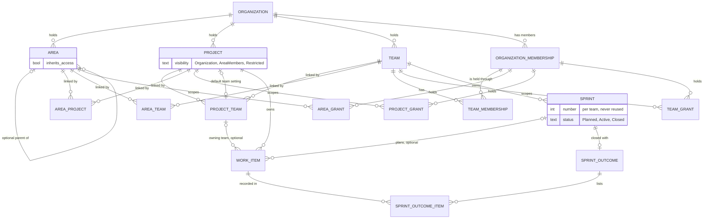

# ADR-0028: Organize an organization as independent areas, projects and teams joined by links, with the organization as the only tenant boundary

- Status: accepted (by the human in chat, at doc-012 gate-1, 2026-10-17)
- Date: 2026-10-16
- Context: `doc-012-matrix-organization-model`, stage 1 (business analysis): [spec](../features/doc-012-matrix-organization-model/spec.md) BR-MX-1..-19, -27, -28, NFR, OQ-1, OQ-2, OQ-4; audits [1](../features/doc-012-matrix-organization-model/audit/1-org-structure.md), [3](../features/doc-012-matrix-organization-model/audit/3-work-items.md), [4](../features/doc-012-matrix-organization-model/audit/4-boards-backlogs.md), [5](../features/doc-012-matrix-organization-model/audit/5-iterations.md); [prior-art](../features/doc-012-matrix-organization-model/prior-art.md) P-1..P-3, P-7, P-8, P-10. Amends [ADR-0024](0024-app-shell-and-visual-language.md) § 2 and [ADR-0026](0026-soft-deactivation-by-status.md) rules 1, 2, 3, 5, 6, 7, 8 and 9. Its access half is ADR-0029 (scoped access), drafted beside it. It goes to the human with the spec at doc-012's gate-1, the nearest gate ([README](README.md), Process 2), and only the human sets `accepted`; the delivery lines implement it and none of them accepts it (spec § Decomposition).

## Problem

Today containment is a chain of mandatory parents, organization → project → {team, area}. Teams and areas carry no organization key, by-id reads are cross-tenant by design and every lock is keyed by project (audit 1). One entity, the per-project area, carries five duties: the item's classification path, team ownership, the creation target, the predicate of a team's backlog, and a delete guard (audits 1, 3, 4). The spec makes area, project and team independent objects of the organization, linked many-to-many. It gives the work item an explicit optional owning team and the team its own sprints (BR-MX-1..-19).
This is decided now because it changes the core schema, the in-process contract nine handlers consume, ADR-0026's reachability and locks, and ADR-0024's addresses, and every delivery line builds on it. The forces: tenant isolation as a database fact (BR-MX-1, P-3); brief § 12, where the database holds what it can; READ COMMITTED with targeted locks (ADR-0011); soft removal (ADR-0026); the NFR volumes; the human's waiver, under which rows may be dropped (status.md); and `docs/conventions/backend.md`, under which a merged migration is never edited.

## Options considered

### Option 1: keep project containment, and share a team into other projects by reference

- Pros: the smallest change. Today's composite keys, reachability chain and addresses survive.
- Cons: it keeps the false hierarchy the brief forbids (§§ 11.6.9, 21.3). A team keeps a home project that scopes its name, page and lifecycle, and deactivating that project hides the team from every other project. An area still cannot span projects, and ownership still rides the area. Rejected.

### Option 2: the area as the container of projects and teams

- Pros: one tree would give navigation, aggregation and inheritance at once.
- Cons: it makes the area a mandatory parent (§ 21.4). A project could not sit in two areas (SC-06), and an organization could not work without areas (§ 3.1.4). The area would become a second tenant-like boundary. Rejected.

### Option 3: independent objects and links, with the tenant checked by handlers only

- Pros: single-column keys and simpler migrations.
- Cons: this is P-3 itself. One forgotten predicate leaks data or links across organizations, and nothing below the handler refuses it. Today's unguarded organization copy on team memberships shows the pattern. Rejected.

### Option 4: independent objects, three link relations and organization-keyed composite keys (chosen)

- Pros: the database refuses a cross-organization link, owning team, sprint, grant or parent. Invariants over pairs become keys, and each object stands alone.
- Cons: every structural relation needs an organization key and composite keys. There is a new lock order, and three link kinds can each be managed from two pages.

## Decision

Option 4, with these rules.

**1. The conceptual model.** It shows entities and cardinalities only, with no columns and no endpoints.

- Every structural object and relation carries its organization: areas, projects, teams, the three link kinds, team memberships, the three grant kinds and sprints. A work item stays keyed by its project, which no structure operation changes (BR-MX-9), and reaches the organization through it.
- A link has no fields beyond its two ends and who made it, when (BR-MX-20). A grant is one relation per scope, not a polymorphic object id, because a polymorphic id cannot carry a foreign key. Team memberships and grants are held through the organization membership.
- The owning team is a reference to the item's project–team link, so it is a linked team by construction. The project default team is a setting that references one of the project's links. The "exactly one linked team" inference is computed at read time and never stored (BR-MX-11).
- Visibility is a closed value on the project, «Организация» at creation (BR-MX-21). A sprint belongs to one team for ever. Its outcome is written once, at close (rule 10).

**2. What replaces mod-002's structure rules (P-1).** The **first team** (`is_first_team`, `FirstTeamId`) and the **per-project root area** (`RootAreaId`) are retired by name. No object has a structural "first" or "root" any more.

| mod-002 rule or story | Fate | Replaced by |
|---|---|---|
| BR-M1-9 (project creates first team + root area; a team creates its child area); US-3's creation half | retired | BR-MX-2: creating a project creates no team, area or membership, and creating a team creates no area. US-3's rename, deactivate and restore are kept |
| BR-M1-11 (one root per project, owned by the first team; every area resolves to a team); US-6 | retired | BR-MX-9: the owning team is stored on the item, and areas own nothing |
| BR-M1-12 (one tree per project, sibling names, no move under a descendant); US-5 | replaced | BR-MX-3, BR-MX-4: one tree per organization with optional parents; top-level areas are siblings; cycle and depth are checked under the tree lock (rule 5); spec US-1 |
| BR-M1-13 (delete a leaf that is no default and holds no item) | replaced | BR-MX-8: the leaf condition stays, held by the parent key; the default and item conditions go with rule 3 |
| BR-M1-14 (team default area; no team context means the root); US-4's default area | replaced | BR-MX-10, BR-MX-11: the project default team. US-4's add and rename move to spec US-2 |
| BR-M1-18 (team delete re-owns areas to the first team); US-7 | replaced | BR-MX-12 and amended ADR-0026 rule 2: unlink with reassignment to «Без команды», applied to every linked project |
| BR-M1-22 (isolation; team and area never move between projects; mod-002 D-w project keys) | replaced | BR-MX-1, BR-MX-5 and rule 4: organization-keyed composite keys. Nothing moves between organizations |
| BR-M1-23 (team set and area tree inside project settings) | replaced | BR-MX-27 and rule 7: every area, project and team has its own page |
| BR-M1-24 (switcher organization → project → team, default first team); US-8 | replaced | BR-MX-28 and rule 7: the organization plus one context object |

**3. The work item keeps no classification pointer (OQ-1, option A).** The item's area pointer is retired, along with its composite key, the card's «Область» field, the list's «Область» column, the path read on every list page, the area-usage delete guard (`IAreaUsage`), and mod-003 BR-M3-23/-24. Of the pointer's two duties, team ownership moves to the owning team and the classification path is dropped, departing from brief § 2 (spec OQ-1). Nothing filters, queries or reports by it today. «Область» then names one thing, the workspace area, and an area reaches items only through its project links. The human chose option A (spec OQ-1, 2026-10-17).

**4. The tenant boundary is enforced by the database (BR-MX-1, P-3).**

- Teams, areas, links, grants, team memberships and sprints carry an organization key. Each referenced table gains the alternate key (organization, id), projects included, which already carry the organization.
- mod-002 D-w's technique moves from the project to the organization. The composite keys are: link ends (organization, project | team | area) → their objects; area parent (organization, parent) → area; grant (organization, object) → object, and grant (organization, user) → organization membership, cascading, so a removed membership ends its grants (BR-MX-20); sprint (organization, team) → team. The team membership's organization copy becomes a real key, (organization, team) → team.
- Inside a project, the keys are: item (project, owning team) → project–team link; item (owning team, sprint) → sprint (team, id); default team (project, team) → link.
- Every by-id read and every lock of an organization-keyed object filters by (organization, id). A project-owned row (a work item, its places, its counter) filters by (project, id), with the project resolved under the organization predicate in the same request. No by-id read is cross-tenant any more (rule 8), and no lock spans organizations.
- A foreign id gets the same answer as one that names nothing, whether the handler or a key catches it. A key violation (SQLSTATE `23503`) maps to that not-found refusal, never to a 500.

**5. Each invariant is held either by the database or by a serialized check.**

| Invariant | Held by | How |
|---|---|---|
| One link per pair (BR-MX-5) | database | The pair is the link's primary key. A link insert ignores an existing pair, and an unlink of an absent pair deletes nothing |
| Unique sibling names, top-level areas included (BR-MX-4) | database | Unique on (organization, parent, normalized name) with NULLs not distinct. This needs PostgreSQL 15+ (the stand runs 18) and closes audit 1's NULL-parent gap |
| No cycle; depth ≤ 10 (BR-MX-3) | serialized check | Every write that changes the tree's shape (create, move, delete) takes the organization's area-tree lock row `FOR UPDATE` (a dedicated row per organization, as `work_item_hierarchy_locks` holds one per project), then reads the destination's ancestors and the moved subtree's height. A constraint cannot see the tree, and a trigger under READ COMMITTED reads the same stale tree that two concurrent moves read. A rename takes no tree lock |
| Delete only a leaf (BR-MX-8) | database | Parent key, Restrict |
| Owning team ∈ the project's linked teams (BR-MX-9) | database + lock | Key onto the link, Restrict. An empty owning team («Без команды») is not checked under MATCH SIMPLE. The write locks the link `FOR SHARE` for a clean refusal, and the key is the backstop |
| Sprint's team = item's owning team (BR-MX-13) | database | Key (owning team, sprint) → sprint (team, id), plus a check "a sprint only with an owning team", which MATCH SIMPLE would otherwise skip |
| Items join only Planned or Active sprints (BR-MX-14) | serialized check | The item write locks the sprint `FOR SHARE` and re-checks its status. Start, close and removal lock it `FOR UPDATE` |
| At most one Active sprint per team (BR-MX-14) | database | Partial unique on (team) where the status is Active |
| Sprint dates come as a pair, finish ≥ start, and both are set once the sprint is past Planned | database | Check constraints |
| The default team is linked (BR-MX-11) | database | Key onto the link, Restrict. The unlink clears the setting before it deletes the link |
| A team's backlog place names the item's current owning team (rule 9) | database | Key (item, team) → item (id, owning team). A change of owning team deletes the place in the same write |
| Unlinking or deleting never cascades to work items (BR-MX-2) | database | Item → link and item → sprint are Restrict, so the domain must reassign first. An area's links and grants cascade from the area row, and nothing hangs below them. Teams and projects are never deleted as rows |

**6. Amendments to ADR-0026.**

- *Rule 1:* a team's name is freed in the organization, not in the project. Links have no status: a link row exists or it does not. Sprints follow rule 9 below.
- *Rule 2:* deleting a team writes its status and, in the same transaction, applies BR-MX-12's unlink with reassignment to every linked project, with «Без команды» as the destination. The items lose their owning team and their pointers to its sprints, their team places are deleted, default-team settings that name the team are cleared, and the links are removed. Its area links, memberships and grants end with it. This is a domain consequence, as re-owning areas was. It reaches the items of deactivated projects too, so a restore never finds an item owned by a deleted team. The team's sprints keep their rows and outcome records. Its Closed sprints and their outcomes stay readable, read-only, on the «Спринты» of the projects whose items they record (BR-MX-14, § 10 *The archive read*); its Planned and Active sprints hold nothing once the pointers are cleared, and no surface reaches them. Deactivating or restoring a project still writes one row, and its links, default-team setting, places and grants come back exactly.
- *Rule 3:* each object's containers are: for a project, a team and an area, the organization (an area has no status); for a sprint, its team; for a link, both of its ends; for a work item, its project. A deactivated project's links stay stored and inert. The project leaves its teams' and areas' link lists, views, counters and the switcher, and its items leave team, sprint and area views. Linking to the project answers «Проект не найден». Its links cannot be addressed until restore, except by a team or area deletion, which removes them. Closing a sprint moves the deactivated project's unfinished items like any others and records its completed ones. The confirmation counts only the items the actor may see (BR-MX-21).
- *Rule 5:* the not-found levels are the organization, then the one object the address names (§ 7, *Not found*), then the ids that object owns: for a team its sprint, for a project its work item. "Deactivated" and "deleted" are still never revealed, the restore exception stands, and a project the caller may not see counts as missing (ADR-0029 § 8).
- *Rule 6,* index table, replacing the team and area rows:

| Rule | Index |
|---|---|
| Team name per organization, freed on delete | unique on (organization, normalized name) where the status is Active |
| Area name among siblings, top level included | unique on (organization, parent, normalized name), NULLs not distinct |
| Sprint name per team, kept for ever | unique on (team, normalized name), all rows |
| Sprint number per team, never reused | unique on (team, number), fed by a per-team counter |
| One grant per user and object, per scope | unique on (object, user) |

- *Rule 7:* the status stays the cross-module contract for every removal but two. The team deletion (rule 2) and the unlink with reassignment (BR-MX-12) change other modules' rows in their own transaction, and the Organizations handler owns both. It calls one in-process write contract per owning module, kept at that module's root beside its read contract. Work items reassign a project's items from one team to another, or to none, and clear their sprint pointers. Boards delete those items' team places. `mod-007-iterations` adds its open-sprint step. Each call locks its own rows in *Rule 8*'s order and joins the caller's transaction; no module writes another module's tables. This is a narrow exception to ADR-0026 rule 7's "does so in its own write path": hiding at read time cannot move rows that BR-MX-12 must move in one transaction.
- *Rule 8,* concurrency (ADR-0011 echelon 3). Binders now lock by organization. A write that binds something to a team locks `teams` by (organization, id) `FOR SHARE`: a project or area link, a sprint's creation, start, close or removal, a membership, a team grant. A write that binds a work item to a team in a project locks the project–team link row by (organization, project, team) `FOR SHARE`: a create or save that sets the owning team, or setting the default team. The unlink locks that row `FOR UPDATE`. Sprint rows are locked `FOR SHARE` by item joins and `FOR UPDATE` by start, close and removal. **One lock order:** (1) the organization's area-tree lock; (2) team rows; (3) project–team links, by project id, then team id; (4) sprints, by id (a close takes its sprint and its destination together), then the team's sprint counter row; (5) work items, by id, with the project's number and hierarchy lock rows keeping mod-003's place beside them; (6) team or project order rows. A write takes only what it needs, in this order, and re-reads what it checks after locking. Applied to each case:
  - *Item save:* the link and the sprint its body names are locked before the item row. This changes mod-003's order, and the owning-team line tests it both ways.
  - *Unlink:* the unlinked link `FOR UPDATE` and the destination's link `FOR SHARE`, in team-id order, re-checking that the destination is still linked (deleting the destination needs its link `FOR UPDATE`, so the share holds it); then the team's open sprints, then the reassigned items by id, then the team's order rows. With «Без команды» as the destination there is no second link.
  - *Sprint close:* the team `FOR SHARE`, then the closing sprint and its destination `FOR UPDATE` together, by id, then the items by id. After locking it re-reads the team's status, the sprint's state and the destination's state.
  - *Link creation:* the team `FOR SHARE`. The project's status is only read, as rule 8's first bullet allows, and the area is guarded by its key.
  - *Team deletion:* the team `FOR UPDATE`, then the unlink's steps per linked project, deactivated ones included, by project id. «Без команды» is the destination, so no destination link is locked.

  Each NFR race then ends in one order and no server error; the later request is refused, or completes on what the earlier one left:
  - *Unlink vs a save that sets that team:* a save that locks the link first commits, and the unlink, re-reading under its lock, reassigns it too; a save that locks it second finds no link and is refused, and the key backs it.
  - *Two unlinks in one project, or an unlink vs its destination's unlink or deletion:* the team-id order serializes them; the later one re-reads and is refused if its destination is no longer linked.
  - *The sprint races* (a close against a save into the sprint, the removal of its destination, an unlink or deletion of its team or a save that changes one of its items' owning team; a removal against a save into the sprint) are serialized by the team row and the sprint rows. § 10 *Sprint races* names the lock, the request that re-reads and the result of each. The result is one order and no server error, which is not always a refusal.
  - *A link vs a team deletion:* `FOR SHARE` queues against `FOR UPDATE`.
  - *A link vs an area deletion:* the deletion cascades a link that committed first, and a link inserted after the deletion fails as not found.
  - *Two moves that would form a cycle:* the tree lock serializes them.
- *Rule 9:* the iteration clause is superseded. A sprint goes Planned → Active → Closed, and Closed is terminal. There is no Removed status: a Planned sprint that holds no item outside «Удалена» is deleted outright after clearing those items' pointers (the item key, Restrict, refuses one that still has items, a deactivated project's included), and its number stays used.

**7. Amendment to ADR-0024 § 2.**

- *Addresses:* the panel has four prefixes. `/organizations/:o/…` serves the organization, including the lists `…/areas`, `…/projects` and `…/teams`. The others are `/organizations/:o/areas/:areaId/…`, `/organizations/:o/projects/:projectId/…` and `/organizations/:o/teams/:teamId/…`, each with its own sections and `…/settings`. A team is never under a project, and no prefix nests one object under another. Owned objects stay under their owner: a work item under its project, a sprint under its team (`…/teams/:teamId/sprints/:sprintId`, in the panel and the API). A sprint id of another team answers «Спринт не найден.», as one that names nothing does. The API follows the same principle: a team or an area is addressed under the organization alone.
- *Work items:* a work item keeps `…/projects/:p/workitems/:identifier`. On a team or area view the card opens over the page by `?workitem=<identifier>` and is read in the item's own project, which every row carries. The identifier is unique in the organization, because keys are unique there (BR-M1-1).
- *The switcher:* it holds the organization plus at most one area, project or team, never three nested levels (BR-MX-28). It shows one list grouped by kind, holding only objects the user may see: the organization alone first, then the user's own teams, then the areas, the projects and the other teams, each group by name, an area shown with its path (BR-MX-27). Choosing another object of the same kind keeps the section, so one team's board leads to another team's board. An object of another kind opens at its overview. The choice is remembered per user in the browser, and an address that names an object sets it. A vanished object falls back to the organization alone, with a notice.
- *Breadcrumbs:* organization › «Области», «Проекты» or «Команды» › the object › the section. An area's trail shows its ancestor areas, because that hierarchy is real and area names are unique only among siblings. A link never appears in a trail.
- *Not found:* the outermost missing level answers. That is the organization first, then the one object the address names: «Проект не найден», «Команда не найдена» or «Область не найдена».
- *Old addresses:* `…/projects/:p/teams/:t/(boards|backlogs)/:level`, `…/projects/:p/settings/teams/:t` and `…/projects/:p/settings/areas` are retired, with no redirect. `…/projects/:p/settings/teams` stays as the project's linked teams (link, unlink, default mark) until the navigation line moves it; `/organizations/:o/settings/projects[/deactivated]`, `…/settings/members` and `…/projects/:p/settings/general` move to `…/projects`, `…/members` and the project's «Общие» and «Настройки», and the navigation line retires the old ones the same way. The panel answers each with «Страница не найдена», whether or not the user may see `:p`, from the line that retires it: `feat-040-team-surfaces-across-projects`, `feat-028-org-level-teams` and `mod-018-area-workspace`. A redirect would keep the nesting alive in the panel's routes, and under the human's waiver (spec § Existing data) the team and area ids these addresses carry need not survive, so most redirects would land on a not-found anyway. The organization-settings pages that feat-028 and `mod-018-area-workspace` add in the meantime, and the project-settings pages that the lines before it add (area links, default team), are retired the same way when `feat-043-area-project-team-navigation`, which follows `mod-018-area-workspace` (delivery order amended by doc-013, 2026-10-18), moves them onto the objects' own pages. The lines after it add no interim page: grants, visibility, area views and sprints arrive as sections of those pages, `…/teams/:t/sprints` and `…/projects/:p/sprints` among them. The API keeps no aliases either, because the panel is its only client, and each line notes its break (P-10).

**8. The in-process structure contract.** `IOrganizationStructure` keeps its place at the module root and its rules: reads only, scoped, no access check, no event. Its members are replaced:

- *Removed:* `FirstTeamId`, `RootAreaId`, `DefaultAreaId`, `IsFirstTeam`, `TeamInfo.ProjectId`, `FindAreaOwnerAsync`, and `ListActiveTeamsAsync(projectId)`.
- *Added:* every method takes the organization id, and an object of another organization reads as null:
  - the project, with its status, reachability, visibility and resolved default team (BR-MX-11, resolved in this one place);
  - the team, with its status and reachability;
  - a project's linked active teams;
  - a team's linked reachable projects;
  - the area-to-projects resolution: the distinct reachable projects linked to an area and, on request, to its descendants;
  - an area's subtree, for filters where an area matches itself and its descendants (doc-001 BR-15).
- *What the slices read instead:*
  - Creation reads the project's default team and the parent's owning team and checks the latter against the linked teams (BR-MX-10).
  - Reads of one item, of the list, of parent candidates and the parent write read the project alone. Visibility is applied by ADR-0029's policy.
  - Team views read the team and its linked projects. Project views read the project. Area views read the area-to-projects resolution.
  - Writes lock through their own repositories, in rule 6's order, and never through this contract. A write that changes another module's rows goes through that module's write contract (§ 6 *Rule 7*).

**9. View order.** The team order and the project order are stored apart. A team place holds (team, level, position), at most one per item, and exists only while that team owns the item (rule 5). A project place holds (project, level, position), one per item. Each order has its own lock row, per (team, level) and per (project, level). Reordering one never touches the other (BR-MX-18).

- *A change of owning team:* a save, an unlink or a team deletion deletes the item's team place in the same write. The item then arrives unplaced on the destination team's backlog, or on no team backlog, and its project place is untouched.
- *Area links and project deactivation:* unlinking an area, or linking or unlinking a team to an area, touches no place. Project deactivation keeps both kinds of place.
- *Unplaced items:* they follow the placed ones, by creation time, then by identifier (project key, then number). Items of different projects therefore never tie. This replaces the per-project number tie-break.
- *Area and sprint views:* area views have no order storage. They sort by a chosen column, with the same tie-break. Sprint views use the team order.

**10. Sprint storage.**

- *The stored sprint:* a sprint stores its team, its number, its name, its status (Planned, Active or Closed), its optional dates, and when and by whom it was started and closed. Numbers come from a per-team counter row, as `work_item_counters` serves item numbers. Sprint creation locks the team row `FOR SHARE` (§ 6 *Rule 8*), so it queues behind a deletion, and then that counter row `FOR UPDATE`, after the sprints of step (4). A started sprint always has both dates (§ 5), and a Closed sprint's dates never change (BR-MX-14); the handler checks the second under the sprint's lock. The default name is «Спринт <n>», and a rename keeps the number (BR-MX-15).
- *The outcome record:* closing writes it in the same transaction. It is one row per sprint item in the Completed category at close, a deactivated project's included, holding the item, its project and its story points as they were at close. Nothing updates or deletes it. Its figures are summed after visibility (BR-MX-21), which is why each row keeps its project, and a deactivated project's rows count on no figure until it is restored (BR-MX-14).
- *The archive read:* a Closed sprint's outcome stays readable after its team is deleted (BR-MX-14, the human's answer at gate-1). A project's «Спринты» reads the outcome rows led by the project, joins each row's sprint and its team whatever the team's status, and lists the Closed sprints that record the project's items, the latest closed first, a deleted team's marked «команда удалена». The list shows the outcome inline: a sprint of a deleted team has no page of its own, because its team's address answers «Команда не найдена». It is a read of the project, so the policy applies it after visibility, and a project the caller may not see answers «Проект не найден».
- *Sprint races* (BR-MX-14). Every sprint write locks the team row `FOR SHARE`, then the sprint rows `FOR UPDATE` by id, a close taking its sprint and its destination together. An item write locks the link, then the sprint `FOR SHARE`, then the item (§ 6 *Rule 8*). The request that locks second re-reads, and ends in one of these results, never in a key violation or a deadlock:
  - *Close vs a save into the sprint:* a close that committed first makes the save re-read Closed and be refused. A save that committed first leaves the item in the sprint, and the close moves or records it.
  - *Close vs the removal of its destination:* both lock the destination `FOR UPDATE`. A removal first refuses the close as «Спринт не найден.». A close first, if it moved items in, makes the removal re-read and be refused; if it moved none, the removal proceeds.
  - *Close vs a team deletion:* the deletion holds the team `FOR UPDATE` and the close its `FOR SHARE`. A deletion first refuses the close as «Команда не найдена.». A close first completes, and the deletion then clears the pointers of what remains.
  - *Close vs an unlink:* both lock the team's open sprints and then the items, in the same order. Neither is refused: whichever is second re-reads, so the close moves or records only the items still in the sprint, and the unlink reassigns every item wherever the close left it.
  - *Close vs a save that changes the owning team of one of its items:* the item row serializes them. Neither is refused: the item is either moved or recorded by the close and then given its new team with no sprint, or left out of the close because the save cleared its sprint first.
  - *Removal vs a save into the sprint:* a removal first refuses the save as «Спринт не найден.». A save first makes the removal re-read, find the item and be refused, and the key (Restrict) backs it.
- *History and metrics:* feat-015's history will record pointer changes and sprint acts, but the outcome record is not derived from history and does not wait for it. The history-derived metrics ADR owed by mod-012 must take a closed sprint's completed set, and so velocity, from this record, and use history only for curves inside the sprint (burndown, scope change). A replay that disagrees never rewrites the record.

**11. Process scope (OQ-2, option A).** One process per organization stays (mod-002 BR-M1-3), so every view shows that process's columns. If processes later become per project, nothing here blocks it: each project would reference one process of its organization through an organization-keyed key, and the "one per organization" unique would go. The shared-view columns that BR-MX-19 leaves to that line then come from the set of projects a view *can* show and the user may see — the team's linked projects, the area's resolved projects, or the project itself — not to the items of the current page or filter, so columns never jump. When one process covers that set, the columns are its states per type. Otherwise the columns are the state categories (doc-001 BR-2), each card shows its own state, and a move offers its own type's states in its own project's process.

**12. The data drop (OQ-4, option A).** Each line adds migrations on top that change the schema and delete the rows they do not map. No merged migration is edited, and no baseline is regenerated: regenerating one would rewrite merged history, break the migration tests and force the human's stand to be recreated. A line whose base gains migrations before it merges, such as after feat-018, regenerates its own unmerged migrations on the fresh snapshot (`docs/conventions/backend.md`). Each line's MR lists the tables it empties. What each line may drop is in the Consequences table.

**13. Volumes and index directions,** sized for 1 000 areas over 10 levels, 200 projects, 200 teams, 10 000 grants and 100 000 items per organization:

- *Led by organization:* teams, areas, links, grants and sprints lead their composite keys with the organization. Each grant kind has (organization, user), the policy's read of what a user holds.
- *Led by owning team:* items by (owning team, type) serve team views across all of a team's projects, and items by (owning team, sprint) serve sprint views and the sprint key.
- *Led by project:* items by (project, type) serve project views and project-set reads. Items by (project, owning team) serve the link key's delete check and the unlink's reassignment.
- *Led by link:* each link kind is indexed in both directions: area → project and project → area, area → team and team → area, project → team and team → project.
- *Area subtrees:* they are resolved in the database by a recursive read over (organization, parent), at most 10 levels deep, returning ids only. There is no stored path or closure table: at 1 000 nodes a recursive read is cheap, and a stored path would make every move rewrite its subtree under the tree lock. Aggregation («Включая дочерние области») walks the whole subtree. Inheritance (BR-MX-22, ADR-0029) walks down from the granted areas and stops at an area whose «Наследовать доступ» is off. The two walks are separate.
- *An area view:* it resolves its project set once (at most 200 ids, deduplicated, so each item appears once, BR-MX-16). It then reads the items of that set, sorted top-N and paged by 50. This fits 2 s at 50 000 items with no organization column on work items.

**Departures from `docs/conventions/*`:** none under OQ-4 (A), which gate-1 chose on 2026-10-17. Option B would have departed from backend.md's never-edit rule and been recorded here.

## Consequences

- **Simpler:** a cross-organization reference cannot be stored at all. Ownership, the sprint match, link uniqueness and the default team are keys, not code paths. An item has one explicit owner, so implicit moves through area edits end. Teams and areas stand alone, with no first team or root area to protect.
- **Harder:** composite keys on every structural relation. A six-step lock order that every write follows and review checks (ADR-0011), including a changed item-save order. The panel's context model, switcher and addresses are rewritten, and the old project-nested addresses stop working: they answer «Страница не найдена».
- **Locked in:** the organization as the only tenant boundary; links with no fields; the owning team as a reference to the link; sprints keyed by team, with team-scoped numbers; outcome records that never change; no classification pointer on items.
- **Amends:** ADR-0024 § 2 and ADR-0026 rules 1, 2, 3, 5, 6, 7, 8 and 9. The nested-id chain of ADR-0027 rule 3 becomes: organization, then a project, team or area in it, then a work item in its project or a sprint in its team; ADR-0029 records this with the codes. When this ADR is accepted, the index lines of ADR-0024 and ADR-0026 get "amended by ADR-0028".
- **Retires or replaces:**
  - Every rule that the spec's fate table marks retired or replaced with BR-MX-1..-19, -27, -28 or this ADR as its successor. That table is the authority, and this list does not repeat it.
  - mod-002 api-contract § 7 is rewritten. Each line notes the break in mod-002's status.md (P-10).
- **The delivery lines must implement:**

| Line | Implements | May drop |
|---|---|---|
| `feat-039-project-board` | project places and their order rows (rule 9) | nothing |
| `mod-017-work-item-owning-team` | the owning-team reference with its key, first onto the project's own teams; the default-team setting; the contract changes of rule 8 except the area reads; team places keyed to the owner; the item-save lock order | team places; the area owner and default markers |
| `feat-028-org-level-teams` | the organization key on teams and team memberships; the project–team link with the owning-team and default keys moved onto it; unlink and deletion (rule 6, rules 2 and 8); the team-name index; the retired project settings' team pages `…/settings/teams/:t`, while `…/settings/teams` stays as the project's linked teams (rule 7) | teams, team memberships, team order rows and places, owning teams |
| `feat-040-team-surfaces-across-projects` | team views led by owning team; the tie-break; team addresses, with the project-nested ones retired, and an interim switcher team level that lists the organization's teams whatever project is chosen (rule 7) | nothing |
| `mod-018-area-workspace` | the organization area tree, the sibling index, the tree lock and depth check, the area links, the area-to-projects resolution, rule 3; the retired project settings' areas address (rule 7) | every per-project area and the item's area pointer |
| `feat-043-area-project-team-navigation`, right after `mod-018-area-workspace` (doc-013, 2026-10-18) | the rest of rule 7: the organization's lists, the object pages, the switcher and breadcrumbs, the team and area pages moved out of the organization settings, the project's linked teams, area links and default team moved out of the project's settings, and the organization settings' project list and members page and the project's general settings moved to `…/projects`, `…/members` and the project's «Общие» and «Настройки», whose old addresses are retired; the lines below add their sections to its pages | the remembered client context |
| `mod-019-scoped-access` | the three grant relations with their keys (ADR-0029) | nothing |
| `feat-041-project-visibility` | the visibility value (rule 1) | nothing |
| `feat-042-area-board-and-overview` | unranked area views and aggregation (rules 9, 13); the area prefix for its views | nothing |
| `mod-007-iterations` | rule 10, the sprint invariants of rule 5, and the sprint steps of the rule 6 lock order | nothing (no sprint data exists) |

- **Revisit when:**
  - Area resolution shows up in the 500 ms single-item budget. Then consider a closure table maintained under the tree lock.
  - An organization-wide item list misses 2 s. Then consider an organization key on work items, guarded by a key onto the project.
  - Processes become per project (rule 11).
  - Links need fields, such as a role or a period.
