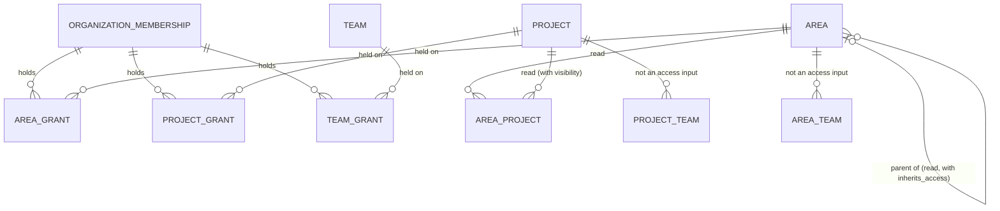

# ADR-0029: Compute effective permissions once, from organization, area, project and team scopes over the membership-derived codes

- Status: accepted (by the human in chat, at doc-012 gate-1, 2026-10-17)
- Date: 2026-10-16
- Context: `doc-012-matrix-organization-model`, stage 1 (business analysis): [spec](../features/doc-012-matrix-organization-model/spec.md) § Roles, BR-MX-20..-26, NFR, OQ-3; stories [US-5](../features/doc-012-matrix-organization-model/stories/US-5-scoped-roles-and-memberships.md) and [US-6](../features/doc-012-matrix-organization-model/stories/US-6-project-visibility.md); [audit 2](../features/doc-012-matrix-organization-model/audit/2-access.md), [audit 3](../features/doc-012-matrix-organization-model/audit/3-work-items.md); [prior-art](../features/doc-012-matrix-organization-model/prior-art.md) P-4, P-5, P-10. **Extends and amends [ADR-0027](0027-organization-access-from-membership.md)**. It reads the model of [ADR-0028](0028-matrix-organization-model.md): the area tree, the links, the grant relations and visibility. It goes to the human with the spec at doc-012's gate-1, the nearest gate, and only the human sets `accepted` (`docs/adr/README.md`, Process 2); the delivery lines implement it, `mod-019-scoped-access` most of it, and none of them accepts it (spec § Decomposition).

## Problem

ADR-0027 derives every organization code from one role per membership. The role is checked once per request, from the organization id in the address. Below the organization nothing narrows access, and every list read ignores the caller (audit 2). The matrix model needs roles held on an area, a project or a team, area inheritance that can be cut off, and a project visibility that removes a project from every surface (BR-MX-20..-25). That is ADR-0027's own "revisit when" condition.
The forces are these. There must be no second model beside ADR-0027 (P-5), and one rule for every read, counter and search (P-4). The result must not depend on order (brief § 10.4 item 6). A change takes effect on the next request, with no Keycloak and nothing in the token (ADR-0027 rules 1 and 3). A single-item read with its check stays within 500 ms at 10 000 grants and 1 000 areas (spec § NFR). The answer order must not disclose a hidden project, and ADR-0027 rule 4's "403 before a nested 404" cannot give that. Finally, the word "scope" already names a code's origin (`PermissionScope`), not where the code applies.

## Options considered

### Option 1: scoped roles in Keycloak (groups per area, project and team, or Authorization Services)

- Pros: the console would show every assignment.
- Cons: ADR-0027 rejected both options for organization roles (Options 1 and 2), and the reasons only grow at a finer grain: a Keycloak write per grant, tokens that go stale, tokens that grow with every object. tech-024 also puts MUSTASK in a company-wide realm that admits only clients and client roles. Rejected.

### Option 2: a second authorization model beside ADR-0027

Project and team role tables, with their own checker and hard-coded role names, next to the membership check. This is what the rejected attempt built (P-5).

- Pros: mod-016's code stays untouched.
- Cons: one question gets two answers. A route checked by one model and a list filtered by the other disagree: lists, single items and search showed Restricted projects (P-4). It needs two inventories, or ends up with none. Rejected.

### Option 3: materialized effective permissions

A table of (user, object, code), rebuilt on every membership, grant, link, parent, inheritance or visibility change.

- Pros: the check and every filter become one join on an indexed table.
- Cons: one area move or one inheritance switch rewrites rows for every grantee of a subtree of up to 1 000 areas, times their linked projects. To keep "next request", the rebuild must run inside the transaction of every structural write and race with concurrent grant writes (NFR Concurrency). The rule would then live twice, in the writer and in its readers. At the spec's volumes the computed form costs one statement. Rejected now; it is the fallback named under "Revisit when".

### Option 4: custom roles, per-code grants or deny entries

- Pros: it can express any policy.
- Cons: the spec puts it out of scope. A deny makes the result depend on precedence, so BR-MX-23's "whatever their order" fails, and per-code grants leave the matrix test unbounded. Rejected.

### Option 5: extend ADR-0027 with fixed bundles per scope, grants held through the membership, and one evaluator per request (chosen)

- Pros: one catalog, one source (the membership), one check and one inventory. Codes are only added, so the result is deterministic. Nothing is in the token, and a change is effective on the next request because nothing outlives the request.
- Cons: the check reads more than one row: the caller's grants and the addressed object's area chain. Every list, counter and search must join the caller's access, which today's read models do not take. The panel needs codes per object.

## Decision

Option 5. ADR-0027 stays the model; this ADR adds the scopes below the organization and amends the rules named in § 1.

**1. What changes in ADR-0027.**

| ADR-0027 rule | Fate |
|---|---|
| 1 Two kinds of code, one catalog | **Stands**, with § 2's rename. The membership stays the only source of organization codes, through its organization role or through a grant it holds (§ 5). Organization codes are never in the realm import or the token, and the realm contract test still compares instance codes only |
| 2 The bundles | **Amended.** `admin`, `member` and `viewer` keep their stored names, but their bundles change per § 4. "A user's codes are exactly their bundle" gives way to § 6. Area, project and team roles are added (§ 3). Team membership still grants no code |
| 3 One check from the address | **Amended.** The check resolves every id in the path, not only `organizationId`, and computes the effective codes in one statement (§ 7). The nested chain becomes: organization, then a project, team or area in it, then a work item in its project or a sprint in its team (ADR-0028). These stand: the membership is read per request and cached nowhere beyond it, and no check calls Keycloak or reads the user projection |
| 4 Not found for non-members | **Amended** (§ 8). "Not found" also covers a project the caller may not see, and the path's not-found answers come before the 403. The instance administrator still sees no content |
| 5 Codes served to the panel | **Amended** (§ 10): codes are served per object |
| 6 The ownership predicate | **Stands**, as step 6 of § 6 |
| 7 The realm inventory | **Stands.** No scoped role or grant enters the realm, and no area, project or team either (consistent with tech-024) |
| 8 Moving an existing store | **Stands.** Nothing in the realm changes, so there is no live-realm step. The rows the lines rework may be dropped (spec § Existing data) |

**2. Terminology: source and scope.**

- `PermissionScope` is renamed **`PermissionSource`**, with its values unchanged. `Instance` means the token. `Organization` means the organization membership, directly or through a grant. "Instance code" and "organization code" keep ADR-0027's meaning.
- **`ResourceScope`** is new: `Organization`, `Area`, `Project` or `Team`, the kind of object a code is checked on. Every organization code has exactly one resource scope, and instance codes have none. A work item, its project's backlog and its card are checked on the item's project. A sprint and a team's backlog are checked on the team.
- From here on, "scope" in documents means the resource scope only. The panel's `PermissionScope` (`instance | organization | project | team`) becomes `instance` plus the four resource scopes.
- A **grant** is one role of one scope, held by one organization membership on one area, project or team. An area's participants are the users whose grants reach it (§ 6, Reach): held on the area itself (direct) or on an ancestor it inherits from (inherited), as the spec's glossary and US-5 define them.
- The **`organizations.area.*`** codes follow the word "area" to the workspace areas of ADR-0028: `.read` reads the tree and the area pages, and `.write` changes an area. They stop meaning the per-project tree, which OQ-1 (A) retires.

**3. Fixed role bundles per scope.** Roles are closed enums. Each role's bundle is an explicit set in the domain, as in ADR-0027 rule 2. There are no custom roles, no editable bundles and no deny.

| Scope | Stored roles | UI names |
|---|---|---|
| Organization | `admin`, `member`, `viewer` | «Администратор», «Участник», «Читатель» |
| Area | `reader`, `editor`, `manager` | «Чтение», «Изменение», «Управление» |
| Project | `reader`, `editor`, `manager` | «Чтение», «Изменение», «Управление» |
| Team | `planner`, `manager` | «Планирование», «Управление» |

**4. The permission matrix.** The table lists the organization codes after this ADR. The marks are: `+` holds; `°` holds only on a project whose visibility is «Организация»; `–` does not hold. A role's codes of another scope apply only where its grant reaches (§ 6). An area role's project codes therefore apply to the linked projects it reaches, never to a «Ограниченный» one.

| Code | Scope | Org A M V | Area Ч И У | Project Ч И У | Team П У | Covers (brief § 10.2) |
|---|---|---|---|---|---|---|
| `organizations.organization.read` | O | + + + | – – – | – – – | – – | the organization, its served access |
| `organizations.organization.write` | O | + – – | – – – | – – – | – – | rename |
| `organizations.organization.deactivate` | O | + – – | – – – | – – – | – – | deactivate, restore, the deactivated list |
| `organizations.membership.read` | O | + + + | – – – | – – – | – – | members |
| `organizations.membership.write` | O | + – – | – – – | – – – | – – | members and their roles (`permissions.manage`, organization part) |
| `organizations.project.create` *(new)* | O | + – – | – – – | – – – | – – | create a project |
| `organizations.project.deactivate` | O | + – – | – – – | – – – | – – | deactivate, restore, the deactivated list |
| `organizations.team.read` | O | + + + | – – – | – – – | – – | teams, their members and pages |
| `organizations.team.create` *(new)* | O | + – – | – – – | – – – | – – | create a team |
| `organizations.team.delete` *(new)* | O | + – – | – – – | – – – | – – | delete a team (BR-MX-12) |
| `organizations.area.read` *(redefined)* | O | + + + | – – – | – – – | – – | the area tree, area pages, links |
| `organizations.area.create` *(new)* | O | + – – | – – – | – – – | – – | a top-level area; a move to or from the top level, and «Наследовать доступ» on a top-level area (BR-MX-3) |
| `process.definition.read` | O | + + + | – – – | – – – | – – | the process |
| `iterations.sprint.read` *(new)* | O | + + + | – – – | – – – | – – | sprints; their items per § 6 |
| `organizations.area.write` *(redefined)* | A | + – – | – – + | – – – | – – | name, description, move, «Наследовать доступ», child areas, delete (`area.manage`) |
| `organizations.area.link` *(new)* | A | + – – | – – + | – – – | – – | the area's end of a link |
| `organizations.area.grant` *(new)* | A | + – – | – – + | – – – | – – | the area's grants |
| `organizations.project.read` *(rescoped)* | P | + ° ° | + + + | + + + | – – | seeing the project at all (§ 6, step 3) |
| `organizations.project.write` *(narrowed)* | P | + – – | – – – | – – + | – – | name, description, default team (`project.manage`) |
| `organizations.visibility.write` *(new)* | P | + – – | – – – | – – + | – – | the project's visibility |
| `organizations.project.link` *(new)* | P | + – – | – – – | – – + | – – | the project's end of a link |
| `organizations.project.grant` *(new)* | P | + – – | – – – | – – + | – – | the project's grants |
| `workitems.workitem.read` | P | + ° ° | + + + | + + + | – – | `workitem.read` |
| `workitems.workitem.write` | P | + ° – | – + + | – + + | – – | `workitem.create`, `.update`, `.assign`, `.change_status`; the owning team; the item's sprint |
| `workitems.link.write` | P | + ° – | – + + | – + + | – – | parent and child |
| `boards.projectbacklog.reorder` *(new)* | P | + ° – | – – – | – + + | – – | the project's backlog order |
| `organizations.team.write` *(narrowed)* | T | + – – | – – – | – – – | – + | name, description, members (`team.manage`) |
| `organizations.team.link` *(new)* | T | + – – | – – – | – – – | – + | the team's end of a link |
| `organizations.team.grant` *(new)* | T | + – – | – – – | – – – | – + | the team's grants |
| `boards.backlog.reorder` *(rescoped)* | T | + + – | – – – | – – – | + + | the team's backlog order |
| `iterations.sprint.write` *(new)* | T | + – – | – – – | – – – | + + | create, rename, date, start, close, remove a sprint (`sprint.manage`) |

- **Link management** is one code per end, `*.link`, because a link joins two scopes. Creating a link needs the code on both ends; removing an area link needs it on either end (BR-MX-6). A project–team unlink needs both, because it reassigns items (BR-MX-12). A move away from a parent and a change of «Наследовать доступ» also check `organizations.area.write` on the area's current parent, or `organizations.area.create` when the area is top-level (BR-MX-3).
- **Grant management** (`permissions.manage`) is `organizations.membership.write` for the organization, plus `*.grant` for each scope. `area.manage`, `project.manage` and `team.manage` are the «Управление» bundles.
- **An object's grants and participants** are read with its read code: `organizations.area.read`, `organizations.project.read`, `organizations.team.read`.
- **`workitem.delete`** maps to no code, because no operation removes an item yet. The line that ships removal registers `workitems.workitem.delete` (scope P) and places it in this matrix.
- **`workitems.workitem.write` stays one code.** No bundle holds create, update, assign or a status change without the others, and a code enters the catalog with the first check that needs it (ADR-0027 rule 1).
- **Retired names:** the old meanings of `organizations.project.write` (create), `organizations.team.write` (create, delete, the default area), and of `organizations.area.*` as the per-project tree. `boards.backlog.reorder` keeps its holders on every team's backlog, the «Участник» role included, and adds the team's planners and managers: no reorder a user has today is taken away (spec § Roles; brief § 17). The project backlog's order is the new `boards.projectbacklog.reorder`, held by the same organization roles on a «Организация» project (spec: mod-006 BR-M4-27 replaced by scoped codes). doc-004's analysis names (`iterations.iteration.*`, `iterations.team-settings.write`) are never registered.

**5. Grants.**

- Only an active organization membership holds a grant. ADR-0028 rule 4 keys the grant onto the membership, with cascade, as for team membership (mod-016 BR-M1-10). Removing the membership therefore ends every grant in the same operation, and a grant written concurrently loses (BR-MX-20; BR-M1-36 extended).
- A membership holds at most one grant per object. Changing the role replaces it, and the grant records who granted or changed it, and when (BR-MX-20).
- A grant ends with its object: deleting an area or a team ends the grants on it. Deactivating a project keeps them, and restoring it brings them back (ADR-0026 rule 2).
- The holder of the object's `*.grant` code may give any role of that scope to any active member of the same organization (BR-MX-1).
- Team membership grants nothing, and a team grant does not require team membership. Neither one changes any work item (BR-MX-26). Both take effect on the next request.
- BR-M1-4 counts organization admins only, and no scope has a "last manager" rule. An area, a project or a team may be left with no manager, because the organization admin manages every object (§ 6, step 2).

**6. The effective-permissions algorithm (BR-MX-21..-23).** *(Superseded in part by [ADR-0031](0031-typed-area-tree.md), accepted 2026-10-29; rule 7 (mod-018, 2026-10-28): area–project links leave the inputs; project reach comes from the grants that reach the project's node.)* The algorithm reads only these inputs: the caller's membership and organization role; the caller's grants in the organization; the area tree with each area's inheritance switch; the area–project links; the addressed project's visibility; and the statuses that decide reachability (ADR-0026 rule 3). Project–team and area–team links are not inputs. No grant passes through a team or through a shared project, so no link can widen access (BR-MX-7, BR-MX-22; SC-05).

**Reach.**

- An area grant on area `a` reaches `a`. It also reaches each child of an area it reaches, as long as that child's «Наследовать доступ» is on. Put the other way round, the area grants that reach `x` are those held on `x`, plus, when `x` inherits, those that reach its parent. The walk follows parent pointers, which form a tree at most 10 levels deep (BR-MX-3, ADR-0028 rule 5). It ends, and the query bounds its depth anyway.
- The grants that reach project `p` are those held on `p`, plus the area grants that reach any area linked to `p`. When `p` is «Ограниченный», only the grants held on `p` count.
- The grants that reach team `t` are those held on `t`. A team grant reaches nothing else, not even the items of the team's projects.
- A grant gives an object only those codes of its bundle whose resource scope is the object's scope.

**Steps.** For caller `u`, code `c` of scope `s` and the addressed object `x` (for scope P, `x` is the project the object belongs to), the first step that decides wins:

1. **Membership.** No active membership in an active organization: «Организация не найдена».
2. **Organization admin.** The role `admin` holds every organization code on every reachable object, whatever its visibility (OQ-3, option A). Go to step 6. The not-found answers of § 8 items 3-4 still come first.
3. **Visibility gate,** for scope P and anything inside a project. Project `p` is visible when it is «Организация»; when it is «Участники областей» and `u` holds a grant on `p` or an area grant that reaches an area linked to `p`; or when it is «Ограниченный» and `u` holds a grant on `p`. Otherwise, and when `p` is missing, deactivated or of another organization: «Проект не найден».
4. **Union.** Take the codes of scope `s` in the organization role's bundle; for scope P, only when `p` is «Организация». Add the codes of scope `s` of every grant that reaches `x`.
5. **The code.** If `c` is not in the union: 403 «Недостаточно прав».
6. **The ownership predicate** of ADR-0027 rule 6, for a code that has one. It may only refuse.

**Properties held by tests.**

- **Additive only.** The union is commutative, associative and idempotent over sets, with no deny and no precedence. The same inputs give the same codes in any order (BR-MX-23; US-5 "The order of the grants").
- **The gate and the union agree.** Every bundle that reaches a project holds `organizations.project.read`, so a project is visible exactly when the union holds that code on it. A property test over generated organizations checks this.
- **Reach is not aggregation.** An area view «Включая дочерние области» collects the projects of the subtree (ADR-0028 rule 13). It then keeps only the items whose project the caller holds `workitems.workitem.read` on. It never extends a grant past an area whose inheritance is off.
- **Items named in team writes.** A team-scope write that names an item in its body, such as a reorder, also needs `workitems.workitem.read` on that item's project, or it answers as if the item did not exist.
- **Consequence writes.** Closing a sprint moves every unfinished item, visible or not, under the team code alone, because the move is the close's own consequence (ADR-0028 rule 6). Deleting an area ends its links and grants under `organizations.area.write` on the area alone, and deleting a team ends its links, memberships and grants and reassigns its items under `organizations.team.delete` alone: neither asks a code of the other ends, because ending those links is the deletion's own consequence (BR-MX-8, BR-MX-12). Each prompt and each result count only the items, projects and links the actor can read; the rest change and are not named.

**7. Where the check runs.**

- **One policy for routes.** `RequiresOrganizationPermission` stays the one declaration for every organization-addressed route. It names the code and the route's resource scope, meaning the object the route addresses.
  - Its requirement handler reads the route values `organizationId`, `projectId`, `teamId`, `areaId`, `sprintId` and the work item's identifier, each resolved inside its container, still before the body is bound (ADR-0027 § "Where the check runs"). It runs § 6 once, on the addressed object (on the organization for a code of scope O), and keeps the resolved access for the operation: the role, the resolved objects and their effective codes.
    - A filtered read addressed by a team or an area checks that object's read code of scope O (`organizations.team.read`, `organizations.area.read`) and filters its rows by its row code.
  - A second code — a save's `workitems.link.write`, a link's other end — is checked against that resolved access or through the same evaluator, never against the role alone.
  - The nine handlers that repeat the project-in-organization chain stop deciding access. They keep their own locks and status reads (ADR-0026 rule 8; ADR-0028 rule 6).
- **Body ids** (parent, owning team, sprint, assignee, a grantee, a new team member, a link's other end, a move's destination) stay with the operation. They are checked after the 400 answers, inside the organization of the address (BR-MX-1): each answers its own not-found, identical for a foreign and an unknown id, and only then a 403 when its second code is lacking. The object the route addresses is the one the operation acts on; for a new child area that is its parent, so the parent is a path id (spec BR-MX-24).
- **Caller-aware filtering.** Some reads return or count rows of several projects. Each such surface is named in spec BR-MX-21 and US-6: the project lists of the organization, an area and a team; the switcher; team, area and sprint views; the work item list and its total where it spans projects; search; «ещё» flags; overview figures; sprint totals. Each such read declares the row code it filters by: `workitems.workitem.read` for items, `organizations.project.read` for projects. A read inside one project (its list, parent candidates, refs) needs only the gate.
  - The evaluator's set form gives the projects of the organization on which the caller holds that code. The read model joins on it in its own query, before paging, so totals and flags are computed after the filter (spec NFR Non-disclosure).
  - Every such read model takes the caller's access as a required argument. `IOrganizationStructure` stays caller-free (ADR-0028 rule 8), and a slice that lists structure through it intersects the result with the set form before answering.
- **Three forms, one rule.** The single form (a user, a code, an object) is a pure domain function over the rows of one statement. The set form (a user, a code, the objects of one scope in a container) walks down from the caller's area grants and stops at an area whose inheritance is off (ADR-0028 rule 13). The inverse form (a code, an object, the users who hold it, § 11) serves the assignee. The set and inverse forms are SQL specifications, and a parity test holds all three equal on generated organizations.
- **Cost and caching.** ADR-0027 rule 3 needed one indexed read. The single form reads, in one statement, the membership, the caller's grants by (organization, user) per ADR-0028 rule 13 (tens of rows even among 10 000), and the area chain: for a project, the ancestors of its linked areas, at most 10 each; for an area, its own. That keeps a single-item read within the 500 ms NFR. The set form covers at most the organization's 200 projects, computed once per request and reused by every query of that request. **Nothing is cached beyond the request.** A cache would need invalidating on every membership, grant, link, parent, inheritance and visibility write to keep "effective on the next request" (BR-MX-23, BR-MX-26), and at these volumes it would save nothing measurable.
- **Concurrency.** A request whose check passed before a grant removal committed is ordered before that removal, by the same argument as ADR-0026 rule 8: a save checked before the removal committed is kept, and one checked after it is refused (US-5). A write that governs access — a grant, a link, a visibility, a parent or an inheritance change — is checked like any other request. Two managers who remove each other's grants at the same moment may both succeed, which leaves the object to the organization admin, who manages every object (§ 9). A grant written for a membership that is being removed loses by its key (§ 5).

**8. Answer order (BR-MX-24).** An organization-addressed request gets the first answer that applies:

1. 401 `http.unauthorized`.
2. 404 «Организация не найдена» (step 1).
3. 404 «Проект не найден»: the project is missing, deactivated (restore excepted, ADR-0026 rule 5), of another organization, or not visible (step 3).
4. 404 «Команда не найдена» or «Область не найдена», then the sprint's («Спринт не найден.») or the work item's not-found: every other id in the path, outside in.
5. 403 «Недостаточно прав» (step 5).
6. 400; then each body id's not-found and the 403 for a second code on it (§ 7); then the operation's own answers, the ownership predicate among them.

This amends ADR-0027 rule 4 and mod-016 api-contract § 0.1 rows 2–4. The code is computed on the object, and a 403 on a hidden project would reveal that it exists. A body id's not-found coming after the 403 on the addressed object reveals nothing: that 403 is the same whether the other id names a hidden, a foreign, an unknown or a visible object (spec US-1, US-3). `RetrofitAccessTests.Order_AViewersWriteToAMissingProject_Is403_…` is restated: the viewer now gets «Проект не найден» (US-6).
The order changes with `feat-041-project-visibility` (spec § Decomposition). Until then every project is visible to every member. In the meantime, `mod-019-scoped-access` evaluates any addressed object it cannot resolve against the organization bundle alone, which keeps today's order.

**9. Administrative access (OQ-3).**

- The organization admin holds every organization code on every object, «Ограниченный» projects included (step 2). This is how a project whose managers have all left gets rescued.
- Instance roles hold instance codes and no membership. The instance administrator, tech-024's `system-admin` included, gets «Организация не найдена» on all organization content (doc-006 US-4).
- feat-033's rescue is an instance operation that appoints an organization admin. It writes a membership, is audited, reads no content and holds no scoped code. Its routes are inventory exceptions that carry that reason.
- Grants live only in the MUSTASK database. tech-024's mapping of client roles to codes in code concerns instance codes only.

**10. Access served to the panel (ADR-0027 rule 5, BR-M1-31).**

- The organization answer keeps the role and the codes of scope O.
- An area, project or team read carries the caller's effective codes on that object. A view over several projects carries the codes of each of its projects, once per project rather than per row. No matrix of every object in the organization is served.
- **Re-reads** happen on today's triggers: an organization switch, refocus, a change to the caller's own role, a 403 or 404 from an organization-scoped call. Two triggers are added: a change to the caller's own grant, and a 403 or 404 from a call under an object, which re-reads that object. A «Проект не найден» on a project page also re-reads the organization's project list, the same way the organization's 404 re-reads the organization list.
- **The role-change notice** compares codes, not role names. The organization notice stays as mod-016 design § 2.4 defines it. When a re-read changes the caller's codes on the object the page shows, one notice reports it for that object without naming a role, since several roles may have contributed. Its wording is the delivery line's design.
- The panel only draws controls from these codes; the server decides every request (brief § 10.4 items 1 and 2).

**11. Assignee (BR-MX-25).** The «Исполнитель» candidates are the active organization members who hold `workitems.workitem.read` on the item's project; this is the inverse form. The candidate read therefore moves from the organization to the project: mod-016 inventory row 34, gated by `workitems.workitem.write` on the project. A save refuses a new assignee outside that set. An existing assignee who loses access stays, marked «нет доступа к проекту», and saving other fields is never refused because of it.

**12. Inventory and matrix tests (BR-M1-33, tech-026 OP-7).**

- **The inventory test** keeps one code per organization-addressed route. It fails verify when:
  - the path lacks the id of the route's declared resource scope;
  - the code's scope is neither O nor the route's scope (a filtered read declares its row code instead);
  - a read of rows from several projects declares no row code;
  - a write route declares a `*.read` code (unchanged).
- **The matrix test.** A scope × role matrix replaces the 3 × 44 one. It is generated from the domain bundles and the routes' declarations, never written by hand. For each route it takes each of the 11 roles, held on the addressed object, or for a project route on an area linked directly, through inheritance or past a cut-off. It then crosses them with each visibility and expects 404, 403 or a pass, per §§ 4 and 6.
- **Beside it** sit the spec's non-disclosure tests and a test per brief § 10.4 item 7 case: conflicts between grants, and the limits of «Ограниченный».
- **The bundle contract.** The bundles become a machine-readable contract under `contracts/`. A contract test compares it with the domain, and the panel's tests read it in place of the hand copy in `src/frontend/src/test/organizationRoles.ts` (tech-026 OP-7).

**Departures from `docs/conventions/*`:** none. The `backend.md` text that names ADR-0027's check gains this ADR's reference in the line that implements it.

## Consequences

- **Simpler:** every route and every list gets the same answer from one evaluator; a change applies on the next request, with nothing about access in the token or the realm; the matrix, the evaluator and the panel's tests share one source.
- **Harder:** every read that shows or counts items of several projects takes the caller's access and joins it, and none does today; the check reads the caller's grants and an area chain instead of one row; routes must carry the ids of their scope; the panel reads codes per object; the generated matrix (11 roles × routes × 3 visibilities) is large and runs in the integration suite.
- **Locked in:** source and scope as two concepts, one resource scope per code; the stored role names; additive evaluation in its fixed order (membership, admin, visibility, union, code, predicate); an invisible project answers as a missing one, and the path's not-found answers come before the 403; only area–project links carry access.
- **Amends:** ADR-0027 rules 2–5 (§ 1). When this ADR is accepted, ADR-0027's index line gets "amended by ADR-0029". ADR-0018 is not touched; tech-024 amends it separately.
- **Retires or replaces:** the spec's fate table is the authority for rules.
  - doc-001 BR-5 and D-1's scope ("no finer than the organization"), replaced by BR-MX-23. doc-006 § Out of scope and mod-016 spec § Out of scope (per-project, per-area and per-team roles), replaced by this ADR. doc-006 § Roles' "team membership grants no access" is kept.
  - mod-016 BR-M1-26, replaced by BR-MX-25 (§ 11). BR-M1-30, -31, -33 and -34 are extended (§§ 2, 10, 12 and 6). BR-M1-4 is kept, counting organization admins only.
  - mod-016 api-contract § 0.1 rows 2–4 (§ 8), § 0.2 (replaced by § 4), § 1.1 (§ 10), and § 3.4 with inventory row 34 (§ 11).
  - mod-006 BR-M4-27 (§ 4). doc-004 § Roles: "M5 adds no role and no scope", "any member acts on any team's pane and iterations", and its `iterations.*` analysis names, replaced by team grants and `iterations.sprint.*`.
  - mod-002 BR-M1-22's outermost-first rule is kept among the not-found answers, which now come before the 403.
  - Each line notes the contract it breaks in the owner's status.md (P-10).
- **What the delivery lines implement.** A line that first checks a code registers it with § 4's bundles for the scopes that exist when it merges. Until `mod-019-scoped-access` merges, a new code is checked against the organization role alone — `admin` holds it, and `member` or `viewer` also where § 4 marks them `°` — and the existing codes keep today's bundles.
  - `feat-039-project-board` registers no code: its reorder is checked with `boards.backlog.reorder`, whose bundle (`admin`, `member`) is the one § 4 gives the project backlog on a «Организация» project.
  - `feat-028-org-level-teams`: `organizations.team.create`, `.delete` and `.link`, `organizations.project.link`, and the narrowed `organizations.team.write`.
  - `mod-018-area-workspace` *(superseded in part by [ADR-0031](0031-typed-area-tree.md), accepted 2026-10-29: no area–project links)*: the inputs of § 6 (the tree, the inheritance switch), the redefined `organizations.area.*`, and `organizations.area.create` and `.link`.
  - `feat-043-area-project-team-navigation` merges before `mod-019-scoped-access` (delivery order amended by doc-013, 2026-10-18), while every project is visible to every member (§ 8): the organization's «Обзор», the organization's, an area's and a team's project lists, the switcher and the cross-project «Рабочие элементы» list read every project of the organization. Each of those read models takes the caller as a required argument, today the membership and role that ADR-0027 rule 3 resolves; `mod-019-scoped-access` replaces it with § 7's resolved access, and `feat-041-project-visibility` adds the set form to them (US-10).
  - `mod-019-scoped-access`: §§ 2, 3, 5, 6 (every project counting as «Организация» until visibility exists), 7, 10 and 12. That is the rename and `ResourceScope`; the grants and their lifecycle; the `*.grant` codes; `organizations.project.create` split from `.write`; `boards.projectbacklog.reorder`, which takes the project backlog's reorder over from `boards.backlog.reorder`; the rescoping of `organizations.project.read`, and of `boards.backlog.reorder` to the team, where every `member` keeps it and the team's planners and managers gain it; the evaluator's three forms with their parity and property tests; the route policy over path ids; the codes served per object; the inventory and the generated matrix, crossed with visibility from `feat-041-project-visibility` on; the bundle contract.
  - `feat-041-project-visibility`: `organizations.visibility.write`, the full step 3, the order of § 8 with `RetrofitAccessTests` restated, filtering on every surface that exists when it merges (each named; the set form on `feat-043-area-project-team-navigation`'s «Обзор», project lists, switcher and cross-project «Рабочие элементы» list among them, doc-013, 2026-10-18), and § 11.
  - `mod-007-iterations`: `iterations.sprint.read` and `.write`, the set form on the sprint list's totals, the sprint board and the area overview's sprint figures, and the step-3 gate on a project's «Спринты» (US-6, US-9, US-12).
  - `feat-042-area-board-and-overview`, feat-003 and `feat-013-board-backlog-filter` apply the set form to the surfaces they build (US-6, US-11).
- **Revisit when:** the single or the set form misses the NFR in profiling (then Option 3, maintained inside the transaction of each write that changes an input); a bundle needs part of a code (split it, for example `workitems.workitem.write` once a role may change an item's state but not its fields); custom roles or deny are asked for; a project–team link should carry access, which under brief § 5 it does not.
