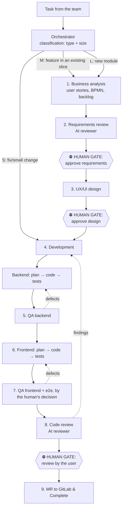

# AI Workflow — architecture

MUSTASK project: greenfield development on .NET 10 + PostgreSQL (backend) and
React + MUI (frontend).

This document is the **single source of truth** about how AI agents work on
the project. It is tool-agnostic: Claude Code, Codex and any other agent read
it. Files in `.claude/`, `.agents/` and `.codex/` are vendor adapters; the
shared orchestration lives in [feature.md](feature.md), stage logic — in
`stages/`.

## Overall scheme



## Key principles

1. **Files are the interface between stages.** Every stage reads the
   artifacts of the previous one and writes its own into
   `docs/features/<id>/`. An agent of any vendor can pick the work up from
   any stage — state does not live in the chat context, it lives in files.
2. **Human gates are mandatory and cheap.** The AI prepares the artifact and
   a short summary with open questions; the human answers approve / a list of
   changes right in the `status.md` file. Three gates: requirements, design,
   final review.
3. **Backend before frontend.** The API contract (endpoints + DTO) is fixed
   at the backend development stage in `api-contract.md` — the frontend is
   developed against it, and until the backend is ready it can work on mocks.
4. **One stage — one context.** We do not drag the whole pipeline through a
   single session: every stage is started by a fresh session/subagent that
   reads only the files it needs. This protects against context degradation
   and allows parallelism.

Between tasks: [handoff.md](handoff.md) — when the next task gets a new
session and when it carries on here, and the prompt that starts it
(`scripts/handoff.sh`).

## Stages (mapped onto the 10 steps)

| # | Stage | Process file | Performer | Output (in `docs/features/<id>/`) |
|---|------|---------------|-------------|--------------------------------|
| 0 | Orchestration itself | [stages/00-orchestrator.md](stages/00-orchestrator.md) | orchestrator, task-executor | a classified, delegated, merged task |
| 1 | Business analysis | [stages/01-business-analysis.md](stages/01-business-analysis.md) | business-analyst | `spec.md` (index) + `stories/US-<N>-<slug>.md` (criteria) |
| 2 | Requirements review | [stages/02-requirements-review.md](stages/02-requirements-review.md) | requirements-reviewer | findings in `review.md`, verdict in `status.md` |
| — | **Gate 1** | — | **the human** | approve in `status.md` |
| 3 | UX/UI design | [stages/03-ux-design.md](stages/03-ux-design.md) | ux-designer | `design.md` (+ prototype) |
| — | **Gate 2** | — | **the human** | approve in `status.md` |
| 4–5 | Backend: dev + QA | [stages/04-backend.md](stages/04-backend.md) | backend-developer, qa-engineer | code, tests, `api-contract.md`, `qa.md` (Backend) |
| 6–7 | Frontend: dev + QA | [stages/05-frontend.md](stages/05-frontend.md) | frontend-developer, qa-engineer | code, tests, `qa.md` (Frontend) |
| 8 | Code review | [stages/06-code-review.md](stages/06-code-review.md) | code-reviewer | findings → fixes |
| — | **Gate 3** | — | **the human** | approve in `status.md` |
| 9–10 | MR & Complete | [stages/07-mr-complete.md](stages/07-mr-complete.md) | orchestrator | MR to GitLab, updated backlog |

For S tasks (bugfix / small tech change) a shortened route applies —
[stages/s-route.md](stages/s-route.md): without stages 1–3, the plan goes into
`status.md`, one human gate.

For F tasks (typo, comment, formatting) — shorter still:
[stages/f-route.md](stages/f-route.md). F differs from S in that it has no
separate QA and review sessions: verification comes down to one deterministic
command, and the review — to the human seeing the full diff at the final gate.
The admissible cases are listed as a closed list; everything else is `S`.

## Orchestration

**The orchestrator is the agent's main session** (Claude Code / Codex), not a
separate service. Its duties:

1. Classify the task (see [routing.md](routing.md)) — type, size, starting
   stage.
2. Create/update the feature's working folder `docs/features/<id>/` and
   `status.md`.
3. Start stages through the shared [feature contract](feature.md): in Claude
   Code — with the `/feature` command and the `.claude/agents/` agents, in
   Codex — with the `$feature` skill and the `.codex/agents/` profiles.
4. Stop at human gates and ask the human explicitly.
5. Maintain the `docs/backlog.md` queue in `main`: add new lines (with the
   number right away) and remove the line of a taken task at start — as
   separate commits into `main` that change only this file. When a task
   completes the queue is not changed — its line left at start
   ([../features/numbering.md](../features/numbering.md)).

## Vendor adapters

| Environment | Entry point | Roles |
|-------|------|------|
| Claude Code | `.claude/commands/feature.md` → `/feature` | `.claude/agents/*.md` |
| Codex | `.agents/skills/feature/SKILL.md` → `$feature` | `.codex/agents/*.toml` |

Both entry points are obliged to reference [feature.md](feature.md) rather
than copy it. `scripts/validate-ai-workflow.py` checks this and cross-checks
the model tiers of the roles. That is why a change to the shared route is made
once in `feature.md` and immediately takes effect for both vendors.

The Codex hook in `.codex/hooks.json` uses the same policy as Claude Code:
`.claude/hooks/block_wide_fs_search.py`. After cloning or changing the hook it
must be reviewed and trusted via `/hooks`; without trust Codex skips the
project-local hook.

POSIX entrypoints remain the source of the scripts' behaviour. In PowerShell
the same commands are run through Git for Windows Bash without copying the
logic:

```powershell
./scripts/new-task.ps1 <prefix> <slug> ["<summary>"] [F|S|M|L] [epic]
./scripts/backlog.ps1 --ids
./scripts/verify.ps1 --list
```

## Feature state: `docs/features/<id>/status.md`

The state machine of the pipeline. Every stage appends its own line on
completion; the human puts approve at the gates. For the format see
[../features/README.md](../features/README.md).

## Routing

The rules for choosing the route (which stages to skip) and the model (which
model at which stage) are in [dispatch.md](dispatch.md).

## Code conventions

- Backend: [../conventions/backend.md](../conventions/backend.md) — a hybrid
  of Onion + Vertical Slice on .NET 10, PostgreSQL.
- Frontend: [../conventions/frontend.md](../conventions/frontend.md) —
  React + MUI, Vertical Slice Design.
- Architectural decisions are recorded as ADRs in [../adr/](../adr/README.md):
  when to write one, the statuses and the acceptance process are in the
  directory's README. An ADR is accepted only by the human (at the nearest
  gate or explicitly in the chat).

Developer agents are obliged to read the corresponding conventions file before
writing code.
