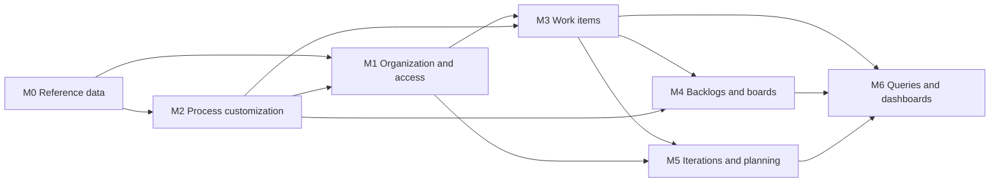
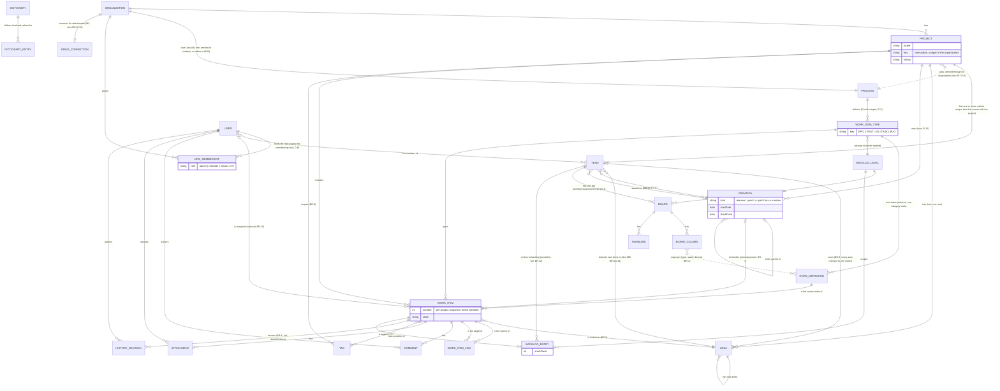

# Spec: Azure DevOps Boards domain map (doc-001, umbrella)

## Context and goal

MUSTASK needs a shared domain map so the six module analyses (doc-002..007)
start from the same glossary, boundaries and MVP cut instead of drifting
apart. The reference is Azure DevOps Boards, read live via its REST API
([research/ado-boards.md](research/ado-boards.md)) and captured as UI
reference ([screenshots/README.md](screenshots/README.md)). The requirements
review ([review.md](review.md)) forced the human decisions D-1..D-12
(`status.md` § Decisions); the module analyses and the cross-module review
(doc-010, D-4..D-24) refined the map, and every refinement is written here
with its source, so each analysis still starts from this spec. It does not
go deep into any module — that is doc-002..007's job.

## Roles

MUSTASK checks access by permission codes — the existing `PermissionCatalog`
pattern (ADR-0018, `src/backend/Mustask.Domain/Identity/PermissionCatalog.cs`):
a **permission** is a `<module>.<resource>.<action>` code, bundled into a
named **role**. **D-9 (an ADR-0018 amendment owed by
`mod-016-organization-access`, bound by doc-006 § Roles
constraints 1–8):** that role lives on `ORG_MEMBERSHIP` itself —
admin/member/viewer, one per organization a user belongs to — never on a
Keycloak realm role; team membership carries no role and no access of its
own (doc-006 § Roles). A user's codes for a resource are exactly their
`ORG_MEMBERSHIP.role` bundle for that resource's organization — `admin` in
one organization and `viewer` in another is normal. Keycloak keeps only
authentication plus instance-level roles, named by the ADR-0018 amendment:
at least the **instance administrator** (every instance-level code: "create
organizations", M0's codes) and the **dictionaries administrator** (M0
only). Granting "create organizations" is Keycloak realm administration — a
Keycloak realm administrator assigns the role or group that carries it
(doc-006 BR-M1-2, doc-010 D-10); it is no MUSTASK code, and no MUSTASK role
carries Keycloak administration rights. No realm role named
`admin`/`member`/`viewer` exists or is checked.

**Ownership predicate (doc-010 D-11, D-12).** A code may carry an ownership
predicate, checked after the code on the resolved object. (1) A role code
narrowed to one's own objects — editing or deleting one's own comment,
removing one's own attachment — is in the member bundle; the admin bundle
holds the unrestricted moderation code; the right goes with the role, so an
author downgraded to viewer no longer edits or deletes their comments.
(2) A personal-object code is in every bundle, viewer included (doc-005
D-14): create, read, update, delete and restore of one's own private
objects — any object a spec declares personal; in release 2 personal
queries and «Мои запросы». No bundle reads or writes another user's private
object; the one exception is the organization administrator's purge of a
soft-deleted one, which grants no read of its content (BR-6). mod-016's
ADR-0018 amendment states the predicate; feat-002 and mod-004 implement it
for own comments and attachments; mod-008 registers the personal-object
code (release 2).

| Role (organization membership) | Bundle | Can |
|---|---|---|
| Organization administrator (`admin`) | every org-scoped code | everything a member can, plus: manage org membership (D-10), create/deactivate/restore projects, manage teams and areas, every team-level setting, moderate comments and attachments, purge deleted work items |
| Member (`member`) | write codes minus admin-only ones, plus the personal-object code | create/edit/comment/attach on work items, move board cards, reorder the backlog, delete and restore a work item (BR-6); write their own private objects (release 2) |
| Reader (`viewer`) | read codes plus the personal-object code | read everything a member can write; write only their own private objects (release 2) |

Every team-level setting — the iterations a team uses and its default, its
default area, its working days and board configuration — is the
organization administrator's; per-iteration values a team enters about
itself (capacity, days off; release 2) are a member's (doc-010 D-20).
Stories name the actor by role in the resource's organization — "a user
whose role in the item's organization is member", "an organization member"
— never by a sign-in role, a project role or a persona the model lacks.
Organizations are not self-service (D-10): the creator becomes the first
organization administrator and adds members found by name/e-mail in
MUSTASK's user projection (doc-006 § Roles, constraint 5; US-1).

## Stories

| id | Title | depends-on | File |
|----|-------|------------|------|
| US-1 | An organization administrator opens an organization and a project | - | `stories/US-1-organization-and-project.md` |
| US-2 | An organization administrator manages teams and areas | US-1 | `stories/US-2-teams-and-areas.md` |
| US-3 | Work items follow the built-in process | US-1 | `stories/US-3-built-in-process.md` |
| US-4 | A member creates and edits work items | US-1, US-2, US-3 | `stories/US-4-create-and-edit-work-items.md` |
| US-5 | A member comments on a work item | US-4 | `stories/US-5-comment-on-work-items.md` |
| US-6 | A member deletes and restores a work item | US-4 | `stories/US-6-delete-and-restore-work-items.md` |
| US-7 | A member works the Kanban boards | US-4 | `stories/US-7-kanban-boards-per-level.md` |
| US-8 | A member orders the backlog | US-7 | `stories/US-8-order-the-backlog.md` |
| US-9 | A member plans by iteration | US-4 | `stories/US-9-plan-by-iteration.md` |
| US-10 | A member finds work items by filter | US-4 | `stories/US-10-filter-work-items.md` |

## Module map

Seven modules: the six analysed (doc-002..007) plus the reference-data
platform. `A --> B`: B depends on/reads from A (A is built or seeded first).

- **M0 — Reference data (platform, exists).** Localized dictionaries and
  picklists (ADR-0021).
- **M1 — Organization & access (doc-006).** Organization, Project (with its
  key), Team (one or more per project, each with a default area), the Area
  tree (team ownership, D-8/BR-3), `ORG_MEMBERSHIP` with the role that
  scopes a member's codes (D-9), and the USER projection fed from Keycloak.
  Calls M2's seed at org creation; does not define what a process is.
- **M2 — Process customization (doc-007).** Process (one per organization,
  D-2), the five built-in types with their keys, ordered states and
  categories, the ranked backlog levels, the seed M1 calls and one
  read-only process-definition screen; no editing UI, no Reason (D-6).
  Needs nothing from M1 (R-10).
- **M3 — Work items (doc-002).** Work items of the five types: identifier,
  fields, links, comments, attachments on the organization's Google Drive,
  tags, history, the «Удалена» state (D-5/D-6) and the purge. Reads M2's
  schema and M1's project/team/area; its iteration pointer references M5's
  entity once M5 exists (additive, so M3 ships first).
- **M4 — Backlogs & boards (doc-003).** One board per team per
  portfolio/requirement level (D-3), the ordered backlog per team per level
  with stack rank (BR-12), and creating a work item from them (doc-010
  D-7). Reads M3 and M2; a card is a view, never a copy.
- **M5 — Iterations & planning (doc-004).** The project's iteration tree, a
  team's selected and default iterations, the work item's iteration
  pointer, the current iteration (BR-9), the planning pane and moving
  unfinished work; founded by an `L` task (D-4) because it adds a field to
  M3's WorkItem. The sprint views (the taskboard is a board on M4's BOARD),
  capacity, burndown and velocity → release 2; forecast, delivery plans →
  release 3.
- **M6 — Queries, search & dashboards (doc-005).** Not founded in MVP
  (D-4); the inline filters are properties of M3/M4's surfaces.

## Glossary

MUSTASK term (Russian UI name in quotes) → Azure DevOps term; the one
glossary, doc-004 § Terms and doc-005 § Glossary included.

| MUSTASK term | Azure DevOps term |
|---|---|
| Рабочий элемент («Рабочий элемент») | Work item (generic entity — D-7) |
| Тип рабочего элемента («Тип») | Work item type (WIT) |
| «Эпик», «Фича», «Пользовательская история», «Задача», «Баг» | Epic, Feature, User Story, Task, Bug; «Задача» is only the Task type, never the generic entity (D-7) |
| Идентификатор («ID», e.g. `PRM-BUG-42`) | Work item ID — here `{ключ проекта}-{ключ типа}-{номер}`, the number from one sequence per project (doc-002 BR-M3-5) |
| Ключ проекта; ключ типа | (none: ADO IDs are instance-wide numbers) — 2–10 Latin capitals and digits, immutable (doc-006 BR-M1-1); `EPIC`/`FEAT`/`US`/`TASK`/`BUG` (doc-007 BR-M2-9) |
| «Организация», «Проект», «Команда»; «Процесс»; «Статус» | Organization, Team project, Team; Process; State |
| Категория статуса: «Новые» / «В работе» / «Решённые» / «Завершённые» / «Удалённые» | State category Proposed / InProgress / Resolved / Completed / Removed (doc-007 § MVP) |
| Уровень бэклога: «Эпики» / «Фичи» / «Истории» / «Задачи» | Backlog level (portfolio / requirement / iteration backlog) |
| Область («Область»); область по умолчанию команды | Area path; team default area |
| Итерация, путь итерации («Итерация», «Релиз 1 / Спринт 2»); вид «Релиз» / «Спринт», номер спринта | Iteration / sprint node, iteration path (ADO nodes have no kind and no number) |
| «Текущая итерация»; итерация по умолчанию, итерации команды | @CurrentIteration; team default iteration, the team's selected iterations |
| Панель планирования («Планирование»), «Без итерации»; «Перенести незавершённые» | Backlog Planning pane, the backlog iteration; (no built-in equivalent) |
| Доска / колонка / дорожка («Доска» / «Колонка» / «Дорожка») | Board / column / swimlane |
| Тег («Теги») | Tag |
| «Заголовок» / «Описание» / «Исполнитель» / «Приоритет» — the full field catalogue is doc-002 § Fields | Title / Description / Assigned To / Priority |
| «неактивен» / «не в организации» (member lists, «Исполнитель») | (none) — an inactive Keycloak account / a removed member; the latter prevails (BR-13) |
| Вложение («Вложение»); Обсуждение («Обсуждение») | Attachment; Discussion / comment |
| «Удалить» / «Восстановить» / «Удалить навсегда» (work item); «Деактивировать» / «Восстановить» (organization, project); «Удалить команду»; «Удалить итерацию» | Delete / Restore / Destroy; (none for deactivate); delete a team; delete an iteration node |
| Корзина | Recycle Bin — term only, never a UI label: the «Удалена» state IS the bin (D-5) |
| История изменений («История») | History (revisions) |
| «Ёмкость», «Дни отсутствия», «Доска задач», «Диаграмма сгорания», «Скорость» (release 2); «План поставки» (release 3) | Capacity, days off, Sprint Taskboard, burndown, velocity; Delivery Plan |
| «Запрос»; «Мои запросы» / «Общие запросы»; «Папка запросов»; «Конструктор условий», «Условие» («И» / «ИЛИ», «Поле», «Оператор», «Значение») | Query; My / Shared Queries; query folder; clause builder, clause (And/Or, Field, Operator, Value) |
| Тип запроса («Плоский список» / «Дерево рабочих элементов» / «Рабочие элементы и прямые связи»); «Результаты»; «Импорт рабочих элементов» / «Экспорт в CSV» | Query type: flat list / tree / direct links; query results; Import work items / Export to CSV |
| «Дашборд команды» / «Дашборд проекта»; «Виджет», «Плитка запроса», «Диаграмма» | Team / project dashboard; widget, query tile, chart |

## Cross-module logical data model

Full attributes live in the module specs; this model keeps what modules share.

| Entity | Owning module | Release |
|---|---|---|
| Dictionary, DictionaryEntry | M0 | exists |
| Organization, OrgMembership, Project, Team, team membership, Area, User (projection of the Keycloak identity, fed by an event listener) | M1 | MVP |
| Process, WorkItemType, StateDefinition, BacklogLevel; FieldDefinition, FormLayout, TransitionRule (release 3) | M2 | MVP; 3 |
| WorkItem, WorkItemLink, Comment, Attachment, Tag, HistoryRevision; the Drive connection (hosted in M1's organization settings) | M3 | MVP |
| Board, BoardColumn, Swimlane, BacklogEntry | M4 | MVP |
| Iteration, a team's iteration selection and default; TeamCapacity, DayOff, TeamWorkingDays, IterationSnapshot (release 2); DeliveryPlan, DeliveryPlanTeam, organization-owned (release 3) | M5 | MVP; 2; 3 |
| Query, QueryFolder (release 2); Dashboard (team and project levels), DashboardWidget (release 3) | M6 | 2; 3 |

## MVP boundary and release plan

**MVP** = organizations and projects with one or more teams each, the five
built-in types across four backlog levels, boards for three levels, one
ordered backlog per team per level, iterations, comments, attachments and
delete/restore, end to end. Beyond D-1..D-12 the rows carry doc-002
W-5/W-10..W-12, doc-004 E-2/E-4..E-7/E-9..E-12, doc-007 R-6 and doc-010
D-4..D-10, D-13, D-14.

| Module | In MVP |
|---|---|
| M0 Reference data | Existing language dictionary only; Priority stays a plain 1–4 integer, not a dictionary |
| M1 Organization & access | Organization creation gated by the instance-level "create organizations" right, which a Keycloak realm administrator assigns (D-10, doc-010 D-10); the creator becomes the org's first administrator; org administrators add/remove members found by name/e-mail in MUSTASK's user projection — fed by a Keycloak event listener plus a backfill, `mod-NNN-keycloak-user-projection` — and set their role admin/member/viewer, which scopes that member's codes and nothing else (`ORG_MEMBERSHIP`, D-9); projects with an immutable key, deactivated and restored, never purged; one or more teams per project — the first created with the project, further ones created, renamed and soft-deleted with a cascade, each with a default area; an Area tree per project, every node resolving to exactly one owning team (BR-3); the organization settings screen, which also hosts M3's Drive connection; no per-project role override, no notifications |
| M2 Process customization | One process per organization, seeded at org creation, with the five built-in types — Эпик, Фича, Пользовательская история, Задача, Баг — each with its key and its ordered states mapped to Proposed/InProgress/Resolved/Completed/Removed (BR-2), the categories labelled in Russian; backlog levels Эпики/Фичи/Истории/Задачи with rank and kind (D-3; Истории also holds Баг); no Reason field, any↔any transition among non-Removed states (BR-10, D-6); one read-only process-definition screen; no editing UI |
| M3 Work items | The field catalogue of doc-002 § Fields — Тип, Заголовок, Описание, Статус, Исполнитель, Область, Итерация (the field is added by M5's founding task, D-4), Приоритет, Теги, plus «Критерии приёмки» on Пользовательская история and «Шаги воспроизведения» on Баг; the identifier `{ключ проекта}-{ключ типа}-{номер}`; Обсуждение; Вложения on the organization's own Google Drive; Parent/Child link (self-hierarchy across the five types); the work item list with its filters (state incl. «Удалена», assignee incl. former members, tag, area, keyword); auto-recorded history; delete/restore via «Удалена» and the organization administrator's purge (BR-6, BR-10) |
| M4 Backlogs & boards | One board per team per portfolio/requirement level — Эпики, Фичи, Истории (D-3; Задачи has an ordered backlog only — the sprint taskboard is release 2); columns mapped per (type, state) from the level's state categories (BR-2), one default swimlane; one ordered, drag-and-drop backlog per team per level (stack rank, BR-12) with its parent/child hierarchy; creating a work item from a team's board or backlog, which gives it the team's default area; the filter bar on the board and the backlog (`feat-NNN-board-backlog-filter`) |
| M5 Iterations & planning | The project's iteration tree of releases and sprints, sprints numbered per project, optional start/finish dates (D-11); each team selects the iterations it uses and may set one as its default; the team's current iteration (BR-9); a work item's optional iteration pointer (BR-7); the iteration filter, the backlog planning pane and «Перенести незавершённые»; removing an iteration softly, with confirmation; no capacity, sprint views, burndown, velocity or delivery plans |
| M6 Queries & dashboards | Not founded in MVP (D-4). The inline filters of the list (M3) and of the board and backlog (M4) belong to those surfaces; no saved/shared queries, no dashboards |

**Release 2** (by module; `doc-NNN-release-2-scope` gives owners to the
items no module analysis has specified yet — notifications, the audit log,
bulk edit, templates, copy/move — and settles the double claims on
notifications and audit, doc-010 D-18; notifications are cross-module and
belong to no module below until it does): M1 — per-project and per-area
permission overrides (BR-5), the M1 audit log (doc-006 BR-M1-15), an
instance-rights screen, team-selected areas as a set; M3 — the ADO Agile
estimation fields: Story Points on Пользовательская история and Баг,
Original Estimate, Remaining Work, Completed Work and Activity on Задача and
Баг (`feat-NNN-work-item-estimation-fields`, doc-010 D-15), other link
types, change type, tag management, bulk edit, templates, copy/move to
another project, @mentions and work-item references in comments; M4 — WIP limits, custom columns/swimlanes, card styles,
multiple boards per level, a per-team level toggle, parent grouping rows,
live push; M5 — the sprint backlog and the sprint taskboard (one item: a
Задачи-level board, owned by M5 on M4's BOARD), capacity, burndown,
velocity; M6 — personal saved queries and shared query folders expressing
everything the MVP inline filters do ("Under" on Область and Итерация, a
keyword clause on Заголовок and the identifier; BR-15, doc-010 D-16), with
the organization administrator's purge (BR-6).

**Release 3**: M2 — the process customization UI and Reason with
per-transition rules (D-6); M5 — forecast by velocity, delivery plans; M6 —
dashboards, widgets and charts (same purge), the operators toward WIQL
parity (Was Ever, @Today, Contains Words, In Group) with tree and
direct-links query types, and CSV import/export (`feat-005`, its only
owner).

Anything past release 3 is in "Out of scope" below — that section is the
single list, this one only says *when* what ships.

## Module order

M0 (exists) → **M2** (needs nothing from M1) → **M1** (org creation calls
M2's seed; member search reads the user projection, founded beside M2) →
**M3** → **M4** and **M5** in parallel, both only reading M3/M1 → **M6**
(analysis only this cycle, D-4).

## Business rules

Cross-module only; module-specific rules belong to doc-002..007, cited as
BR-M<k>-n (M3 = doc-002 … M6 = doc-005).

| # | Rule | Source |
|---|------|--------|
| BR-1 | A work item belongs to exactly one project and exactly one type defined by that project's organization's process. | research/ado-boards.md; D-2 |
| BR-2 | Every state a type defines maps to exactly one category (Proposed/InProgress/Resolved/Completed/Removed); backlogs, reports and metrics rely on the category, never the state name. «Разрешена» is InProgress on Эпик, Фича and Пользовательская история and Resolved on Баг, so a board maps each (type, state) to a column: on the «Истории» board Пользовательская история «Разрешена» gets its own column, not the «В работе» column, and each board's headers follow that per-level mapping (doc-003); a state filter matches the label on every type, so «Статус = Разрешена» spans two categories. | research/ado-boards.md § Work item types; D-3; doc-010 D-4, D-5 |
| BR-3 | A work item is on a team's board/backlog only when its Area is owned by that team (directly, or by inheriting the nearest owned ancestor Area); it never appears on more than one team's board at once. Every area resolves to exactly one owning team: the root is always owned, by the project's first team (doc-006 BR-M1-11). | D-8; research/ado-boards.md (Team field = Area Path) |
| BR-4 | Work item history: every create, field change, state transition (a card move is a state revision authored by the mover), link add/remove, tag add/remove, comment add/edit/delete, attachment add/remove, delete and restore is recorded in the item's history with who and when; one save is one revision, however many fields it touched; history is derived and append-only, never edited. A comment edit records that the text changed, not the old text, and marks the comment as edited with the edit time. A purge removes the item with its history and records the purge of the parent, with its identifier, in each surviving child's history. | research/ado-boards.md § Rules; D-5; doc-010 D-20 |
| BR-5 | A permission check for an org/project/team-scoped resource derives its codes from the acting user's `ORG_MEMBERSHIP.role` for that resource's organization, never from a Keycloak realm role; Keycloak carries only authentication plus instance-level roles, named by the ADR-0018 amendment. MVP scopes no finer than the organization (no per-project or per-team override). A user with no membership in the resource's organization is answered "not found" in every module (doc-006 BR-M1-8); «Недостаточно прав» is only for a member whose role lacks the code. A code may carry an ownership predicate (§ Roles): a private object is reachable only by its owner, whatever their role, while they hold a membership in its organization. | D-9, D-2; ADR-0018 (amendment owed by `mod-016-organization-access`); doc-010 D-11, D-12 |
| BR-6 | Deletion is soft wherever the entity can be restored, and retention is indefinite. Where a spec defines a purge, only the organization administrator performs it, in the product: work items in MVP; queries and folders (release 2), dashboards and widgets (release 3), whose purge list shows owner, folder and deletion date, never content. Organizations, projects, teams and iterations are never purged. Per entity: § Deletion lifecycle; an item in «Удалена» takes part in other operations per BR-14. | D-5; doc-010 D-13, D-20 |
| BR-7 | An iteration is a single optional pointer on a work item (never a set); boards, backlogs and planning all read that one pointer. | Module map M5 |
| BR-8 | Tags are project-scoped; a filter or a board never shows a tag from another project. | research/ado-boards.md § Security |
| BR-9 | A team's current iteration is derived on read, never stored, from the server's date in UTC: among the iterations the team has selected (`TEAM }o--o{ ITERATION`) whose start/finish dates cover today, both days included, the earliest finish wins, then the latest start, then a sprint over a release, then the one created first (between sprints, the lower number); if none qualifies, the team's default iteration is current; with no default there is none. It exists on team surfaces and in team-bound queries only. The default iteration is never assigned to new work items — it only decides the current iteration when no dates do. | D-11, R-9; doc-004 E-1, E-2; doc-010 D-20 |
| BR-10 | Among a type's non-Removed states, any state may move directly to any other with no reason and no rule check; «Удалена» is reached only via Delete and left only via Restore, which defaults to (but does not require) the state held immediately before deletion. No operation other than Restore changes the state of an item in «Удалена», whatever its concurrency policy; for users a deleted item is read-only (BR-14). | D-6; doc-010 D-20 |
| BR-11 | Concurrency is a policy per operation, not per field: § Concurrency policy. It is a correctness requirement (ADR-0010); the client-visible concurrency token is designed by `mod-003-work-item-core` and reused by `mod-006-boards-backlogs`. | ADR-0010; doc-003 DD-2; doc-010 D-20 |
| BR-12 | The backlog order (stack rank) is scoped per team and per backlog level, owned by M4 and read (never written) by M3's lists; it is a property of the whole backlog — a filter hides non-matching items but never changes their relative order. | Module map M4; R-2 |
| BR-13 | The «Исполнитель» candidate set on a work item is every active member of the work item's organization, not only the team that owns its Area; an inactive account is not offered, and an assignee who is inactive or no longer a member stays, marked «неактивен» or «не в организации» — the latter prevails (doc-002 § Fields). | R-14; doc-006 H-8; doc-010 D-20 |
| BR-14 | An item in «Удалена»: (a) is excluded from every list, board, backlog, pane count, bulk move, tag suggestion, query result and export unless a filter or clause names «Удалена»; (b) keeps its area, iteration, tags, links, state and restore-target state — deleting an area that holds it is refused (doc-006 BR-M1-13), and a release-3 state removal is refused while any item is in that state or remembers it (doc-007 BR-M2-6); (c) is changed only by Restore, Purge and system reference clean-up, recorded in its history (iteration removal clears its pointer and counts it in the confirmation) — a card move or reorder of it is refused with the stale-move notice and a refresh, a CSV row targeting it is rejected, and a live child may remove the link to its deleted parent from its own side, recorded in both histories; (d) if its Area is re-owned while it is deleted, its retained backlog entry is re-scoped on Restore and appended at the bottom of the new team's backlog. | D-5; doc-010 D-20 |
| BR-15 | An area or iteration condition matches the node and its whole subtree — in the MVP inline filters and, from release 2, in a saved query's "Under"; "=" in a saved query is an exact match. | doc-004 BR-M5-9; doc-010 D-16 |

### Deletion lifecycle (BR-6)

| Entity | Deleted as | Restore | Purge | Reserved afterwards |
|---|---|---|---|---|
| WorkItem | state «Удалена» («Удалить») | member, admin («Восстановить») | org admin («Удалить навсегда»), MVP | its identifier's number, never reused |
| Organization, Project | status deactivated («Деактивировать») | org admin («Восстановить») | never | the name; a project's key |
| Team | soft-deleted with a cascade (doc-006 BR-M1-18) | none | never | nothing: the name is freed |
| Iteration | soft-removed («Удалить итерацию», doc-004) | none | never | a sprint's number; the name is freed |
| Query, QueryFolder (release 2); Dashboard, DashboardWidget (release 3) | own deleted status, separate from the one inherited from its project (doc-005) | whoever may delete it | org admin, no read of content | — |

Removed outright, with no restore: a membership, a team membership, an
empty Area leaf (no trace until M1's audit log, release 2); a WorkItemLink,
a comment's text, an attachment, a tag on an item (each in the item's
history, BR-4). `mod-002` owes the soft-deactivation ADR; `mod-005`'s
recycle bin and M6's soft deletes reference it.

### Concurrency policy (BR-11)

| Operation | Policy |
|---|---|
| Work item form save (every field, Статус, Теги, type fields and Итерация included) | revision check; the second save is rejected as a conflict, and its author reloads and reapplies |
| Card move between board columns | last write wins, no check; advances the revision, so a later form save from an older revision conflicts; of two moves of the same card the one arriving second decides the column, and its mover gets the stale-move notice below and a refreshed view (doc-003); refused on an item in «Удалена» (BR-14) |
| Backlog or in-column reorder | last write wins; the member whose move arrived second gets «Порядок изменён другим участником — список обновлён» and a refreshed view |
| Planning-pane drop | revision check (it writes the iteration pointer) |
| Backlog parent mapping | a link write; the one-parent invariant holds atomically, and the loser is refused |
| Comment, attachment or link add | a separate write, never blocked by a stale field revision |
| Bulk move of unfinished work, iteration removal | count-confirmed, all or nothing |
| CSV update row (release 3) | last write wins per row, recorded in history |
| M1 check-then-act invariants | of two conflicting changes, one is refused (doc-006 NFR Concurrency) |
| M6 shared objects (release 2/3) | revision check |

## Operation completeness

| Entity | Create | Read | Update | Delete/deactivate | Cancel/reverse |
|---|---|---|---|---|---|
| Organization | instance administrator, or a user a Keycloak realm administrator granted "create organizations" (D-10); the creator becomes its first `admin` member | admin, member, viewer (own orgs only) | admin (rename) | admin (deactivate, BR-6) | admin (restore); never purged |
| Organization membership (`ORG_MEMBERSHIP`) | admin, adding an existing Keycloak user found by name/e-mail in the user projection, with a chosen role (D-10) | admin, member, viewer (own org's membership list only) | admin (change a member's role among admin/member/viewer) | admin (remove a member) | n/a |
| Project | org admin, with its key | admin, member, viewer (of that org) | org admin (rename; the key never) | org admin (deactivate, BR-6) | org admin (restore); never purged |
| Team | org admin: the first with the project, further ones any time (doc-004 E-5) | admin, member, viewer | org admin (rename; add/remove members, candidates limited to the organization's members; set its default area) | org admin: soft, with a cascade; never the first team, which owns the root area (doc-006 BR-M1-18) | no: no restore (doc-006 BR-M1-18) |
| Area | org admin (child nodes; the root comes with the project) | admin, member, viewer | org admin (rename, move, re-own a child node to any team; the root never) | org admin: an empty leaf only — deleted work items count — and never a team's default area | no: re-create it |
| Process / WorkItemType / StateDefinition / BacklogLevel | no: MVP seeds one process per org automatically (M2 scope) | admin, member, viewer | no: release 3 (M2 UI) | no | n/a |
| WorkItem | member, admin | admin, member, viewer | member, admin (BR-4); not while «Удалена» (BR-14) | member, admin (soft → «Удалена», BR-6/10) | member, admin (restore, BR-6/10); org admin purges (BR-6) |
| WorkItemLink | member, admin | admin, member, viewer | no: removed and re-added, or a parent replaced atomically by the backlog mapping (doc-002) | member, admin | n/a |
| Comment / Attachment | member, admin | admin, member, viewer | Comment: its author, holding the member or admin role, marked as edited; Attachment: no, remove + re-add instead | Comment: its author (member or admin role), or admin as moderation; Attachment: its uploader (member or admin role), or admin | no: a comment edit keeps no earlier text (BR-4); Attachment: n/a |
| Tag | member, admin (free-form on a work item) | admin, member, viewer | no: release 2 (no standalone tag-management screen in MVP) | no: release 2 | n/a |
| HistoryRevision | system only, on every write (BR-4) | admin, member, viewer | no: append-only | no: only with its work item, on purge | n/a |
| Board / BoardColumn / Swimlane / BacklogEntry | no: M4 seeds one board and backlog per team per level, for every team, incl. teams older than M4 (D-3) | admin, member, viewer | member, admin (BacklogEntry: reorder, BR-12); no: release 2 (WIP limits, custom columns/swimlanes) | no: hidden with a deleted team (doc-006 BR-M1-18); otherwise release 2 | n/a |
| Iteration | admin (a release or a sprint in the project's tree) | admin, member, viewer | admin (rename, dates, move; which iterations a team selects and its default, BR-9/D-11) | admin (soft, confirmed; items pointing at it become unassigned, deleted ones included — BR-7, BR-14) | no: no reactivation; never purged |
| Query / Dashboard / DashboardWidget | no: MVP has no saved-query or dashboard entity — filtering is inline session state (release 2/3) | no: release 2/3 | no: release 2/3 | no: release 2/3 | n/a |

## Non-functional requirements

- **Volumes:** tens of organizations, tens of projects each, thousands of
  work items per project; the work item list and a board/backlog view return
  within 2 s for up to 5,000 items in one project/team/level (Gridify-backed,
  ADR-0015/0016); a state/board/backlog write completes within 1 s.
- **Concurrency:** BR-11's policy table is a correctness requirement.
- **Audit/retention:** BR-4 — every change, delete and restore of a work
  item is attributable to a user and a timestamp; retention is indefinite
  (BR-6). Not audited in MVP, accepted: M1 beyond the who/when on
  memberships (M1's audit log is release 2), M2, the backlog order (a
  reorder is no history event), M5's iteration administration and team
  selection, M6, and the purge itself until release 2's audit log.
- **Localization:** type/state/category names and UI copy are Russian (this
  spec, AGENTS.md); the dictionary pattern (ADR-0021) covers only M0-owned
  lists — Priority stays a plain integer.

## Out of scope

Everything the release plan dates to release 2 or 3 is out of MVP; beyond
it, never in scope:

- Repos, Pipelines, Test Plans, any Git-linked "Development" section;
  analytics views, Power BI, service hooks, webhooks.
- Outbound e-mail of any kind: notifications are in-app only (release 2).
- Full WIQL parity: the release-3 query language (M6) is a deliberate subset.
- Stakeholder/Basic-style access levels; cross-organization data sharing.
- Purging an organization, a project, a team or an iteration (BR-6).

## Decomposition for the backlog

Each module's founding line and the ADRs the `L` lines owe (R-8; an
analysis task writes none):

| Module | Founding line | ADRs it owes |
|---|---|---|
| M1 | `mod-002-organizations-projects-teams` | status-based soft deactivation |
| M1 | `mod-016-organization-access`, M1's access sub-slice (doc-010 D-25) | the ADR-0018 amendment — the role on `ORG_MEMBERSHIP` (D-9), bound by doc-006 § Roles constraints 1–8, the ownership predicate included (doc-010 D-11) |
| M1 | `mod-NNN-keycloak-user-projection`, which mod-016's member search depends on | the Keycloak event-listener provider and the user projection; ADR-0023's guards stay (doc-010 D-9) |
| M2 | `mod-001-process-seed` | none: `L` as the module's founder |
| M3 | `mod-003-work-item-core`; `mod-004-work-item-attachments`; `mod-005-work-item-delete-restore` | history/audit, scoped to anticipate the M1 audit log (doc-006 BR-M1-15), "Was Ever" and release-2 metrics; the client-visible concurrency token; attachment storage on each organization's Drive; the recycle bin, referencing mod-002's soft deactivation |
| M4 | `mod-006-boards-backlogs` | none of its own: it reuses mod-003's concurrency token |
| M5 | `mod-007-iterations` | none: `L` as the module's founder |
| M6 | `mod-008-queries-dashboards` (release 2) | per doc-005 |

Every other line — feature slices, release-2/3 lines, the `NNN` lines named
here — is in the product plan's normalized queue
(`docs/features/doc-010-backlog-normalization-product-plan/spec.md`).

## Open questions

None: round 2's questions are answered by D-9..D-12, the cross-module ones
by doc-010 D-4..D-24.
