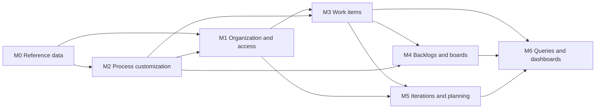
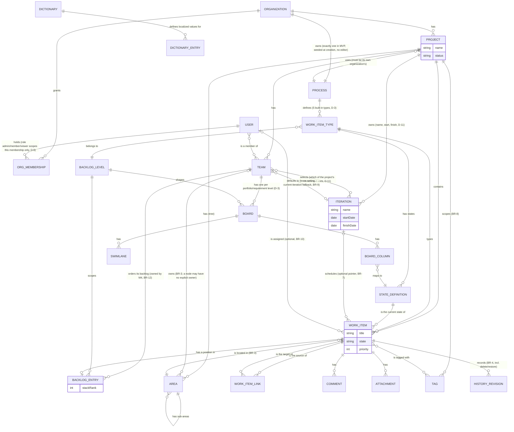

# Spec: Azure DevOps Boards domain map (doc-001, umbrella)

## Context and goal

MUSTASK needs a shared domain map before six modules (doc-002..doc-007) are
analysed in depth, so each starts from the same glossary, boundaries and MVP
cut instead of drifting apart. The reference is Azure DevOps Boards, read
live via its REST API ([research/ado-boards.md](research/ado-boards.md)) and
captured as UI reference
([screenshots/README.md](screenshots/README.md)). Round 1 of the
requirements review ([review.md](review.md)) raised 31 findings and forced
twelve decisions (`status.md` § Decisions, D-1..D-12): several
organizations, five built-in types with backlog levels and boards, an Area
tree as the team-ownership mechanism, iterations as their own founded slice
(project-owned, team-selected, D-11), comments and delete/restore in MVP, no
Reason field, permission codes derived from the admin/member/viewer role
recorded on the organization membership (D-9), gated organization creation
(D-10) and the Russian type/level names (D-12). This revision reflects every
decision and resolves or answers every finding; it still does not go deep
into any module — that is doc-002..007's job.

## Roles

MUSTASK checks access by permission codes — the existing `PermissionCatalog`
pattern (ADR-0018, `src/backend/Mustask.Domain/Identity/PermissionCatalog.cs`):
a **permission** is a `<module>.<resource>.<action>` code, bundled into a
named **role**. **D-9 (an ADR-0018 amendment owed by
`mod-organizations-projects-teams`):** that role lives on `ORG_MEMBERSHIP`
itself — admin/member/viewer, one per organization a user belongs to —
never on a Keycloak realm role; project/team membership carries no role of
its own, it only requires an `ORG_MEMBERSHIP` to exist (BR-5). A user's
codes for a resource are exactly their `ORG_MEMBERSHIP.role` bundle for
that resource's organization and nothing outside it — `admin` in one
organization and `viewer` in another is normal. Keycloak keeps only
authentication plus two instance-level roles unrelated to any organization:
**instance administrator** (every instance-level permission, incl. granting
"create organizations", D-10) and **dictionaries administrator** (M0 only).
No realm role named `admin`/`member`/`viewer` exists or is checked.

| Role (organization membership) | Bundle | Can |
|---|---|---|
| Organization administrator (`admin`) | every org-scoped code | manage org membership (D-10), create/delete projects, manage teams and areas, restore/purge the recycle bin |
| Member (`member`) | write codes minus admin-only ones | create/edit/comment/attach on work items, move board cards, reorder the backlog, delete a work item (BR-6) |
| Reader (`viewer`) | read codes only | read everything a member can write |

Organizations are not self-service (D-10): an instance administrator, or a
user granted the instance-level "create organizations" permission, creates
one; the creator becomes its first organization administrator automatically
(`ORG_MEMBERSHIP.role = admin`). An organization administrator adds further
members by searching existing realm users by name/e-mail — Operation
completeness, US-1.

## Stories

| id | Title | depends-on | File |
|----|-------|------------|------|
| US-1 | An organization administrator opens an organization and a project | - | `stories/US-1-organization-and-project.md` |
| US-2 | An organization administrator manages teams and areas | US-1 | `stories/US-2-teams-and-areas.md` |
| US-3 | Work items follow the built-in process | US-1 | `stories/US-3-built-in-process.md` |
| US-4 | A team member creates and edits work items | US-1, US-2, US-3 | `stories/US-4-create-and-edit-work-items.md` |
| US-5 | A team member comments on a work item | US-4 | `stories/US-5-comment-on-work-items.md` |
| US-6 | A team member deletes and restores a work item | US-4 | `stories/US-6-delete-and-restore-work-items.md` |
| US-7 | A team member works the Kanban boards | US-4 | `stories/US-7-kanban-boards-per-level.md` |
| US-8 | A team member orders the backlog | US-7 | `stories/US-8-order-the-backlog.md` |
| US-9 | A team member plans by iteration | US-4 | `stories/US-9-plan-by-iteration.md` |
| US-10 | A team member finds work items by filter | US-4 | `stories/US-10-filter-work-items.md` |

## Module map

Seven modules: the six queued (doc-002..007) plus the reference-data platform
they all read from. Diagram legend: `A --> B` means B depends on/reads from
A (A is built or seeded first).

- **M0 — Reference data (platform, exists).** Localized dictionaries and
  picklists (ADR-0021). Not decomposed further here.
- **M1 — Organization & access (doc-006).** Owns Organization, Project,
  Team, the Area tree (team-ownership mechanism, D-8/BR-3) and
  `ORG_MEMBERSHIP`, whose recorded role scopes a member's permission codes
  (D-9). Organization creation is instance-administrator-gated with a
  grantable "create organizations" permission; org administrators add
  members from existing realm users (D-10). Reads M2's seed-a-process
  capability at org creation; does not define what a process is.
- **M2 — Process customization (doc-007).** Owns Process (one per
  organization, D-2), the five built-in types, their states/categories and
  the backlog-level definitions, plus the seed logic M1 calls. No editing UI,
  no Reason field (D-6). Needs nothing from M1 — resolves the former M1↔M2
  cycle, R-10.
- **M3 — Work items (doc-002).** Owns work item instances across the five
  types: fields, links, comments, attachments, tags, history, the
  delete/restore state «Удалена» (D-5/D-6). Reads the schema from M2 and
  project/team/area from M1; its optional iteration pointer references M5's
  entity once M5 exists (additive, so M3 ships first).
- **M4 — Backlogs & boards (doc-003).** Owns one board per team per
  portfolio/requirement level (Эпики/Фичи/Истории, D-3) and the ordered
  backlog per team per level, incl. stack rank (BR-12). Reads work items
  from M3, structure from M2; a card is a view, never a copy.
- **M5 — Iterations & planning (doc-004).** Owns the project-owned iteration
  list, a team's selected iterations and default iteration setting, the
  work item's iteration pointer, current-iteration derivation (BR-9, D-11).
  Founded by an `L` task in MVP (D-4): it adds a field to M3's WorkItem, a
  boundary change (routing.md). Capacity/taskboard/burndown/velocity/
  delivery plans → release 2/3.
- **M6 — Queries, search & dashboards (doc-005).** Not founded in MVP
  (D-4): no saved queries, no dashboards. Inline filtering of the list/board
  is a property of M3/M4, not this module's; doc-005 still runs to prepare
  release 2/3.

## Glossary

MUSTASK term (Russian UI name in quotes) → Azure DevOps term.

| MUSTASK term | Azure DevOps term |
|---|---|
| Рабочий элемент («Рабочий элемент») | Work item (generic entity — D-7) |
| Тип рабочего элемента («Тип рабочего элемента») | Work item type (WIT) |
| Эпик («Эпик») | Epic (WIT) |
| Фича («Фича») | Feature (WIT) |
| Пользовательская история («Пользовательская история») | User Story (WIT) |
| Задача («Задача») | Task (WIT) — the one type name, not the generic entity (D-7) |
| Баг («Баг») | Bug (WIT) |
| Организация («Организация») | Organization |
| Процесс («Процесс») | Process |
| Статус / категория статуса («Статус») | State / state category |
| Уровень бэклога («Уровень бэклога») | Backlog level / behavior |
| Область («Область») | Area path |
| Итерация («Итерация») | Iteration / sprint |
| Команда («Команда») | Team |
| Доска / колонка / дорожка («Доска» / «Колонка» / «Дорожка») | Board / column / swimlane |
| Порядок бэклога («Порядок») | Stack rank |
| Тег («Тег») | Tag |
| Проект («Проект») | Team project |
| «Заголовок» / «Описание» / «Исполнитель» / «Приоритет» | Title / Description / Assigned To / Priority |
| Вложение («Вложение») | Attachment |
| Обсуждение («Обсуждение») | Discussion / comment |
| Корзина («Корзина») | Recycle Bin — D-5: the «Удалена» state IS the bin, no separate screen entity |
| История изменений («История») | History (revisions) |

## Cross-module logical data model

Query/Dashboard/DashboardWidget are release 2/3 entities (M6, not founded in
MVP — D-4) and are not modeled in detail here; see doc-005.

| Entity | Owning module |
|---|---|
| Dictionary, DictionaryEntry | M0 |
| Organization, OrgMembership, Project, Team, Area, User (projection of the Keycloak identity) | M1 |
| Process, WorkItemType, StateDefinition, BacklogLevel | M2 |
| WorkItem, WorkItemLink, Comment, Attachment, Tag, HistoryRevision | M3 |
| Board, BoardColumn, Swimlane, BacklogEntry | M4 |
| Iteration | M5 |
| Query, Dashboard, DashboardWidget | M6 (not founded in MVP, D-4) |

## MVP boundary and release plan

**MVP** = any number of organizations and projects, each with one default
team, the five built-in work item types across four backlog levels, boards
for the three portfolio/requirement levels, one ordered backlog per team per
level, iterations, comments, attachments and delete/restore, end to end.

| Module | In MVP |
|---|---|
| M0 Reference data | Existing language dictionary only; Priority stays a plain 1–4 integer, not a dictionary |
| M1 Organization & access | Organization creation is instance-administrator-gated, with "create organizations" as a grantable instance-level permission (D-10); the creator becomes the org's first administrator; org administrators add/remove members from existing realm users by name/e-mail search and set their role admin/member/viewer, which scopes that member's codes and nothing else (`ORG_MEMBERSHIP`, D-9); read/create a Project inside an organization the user belongs to; exactly one default team per project; an Area tree per project with each node owned by at most one team (BR-3); no per-project role override, no notifications |
| M2 Process customization | One process per organization, seeded automatically at org creation, with the five built-in types — Эпик, Фича, Пользовательская история, Задача, Баг — each with its own states mapped to Proposed/InProgress/Resolved/Completed/Removed (BR-2); backlog levels Эпики/Фичи/Истории/Задачи (D-3; Истории also holds Баг); no Reason field, any↔any transition among non-Removed states (BR-10, D-6); no editing UI |
| M3 Work items | Заголовок, Описание, Статус, Исполнитель, Область, Итерация (optional; the field itself is added by M5's founding task, D-4), Приоритет, Теги, Обсуждение, Вложения, Parent/Child link (self-hierarchy across the five types); auto-recorded history; delete/restore via the «Удалена» state (BR-6, BR-10) |
| M4 Backlogs & boards | One board per team per portfolio/requirement level — Эпики, Фичи, Истории (D-3; Задачи has an ordered backlog list only, no board — the Sprint Taskboard is release 2); columns matching that level's state categories, one default swimlane; one ordered, drag-and-drop backlog per team per level (stack rank, BR-12) |
| M5 Iterations & planning | Iterations belong to the project (name, optional start/finish dates, D-11); each team selects which of the project's iterations it uses (`TEAM }o--o{ ITERATION`) and may set one of its selected iterations as its default; the team's current iteration is the selected one whose dates cover today, the earliest-finish one on overlap, else the team's default iteration, else none (BR-9); a work item's optional iteration pointer (BR-7); no capacity, taskboard, burndown, velocity or delivery plans |
| M6 Queries & dashboards | Not founded in MVP (D-4). Inline filter of the work item list (M3) and board (M4) by state/assignee/tag/area is a property of those surfaces; no saved/shared queries, no dashboards |

**Release 2** (adds, by module): M1 — per-project permission overrides
beyond org membership, notifications; M3 — bulk edit, work item templates,
copy/move to another project; M4 — WIP limits, custom columns/swimlanes,
card styling rules, multiple boards per level; M5 — sprint capacity, the
taskboard, burndown/velocity charts, the Задачи-level board; M6 — inline
filters graduate into personal saved queries and shared query folders.

**Release 3** (adds): M2 — the process customization UI (custom types,
fields, states, rules, form layout) and the Reason field with per-transition
rules (D-6); M5 — forecast by velocity, delivery plans; M6 — dashboards,
widgets, charts, a WIQL-level query language, CSV import/export.

Anything past release 3 is in "Out of scope" below — that section is the
single list, this one only says *when* what ships.

## Module order

M0 (exists) → **M2** (doc-007: schema/seed logic, needs nothing from M1) →
**M1** (doc-006: org creation calls M2's seed) → **M3** (doc-002: the
instance data every downstream module displays) → **M4** (doc-003) and
**M5** (doc-004) in parallel, both only reading M3/M1 → **M6** (doc-005:
analysis only this cycle, no MVP slice founded, D-4).

## Business rules

Cross-module only; module-specific rules belong to doc-002..007.

| # | Rule | Source |
|---|------|--------|
| BR-1 | A work item belongs to exactly one project and exactly one type defined by that project's organization's process. | research/ado-boards.md; D-2 |
| BR-2 | Every state a type defines maps to exactly one category (Proposed/InProgress/Resolved/Completed/Removed); boards, backlogs and reports rely on the category, never the state name. | research/ado-boards.md § Work item types; D-3 |
| BR-3 | A work item is on a team's board/backlog only when its Area is owned by that team (directly, or by inheriting the nearest owned ancestor Area); it never appears on more than one team's board at once. | D-8; research/ado-boards.md (Team field = Area Path) |
| BR-4 | Every field change, state transition, link change, comment add/edit/delete, attachment add/remove and delete/restore is recorded in the work item's history with who and when; history is derived, never edited directly. | research/ado-boards.md § Rules; D-5 |
| BR-5 | A permission check for an org/project/team-scoped resource derives its codes from the acting user's `ORG_MEMBERSHIP.role` for that resource's organization, never from a Keycloak realm role; Keycloak carries only authentication plus the two instance-level roles (instance administrator, dictionaries administrator). MVP scopes no finer than the organization (no per-project override). | D-9, D-2; ADR-0018 (amendment owed by `mod-organizations-projects-teams`) |
| BR-6 | Deletion is always soft, never a hard delete, and retention is indefinite: only an administrator purges a deleted object permanently, by hand. For a work item the mechanism is the «Удалена» state — that state IS the recycle bin, not a second mechanism; for an organization and a project it is a deactivated status that hides the object from the normal lists. | D-5 |
| BR-7 | An iteration is a single optional pointer on a work item (never a set); boards, backlogs and planning all read that one pointer. | Module map M5 |
| BR-8 | Tags are project-scoped; a filter or a board never shows a tag from another project. | research/ado-boards.md § Security |
| BR-9 | A team's current iteration is the iteration it has selected (`TEAM }o--o{ ITERATION`) whose start/finish dates cover today; if more than one qualifies, the one with the earliest finish date wins; if none does, the team's default iteration (a team setting, `TEAM ITERATION "defaults to"`) is current instead; if the team has no default either, there is no current iteration. | D-11, R-9 |
| BR-10 | Among a type's non-Removed states, any state may move directly to any other with no reason and no rule check; «Удалена» is reached only via Delete and left only via Restore, which defaults to (but does not require) the state held immediately before deletion. | D-6 |
| BR-11 | Concurrency (ADR-0010, platform default): two users editing the same work item — optimistic concurrency (`xmin`), the second write rejected with a conflict to reload and reapply; two users dragging/reordering the same board or backlog — the *stale-move conflict notice* rule: last write wins, every other pending-move client sees a one-time notice and refreshes. | ADR-0010 |
| BR-12 | The backlog order (stack rank) is scoped per team and per backlog level, owned by M4 and read (never written) by M3's lists; it is a property of the whole backlog — a filter hides non-matching items but never changes their relative order. | Module map M4; R-2 |
| BR-13 | The "Assigned To" candidate set on a work item is every member of the work item's project's organization, not only the team that owns its Area. | R-14 |

## Operation completeness

| Entity | Create | Read | Update | Delete/deactivate | Cancel/reverse |
|---|---|---|---|---|---|
| Organization | instance administrator, or a user granted the instance-level "create organizations" permission (D-10); the creator becomes its first `admin` member | admin, member, viewer (own orgs only) | admin (rename) | admin (soft, BR-6) | admin (restore) |
| Organization membership (`ORG_MEMBERSHIP`) | admin, adding an existing realm user found by name/e-mail search, with a chosen role (D-10) | admin, member, viewer (own org's membership list only) | admin (change a member's role among admin/member/viewer) | admin (remove a member) | n/a |
| Project | org admin | admin, member, viewer (of that org) | org admin | org admin (soft, BR-6) | org admin (restore) |
| Team / Area | org admin (Team: one default per project, MVP; Area: tree edits) | admin, member, viewer | Team: add/remove members, candidates limited to the organization's members (US-2); Area: re-own a node to another team | Team: no, release 2 (a project keeps its default team in MVP); Area: a leaf with no work items | n/a |
| Process / WorkItemType / StateDefinition / BacklogLevel | no: MVP seeds one process per org automatically (M2 scope) | admin, member, viewer | no: release 3 (M2 UI) | no | n/a |
| WorkItem | member, admin | admin, member, viewer | member, admin (BR-4) | member, admin (soft → «Удалена», BR-6/10) | member, admin (restore, BR-6/10) |
| WorkItemLink | member, admin | admin, member, viewer | no: removed and re-added, not edited in place | member, admin | n/a |
| Comment / Attachment | member, admin | admin, member, viewer | Comment: author only, own; Attachment: no, delete + re-add instead | Comment: author/admin (moderation); Attachment: member (own)/admin | Comment: no, edit history stands (BR-4); Attachment: n/a |
| Tag | member, admin (free-form on a work item) | admin, member, viewer | no: release 2 (no standalone tag-management screen in MVP) | no: release 2 | n/a |
| HistoryRevision | system only, on every write (BR-4) | admin, member, viewer | no: append-only | no | n/a |
| Board / BoardColumn / Swimlane / BacklogEntry | no: MVP seeds one board per team per level (D-3) | admin, member, viewer | member, admin (BacklogEntry: reorder, BR-12); no: release 2 (WIP limits, custom columns/swimlanes) | no: release 2 | n/a |
| Iteration | admin (project-owned, name/dates) | admin, member, viewer | admin (dates; select which of the project's iterations a team uses and set the team's default, BR-9/D-11) | admin (work items pointing at it become unassigned, BR-7) | n/a |
| Query / Dashboard / DashboardWidget | no: MVP has no saved-query or dashboard entity — filtering is inline session state (release 2/3) | no: release 2/3 | no: release 2/3 | no: release 2/3 | n/a |

## Non-functional requirements

- **Volumes:** tens of organizations, tens of projects each, thousands of
  work items per project; the work item list and a board/backlog view return
  within 2 s for up to 5,000 items in one project/team/level (Gridify-backed,
  ADR-0015/0016); a state/board/backlog write completes within 1 s.
- **Concurrency:** BR-11 (ADR-0010) is a correctness requirement, not
  best-effort.
- **Audit/retention:** BR-4/BR-6 — every change, delete and restore is
  attributable to a user and a timestamp; retention is indefinite, an
  administrator purges by hand, no numeric window.
- **Localization:** type/state names and UI copy are Russian (this spec,
  AGENTS.md); the dictionary pattern (ADR-0021) covers only M0-owned lists —
  Priority stays a plain integer.

## Out of scope

- Repos, Pipelines, Test Plans, any Git-linked "Development" section.
- Analytics views, Power BI, service hooks, webhooks.
- Email digests/outbound email: notifications are in-app only, release 2+.
- A process editor, custom fields/rules/form layout, and the Reason field
  with per-transition rules (D-6) — all release 3.
- Full WIQL parity — the release-3 query language (M6) is a deliberate
  subset; beyond inline filters and, release 2, saved/shared queries with a
  clause builder, nothing else ships.
- The Задачи-level board (Sprint Taskboard), sprint capacity, burndown and
  velocity charts, delivery plans — release 2/3 (D-3).
- Per-project/per-area permission overrides beyond org membership (BR-5) —
  release 2; cross-organization data sharing is never in scope.
- Stakeholder/Basic Azure DevOps-style access-level distinctions.
- @mentions and work-item references inside comments (release 2+).

## Decomposition for the backlog

**(a) Module analysis tasks, already queued:**

| id | Task | size | deps |
|---|---|---|---|
| doc-002-work-items | Work items deep dive: the five built-in types' field/state lists, WORK_ITEM/WORK_ITEM_LINK/COMMENT/ATTACHMENT/TAG/HISTORY_REVISION entities, BR-1/2/4/6/8/10; input: this spec's glossary, module M3 boundary, MVP table | M | doc-001 |
| doc-003-backlogs-boards | Backlogs and boards deep dive: BOARD/BOARD_COLUMN/SWIMLANE/BACKLOG_ENTRY entities, boards for the three portfolio/requirement levels, stack rank (BR-12); input: module M4 boundary, MVP/release tables, BR-2/3 | M | doc-001 |
| doc-004-iterations-planning | Iterations and planning deep dive: ITERATION entity, team iteration selection and default setting (`TEAM ITERATION`), current-iteration derivation (BR-9, D-11), release-2/3 capacity/taskboard/burndown/forecast/delivery plans; input: module M5 boundary, BR-7/9 | M | doc-001 |
| doc-005-queries-dashboards | Queries/dashboards deep dive (release-2/3 ground, M6 not founded in MVP — D-4): QUERY/DASHBOARD/DASHBOARD_WIDGET entities; input: module M6 boundary, MVP/release tables | M | doc-001 |
| doc-006-org-access | Organization/access deep dive: ORGANIZATION/PROJECT/TEAM/AREA/ORG_MEMBERSHIP/USER entities, the membership-held permission-code model (Roles section, D-1/D-9), the organization-creation gate and member-adding flow (D-10), the MVP org/project/team/area cut; input: Roles section, module M1 boundary, BR-3/5/13 | M | doc-001 |
| doc-007-process-customization | Process customization deep dive: PROCESS/WORK_ITEM_TYPE/STATE_DEFINITION/BACKLOG_LEVEL entities for the five built-in types (D-3), the MVP seeded-per-organization process, release-3 editing UI and Reason (D-6); input: module M2 boundary, MVP table, BR-1/2/10 | M | doc-001 |

**(b) First feature slices of the MVP:**

| id | Task | size | deps |
|---|---|---|---|
| mod-organizations-projects-teams | Founds M1: Organization/Project/Team CRUD (creation gated by the instance-level "create organizations" permission, D-10), the Area tree with team ownership (BR-3), `ORG_MEMBERSHIP` holding the admin/member/viewer role that scopes that member's permission codes (D-9, owes an ADR-0018 amendment) | L | doc-006-org-access, mod-process-seed |
| mod-process-seed | Founds M2: the five built-in types with per-type states/categories and backlog-level definitions, seeded per organization, no editing UI (D-3/D-6) | L | doc-007-process-customization |
| mod-work-item-core | Founds M3: WorkItem CRUD across the five types (Заголовок/Описание/Статус/Исполнитель/Область/Приоритет/Теги), history (BR-4), and the work item identifier scheme (per-project or instance-wide, user-visible key or not — decided there with doc-002, not here) | L | mod-organizations-projects-teams, mod-process-seed, doc-002-work-items |
| feat-work-item-links | Parent/Child link across the five types | M | mod-work-item-core |
| mod-work-item-attachments | Founds the attachment storage pattern on a work item | L | mod-work-item-core |
| feat-work-item-comments | Comment add/edit/delete with moderation (BR-4) | M | mod-work-item-core |
| mod-work-item-delete-restore | Founds the soft-delete/recycle-bin pattern: delete → «Удалена», restore (BR-6/BR-10) | L | mod-work-item-core |
| mod-boards-backlogs | Founds M4: one board per team per level (Эпики/Фичи/Истории, D-3), the ordered backlog per team per level incl. stack rank (BR-12) | L | mod-work-item-core, doc-003-backlogs-boards |
| mod-iterations | Founds M5: the project-owned iteration list, team iteration selection and default setting, the work item's iteration pointer, current-iteration derivation (BR-9, D-11) | L | mod-work-item-core, doc-004-iterations-planning |
| feat-work-item-search | Inline filter of the work item list and board by state/assignee/tag/area (M3/M4 surfaces, not a new module — D-4) | M | mod-work-item-core, mod-boards-backlogs |

ADRs the `L` tasks above owe (R-8; an analysis task writes none): org/tenancy
model + permission scoping — an amendment to ADR-0018 moving the
admin/member/viewer role from a Keycloak realm role onto `ORG_MEMBERSHIP`
(D-9) → `mod-organizations-projects-teams`; history/audit →
`mod-work-item-core`; attachment storage → `mod-work-item-attachments`;
soft-delete/recycle-bin → `mod-work-item-delete-restore`. The other `L`
tasks are `L` solely as their module's founder, not for an ADR.

## Open questions

None outstanding: the three questions raised by round 2 of the requirements
review (self-service organization creation, the Russian type/level names,
the current-iteration fallback) are answered by D-9/D-10/D-11/D-12 above and
reflected throughout this spec.
