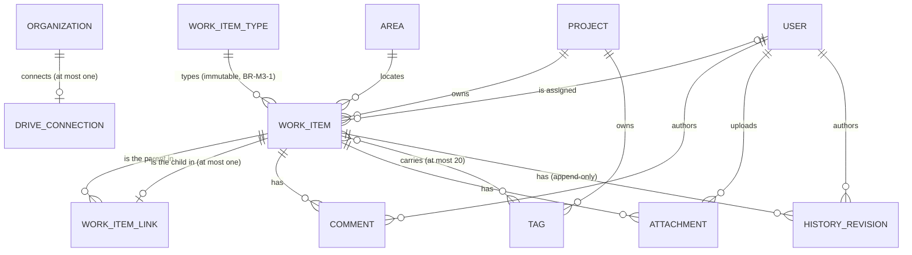
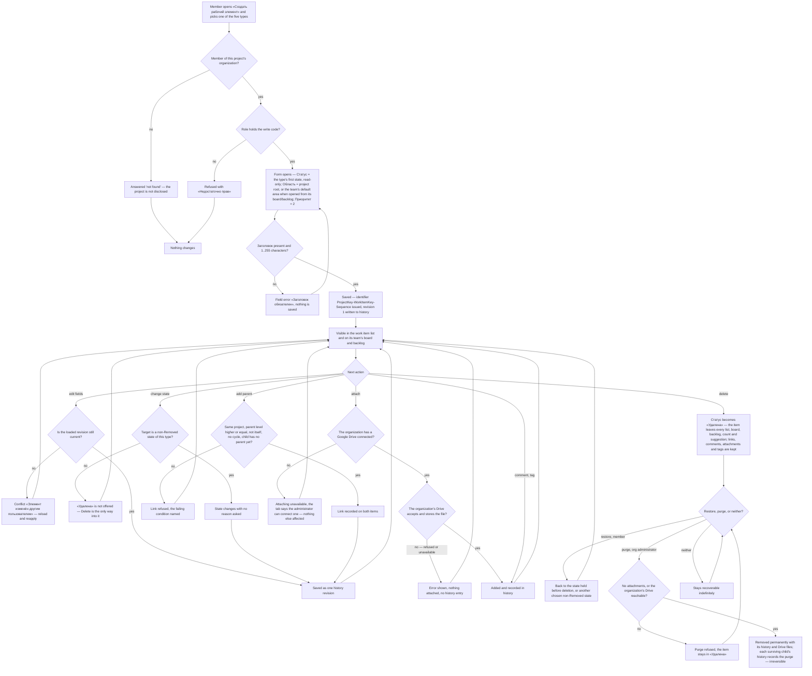

# Spec: Work items module (doc-002, module M3)

## Context and goal

M3 is the module every other MVP surface displays: boards, backlogs,
iteration planning and filters all read work items, and none can be built
until the work item — types, fields, states, links, comments, attachments,
tags, history — is pinned down. The umbrella
[doc-001](../doc-001-domain-map/spec.md) fixes M3's boundary, MVP fields and
the cross-module rules this spec cites by number; its decisions D-1..D-12,
this task's gate-1 answers W-1..W-13 (`status.md` § Decisions) and doc-010's
D-4..D-24 are binding. This spec turns the boundary into verifiable behaviour
and feeds the implementation lines of § Decomposition. Reference product:
Azure DevOps Boards only
([research](../doc-001-domain-map/research/ado-boards.md),
[screenshots](../doc-001-domain-map/screenshots/README.md) 05–09, 25, 26).

## Roles

Rights come from the user's `ORG_MEMBERSHIP.role` in the item's
organization, never a realm role, and MVP scopes no finer than the
organization (doc-001 § Roles, BR-5). A user with no membership there is
answered "not found", never "forbidden".

| Role | On a work item |
|---|---|
| Organization administrator (`admin`) | everything a member can, plus deleting any comment and removing any attachment as moderation, purging a deleted work item permanently (the only purge in MVP), and connecting or disconnecting the organization's Google Drive (US-13) |
| Member (`member`) | create, edit, change state, link, tag, comment, attach, delete and restore work items in every project of the organization; edits and deletes only their own comments and removes only their own attachments — an ownership predicate on the code, which goes with the role: an author whose role becomes `viewer` loses it (doc-001 § Roles) |
| Reader (`viewer`) | read work items, comments, attachments, links, tags and history; no write action is offered |

Permission codes (ADR-0018; analysis-level names of doc-010 § Permission codes,
exact strings the founder's) are registered by the slice that founds the
operation — each row of § Decomposition names its codes.

## Stories

| id | Title | depends-on | File |
|----|-------|------------|------|
| US-1 | A member creates a work item of one of the five types | - | `stories/US-1-create-work-item.md` |
| US-2 | A member edits a work item on its form | US-1 | `stories/US-2-edit-work-item-form.md` |
| US-3 | A member moves a work item through its states | US-1 | `stories/US-3-work-item-states.md` |
| US-4 | Every work item carries a stable, user-visible identifier | US-1 | `stories/US-4-work-item-identifier.md` |
| US-5 | A member builds the hierarchy with Parent/Child links | US-1 | `stories/US-5-parent-child-links.md` |
| US-6 | A member discusses a work item in comments | US-1 | `stories/US-6-work-item-comments.md` |
| US-7 | A member attaches files to a work item | US-1, US-13 | `stories/US-7-work-item-attachments.md` |
| US-8 | A member tags a work item | US-1 | `stories/US-8-work-item-tags.md` |
| US-9 | A member reads a work item's history | US-1, US-2 | `stories/US-9-work-item-history.md` |
| US-10 | A member deletes and restores a work item, an administrator purges it | US-1, US-3 | `stories/US-10-delete-restore-purge.md` |
| US-11 | A member finds work items in the list | US-1, US-8, US-10 | `stories/US-11-work-item-list-and-filters.md` |
| US-12 | A story carries acceptance criteria, a bug carries repro steps | US-2 | `stories/US-12-type-specific-fields.md` |
| US-13 | An organization administrator connects the organization's Google Drive | - | `stories/US-13-organization-google-drive.md` |

## Types, levels and states

The five built-in types (D-3, D-7, D-12), their backlog levels, their states
in seed order and each state's category are defined once, by M2's seed:
`doc-007` § MVP: the seeded process (`mod-001-process-seed`). Levels are
ordered Эпики > Фичи > Истории (Пользовательская история, Баг) > Задачи by
rank (doc-007 BR-M2-4). M3 relies on these properties of that table:

- one label set whatever the type's gender (W-7): «Новая», «Активна»,
  «Закрыта», «Удалена» on all five types, «Разрешена» on all but Задача
  (W-2, W-9); an item is created in its type's first state, «Новая»
  (doc-007 BR-M2-2);
- «Разрешена» is InProgress on Эпик, Фича and Пользовательская история and
  Resolved on Баг — the one label that maps to two categories. A state
  filter or query clause compares the label, so «Статус = Разрешена» returns
  items of both categories (US-11; doc-005 BR-M6-5); boards map columns per
  (type, state), so a История and a Баг in «Разрешена» sit in two different
  columns of the Истории board (doc-003 BR-M4-2).

## Fields in MVP

The single field catalogue of the work item: every name is the UI label, and
other modules (doc-005's query fields, doc-007's field layout) cite it.

| Поле | Kind | Required | Default | Rule |
|---|---|---|---|---|
| ID | identifier | system | issued at creation | `{ProjectKey}-{WorkItemKey}-{Sequence}`, read-only (BR-M3-5) |
| Тип | one of the five | yes, at creation | — | chosen in the create dialog, immutable afterwards (BR-M3-1) |
| Заголовок | single-line text | yes | — | 1..255 characters after trimming (BR-M3-3) |
| Описание | rich text | no | empty | ≤ 100 000 characters, fixed safe subset (BR-M3-4) |
| Статус | one of the type's states | yes | the type's first state (doc-007 BR-M2-2) | shown read-only on the create form — an item is always created in its first state, and a CSV row that names another state for a new item is rejected with the reason (doc-005 BR-M6-8); «Удалена» is never offered (doc-001 BR-10) |
| Исполнитель | user | no | unassigned | candidates = the current members of the item's organization whose account is active (doc-001 BR-13, doc-006 BR-M1-17). An inactive account is never offered; one already assigned stays, marked «неактивен». An assignee whose membership is removed stays, marked «не в организации» — this mark prevails over «неактивен» — and is never offered again until they are a member again; history is not rewritten (W-3) |
| Область | node of the project's area tree | yes | the project's root area; on an item created from a team's board or backlog, that team's default area (doc-006 BR-M1-14 — the first team's default is the root; doc-003 BR-M4-21) | must belong to the item's own project (doc-001 BR-3) |
| Приоритет | integer 1..4 | no | 2 | a plain integer, not a dictionary (doc-001 MVP table, M0 row) |
| Теги | set of project-scoped tags | no | none | ≤ 20 per item, each 1..50 characters (BR-M3-11); part of the form's field set, saved and revision-checked with it (doc-001 BR-11) |
| Итерация | optional iteration pointer | no | none — a team's default iteration is never assigned (doc-004 BR-M5-6) | the field and its form control are added by `mod-007-iterations` (D-4, doc-001 BR-7) |
| Критерии приёмки | rich text | no | empty | Пользовательская история only; as Описание (BR-M3-4); added by `feat-007-work-item-type-fields` (W-5, US-12) |
| Шаги воспроизведения | rich text | no | empty | Баг only; otherwise as Критерии приёмки |
| Дата изменения | timestamp | system | — | the time of the item's latest history revision, derived (§ Logical data model); the list sorts by it (US-11) |

## Logical data model (M3)

Logical level only — no tables, no endpoints. `PROJECT`, `AREA`, `USER`,
`ORGANIZATION` (M1) and `WORK_ITEM_TYPE` (M2) are endpoints M3 attaches to;
the iteration pointer is M5's (doc-004).

| Entity | Key attributes | Stored vs derived | Uniqueness |
|---|---|---|---|
| WORK_ITEM | project, type, number, the § Fields values, restore-target state, revision | stored; the identifier is derived from the project key, the type key and the number; created by/at and changed at are derived from its revisions; the restore-target state is stored when the item is deleted and cleared by Restore (doc-001 BR-10); the revision is the concurrency token (doc-001 BR-11) | number unique in the project, never reused (BR-M3-5) |
| WORK_ITEM_LINK | parent, child, kind (Parent/Child) | stored; who/when is in both items' histories | one parent per child, no cycle (BR-M3-8) |
| COMMENT | work item, author, text, posted at, edited at | stored; a deleted comment is removed, its existence and deletion stay in history (BR-M3-12) | — |
| ATTACHMENT | work item, file name, size, uploader, uploaded at, Drive file reference | stored; removal deletes the record (BR-M3-13) | several may share a name |
| TAG | project, spelling | a stored project entity; the spelling is the first one typed and is kept while no item uses it; it is offered only while a live item carries it (US-8) | unique in the project, case-insensitive, trimmed (BR-M3-11) |
| HISTORY_REVISION | work item, author, timestamp, the field changes (old → new) and acts (link, tag, comment, attachment, delete, restore, parent purged) of one write | stored, append-only, removed only by its item's purge; `mod-003`'s history ADR designs it, anticipating doc-006 BR-M1-15, `mod-010`'s Was Ever and `mod-012`'s metrics | one revision per save |
| DRIVE_CONNECTION | organization, connected by/at, disconnected by/at, credential reference | stored; the credential is a secret, never returned (BR-M3-16) | at most one per organization |

## Business process (BPMN)

## Business rules

Module rules are BR-M3-n. Cross-module rules are doc-001's and are cited by
number — BR-4 history, BR-6 deletion, BR-10 states, BR-11 concurrency,
BR-14 the participation of an item in «Удалена» (read-only for users),
BR-15 subtree matching; a number
missing from the sequence below is held there and is not reused.

| # | Rule | Source |
|---|------|--------|
| BR-M3-1 | A work item's type is chosen when it is created and never changes afterwards; changing type means creating a new item by hand in MVP. | doc-001 BR-1; research § Other capabilities (release 2) |
| BR-M3-2 | A work item belongs to exactly one project, and its Область, Теги, parent and children all belong to that same project. | doc-001 BR-1/BR-3/BR-8 |
| BR-M3-3 | Заголовок is trimmed before validation; a whitespace-only title is refused, and 255 characters is the hard limit, enforced on save and not only in the browser. | research § Fields |
| BR-M3-4 | Описание, Критерии приёмки, Шаги воспроизведения and comment text are rich text limited to a fixed safe subset — headings, bold, italic, lists, links, inline code, code blocks, tables; script, iframe, style and event attributes are stripped on save, and images are attachments, never inline data. | research § Fields (Описание is html); D-8 (images are attachments) |
| BR-M3-5 | The identifier is `{ProjectKey}-{WorkItemKey}-{Sequence}` — the project's key (set at project creation, never changed, unique within the organization: W-10, doc-006 BR-M1-1), the type's key (`EPIC`, `FEAT`, `US`, `TASK`, `BUG`: W-11, doc-007's seed) and a number from one sequence per project shared by all five types, e.g. `MSK-BUG-42`; the number alone is therefore unique within its project. It is issued once at creation, never reused — not even after a purge — and never changes in MVP, where neither a type change nor a move exists (§ Out of scope). Gaps are normal: a refused save may consume a number. An item's address carries its organization's internal id, and the identifier is resolved inside that organization (US-4). | W-6, W-10, W-11; doc-010 D-8 |
| BR-M3-8 | Parent/Child is the only link type in MVP. A work item has at most one parent; a link is refused unless both items are in the same project, the parent's backlog level is higher than **or equal to** the child's (a Баг may be a child of a Пользовательская история), the parent is not the item itself, and the link creates no cycle. **Replace parent** is a named, atomic operation: it removes the child's existing Parent link and adds a new one in one write, is refused under the same conditions as an add (the old link then stays), and is recorded as a removal on the old parent, an addition on the new one and one revision on the child. The backlog's mapping action uses it (doc-003 BR-M4-10); the form does not — there a second parent is refused, naming the existing one (US-5). | W-1; research § Link types; doc-010 N-18 |
| BR-M3-9 | Deleting a work item never cascades to its children: each child keeps its parent link, and while the parent is in «Удалена» the child is treated as unparented by backlogs and hierarchy views. The child may remove that link from its own side — recorded in both items' histories — or have it replaced by the backlog mapping (BR-M3-8). | this spec, US-10; doc-010 N-14 |
| BR-M3-11 | Tags are project-scoped, free-form, created by typing; matching is case-insensitive and whitespace-trimmed, so «Аудит» and «аудит» are one tag, and a tag from another project is never offered or shown. A tag carried only by items in «Удалена» is not suggested. | doc-001 BR-8, BR-14 |
| BR-M3-12 | A comment is edited or deleted by its author only while the author's role is `member` or `admin`, and deleted by an organization administrator as moderation. An edit keeps no earlier text: the comment carries an "edited" marker with the edit time, and history records that the text changed. A deleted comment's text disappears from the item, while the fact that it existed and was deleted stays in history. | doc-001 § Roles; doc-010 N-8, N-17 |
| BR-M3-13 | An attachment is added or removed, never edited in place; it is removed by its uploader while their role is `member` or `admin`, or by an organization administrator; removing one detaches it from the work item and is not undoable in MVP. | doc-001 Operation completeness; doc-010 N-8 |
| BR-M3-16 | Attachment files are stored through the Google Drive API in the Drive of the work item's organization — each organization connects its own (US-13) and holds only its own files. MUSTASK sets no size or count limit of its own, only that Drive's apply, so quota is per organization; there is no extension filter and no virus scan of MUSTASK's own (W-13). MUSTASK never shares a file to users inside Drive and serves every download only after its read check (doc-001 BR-5); who can open the organization's Drive directly — its owner, its Google Workspace administrators — is that organization's business, outside MUSTASK's control. A file the Drive refuses, or cannot take because it is unavailable, is not attached at all: the user sees an error, and neither the item nor its history changes. | W-8, W-12, W-13 |
| BR-M3-17 | With no Drive connected, attaching is unavailable with a message naming the organization administrator as the one who can connect it; nothing else on a work item changes. If the Drive is disconnected or its access breaks, existing attachments stay listed and their download fails with a visible error; nothing is removed from any item or its history, and a purge of an item with attachments is refused until the Drive is reachable (US-10). Removing an attachment never waits on the Drive: it leaves the item even while the Drive is unreachable (what becomes of its file is `mod-004`'s call, BR-M3-13). What reconnecting restores is `mod-004`'s ADR. | W-12 |
| BR-M3-18 | (release 2) The estimation fields of § Release 2 belong to the form's field set of the types that carry them — saved, history-recorded and revision-checked with it (doc-001 BR-4, BR-11) — and a write of one onto another type is refused. No field changes another automatically: closing a Задача leaves its «Оставшаяся работа» as entered (doc-001 D-6). | doc-010 D-15 |

## Release 2: estimation fields

Built by `feat-NNN-work-item-estimation-fields`, not by any MVP line; read
by doc-004's capacity, burndown, velocity and forecast (BR-M5-15, BR-M5-16).
Every field is optional; empty means "not estimated", never 0.

| Поле | Kind | Types | Reference-product field |
|---|---|---|---|
| Оценка в пунктах | number ≥ 0 | Пользовательская история, Баг | Story Points |
| Исходная оценка | hours ≥ 0 | Задача, Баг | Original Estimate |
| Оставшаяся работа | hours ≥ 0 | Задача, Баг | Remaining Work |
| Выполненная работа | hours ≥ 0 | Задача, Баг | Completed Work |
| Вид работ | one of a fixed M3 list, like Приоритет: «Развёртывание», «Проектирование», «Разработка», «Документирование», «Требования», «Тестирование» | Задача, Баг | Activity |

## Operation completeness

| Entity | Create | Read | Update | Delete/deactivate | Cancel/reverse |
|---|---|---|---|---|---|
| WorkItem | member, admin (US-1) | admin, member, viewer, within their own organization | member, admin, except while «Удалена» (US-2, doc-001 BR-14) | member, admin — soft, state «Удалена» (US-10, doc-001 BR-6) | member, admin restore (US-10); org admin purge — the one irreversible operation in M3, recorded on each surviving child |
| WorkItemLink (Parent/Child) | member, admin (US-5) | admin, member, viewer | no in place: the form removes and re-adds; the backlog mapping uses the atomic replace parent (BR-M3-8) | member, admin; a live child may remove its link to a deleted parent (BR-M3-9) | no: re-adding the link is the reversal, and both acts stand in history |
| Comment | member, admin (US-6) | admin, member, viewer | author, while their role is member or admin (BR-M3-12) | author (member or admin role), or admin as moderation (BR-M3-12) | no: an edit keeps no earlier text and a deletion keeps only the fact (BR-M3-12) |
| Attachment | member, admin (US-7) | admin, member, viewer — download; no in-browser preview in MVP | no: remove and add instead (BR-M3-13) | uploader (member or admin role), admin as moderation (BR-M3-13) | no: BR-M3-13; a purge deletes the item's files from Drive as well (US-10); whether a removed attachment's file stays in Drive is `mod-004`'s call, invisible to users |
| Tag | member, admin, by typing it on a work item (US-8) | admin, member, viewer | no: MVP has no tag-management screen; a tag is removed and another added | removed from a work item by member/admin; a tag no live item uses stops being offered, and nobody deletes it by hand in MVP | n/a |
| HistoryRevision | system only, on every write (doc-001 BR-4) | admin, member, viewer | no: append-only | no: it disappears only with its work item, on purge | n/a |
| Drive connection (one per organization) | admin (US-13), in the organization settings (doc-006 § Roles) | admin sees status, who and when — never the credentials; members and viewers see only whether attaching is available | no: disconnect and connect again | admin disconnects; files stay in the Drive (BR-M3-17) | no: connecting again is the reversal; what it restores is `mod-004`'s ADR |

## Non-functional requirements

- **Volumes and speed** (doc-001 NFR): server response times on a warm
  instance, one request at a time — the list within 2 s for 5 000 items in
  one project; opening or saving a form within 1 s each, an item with 500
  revisions included (history paged).
- **Size limits**: Заголовок ≤ 255; each rich-text field ≤ 100 000; a
  comment ≤ 10 000 characters; ≤ 20 tags of 1..50 characters; attachments —
  the organization's Google Drive limits only (BR-M3-16).
- **External service** (W-8, W-12): while an organization's Drive is down
  only that organization's attachment upload, download and purge-with-files
  fail, with a user-visible message; everything else keeps working. Each
  organization's Drive credentials are a secret of that organization: never
  shown back, never logged, never returned by the API; how they are stored is
  `mod-004`'s ADR.
- **Audit and retention** (doc-001 BR-4, BR-6): every create, field and
  state change — a board card move included, authored by the mover — link,
  tag, comment, attachment, delete and restore is attributable to a user and
  a timestamp; a deleted item stays recoverable indefinitely. Purge destroys
  the item with its history; each surviving child's history records
  «Родитель удалён навсегда: <идентификатор>», and the purge itself stays
  unattributed until the release-2 audit log.
- **Concurrency** (doc-001 BR-11): a form save — fields incl. Статус, Теги,
  type fields and Итерация — is revision-checked; adding a comment, an
  attachment or a link is a separate write that a stale field revision does
  not block; a board card move is last write wins and advances the revision.
- **Permissions** (doc-001 BR-5): a reader never sees a write control — the
  panel filters controls by the user's codes for the organization, obtained
  from Mustask.Api (doc-006 § Roles, constraint 7) — and the server refuses a
  write reached directly.
- **Localization**: UI copy is Russian; identifier keys are Latin (W-10, W-11).

## Out of scope

- The Reason field and per-transition rules — release 3 (D-6), explicitly
  including the ADO "Resolved Reason" picklist on a bug.
- Per-type fields other than W-5's two and § Release 2's estimation set —
  Effort, Business Value, Risk, Value Area, Severity, Start/Target dates:
  unplanned, left to `doc-NNN-release-2-scope` (doc-010 D-18).
- Link types other than Parent/Child (Related, Duplicate,
  Predecessor/Successor, Affects, hyperlinks, artifact links), change type,
  copy, move to another project, bulk edit and templates — release 2, scoped
  by `doc-NNN-release-2-scope`; a retyped or moved item's identifier is
  decided with those operations, so BR-M3-5's immutability holds in MVP.
- CSV import/export — release 3, M6, `feat-005-csv-import-export` only.
- @mentions, references, reactions, comment threading, follow/subscribe and
  notifications — release 2; `doc-NNN-release-2-scope` settles the owner.
- Inline images and attachment previews (MVP attaches and downloads);
  extension filtering and virus scanning of MUSTASK's own (W-13); an
  instance-wide, the uploader's own or a non-Google Drive, and moving files
  between Drives (W-12).
- Full-text search over rich text, comments and attachments — US-11 matches
  Заголовок and the identifier only; the rest is release 2/3 (M6, D-4).
- A separate «Корзина» screen: D-5 makes «Удалена» itself the bin, reached
  by filtering the list by that state (US-10, US-11).
- Board and backlog surfaces, card layout and stack rank — M4, `doc-003`;
  M3 never writes the order (doc-001 BR-12).

## Decomposition for the backlog

Seven lines are queued and keep their ids and sizes;
`feat-NNN-work-item-estimation-fields` is new (release 2) and keeps `NNN`
until the orchestrator queues it (`features/numbering.md`). Priority is top
to bottom; links, comments and type fields run in parallel. The read-only
rule for items in «Удалена» (doc-001 BR-14) is enforced by `mod-005` for the
writes that exist when it ships, and by each later line for its own writes.

| id | Task | size | deps |
|----|------|------|------|
| mod-003-work-item-core | Founds M3: the create dialog with the five types, the form and its common field set (§ Fields, incl. the Исполнитель markings and the read-only Статус at create), state changes, the identifier (BR-M3-5), project-scoped tags, the list surface without filters, history, and the logical data model; enforces doc-006 BR-M1-13's refusal to delete an area that holds any of its items, «Удалена» included (M1 ships before the items exist); registers `workitems.workitem.read`/`.write`; owes the history ADR (scope per § Logical data model) and the client-visible concurrency-token ADR (doc-001 BR-11, reused by `mod-006`). Covers US-1, US-2, US-3, US-4, US-8, US-9 and the list half of US-11 | L | mod-002-organizations-projects-teams, doc-002 |
| feat-001-work-item-links | Parent/Child links with BR-M3-8's refusals and the atomic replace parent used by `feat-004`'s backlog mapping, the child-side removal under a deleted parent (BR-M3-9), the links section of the form; registers `workitems.link.write`; enforces the read-only rule for its own writes. Covers US-5 | M | mod-003-work-item-core |
| feat-002-work-item-comments | Обсуждение: add, edit own, delete own, admin moderation, recorded in history (BR-M3-12); registers `workitems.comment.write` (ownership predicate) and `.moderate`; enforces the read-only rule for its own writes. Covers US-6 | M | mod-003-work-item-core |
| feat-007-work-item-type-fields | «Критерии приёмки» on Пользовательская история and «Шаги воспроизведения» on Баг (W-5) — rich text under BR-M3-4, no new mechanism; enforces the read-only rule for its own writes. Covers US-12 | M | mod-003-work-item-core |
| mod-005-work-item-delete-restore | Founds the recycle bin: delete → «Удалена», restore to the stored previous or a chosen state, the org-admin purge recording the purge on surviving children, the read-only rule and the no-cascade rule BR-M3-9; registers `workitems.workitem.delete` and `.purge`; owes the recycle-bin ADR, referencing `mod-002`'s soft-deactivation ADR. Covers US-10 | L | mod-003-work-item-core |
| mod-004-work-item-attachments | Founds the attachment storage pattern on each organization's own Google Drive (BR-M3-16, BR-M3-17): the organization-settings section to connect, check and disconnect it; upload, list, download, remove, that Drive's limits only, user-visible errors when no Drive is connected, when it refuses, is down or lost; deletes a purged item's files from Drive (US-10) and states whether a removed attachment's file is kept there; registers `workitems.attachment.write` (ownership predicate), `.moderate` and `workitems.attachment-storage.manage`; enforces the read-only rule for its own writes; owes the attachment-storage ADR — per-organization connections, credential storage, disconnect and recovery. Covers US-7, US-13 | L | mod-005-work-item-delete-restore |
| feat-003-work-item-search | Inline filters of the work item list: state incl. «Удалена» (the recycle bin), assignee incl. former members, tag, area with its sub-areas, and a keyword over Заголовок and the identifier. Covers the filter half of US-11; the board and backlog filter bar is doc-003's `feat-NNN-board-backlog-filter` | M | mod-003-work-item-core, mod-005-work-item-delete-restore |
| feat-NNN-work-item-estimation-fields | Release 2. The estimation fields of § Release 2 on their types, with the «Вид работ» list (BR-M3-18); enforces the read-only rule for its own writes | M | mod-003-work-item-core, doc-NNN-release-2-scope |

`mod-003` keeps the list surface (W-4): it cannot wait for `feat-003`. The
"connect a Drive" setting stays in `mod-004` (an external counterparty and
per-organization secrets, both `L` thresholds): it serves only attachments,
and `mod-004` adds it as a section of the organization settings `mod-002`
founds (doc-006 § Roles).

## Open questions

- [x] **OQ-1..OQ-8** closed at gate-1 by W-5..W-13 and R-23. No question is
      open.
