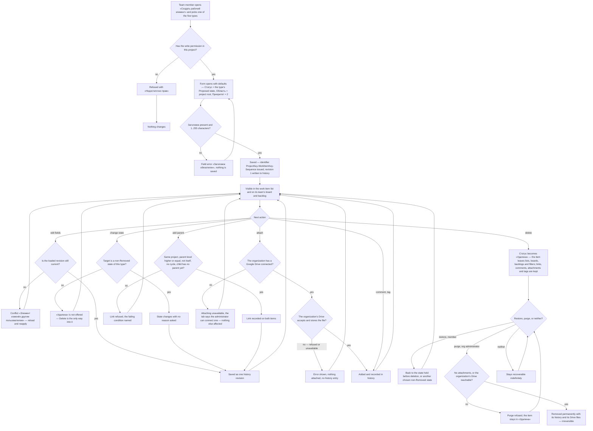

# Spec: Work items module (doc-002, module M3)

## Context and goal

M3 is the module every other MVP surface displays: boards, backlogs,
iteration planning and filters all read work items, and none can be built
until the work item — types, fields, states, links, comments, attachments,
tags, history — is pinned down. The umbrella
[doc-001](../doc-001-domain-map/spec.md) fixed M3's boundary, MVP fields and
cross-module rules BR-1..13; its decisions D-1..D-12 and this task's gate-1
answers W-1..W-13 (`status.md` § Decisions) are binding. This spec turns the
boundary into verifiable behaviour and feeds seven implementation lines
(§ Decomposition). Reference product: Azure DevOps Boards only
([research](../doc-001-domain-map/research/ado-boards.md),
[screenshots](../doc-001-domain-map/screenshots/README.md) 05–09, 25, 26).

## Roles

Unchanged from the umbrella (§ Roles, D-9/BR-5): rights come from the user's
`ORG_MEMBERSHIP.role` in the item's organization, never a realm role, and MVP
scopes no finer than the organization.

| Role | On a work item |
|---|---|
| Organization administrator (`admin`) | everything a member can, plus deleting any comment and removing any member's attachment as moderation, purging a deleted work item permanently, and connecting or disconnecting the organization's Google Drive (US-13; W-12 names no role — like every org-wide setting, doc-001 § Roles) |
| Member (`member`) | create, edit, change state, link, tag, comment, attach, delete and restore work items in every project of that organization; an attachment is removed only by whoever uploaded it (doc-001 Operation completeness) |
| Reader (`viewer`) | read work items, comments, attachments, links, tags and history; no write action is offered |

Permission codes (`PermissionCatalog`, ADR-0018) are registered slice by
slice: work item read/write/delete by `mod-003`, comment moderation by
`feat-002`, attachment removal and the Drive connection by `mod-004`, purge
by `mod-005`. This spec
only fixes who may do what.

## Stories

| id | Title | depends-on | File |
|----|-------|------------|------|
| US-1 | A team member creates a work item of one of the five types | - | `stories/US-1-create-work-item.md` |
| US-2 | A team member edits a work item on its form | US-1 | `stories/US-2-edit-work-item-form.md` |
| US-3 | A team member moves a work item through its states | US-1 | `stories/US-3-work-item-states.md` |
| US-4 | Every work item carries a stable, user-visible identifier | US-1 | `stories/US-4-work-item-identifier.md` |
| US-5 | A team member builds the hierarchy with Parent/Child links | US-1 | `stories/US-5-parent-child-links.md` |
| US-6 | A team member discusses a work item in comments | US-1 | `stories/US-6-work-item-comments.md` |
| US-7 | A team member attaches files to a work item | US-1, US-13 | `stories/US-7-work-item-attachments.md` |
| US-8 | A team member tags a work item | US-1 | `stories/US-8-work-item-tags.md` |
| US-9 | A team member reads a work item's history | US-1, US-2 | `stories/US-9-work-item-history.md` |
| US-10 | A team member deletes, restores and purges a work item | US-1, US-3 | `stories/US-10-delete-restore-purge.md` |
| US-11 | A team member finds work items in the list | US-1, US-8, US-10 | `stories/US-11-work-item-list-and-filters.md` |
| US-12 | A story carries acceptance criteria, a bug carries repro steps | US-2 | `stories/US-12-type-specific-fields.md` |
| US-13 | An organization administrator connects the organization's Google Drive | - | `stories/US-13-organization-google-drive.md` |

## Types, levels and states

The five built-in types (D-3, D-7, D-12) and the states M3 requires of M2's
seed (`doc-007`, `mod-001-process-seed`, which own the definition).
Categories are what boards and backlogs read (BR-2); state names are Russian
UI copy, one label set for all five types whatever their gender (W-7).

| Тип | Backlog level | States → category |
|---|---|---|
| Эпик | Эпики | «Новая»→Proposed, «Активна»→InProgress, «Разрешена»→InProgress, «Закрыта»→Completed, «Удалена»→Removed |
| Фича | Фичи | as Эпик |
| Пользовательская история | Истории | as Эпик |
| Баг | Истории | «Новая»→Proposed, «Активна»→InProgress, «Разрешена»→**Resolved**, «Закрыта»→Completed, «Удалена»→Removed |
| Задача | Задачи | «Новая»→Proposed, «Активна»→InProgress, «Закрыта»→Completed, «Удалена»→Removed |

This mirrors the reference product's Agile process: «Разрешена» is
in-progress everywhere except on a bug (research; screenshot 26) and stays on
Эпик and Фича (W-9). Баг alone reaches Resolved — the board-column
consequence `doc-003` owns is in US-3.

**Errata to doc-001** (W-2): doc-001's approved US-3
(`../doc-001-domain-map/stories/US-3-built-in-process.md`) names the «Задача»
states «Новая»/«Выполняется»/«Готово»; it is superseded on this point by the
row above, and the «Выполняется» examples in its US-6 and US-10 read
«Активна». doc-001 is not reopened.

## Fields in MVP

One common field set on all five types (doc-001's M3 MVP line), plus two
type-specific rich-text fields (W-5).

| Поле | Kind | Required | Default | Rule |
|---|---|---|---|---|
| Тип | one of the five | yes, at creation | — | chosen in the create dialog, immutable afterwards (BR-1) |
| Заголовок | single-line text | yes | — | 1..255 characters after trimming (BR-3) |
| Описание | rich text | no | empty | ≤ 100 000 characters, fixed safe subset (BR-4) |
| Статус | one of the type's states | yes | the type's Proposed state | «Удалена» never offered here (BR-6) |
| Исполнитель | user | no | unassigned | candidates = every current member of the item's organization (doc-001 BR-13); an assignee whose membership is later removed stays on the item, shown as a former member, and is never offered for a new assignment; history is not rewritten (W-3) |
| Область | node of the project's area tree | yes | the project's root area | must belong to the item's own project (doc-001 BR-3) |
| Приоритет | integer 1..4 | no | 2 | a plain integer, not a dictionary (doc-001 MVP table, M0 row) |
| Теги | set of project-scoped tags | no | none | ≤ 20 per item, each 1..50 characters (BR-11); part of the form's field set — saved and concurrency-guarded with it (BR-15) |
| Итерация | optional iteration pointer | no | none | the field itself, and its control on the form, are added by `mod-007-iterations` (D-4, doc-001 BR-7) |
| Критерии приёмки | rich text | no | empty | Пользовательская история only; as Описание (≤ 100 000, BR-4); added by `feat-NNN-work-item-type-fields` (W-5, US-12) |
| Шаги воспроизведения | rich text | no | empty | Баг only; otherwise as Критерии приёмки |

## Business process (BPMN)

## Business rules

Module rules; the cross-module ones they rest on are cited by their doc-001
number.

| # | Rule | Source |
|---|------|--------|
| BR-1 | A work item's type is chosen when it is created and never changes afterwards; changing type means creating a new item by hand in MVP. | doc-001 BR-1; research § Other capabilities (release 2) |
| BR-2 | A work item belongs to exactly one project, and its Область, Теги, parent and children all belong to that same project. | doc-001 BR-1/BR-3/BR-8 |
| BR-3 | Заголовок is trimmed before validation; a whitespace-only title is refused, and 255 characters is the hard limit, enforced on save and not only in the browser. | research § Fields |
| BR-4 | Описание, Критерии приёмки, Шаги воспроизведения and comment text are rich text limited to a fixed safe subset — headings, bold, italic, lists, links, inline code, code blocks, tables; script, iframe, style and event attributes are stripped on save, and images are attachments, never inline data. | research § Fields (Описание is html); D-8 (images are attachments) |
| BR-5 | The identifier is `{ProjectKey}-{WorkItemKey}-{Sequence}` — the project's key (set at project creation, never changed, unique within the organization — W-10), the type's key (`EPIC`, `FEAT`, `US`, `TASK`, `BUG` — W-11) and a number from one sequence per project shared by all five types, e.g. `MSK-BUG-42`; the number alone is therefore unique within its project. It is issued once at creation, never reused — not even after a purge — and never changes in MVP, where neither a type change nor a move exists (§ Out of scope). Gaps are normal: a refused save may consume a number, and nothing promises consecutive ones. | W-6, W-10, W-11 |
| BR-6 | The Статус control offers only the non-Removed states of the item's own type; «Удалена» is reached only through Delete and left only through Restore. | doc-001 BR-10, D-6 |
| BR-7 | Any non-Removed state may move directly to any other with no reason asked and no rule check. | doc-001 BR-10, D-6 |
| BR-8 | Parent/Child is the only link type in MVP. A work item has at most one parent; a link is refused unless both items are in the same project, the parent's backlog level is higher than **or equal to** the child's (a Баг may be a child of a Пользовательская история), the parent is not the item itself, and the link creates no cycle. | W-1; research § Link types (tree topology: one parent, no cycles) |
| BR-9 | Deleting a work item never cascades to its children: each child keeps its parent link, and while the parent is deleted the child is treated as unparented by backlogs and hierarchy views until the parent is restored. | this spec, US-10 |
| BR-10 | Every create, field change, state transition, link add/remove, tag add/remove, comment add/edit/delete, attachment add/remove, delete and restore is recorded in the item's history with who and when; one save is one revision, however many fields it touched; history is append-only and is never edited or deleted on its own. | doc-001 BR-4 |
| BR-11 | Tags are project-scoped, free-form, created by typing; matching is case-insensitive and whitespace-trimmed, so «Аудит» and «аудит» are one tag, and a tag from another project is never offered or shown. | doc-001 BR-8 |
| BR-12 | A comment may be edited only by its author and deleted by its author or by an organization administrator; a deleted comment's text disappears from the item, while the fact that it existed and was deleted stays in history. | doc-001 Operation completeness |
| BR-13 | An attachment is added or removed, never edited in place; removing one detaches it from the work item and is not undoable in MVP. | doc-001 Operation completeness |
| BR-14 | A deleted work item is read-only: it may be restored or purged, but not edited, commented on, re-linked or re-tagged while it is in «Удалена». | this spec, US-10 |
| BR-15 | Optimistic concurrency (doc-001 BR-11, ADR-0010) guards the work item's own field set, Теги included; adding a comment, an attachment or a link is a separate write that a stale field revision does not block and that does not itself provoke a conflict. | doc-001 BR-11 |
| BR-16 | Attachment files are stored through the Google Drive API in the Drive of the work item's organization — each organization connects its own (US-13) and holds only its own files. MUSTASK sets no size or count limit of its own, only that Drive's apply, so quota is per organization; there is no extension filter and no virus scan of MUSTASK's own (W-13). MUSTASK never shares a file to users inside Drive and serves every download only after its read check (doc-001 BR-5); who can open the organization's Drive directly — its owner, its Google Workspace administrators — is that organization's business, outside MUSTASK's control. A file the Drive refuses, or cannot take because it is unavailable, is not attached at all: the user sees an error, and neither the item nor its history changes. | W-8, W-12, W-13 |
| BR-17 | With no Drive connected, attaching is unavailable with a message naming the organization administrator as the one who can connect it; nothing else on a work item changes. If the Drive is disconnected or its access breaks, existing attachments stay listed and their download fails with a visible error; nothing is removed from any item or its history, and a purge of an item with attachments is refused until the Drive is reachable (US-10). Removing an attachment never waits on the Drive: it leaves the item even while the Drive is unreachable (what becomes of its file is `mod-004`'s call, BR-13). What reconnecting restores is `mod-004`'s ADR. | W-12 |

## Operation completeness

| Entity | Create | Read | Update | Delete/deactivate | Cancel/reverse |
|---|---|---|---|---|---|
| WorkItem | member, admin (US-1) | admin, member, viewer, within their own organization | member, admin, except while «Удалена» (US-2, BR-14) | member, admin — soft, state «Удалена» (US-10, doc-001 BR-6) | member, admin restore (US-10); admin purge is the one irreversible operation in M3 |
| WorkItemLink (Parent/Child) | member, admin (US-5) | admin, member, viewer | no: a link is removed and re-added, never edited (doc-001 Operation completeness) | member, admin | no: re-adding the link is the reversal, and both acts stand in history |
| Comment | member, admin (US-6) | admin, member, viewer | author only, own comment (BR-12) | author, or admin as moderation (BR-12) | no: an edit or a deletion is itself recorded, the earlier text is not restorable in MVP |
| Attachment | member, admin (US-7) | admin, member, viewer — download; no in-browser preview in MVP | no: remove and add instead (BR-13) | member (own), admin (doc-001 Operation completeness) | no: BR-13; a purge deletes the item's files from Drive as well (US-10); whether a removed attachment's file stays in Drive is `mod-004-work-item-attachments`' call, invisible to users |
| Tag | member, admin, by typing it on a work item (US-8) | admin, member, viewer | no: MVP has no tag-management screen, so a tag is not renamed — it is removed and another added (doc-001, release 2) | removed from a work item by member/admin; a project tag no item uses stops being offered, but nobody deletes it by hand in MVP | n/a |
| HistoryRevision | system only, on every write (BR-10) | admin, member, viewer | no: append-only | no: it disappears only with its work item, on purge | n/a |
| Drive connection (one per organization) | admin (US-13) | admin sees status, who and when — never the credentials; members and viewers see only whether attaching is available | no: disconnect and connect again | admin disconnects; files stay in the Drive (BR-17) | no: connecting again is the reversal; what it restores is `mod-004`'s ADR |

## Non-functional requirements

- **Volumes and speed** (doc-001 NFR): server response times on a warm
  instance, one request at a time — the list within 2 s for 5 000 items in
  one project; opening or saving a form within 1 s each, an item with 500
  revisions included (history paged).
- **Size limits**: Заголовок ≤ 255; each rich-text field ≤ 100 000; a
  comment ≤ 10 000 characters; ≤ 20 tags of 1..50 characters; attachments —
  the organization's Google Drive limits only (BR-16).
- **External service** (W-8, W-12): while an organization's Drive is down
  only that organization's attachment upload, download and purge-with-files
  fail, with a user-visible message; everything else keeps working. Each
  organization's Drive credentials are a secret of that organization: never
  shown back, never logged, never returned by the API; how they are stored is
  `mod-004`'s ADR.
- **Audit and retention** (doc-001 BR-4/BR-6): every change is attributable
  to a user and a timestamp; a deleted item stays recoverable indefinitely.
  Purge destroys the item with its history and MVP keeps no tombstone — an
  instance-level audit log is release 2.
- **Concurrency**: BR-15. **Permissions**: doc-001 BR-5 — a reader never
  sees a write control, and the server refuses a write reached directly.
- **Localization**: types, states, labels and messages are Russian; code and
  documentation are English; identifier keys are Latin (W-10, W-11).

## Out of scope

- The Reason field and per-transition rules — release 3 (D-6), explicitly
  including the ADO "Resolved Reason" picklist on a bug.
- Per-type fields of the reference product other than the two of W-5 —
  Story Points, Effort, Business Value, Risk, Value Area, Severity, Activity,
  Original/Remaining/Completed Work, Start/Target dates — release 2.
- Every link type except Parent/Child: Related, Duplicate,
  Predecessor/Successor, Affects, hyperlinks and artifact links — release 2.
- Change type, copy, move to another project, bulk edit, templates, CSV
  import/export — release 2 (doc-001 release plan). The identifier embeds
  both keys, so what a retyped or moved item's identifier becomes is decided
  with those operations; MVP has neither, so BR-5's immutability holds.
- @mentions, references, reactions, comment threading, follow/subscribe and
  notifications — release 2 (doc-001 Out of scope).
- Inline images in rich text and attachment previews — MVP attaches and
  downloads (BR-16). File-extension filtering and virus scanning of
  MUSTASK's own — none in MVP (W-13).
- An instance-wide Drive, the uploader's own Drive, storage other than Google
  Drive, and moving files between Drives — only per-organization Drive (W-12).
- Full-text search over rich text, comments and attachments — US-11 matches
  Заголовок and the identifier only; the rest is release 2/3 (M6, D-4).
- A separate «Корзина» screen: D-5 makes «Удалена» itself the bin, reached
  by filtering the list by that state (US-10, US-11).
- Board and backlog surfaces, card layout and stack rank — M4, `doc-003`,
  including whether a restored item regains its backlog position; M3 never
  writes the order (doc-001 BR-12).

## Decomposition for the backlog

Six lines are **already queued** and keep their ids, `deps` and sizes;
`feat-NNN-work-item-type-fields` is new and keeps `NNN` until the
orchestrator queues it (`features/numbering.md`). Priority is top to bottom;
links, comments and type fields run in parallel.

| id | Task | size | deps |
|----|------|------|------|
| mod-003-work-item-core | Founds M3: the create dialog with the five types, the work item form and its common field set, state changes, the identifier `{ProjectKey}-{WorkItemKey}-{Sequence}` (BR-5), project-scoped tags, the work item list surface without filters, and history (BR-10); owes the history/audit ADR. Covers US-1, US-2, US-3, US-4, US-8, US-9 and the list half of US-11 | L | mod-002, mod-001, doc-002 |
| feat-001-work-item-links | Parent/Child links with the refusal conditions of BR-8 and the links section of the form. Covers US-5 | M | mod-003 |
| feat-002-work-item-comments | Обсуждение: add, edit own, delete own, admin moderation, all recorded in history (BR-12). Covers US-6 | M | mod-003 |
| feat-NNN-work-item-type-fields | «Критерии приёмки» on Пользовательская история and «Шаги воспроизведения» on Баг (W-5) — rich text under BR-4, no new mechanism. Covers US-12 | M | mod-003 |
| mod-004-work-item-attachments | Founds the attachment storage pattern on each organization's own Google Drive (BR-16, BR-17): the organization setting to connect, check and disconnect it; upload, list, download, remove, that Drive's limits only, user-visible errors when no Drive is connected, when it refuses, is down or lost; deletes a purged item's files from Drive (US-10) and states whether a removed attachment's file is kept there (BR-13); owes the attachment-storage ADR — per-organization Drive connections, credential storage, disconnect and recovery. Covers US-7, US-13 | L | mod-003 |
| mod-005-work-item-delete-restore | Founds the soft-delete pattern: delete → «Удалена», restore to the previous or a chosen state, administrator purge, the read-only rule BR-14 and the no-cascade rule BR-9; owes the soft-delete ADR. Covers US-10 | L | mod-003 |
| feat-003-work-item-search | Inline filters of the list and the board by state, assignee (former members included, W-3), tag and area, **plus a keyword filter over Заголовок and the identifier** and reaching deleted items through the state filter. Covers the filter half of US-11 | M | mod-003, mod-006 |

For the orchestrator's queue edits:

- **mod-003 grew by the list surface** (W-4) — it cannot wait for `feat-003`,
  which depends on `mod-006`; size stays `L`, the `note:` records the growth.
- **Two keys are required of upstream**, not owned by M3. Of `mod-002` /
  `doc-006-org-access` (W-10): the organization administrator sets the
  project key at project creation — 2..10 Latin capitals and digits starting
  with a letter, unique within the organization (deleted projects included),
  never changed. Of `mod-001-process-seed` / `doc-007` (W-11): the seed fixes
  `EPIC`/`FEAT`/`US`/`TASK`/`BUG`, not editable. All four lines carry it.
- **mod-004 gains an external counterparty and per-organization secrets**
  (W-8, W-12), both `L` thresholds; already `L`. **The "connect a Drive"
  setting stays in `mod-004`**: it serves only attachments, and moving it to
  `mod-002` would put the Drive integration and its secrets into M1.
  `mod-004` adds a section to the organization settings `mod-002` founds
  (a transitive dep via `mod-003`); `doc-006` only notes that it will exist.

## Open questions

- [x] **OQ-1..OQ-8** closed at gate-1: W-5 per-type fields (US-12), W-6
      identifier, W-7 one label set, W-8 Drive's limits only, W-9 «Разрешена»
      kept; round 2 — W-10 project key and W-11 type keys (required of
      upstream, BR-5), W-12 Drive per organization (BR-16/17, US-13), W-13 no
      extension filter or virus scan (R-23). No question is open.
