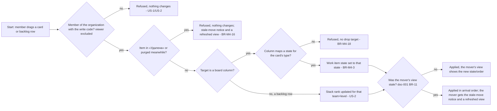

# Spec: Backlogs and boards (doc-003, module M4 deep dive)

## Context and goal

A team turns its assigned work items into a workable plan two ways: an
ordered backlog per level, so it agrees what is next, and a Kanban board per
level, so it tracks flow without opening every item. This deep dive refines
module M4 of the domain map (`doc-001`) — the `BOARD`, `BOARD_COLUMN`,
`SWIMLANE` and `BACKLOG_ENTRY` entities — into behaviour ready for
`mod-006-boards-backlogs` and its follow-ups `feat-004-backlog-hierarchy`
(DD-3) and `feat-NNN-board-backlog-filter` (doc-010 D-14): which levels get a
board (D-3), how a board's columns map to states per (type, state) (doc-010
D-4, D-5), how the backlog stays ordered under concurrent drags and filters
(`doc-001` BR-11, BR-12), how the parent/child hierarchy surfaces on the
backlog, how a project's several teams (doc-004 E-5) each get their boards,
and the MVP cut that leaves WIP limits, custom columns/swimlanes and the
Задачи-level taskboard for release 2.

## Roles

Board and backlog access follows the organization membership role on
`ORG_MEMBERSHIP` (D-9, `../doc-001-domain-map/spec.md` § Roles); there is
no board- or backlog-specific role. Team membership carries no access of its
own (doc-006 § Roles): every member of the organization reads every team's
boards and backlogs, and a member or administrator acts on all of them; team
membership only decides which team's board and backlog a user's view opens
on by default. A user with no membership in the organization is answered
"not found" (doc-001 BR-5).

| Role | Can, on any team's board or backlog of their organization |
|---|---|
| Reader (`viewer`) | Open it; see every column, swimlane, card and the current order; cannot move a card, reorder, assign a parent or create an item. |
| Member (`member`) | Everything a reader can, plus: drag a card between columns (writes the work item's state through M3, `workitems.workitem.write`, US-1); drag an entry in the backlog (writes its stack rank, `boards.backlog.reorder`, US-2); assign or clear a parent from the backlog view (M3's Parent/Child link, `workitems.link.write`, US-3); create a work item from the board or backlog (`workitems.workitem.write`, US-4). |
| Organization administrator (`admin`) | Everything a member can; MVP has no admin-only board/backlog operation. Board configuration — columns, swimlanes, WIP (release 2) — will be the organization administrator's, as every team-level setting is (doc-001 § Roles). |

## Stories

| id | Title | depends-on | File |
|----|-------|------------|------|
| US-1 | A member works a team's Kanban board for a level | - | `stories/US-1-kanban-board-per-level.md` |
| US-2 | A member orders a team's backlog for a level | - | `stories/US-2-order-the-backlog.md` |
| US-3 | A member navigates the parent/child hierarchy on a team's backlog | US-2 | `stories/US-3-backlog-hierarchy.md` (delivered by `feat-004-backlog-hierarchy` — DD-3) |
| US-4 | A member creates a work item from a team's board or backlog | US-1, US-2 | `stories/US-4-create-from-board-or-backlog.md` |

## Business process (BPMN)

## Business rules

Module rules are BR-M4-n; cross-module rules are `doc-001`'s, cited by
number — BR-11 concurrency (the card-move, reorder and mapping policies),
BR-12 stack rank; a number missing below is held there and is not reused.

| # | Rule | Source (document / decision) |
|---|------|------------------------------|
| BR-M4-1 | Эпики, Фичи and Истории each have exactly one board per team; Задачи has an ordered backlog list only, no board — the Sprint Taskboard is release 2, owned by M5 on M4's `BOARD` (doc-004). | `doc-001` D-3, MVP table |
| BR-M4-2 | A board's columns map per (type, state). Each non-Removed state of each type at the level belongs to exactly one column, and a column holds at most one state per type. Columns follow the category order Proposed → InProgress → Resolved → Completed; within a category a level has as many columns as the most states any of its types has there, and its k-th column maps each type to that type's k-th state of the category in seed order (`doc-007` § MVP: the seeded process), or to none (BR-M4-18). The first column of a category is headed by the category's label from `doc-007` («Новые», «В работе», «Решённые», «Завершённые»); a further column of the same category is headed by the label of the state it maps. Removed has no column (BR-M4-16). For the seeded process this gives § Board columns. | `doc-001` BR-2; doc-010 D-4, D-5, D-23 (c) |
| BR-M4-3 | A card has no stored board position: its column is the one its type's current state maps to (BR-M4-2), computed on read. Dragging a card writes `WORK_ITEM.state` to the state the target column maps for the card's type — the same state write the form performs (`doc-001` US-4), under the card-move policy of `doc-001` BR-11 (last write wins, no check, advances the revision); the board is a view, never a copy. | `doc-001` Module map § M4; doc-010 D-4 |
| BR-M4-4 | MVP seeds exactly one, unnamed default swimlane per board; every card is in it; there is no swimlane picker in MVP UI. | `status.md` § Decisions |
| BR-M4-5 | A `BACKLOG_ENTRY` exists for a work item at exactly one (team, level) pair — the team owning its Area (`doc-001` BR-3: every area resolves to exactly one owning team) and the level its type belongs to. | `doc-001` ER model, BR-3 |
| BR-M4-6 | A work item entering a team+level backlog it is not in — created (also from a board or backlog, BR-M4-21), moved in because its Area's owning team changed (also by a team's deletion, BR-M4-20), or restored after such a change (BR-M4-17) — is appended at the bottom, as the last row of that list; its former rank is not carried over. A team member repositions it by dragging. Which end of the numeric rank scale is the bottom is design's. | research § Backlogs; `doc-001` BR-12 |
| BR-M4-8 | Drag and drop is the only reorder primitive in MVP (`doc-001` MVP table, M4 row): an entry reaches the top or the bottom by being dragged there. There is no numeric rank field and no "move to top/bottom" command. Creating a new work item at a chosen position (the reference product's "add at top") is release 2; MVP creates from a board or backlog at the bottom only (BR-M4-21). | `doc-001` MVP table (M4); research § Backlogs & sprints |
| BR-M4-9 | The backlog's parent/child display reads M3's Parent/Child `WorkItemLink` (`doc-002`, `feat-001-work-item-links`); M4 stores no hierarchy data of its own. Expanding or collapsing a row only toggles whether its children show — it never changes the order (`doc-001` BR-12). | `doc-001` ER model (`WORK_ITEM_LINK`, owner M3) |
| BR-M4-10 | The mapping action (assigning a parent from the backlog view) writes M3's Parent/Child link: it adds the link to a child with no parent, re-parents a child that has one through M3's atomic replace parent (`doc-002` BR-M3-8), and clearing removes the link; it never creates a second link type or a duplicate. It offers as parents only items of the level directly above the child's — M4's own narrowing of `doc-002`'s "higher or equal" (W-1); a same-level or level-skipping parent is set on the work item form. A child whose parent is in «Удалена» is treated as having no parent: the mapping offers to assign one, which replaces the link to the deleted parent (`doc-002` BR-M3-9). Two members mapping one child at once: the one-parent invariant holds and the later write is refused (`doc-001` BR-11). | research § Backlogs & sprints (mapping pane); doc-010 N-14, N-18 |
| BR-M4-11 | A level's backlog lists that level's own entries as top-level rows, in stack-rank order; nesting appears only beneath an expanded row, and only for its children on the same team's backlog exactly one level below (BR-M4-9). A work item with no parent, a parent in «Удалена», a parent on its own level or more than one level above, or a parent on another team's backlog is nested beneath no row — it is a top-level row on its own level's backlog. This is normal, not an error. Showing the level above's parents as grouping rows on a lower level's backlog is release 2. | research § Backlogs & sprints; `doc-001` BR-12 |
| BR-M4-13 | A project has one or more teams in MVP (doc-004 E-5; doc-006 BR-M1-9). M4 guarantees one board per portfolio/requirement level and one backlog per level for every team — a team added later and a team that existed before M4 shipped included; whether it creates them when the team is created or on first read is design's. When M4 ships, every existing work item gets its `BACKLOG_ENTRY`, ordered by identifier number (creation order); an item already in «Удалена» gets a hidden one (BR-M4-16). The cross-team behaviours of BR-M4-5, BR-M4-6 and BR-M4-11 — an Area re-owned between teams, a parent on another team's backlog — are MVP behaviour, accepted with two real teams. | doc-004 E-5; doc-010 N-2, N-30 |
| BR-M4-14 | A card shows, at minimum, the work item's identifier, Заголовок, Исполнитель, Приоритет and Теги; a backlog row shows the same fields plus Статус. Both are drawn from `doc-002` § Fields; which fields show is fixed in MVP — no per-type or per-card customization (release 2). | `doc-001` MVP table, M3 row |
| BR-M4-15 | Inside a column, cards are ordered by the level's backlog stack rank — the same order the team's backlog list uses, not a separate board-only order. Dragging a card vertically within the same column reorders it exactly as a backlog drag would (BR-M4-8); dragging a card into another column only changes its state (BR-M4-3) — its position in the new column follows from its unchanged stack rank. | This spec, BR-M4-3, BR-M4-8 |
| BR-M4-16 | A work item in «Удалена» is on no board and no backlog (`doc-001` BR-14): no column maps Removed, and every team+level backlog excludes it. Its `BACKLOG_ENTRY` is retained but hidden — not deleted — so a restore can return it to its former position (BR-M4-17). A card move or reorder that reaches an item which is in «Удалена» or purged — from a view that still showed it — is refused, nothing changes and no history is written, and the mover gets the stale-move notice and a refreshed view (`doc-001` BR-11, BR-14). | `doc-001` BR-10, BR-14, D-5; doc-010 N-14 |
| BR-M4-17 | Restoring a work item (`doc-002` US-10) reinstates its `BACKLOG_ENTRY` at the position its retained stack rank holds — its former position, not the bottom. If its Area was re-owned by another team while it was deleted, the entry is re-scoped on restore and appended at the bottom of the new owning team's backlog (BR-M4-6). | `doc-001` BR-10; doc-010 N-14 |
| BR-M4-18 | A card cannot be dropped on a column that maps no state of its type (BR-M4-2): the board offers no drop target for that card there, and a direct request to move it there is rejected, with the work item's state unchanged. This is normal — the column exists for another type at the same level. | DD-1; doc-010 D-4 |
| BR-M4-20 | When a team is deleted (doc-006 BR-M1-18) its boards and backlogs are hidden with it, never deleted: no surface lists them and no write reaches them. The team's areas are re-owned to the project's first team first, so each of its live work items is re-scoped under BR-M4-6 — appended at the bottom of the first team's backlog at its level, keeping their relative order; an item in «Удалена» is re-scoped when restored (BR-M4-17). | doc-010 D-6 |
| BR-M4-21 | A member or administrator creates a work item from a team's board or backlog: M3's create dialog (`doc-002` US-1) opens with the type picker limited to the level's types and Область preset to the team's default area (doc-006 BR-M1-14; for the project's first team, the root area). The item is appended at the bottom of that team's backlog at its level (BR-M4-6) and, on a board, appears in the column of its first state. If Область is changed in the dialog, the item goes to the backlog of the team owning the chosen area (BR-M4-5). | doc-010 D-7 |
| BR-M4-22 | The team's board and backlog carry the inline filter bar of the work item list (`doc-002` US-11) — state, assignee incl. former and inactive members, tag, area with its sub-areas, keyword — over the team's own items at the level; «Удалена» is not offered (BR-M4-16). A filter hides cards and rows and never changes the order: a drag inside a filtered view reorders relative to the full list (`doc-001` BR-12). doc-004's iteration filter joins this bar (doc-004 US-13). | doc-010 D-14 |

### Board columns

The seeded process under BR-M4-2 (header → the state a drop writes, per
type; "—" = no drop target, BR-M4-18). The two «Разрешена» states of the
Истории level are in two categories (`doc-002` § Types), so they sit in two
columns.

| Level | Columns, in order |
|---|---|
| Эпики | «Новые» → «Новая» · «В работе» → «Активна» · «Разрешена» → «Разрешена» · «Завершённые» → «Закрыта» |
| Фичи | as Эпики, for Фича |
| Истории | «Новые» → История «Новая», Баг «Новая» · «В работе» → История «Активна», Баг «Активна» · «Разрешена» → История «Разрешена», Баг — · «Решённые» → История —, Баг «Разрешена» · «Завершённые» → История «Закрыта», Баг «Закрыта» |
| Задачи | no board in MVP (BR-M4-1); the release-2 taskboard would get «Новые» · «В работе» · «Завершённые» |

## Data model

Refines `doc-001`'s cross-module ER fragment for the entities it assigns to
M4 (`BOARD`, `BOARD_COLUMN`, `SWIMLANE`, `BACKLOG_ENTRY`). Logical level only
— no column types, no tables, no endpoints; the API contract is the backend
stage's.

| Entity | Key attributes (logical) | Stored vs. computed | Uniqueness | Owning module |
|---|---|---|---|---|
| BOARD | team, backlog level (Эпики/Фичи/Истории) | Stored: the (team, level) pair, guaranteed for every team (BR-M4-13), hidden with a deleted team (BR-M4-20). Nothing else — no name, no settings in MVP (release 2: rename, visibility). | one board per (team, level) — D-3, BR-M4-1 | M4 |
| BOARD_COLUMN | board, state category, position k within the category | Stored: (board, category, k), seeded per BR-M4-2; the display order is category order, then k. The per-type state a column maps and its header are *computed* on read from `doc-007`'s seed order and category labels — this is `doc-001`'s derived ER edge `BOARD_COLUMN }o..o{ STATE_DEFINITION : "maps per (type, state)"`, one state per (column, type) at most. | one column per (board, category, k) | M4 (stores the column); M2/`doc-007` (owns the state order and labels the mapping derives from) |
| SWIMLANE | board | Stored: MVP seeds exactly one, unnamed swimlane per board (BR-M4-4) — no name, no order, no WIP field. | one swimlane per board in MVP | M4 |
| BACKLOG_ENTRY | work item, team, backlog level, stack rank | Stored: `stackRank` (an orderable value, BR-M4-8) and the (team, level) pair — retained, not re-derived on every read, because BR-M4-16/BR-M4-17 need the entry and its rank to survive a delete/restore. Team and level are set from the Area's owning team and the type when the entry is created (BR-M4-5). A change of the owning team re-scopes the entry and appends it at the bottom of the new team's backlog, without its rank (BR-M4-6); for an item in «Удалена» that happens on restore (BR-M4-17). The entry stores no column (BR-M4-3), no swimlane (BR-M4-4) and no parent/child data (BR-M4-9). | at most one entry per work item; refines `doc-001`'s `WORK_ITEM \|\|--o\| BACKLOG_ENTRY` | M4 |

## Operation completeness

| Entity | Create | Read | Update | Delete/deactivate | Cancel/reverse |
|--------|--------|------|--------|-------------------|----------------|
| Board | no: M4 guarantees one board per team per portfolio/requirement level (BR-M4-13) — it exists and opens empty before the team has an item at that level (US-1); not user-created (release 2: multiple boards per level) | admin, member, viewer | no: release 2 (rename, per-level visibility toggle) | no direct action: hidden when its team is deleted (doc-006 BR-M1-18, BR-M4-20) | n/a in M4: a board follows its team |
| BoardColumn | no: seeded per BR-M4-2, fixed | admin, member, viewer | no: release 2 (rename, add/remove/split columns, WIP limits, custom mapping) | no: release 2 | n/a |
| Swimlane | no: MVP seeds exactly one default swimlane per board (BR-M4-4) | admin, member, viewer | no: release 2 (add/rename/reorder swimlanes) | no: release 2 | n/a |
| BacklogEntry | system: when a work item enters a team's backlog at its level (BR-M4-5, BR-M4-6) — created, created from a board or backlog (BR-M4-21), moved in by an Area's re-ownership, or backfilled when M4 ships (BR-M4-13) | admin, member, viewer | member, admin — drag to reorder (US-2); assign/clear a parent from the mapping view (BR-M4-10, US-3); the board's card move (US-1) updates `WORK_ITEM.state` through M3, not the entry | system: re-scoped when its Area's owning team changes, a team's deletion included (BR-M4-6, BR-M4-20); hidden, not deleted, while its item is in «Удалена» (BR-M4-16); no direct "delete this entry" action | member, admin (implicit): restoring the work item reinstates the entry at its retained position, or at the bottom of a new owning team's backlog (BR-M4-17) |

## Non-functional requirements

- **Refresh model.** MVP has no live push and does not need one. The
  policies are `doc-001` BR-11's: a card move is last write wins with no
  check and advances the item's revision; a reorder is last write wins. The
  stale-move notice «Порядок изменён другим участником — список обновлён»
  goes to the member whose move arrives second, with the response, together
  with a refreshed view: two moves of different items both apply in arrival
  order; two drags of the same card — the second drag's column is final. The
  first mover sees the combined result at their next interaction (a drag,
  an expand, a filter change) or on reload. A move of an item meanwhile in
  «Удалена» or purged is refused with the same notice (BR-M4-16). Pushing
  moves to idle viewers in near-real time is release 2 (Out of scope).
- **Volumes/latency.** Covered by `doc-001`'s non-functional requirements
  (board/backlog view ≤ 2 s up to 5,000 items, a write ≤ 1 s); no
  M4-specific addition.
- **Audit.** A card move is a state revision in the item's history,
  authored by the mover (`doc-001` BR-4); a reorder is not a history event —
  the M4 order is not audited in MVP.

## Out of scope

- WIP limits per column (release 2).
- Custom columns (add/rename/remove/split into Doing/Done) and custom
  swimlanes beyond the one MVP default (release 2).
- Definition of Done per column, card styling rules (colour by query
  criteria), tag colours, per-type card field customization (release 2).
- Multiple boards per level for one team (release 2).
- The Задачи-level board (Sprint Taskboard), sprint capacity, burndown,
  velocity, cumulative flow, lead/cycle time — release 2, module M5
  (`doc-004`).
- Delivery plans (cross-team timeline) and forecast by velocity — release 3,
  module M5.
- Bulk edit — release 2, scoped by `doc-NNN-release-2-scope` (doc-010
  D-18). CSV import/export — release 3, M6, `feat-005-csv-import-export`
  only (`doc-005`).
- Iteration-scoped views of a board or backlog (the sprint backlog): M4's
  MVP views read the iteration pointer only through the iteration filter
  (`feat-008-iteration-filter`) and the planning pane
  (`feat-009-iteration-planning-pane`); the sprint backlog and the taskboard
  are release 2, module M5 (`doc-004`).
- A per-team toggle of which backlog levels are visible, parent rows of the
  level above shown as grouping context (BR-M4-11), and live push of someone
  else's move to an idle viewer — release 2, scoped by
  `doc-NNN-release-2-scope`.
- Creating a work item at a chosen position of the backlog — release 2
  (BR-M4-8).
- Any board/backlog permission finer than the organization membership role
  (per-project/per-area overrides) — release 2 (`doc-001` BR-5);
  restricting a team's board to its members is not planned (D-9).

## Decomposition for the backlog

`mod-006` keeps its dependency on `mod-005` (doc-010 D-19).

| id | Task | size | deps |
|----|------|------|------|
| mod-006-boards-backlogs | Founds M4: one board per team per level with per-(type, state) columns and headers, the refused-drop rule (BR-M4-1..4, BR-M4-18); the ordered backlog per team per level with drag reordering (BR-M4-5, -6, -8); every team, including later and pre-M4 ones, with entries backfilled for pre-M4 items (BR-M4-13); card and row fields, in-column order (BR-M4-14, -15); deleted items hidden, restored to position or re-scoped, their moves refused (BR-M4-16, -17); a deleted team's boards hidden (BR-M4-20); create from a board or backlog (BR-M4-21); the stale-move notice, reusing `mod-003`'s concurrency-token ADR (`doc-001` BR-11); registers `boards.backlog.reorder`. No hierarchy (`feat-004`), no filter bar (`feat-NNN-board-backlog-filter`). Covers US-1, US-2 except its filtered-order scenario, US-4 | L | mod-005-work-item-delete-restore, doc-003-backlogs-boards |
| feat-004-backlog-hierarchy | Backlog parent/child hierarchy: reads M3's Parent/Child link to show the tree on the backlog (expand/collapse, BR-M4-9, BR-M4-11) and writes the mapping action — add, M3's replace parent, clear — one level up only, with `workitems.link.write` (BR-M4-10); delivers US-3 | M | mod-006-boards-backlogs, feat-001-work-item-links |
| feat-NNN-board-backlog-filter | The inline filter bar on the team's board and backlog (BR-M4-22), with `doc-002` US-11's filters over the team's items; covers US-2's filtered-order scenario; doc-004's iteration filter builds on it | M | mod-006-boards-backlogs, feat-003-work-item-search |

## Open questions

None (R-1/R-5/R-6/R-8 resolved per DD-1..DD-3, `status.md` § Decisions;
the column model per doc-010 D-4/D-5).
