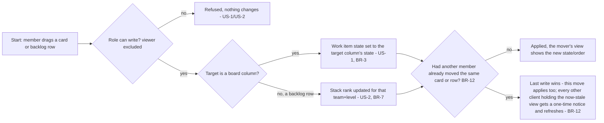

# Spec: Backlogs and boards (doc-003, module M4 deep dive)

## Context and goal

A team turns its assigned work items into a workable plan two ways: an
ordered backlog per level, so it agrees what is next, and a Kanban board per
level, so it tracks flow without opening every item. This deep dive refines
module M4 of the domain map (`doc-001`) — the `BOARD`, `BOARD_COLUMN`,
`SWIMLANE` and `BACKLOG_ENTRY` entities — into behaviour ready for
`mod-boards-backlogs` and its hierarchy follow-up
`feat-NNN-backlog-hierarchy` (DD-3): which levels get a board (D-3), how a
board column maps to state per type (DD-1), how the backlog stays ordered
under concurrent drags and active filters (BR-12 of `doc-001`), how the
parent/child hierarchy surfaces on the backlog, and the MVP cut that leaves
WIP limits, custom columns/swimlanes and the Задачи-level taskboard for
release 2 (`doc-003-backlogs-boards/status.md` § Decisions).

## Roles

Board and backlog access follows the organization membership role recorded
on `ORG_MEMBERSHIP` (D-9, `../doc-001-domain-map/spec.md` § Roles) — there
is no board- or backlog-specific role of its own.

| Role | Can, on a board/backlog scoped to a team whose Area(s) contain the work item (BR-3, `doc-001`) |
|---|---|
| Reader (`viewer`) | Open any of their organization's team boards and backlogs; see every column, swimlane, card and the current order; cannot move a card, reorder the backlog or assign a parent. |
| Member (`member`) | Everything a reader can, plus: drag a card between columns (writes the work item's state, US-1), drag an entry in the backlog (writes its stack rank, US-2), assign or clear a parent link from the backlog view (US-3, writes through M3's Parent/Child link). |
| Organization administrator (`admin`) | Everything a member can; MVP defines no admin-only board/backlog operation — board/column/swimlane administration is release 2 (see Out of scope). |

## Stories

| id | Title | depends-on | File |
|----|-------|------------|------|
| US-1 | A team member works the Kanban board for a level | - | `stories/US-1-kanban-board-per-level.md` |
| US-2 | A team member orders the team's backlog for a level | - | `stories/US-2-order-the-backlog.md` |
| US-3 | A team member navigates the parent/child hierarchy on the backlog | US-2 | `stories/US-3-backlog-hierarchy.md` (delivered by `feat-NNN-backlog-hierarchy`, not `mod-boards-backlogs` — DD-3) |

## Business process (BPMN)

## Business rules

| # | Rule | Source (document / decision) |
|---|------|------------------------------|
| BR-1 | Эпики, Фичи and Истории each have exactly one board per team, seeded automatically; Задачи has an ordered backlog list only, no board — the Sprint Taskboard is release 2. | `doc-001` D-3, MVP table |
| BR-2 | A board's columns are seeded one per non-Removed state category (Proposed/InProgress/Resolved/Completed) actually used by at least one type at that level, in that fixed order; a category no type at the level uses gets no column. For each type at the level, a column maps to exactly one state of that type — that type's first state in the column's category, in M2's seed order (`doc-007` owes that order). A type that defines no state in a column's category has no state mapped there (BR-18). Column wording is owned by M2/`doc-007`, not invented here. | `doc-001` BR-2, DD-1 |
| BR-3 | A card has no stored board position: its column is the column of its current state's *category*, computed on read — including a state that is not its type's first state in that category, which no column's per-type mapping names (BR-2). The per-type mapping decides only what a drag writes: dragging a card writes `WORK_ITEM.state` to the target column's mapped state for the card's own type (BR-2) — the same write editing the item's form performs (`doc-001` US-4) — the board is a view, never a copy. | `doc-001` Module map, § M4, DD-1 |
| BR-4 | MVP seeds exactly one, unnamed default swimlane per board; every card is in it; there is no swimlane picker in MVP UI. | `doc-003-backlogs-boards/status.md` § Decisions |
| BR-5 | A `BACKLOG_ENTRY` exists for a work item at exactly one (team, level) pair — the team owning its Area (BR-3, `doc-001`) and the level its type belongs to; a work item whose Area has no owning team has no `BACKLOG_ENTRY` and appears on no board or backlog. | `doc-001` ER model, BR-3 |
| BR-6 | A work item entering a team+level backlog for the first time — created, or moved in because its Area's owning team changed — is appended at the bottom, i.e. as the last row of that team+level list (which end of the numeric rank scale that is, is a design matter, not a requirement); a team member repositions it afterwards by dragging. | research/ado-boards.md § Backlogs; `doc-001` BR-12 |
| BR-7 | The backlog order (stack rank) is a property of the whole team+level backlog, never of a filtered view: a filter (`doc-001` US-10) hides non-matching rows, but a drag performed inside the filtered view still reorders relative to the full, unfiltered list. | `doc-001` BR-12 |
| BR-8 | Drag and drop is the only reorder primitive in MVP (`doc-001` MVP table, M4 row: "one ordered, drag-and-drop backlog per team per level"): an entry reaches the top or the bottom by being dragged to that end of the list. There is no numeric rank entry field and no discrete "insert at top/bottom" command — the "add at top/bottom" affordance of the reference product creates a *new* work item at a position and is release-2 ground (creation in MVP is M3's, and a created item lands at the bottom, BR-6). | `doc-001` MVP table (M4); research/ado-boards.md § Backlogs & sprints |
| BR-9 | The backlog's parent/child display reads M3's Parent/Child `WorkItemLink` (`doc-002`, `feat-work-item-links`); M4 stores no hierarchy data of its own. Expanding or collapsing a row only toggles whether its children show — it never changes the order (BR-7). | `doc-001` ER model (`WORK_ITEM_LINK`, owner M3) |
| BR-10 | Assigning a parent from the backlog view (the "mapping" action) creates or replaces the same Parent/Child link a team member could set from the work item form; it never creates a second link type or a duplicate. | research/ado-boards.md § Backlogs & sprints (mapping pane) |
| BR-11 | A level's backlog lists that level's own entries as top-level rows, in stack-rank order (BR-7); nesting appears only beneath an expanded row, and only for its children on the same team's backlog exactly one level below (BR-9). A work item with no parent, or whose parent is more than one level above it or on another team's backlog (BR-13), is nested beneath no row — it appears only as a top-level row on its own level's backlog. This is normal, not an error. Showing the level above's parents as grouping rows on a lower level's backlog is release 2 (Out of scope). | research/ado-boards.md § Backlogs & sprints; BR-7, BR-9 |
| BR-12 | Two members dragging the same board or backlog at once: the *stale-move conflict notice* rule — last write wins, every other pending-move client sees a one-time notice and its view refreshes to the current state/order. | `doc-001` BR-11 |
| BR-13 | MVP ships exactly one team per project (`doc-001` MVP table, M1 row); each project therefore has exactly one board and one backlog per level in MVP. The cross-team behaviours BR-5/BR-11 describe in general (an Area re-owned between two teams, a parent whose Area belongs to a different team) are domain invariants of the multi-team model; in MVP they are exercised through their single-team-reachable variants — an Area's ownership toggling between "owned by the project's one team" and "unowned", and a linked parent that is simply not one level above its child — not end-to-end with two real teams. | `doc-001` MVP table, M1 row |
| BR-14 | A card shows, at minimum, the work item's identifier, Заголовок, Исполнитель, Приоритет and Теги; a backlog row shows the same fields plus Статус. Both are drawn from M3's MVP field set; which fields show is fixed in MVP — no per-type or per-card customization (release 2). | `doc-001` MVP table, M3 row |
| BR-15 | Inside a column, cards are ordered by the level's backlog stack rank — the same order the team's backlog list (`BACKLOG_ENTRY`) uses, not a separate board-only order. Dragging a card vertically within the same column reorders it exactly as dragging it in the backlog view would (BR-8); dragging a card into a different column only changes its state (BR-3) — its position within the new column follows from its unchanged stack rank, a single drag never sets both the column and an arbitrary position within it. | This spec, BR-3 & BR-8 |
| BR-16 | A work item whose current state's category is Removed (`doc-001` D-5, «Удалена») is on no board and no backlog: BR-2 seeds no column for the Removed category, and every team+level backlog list excludes it. Its `BACKLOG_ENTRY`, if one already exists, is retained but hidden — not deleted — so restoring the work item can return it to its former position (BR-17). | `doc-001` BR-6, D-5 |
| BR-17 | Restoring a work item (`doc-001` US-6) reinstates its `BACKLOG_ENTRY` at the position its retained stack rank already holds — its former position, not appended at the bottom; BR-6's "appended at the bottom" is for an entry entering a backlog it was never in, not one returning to it. | `doc-001` BR-10 |
| BR-18 | A card cannot be dropped on a column its type has no mapped state in (BR-2): the board offers no drop target for that card on that column, and a direct API request to move it there is rejected, with the work item's state unchanged. This is normal — the column exists for another type at the same level — not an error state. | DD-1 |
| BR-19 | The concurrency policy attaches to the operation, not the field: a card drag (BR-3) and a backlog reorder (BR-7) are last-write-wins (BR-12), with no `xmin` check, even though a drag writes the same `WORK_ITEM.state` field a form save writes; a work item form save (`doc-001` US-4) keeps its `xmin` optimistic-concurrency check (`doc-001` BR-11) unconditionally. Mixed race: a drag lands immediately regardless of any form open on the same item, with no check and no notice to that form; a form save whose `xmin` the drag has since advanced is rejected with the normal edit conflict (`doc-001` BR-11), the same outcome as if another form save had raced it — the member reloads and reapplies. A drag is never rejected by, and never waits for, a pending form save. | DD-2, `doc-001` BR-11, ADR-0010 |

## Data model

Refines `doc-001`'s cross-module ER fragment for the entities it assigns to
M4 (`BOARD`, `BOARD_COLUMN`, `SWIMLANE`, `BACKLOG_ENTRY`). Logical level only
— no column types, no tables, no endpoints; the API contract is the backend
stage's.

| Entity | Key attributes (logical) | Stored vs. computed | Uniqueness | Owning module |
|---|---|---|---|---|
| BOARD | team, backlog level (Эпики/Фичи/Истории) | Stored: the (team, level) pair, seeded at team creation (Operation completeness below). Nothing else — no name, no settings in MVP (release 2: rename, visibility). | one board per (team, level) — D-3, BR-1 | M4 |
| BOARD_COLUMN | board, state category | Stored: (board, category) — one column per non-Removed category the level's types use (BR-2); the fixed display order is the category order (Proposed/InProgress/Resolved/Completed), not a stored index. The per-type mapping (BR-2: each type's first state in the category, M2's seed order) is *computed* on read from `STATE_DEFINITION`, not stored on the column — `doc-001`'s ER edge `BOARD_COLUMN }o--\|\| STATE_DEFINITION : "maps to"` is refined here into a *derived*, per-(column, type) relationship rather than one stored state reference per column. | one column per (board, category) | M4 (stores the column); M2/`doc-007` (owns the per-type state order the mapping derives from) |
| SWIMLANE | board | Stored: MVP seeds exactly one, unnamed swimlane per board (BR-4) — no name, no order, no WIP field beyond that link. | one swimlane per board in MVP | M4 |
| BACKLOG_ENTRY | work item, team, backlog level, stack rank | Stored: `stackRank` (an orderable value, BR-7/BR-8) and the (team, level) pair the entry is scoped to — retained, not re-derived on every read, because BR-16/BR-17 need the entry and its rank to survive a delete/restore. Team and level are set from the work item's Area-owning team and type when the entry is created (BR-5). An Area re-scope does *not* carry the rank over: moving to another owning team re-scopes the entry and appends it at the bottom of that team's backlog (BR-6), and an Area becoming unowned removes the entry (BR-5), so a later re-ownership appends it at the bottom again; the entry stores no board column (BR-3, computed) and no swimlane (BR-4, always the one default) and no parent/child data (BR-9, owned by M3's `WORK_ITEM_LINK`). | at most one entry per work item — one per (team, level), and a work item has exactly one Area and one type (BR-5); refines `doc-001`'s `WORK_ITEM \|\|--o\| BACKLOG_ENTRY` cardinality | M4 |

## Operation completeness

| Entity | Create | Read | Update | Delete/deactivate | Cancel/reverse |
|--------|--------|------|--------|-------------------|----------------|
| Board | no: MVP auto-seeds exactly one board per team per portfolio/requirement level (Эпики/Фичи/Истории) when the team itself is created (M1, `doc-006`) — a board exists and opens empty before the team has a single work item at that level (US-1); not user-created (release 2: multiple boards per level) | admin, member, viewer | no: release 2 (rename, per-level visibility toggle) | no: a team's board exists as long as the team does; team deactivation is M1's concern (`doc-006`) | n/a |
| BoardColumn | no: MVP seeds columns 1:1 from the level's used state categories (BR-2), fixed | admin, member, viewer | no: release 2 (rename, add/remove/split columns, WIP limits, per-type state mapping) | no: release 2 | n/a |
| Swimlane | no: MVP seeds exactly one default swimlane per board (BR-4) | admin, member, viewer | no: release 2 (add/rename/reorder swimlanes) | no: release 2 | n/a |
| BacklogEntry | system: created automatically when a work item becomes visible on a team's backlog at its level (BR-5), appended at the bottom by default (BR-6) | admin, member, viewer | member, admin — drag to reorder, to either end of the list or between two neighbours (BR-7/BR-8, US-2); assign/clear a parent from the mapping view (BR-9/BR-10, US-3); the board's card-move (US-1) updates `WORK_ITEM.state` through M3, not the entry itself | member, admin (implicit): an entry disappears when its work item's Area loses the owning team (re-scoped to the new team's backlog, or to no team, BR-6/BR-13) or when the work item is soft-deleted into «Удалена» (`doc-001` BR-6, this spec's BR-16); no direct "delete this entry" action | member, admin (implicit): restoring the work item (`doc-001` US-6) reinstates its `BACKLOG_ENTRY` at the position its retained stack rank already holds (BR-17) — not a separate board/backlog action, but its visible effect there |

## Non-functional requirements

- **Refresh model.** MVP has no live push and does not need one: `doc-001`
  BR-11 promises the one-time notice to a *pending-move* client — one whose
  own drag lands on a view that has meanwhile changed — not to every idle
  viewer, and `doc-001`'s non-functional requirements ask for no real-time
  channel. So: a member's own drag is applied and answered immediately, with
  the notice attached when the view it was made from was already stale
  (BR-12); any other open viewer of the same board/backlog sees the new
  state/order the next time it interacts with that view (a drag, an expand,
  a filter change) or reloads it. Pushing a move to idle viewers in
  near-real time is release-2 ground (Out of scope).
- **Volumes/latency.** Covered by `doc-001`'s non-functional requirements
  (board/backlog view ≤ 2 s up to 5,000 items, a write ≤ 1 s); no
  M4-specific addition.

## Out of scope

- WIP limits per column (release 2).
- Custom columns (add/rename/remove/split into Doing/Done) and custom
  swimlanes beyond the one MVP default (release 2).
- Definition of Done per column, card styling rules (colour by query
  criteria), tag colours, per-type card field customization (release 2).
- Multiple boards per level for one team (release 2).
- The Задачи-level board (Sprint Taskboard), sprint capacity, burndown,
  velocity, cumulative flow, lead/cycle time — release 2, module M5
  (`doc-004`).
- Delivery plans (cross-team timeline) and forecast by velocity — release 3,
  module M5.
- Bulk edit and CSV export from the backlog view — release 2, module M3.
- Iteration-scoped views of a board or backlog (the sprint backlog): the MVP
  team backlog and board list every work item of that team and level
  whatever its iteration pointer holds (`doc-001` BR-7 is read by M5's
  planning surfaces, not by M4's MVP views); the sprint backlog and the
  taskboard are release 2, module M5 (`doc-004`).
- A per-team toggle of which backlog levels are visible (the reference
  product's team setting) — release 2; in MVP every level's backlog and
  board is always available to the team.
- Parent rows of the level above shown as grouping context on a lower
  level's backlog (the reference product's "Parents: Show" option) —
  release 2; in MVP the hierarchy shows only by expanding a row (BR-11).
- Live push of someone else's move to an idle viewer of the same
  board/backlog (real-time refresh, web sockets) — release 2; see
  Non-functional requirements, "Refresh model".
- Any board/backlog permission finer than the organization membership role
  (per-project/per-area overrides) — release 2 (`doc-001` BR-5).

## Decomposition for the backlog

| id | Task | size | deps |
|----|------|------|------|
| mod-boards-backlogs | Founds M4: one board per team per level with columns seeded by used state category, per-type mapping and the refused-drop rule (Эпики/Фичи/Истории, BR-1..BR-4, BR-18); the ordered backlog per team per level incl. stack rank and drag-and-drop reordering (BR-5..BR-8); the single-team MVP scope, card and row fields, in-column order by stack rank (BR-13..BR-15); hiding a deleted work item and restoring it to its former position (BR-16, BR-17); the stale-move conflict notice on concurrent drags and the drag/form-save concurrency split (BR-12, BR-19); no parent/child hierarchy (that is `feat-NNN-backlog-hierarchy`, below) | L | mod-work-item-core, mod-work-item-delete-restore, doc-003-backlogs-boards |
| feat-NNN-backlog-hierarchy | Backlog parent/child hierarchy: reads M3's Parent/Child link to display the tree on the backlog (expand/collapse, BR-9) and writes the mapping action that creates/replaces/clears that link from the backlog view (BR-10/BR-11); delivers US-3 | M | mod-boards-backlogs, feat-work-item-links |

## Open questions

None (R-1/R-5/R-6/R-8 resolved per DD-1..DD-3, `status.md` § Decisions).
