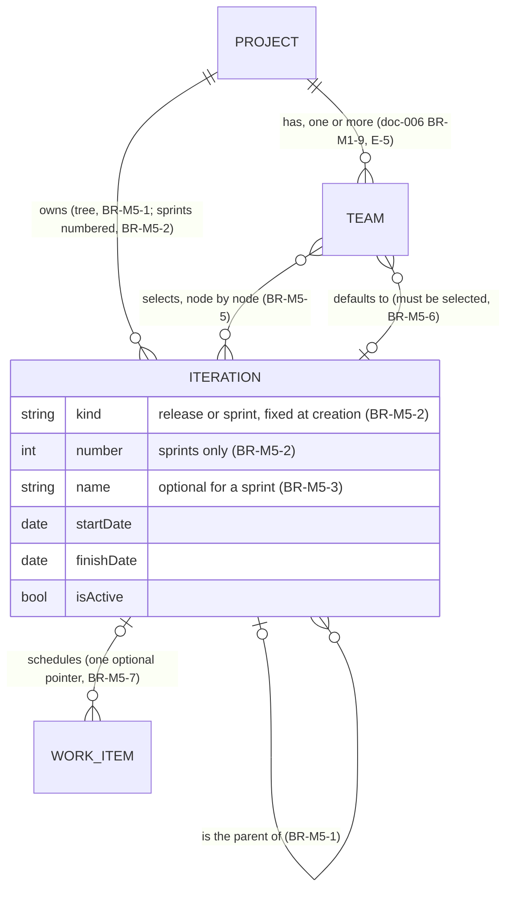
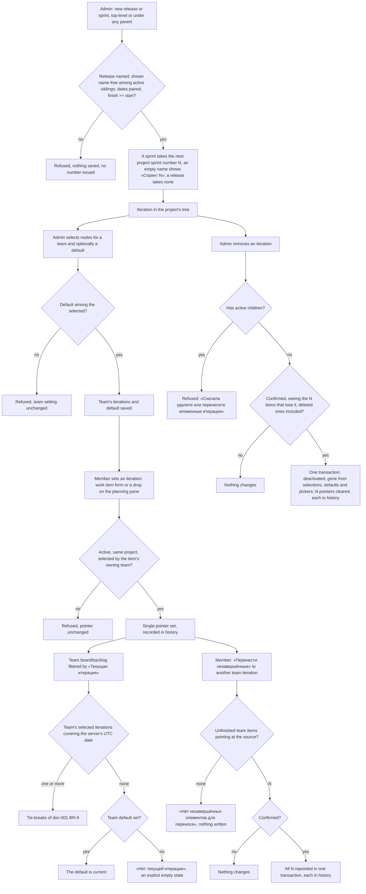

# Spec: Iterations and planning (doc-004, module M5)

## Context and goal

A team needs to say *when* a work item is meant to happen, and to see what it
is doing **now** apart from what is planned for later — module M5 of the
domain map (doc-001, § Module map). This spec turns doc-001's US-9 into what
`mod-007-iterations` founds and the three MVP slices that build on it (the
iteration filter, the backlog planning pane, moving unfinished work), and
analyses sprint views, capacity, burndown/velocity, forecast and delivery
plans as **release 2/3 ground**. Reference: Azure DevOps Boards
([doc-001 research](../doc-001-domain-map/research/ado-boards.md), screenshots
03, 11, 17). Binding input: doc-001 D-1..D-12, the human's E-1..E-13
(`status.md` § Decisions) and doc-010 D-4..D-24. doc-001's rules are cited as
`doc-001 BR-n`, this module's as BR-M5-n.

## Roles

Access is by permission codes derived from `ORG_MEMBERSHIP.role` (doc-001
D-1/D-9, BR-5); a non-member of the organization is answered "not found".
M5 adds no role and no scope of its own, and team membership carries no
access: any member acts on any team's pane and iterations (doc-006 § Roles).
Every team-level setting is the organization administrator's; per-iteration
values a team enters about itself are a member's (doc-001 § Roles).
`mod-007` registers `iterations.iteration.read`, `iterations.iteration.write`
and `iterations.team-settings.write`; every write to a work item's iteration
pointer — form, pane drop, bulk move — is `workitems.workitem.write`
(analysis-level names, doc-010 § Permission codes).

| Role | On iterations and planning |
|---|---|
| Organization administrator (`admin`) | create (as a release or a sprint), rename, date, move and remove the project's iterations; choose a team's iterations and its default; release 2: a team's working days; everything a member can do |
| Member (`member`) | set and clear a work item's iteration (work item form, planning pane); move a team's unfinished work to another iteration; release 2: capacity and days off per iteration; release 3: create and edit delivery plans; read everything below |
| Reader (`viewer`) | read the iteration tree, team selections, a work item's iteration, the current iteration, filtered views and (release 3) delivery plans; no writes |

## Stories

MVP stories are delivered by the MVP tasks in § Decomposition; release 2/3
stories are analysis ground built by no MVP task.

| id | Title | depends-on | File |
|----|-------|------------|------|
| US-1 | (MVP) An administrator builds the project's iteration tree | - | `stories/US-1-manage-project-iterations.md` |
| US-2 | (MVP) An administrator chooses a team's iterations and its default | US-1 | `stories/US-2-team-iterations-and-default.md` |
| US-3 | (MVP) A member schedules a work item into an iteration | US-1, US-2 | `stories/US-3-assign-work-item-to-iteration.md` |
| US-4 | (MVP) A team sees its current iteration | US-2 | `stories/US-4-current-iteration.md` |
| US-5 | (release 2) A team plans a sprint from the backlog | US-3, US-11 | `stories/US-5-sprint-backlog.md` |
| US-6 | (release 2) A team works the sprint taskboard | US-5 | `stories/US-6-sprint-taskboard.md` |
| US-7 | (release 2) A team plans sprint capacity | US-5 | `stories/US-7-sprint-capacity.md` |
| US-8 | (release 2) A team tracks burndown and velocity | US-5 | `stories/US-8-burndown-and-velocity.md` |
| US-9 | (release 3) A member forecasts the backlog by velocity | US-8 | `stories/US-9-forecast-by-velocity.md` |
| US-10 | (release 3) An organization member reads a delivery plan across teams | US-3 | `stories/US-10-delivery-plans.md` |
| US-11 | (MVP) A member schedules from a team's backlog planning pane | US-3, US-4 | `stories/US-11-backlog-planning-pane.md` |
| US-12 | (MVP) A member moves a team's unfinished work to another iteration | US-11 | `stories/US-12-move-unfinished-work.md` |
| US-13 | (MVP) A member filters work items by iteration | US-3, US-4 | `stories/US-13-filter-by-iteration.md` |
| US-14 | (MVP) An administrator removes an iteration | US-1, US-3 | `stories/US-14-remove-iteration.md` |

## Terms

M5's terms — «Итерация» and the iteration path, «Релиз»/«Спринт» and the
sprint number, «Текущая итерация», «Итерация по умолчанию», «Планирование»
and «Без итерации», «Перенести незавершённые», and the release-2/3 «Ёмкость»,
«Дни отсутствия», «Доска задач», «Диаграмма сгорания», «Скорость», «План
поставки» — with their Azure DevOps equivalents are in doc-001's glossary.

## Logical data model (M5)

`WORK_ITEM`, `TEAM` and `PROJECT` appear only as the endpoints M5 attaches to.

Release 2/3 entities, analysed but built by no MVP task:

| Entity | Holds | Release | Founding task |
|---|---|---|---|
| TeamCapacity, DayOff, TeamWorkingDays | hours/day and activity per member per iteration; member/team days off; the team's working weekdays | 2 | `feat-011-sprint-capacity` |
| IterationSnapshot | remaining/completed effort per iteration per day, derived from history (doc-001 BR-4), never edited | 2 | `mod-012-iteration-metrics` |
| DeliveryPlan, DeliveryPlanTeam | owned by the organization; which teams (of any of its projects) and levels a timeline shows; no scheduling data of its own (BR-M5-17) | 3 | `mod-013-delivery-plans` |

## Business process (BPMN)

## Business rules

Who may perform each operation is § Roles; BR-M5-14, which restated it, is
not reused.

| # | Rule | Source |
|---|------|--------|
| BR-M5-1 | An iteration belongs to exactly one project and is either top-level or the child of another active iteration of that project — a tree of any depth, never a cycle, never across projects. Either kind (BR-M5-2) may sit at any level and under either kind: the kind drives numbering, naming and one tie-break of doc-001 BR-9 only, never structure. An administrator may move a node, together with its whole subtree, under another active parent or to the top; pointers and team selections are unchanged by a move. Siblings are ordered by start date (undated last), then in creation order (for two sprints, number order). | D-11; E-7, E-11; research § Team settings |
| BR-M5-2 | Every iteration is of one kind, «Релиз» or «Спринт», chosen by the administrator at creation (the choice starts at «Спринт») and never changed: a change would issue a number to an old node or orphan one, so a wrong kind is fixed by removal and re-creation (BR-M5-10). At creation every sprint, at any level, gets the next number of its project's sprint sequence (1, 2, 3…); a release gets no number and consumes none. The number never changes and is never issued again, also after the sprint is removed. A refused creation issues no number, and two creations at the same moment never receive the same one. | E-10, E-11; R-17, R-18 |
| BR-M5-3 | A release's name is required after trimming («Укажите название релиза»). A sprint's name is optional: while empty — at creation or after a rename clears it — the sprint is shown as «Спринт N» with N its number. Any iteration may be renamed by an administrator; a rename changes neither the kind nor the number. The shown name is unique among the **active** children of the same parent (or among active top-level nodes), compared trimmed and case-insensitively, on creation, rename and move alike — an empty sprint name competes as its «Спринт N», and a taken one is refused like any duplicate; a removed iteration reserves no name (it can never return, BR-M5-10). Names may repeat under different parents; every picker, filter and pane shows the path («Релиз 1 / Спринт 2»). | E-10..E-12, E-3; R-3, R-18 |
| BR-M5-4 | Dates are optional and paired: both empty or both set, finish >= start (equal = a one-day iteration). A parent's dates are its own: they neither constrain nor are derived from its children's. | doc-001 US-9; E-7 |
| BR-M5-5 | A team uses exactly the active iterations an administrator has selected for it, node by node: selecting a parent selects none of its children and vice versa. Every picker, drop target and iteration filter on that team's surfaces offers that subset, shown in tree order, and nothing else. Several teams per project may select the same iteration independently. When a team is deleted (doc-006 BR-M1-18) its selection and default are dropped with it; no work item pointer changes (BR-M5-7). | D-11; E-5; E-7; doc-010 D-6 |
| BR-M5-6 | A team's default iteration must be one of its selected iterations; unselecting or removing it clears the default in the same operation. The default is never assigned to a new work item — a new item has no iteration (`doc-002` § Fields); it only decides «Текущая итерация» when no selected iteration's dates cover today (doc-001 BR-9). | doc-001 BR-9; doc-010 N-23 |
| BR-M5-7 | A work item points at at most one iteration, parent or leaf. **Setting** it requires the iteration to be active, in the work item's project and selected by the work item's owning team (doc-001 BR-3 — every area resolves to one owning team); otherwise it is refused with «Команда не использует эту итерацию». **Clearing** is always allowed. A stored pointer whose iteration the owning team does not use — unselected since, or kept when the item's Area moved to another team, a team's deletion included — stays, is displayed marked as outside the team's selection, and is never rewritten by an unrelated save. A pointer write from the form or the pane is revision-checked (doc-001 BR-11). | doc-001 BR-7; R-5, R-6 |
| BR-M5-8 | A team's current iteration is derived on read, never stored, by doc-001 BR-9 (the server's UTC date, the tie-breaks, the default as the fallback). It exists on team surfaces (team iteration settings, board, backlog, planning pane) and in team-bound queries (`doc-005` BR-M6-6) — never on the project-wide work item list. | doc-001 BR-9, D-11; E-1, E-2 |
| BR-M5-9 | Filtering by an iteration matches it and its descendants (doc-001 BR-15) and never changes the relative backlog order (doc-001 BR-12); items in «Удалена» are excluded (doc-001 BR-14). On a team's board and backlog the choice is «Текущая итерация» plus the team's selected iterations, over the team's own items (doc-001 BR-3); on the project-wide list the choice is any active iteration of the project, with no «Текущая итерация». | E-2, E-4, E-7; R-1 |
| BR-M5-10 | Removing an iteration is soft (doc-001 BR-6) and admin-only. It is refused while the iteration has active children. Otherwise the administrator first confirms a prompt stating how many work items will lose their iteration — items in «Удалена» counted too; then, in one all-or-nothing operation, the iteration is deactivated, leaves every team selection, default, picker and filter, and every pointer to it is cleared, each clearing recorded in that item's history (doc-001 BR-4) — for an item in «Удалена» as the system clean-up doc-001 BR-14 allows. The operation acts on the pointers as they stand at confirmation; if their number differs from the one confirmed, nothing is written and the prompt is shown again with the new number. There is no reactivation, and an iteration is never purged. | doc-001 BR-6; E-3; R-2, R-9; doc-010 D-13, N-14 |
| BR-M5-11 | Iteration dates constrain nothing: any work item in any state may be scheduled into a past or future iteration, and nothing happens automatically when an iteration ends — no rollover, no state change, no notification. | doc-001 D-6; E-9 |
| BR-M5-12 | «Перенести незавершённые» repoints, from one source iteration to one target iteration the team has selected (≠ source), every work item of any level that is owned by the team, points **exactly** at the source, and whose state category is Proposed, InProgress or Resolved — Completed and «Удалена» items stay. The member confirms the count first; the move acts on the items matching at confirmation, and if their number differs from the one confirmed, nothing is written and the prompt is shown again with the new number; the move is all-or-nothing, each repoint in history; nothing to move writes nothing. | E-9; doc-001 BR-2 |
| BR-M5-13 | The planning pane beside a team's backlog lists the team's selected iterations (BR-M5-5) with the count of the team's items of the viewed backlog level pointing exactly at each (items in «Удалена» not counted), marks the current one (BR-M5-8) and ends with «Без итерации». Dropping a backlog item on an entry sets (or, on «Без итерации», clears) its pointer under BR-M5-7; the backlog order is unchanged. | E-6; screenshot 03 |
| BR-M5-15 | (release 2) Capacity is per team, iteration and member: hours/day and one «Вид работ» (`doc-002` § Release 2), minus member and team days off in that iteration, over the team's working days; it feeds charts and warnings, never blocks scheduling. The working days are a team setting of the organization administrator; capacity and days off are entered by a member. | research § Team settings; doc-001 § Roles |
| BR-M5-16 | (release 2) Burndown and velocity are derived from history (doc-001 BR-4) over the iteration's dates and the team's area ownership; an undated iteration has none. Burndown reads «Оставшаяся работа», velocity and forecast read «Оценка в пунктах» — the estimation fields of `doc-002` § Release 2 (E-8). | research § Backlogs & sprints; doc-010 D-15 |
| BR-M5-17 | (release 3) A delivery plan belongs to the organization and may show teams of any of its projects; it stores only which teams and levels it shows, and moving a card writes the work item's pointer (BR-M5-7), never dates of its own. Members and administrators create and edit plans; every role reads them. | research § Other capabilities; doc-010 N-31 |

## Operation completeness

| Entity | Create | Read | Update | Delete/deactivate | Cancel/reverse |
|--------|--------|------|--------|-------------------|----------------|
| Iteration | admin (US-1; picks release or sprint; a sprint's number issued by the system, BR-M5-2) | admin, member, viewer of the organization | admin (rename, clear a sprint's name, set/clear dates, move in the tree; kind and number: no, fixed at creation) | admin (soft, confirmed, refused with active children — US-14) | n/a: no reactivation and no purge (E-3, BR-M5-10) |
| Team's iteration selection | admin (select a node, BR-M5-5) | admin, member, viewer | no: a set — a node is selected or not | admin (unselect; clears the default if it was that one); system, when the team is deleted (BR-M5-5) | n/a: selecting again is the reverse; pointers untouched (BR-M5-7) |
| Team default iteration | admin (one of the selected, BR-M5-6) | admin, member, viewer | admin (another selected node) | admin (clear; no current unless dates decide); system, when the team is deleted | n/a |
| Work item iteration pointer | member, admin (form US-3, pane US-11) | admin, member, viewer | member, admin (repoint one item; bulk only via BR-M5-12, US-12) | member, admin (clear; the item is unscheduled, not deleted); system on removal, items in «Удалена» included (BR-M5-10) | no undo: history keeps every previous value; moving back is another move |
| Current iteration | no: derived (BR-M5-8) | admin, member, viewer | no: changes only through dates, selection or default | no | n/a |
| Capacity entities / IterationSnapshot | no: release 2 (snapshot: system-only) | no: release 2 | no: release 2 (snapshot: never) | no: release 2 | n/a |
| DeliveryPlan (organization) | member, admin (release 3) | admin, member, viewer (release 3) | member, admin (release 3) | member, admin (release 3) | n/a: release-3 ground |

## Non-functional requirements

- **Volumes:** up to a few hundred iterations per project (tree), tens of teams
  per project. A picker or the pane lists a team's selection — tens of rows,
  no paging. A list, board or backlog filtered by an iteration stays in
  doc-001's budget: up to 5,000 work items within 2 s.
- **Bulk writes:** removing an iteration (BR-M5-10) and moving unfinished
  work (BR-M5-12) complete within 5 s for up to 5,000 affected work items,
  all or nothing: on failure no pointer changes and the iteration stays
  active. A user saving one of those items meanwhile gets doc-001 BR-11's
  form-save conflict (reload and reapply); a drop or pointer write aimed at
  an iteration removed meanwhile is refused (BR-M5-7).
- **Derivation cost:** the current iteration is computed once per request from
  the team's selection, not per work item.
- **Audit:** every pointer change — set, repoint, clear, pane drop, bulk move,
  clearing by removal — is in the work item's history with who and when.
  Iteration administration and team selection/default are not audited in
  MVP (doc-001 BR-4, its list of what MVP does not audit).

## Out of scope

- Everything in doc-001 § Out of scope.
- **Release 2/3 ground only:** sprint backlog and taskboard (US-5, US-6),
  capacity (US-7), burndown/velocity (US-8), forecast (US-9), delivery plans
  (US-10), the Задачи-level board (doc-001 D-3). Estimation fields:
  `doc-002` § Release 2.
- Reactivating or purging a removed iteration (E-3, BR-M5-10); cascading
  removal of a subtree.
- Changing an iteration's kind; numbering releases; placement rules by kind
  (BR-M5-1, BR-M5-2).
- Iteration templates, cadence-generated sprint series, renaming by pattern;
  ADO's team "backlog iteration" root; child dates bounded by the parent's.
- Automatic rollover and any date-driven behaviour (BR-M5-11); general bulk
  edit and multi-select drag (release 2) — BR-M5-12 is the only bulk write.
- Time zones per project, team or viewer (E-1); per-iteration goals or notes.
- Cross-project iterations; time tracking; M6 read models (doc-005).

## Relation to doc-001

E-2, E-4..E-7 and E-9..E-12 widen or change doc-001, which carries them in
place: its MVP table (several teams, the iteration tree, the planning pane,
the move of unfinished work), its ER (ITERATION's kind, number and parent),
its Operation completeness (Team, Iteration), US-2 and US-9 — whose
scenarios 3–6 assign under BR-M5-7's team-selection rule and filter under
BR-M5-9's subtree match. The current-iteration derivation lives in doc-001
BR-9.

## Decomposition for the backlog

**MVP — queued:**

| id | Task | size | deps |
|----|------|------|------|
| mod-007-iterations | Founds M5 per US-1, US-2, US-3, US-4, US-14: the tree of releases and numbered sprints with editable names and paired optional dates (BR-M5-1..4), team selection and default, dropped with a deleted team (BR-M5-5/6), the pointer on M3's work item with its write rule and form picker (BR-M5-7), current-iteration derivation shown on the team's iteration settings (BR-M5-8), confirmed soft removal clearing deleted items' pointers too (BR-M5-10); registers `iterations.iteration.read`/`.write` and `iterations.team-settings.write`. Owes no ADR: removal reuses `mod-002`'s soft-deactivation ADR | L | mod-003-work-item-core, doc-004 |
| feat-008-iteration-filter | US-13: the iteration filter in the list's filter bar (`feat-003`) and in the board/backlog filter bar (`doc-003` `feat-NNN-board-backlog-filter`), «Текущая итерация» on team surfaces only (BR-M5-9, E-4) | M | mod-007-iterations, feat-NNN-board-backlog-filter |
| feat-009-iteration-planning-pane | US-11: the backlog planning pane (BR-M5-13, E-6) | M | mod-007-iterations, mod-006-boards-backlogs |
| feat-010-move-unfinished-work | US-12: «Перенести незавершённые» from a pane entry (BR-M5-12, E-9) | M | feat-009-iteration-planning-pane |

**Release 2/3 — queued** (the estimation fields are `doc-002`'s
`feat-NNN-work-item-estimation-fields`, E-8):

| id | Task | size | deps |
|----|------|------|------|
| mod-011-sprint-views | Founds the sprint hub: US-5, US-6. `L`: it changes M4's BR-M4-1 — the Задачи level gains the taskboard, on M4's BOARD | L | feat-004-backlog-hierarchy, feat-009-iteration-planning-pane, feat-NNN-work-item-estimation-fields |
| feat-011-sprint-capacity | US-7, BR-M5-15 | M | mod-011-sprint-views |
| mod-012-iteration-metrics | Founds the metrics pattern: US-8, BR-M5-16; owes the history-derived-metrics ADR | L | mod-011-sprint-views, feat-NNN-work-item-estimation-fields |
| feat-012-backlog-forecast | US-9 | M | mod-012-iteration-metrics |
| mod-013-delivery-plans | Founds the organization-owned delivery plan: US-10, BR-M5-17 | L | mod-007-iterations, mod-006-boards-backlogs |

Priority: `mod-007-iterations`; then, once `mod-006` and the board/backlog
filter are in, `feat-009-iteration-planning-pane` and `feat-008-iteration-filter`
in parallel; then `feat-010-move-unfinished-work`. Release 2: sprint views,
then capacity and metrics; release 3: forecast and delivery plans.

## Open questions

None. E-1..E-12 answer every question of rounds 1 and 2: which nodes take a
number (R-17) by E-11, whether the name is editable by E-12.
