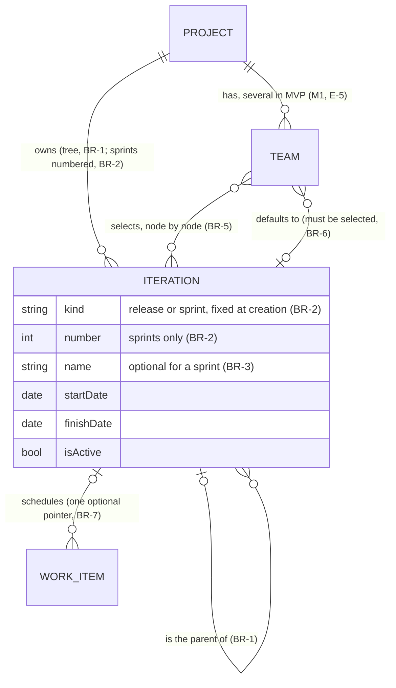
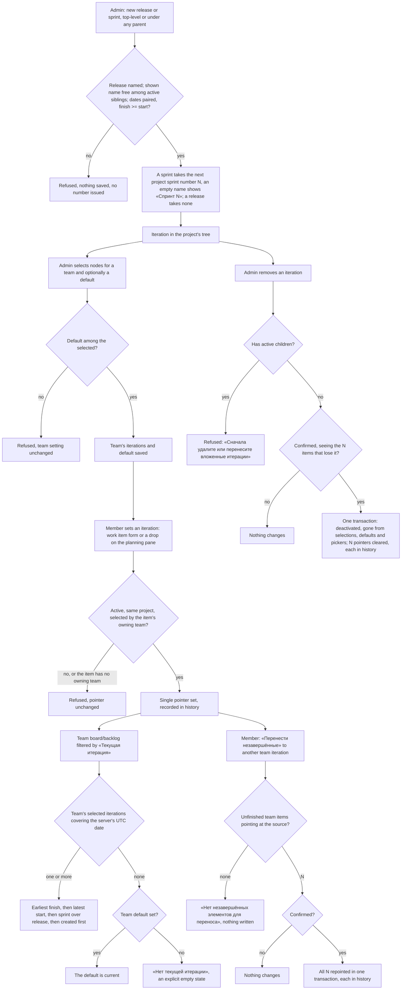

# Spec: Iterations and planning (doc-004, module M5)

## Context and goal

A team needs to say *when* a work item is meant to happen, and to see what it
is doing **now** apart from what is planned for later — module M5 of the
domain map (doc-001, § Module map). This spec turns doc-001's US-9 into what
`mod-007-iterations` founds and the three MVP slices that build on it (the
iteration filter, the backlog planning pane, moving unfinished work), and
analyses sprint views, capacity, burndown/velocity, forecast and delivery
plans as **release 2/3 ground**. Reference: Azure DevOps Boards
([doc-001 research](../doc-001-domain-map/research/ado-boards.md), screenshots
03, 11, 17). Binding input: doc-001 D-1..D-12 and the human's E-1..E-12
(`status.md` § Decisions); where E-5/E-6/E-7/E-9..E-12 widen or change doc-001,
§ Amendments lists what they supersede. doc-001's rules are cited as `doc-001 BR-n`.

## Roles

Access is by permission codes derived from `ORG_MEMBERSHIP.role` (doc-001
D-1/D-9, BR-5). M5 adds no role and no scope of its own.

| Role | On iterations and planning |
|---|---|
| Organization administrator (`admin`) | create (as a release or a sprint), rename, date, move and remove the project's iterations; choose a team's iterations and its default; everything a member can do |
| Member (`member`) | set and clear a work item's iteration (work item form, planning pane); move a team's unfinished work to another iteration; read everything below |
| Reader (`viewer`) | read the iteration tree, team selections, a work item's iteration, the current iteration and filtered views; no writes |

## Stories

MVP stories are delivered by the MVP tasks in § Decomposition; release 2/3
stories are analysis ground built by no MVP task.

| id | Title | depends-on | File |
|----|-------|------------|------|
| US-1 | (MVP) An administrator builds the project's iteration tree | - | `stories/US-1-manage-project-iterations.md` |
| US-2 | (MVP) An administrator chooses a team's iterations and its default | US-1 | `stories/US-2-team-iterations-and-default.md` |
| US-3 | (MVP) A team member schedules a work item into an iteration | US-1, US-2 | `stories/US-3-assign-work-item-to-iteration.md` |
| US-4 | (MVP) A team sees its current iteration | US-2 | `stories/US-4-current-iteration.md` |
| US-5 | (release 2) A team plans a sprint from the backlog | US-3, US-11 | `stories/US-5-sprint-backlog.md` |
| US-6 | (release 2) A team works the sprint taskboard | US-5 | `stories/US-6-sprint-taskboard.md` |
| US-7 | (release 2) A team plans sprint capacity | US-5 | `stories/US-7-sprint-capacity.md` |
| US-8 | (release 2) A team tracks burndown and velocity | US-5 | `stories/US-8-burndown-and-velocity.md` |
| US-9 | (release 3) A product owner forecasts the backlog by velocity | US-8 | `stories/US-9-forecast-by-velocity.md` |
| US-10 | (release 3) A manager reads a delivery plan across teams | US-3 | `stories/US-10-delivery-plans.md` |
| US-11 | (MVP) A team member schedules from the backlog planning pane | US-3, US-4 | `stories/US-11-backlog-planning-pane.md` |
| US-12 | (MVP) A team member moves unfinished work to another iteration | US-11 | `stories/US-12-move-unfinished-work.md` |
| US-13 | (MVP) A team member filters work items by iteration | US-3, US-4 | `stories/US-13-filter-by-iteration.md` |
| US-14 | (MVP) An administrator removes an iteration | US-1, US-3 | `stories/US-14-remove-iteration.md` |

## Terms (additions to doc-001's glossary)

| MUSTASK term (Russian UI name) | Azure DevOps term |
|---|---|
| Итерация, путь итерации («Итерация», «Релиз 1 / Спринт 2») | Iteration / sprint node, iteration path |
| Вид итерации: релиз, спринт («Релиз», «Спринт»); номер спринта | (none: ADO nodes have no kind and no number) |
| Текущая итерация («Текущая итерация») | @CurrentIteration / timeFrame = current |
| Итерация по умолчанию, итерации команды | Team default iteration, the team's selected iterations |
| Панель планирования («Планирование»), «Без итерации» | Backlog Planning pane, the backlog iteration |
| «Перенести незавершённые» | (no built-in equivalent; multi-select "Move to iteration") |
| «Ёмкость», «Дни отсутствия», «Доска задач» (release 2) | Capacity, days off, Sprint Taskboard |
| «Диаграмма сгорания», «Скорость» (release 2), «План поставки» (release 3) | Burndown, velocity, Delivery Plan |

## Logical data model (M5)

`WORK_ITEM`, `TEAM` and `PROJECT` appear only as the endpoints M5 attaches to.

Release 2/3 entities, analysed but built by no MVP task:

| Entity | Holds | Release | Founding task |
|---|---|---|---|
| TeamCapacity, DayOff, TeamWorkingDays | hours/day and activity per member per iteration; member/team days off; the team's working weekdays | 2 | `feat-NNN-sprint-capacity` |
| IterationSnapshot | remaining/completed effort per iteration per day, derived from history (doc-001 BR-4), never edited | 2 | `mod-NNN-iteration-metrics` |
| DeliveryPlan, DeliveryPlanTeam | which teams and levels a timeline shows; no scheduling data of its own (BR-17) | 3 | `mod-NNN-delivery-plans` |

## Business process (BPMN)

## Business rules

| # | Rule | Source |
|---|------|--------|
| BR-1 | An iteration belongs to exactly one project and is either top-level or the child of another active iteration of that project — a tree of any depth, never a cycle, never across projects. Either kind (BR-2) may sit at any level and under either kind: the kind drives numbering, naming and one tie-break of BR-8 only, never structure, and ADO constrains node placement no further. An administrator may move a node, together with its whole subtree, under another active parent or to the top; pointers and team selections are unchanged by a move. Siblings are ordered by start date (undated last), then in creation order (for two sprints, number order). | D-11; E-7, E-11; research § Team settings |
| BR-2 | Every iteration is of one kind, «Релиз» or «Спринт», chosen by the administrator at creation (the choice starts at «Спринт») and never changed: a change would issue a number to an old node or orphan one, so a wrong kind is fixed by removal and re-creation (BR-10). At creation every sprint, at any level, gets the next number of its project's sprint sequence (1, 2, 3…); a release gets no number and consumes none. The number never changes and is never issued again, also after the sprint is removed. A refused creation issues no number, and two creations at the same moment never receive the same one. | E-10, E-11; R-17, R-18 |
| BR-3 | A release's name is required after trimming («Укажите название релиза»). A sprint's name is optional: while empty — at creation or after a rename clears it — the sprint is shown as «Спринт N» with N its number. Any iteration may be renamed by an administrator; a rename changes neither the kind nor the number. The shown name is unique among the **active** children of the same parent (or among active top-level nodes), compared trimmed and case-insensitively, on creation, rename and move alike — an empty sprint name competes as its «Спринт N», and a taken one is refused like any duplicate; a removed iteration reserves no name (it can never return, BR-10). Names may repeat under different parents; every picker, filter and pane shows the path («Релиз 1 / Спринт 2»). | E-10..E-12, E-3; R-3, R-18 |
| BR-4 | Dates are optional and paired: both empty or both set, finish >= start (equal = a one-day iteration). A parent's dates are its own: they neither constrain nor are derived from its children's. | doc-001 US-9; E-7 |
| BR-5 | A team uses exactly the active iterations an administrator has selected for it, node by node: selecting a parent selects none of its children and vice versa. Every picker, drop target and iteration filter on that team's surfaces offers that subset, shown in tree order, and nothing else. Several teams per project may select the same iteration independently. | D-11; E-5; E-7 |
| BR-6 | A team's default iteration must be one of its selected iterations; unselecting or removing it clears the default in the same operation. | doc-001 BR-9 |
| BR-7 | A work item points at at most one iteration, parent or leaf. **Setting** it requires the iteration to be active, in the work item's project and selected by the work item's owning team (doc-001 BR-3); otherwise it is refused with «Команда не использует эту итерацию». A work item with no owning team cannot be scheduled («У области элемента нет команды-владельца»). **Clearing** is always allowed. A stored pointer whose iteration the team has since unselected stays, is displayed marked as outside the team's selection, and is never rewritten by an unrelated save. | doc-001 BR-7; R-5, R-6 |
| BR-8 | A team's current iteration is derived on read, never stored. "Today" is the server's date in UTC. Candidates are the team's selected iterations whose dates cover today, both boundary days included; the winner is the earliest finish, then the latest start (so a sprint beats a containing release that finishes the same day), then a sprint over a release, then the one created first (between sprints, the lower number). With no candidate, the team's default is current; with no default, there is none. It exists only on team surfaces (team iteration settings, board, backlog, planning pane) — never on the project-wide work item list. | doc-001 BR-9, D-11; E-1, E-2; R-7 |
| BR-9 | Filtering by an iteration shows work items pointing at it **or at any of its descendants**, and never changes their relative backlog order (doc-001 BR-12). On a team's board and backlog the choice is «Текущая итерация» plus the team's selected iterations, over the team's own items (doc-001 BR-3); on the project-wide list the choice is any active iteration of the project, with no «Текущая итерация». | E-2, E-4, E-7; R-1 |
| BR-10 | Removing an iteration is soft (doc-001 BR-6) and admin-only. It is refused while the iteration has active children. Otherwise the administrator first confirms a prompt stating how many work items will lose their iteration; then, in one all-or-nothing operation, the iteration is deactivated, leaves every team selection, default, picker and filter, and every pointer to it is cleared, each clearing in that work item's history (doc-001 BR-4). The operation acts on the pointers as they stand at confirmation; if their number differs from the one confirmed, nothing is written and the prompt is shown again with the new number. There is no reactivation; an administrator purges by hand. | doc-001 BR-6, Operation completeness; E-3; R-2, R-9 |
| BR-11 | Iteration dates constrain nothing: any work item in any state may be scheduled into a past or future iteration, and nothing happens automatically when an iteration ends — no rollover, no state change, no notification. | doc-001 D-6; E-9 |
| BR-12 | «Перенести незавершённые» repoints, from one source iteration to one target iteration the team has selected (≠ source), every work item of any level that is owned by the team, points **exactly** at the source, and whose state category is Proposed, InProgress or Resolved — Completed and «Удалена» items stay. The member confirms the count first; the move acts on the items matching at confirmation, and if their number differs from the one confirmed, nothing is written and the prompt is shown again with the new number; the move is all-or-nothing, each repoint in history; nothing to move writes nothing. | E-9; doc-001 BR-2 |
| BR-13 | The planning pane beside a team's backlog lists the team's selected iterations (BR-5) with the count of the team's items of the viewed backlog level pointing exactly at each (any state except «Удалена»), marks the current one (BR-8) and ends with «Без итерации». Dropping a backlog item on an entry sets (or, on «Без итерации», clears) its pointer under BR-7; the backlog order is unchanged. | E-6; screenshot 03 |
| BR-14 | Only an administrator creates (choosing the kind), renames, dates, moves or removes an iteration and changes a team's selection or default; a member or administrator sets and clears pointers and moves unfinished work; a viewer writes nothing. | doc-001 D-9 |
| BR-15 | (release 2) Capacity is per team, iteration and member: hours/day and one activity, minus member and team days off, over the team's working days; it feeds charts and warnings, never blocks scheduling. | research § Team settings |
| BR-16 | (release 2) Burndown and velocity are derived from history (doc-001 BR-4) over the iteration's dates and the team's area ownership; an undated iteration has none. They read estimation fields owned by doc-002 (E-8). | research § Backlogs & sprints |
| BR-17 | (release 3) A delivery plan stores only which teams and levels it shows; moving a card writes the work item's pointer (BR-7), never dates of its own. | research § Other capabilities |

## Operation completeness

| Entity | Create | Read | Update | Delete/deactivate | Cancel/reverse |
|--------|--------|------|--------|-------------------|----------------|
| Iteration | admin (US-1; picks release or sprint; a sprint's number issued by the system, BR-2) | admin, member, viewer of the organization | admin (rename, clear a sprint's name, set/clear dates, move in the tree; kind and number: no, fixed at creation, BR-2) | admin (soft, confirmed, refused with active children — US-14) | n/a: no reactivation (E-3, doc-001 `n/a`) |
| Team's iteration selection | admin (select a node, BR-5) | admin, member, viewer | no: a set — a node is selected or not | admin (unselect; clears the default if it was that one) | n/a: selecting again is the reverse; pointers untouched (BR-7) |
| Team default iteration | admin (one of the selected, BR-6) | admin, member, viewer | admin (another selected node) | admin (clear; no current unless dates decide, BR-8) | n/a |
| Work item iteration pointer | member, admin (form US-3, pane US-11) | admin, member, viewer | member, admin (repoint one item; bulk only via BR-12, US-12) | member, admin (clear; the item is unscheduled, not deleted); system on removal (BR-10) | no undo: history keeps every previous value; moving back is another move |
| Current iteration | no: derived (BR-8) | admin, member, viewer | no: changes only through dates, selection or default | no | n/a |
| Capacity entities / IterationSnapshot / DeliveryPlan | no: release 2 / 2 (system-only) / 3 | no: release 2/3 | no: release 2/3 (snapshot: never) | no: release 2/3 | n/a |

## Non-functional requirements

- **Volumes:** up to a few hundred iterations per project (tree), tens of teams
  per project. A picker or the pane lists a team's selection — tens of rows,
  no paging. A list, board or backlog filtered by an iteration stays in
  doc-001's budget: up to 5,000 work items within 2 s.
- **Bulk writes:** removing an iteration (BR-10) and moving unfinished work
  (BR-12) complete within 5 s for up to 5,000 affected work items, all or
  nothing: on failure no pointer changes and the iteration stays active.
  A user saving one of those items meanwhile gets doc-001 BR-11's conflict
  (reload and reapply); a drop or pointer write aimed at an iteration removed
  meanwhile is refused (BR-7).
- **Derivation cost:** the current iteration is computed once per request from
  the team's selection, not per work item.
- **Audit:** every pointer change — set, repoint, clear, pane drop, bulk move,
  clearing by removal — is in the work item's history with who and when.

## Out of scope

- Everything in doc-001 § Out of scope, minus the exceptions in § Amendments.
- **Release 2/3 ground only:** sprint backlog and taskboard (US-5, US-6),
  capacity (US-7), burndown/velocity (US-8), forecast (US-9), delivery plans
  (US-10), the Задачи-level board (doc-001 D-3). Estimation fields: doc-002.
- Reactivating a removed iteration (E-3); cascading removal of a subtree.
- Changing an iteration's kind; numbering releases; placement rules by kind (BR-1, BR-2).
- Iteration templates, cadence-generated sprint series, renaming by pattern;
  ADO's team "backlog iteration" root; child dates bounded by the parent's.
- Automatic rollover and any date-driven behaviour (BR-11); general bulk edit
  and multi-select drag (doc-001 release 2) — BR-12 is the only bulk write.
- Time zones per project, team or viewer (E-1); per-iteration goals or notes.
- Cross-project iterations; time tracking; M6 read models (doc-005).

## Amendments to doc-001 and the queue

E-5, E-6, E-7, E-9 and E-10..E-12 supersede these doc-001 statements, and
E-2/E-4 add to one; doc-001 is not edited here (it is merged history), this table is the
record:

| Decision | doc-001 statement superseded | Now |
|---|---|---|
| E-5 | § MVP boundary "each with one default team"; M1 row "exactly one default team per project"; Operation completeness Team create "one default per project, MVP"; US-2 "the project's default team" | several teams per project in MVP; team deletion stays doc-006's to decide |
| E-6 | M5 MVP row, which names no planning surface beyond the pointer (an addition, not a contradiction; § Module order holds for the founders) | the backlog planning pane is MVP (US-11), a slice after both M4 and M5 |
| E-7 | US-9 "flat iteration list (MVP: no tree/hierarchy — module map M5)"; M5 "project-owned iteration list"; ER `PROJECT ||--o{ ITERATION` only; Operation completeness Iteration Update "admin (dates; …)" | a tree (BR-1), ITERATION parent relation; Update adds moving a node in the tree and renaming (E-12) |
| E-10, E-11, E-12 | ER `ITERATION { name, startDate, finishDate }` | ITERATION gains a kind (release/sprint, fixed at creation) and, for sprints only, a per-project number; a sprint's name may stay empty and shows «Спринт N» (BR-2, BR-3) |
| E-9 | M3 release 2 "bulk edit" as the only bulk write path | one narrow bulk write in MVP (BR-12) |
| E-2, E-4 | M6 MVP row "inline filter of the work item list (M3) and board (M4) by state/assignee/tag/area" (an addition, not a contradiction: doc-001 US-9 already filters team boards/backlogs by iteration) | an iteration dimension in that filter bar, on the project list too, owned by `feat-NNN-iteration-filter` |

After gate-1 the orchestrator amends these queue lines (proposed wording;
doc-003-backlogs-boards and doc-006-org-access take E-5/E-6 as input):

- `mod-002-organizations-projects-teams` — "Founds M1: Organization/Project/Team CRUD **with several teams per project (doc-004 E-5)**, instance-level 'create organizations' permission, Area tree with team ownership, ORG_MEMBERSHIP holding the admin/member/viewer role that scopes permission codes; owes an ADR-0018 amendment (doc-001 D-9/D-10)"; size and deps unchanged.
- `mod-006-boards-backlogs` — "Founds M4: one board per team per level (Эпики/Фичи/Истории) **for every team of a project, incl. teams added later (doc-004 E-5)**, the ordered backlog per team per level incl. stack rank (BR-12)"; the pane is not in it (`feat-NNN-iteration-planning-pane`).
- `mod-007-iterations` — "Founds M5: the project's iteration tree of releases and sprints, sprints numbered per project (doc-004 E-7, E-10..E-12), team iteration selection and default, the work item's iteration pointer, current-iteration derivation on the server's UTC date (doc-001 BR-9, D-11, doc-004 E-1), soft removal with confirmation"; size L, deps `mod-003,doc-004` unchanged.

## Decomposition for the backlog

**Already queued — refined here (deps match the queue line):**

| id | Task | size | deps |
|----|------|------|------|
| mod-007-iterations | Founds M5 per US-1, US-2, US-3, US-4, US-14: the tree of releases and numbered sprints with editable names and paired optional dates (BR-1..4), team selection and default (BR-5/6), the pointer on M3's work item with its write rule and form picker (BR-7), current-iteration derivation shown on the team's iteration settings (BR-8), confirmed soft removal (BR-10). Still one L: the filter, pane and bulk move left it for their own tasks; the tree and numbering stay inside its own entity. Owes no ADR. | L | mod-003-work-item-core, doc-004 |

**New MVP tasks:**

| id | Task | size | deps |
|----|------|------|------|
| feat-NNN-iteration-filter | US-13: the iteration filter on the M3 list and the M4 board/backlog, «Текущая итерация» on team surfaces only (BR-9, E-4), in feat-003's filter bar | M | mod-007-iterations, mod-006-boards-backlogs, feat-003-work-item-search |
| feat-NNN-iteration-planning-pane | US-11: the backlog planning pane (BR-13, E-6) | M | mod-007-iterations, mod-006-boards-backlogs |
| feat-NNN-move-unfinished-work | US-12: «Перенести незавершённые» from a pane entry (BR-12, E-9) | M | feat-NNN-iteration-planning-pane |

**New release 2/3 tasks** (estimation fields come from doc-002's decomposition, E-8):

| id | Task | size | deps |
|----|------|------|------|
| mod-NNN-sprint-views | Founds the sprint hub: US-5, US-6 | L | mod-007-iterations, mod-006-boards-backlogs, feat-001-work-item-links, doc-002's estimation-fields slice |
| feat-NNN-sprint-capacity | US-7, BR-15 | M | mod-NNN-sprint-views |
| mod-NNN-iteration-metrics | Founds the metrics pattern: US-8, BR-16; owes the history-derived-metrics ADR | L | mod-NNN-sprint-views, doc-002's estimation-fields slice |
| feat-NNN-backlog-forecast | US-9 | M | mod-NNN-iteration-metrics |
| mod-NNN-delivery-plans | Founds the delivery plan: US-10, BR-17 | L | mod-007-iterations, mod-006-boards-backlogs |

Priority: `mod-007-iterations`; then, once `mod-006`/`feat-003` are in,
`feat-NNN-iteration-planning-pane` and `feat-NNN-iteration-filter` in
parallel; then `feat-NNN-move-unfinished-work`. Release 2: sprint views, then
capacity and metrics; release 3: forecast and delivery plans.

## Open questions

None. E-1..E-12 answer every question of rounds 1 and 2: which nodes take a
number (R-17) by E-11, whether the name is editable by E-12.
