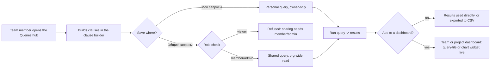

# Spec: Queries, search & dashboards module analysis (doc-005)

## Context and goal

MUSTASK's work item list and boards (M3/M4) already support ad hoc inline
filtering (`feat-003-work-item-search` on the list,
`feat-NNN-board-backlog-filter` on boards and backlogs); D-4
([doc-001](../doc-001-domain-map/status.md) § Decisions) keeps a saved-query
and dashboard module (M6) out of MVP entirely and names it release-2/3
ground instead. This task analyses that ground: what a saved query is, who
owns it, the deliberate WIQL-subset boundary, dashboards and widgets, and
CSV import/export — on the model of Azure DevOps' Queries and Dashboards
hubs ([research/ado-boards.md](../doc-001-domain-map/research/ado-boards.md)
§§ Queries, Security; screenshots 13–16). It does not reopen D-4 or any
other D-1..D-12 decision; round 1 of the requirements review forced four
further human decisions, D-13..D-16 (`status.md` § Decisions), and doc-010's
D-4..D-24 are binding too. Module rules are BR-M6-n. It does not cover
free-text/inline search — that stays M3/M4's.

## Roles

M6 reuses the `ORG_MEMBERSHIP.role` an organization member already has
(admin/member/viewer, D-9) for every shared object; a user who is not a
member of the project's organization is answered "not found" (doc-001
BR-5). Personal objects (D-14) are reached through doc-001 § Roles'
personal-object code: every bundle, viewer included, holds it, and its
ownership predicate limits it to the acting user's own private objects — in
release 2 their personal queries and their «Мои запросы» folder, later any
object a spec declares personal (doc-010 D-12). A viewer's write to their own
private query is therefore an ordinary permission check (doc-001 BR-5), and
no bundle, admin included, reads another user's private object; the
organization administrator's purge (BR-M6-9) reveals no content.
`mod-002`'s ADR-0018 amendment states the predicate, and `mod-008` registers
the personal-object code in every bundle (doc-010 D-11).

| Role | Own personal queries | Shared queries/folders | Dashboards/widgets |
|---|---|---|---|
| Reader (`viewer`) | create/read/update/delete/restore (D-14) | read and run only | read only |
| Member (`member`) | same | create/read/update/delete/restore any | create/read/update/delete/restore (a team's seeded default can't be deleted; project dashboards have no protected default — D-15) |
| Organization administrator (`admin`) | same | same as member, plus purge of deleted ones — other users' private ones included, unseen (BR-M6-9) | same as member, plus purge (BR-M6-9) |

## Stories

| id | Title | depends-on | File |
|---|---|---|---|
| US-1 | A member builds a query with the clause builder | - | `stories/US-1-clause-builder-query-model.md` |
| US-2 | A member saves a personal query and shares one with the project | US-1 | `stories/US-2-personal-and-shared-queries.md` |
| US-3 | A member works with query results | US-1, US-2 | `stories/US-3-query-results.md` |
| US-4 | A member imports and exports work items via CSV | US-1, US-3 | `stories/US-4-csv-import-export.md` |
| US-5 | An organization member builds a dashboard with widgets and charts backed by queries | US-2, US-3 | `stories/US-5-dashboards-widgets-and-charts.md` |

## Business process (BPMN)

## Logical data model

`PROJECT`, `TEAM`, `USER` and `WORK_ITEM` are M1/M3's entities
([doc-001](../doc-001-domain-map/spec.md) § Cross-module logical data
model) — M6 only reads them. Every entity above carries a deleted status of
its own (BR-M6-9), separate from its project's deactivation, which hides
M6 objects through the project without writing that status (BR-M6-10); the
attribute is left out of the diagram for brevity.

## Glossary

M6's terms («Запрос», «Мои запросы», «Общие запросы», «Папка запросов»,
«Конструктор условий», «Условие», the query types, «Результаты», «Дашборд
команды» / «Дашборд проекта», «Виджет», «Плитка запроса», «Диаграмма»,
«Импорт рабочих элементов» / «Экспорт в CSV») with their Azure DevOps
equivalents are in doc-001's glossary. Macro tokens (`@Me`, `@Today`,
`@CurrentIteration`) are literal query-language syntax, kept in English the
same way internal field codes are — they are not localized UI copy.
Operator names, by contrast, are ordinary UI copy and carry Russian labels;
the English WIQL names used below (Under, Was Ever, Contains) are the
internal codes behind those labels.

## Business rules

| # | Rule | Source |
|---|------|--------|
| BR-M6-1 | A query is scoped to exactly one project; there is no cross-project query, mirroring the project scoping of tags. | doc-001 BR-8; research/ado-boards.md § Queries |
| BR-M6-2 | A personal query lives in the owner's private «Мои запросы» folder and is visible and editable only by that user, whatever the owner's role, while they are a member of the organization (doc-001 § Roles, the personal-object code; D-14). | research/ado-boards.md §§ Queries, Security; D-14 |
| BR-M6-3 | A shared query lives in the project's «Общие запросы» folder; read is org-wide — every member of the project's organization can see and run it (D-9, doc-001 BR-5: nothing is scoped finer than the organization); member/admin can create, edit and delete any shared query or sub-folder; viewer can only read and run. | D-9; doc-001 BR-5; research/ado-boards.md § Security (Query folders) |
| BR-M6-4 | Query results show every work item of the project the requesting user may read — org-wide read (D-9) — never narrowed to the requester's own team the way a board is. A work item in «Удалена» appears only through a clause that names «Удалена» (doc-001 BR-14). A team-bound @CurrentIteration (BR-M6-6) picks the iteration and does not narrow the results to that team's areas. | D-9; doc-001 BR-3 (contrast), BR-14; doc-010 N-23 |
| BR-M6-5 | The release-2 field, operator and macro set covers everything the MVP inline filter does — "Under" on Область and Итерация matching the node and its descendants while "=" stays exact (doc-001 BR-15), and a keyword clause over Заголовок and the identifier — and is defined, with the release-3 extension toward WIQL parity, in US-1's "Query language" tables. A Статус clause compares the state label on every type, so «Статус = Разрешена» spans two categories: InProgress on Эпик, Фича and Пользовательская история, Resolved on Баг (`doc-002` § Types). *Superseded by bug-004 D-3 (2026-10-12): «Разрешена» is Resolved on all four types, a state name has one category on every type, and the clause's result is one category.* Release 3 also adds the tree and "work items and direct links" query types, decomposed as their own task because they change the result from a list to a hierarchy (`mod-010-query-hierarchy-operators`). | doc-001 MVP/release tables; research § Queries; doc-010 D-4, D-16 |
| BR-M6-6 | The `@CurrentIteration` macro resolves against a team's current iteration (doc-001 BR-9) and works with "=" and "Under"; a query may use it only if it declares a team from its own project (BR-M6-1) whose iteration to read — a query with no team context, or a team outside the query's project, cannot use the macro (D-16); if the bound team is deleted (doc-006 BR-M1-18, possible from MVP), the query cannot run until another team of its project is chosen. | doc-001 BR-9, D-11; D-16; doc-010 D-6 |
| BR-M6-7 | A dashboard widget backed by a query re-runs that query every time the dashboard is displayed or refreshed — never a cached snapshot; the markdown widget is the only kind with no query. Only a shared query may back a widget — a personal query is owner-only (BR-M6-2) and would leak through a dashboard every org member can read. | research/ado-boards.md (dashboard widgets) |
| BR-M6-8 | CSV import creates and updates WorkItem records through the same validation path as a manual create/edit (M3 owns the data), one row per transaction — a row that fails validation is rejected and reported without blocking the rest of the file; import needs write access to WorkItem, so only member/admin may import (doc-001 BR-5). A row names an existing work item by its full identifier (`doc-002` BR-M3-5) within the target project; a row that targets a work item in «Удалена» or of another project is rejected; an update row is last write wins, recorded in history (doc-001 BR-11); a new-item row naming a state other than its type's first is rejected with the reason (`doc-002` § Fields). CSV export writes out a query's persisted column set (BR-M6-12) for its current result set; export needs only read access to the query (BR-M6-4), so any role including viewer may export. Files are UTF-8 with a BOM, semicolon-delimited (Russian-locale Excel default), capped at 5,000 rows per file: an import file over the cap is refused whole, before any row is processed; an export whose result set exceeds the cap is refused with a request to narrow the query — never a silently truncated file. | research § Other product capabilities; doc-010 N-3, N-14, N-16, N-27 |
| BR-M6-9 | Deleting a query, query folder, dashboard or widget sets its own deleted status (doc-001 BR-6): it leaves the normal lists, retention is indefinite, and whoever may delete it may restore it — the owner for a personal query or folder, a member or administrator for shared ones, dashboards and widgets. Only the organization administrator purges, from a purge list that shows owner, folder and deletion date, never an object's name or content — also for another user's private query or folder, which the purge neither reveals nor restores. A widget backed by a deleted or purged query shows «Запрос удалён» (US-5) until the query is restored, or the widget is re-pointed or removed. | doc-001 BR-6, D-5; D-13; doc-010 D-13 |
| BR-M6-10 | A user has at most one private «Мои запросы» folder per project, not one global folder (BR-M6-1). A query's name is unique, case-insensitively, within its immediate folder only. An object's own deleted status is separate from its project's deactivation (doc-001 BR-6): a deactivated project hides its queries, folders and dashboards, and restoring the project brings back exactly those not deleted on their own. When a user's organization membership is removed (D-10) their personal queries and folder are soft-deleted automatically — a private object has one owner and nothing to transfer to. When a team is deleted (doc-006 BR-M1-18, possible from MVP) its team dashboards are soft-deleted with it, a team deleted before `mod-009` ships gets no default dashboard, and a query bound to it stops (BR-M6-6). | research (My Queries); doc-001 BR-6, D-10; doc-010 D-6, N-12 |
| BR-M6-11 | A member or admin may move ("promote") their own personal query into a shared folder; once shared it is governed by BR-M6-3 like any other shared query — no owner-only restriction survives the move. A viewer who owns a personal query cannot promote it themselves (promoting writes to a shared folder, BR-M6-3) — they may ask a member or admin to recreate or share it. | US-2 (R-10) |
| BR-M6-12 | A saved query persists a chosen column set (US-3); a query with no explicit choice uses the default column set — «ID», Заголовок, Статус, Исполнитель, Приоритет. CSV export (BR-M6-8) uses exactly the persisted set. | US-3, US-4 (R-9); doc-010 N-3 |

## Operation completeness

Purge (BR-M6-9) is the organization administrator's alone and reveals no
content of a private object.

| Entity | Create | Read | Update | Delete/deactivate | Cancel/reverse |
|--------|--------|------|--------|-------------------|----------------|
| Query (personal) | any org member incl. viewer, in their own «Мои запросы» (release 2, D-14) | owner only | owner only | owner only, soft; purge: org admin (BR-M6-9) | owner (restore, BR-M6-9) |
| Query (shared) | member, admin, into «Общие запросы» (release 2) | admin, member, viewer (org-wide read, D-9) | member, admin (any shared query, BR-M6-3) | member, admin, soft; purge: org admin | member, admin (restore) |
| Query folder (shared sub-folder) | member, admin | admin, member, viewer | member, admin (rename) | member, admin — only when empty, soft; purge: org admin | member, admin (restore) |
| Dashboard (team) | member, admin (additional ones); the team's first is seeded automatically (release 3, D-15) | admin, member, viewer | member, admin (rename, reorder widgets) | member, admin for additional dashboards; the seeded default cannot be deleted; soft; system, when its team is deleted (BR-M6-10); purge: org admin | member, admin (restore) |
| Dashboard (project) | member, admin (release 3, D-15); none seeded automatically | admin, member, viewer | member, admin | member, admin, soft; purge: org admin | member, admin (restore) |
| Dashboard widget | member, admin | admin, member, viewer | member, admin (settings, resize, reorder) | member, admin, soft; purge: org admin | member, admin (restore) |

## Non-functional requirements

- **Volumes:** a project's «Общие запросы» folder holds on the order of
  hundreds of queries; a project-scoped flat query's result list returns
  within 2 s for up to 5,000 matching work items in that project — the
  bound is project-wide, not narrowed to a team or a level the way doc-001's
  board/backlog bound is (doc-001 NFR; BR-M6-4 contrast). A tree/linked
  query (release 3), which also resolves link/parent rows for the same match
  set, returns within 4 s for the same 5,000-item volume.
- **Dashboards (release 3):** a dashboard holds at most 10 widgets; opening
  or refreshing it re-runs every widget's query in parallel, not
  sequentially, and a dashboard whose widgets are backed by flat queries,
  each within the volume above, becomes interactive within 3 s; a widget
  backed by a tree/linked query is held to that query's own 4 s bound and
  the rest of the dashboard does not wait for it.
  BR-M6-7's "never a cached snapshot" rules out any cross-user or
  cross-session cache of widget data; it does not forbid two widgets on the
  same page load sharing one request for an identical query — that is
  `feat-006-dashboard-charts`'s implementation choice, not a data-freshness
  exception, and is stated here only to stop it being read as one.
- **Concurrency** (doc-001 BR-11): a shared query, a shared folder and a
  dashboard layout are multi-writer objects — revision check, the second
  write rejected with a conflict to reload and reapply. A personal query has
  a single owner and cannot conflict.
- **Audit:** query and dashboard changes are not recorded in
  `HistoryRevision` — that mechanism is WorkItem-only (doc-001 BR-4, whose
  list of what MVP does not audit names M6); no audit trail for
  queries/dashboards is planned for release 2/3.
- **Localization:** query/dashboard UI copy is Russian (AGENTS.md); macro
  tokens stay literal English syntax (Glossary above).

## Out of scope

- Free-text/inline search across the work item list, boards and backlogs —
  M3/M4's, delivered by `feat-003-work-item-search` and
  `feat-NNN-board-backlog-filter` (D-4); not part of this module.
- Cross-project queries ("query across projects") — BR-M6-1.
- Full WIQL parity / a raw-text query editor — BR-M6-5 is a deliberate
  subset; the release-3 "language" is the clause builder's internal model
  only (US-1 § Query language).
- The `@Project`, `@Follows` and `@RecentMentions` macros — closed as
  "never" in US-1 § Query language, not merely deferred.
- A permission model finer than the organization role (member/admin/viewer)
  on individual queries or folders, beyond doc-001's personal-object code —
  no per-object ACL.
- Query-based card styling rules on boards ("color by query criteria") — a
  board (M4) feature, not analyzed here.
- Delivery Plans, Analytics views, Power BI, service hooks/webhooks — out of
  scope at the umbrella level already (doc-001).
- Email delivery of query results or dashboards — notifications are
  in-app only (doc-001 umbrella).
- Bulk edit of query results — surfaced only once M3's release-2 bulk edit
  exists, scoped by `doc-NNN-release-2-scope` (doc-010 D-18).
- A history/audit trail for queries and dashboards — see Non-functional
  requirements above.
- Sprint burndown/velocity/CFD and capacity widgets — M5's scope
  (doc-004), not analyzed here even though they would eventually appear as
  dashboard widget types.

## Decomposition for the backlog

The ownership check D-14 needs is not a task of its own: `mod-002`'s
ADR-0018 amendment states the predicate, and `mod-008` registers doc-001's
personal-object code in every bundle (doc-010 D-11). CSV import/export has
one owner in MUSTASK, `feat-005`.

| id | Task | size | deps |
|---|---|---|---|
| mod-008-queries-dashboards | Release 2. Founds M6 (`L`: a new module): Query/QueryFolder entities; the release-2 clause-builder query model (US-1, BR-M6-5) incl. «ID», the keyword clause and "Under" on Область and Итерация; personal «Мои запросы» (D-14) and shared «Общие запросы» folders with org-role permissions, soft delete/restore and the org-admin purge (US-2, BR-M6-9, BR-M6-10); the query results view with column selection (US-3, BR-M6-12); registers `queries.query.read`, `queries.query.write`, `queries.query.purge` and the personal-object code in every bundle | L | feat-003-work-item-search, mod-007-iterations, doc-005-queries-dashboards, doc-NNN-release-2-scope |
| mod-009-dashboards-widgets | Release 3. Founds Dashboard/DashboardWidget entities at both levels (D-15): one protected default team dashboard seeded automatically (for new teams and for teams existing when it ships, none for a deleted team) plus additional team dashboards, soft-deleted with their team (BR-M6-10), and project dashboards (none protected); query-tile and markdown widget kinds; the 10-widget cap; soft delete/restore and the org-admin purge (US-5 baseline, BR-M6-9); registers `dashboards.dashboard.read`, `.write` and `.purge`. `L`: a new slice with its own entities, API and screens, and seeding on M1's team creation — adding into another module's flow changes that module's boundary (routing.md, L thresholds) | L | mod-008-queries-dashboards |
| feat-005-csv-import-export | Release 3. CSV import/export of work items from the Queries hub, through M3's normal validation path, one row per transaction, rows matched by the full identifier within the project, deleted-item rows rejected, update rows last write wins, UTF-8/BOM/`;`-delimited, capped at 5,000 rows (US-4, BR-M6-8) | M | mod-008-queries-dashboards |
| feat-006-dashboard-charts | Release 3. Chart widgets backed by a query — grouping and rendering only, no new query language (US-5 remainder) | M | mod-009-dashboards-widgets |
| mod-010-query-hierarchy-operators | Release 3. The operator/macro extension toward WIQL parity (Contains Words, Was Ever, In Group, the Дата изменения field, @Today) together with the tree and "work items and direct links" query types (US-1 remainder). Split out because tree/linked queries change the result from a flat list to a hierarchy — link traversal, parent rollup, a new result contract and UI. `L` by threshold, not by volume: Was Ever and Дата изменения read M3's history (doc-001 BR-4), a read surface M3 must newly expose — adding into another module changes its boundary (routing.md, L thresholds) | L | mod-008-queries-dashboards, feat-001-work-item-links |

## Open questions

None outstanding: the three questions raised in round 1 of the requirements
review are answered by D-13..D-16 (`status.md` § Decisions) and reflected
throughout this revision.
