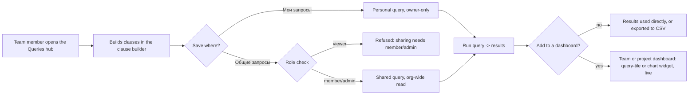
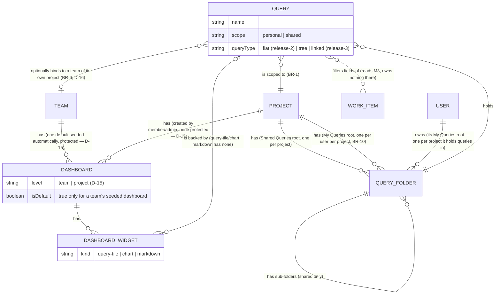

# Spec: Queries, search & dashboards module analysis (doc-005)

## Context and goal

MUSTASK's work item list and boards (M3/M4) already support ad hoc inline
filtering (`feat-003-work-item-search`); D-4
([doc-001](../doc-001-domain-map/status.md) § Decisions) keeps a saved-query
and dashboard module (M6) out of MVP entirely and names it release-2/3
ground instead. This task analyses that ground: what a saved query is, who
owns it, the deliberate WIQL-subset boundary, dashboards and widgets, and
CSV import/export — on the model of Azure DevOps' Queries and Dashboards
hubs ([research/ado-boards.md](../doc-001-domain-map/research/ado-boards.md)
§§ Queries, Security; screenshots 13–16). It does not reopen D-4 or any
other D-1..D-12 decision; round 1 of the requirements review forced four
further human decisions, D-13..D-16 (`status.md` § Decisions), reflected
throughout this revision. It does not cover free-text/inline search — that
stays M3/M4's, delivered by `feat-003-work-item-search`.

## Roles

M6 reuses the `ORG_MEMBERSHIP.role` an organization member already has
(admin/member/viewer, D-9) for every shared object. Personal objects are the
one exception (D-14): a `viewer` may create, read, update and delete their
own private queries and their private "Мои запросы" folder — ownership, not
role, is the check. **This departs from doc-001's Roles table** ("Reader
(`viewer`): read codes only") and from its rule that "a user's codes for a
resource are exactly their `ORG_MEMBERSHIP.role` bundle for that resource's
organization and nothing outside it" (doc-001 § Roles, BR-5) — an
ownership-based write is a check doc-001's permission model does not express
yet. It is carried back into doc-001's Roles section and M1's permission
catalog by `doc-NNN-personal-object-ownership` (§ Decomposition below, an
ADR-0018 amendment), not edited in doc-001 from here; M6's founder depends
on that task landing first.

| Role | Own personal queries | Shared queries/folders | Dashboards/widgets |
|---|---|---|---|
| Reader (`viewer`) | create/read/update/delete (D-14) | read and run only | read only |
| Member (`member`) | same | create/read/update/delete any | create/read/update/delete (a team's seeded default can't be deleted; project dashboards have no protected default — D-15) |
| Organization administrator (`admin`) | same | same as member | same as member |

## Stories

| id | Title | depends-on | File |
|----|-------|------------|------|
| US-1 | A team member builds a query with the clause builder | - | `stories/US-1-clause-builder-query-model.md` |
| US-2 | A team member saves a personal query and shares one with the project | US-1 | `stories/US-2-personal-and-shared-queries.md` |
| US-3 | A team member works with query results | US-1, US-2 | `stories/US-3-query-results.md` |
| US-4 | A team member imports and exports work items via CSV | US-1, US-3 | `stories/US-4-csv-import-export.md` |
| US-5 | A team or project member builds a dashboard with widgets and charts backed by queries | US-2, US-3 | `stories/US-5-dashboards-widgets-and-charts.md` |

## Business process (BPMN)

## Logical data model

`PROJECT`, `TEAM`, `USER` and `WORK_ITEM` are M1/M3's entities
([doc-001](../doc-001-domain-map/spec.md) § Cross-module logical data
model) — M6 only reads them. Every entity above carries the same
soft-delete status as `PROJECT.status` (BR-9) — a dedicated `status`
attribute is left out of the diagram for brevity.

## Glossary

MUSTASK term (Russian UI name in quotes) → Azure DevOps term.

| MUSTASK term | Azure DevOps term |
|---|---|
| Запрос («Запрос») | Query |
| Мои запросы («Мои запросы») | My Queries (personal folder) |
| Общие запросы («Общие запросы») | Shared Queries (shared folder) |
| Папка запросов («Папка запросов») | Query folder |
| Конструктор условий («Конструктор условий») | Clause builder |
| Условие («Условие»: «И» / «ИЛИ», «Поле», «Оператор», «Значение») | Clause (And/Or, Field, Operator, Value) |
| Тип запроса («Плоский список» / «Дерево рабочих элементов» / «Рабочие элементы и прямые связи») | Query type: Flat list / Tree of work items / Work items and direct links |
| Результаты («Результаты») | Query results |
| Дашборд команды / Дашборд проекта («Дашборд команды» / «Дашборд проекта») | Team dashboard / Project dashboard (D-15) |
| Виджет («Виджет») | Widget |
| Плитка запроса («Плитка запроса») | Query tile widget |
| Диаграмма («Диаграмма») | Chart widget |
| Импорт / экспорт («Импорт рабочих элементов» / «Экспорт в CSV») | Import work items / Export to CSV |

Macro tokens (`@Me`, `@Today`, `@CurrentIteration`) are literal
query-language syntax, kept in English the same way internal field codes
are — they are not localized UI copy. Operator names, by contrast, are
ordinary UI copy and carry Russian labels; the English WIQL names used below
(Under, Was Ever, Contains) are the internal codes behind those labels.

## Business rules

| # | Rule | Source |
|---|------|--------|
| BR-1 | A query is scoped to exactly one project; there is no cross-project query, mirroring the project scoping of tags. | doc-001 BR-8; research/ado-boards.md § Queries |
| BR-2 | A personal query lives in the owner's private "Мои запросы" folder and is visible and editable only by that user, regardless of organization role — including a `viewer` (D-14; see Roles above for the doc-001 departure this creates). | research/ado-boards.md §§ Queries, Security; D-14 |
| BR-3 | A shared query lives in the project's "Общие запросы" folder; read is org-wide — every member of the project's organization can see and run it (D-9, doc-001 BR-5: nothing is scoped finer than the organization; per-project permission overrides are M1's release-2 ground and are not modelled here); member/admin can create, edit and delete any shared query or sub-folder; viewer can only read and run. | D-9; doc-001 BR-5; research/ado-boards.md § Security (Query folders) |
| BR-4 | Query results show every work item the requesting user's organization role already grants read access to in that project — org-wide read visibility (D-9) — never narrowed to the requester's own team the way a board is. | D-9; doc-001 BR-3 (contrast) |
| BR-5 | The release-2 field, operator and macro set, and the release-3 extension toward WIQL parity, are defined in US-1's "Query language" tables (moved there for the spec's line budget — this is business ground, not implementation); release 3 also adds the tree and "work items and direct links" query types, decomposed as their own task because they change the result from a list to a hierarchy (§ Decomposition, `mod-NNN-query-hierarchy-operators`). | doc-001 MVP/release tables; research/ado-boards.md § Queries |
| BR-6 | The `@CurrentIteration` macro resolves against a team's current iteration (doc-001 BR-9); a query may use it only if it declares a team from its own project (BR-1) whose iteration to read — a query with no team context, or a team outside the query's project, cannot use the macro (D-16); if the bound team is later deleted, the query cannot run until another team of its project is chosen. | doc-001 BR-9, D-11; D-16 |
| BR-7 | A dashboard widget backed by a query re-runs that query every time the dashboard is displayed or refreshed — never a cached snapshot; the markdown widget is the only kind with no query. Only a shared query may back a widget — a personal query is owner-only (BR-2) and would leak through a dashboard every org member can read. | research/ado-boards.md (dashboard widgets) |
| BR-8 | CSV import creates and updates WorkItem records through the same validation path as a manual create/edit (M3 owns the data), one row per transaction — a row that fails validation is rejected and reported without blocking the rest of the file; import needs write access to WorkItem, so only member/admin may import (doc-001 BR-5), a viewer may not. CSV export writes out a query's persisted column set (BR-12) for its current result set; export needs only read access to the query (BR-4), so any role including viewer may export. Files are UTF-8 with a BOM, semicolon-delimited (Russian-locale Excel default), capped at 5,000 rows per file: an import file over the cap is refused whole, before any row is processed; an export whose result set exceeds the cap is refused with a request to narrow the query — never a silently truncated file. | research/ado-boards.md § Other product capabilities |
| BR-9 | Deletion of a query, query folder, dashboard or widget is soft, exactly as doc-001 BR-6 states for the rest of the system: the object gets a deleted status that hides it from the normal lists — the mechanism doc-001 BR-6 gives a project, not the WorkItem «Удалена» process state, which M6 objects do not have — retention is indefinite, and only an administrator purges it by hand (D-13). Purge is the one action an administrator may take on another user's soft-deleted personal query or folder; it grants no read of its content and no restore (BR-2). Whoever may delete an object may also restore it — owner for a personal query/folder, member/admin for a shared query, folder, dashboard or widget — the same split as doc-001's WorkItem delete/restore. A dashboard widget backed by a soft-deleted query shows the placeholder «Запрос удалён» (US-5) until the query is restored or the widget is re-pointed or removed. | doc-001 BR-6, D-5; D-13 |
| BR-10 | A user has at most one private "Мои запросы" folder per project, not one global folder (matching the reference product and this module's own project scoping, BR-1). A query's name is unique, case-insensitively, within its immediate folder only — not across folders or projects. When a project deactivates (doc-001 BR-6) its queries, folders and dashboards deactivate with it and are restored together with it. When a user's organization membership is removed (D-10) their personal queries and folder are soft-deleted automatically — a private object has one owner and nothing to transfer to. When a team is deleted (release 2+) its team dashboards are soft-deleted with it. | research/ado-boards.md (My Queries); doc-001 BR-6, D-10 |
| BR-11 | A member or admin may move ("promote") their own personal query into a shared folder; once shared it is governed by BR-3 like any other shared query — no owner-only restriction survives the move. A viewer who owns a personal query cannot promote it themselves (promoting writes to a shared folder, BR-3) — they may ask a member or admin to recreate or share it. | US-2 (R-10) |
| BR-12 | A saved query persists a chosen column set (US-3); a query with no explicit choice uses the default column set — Заголовок, Статус, Исполнитель, Приоритет. CSV export (BR-8) uses exactly the persisted set. | US-3, US-4 (R-9) |

The release-2/3 field, operator and macro tables — too large for this
index's line budget — live in `stories/US-1-clause-builder-query-model.md`
§ Query language; every macro `research/ado-boards.md` § Queries lists is
closed there, and so is whether release 3 exposes a raw-text syntax.

## Operation completeness

| Entity | Create | Read | Update | Delete/deactivate | Cancel/reverse |
|--------|--------|------|--------|-------------------|----------------|
| Query (personal) | any org member incl. viewer, in their own "Мои запросы" (release 2, D-14) | owner only | owner only | owner only, soft (BR-9) | owner (restore, BR-9) |
| Query (shared) | member, admin, into "Общие запросы" (release 2) | admin, member, viewer (org-wide read, D-9) | member, admin (any shared query, BR-3) | member, admin, soft (BR-9) | member, admin (restore, BR-9) |
| Query folder (shared sub-folder) | member, admin | admin, member, viewer | member, admin (rename) | member, admin — only when empty, soft (BR-9) | member, admin (restore, BR-9) |
| Dashboard (team) | member, admin (additional ones); the team's first is seeded automatically (release 3, D-15) | admin, member, viewer | member, admin (rename, reorder widgets) | member, admin for additional dashboards; the seeded default cannot be deleted; soft (BR-9) | member, admin (restore, BR-9) |
| Dashboard (project) | member, admin (release 3, D-15); none seeded automatically | admin, member, viewer | member, admin | member, admin, soft (BR-9) | member, admin (restore, BR-9) |
| Dashboard widget | member, admin | admin, member, viewer | member, admin (settings, resize, reorder) | member, admin, soft (BR-9) | member, admin (restore, BR-9) |

## Non-functional requirements

- **Volumes:** a project's "Общие запросы" folder holds on the order of
  hundreds of queries; a project-scoped flat query's result list returns
  within 2 s for up to 5,000 matching work items in that project — the
  bound is project-wide, not narrowed to a team or a level the way doc-001's
  board/backlog bound is (doc-001 NFR; BR-4 contrast). A tree/linked query
  (release 3), which also resolves link/parent rows for the same match set,
  returns within 4 s for the same 5,000-item volume.
- **Dashboards (release 3):** a dashboard holds at most 10 widgets; opening
  or refreshing it re-runs every widget's query in parallel, not
  sequentially, and a dashboard whose widgets are backed by flat queries,
  each within the volume above, becomes interactive within 3 s; a widget
  backed by a tree/linked query is held to that query's own 4 s bound and
  the rest of the dashboard does not wait for it.
  BR-7's "never a cached snapshot" rules out any cross-user or
  cross-session cache of widget data; it does not forbid two widgets on the
  same page load sharing one request for an identical query — that is
  `feat-NNN-dashboard-charts`'s implementation choice, not a data-freshness
  exception, and is stated here only to stop it being read as one.
- **Concurrency:** a shared query, a shared folder and a dashboard layout
  are multi-writer objects and follow the platform default (ADR-0010,
  doc-001 BR-11): optimistic concurrency, the second write rejected with a
  conflict to reload and reapply. A personal query has a single owner and
  cannot conflict.
- **Audit:** query and dashboard changes are not recorded in
  `HistoryRevision` — that mechanism is WorkItem-only (doc-001 BR-4); no
  audit trail for queries/dashboards is planned for release 2/3, stated
  explicitly to avoid a silent gap.
- **Localization:** query/dashboard UI copy is Russian (AGENTS.md); macro
  tokens stay literal English syntax (Glossary above).

## Out of scope

- Free-text/inline search across the work item list and board — M3/M4's,
  delivered by `feat-003-work-item-search` (D-4); not part of this module.
- Cross-project queries ("query across projects") — BR-1.
- Full WIQL parity / a raw-text query editor — BR-5 is a deliberate subset;
  the release-3 "language" is the clause builder's internal model only
  (US-1 § Query language).
- The `@Project`, `@Follows` and `@RecentMentions` macros — closed as
  "never" in US-1 § Query language, not merely deferred.
- A permission model finer than the organization role (member/admin/viewer)
  on individual queries or folders, beyond the one ownership exception
  D-14 already carries back to doc-001 (§ Roles) — no per-object ACL.
- Query-based card styling rules on boards ("color by query criteria") — a
  board (M4) feature, not analyzed here.
- Delivery Plans, Analytics views, Power BI, service hooks/webhooks — out of
  scope at the umbrella level already (doc-001).
- Email delivery of query results or dashboards — notifications are
  in-app only (doc-001 umbrella).
- Bulk edit of query results — depends on M3's own release-2 bulk-edit
  capability (doc-001); M6 would only surface it once it exists, not
  analyzed further here.
- A history/audit trail for queries and dashboards — see Non-functional
  requirements above.
- Sprint burndown/velocity/CFD and capacity widgets — M5's scope
  (doc-004), not analyzed here even though they would eventually appear as
  dashboard widget types.

## Decomposition for the backlog

| id | Task | size | deps |
|---|---|---|---|
| doc-NNN-personal-object-ownership | Docs task, no behaviour of its own: amends doc-001's Roles section and BR-5, and states what M1's permission catalog must express, for an ownership-based write — a `viewer` may write their own private objects (D-14). It writes no ADR (doc-001: an analysis task writes none); the ADR-0018 amendment and the check itself are owed by the M1 code task it names — `mod-002-organizations-projects-teams` if that has not shipped yet, else a follow-up M1 task, which M6's founder then also depends on. `M` like every other analysis task: no threshold fires. | M | doc-001 |
| mod-NNN-queries-dashboards | Release 2. Founds M6 (`L`: a new module): Query/QueryFolder entities; the release-2 clause-builder query model over the release-2 field/operator/macro set (US-1); personal "Мои запросы" (viewer-owned, D-14) and shared "Общие запросы" folders with org-role permissions and soft delete/restore (US-2, BR-9); the query results view with column selection (US-3, BR-12) | L | mod-003-work-item-core, feat-003-work-item-search, mod-007-iterations, mod-005-work-item-delete-restore, doc-NNN-personal-object-ownership |
| mod-NNN-dashboards-widgets | Release 3. Founds Dashboard/DashboardWidget entities at both levels (D-15): one protected default team dashboard seeded automatically (for new teams and for teams existing when it ships) plus additional team dashboards, and project dashboards (none protected); query-tile and markdown widget kinds; the 10-widget cap; soft delete/restore (US-5 baseline, BR-9). `L`: a new slice with its own entities, API and screens, and seeding on M1's team creation — adding into another module's flow changes that module's boundary (routing.md, L thresholds) | L | mod-NNN-queries-dashboards |
| feat-NNN-csv-import-export | Release 3. CSV import/export of work items from the Queries hub, through M3's normal validation path, one row per transaction, UTF-8/BOM/`;`-delimited, capped at 5,000 rows (US-4, BR-8) | M | mod-NNN-queries-dashboards |
| feat-NNN-dashboard-charts | Release 3. Chart widgets backed by a query — grouping and rendering only, no new query language (US-5 remainder) | M | mod-NNN-dashboards-widgets |
| mod-NNN-query-hierarchy-operators | Release 3. The operator/macro extension toward WIQL parity (Under, Was Ever, the Дата изменения field, @Today) together with the tree and "work items and direct links" query types (US-1 remainder). Split out because tree/linked queries change the result from a flat list to a hierarchy — link traversal, parent rollup, a new result contract and UI. `L` by threshold, not by volume: Was Ever and Дата изменения read M3's history (BR-4), a read surface M3 must newly expose — adding into another module changes its boundary (routing.md, L thresholds) | L | mod-NNN-queries-dashboards, feat-001-work-item-links |

## Open questions

None outstanding: the three questions raised in round 1 of the requirements
review are answered by D-13..D-16 (`status.md` § Decisions) and reflected
throughout this revision.
