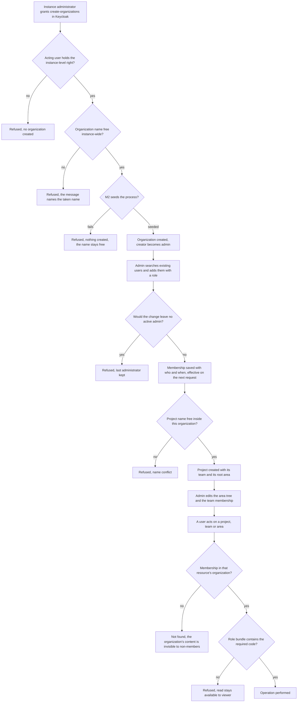
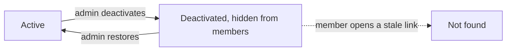
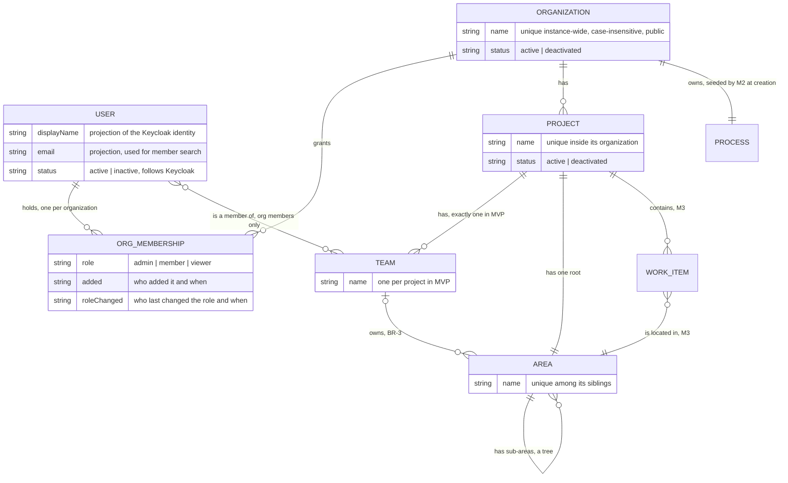

# Spec: Organization, projects, teams and access (doc-006, module M1)

## Context and goal

MUSTASK is multi-organization (D-2): before anyone can track work, someone
must be able to create an organization, put people in it with a role, open a
project inside it and say which team owns which part of the work. This task
is the deep dive of module **M1** of the umbrella
[doc-001](../doc-001-domain-map/spec.md) — its decomposition row (a) for
doc-006 — and it turns doc-001's Roles section, MVP row for M1 and rules
BR-3/5/6/13 into behaviour a test can check. Reference product: Azure DevOps
Boards ([research](../doc-001-domain-map/research/ado-boards.md) §§
Organization / project, Team settings, Security;
[screenshots](../doc-001-domain-map/screenshots/README.md) 18, 20, 21).
doc-001's decisions D-1..D-12 and this task's decisions H-1..H-9
(`status.md`) are binding input and are not reopened here.

## Roles

Access is decided by permission codes — the `<module>.<resource>.<action>`
pattern already in `PermissionCatalog` (ADR-0018). **The code bundle for an
organization-scoped resource comes from the acting user's `ORG_MEMBERSHIP`
for that resource's organization, never from a Keycloak realm role (BR-5,
D-9).** Keycloak keeps authentication and two instance-level roles that
belong to no organization: **instance administrator** (every instance-level
code, incl. "create organizations") and **dictionaries administrator** (M0
only).

**Constraints the ADR-0018 amendment must satisfy.** ADR-0018 still
describes the pre-D-9 layering; the amendment is owed by
`mod-002-organizations-projects-teams` and is not written by this analysis
task. Whatever it designs, it must hold these:

1. **Two kinds of code.** Instance-level codes — M0's
   `dictionaries.languages.*` and `organizations.organization.create` — stay
   where ADR-0018 puts them: client roles of `mustask-api`, bundled into
   realm roles and groups, carried in the token. Organization-scoped codes
   (every other row of the table below) are never declared in the realm
   import, never mapped onto a Keycloak role or group, and never read from
   the token; the membership is their only source. Whether they are
   registered in `PermissionCatalog` beside the instance-level codes or in a
   registry of their own is the amendment's choice, but the realm-import
   contract test ("the `mustask-api` client's roles equal the catalog")
   compares against the instance-level codes only.
2. **The realm roles `admin`, `member`, `viewer` leave the realm import**
   (D-9: no realm role with those names exists). `admin`'s bundle, "every
   instance-level code", passes to the instance administrator role;
   `member` and `viewer` grant only `dictionaries.languages.read` today, and
   every user who holds that code today keeps it. The groups
   «Администраторы», «Сотрудники», «Участники» may be kept, renamed or
   removed, provided the first holds.
3. **The contract test "the `admin` role holds every permission and is
   granted to at least one group"** is restated for the instance
   administrator role: it holds every instance-level code, no
   organization-scoped code, and is granted to at least one group.
4. **M0 is unchanged:** `dictionaries.languages.read`/`.write` reach exactly
   the users they reach before the amendment, and the dictionaries
   administrator role is untouched.
5. **MUSTASK reads users from Keycloak** — search by name/e-mail and account
   status — through a channel the amendment names (admin API with a service
   account, or events). Its rights are limited to viewing and querying
   users; its credential comes only from environment/user secrets. An access
   check still never calls Keycloak.

| Code (analysis-level; the exact strings are fixed by `mod-002-organizations-projects-teams`) | Scope | admin | member | viewer |
|---|---|---|---|---|
| `organizations.organization.create` | instance | granted in the Keycloak console (BR-M1-2), never by a membership role | same | same |
| `organizations.organization.read` | organization | yes | yes | yes |
| `organizations.organization.write` (rename) | organization | yes | no | no |
| `organizations.organization.deactivate` (incl. restore) | organization | yes | no | no |
| `organizations.membership.read` | organization | yes | yes | yes |
| `organizations.membership.write` (add, change role, remove) | organization | yes | no | no |
| `organizations.project.read` | organization | yes | yes | yes |
| `organizations.project.write` (create, rename) | organization | yes | no | no |
| `organizations.project.deactivate` (incl. restore) | organization | yes | no | no |
| `organizations.team.read` | organization | yes | yes | yes |
| `organizations.team.write` (rename, membership) | organization | yes | no | no |
| `organizations.area.read` | organization | yes | yes | yes |
| `organizations.area.write` (create, rename, move, re-own, delete) | organization | yes | no | no |

Inside M1 `member` and `viewer` are both read-only — what separates them are
the work item, board, backlog and iteration codes owned by M3/M4/M5. Team
membership carries no role of its own: it decides which board and backlog a
user sees (BR-3), not what they may do.

## Stories

| id | Title | depends-on | File |
|----|-------|------------|------|
| US-1 | An instance administrator grants the right to create organizations | - | `stories/US-1-grant-create-organizations.md` |
| US-2 | A permitted user creates an organization and maintains it | US-1 | `stories/US-2-create-and-maintain-organization.md` |
| US-3 | An organization administrator manages membership | US-2 | `stories/US-3-manage-organization-membership.md` |
| US-4 | Access is scoped to the organization the resource belongs to | US-3 | `stories/US-4-organization-scoped-access.md` |
| US-5 | An organization administrator manages projects | US-2 | `stories/US-5-manage-projects.md` |
| US-6 | An organization administrator manages the project's team | US-5 | `stories/US-6-manage-team-membership.md` |
| US-7 | An organization administrator manages the project's area tree | US-5 | `stories/US-7-manage-area-tree.md` |

No story is spun out into its own queue line: this is an analysis task, every
story here is a specification for `mod-002-organizations-projects-teams`
(see Decomposition), and all of them are `shippable: no`.

## Business process (BPMN)

From "nobody has an organization yet" to "a member acts on a resource",
with the refusals on the way.

Lifecycle of an organization and of a project — soft only, BR-6; MVP has no
purge, so a deactivated object and its name persist (BR-M1-1):

## Entities and invariants

M1 owns six entities; everything else in the diagram is another module's and
is shown only where M1 touches it.

- **USER is a projection, not a master record.** MUSTASK never creates,
  edits, disables or deletes a user — Keycloak does; MUSTASK keeps display
  name, e-mail and active/inactive status to render lists and to search
  candidates, refreshed from the identity provider (BR-M1-17).
- **An organization is the isolation boundary.** No entity of one
  organization ever references an entity of another; there is no
  cross-organization sharing, now or later (doc-001, Out of scope).
- **A project never moves** between organizations, and a team never moves
  between projects.

## Business rules

Module-local rules are `BR-M1-*`; cross-module rules keep their doc-001
numbers (BR-3, BR-5, BR-6, BR-13) and are not restated here. BR-M1-15 is
release 2 (§ MVP boundary).

| # | Rule | Source (document / decision) |
|---|------|------------------------------|
| BR-M1-1 | An organization's name is unique instance-wide and public within the instance: a refusal may say the name is taken, and says nothing else about the organization behind it. A project's name is unique inside its organization. Both comparisons ignore letter case and surrounding spaces. MVP has no purge: a deactivated organization or project keeps its name reserved for as long as it exists. The name of an organization, a project, a team and an area is 1–100 characters after the surrounding spaces are trimmed. | H-2; doc-001 US-1; research § Organization / project |
| BR-M1-2 | "Create organizations" is an instance-level right, independent of every membership: holding it gives access to no organization's data, and losing it does not touch the organizations already created. It is granted and revoked in the Keycloak console, through ADR-0018's permission → role → group chain; MUSTASK has no screen for it. | D-10; ADR-0018 § Consequences ("grant permission" moves to the Keycloak console) |
| BR-M1-3 | An organization's process is seeded by M2 at the moment the organization is created, exactly one per organization; M1 calls that capability and never defines what a process is. Creation and seed succeed or fail together: on a seed failure no organization exists, its name stays free and the creator sees a refusal. Every project of the organization uses its process. | D-2; doc-001 module map M1/M2 |
| BR-M1-4 | No change made in MUSTASK may leave an organization without an `admin` membership whose account is active (BR-M1-17) — active as MUSTASK's user projection shows it at the moment of the change: removing or downgrading an administrator, the acting one included, is refused if it would. An account disabled or deleted in Keycloak is not such a change and is never refused (§ MVP boundary, known limitation). An administrator may downgrade or remove their own membership while another active administrator remains; a member or reader leaves only by an administrator's action. | this spec (analysis); H-1, H-4 |
| BR-M1-5 | A user holds at most one membership per organization, and may hold memberships in any number of organizations; a membership is created only for an existing Keycloak identity, and outlives that identity being disabled or deleted (BR-M1-17). | D-2, D-9 |
| BR-M1-6 | Organization-scoped codes are derived per request from the membership, not carried in the token: adding a member, changing a role or removing a member takes effect on the user's next request, with no re-login. | D-9; ADR-0018 (amendment owed by `mod-002-organizations-projects-teams`, § Roles) |
| BR-M1-7 | The organization that owns the resource decides: the codes come from the acting user's membership in *that* organization, resolved as Area → Project → Organization and Team → Project → Organization. MVP scopes no finer — no per-project or per-area override. | BR-5, D-9 |
| BR-M1-8 | A user with no membership is told nothing about an organization's content — its projects, members, teams, areas and work items: opening the organization or anything under it answers "not found", never "forbidden". The existence of an organization's name is not content (BR-M1-1). | H-2; research § Security |
| BR-M1-9 | Creating a project creates exactly one team for it, with the creating administrator as its only member; MVP has no action to create a second team or to delete the one that exists. doc-001's MVP table (M1) and its Operation completeness row (Team / Area) both fix one team per project; several teams are release 2. | doc-001 MVP table M1, Operation completeness |
| BR-M1-10 | Team membership is a subset of organization membership: only members of the project's organization may be in its teams, and removing an organization membership removes that user from every team of that organization. A team may be left with no members. | BR-5; doc-001 US-2 |
| BR-M1-11 | Every project has exactly one root area, created with the project and named after it; it is renamed only with the project, never on its own, cannot be deleted or moved, and is always owned by the project's team — its owner cannot be changed or cleared. So every area resolves to an owning team (BR-3), which in MVP is always the project's one team: ownership decides nothing there yet and is kept so that several teams per project (release 2) start from areas that already carry an owner. | D-8; screenshot 18 |
| BR-M1-12 | The areas of a project form a tree: sibling names are unique, and a node cannot be moved under its own descendant. | research § Team settings |
| BR-M1-13 | An area node is deleted only when it is a leaf with no work items in it; otherwise the delete is refused and the administrator must move the content first. | doc-001 Operation completeness (Team / Area) |
| BR-M1-14 | A project exposes a default area for new work items; in MVP it is the project's root area, and a per-team configurable default area is release 2. The rule that a work item created without an explicit area gets it belongs to `doc-002-work-items` (M3), which must echo it. | screenshot 18 ("Default area") |
| BR-M1-16 | A membership records who added it and when, and who last changed its role and when; everyone who can read the membership list reads them. It is the only change record M1 keeps in MVP. | H-3 |
| BR-M1-17 | A member whose Keycloak account is disabled or deleted keeps every membership and team membership and is shown as «неактивен» in member lists and wherever they appear as «Исполнитель» (M3 renders it, `doc-002-work-items` echoes it); they cannot sign in; removing them is an administrator's decision, never automatic. A disabled account enabled again loses the marking and has its memberships unchanged. An inactive account is not offered as a candidate in the add-member search or the add-to-team picker; whether it remains an assignee candidate is for `doc-002-work-items` to state, alongside BR-13. | H-4, H-8 |

## Operation completeness

| Entity | Create | Read | Update | Delete/deactivate | Cancel/reverse |
|--------|--------|------|--------|-------------------|----------------|
| Organization | instance administrator or a user granted "create organizations" (US-1/US-2); the creator becomes its first `admin` | admin, member, viewer — own organizations only (BR-M1-8) | admin (rename, US-2) | admin (soft, BR-6) | admin (restore, US-2); no purge in MVP — the organization and its name persist (BR-M1-1) |
| Instance right "create organizations" | instance administrator, in the Keycloak console (BR-M1-2, US-1) | instance administrator, in the Keycloak console | n/a — a code is held or not | instance administrator revokes, in the Keycloak console (US-1) | n/a |
| Organization membership | admin, adding an existing Keycloak user found by name/e-mail (US-3) | admin, member, viewer — own organization's list, with who/when (BR-M1-16) | admin (role among admin/member/viewer, own role included, BR-M1-4) | admin (remove, own membership included; the last active admin refused, BR-M1-4); no self-leave for member/viewer; never automatic for an inactive account (BR-M1-17) | no: re-add instead; the new membership records its own who/when (BR-M1-16) |
| Project | org admin (US-5) | admin, member, viewer of that organization | org admin (rename, US-5) | org admin (soft, BR-6) | org admin (restore from the deactivated list, US-5); no purge in MVP — the project and its name persist (BR-M1-1) |
| Team | no: created with the project, exactly one (BR-M1-9); several teams are release 2 | admin, member, viewer | org admin (rename; add/remove members from the organization's members, US-6) | no: a project keeps its one team in MVP (doc-001 MVP table) | n/a |
| Team membership | org admin (US-6) | admin, member, viewer | no: removed and re-added, not edited in place | org admin (US-6); also automatic when the organization membership goes (BR-M1-10) | n/a |
| Area | org admin (child nodes; the root comes with the project, BR-M1-11) | admin, member, viewer | org admin (rename, move, re-own child nodes; the root follows the project only, BR-M1-11, US-7) | org admin — empty leaves only (BR-M1-13) | no: a deleted empty leaf holds nothing to restore; re-create it |
| User (projection) | no: Keycloak owns identities; the projection appears when a user first signs in or is picked in member search | admin, member, viewer — display name, e-mail and active status of the organization's members | no: name, e-mail and active status follow Keycloak (BR-M1-17) | no: a disabled or deleted account keeps its memberships; an admin removes them (BR-M1-17) | n/a |

## Non-functional requirements

- **Volumes:** tens of organizations per instance, tens of projects per
  organization, up to ~500 memberships per organization and an area tree of
  up to 500 nodes and 10 levels per project. The member list, the project
  list and the area tree render within 2 s at those volumes; resolving an
  area's owning team (BR-3 inheritance) stays within that budget.
- **Member search:** searching existing users by part of a name or e-mail
  returns within 2 s and shows display name and e-mail only.
- **Access checks:** an access check needs no call to Keycloak (ADR-0018).
  Organization-scoped codes are derived from the membership per request, so a
  role change takes effect on the next request with no re-login (BR-M1-6);
  the instance-level "create organizations" code is carried in the token, so
  granting or revoking it takes effect only when the token is renewed
  (ADR-0018 § Consequences, "revocation is NOT instant"; US-1).
- **Concurrency:** every invariant stated in BR-M1-1, -4, -5, -10, -12 and
  -13 holds under concurrent requests, including a work item created in an
  area (M3) while that area is deleted. Of two changes that each pass the
  check alone but together would break the rule, one is refused. The
  mechanism (a unique constraint, a serialized check) is decided at design.
  doc-001's BR-11 covers work items and boards only.
- **Identity refresh:** a member's display name, e-mail and active status
  follow Keycloak within a period that `mod-002-organizations-projects-teams`
  fixes and writes down at design (BR-M1-17).
- **Audit:** MVP keeps who/when on the membership only (BR-M1-16); the full
  M1 audit is release 2 (BR-M1-15). ADR-0018 § Consequences: "audit does not
  come for free".
- **Localization:** all interface copy is Russian (AGENTS.md); the strings
  quoted in the stories are the product wording.

## MVP boundary and release 2 for M1

**MVP:** the instance-level create gate with its right granted in Keycloak;
the organization with membership, the three roles and who/when on each
membership; the inactive marking of members whose account is gone; the
project with its one team and its root area; the area tree with team
ownership and inheritance; soft deactivate/restore for organization and
project, with no purge.

**Known MVP limitation — an organization with no usable administrator
(accepted risk, H-1).** BR-M1-4 stops MUSTASK itself from removing the last
active administrator, concurrent changes included, but an organization can
still end up with nobody able to administer it when every `admin` membership
belongs to an account that is disabled or deleted in Keycloak (BR-M1-17), or
to a person who has left and whose account nobody can use. MVP offers no
recovery path for it: the other members keep working within their roles, and
nobody can change membership, rename or deactivate the organization, or
manage its projects, teams and areas. Keeping more than one administrator is
the only mitigation. Outside MUSTASK, an administrator account that was only
disabled can be enabled again in the Keycloak console, which restores its role
(BR-M1-17); a deleted account cannot come back. Neither is a MUSTASK recovery
path.

**Release 2** (named here only to fix the boundary — not queued by this
task): several teams per project and team deletion; a per-team default area
and team-selected areas as a set; per-project and per-area permission
overrides beyond the organization role (BR-5); notifications — in-app
subscriptions by category, in the spirit of screenshot 21; a MUSTASK screen
for instance-level rights, which needs an ADR-0018 amendment of its own;
**BR-M1-15** — every change to a membership, a role, or the active/deactivated
status of an organization or project records who did it and when, readable by
the organization's administrators, built on the audit/history mechanism whose
ADR `mod-003-work-item-core` owes, not a second one.

## Out of scope

- Self-service organization creation and sign-up: creation stays gated
  (D-10).
- User management of any kind — creating, editing, disabling or deleting
  users, passwords, MFA, SSO settings: Keycloak owns identities (ADR-0018).
- Custom roles or custom permission bundles: the three roles are fixed by
  D-9 and change only with a release.
- Cross-organization data sharing, moving a project between organizations,
  merging organizations — never in scope (doc-001).
- Azure DevOps-style access levels (Stakeholder/Basic) and per-group
  security namespaces (research § Security): MUSTASK has one flat role per
  membership.
- Outbound e-mail of any kind, including invitations: a user must already
  exist in Keycloak to be added (D-10).
- Quotas, billing, usage limits per organization.
- Purging a deactivated organization or project (BR-M1-1).
- An ADR: analysis writes none; the ADR-0018 amendment is owed by
  `mod-002-organizations-projects-teams` (doc-001) and must satisfy the
  constraints in § Roles.

## Decomposition for the backlog

`mod-002-organizations-projects-teams` is already in the queue with its
number (doc-001 decomposition (b)); this spec keeps its name and scope
unchanged (H-5) and proposes no new queue lines.

| id | Task | size | deps |
|----|------|------|------|
| `mod-002-organizations-projects-teams` (queued, unchanged) | Founds all of M1 as doc-001 decomposed it: Organization with its lifecycle, `ORG_MEMBERSHIP` with the admin/member/viewer role and who/when, the derivation of organization-scoped codes replacing realm roles and the ADR-0018 amendment bound by § Roles, the instance-level "create organizations" gate, member management with the last-administrator rule, Project with its one team and its root area, the area tree with team ownership. Stories US-1..US-7 | L | doc-006-org-access, mod-001-process-seed |

Priority: unchanged — M3 (`mod-003-work-item-core`) and everything
downstream depend on it. Release-2 items above are deliberately not queued.

## Open questions

None: every question raised by this analysis is answered by D-1..D-12,
H-1..H-5, ADR-0018 or doc-001.
