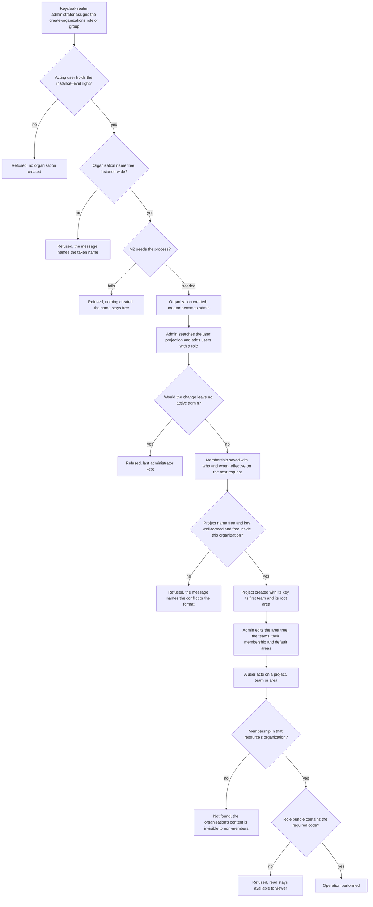
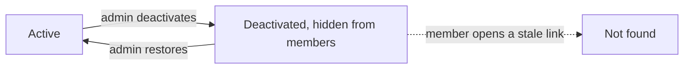
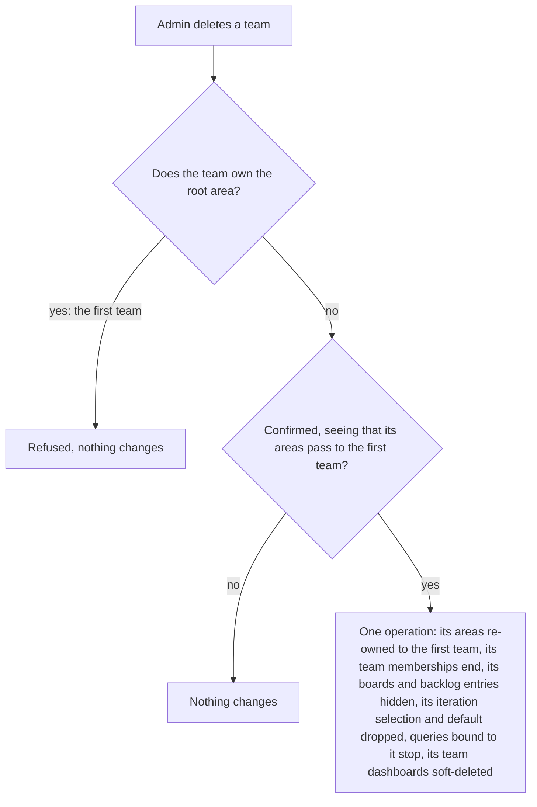
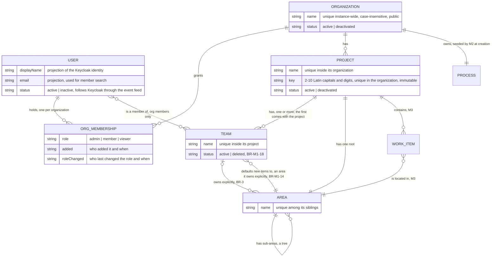

# Spec: Organization, projects, teams and access (doc-006, module M1)

## Context and goal

MUSTASK is multi-organization (D-2): before anyone can track work, someone
must be able to create an organization, put people in it with a role, open a
project inside it and say which team owns which part of the work. This task
is the deep dive of module **M1** of the umbrella
[doc-001](../doc-001-domain-map/spec.md) — its decomposition row (a) for
doc-006 — and it turns doc-001's Roles section, MVP row for M1 and rules
BR-3/5/6/13 into behaviour a test can check. Reference product: Azure DevOps
Boards ([research](../doc-001-domain-map/research/ado-boards.md) §§
Organization / project, Team settings, Security;
[screenshots](../doc-001-domain-map/screenshots/README.md) 18, 20, 21).
doc-001's decisions D-1..D-12, this task's decisions H-1..H-9
(`status.md`) and the cross-module decisions of doc-010 (D-4..D-24, its
`status.md`) are binding input and are not reopened here.

## Roles

Access is decided by permission codes — the `<module>.<resource>.<action>`
pattern already in `PermissionCatalog` (ADR-0018). **The code bundle for an
organization-scoped resource comes from the acting user's `ORG_MEMBERSHIP`
for that resource's organization, never from a Keycloak realm role (BR-5,
D-9).** Keycloak keeps authentication and instance-level roles only, which
belong to no organization and are named by the ADR-0018 amendment
(constraint 8): at least the **instance administrator** (every
instance-level code: "create organizations", M0's codes) and the
**dictionaries administrator** (M0 only). Granting and revoking "create
organizations" is Keycloak realm administration, not a MUSTASK code
(BR-M1-2).

**Constraints the ADR-0018 amendment must satisfy.** ADR-0018 still
describes the pre-D-9 layering; the amendment is owed by
`mod-002-organizations-projects-teams` and is not written by this analysis
task. Whatever it designs, it must hold these:

1. **Two kinds of code.** Instance-level codes — M0's
   `dictionaries.languages.*` and `organizations.organization.create` — stay
   where ADR-0018 puts them: client roles of `mustask-api`, bundled into
   realm roles and groups, carried in the token. Organization-scoped codes
   (every other row of the table below, and every code of M2–M6) are never
   declared in the realm import, never mapped onto a Keycloak role or group,
   and never read from the token; the membership is their only source.
   Where they are registered is the amendment's choice, but every
   catalogued code carries its scope (instance | organization), and the
   realm-import contract test ("the `mustask-api` client's roles equal the
   catalog") filters on it and compares the instance-level codes only;
   renaming the instance code is the amendment's call.
2. **The realm roles `admin`, `member`, `viewer` leave the realm import**
   (D-9: no realm role with those names exists). `admin`'s bundle, "every
   instance-level code", passes to the instance administrator role;
   `member` and `viewer` grant only `dictionaries.languages.read` today, and
   every user who holds that code today keeps it. The groups
   «Администраторы», «Сотрудники», «Участники» may be kept, renamed or
   removed, provided the first holds.
3. **The contract test "the `admin` role holds every permission and is
   granted to at least one group"** is restated for the instance
   administrator role: it holds every instance-level code, no
   organization-scoped code, and is granted to at least one group.
4. **M0 is unchanged:** `dictionaries.languages.read`/`.write` reach exactly
   the users they reach before the amendment, and the dictionaries
   administrator role is untouched.
5. **Users are read through a projection** (doc-010 D-9). A Keycloak
   event-listener provider, a new deployable, pushes every user created,
   updated, disabled or deleted in realm `mustask` into MUSTASK's USER
   projection, and a backfill loads the existing users; member search and
   the «неактивен» marking (BR-M1-17) read the projection only. No shipping
   code calls Keycloak's admin REST surface and no production client has a
   service account — ADR-0023's guards stay. Credentials come only from
   environment/user secrets. `mod-NNN-keycloak-user-projection` founds both
   and owes their ADR; an access check still never calls Keycloak.
6. **A resource-based check.** The resource's organization is resolved
   (Area/Team → Project → Organization; WorkItem, Iteration, Board,
   BacklogEntry, Query, Dashboard → Project or Team → Organization), the
   acting user's membership there is read per request (BR-M1-6), a
   non-member gets "not found" (BR-M1-8), the role's bundle must hold the
   code, and then the code's optional ownership predicate is checked on the
   resolved object (doc-001 § Roles). MVP needs the predicate for one's own
   comments (`feat-002`) and attachments (`mod-004`), which implement it
   under this rule; `mod-008` registers the personal-object code (release 2,
   doc-010 D-11). The founders of M2–M6 plug into this check.
7. **The panel learns org-scoped codes from Mustask.Api**, not from the
   token, with BR-M1-6's freshness, and filters navigation and controls by
   them.
8. **The realm role inventory.** The amendment names every realm role and
   group that remains — at least the instance administrator, the
   dictionaries administrator and a grantable "create organizations" role
   or group — and which of them gives `dictionaries.languages.read` to a
   user in none; it updates `scripts/keycloak-seed.sh`, the E2E fixture's
   group and `src/backend/AGENTS.md`.

| Code (analysis-level; the exact strings are fixed by `mod-002-organizations-projects-teams`) | Scope | admin | member | viewer |
|---|---|---|---|---|
| `organizations.organization.create` | instance | assigned by a Keycloak realm administrator (BR-M1-2), never by a membership role | same | same |
| `organizations.organization.read` | organization | yes | yes | yes |
| `organizations.organization.write` (rename) | organization | yes | no | no |
| `organizations.organization.deactivate` (incl. restore) | organization | yes | no | no |
| `organizations.membership.read` | organization | yes | yes | yes |
| `organizations.membership.write` (add, change role, remove) | organization | yes | no | no |
| `organizations.project.read` | organization | yes | yes | yes |
| `organizations.project.write` (create with its key, rename) | organization | yes | no | no |
| `organizations.project.deactivate` (incl. restore) | organization | yes | no | no |
| `organizations.team.read` | organization | yes | yes | yes |
| `organizations.team.write` (create, rename, delete, membership, default area) | organization | yes | no | no |
| `organizations.area.read` | organization | yes | yes | yes |
| `organizations.area.write` (create, rename, move, re-own, delete) | organization | yes | no | no |

The organization settings screen also hosts the Drive-connection section
`mod-004` adds, guarded by M3's `workitems.attachment-storage.manage` (admin
only, doc-002 US-13). Inside M1 `member` and `viewer` are both read-only;
outside it the viewer bundle holds the personal-object code (doc-001
§ Roles). Team membership carries no role and no access: any organization
member reads, and a member or administrator acts on, every team's boards,
backlogs, planning pane and (release 3) dashboards (BR-5); it decides which
team a user's views open on by default and, from release 2, whose capacity
is planned and whom "In Group" matches.

## Stories

| id | Title | depends-on | File |
|----|-------|------------|------|
| US-1 | A Keycloak realm administrator grants the right to create organizations | - | `stories/US-1-grant-create-organizations.md` |
| US-2 | A permitted user creates an organization and maintains it | US-1 | `stories/US-2-create-and-maintain-organization.md` |
| US-3 | An organization administrator manages membership | US-2 | `stories/US-3-manage-organization-membership.md` |
| US-4 | Access is scoped to the organization the resource belongs to | US-3 | `stories/US-4-organization-scoped-access.md` |
| US-5 | An organization administrator manages projects | US-2 | `stories/US-5-manage-projects.md` |
| US-6 | An organization administrator manages the project's teams | US-5 | `stories/US-6-manage-team-membership.md` |
| US-7 | An organization administrator manages the project's area tree | US-5, US-6 | `stories/US-7-manage-area-tree.md` |

No story is spun out into its own queue line: this is an analysis task, every
story here is a specification for `mod-002-organizations-projects-teams`
(US-3's member search also for `mod-NNN-keycloak-user-projection`, see
Decomposition), and all of them are `shippable: no`.

## Business process (BPMN)

From "nobody has an organization yet" to "a member acts on a resource",
with the refusals on the way.

Lifecycle of an organization and of a project — soft only (doc-001 BR-6),
never purged, so a deactivated object, its name and a project's key persist
(BR-M1-1). `mod-002` owes the ADR for this status-based deactivation (hidden
from lists, restorable, names reserved, cascading to everything beneath),
which the work item recycle bin and M6's soft deletes reference:

Deleting a team — soft, with a cascade over M1, M4, M5 and M6, no restore
(BR-M1-18):

## Entities and invariants

M1 owns six entities; everything else in the diagram is another module's and
is shown only where M1 touches it.

- **USER is a projection, not a master record.** MUSTASK never creates,
  edits, disables or deletes a user — Keycloak does; MUSTASK keeps display
  name, e-mail and active/inactive status to render lists and to search
  candidates, fed by Keycloak's event listener and a backfill (§ Roles,
  constraint 5; BR-M1-17).
- **An organization is the isolation boundary.** No entity of one
  organization ever references an entity of another; there is no
  cross-organization sharing, now or later (doc-001, Out of scope).
- **A project never moves** between organizations, and a team never moves
  between projects.

## Business rules

Module-local rules are `BR-M1-*`; cross-module rules keep their doc-001
numbers (BR-3, BR-5, BR-6, BR-13, BR-14) and are not restated here.
BR-M1-15 is release 2 (§ MVP boundary).

| # | Rule | Source (document / decision) |
|---|------|------------------------------|
| BR-M1-1 | An organization's name is unique instance-wide and public within the instance: a refusal may say the name is taken, and says nothing else about the organization behind it. A project's name is unique inside its organization. Both comparisons ignore letter case and surrounding spaces. A project's key is set by the organization administrator at creation: 2–10 Latin capital letters and digits, starting with a letter; unique inside its organization, deactivated projects included; never changed, a rename included; it heads every work item identifier (doc-002 BR-M3-5). Organizations and projects are never purged: a deactivated one keeps its name, and a project its key, reserved for as long as it exists. The name of an organization, a project, a team and an area is 1–100 characters after the surrounding spaces are trimmed. | H-2; doc-002 W-10; doc-010 D-13; doc-001 US-1; research § Organization / project |
| BR-M1-2 | "Create organizations" is an instance-level right, independent of every membership: holding it gives access to no organization's data, and losing it does not touch the organizations already created. Granting and revoking it is Keycloak realm administration: a Keycloak realm administrator assigns or removes the realm role or group that carries the code (named by the ADR-0018 amendment, constraint 8). It is not a MUSTASK code, no MUSTASK role — the instance administrator's included — carries Keycloak administration rights, and MUSTASK has no screen for it. | D-10; doc-010 D-10; ADR-0018 § Consequences ("grant permission" moves to the Keycloak console) |
| BR-M1-3 | An organization's process is seeded by M2 at the moment the organization is created, exactly one per organization; M1 calls that capability and never defines what a process is. Creation and seed succeed or fail together: on a seed failure no organization exists, its name stays free and the creator sees a refusal. Every project of the organization uses its process. | D-2; doc-001 module map M1/M2 |
| BR-M1-4 | No change made in MUSTASK may leave an organization without an `admin` membership whose account is active (BR-M1-17) — active as MUSTASK's user projection shows it at the moment of the change: removing or downgrading an administrator, the acting one included, is refused if it would. An account disabled or deleted in Keycloak is not such a change and is never refused (§ MVP boundary, known limitation). An administrator may downgrade or remove their own membership while another active administrator remains; a member or reader leaves only by an administrator's action. | this spec (analysis); H-1, H-4 |
| BR-M1-5 | A user holds at most one membership per organization, and may hold memberships in any number of organizations; a membership is created only for an existing Keycloak identity, and outlives that identity being disabled or deleted (BR-M1-17). | D-2, D-9 |
| BR-M1-6 | Organization-scoped codes are derived per request from the membership, not carried in the token: adding a member, changing a role or removing a member takes effect on the user's next request, with no re-login. | D-9; ADR-0018 (amendment owed by `mod-002-organizations-projects-teams`, § Roles) |
| BR-M1-7 | The codes come from the acting user's membership in the organization that owns the resource (doc-001 BR-5), resolved as Area → Project → Organization and Team → Project → Organization; § Roles constraint 6 extends the chain to the resources of M2–M6. | BR-5, D-9 |
| BR-M1-8 | A user with no membership is told nothing about an organization's content — its projects, members, teams, areas and work items: opening the organization or anything under it answers "not found", never "forbidden". The existence of an organization's name is not content (BR-M1-1). | H-2; research § Security |
| BR-M1-9 | Creating a project creates its first team, named after the project, with the creating administrator as its only member; it owns the root area (BR-M1-11). An organization administrator adds further teams to the project at any time; each comes with a child area of the root named after it, owned by it and set as its default area (BR-M1-14), and if the root already has a child of that name the team is not created (BR-M1-12). A team's name is 1–100 characters and unique among the project's active teams, compared ignoring letter case and surrounding spaces. An organization administrator renames a team — its areas keep their names — and deletes it per BR-M1-18. | doc-004 E-5; doc-010 D-6, D-7, D-23 (b); doc-001 MVP table M1 |
| BR-M1-10 | Team membership is a subset of organization membership: only members of the project's organization may be in its teams, and removing an organization membership removes that user from every team of that organization. A team may be left with no members. | BR-5; doc-001 US-2 |
| BR-M1-11 | Every project has exactly one root area, created with the project and named after it; it is renamed only with the project, never on its own, cannot be deleted or moved, and is owned by the project's first team for good — its owner cannot be changed or cleared, and that team is never deleted (BR-M1-18). Every other area is owned explicitly by one team of the project, any of them, or by none, and then inherits the owner of its nearest explicitly owned ancestor; so every area resolves to exactly one owning team (doc-001 BR-3). | D-8; H-9; doc-010 D-6; screenshot 18 |
| BR-M1-12 | The areas of a project form a tree: sibling names are unique, and a node cannot be moved under its own descendant. | research § Team settings |
| BR-M1-13 | An area node is deleted only when it is a leaf with no work items in it — work items in «Удалена» included (doc-001 BR-14) — and is no team's default area (BR-M1-14); otherwise the delete is refused and the administrator must move the content, or change the default, first. | doc-001 Operation completeness (Area) |
| BR-M1-14 | Every team has exactly one default area, an area it owns explicitly: the first team's is the root area and never changes; a later team's is at first the area created with it (BR-M1-9), and an organization administrator may set a later team's default to any other area that team owns explicitly. A work item created from a team's board or backlog takes that team's default area (doc-003); one created with no team context — M3's project-wide create form — takes the root area, the first team's default (doc-002 § Fields, Область). An area that is a team's default cannot be re-owned to another team, left without an explicit owner or deleted until that team's default changes. | screenshot 18 ("Default area"); doc-010 D-7, D-23 (b) |
| BR-M1-16 | A membership records who added it and when, and who last changed its role and when; everyone who can read the membership list reads them. It is the only change record M1 keeps in MVP. | H-3 |
| BR-M1-17 | A member whose Keycloak account is disabled or deleted keeps every membership and team membership and is shown as «неактивен» in member lists and wherever they appear as «Исполнитель»; they cannot sign in; removing them is an administrator's decision, never automatic. A disabled account enabled again loses the marking and has its memberships unchanged. The status is the user projection's (§ Roles, constraint 5). An inactive account is not offered as a candidate in the add-member search, the add-to-team picker or the «Исполнитель» picker; an assignee who is no longer a member is marked «не в организации», which prevails over «неактивен» — the assignee side is doc-002 § Fields (Исполнитель) and doc-001 BR-13. | H-4, H-8; doc-010 D-9 |
| BR-M1-18 | An organization administrator deletes a team — soft, after a confirmation naming the project's first team as the new owner of its areas — except the team that owns the root area, which is refused. In one operation: every area the team owns explicitly is re-owned to the first team, so its work items move to the first team's backlogs (doc-003); its team memberships end; its boards and backlog entries are hidden (doc-003); its iteration selection and default are dropped (doc-004); queries bound to it stop running (doc-005, from release 2) and its team dashboards are soft-deleted (doc-005, from release 3). There is no restore — the cascade cannot be undone — and the deleted team's name becomes free in the project; the areas it owned keep their names, so a new team of that name is refused while the root still has a child area of that name (BR-M1-9) until that area is renamed. | doc-010 D-6, D-23 (a) |

## Operation completeness

| Entity | Create | Read | Update | Delete/deactivate | Cancel/reverse |
|--------|--------|------|--------|-------------------|----------------|
| Organization | instance administrator or a user granted "create organizations" (US-1/US-2); the creator becomes its first `admin` | admin, member, viewer — own organizations only (BR-M1-8) | admin (rename, US-2) | admin (deactivate — soft, doc-001 BR-6) | admin (restore, US-2); never purged — the organization and its name persist (BR-M1-1) |
| Instance right "create organizations" | a Keycloak realm administrator, in the Keycloak console (BR-M1-2, US-1) | a Keycloak realm administrator, in the Keycloak console | n/a — a code is held or not | a Keycloak realm administrator revokes, in the Keycloak console (US-1) | n/a |
| Organization membership | admin, adding an existing Keycloak user found by name/e-mail in the user projection (US-3) | admin, member, viewer — own organization's list, with who/when (BR-M1-16) | admin (role among admin/member/viewer, own role included, BR-M1-4) | admin (remove, own membership included; the last active admin refused, BR-M1-4); no self-leave for member/viewer; never automatic for an inactive account (BR-M1-17) | no: re-add instead; the new membership records its own who/when (BR-M1-16) |
| Project | org admin, with its key (US-5) | admin, member, viewer of that organization | org admin (rename; the key never, BR-M1-1, US-5) | org admin (deactivate — soft, doc-001 BR-6) | org admin (restore from the deactivated list, US-5); never purged — the project, its name and its key persist (BR-M1-1) |
| Team | org admin (US-6): the first comes with the project, further ones any time, each with its own area (BR-M1-9) | admin, member, viewer | org admin (rename; add/remove members from the organization's members; set its default area among the areas it owns explicitly — the first team's stays the root, BR-M1-14; US-6) | org admin — soft, with the cascade of BR-M1-18; never the first team, which owns the root area (US-6) | no: no restore — the cascade cannot be undone; create a new team instead (BR-M1-18) |
| Team membership | org admin (US-6) | admin, member, viewer | no: removed and re-added, not edited in place | org admin (US-6); also automatic when the organization membership goes (BR-M1-10) or the team is deleted (BR-M1-18) | n/a |
| Area | org admin (child nodes; the root comes with the project, BR-M1-11; a later team's first area comes with the team, BR-M1-9) | admin, member, viewer | org admin (rename, move, re-own child nodes to any team of the project — never a team's default area away from it, BR-M1-14; the root follows the project only, BR-M1-11, US-7) | org admin — empty leaves only, deleted work items counting, never a team's default area (BR-M1-13) | no: a deleted empty leaf holds nothing to restore; re-create it |
| User (projection) | no: Keycloak owns identities; the projection is fed by Keycloak's event listener and a backfill (§ Roles, constraint 5) | admin, member, viewer — display name, e-mail and active status of the organization's members | no: name, e-mail and active status follow Keycloak (BR-M1-17) | no: a disabled or deleted account keeps its memberships; an admin removes them (BR-M1-17) | n/a |

## Non-functional requirements

- **Volumes:** tens of organizations per instance, tens of projects per
  organization, up to ~500 memberships per organization and an area tree of
  up to 500 nodes and 10 levels per project. The member list, the project
  list and the area tree render within 2 s at those volumes; resolving an
  area's owning team (BR-3 inheritance) stays within that budget.
- **Member search:** searching existing users by part of a name or e-mail
  runs on the user projection, returns within 2 s and shows display name and
  e-mail only; it keeps working while Keycloak is unreachable.
- **Access checks:** an access check needs no call to Keycloak (ADR-0018).
  Organization-scoped codes are derived from the membership per request, so a
  role change takes effect on the next request with no re-login (BR-M1-6);
  the instance-level "create organizations" code is carried in the token, so
  granting or revoking it takes effect only when the token is renewed
  (ADR-0018 § Consequences, "revocation is NOT instant"; US-1).
- **Concurrency:** every invariant stated in BR-M1-1 (names and project
  keys), -4, -5, -9 (team names), -10, -12, -13, -14 and -18 holds under
  concurrent requests, including a work item created in an area (M3) while
  that area is deleted, and an area re-owned to a team while that team is
  deleted. Of two changes that each pass the check alone but together would
  break the rule, one is refused — the "M1 check-then-act" row of doc-001's
  concurrency policy (BR-11). The mechanism (a unique constraint, a
  serialized check) is decided at design.
- **Identity refresh:** a user created, changed, disabled or deleted in
  Keycloak reaches the projection through the event feed within a period
  that `mod-NNN-keycloak-user-projection` fixes and writes down at design;
  while the feed is interrupted, statuses stay as last received (BR-M1-17).
- **Audit:** MVP keeps who/when on the membership only (BR-M1-16); the full
  M1 audit is release 2 (BR-M1-15) — doc-001 § Non-functional requirements
  lists what MVP does not audit. ADR-0018 § Consequences: "audit does not
  come for free".
- **Localization:** all interface copy is Russian (AGENTS.md); the strings
  quoted in the stories are the product wording.

## MVP boundary and release 2 for M1

**MVP:** the instance-level create gate with its right assigned in
Keycloak; the organization with membership, the three roles and who/when on
each membership; member search and the inactive marking over the user
projection fed from Keycloak (`mod-NNN-keycloak-user-projection`); the
project with its key, its teams (the first created with it) and its root
area; creating, renaming and deleting teams with the cascade of BR-M1-18,
and each team's default area; the area tree with team ownership and
inheritance; soft deactivate/restore for organization and project, never
purged.

**Known MVP limitation — an organization with no usable administrator
(accepted risk, H-1).** BR-M1-4 stops MUSTASK itself from removing the last
active administrator, concurrent changes included, but an organization can
still end up with nobody able to administer it when every `admin` membership
belongs to an account that is disabled or deleted in Keycloak (BR-M1-17), or
to a person who has left and whose account nobody can use. MVP offers no
recovery path for it: the other members keep working within their roles, and
nobody can change membership, rename or deactivate the organization, or
manage its projects, teams and areas. Keeping more than one administrator is
the only mitigation. Outside MUSTASK, an administrator account that was only
disabled can be enabled again in the Keycloak console, which restores its role
(BR-M1-17); a deleted account cannot come back. Neither is a MUSTASK recovery
path.

**Release 2** (named here only to fix the boundary — not queued by this
task): team-selected areas as a set; per-project and per-area permission
overrides beyond the organization role (BR-5); notifications — in-app
subscriptions by category, in the spirit of screenshot 21; a MUSTASK screen
for instance-level rights, which needs an ADR-0018 amendment of its own;
**BR-M1-15** — every change to a membership, a role, a team, or the
active/deactivated status of an organization or project records who did it
and when, readable by the organization's administrators, built on the
audit/history mechanism whose ADR `mod-003-work-item-core` owes, not a
second one. Notifications and the audit log are also claimed by M3
(doc-002); `doc-NNN-release-2-scope` settles which module owns each
(doc-010 D-18).

## Out of scope

- Self-service organization creation and sign-up: creation stays gated
  (D-10).
- User management of any kind — creating, editing, disabling or deleting
  users, passwords, MFA, SSO settings: Keycloak owns identities (ADR-0018).
- Custom roles or custom permission bundles: the three roles are fixed by
  D-9 and change only with a release.
- Cross-organization data sharing, moving a project between organizations,
  merging organizations — never in scope (doc-001).
- Azure DevOps-style access levels (Stakeholder/Basic) and per-group
  security namespaces (research § Security): MUSTASK has one flat role per
  membership.
- Outbound e-mail of any kind, including invitations: a user must already
  exist in Keycloak to be added (D-10).
- Quotas, billing, usage limits per organization.
- Purging an organization, a project or a team (BR-M1-1, BR-M1-18);
  restoring a deleted team; calling Keycloak's admin REST surface from
  shipping code (ADR-0023; constraint 5).
- An ADR: analysis writes none; `mod-002` owes the ADR-0018 amendment and
  the soft-deactivation ADR, `mod-NNN-keycloak-user-projection` the
  projection's, all bound by § Roles.

## Decomposition for the backlog

`mod-002-organizations-projects-teams` is queued and keeps its name; its
scope grows as below. The Keycloak user projection is a line of its own
(doc-010 D-9), which mod-002's member search depends on.

| id | Task | size | deps |
|----|------|------|------|
| `mod-NNN-keycloak-user-projection` | Founds the USER projection and the Keycloak event-listener provider that feeds it (user created, updated, disabled, deleted), with a backfill of existing users; member search and the active/inactive status read it; no admin-API call from shipping code, ADR-0023's guards unchanged; owes the ADR for the provider and the projection (§ Roles, constraint 5) | L | doc-006-org-access, doc-010-backlog-normalization-product-plan |
| `mod-002-organizations-projects-teams` (queued) | Founds all of M1: Organization with its lifecycle; `ORG_MEMBERSHIP` with the admin/member/viewer role and who/when; the derivation of organization-scoped codes replacing realm roles and the ADR-0018 amendment bound by § Roles constraints 1–8 (scope attribute, resource-based check with the ownership predicate, codes served to the panel, realm role inventory); the soft-deactivation ADR; the instance-level "create organizations" gate; member management with the last-administrator and inactive-account rules over the projection; Project with its key, its teams — create, rename, default area, delete with the cascade — and its root area; the area tree with team ownership; the organization settings screen `mod-004` extends. Stories US-1..US-7 | L | doc-006-org-access, mod-001-process-seed, mod-NNN-keycloak-user-projection, doc-010-backlog-normalization-product-plan |

Priority: `mod-NNN-keycloak-user-projection` runs beside `mod-001`, both
ahead of `mod-002`; M3 (`mod-003-work-item-core`) and everything downstream
depend on `mod-002`. Release-2 items above are deliberately not queued.

## Open questions

None: every question raised by this analysis is answered by D-1..D-12,
H-1..H-9, doc-010 D-6..D-13 and D-23, ADR-0018 or doc-001.
