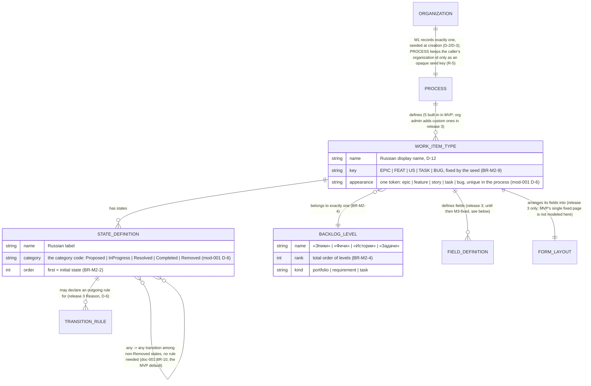
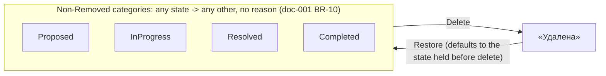

# Spec: Process customization (doc-007, M2 deep dive)

## Context and goal

Every work item in MUSTASK is typed and stated by a Process — doc-001's
module map assigns this to **M2** (`../doc-001-domain-map/spec.md` § Module
map, § Cross-module logical data model), sketched at a high level by its
umbrella story US-3 (`../doc-001-domain-map/stories/US-3-built-in-process.md`).
This task goes one level deeper for every module that reads a Process (M1's
seed call, M3's field/state list, M4's board columns): the five built-in
types' full state lists and categories, the backlog levels, and — analysis
only, no screens — what a release-3 process editor may change and what it
must never break. The reference is Azure DevOps's Agile process, read live
via its REST API and captured in screenshots
(`../doc-001-domain-map/research/ado-boards.md`, `../doc-001-domain-map/screenshots/`).

## Roles

Per D-1/D-9 (`../doc-001-domain-map/status.md` § Decisions): permission
codes are computed from a user's `ORG_MEMBERSHIP.role` (admin/member/viewer)
for the process's owning organization — no Keycloak realm role is checked
here.

| Role | Reads the process definition | Customizes it |
|---|---|---|
| Organization administrator (`admin`) | yes | release 3 only — no editor exists in MVP (D-6) |
| Member (`member`) | yes | never |
| Reader (`viewer`) | yes | never |

Reading means the read-only process-definition screen (§ "MVP: the seeded
process", R-6) — identical for every role, since M2 exposes nothing an admin
alone may see (US-3: "a reader can see the process definition but not change
it"). It is guarded by one organization-scoped code, `process.definition.read`
in every bundle, registered by `mod-001-process-seed` (the exact string is
that task's; release 3 adds an admin-only write code). A user holding no
`ORG_MEMBERSHIP` in that organization reads none of it and is answered
«Организация не найдена», as for an organization that does not exist
(doc-001 BR-5, doc-006 BR-M1-8).

## Stories

| id | Title | depends-on | File |
|----|-------|------------|------|
| US-1 | An organization's process is seeded automatically at creation | - | `stories/US-1-process-seeded-at-organization-creation.md` |
| US-2 | Any organization member reads the process definition, read-only | US-1 | `stories/US-2-read-only-process-definition.md` |
| US-3 | A member moves a work item freely among non-Removed states | US-1 | `stories/US-3-free-state-transitions-and-recycle-bin.md` |
| US-4 | An organization administrator adds custom types, fields and states (release 3) | US-1, US-2, US-3 | `stories/US-4-customize-types-fields-states.md` |
| US-5 | An organization administrator turns on Reason with per-transition rules (release 3) | US-4 | `stories/US-5-reason-and-transition-rules.md` |

## Logical model (M2)

`PROCESS`, `WORK_ITEM_TYPE`, `STATE_DEFINITION` and `BACKLOG_LEVEL` are the
MVP entities (doc-001's cross-module model); `FIELD_DEFINITION`,
`FORM_LAYOUT` and `TRANSITION_RULE` exist only from release 3 on, as analysis
vocabulary for the future editor. Until then every field is M3-fixed and
catalogued in doc-002 § Fields — in MVP the common set plus the two
type-specific fields (doc-002 W-5), in release 2 also the estimation fields
(doc-010 D-15) — and none of them is an M2 concept.

`WORK_ITEM_TYPE` stores no icon or colour of its own. Each type stores
exactly one appearance token from the closed set `epic`, `feature`, `story`,
`task`, `bug`, and no two types share one. The seed sets it for the five
built-in types, and it is not editable in MVP (P-5). What a token looks like
is the panel theme's concern, not M2's (mod-015 BR-4), so restyling a type
needs no change to any seeded process. `STATE_DEFINITION` stores its
category as the category code (`Proposed`, `InProgress`, `Resolved`,
`Completed`, `Removed`). The Russian category label is derived from that
code and never stored (doc-010 D-5). Both points were amended by
`mod-001-process-seed` (its status.md D-6), and they replace the icon and
colour that P-5 originally named.

**Direction (R-5).** M2 needs nothing from M1 (doc-001 § Module order): the
seed takes the owning organization's identifier from its caller and keeps it
only as an opaque key for idempotency (BR-M2-9) — M2 knows nothing else of an
organization; it hands its `PROCESS` identity back, and M1 is the side that
records which process is the organization's — why `mod-001-process-seed`
ships before M1. Stable identities and the seed key: BR-M2-9.

## MVP: the seeded process

Exactly one `PROCESS` per organization (BR-M2-1): the seed exposes a
capability to M1 — create the definitions, hand back their identity (R-5) —
unlike Azure DevOps's Basic/Agile/Scrum/CMMI picker
(`../doc-001-domain-map/screenshots/22-process-list.png`); one shape,
forever, no template picker now or later (P-4). M1 calls it synchronously
while creating the organization; a failed seed fails that creation as a
whole (BR-M2-8). The call is idempotent per BR-M2-9. Every project of the
organization uses that one process, with no project- or team-level override
in MVP (doc-001 ER: `PROJECT }o..|| PROCESS`, derived through the
organization, P-4).

MVP also ships one read-only **process-definition screen**, reached from a
project (doc-001 US-3: "the project's work item type list"; the exact
navigation is `mod-001-process-seed`'s design) (R-6): it lists the five types
with their key, ordered state list, initial state, the Russian label of each
state's category, fixed appearance token and backlog level; no control on it
creates, renames or deletes anything. This makes `mod-001-process-seed` a
full-stack slice — the seed logic plus this one screen.

Five built-in types, unmodifiable, each with its key (doc-002 W-11) and
mapped to exactly one backlog level (D-3, D-12). The levels are totally
ordered by rank, highest first, and each has a kind (BR-M2-4):

| BacklogLevel («Уровень бэклога») | Rank | Kind | WorkItemType(s) («Ключ») |
|---|---|---|---|
| «Эпики» | 4 | portfolio | Эпик (`EPIC`) |
| «Фичи» | 3 | portfolio | Фича (`FEAT`) |
| «Истории» | 2 | requirement | Пользовательская история (`US`), Баг (`BUG`) |
| «Задачи» | 1 | task | Задача (`TASK`) |

Each type's appearance token is fixed by the seed: Эпик `epic`, Фича
`feature`, Пользовательская история `story`, Задача `task`, Баг `bug`
(§ "Logical model"; mod-001 D-6).

The five categories are fixed; each has one Russian label, shown on the
process-definition screen and in the glossary (doc-001), and used by M4 as
the default board column header (doc-010 D-5):

| Category | Label | Board column |
|---|---|---|
| Proposed | «Новые» | yes |
| InProgress | «В работе» | yes |
| Resolved | «Решённые» | yes, where a type of the level has a Resolved state |
| Completed | «Завершённые» | yes |
| Removed | «Удалённые» | never: a deleted item is on no board (doc-001 BR-14) |

> **Superseded in part by bug-004 D-3 (2026-10-12):** the labels are not the
> board's default column headers any more. A column is headed by the name of
> the state it maps (mod-006 BR-M4-2), as the reference tracker heads its
> columns; the labels stay on the process-definition screen, in the glossary
> and wherever a category is shown. The table above is left as written.

Every type's full state list, in order (first = initial state; «Удалена»
last and never on the ordinary state control), each state mapped to exactly
one category (doc-001 BR-2). One label set serves every type, whatever its
grammatical gender (doc-002 W-7/W-9, doc-010 D-4); Эпик, Фича and
Пользовательская история mirror the reference's own grouping
(`../doc-001-domain-map/research/ado-boards.md` § "Work item types (WIT) and
states"; screenshot
`../doc-001-domain-map/screenshots/26-process-userstory-states.png`), and the
same source reserves the Resolved category for Bug alone:

| WorkItemType | States, in order (initial first) → category |
|---|---|
| Эпик, Фича, Пользовательская история | «Новая»→Proposed, «Активна»→InProgress, «Разрешена»→InProgress, «Закрыта»→Completed, «Удалена»→Removed |
| Баг | «Новая»→Proposed, «Активна»→InProgress, «Разрешена»→Resolved, «Закрыта»→Completed, «Удалена»→Removed |
| Задача | «Новая»→Proposed, «Активна»→InProgress, «Закрыта»→Completed, «Удалена»→Removed (no Resolved state — mirrors ADO's Task, which skips it too; doc-002 W-2) |

**One label, two categories.** «Разрешена» is InProgress on Эпик, Фича and
Пользовательская история (as User Story Resolved in Azure DevOps) and
Resolved on Баг (doc-010 D-4). Readers that need its meaning key on the
type's state identity (BR-M2-9); only a state filter goes by the label:

- reports and metrics read the category, so a Пользовательская история in
  «Разрешена» counts as InProgress;
- a board maps columns per (type, state), not by category alone: on the
  «Истории» board Пользовательская история «Разрешена» gets its own column,
  not the «В работе» column, and each board's column set and headers follow
  that per-level mapping (M4, doc-003) rather than the category labels
  blindly;
- a state filter or query clause «Статус = Разрешена» matches the label on
  every type, so its result spans two categories — InProgress items of
  Эпик, Фича and Пользовательская история and Resolved items of Баг
  (doc-002, doc-005).

> **Superseded by bug-004 D-3 (2026-10-12): one name, one meaning.**
> «Разрешена» is **Resolved** on Эпик, Фича, Пользовательская история and Баг
> alike — done, awaiting verification — so the first row of the states table
> reads «Разрешена»→Resolved, and "One label, two categories" no longer holds.
> The rule is general: **a state name has one category on every type of a
> process.** The seed is tested against it, and any path that creates or
> renames a state must refuse a breach (`StateNameRule`; today only the seed
> creates states). Of the three bullets above: the first reads «Разрешена»
> counts as Resolved on every type; the second goes — the «Истории» board has
> one column «Разрешена» holding the story's and the bug's cards, each type
> mapped to its own state, and columns are headed by state names (mod-006
> BR-M4-2); the third reads one category, and the filter's result is one
> category on every type. Existing processes were moved by the migration
> `MoveResolvedStatesToResolvedCategory`, which touches only states still as
> seeded and names every process where a state name still stands in two
> categories — in the PostgreSQL server log, which `dotnet ef database update`
> does not print, so the check is a step run afterwards
> (`docs/runbooks/local-migrations.md`, "Migrations that report"). A state
> renamed or repositioned by hand that breaks no rule is named nowhere. The
> text and tables above are left as written.

«Удалена» is seeded on every type like any other state, but it is not on the
ordinary state control: MUSTASK gives it to all five types uniformly via
delete/restore (D-5, doc-001 BR-6) and enters it only by Delete — unlike
Azure DevOps, where Removed is an ordinary destination
(`../doc-001-domain-map/research/ado-boards.md` § "Transitions"); deletion
here is platform-wide, not per-type. Among the remaining, non-Removed
states, any state moves to any other with no reason (doc-001 BR-10, D-6);
MVP offers no workflow diagram to configure.

No Reason field exists on any type in MVP (D-6); no field, rule or
form-layout customization is exposed — the fields and the one fixed form are
doc-002 § Fields, the single field catalogue, and are platform behaviour,
not yet an M2 concept.

## Release 3: the customization surface (analysis only)

No screens are designed here — this states what each concept must mean and
what it must never break once a process editor exists (D-6;
`../doc-001-domain-map/spec.md` § "Out of scope"). Everything below is
additive: the five built-in types, their categories and backlog levels stay
extendable, never removable — mirroring Azure DevOps ("System processes
cannot be customized", `../doc-001-domain-map/screenshots/22-process-list.png`)
— and every customization mutates the organization's one seeded Process in
place; there is no inherited/forked copy the way ADO's "inherited process"
model works (P-3).

- **Custom work item types.** Beyond the five built-ins; invariant: assigned
  to exactly one backlog level (BR-M2-4), carries a key unique in the
  process (BR-M2-9), and every declared state maps to a fixed category
  (doc-001 BR-2) — never valid mid-edit with an unmapped state.
  Which appearance token a custom type gets, whether custom types may share
  a token, and whether release 3 makes the built-in tokens editable, is not
  decided here (P-5 covers MVP only) — a question for release 3's own
  analysis.
- **Custom fields.** Kinds proposed after Azure DevOps's
  (`../doc-001-domain-map/research/ado-boards.md` § "Fields"), plus boolean,
  which that note does not list: text (single/multi-line), rich text,
  integer, decimal, date, identity, picklist, boolean — adopted here as
  release 3's working scope (gate-1 default). Invariant: narrowing (a kind
  or value-set change that a stored value no longer fits) or removing a
  field that existing items already hold a value in is blocked until that
  data is migrated or retired (BR-M2-6).
- **Custom states.** Add, rename or hide per type; a rename never changes
  the state's identity (R-3). Invariant: the category mapping stays total
  (doc-001 BR-2); a state held by an existing work item, or remembered by a
  deleted one as its restore target, cannot be removed until no item does
  (BR-M2-6); «Удалена» stays reachable only via delete/restore, never an
  ordinary destination (doc-001 BR-10 is not itself editable).
- **Rules.** Field-level conditions/actions, a subset of Azure DevOps's
  (`../doc-001-domain-map/research/ado-boards.md` § "Rules"): when/whenChanged
  conditions; copyValue/setDefaultValue/makeRequired/makeReadOnly/hide actions
  (ADO's whenNot/whenWas/whenNotChanged, setValueToEmpty and copyFrom* are not
  proposed). Invariant: a rule adds a side effect on top of a transition, it
  never removes one from the any↔any set (BR-M2-7).
- **Form layout.** Per-type arrangement of fields into pages/groups
  (`../doc-001-domain-map/screenshots/25-process-userstory-layout.png`).
  Invariant: system fields (Заголовок, Статус) may be repositioned but
  never hidden from the form.
- **Custom backlog levels.** Add portfolio levels beyond «Эпики»/«Фичи», or
  reassign which types map to a level. Invariant: «Истории»/«Задачи» stay
  unremovable — Azure DevOps's own "one requirement/iteration backlog,
  cannot be removed" rule (`../doc-001-domain-map/screenshots/24-process-agile-backlog-levels.png`)
  — every type keeps exactly one backlog level at all times (BR-M2-4).
- **Reason with per-transition rules.** Turn Reason on for a type and, per
  transition, set a default reason and whether it's required to complete
  that transition (Azure DevOps shape: Bug's New→Active "Approved").
  Invariant: never narrows the any↔any set inherited from MVP (BR-M2-7) —
  it adds a required side-input to a transition, it does not remove the
  transition; D-6 stays the MVP default, release 3 only adds an opt-in.

## Business process (BPMN)

## Business rules

The category mapping of every state is doc-001 BR-2, and the transition rule
(any↔any among non-Removed states, «Удалена» only through Delete and
Restore) is doc-001 BR-10; neither is restated here. BR-M2-3 is retired for
that reason, and its number is not reused.

| # | Rule | Source (document / decision) |
|---|------|------------------------------|
| BR-M2-1 | Exactly one Process per organization, created automatically at organization creation, never chosen from a template; M1, not M2, records the organization→process pointer the seed hands back (R-5). | D-2, D-3, P-4; doc-001 ER `ORGANIZATION \|\|--\|\| PROCESS` |
| BR-M2-2 | A type's states are ordered, and the first is its initial state: every work item of the type is created in it (doc-002 § Fields, Статус). | R-2; `../doc-001-domain-map/research/ado-boards.md` § "Work item types" (State field, default New) |
| BR-M2-4 | Each WorkItemType belongs to exactly one BacklogLevel; a BacklogLevel may host more than one type (D-3: «Истории» hosts Пользовательская история and Баг). Levels are totally ordered by rank, and each has a kind — portfolio, requirement or task: M3's parent rule (doc-002 BR-M3-8) and M4's nesting (doc-003 BR-M4-11) read the rank, and M4's choice of which levels get a board (doc-003 BR-M4-1) reads the kind. | D-3; doc-001 ER `WORK_ITEM_TYPE }o--\|\| BACKLOG_LEVEL`; research (ranks 40/30/20/10) |
| BR-M2-5 | A process customization (release 3) that would leave an existing work item's current state without a category mapping, or a type without a backlog level, is rejected by the editor before it is saved. | Analysis-only, derived from doc-001 BR-2 and BR-M2-4 |
| BR-M2-6 | A process customization (release 3) never removes or hides a state, type or field that an existing work item currently references — a deleted item's restore-target state included — until that item has been migrated to a replacement value. | Analysis-only; doc-001 BR-14; `../doc-001-domain-map/research/ado-boards.md` § "Rules" (no destructive action type exists in ADO's rule engine either) |
| BR-M2-7 | A release-3 rule or a per-transition Reason requirement adds a side effect (default value, required field) on top of a transition; it never removes a transition from the any↔any set of doc-001 BR-10. | D-6; `../doc-001-domain-map/research/ado-boards.md` § "Transitions" (an inherited process allows any state → any state, and every transition already carries a Reason list) |
| BR-M2-8 | The seed is all-or-nothing: it creates the complete process or none of it. A failed seed fails organization creation as a whole; an organization is never created — or visible to any module — without its process. | Orchestrator default R-4, confirmed at gate-1, `status.md` |
| BR-M2-9 | Every WorkItemType, StateDefinition and BacklogLevel carries a stable identity, independent of its renameable display name, fixed when the seed creates it; M3's work item and M4's per-(type, state) column mapping reference that identity, never the name. A WorkItemType's key (`EPIC`, `FEAT`, `US`, `TASK`, `BUG` for the five built-ins) is part of that identity: fixed by the seed, unique in the process, never edited, and it appears in every work item identifier (doc-002 BR-M3-5). The seed is idempotent keyed on the organization identifier its caller supplies (held by M2 as an opaque key, R-5): at most one Process per key, so a retry or two calls racing for the same new organization create nothing twice; within a process no type, key, state or backlog level repeats. | R-3, R-5; doc-002 W-11; doc-001 ER (`WORK_ITEM` → `STATE_DEFINITION`) |

## Operation completeness

| Entity | Create | Read | Update | Delete/deactivate | Cancel/reverse |
|---|---|---|---|---|---|
| Process | no: seeded automatically by the M1→M2 capability at org creation (BR-M2-1) | admin, member, viewer (`process.definition.read`, § Roles) | no: MVP (release 3: customized in place — the one Process, never forked/replaced, P-3) | no: a process lives as long as its organization, which is deactivated, never purged (doc-001 BR-6) | n/a |
| WorkItemType | no: MVP ships the fixed five (D-3) | admin, member, viewer | no: MVP; org admin, release 3 (rename, recategorize within doc-001 BR-2 and BR-M2-5; the key never, BR-M2-9) | no: MVP; org admin, release 3 — custom types only, and only after BR-M2-6's migration | n/a |
| StateDefinition | no: MVP ships the fixed per-type lists | admin, member, viewer | no: MVP; org admin, release 3 (add/rename, within doc-001 BR-2) | no: MVP; org admin, release 3 (hide only if no work item holds it or remembers it, BR-M2-6); «Удалена» is never editable (doc-001 BR-10) | n/a |
| BacklogLevel | no: MVP ships the fixed four (D-3) | admin, member, viewer | no: MVP; org admin, release 3 (rename, reassign types, BR-M2-4) | no: not in MVP or release 3 — «Истории»/«Задачи» stay unremovable like ADO's requirement/iteration backlog | n/a |
| FieldDefinition (release 3 only) | org admin | admin, member, viewer | org admin (kind changes limited by existing data) | org admin, only after BR-M2-6's migration | n/a |
| FormLayout (release 3 only) | org admin (per type, default on type creation) | admin, member, viewer | org admin (move fields between pages/groups; system fields never hidden) | no: a layout always exists, it is reset to default, not deleted | n/a |
| TransitionRule / Reason (release 3 only) | org admin (per transition) | admin, member, viewer | org admin | org admin (turns Reason back off for that transition) | n/a |

## Non-functional requirements

- The seed call is synchronous and blocks organization creation (US-1), and
  its failure fails that creation as a whole (BR-M2-8); the seed itself sets
  no performance budget of its own in this task (R-19).
- A process is read far more often than it changes: MVP never writes to it
  after seeding, and even release 3 expects edits to be rare, so no
  read-scaling or write-throughput target is set beyond ordinary dictionary
  reads (M0 pattern).

## Out of scope

- The release-3 process editor's screens — this task states invariants
  only, no UI (D-6).
- Choosing among process templates (Azure DevOps's Basic/Scrum/CMMI) —
  MUSTASK seeds exactly one process per organization, in MVP and release 3
  alike, permanently (BR-M2-1, P-4); nothing here proposes a template picker.
- Per-project or per-team process override — every project of an
  organization uses that organization's one process.
- Test Case, Test Plan, Test Suite and Issue types, and anything under
  Azure DevOps's Repos/Pipelines/Test Plans
  (`../doc-001-domain-map/spec.md` § "Out of scope").
- Editing a type's appearance token in MVP — fixed by the seed (P-5);
  release 3 is left open (§ "Release 3", Custom work item types).
- Migrating an organization's already-seeded process when release 3 ships —
  a defined upgrade path is release 3's own design-stage question, not
  analysed here.
- Process import/export, and sharing a customized process across
  organizations.

## Decomposition for the backlog

| id | Task | size | deps |
|---|---|---|---|
| mod-001-process-seed | Founds M2: the five built-in types with their keys `EPIC`/`FEAT`/`US`/`TASK`/`BUG` (BR-M2-9, doc-002 W-11), per-type ordered states with their categories (initial state first, BR-M2-2), the Russian category labels, and the backlog levels with rank and kind (BR-M2-4), seeded per organization; plus the one read-only process-definition screen (D-3/D-6, R-6), guarded by `process.definition.read`, which this task registers; no editing UI. Delivers the definitions, with doc-001 BR-10 as the constraint mod-003-work-item-core and mod-005-work-item-delete-restore enforce on work items (R-7) | L | doc-007-process-customization, doc-010-backlog-normalization-product-plan |
| feat-NNN-process-custom-types | Release 3: org admin adds custom work item types — name, key, backlog level (BR-M2-4), states within the fixed categories (doc-001 BR-2) | M | mod-001-process-seed, mod-003-work-item-core |
| mod-NNN-process-custom-fields | Release 3: org admin adds custom fields per type (kinds per this spec) and work items store/render their values — founds the schema-flexible field-value pattern in M3's storage and form (an ADR-level decision, so `L` by the routing thresholds; the pattern cannot be split away from its first use); a field already holding data cannot be narrowed or removed until migrated (BR-M2-6) | L | feat-NNN-process-custom-types |
| feat-NNN-process-custom-states | Release 3: org admin adds/renames/hides states per type, keeping the category mapping total (doc-001 BR-2) and never orphaning a work item's current or restore-target state (BR-M2-6) | M | feat-NNN-process-custom-types |
| feat-NNN-process-rules | Release 3: org admin defines field-level conditions/actions (per this spec's rule subset) without removing a transition from the any↔any set (BR-M2-7) | M | mod-NNN-process-custom-fields |
| feat-NNN-process-form-layout | Release 3: org admin arranges each type's form into pages/groups per this spec, without hiding a system field | M | mod-NNN-process-custom-fields |
| feat-NNN-process-reason-transitions | Release 3: org admin turns on the Reason field with per-transition default/required rules without narrowing the any↔any transition set (BR-M2-7, D-6); the reason is recorded in M3's history (US-5) | M | mod-001-process-seed, mod-003-work-item-core |
| feat-NNN-process-custom-backlog-levels | Release 3: org admin adds custom portfolio backlog levels and reassigns types to them (M2 side only), keeping «Истории»/«Задачи» unremovable and every type on exactly one level (BR-M2-4) | M | mod-001-process-seed |
| feat-NNN-process-custom-backlog-boards | Release 3: seeds a board and ordered backlog per team for each custom portfolio level added above (M4 side) | M | feat-NNN-process-custom-backlog-levels, mod-006-boards-backlogs |

## Open questions

In-place mutation vs. an inherited fork and one seed template forever are
answered by the human decisions P-3/P-4. Three orchestrator defaults
written into this spec were confirmed by the human at gate-1 on 2026-09-24
(`status.md` § Decisions); none remain open:

1. A failed seed fails the whole organization creation (BR-M2-8, R-4).
2. The seed sets no performance budget of its own (§ Non-functional
   requirements, R-19).
3. The release-3 field-kind list stays as drafted (§ "Release 3", Custom
   fields).
