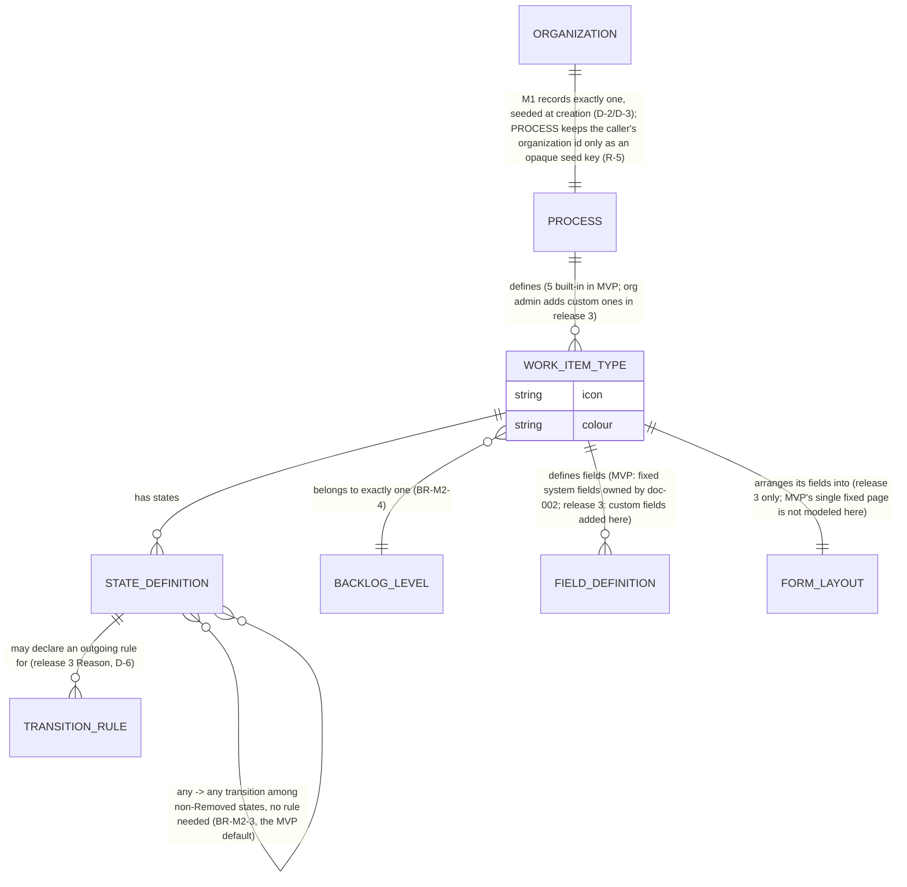

# Spec: Process customization (doc-007, M2 deep dive)

## Context and goal

Every work item in MUSTASK is typed and stated by a Process — doc-001's
module map assigns this to **M2** (`../doc-001-domain-map/spec.md` § Module
map, § Cross-module logical data model), sketched at a high level by its
umbrella story US-3 (`../doc-001-domain-map/stories/US-3-built-in-process.md`).
This task goes one level deeper for every module that reads a Process (M1's
seed call, M3's field/state list, M4's board columns): the five built-in
types' full state lists and categories, the backlog levels, and — analysis
only, no screens — what a release-3 process editor may change and what it
must never break. The reference is Azure DevOps's Agile process, read live
via its REST API and captured in screenshots
(`../doc-001-domain-map/research/ado-boards.md`, `../doc-001-domain-map/screenshots/`).

## Roles

Per D-1/D-9 (`../doc-001-domain-map/status.md` § Decisions): permission
codes are computed from a user's `ORG_MEMBERSHIP.role` (admin/member/viewer)
for the process's owning organization — no Keycloak realm role is checked
here.

| Role | Reads the process definition | Customizes it |
|---|---|---|
| Organization administrator (`admin`) | yes | release 3 only — no editor exists in MVP (D-6) |
| Member (`member`) | yes | never |
| Reader (`viewer`) | yes | never |

Reading means the read-only process-definition screen (§ "MVP: the seeded
process", R-6) — identical for every role, since M2 exposes nothing an admin
alone may see (US-3: "a reader can see the process definition but not change
it"). A user holding no
`ORG_MEMBERSHIP` in that organization reads none of it: no membership, no
codes (doc-001 BR-5).

## Stories

| id | Title | depends-on | File |
|----|-------|------------|------|
| US-1 | An organization's process is seeded automatically at creation | - | `stories/US-1-process-seeded-at-organization-creation.md` |
| US-2 | Any organization member reads the process definition, read-only | US-1 | `stories/US-2-read-only-process-definition.md` |
| US-3 | A team member moves a work item freely among non-Removed states | US-1 | `stories/US-3-free-state-transitions-and-recycle-bin.md` |
| US-4 | An organization administrator adds custom types, fields and states (release 3) | US-1, US-2, US-3 | `stories/US-4-customize-types-fields-states.md` |
| US-5 | An organization administrator turns on Reason with per-transition rules (release 3) | US-4 | `stories/US-5-reason-and-transition-rules.md` |

## Logical model (M2)

`PROCESS`, `WORK_ITEM_TYPE`, `STATE_DEFINITION` and `BACKLOG_LEVEL` are the
MVP entities (doc-001's cross-module model); `FIELD_DEFINITION`,
`FORM_LAYOUT` and `TRANSITION_RULE` exist only from release 3 on, as analysis
vocabulary for the future editor; `WORK_ITEM_TYPE` also carries an `icon`
and a `colour`, set by the seed for the five built-in types and not editable
in MVP (P-5).

**Direction (R-5).** M2 needs nothing from M1 (doc-001 § Module order): the
seed takes the owning organization's identifier from its caller and keeps it
only as an opaque key for idempotency (BR-M2-9) — M2 knows nothing else of an
organization; it hands its `PROCESS` identity back, and M1 is the side that
records which process is the organization's — why `mod-001-process-seed`
ships before M1. Stable identities and the seed key: BR-M2-9.

## MVP: the seeded process

Exactly one `PROCESS` per organization (BR-M2-1): the seed exposes a
capability to M1 — create the definitions, hand back their identity (R-5) —
unlike Azure DevOps's Basic/Agile/Scrum/CMMI picker
(`../doc-001-domain-map/screenshots/22-process-list.png`); one shape,
forever, no template picker now or later (P-4). M1 calls it synchronously
while creating the organization; a failed seed fails that creation as a
whole (BR-M2-8). The call is idempotent per BR-M2-9. Every project of the
organization uses that one process, with no project- or team-level override
in MVP (doc-001 ER: `PROJECT }o--|| PROCESS`).

MVP also ships one read-only **process-definition screen**, reached from a
project (doc-001 US-3: "the project's work item type list"; the exact
navigation is `mod-001-process-seed`'s design) (R-6): it lists the five types
with their ordered state list, default state, category per state, fixed
icon/colour and backlog level; no control on it creates, renames or deletes
anything. This makes `mod-001-process-seed` a full-stack slice — the seed
logic plus this one screen.

Five built-in types, unmodifiable, each mapped to exactly one backlog level
(D-3, D-12):

| BacklogLevel («Уровень бэклога») | WorkItemType(s) |
|---|---|
| «Эпики» | Эпик |
| «Фичи» | Фича |
| «Истории» | Пользовательская история, Баг |
| «Задачи» | Задача |

Every type's full state list, in order (first = default state; «Удалена»
last and never on the ordinary state control), mapped to exactly one of the
five fixed categories (BR-2/BR-M2-2). Эпик, Фича and Пользовательская
история mirror the reference's own three-way
grouping (`../doc-001-domain-map/research/ado-boards.md` § "Work item types
(WIT) and states"; screenshot
`../doc-001-domain-map/screenshots/26-process-userstory-states.png`); Баг
gets its own flow, since the same source reserves the Resolved category for
Bug alone, with Russian names agreeing in gender with the masculine «Баг»
except «Удалена», which stays one uniform recycle-bin state on every type
(human decisions P-1/P-2, `status.md`; D-5):

| WorkItemType | States, in order (default first) → category |
|---|---|
| Эпик, Фича, Пользовательская история | «Новая»→Proposed, «Активна»→InProgress, «Решена»→InProgress, «Закрыта»→Completed, «Удалена»→Removed |
| Баг | «Новый»→Proposed, «В работе»→InProgress, «Исправлен»→Resolved, «Закрыт»→Completed, «Удалена»→Removed |
| Задача | «Новая»→Proposed, «Выполняется»→InProgress, «Готово»→Completed, «Удалена»→Removed (no Resolved state — mirrors ADO's Task, which skips it too) |

«Удалена» is seeded on every type like any other state, but it is not on the
ordinary state control: MUSTASK gives it to all five types uniformly via
delete/restore (D-5/BR-6) and enters it only by Delete — unlike Azure
DevOps, where Removed is an ordinary destination
(`../doc-001-domain-map/research/ado-boards.md` § "Transitions"); deletion
here is platform-wide, not per-type. Among the remaining, non-Removed
states, any state moves to any other with no reason (BR-10/D-6/BR-M2-3); MVP
offers no workflow diagram to configure.

No Reason field exists on any type in MVP (D-6); no field, rule or
form-layout customization is exposed — every type's one fixed layout
(Заголовок/Описание/Статус/Исполнитель/Область/Приоритет/Теги, owned by
doc-002/M3) is platform behaviour, not yet an M2 concept.

## Release 3: the customization surface (analysis only)

No screens are designed here — this states what each concept must mean and
what it must never break once a process editor exists (D-6;
`../doc-001-domain-map/spec.md` § "Out of scope"). Everything below is
additive: the five built-in types, their categories and backlog levels stay
extendable, never removable — mirroring Azure DevOps ("System processes
cannot be customized", `../doc-001-domain-map/screenshots/22-process-list.png`)
— and every customization mutates the organization's one seeded Process in
place; there is no inherited/forked copy the way ADO's "inherited process"
model works (P-3).

- **Custom work item types.** Beyond the five built-ins; invariant: assigned
  to exactly one backlog level (BR-M2-4) and every declared state maps to a
  fixed category (BR-M2-2) — never valid mid-edit with an unmapped state.
  Where a custom type's icon/colour come from, and whether release 3 makes
  the built-in ones editable, is not decided here (P-5 covers MVP only) — a
  question for release 3's own analysis.
- **Custom fields.** Kinds proposed after Azure DevOps's
  (`../doc-001-domain-map/research/ado-boards.md` § "Fields"), plus boolean,
  which that note does not list: text (single/multi-line), rich text,
  integer, decimal, date, identity, picklist, boolean — adopted here as
  release 3's working scope (gate-1 default). Invariant: narrowing (a kind
  or value-set change that a stored value no longer fits) or removing a
  field that existing items already hold a value in is blocked until that
  data is migrated or retired (BR-M2-6).
- **Custom states.** Add, rename or hide per type; a rename never changes
  the state's identity (R-3). Invariant: the category mapping stays total
  (BR-M2-2); a state held by an existing work item cannot be removed until
  the item moves off it (BR-M2-6); «Удалена» stays reachable only via
  delete/restore, never an ordinary destination (BR-M2-3 is not itself
  editable).
- **Rules.** Field-level conditions/actions, a subset of Azure DevOps's
  (`../doc-001-domain-map/research/ado-boards.md` § "Rules"): when/whenChanged
  conditions; copyValue/setDefaultValue/makeRequired/makeReadOnly/hide actions
  (ADO's whenNot/whenWas/whenNotChanged, setValueToEmpty and copyFrom* are not
  proposed). Invariant: a rule adds a side effect on top of a transition, it
  never removes one from the any↔any set (BR-M2-7).
- **Form layout.** Per-type arrangement of fields into pages/groups
  (`../doc-001-domain-map/screenshots/25-process-userstory-layout.png`).
  Invariant: system fields (Заголовок, Статус) may be repositioned but
  never hidden from the form.
- **Custom backlog levels.** Add portfolio levels beyond «Эпики»/«Фичи», or
  reassign which types map to a level. Invariant: «Истории»/«Задачи» stay
  unremovable — Azure DevOps's own "one requirement/iteration backlog,
  cannot be removed" rule (`../doc-001-domain-map/screenshots/24-process-agile-backlog-levels.png`)
  — every type keeps exactly one backlog level at all times (BR-M2-4).
- **Reason with per-transition rules.** Turn Reason on for a type and, per
  transition, set a default reason and whether it's required to complete
  that transition (Azure DevOps shape: Bug's New→Active "Approved").
  Invariant: never narrows the any↔any set inherited from MVP (BR-M2-7) —
  it adds a required side-input to a transition, it does not remove the
  transition; D-6 stays the MVP default, release 3 only adds an opt-in.

## Business process (BPMN)

## Business rules

| # | Rule | Source (document / decision) |
|---|------|------------------------------|
| BR-M2-1 | Exactly one Process per organization, created automatically at organization creation, never chosen from a template; M1, not M2, records the organization→process pointer the seed hands back (R-5). | D-2, D-3, P-4; doc-001 ER `ORGANIZATION \|\|--\|\| PROCESS` |
| BR-M2-2 | Every state a WorkItemType defines maps to exactly one of the five fixed categories (Proposed/InProgress/Resolved/Completed/Removed); boards, backlogs and reports read the category, never the state name. States are ordered, and the first is the type's default initial state (R-2). | doc-001 BR-2; `../doc-001-domain-map/research/ado-boards.md` § "Work item types" (State field, default New) |
| BR-M2-3 | Among a type's non-Removed states, any state moves directly to any other with no reason in MVP; «Удалена» is entered only via Delete and left only via Restore, which defaults to — but does not require — the state held immediately before deletion. | doc-001 BR-10; D-6 |
| BR-M2-4 | Each WorkItemType belongs to exactly one BacklogLevel; a BacklogLevel may host more than one type (D-3: «Истории» hosts Пользовательская история and Баг). | D-3; doc-001 ER `WORK_ITEM_TYPE }o--\|\| BACKLOG_LEVEL` |
| BR-M2-5 | A process customization (release 3) that would leave an existing work item's current state without a category mapping, or a type without a backlog level, is rejected by the editor before it is saved. | Analysis-only, derived from BR-M2-2/BR-M2-4 |
| BR-M2-6 | A process customization (release 3) never removes or hides a state, type or field that an existing work item currently references until that item has been migrated to a replacement value. | Analysis-only; `../doc-001-domain-map/research/ado-boards.md` § "Rules" (no destructive action type exists in ADO's rule engine either) |
| BR-M2-7 | A release-3 rule or a per-transition Reason requirement adds a side effect (default value, required field) on top of a transition; it never removes a transition from the any↔any set inherited from BR-M2-3. | D-6; `../doc-001-domain-map/research/ado-boards.md` § "Transitions" (an inherited process allows any state → any state, and every transition already carries a Reason list) |
| BR-M2-8 | The seed is all-or-nothing: it creates the complete process or none of it. A failed seed fails organization creation as a whole; an organization is never created — or visible to any module — without its process. | Orchestrator default R-4, to be confirmed at gate-1, `status.md` |
| BR-M2-9 | Every WorkItemType, StateDefinition and BacklogLevel carries a stable identity, independent of its renameable display name, fixed when the seed creates it; M3's work item and M4's board column reference that identity, never the name. The seed is idempotent keyed on the organization identifier its caller supplies (held by M2 as an opaque key, R-5): at most one Process per key, so a retry or two calls racing for the same new organization create nothing twice; within a process no type, state or backlog level repeats. | R-3, R-5; doc-001 ER (`WORK_ITEM`/`BOARD_COLUMN` → `STATE_DEFINITION`) |

## Operation completeness

| Entity | Create | Read | Update | Delete/deactivate | Cancel/reverse |
|---|---|---|---|---|---|
| Process | no: seeded automatically by the M1→M2 capability at org creation (BR-M2-1) | admin, member, viewer | no: MVP (release 3: customized in place — the one Process, never forked/replaced, P-3) | no: a process is removed only with its organization (BR-6) | n/a |
| WorkItemType | no: MVP ships the fixed five (D-3) | admin, member, viewer | no: MVP; org admin, release 3 (rename, recategorize within BR-M2-2/5) | no: MVP; org admin, release 3 — custom types only, and only after BR-M2-6's migration | n/a |
| StateDefinition | no: MVP ships the fixed per-type lists | admin, member, viewer | no: MVP; org admin, release 3 (add/rename, within BR-M2-2) | no: MVP; org admin, release 3 (hide only if no work item holds it, BR-M2-6); «Удалена» is never editable (BR-M2-3) | n/a |
| BacklogLevel | no: MVP ships the fixed four (D-3) | admin, member, viewer | no: MVP; org admin, release 3 (rename, reassign types, BR-M2-4) | no: not in MVP or release 3 — «Истории»/«Задачи» stay unremovable like ADO's requirement/iteration backlog | n/a |
| FieldDefinition (release 3 only) | org admin | admin, member, viewer | org admin (kind changes limited by existing data) | org admin, only after BR-M2-6's migration | n/a |
| FormLayout (release 3 only) | org admin (per type, default on type creation) | admin, member, viewer | org admin (move fields between pages/groups; system fields never hidden) | no: a layout always exists, it is reset to default, not deleted | n/a |
| TransitionRule / Reason (release 3 only) | org admin (per transition) | admin, member, viewer | org admin | org admin (turns Reason back off for that transition) | n/a |

## Non-functional requirements

- The seed call is synchronous and blocks organization creation (US-1), and
  its failure fails that creation as a whole (BR-M2-8); the seed itself sets
  no performance budget of its own in this task (R-19).
- A process is read far more often than it changes: MVP never writes to it
  after seeding, and even release 3 expects edits to be rare, so no
  read-scaling or write-throughput target is set beyond ordinary dictionary
  reads (M0 pattern).

## Out of scope

- The release-3 process editor's screens — this task states invariants
  only, no UI (D-6).
- Choosing among process templates (Azure DevOps's Basic/Scrum/CMMI) —
  MUSTASK seeds exactly one process per organization, in MVP and release 3
  alike, permanently (BR-M2-1, P-4); nothing here proposes a template picker.
- Per-project or per-team process override — every project of an
  organization uses that organization's one process.
- Test Case, Test Plan, Test Suite and Issue types, and anything under
  Azure DevOps's Repos/Pipelines/Test Plans
  (`../doc-001-domain-map/spec.md` § "Out of scope").
- Editing a type's icon or colour in MVP — fixed by the seed (P-5); release
  3 is left open (§ "Release 3", Custom work item types).
- Migrating an organization's already-seeded process when release 3 ships —
  a defined upgrade path is release 3's own design-stage question, not
  analysed here.
- Process import/export, and sharing a customized process across
  organizations.

## Decomposition for the backlog

| id | Task | size | deps |
|---|---|---|---|
| mod-001-process-seed | Founds M2: the five built-in types with per-type states/categories (ordered, defaults set) and backlog-level definitions, seeded per organization, plus the one read-only process-definition screen (D-3/D-6, R-6); no editing UI. Delivers the definitions, with BR-M2-3 as the constraint mod-003-work-item-core and mod-005-work-item-delete-restore enforce on work items (R-7) | L | doc-007-process-customization |
| feat-NNN-process-custom-types | Release 3: org admin adds custom work item types — name, backlog level (BR-M2-4), states within the fixed categories (BR-M2-2) | M | mod-001-process-seed, mod-003-work-item-core |
| mod-NNN-process-custom-fields | Release 3: org admin adds custom fields per type (kinds per this spec) and work items store/render their values — founds the schema-flexible field-value pattern in M3's storage and form (an ADR-level decision, so `L` by the routing thresholds; the pattern cannot be split away from its first use); a field already holding data cannot be narrowed or removed until migrated (BR-M2-6) | L | feat-NNN-process-custom-types |
| feat-NNN-process-custom-states | Release 3: org admin adds/renames/hides states per type, keeping the category mapping total (BR-M2-2) and never orphaning a work item's current state (BR-M2-6) | M | feat-NNN-process-custom-types |
| feat-NNN-process-rules | Release 3: org admin defines field-level conditions/actions (per this spec's rule subset) without removing a transition from the any↔any set (BR-M2-7) | M | mod-NNN-process-custom-fields |
| feat-NNN-process-form-layout | Release 3: org admin arranges each type's form into pages/groups per this spec, without hiding a system field | M | mod-NNN-process-custom-fields |
| feat-NNN-process-reason-transitions | Release 3: org admin turns on the Reason field with per-transition default/required rules without narrowing the any↔any transition set (BR-M2-7, D-6); the reason is recorded in M3's history (US-5) | M | mod-001-process-seed, mod-003-work-item-core |
| feat-NNN-process-custom-backlog-levels | Release 3: org admin adds custom portfolio backlog levels and reassigns types to them (M2 side only), keeping «Истории»/«Задачи» unremovable and every type on exactly one level (BR-M2-4) | M | mod-001-process-seed |
| feat-NNN-process-custom-backlog-boards | Release 3: seeds a board and ordered backlog per team for each custom portfolio level added above (M4 side) | M | feat-NNN-process-custom-backlog-levels, mod-006-boards-backlogs |

## Open questions

In-place mutation vs. an inherited fork and one seed template forever are
answered by the human decisions P-3/P-4. Three orchestrator defaults
written into this spec were confirmed by the human at gate-1 on 2026-09-24
(`status.md` § Decisions); none remain open:

1. A failed seed fails the whole organization creation (BR-M2-8, R-4).
2. The seed sets no performance budget of its own (§ Non-functional
   requirements, R-19).
3. The release-3 field-kind list stays as drafted (§ "Release 3", Custom
   fields).
