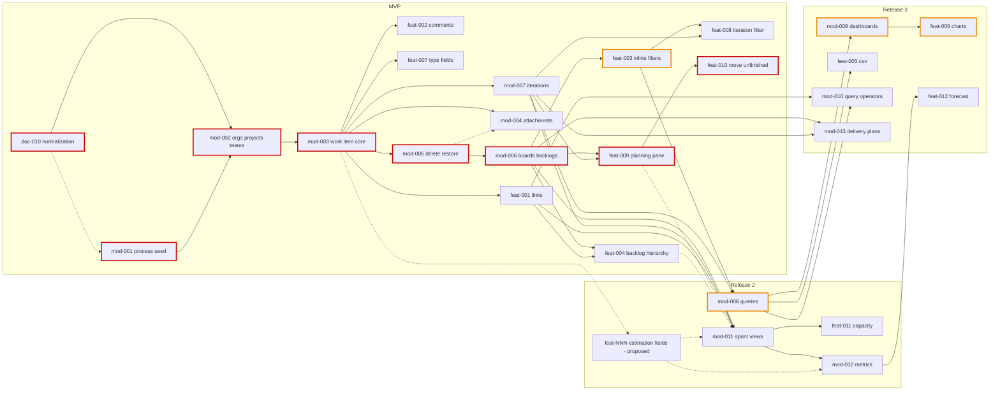

# Cross-review C — scope, releases and the queue

Coverage: spec.md + status.md of doc-001..doc-007 in full; stories doc-001 US-9/US-10, doc-002 US-10/US-11, doc-004 US-5/US-6/US-7 (+grep of US-8/US-9), doc-005 US-1, doc-006 US-6; `docs/backlog.md` and `docs/backlog/withdrawn.md` **as on `main` @34ee78d** (25 lines — 27 before the two withdrawals; this branch's copy is the pre-take snapshot 51d21df and is stale by design); main's reflog (all 56 queue/merge commits, in place of `git log`, no shell in this session); `routing.md`, `numbering.md`, ADR-0010, ADR-0020, the ADR index; doc-010 `status.md`.

Shorthand: `doc-00N:L` = `docs/features/doc-00N-*/spec.md` line L unless a file is named; `queue:L` = `docs/backlog.md` on `main` line L.

## Findings

### C-1
Severity: blocker
Affects: mod-002, mod-006 (queue:16, :22); doc-001 § MVP boundary, Operation completeness, US-1/US-2; doc-003 BR-13, US-2, US-3, decomposition; doc-006 BR-M1-9, BR-M1-11, ER, Team row, § MVP boundary / Release 2, US-5/US-6/US-7, decomposition; doc-010 D-2
Problem: Several teams per project is in the MVP (doc-004 E-5, kept by E-13), but three merged specs still put it in release 2, and D-2 carries only part of it back. doc-001:238 "exactly one default team per project" and :295 "Team: no, release 2". doc-003:69 BR-13 "MVP ships exactly one team per project", and its row at :151 says "the single-team MVP scope". doc-006:212 "several teams are release 2", :288 lists "several teams per project and team deletion" as release 2, and US-6:43 "MVP offers no second team and no team deletion". D-2 (doc-010 status:38) covers only "doc-006 BR-M1-9/11, Team row, M1 decomposition". That leaves out doc-001, doc-003, doc-006's ER, its MVP/Release-2 sections and US-5/6/7. No spec has a story in which an administrator creates a second team. Even so, queue:16 promises "Team CRUD with several teams per project" (CRUD includes a delete that doc-006 puts in release 2, and doc-004:202 says "team deletion stays doc-006's to decide"). queue:22 promises boards "for every team of a project, incl. teams added later". Both queue lines rest on capabilities no spec defines, and both are founders on the critical path.
Proposed resolution: Widen the E-5 amendment set that doc-010 delivers to cover: doc-001 (§ MVP boundary, M1 row, Operation completeness Team/Area, US-1/US-2); doc-003 (BR-13, BR-5/BR-11 notes, US-2:65, US-3:58, decomposition row); doc-006 (BR-M1-9, BR-M1-11 root-area owner with n teams, ER notes :168/:177, Team row, § MVP boundary, § Release 2, US-5/US-6/US-7, decomposition row). Add one doc-006 story: "an organization administrator creates another team for a project" (name, members, area ownership, board/backlog seeding hook for mod-006). Reword mod-002 from "Team CRUD" to the scope the human picks below.
Decision: human — team deletion in MVP? (a) create + rename + membership only; deletion stays release 2, as doc-006 and E-5 imply (recommended: no downstream rules needed); (b) deletion in MVP too, which then needs rules for a deleted team's boards/backlog entries (doc-003), iteration selections (doc-004) and dashboards (doc-005 BR-10).

### C-2
Severity: blocker
Affects: mod-001 (queue:15); doc-007 decomposition row :269; doc-002 :62-66, :246-249; doc-010 Plan step 5
Problem: mod-001 is the head of every chain and the only queue line that does not wait for doc-010. queue:15 "deps:doc-007", and doc-007 is merged, so the line can be taken today. Its input is contradicted by doc-002. The seed's state names differ: doc-007:124 has Баг «Новый»/«В работе»/«Исправлен»/«Закрыт», while doc-002:65 has «Новая»/«Активна»/«Разрешена»/«Закрыта». Задача and «Решена»/«Разрешена» differ the same way. The seed's type keys are also missing from doc-007: doc-002:248 "Of mod-001-process-seed / doc-007 (W-11): the seed fixes EPIC/FEAT/US/TASK/BUG", but doc-007's row :269 has no keys. The contradiction itself belongs to dimension D. What belongs here is that the queue does not guard against it. doc-010's own plan applies queue edits only "After gate-1" (status Plan step 5), which leaves that window open.
Proposed resolution: Re-dep now, in a queue-only commit to main rather than after gate-1: `mod-001 … deps:doc-007,doc-010`. After that, every code line reaches doc-010.
Decision: default — apply the re-dep immediately.

### C-3
Severity: major
Affects: feat-003 (queue:24), mod-005 (queue:21), mod-006 (queue:22), feat-008 (queue:32); doc-002 US-10, US-11, row :238; doc-003 US-2, BR-7; doc-001 US-10
Problem: The filter surfaces are split so that two MVP capabilities arrive after they are needed and one belongs to no line. (1) The recycle bin: deleted items are reachable only through feat-003's state filter. doc-002 US-11:63 "Deleted items are reached through the state filter", and :217 "«Удалена» itself the bin, reached by filtering the list". Yet mod-005 (US-10:21 "disappears from the list's default view") ships before feat-003, because feat-003 depends on mod-006, which depends on mod-005. Until then no UI path restores an item, so mod-005's own restore scenarios cannot be exercised end to end. This is a capability cycle mod-005 → feat-003 → mod-006 → mod-005. (2) The backlog filter: doc-003 US-2:47 "Given a team's backlog with a filter applied" is acceptance of mod-006, but feat-003 filters only "the list and the board" (doc-002:238, queue:24). feat-008 (queue:32) then assumes "feat-003's filter bar" on "the M4 board/backlog". No line delivers the backlog filter.
Proposed resolution: Split by surface. feat-003 keeps the list filters (state incl. «Удалена», assignee incl. former members, tag, area, keyword) and is re-depped to `mod-005` (drop `mod-006`). A new M line `feat-NNN-board-backlog-filter` adds the filter bar on the board and the backlog, including doc-003 US-2's "filtered order" scenario (moved out of mod-006's acceptance), with deps `mod-006,feat-003`. feat-008 is re-depped onto the new line. Amend doc-002's row :238, doc-003's decomposition and doc-001 US-10 "delivered by".
Decision: human — (a) split as above (recommended: removes the cycle, gives the backlog filter an owner, and the recycle bin becomes usable right after mod-005); (b) keep one feat-003 behind mod-006, extend it to the backlog, and add a minimal "show deleted" list toggle to mod-005.

### C-4
Severity: major
Affects: feat-005 (queue:28); doc-001 § Release 3; doc-002 § Out of scope; doc-003 § Out of scope; doc-005 decomposition
Problem: CSV import/export is placed in two releases and two modules. doc-001:255 lists it in release 3 under M6, and doc-005:230 and queue:28 agree ("Release 3 … from the Queries hub"). doc-002:204, however, says "bulk edit, templates, CSV import/export — release 2 (doc-001 release plan)", citing a plan that says the opposite. doc-003:129 says "Bulk edit and CSV export from the backlog view — release 2, module M3".
Proposed resolution: Amend doc-002:204 and doc-003:129 to "CSV import/export — release 3, M6, feat-005". If export from the backlog view is wanted, state it as a release-3 extension of feat-005, not as a second M3 line.
Decision: default — release 3, feat-005 the only owner.

### C-5
Severity: major
Affects: mod-011, feat-011, mod-012, feat-012 (queue:35-38); doc-002 § Out of scope, § Decomposition; doc-004 rows :236/:238, US-7, US-8, US-9
Problem: Release 2's sprint and metrics lines rely on a slice that neither exists in any spec nor has a queue line. doc-004:236 gives mod-NNN-sprint-views the deps "… doc-002's estimation-fields slice", and :238 gives metrics the same. But doc-002 has no such row: :200-201 only lists "Story Points, Effort, … Activity, Original/Remaining/Completed Work … — release 2" as out of scope. The queue carries the gap as a note ("estimation fields owed by doc-002 per doc-004 E-8, not yet queued", queue:35/:37), not as a dependency. Three release-2 stories need estimates: US-7:35 "committed work exceeds its capacity", US-8:63 "Estimation fields are a prerequisite" and US-9:31.
Proposed resolution: Add a doc-002 decomposition row and a queue line: `feat-NNN-work-item-estimation-fields — Release 2. …` size M (additive fields on M3's own WorkItem, not breaking), deps `mod-003`, epic work-items. Re-dep mod-011 and mod-012 onto it; feat-011 and feat-012 inherit it.
Decision: human — which fields: (a) exactly what doc-004 US-7..US-9 read: Story Points on the Истории-level types, Remaining Work and Activity on Задача (recommended); (b) doc-002's whole release-2 list (Effort, Business Value, Risk, Value Area, Severity, Original/Completed Work, Start/Target dates as well).

### C-6
Severity: major
Affects: feat-003, feat-008 (MVP), mod-008 (release 2), mod-010 (release 3, queue:30); doc-005 BR-5, US-1; doc-001 § Release 2
Problem: The MVP inline filter and the query language overlap, and the release-2 query model regresses against the MVP filter. The MVP filter already matches hierarchically: doc-002 US-11:47 "Filtering by area covers sub-areas", and doc-004:141 BR-9 "pointing at it or at any of its descendants". Its keyword also matches the identifier (US-11:53). The release-2 query model has Область "=, In" and Итерация "=" only (doc-005 US-1:26-27), with "Under is not available until release 3" (US-1:79-83). mod-010 (queue:30) then re-delivers "Under" in release 3. doc-001:249-250 promises that inline filters "graduate into personal saved queries" in release 2. That graduation loses capability, and the descendant matching gets built twice, in two modules.
Proposed resolution: Amend doc-005 BR-5 and US-1 so that release 2 includes "Under" on Область and descendant matching on Итерация (the same semantics as feat-003/feat-008, which mod-008 already depends on), and so that a Заголовок/identifier keyword clause exists. mod-010 keeps Was Ever, Дата изменения/@Today, Contains Words, In Group and the tree/linked query types. Reword mod-008 and mod-010.
Decision: human — (a) release 2 covers everything the MVP filter can do (recommended: this is what "graduate" in doc-001 promises); (b) keep the current cut and state that saved queries cannot express the MVP filter until release 3.

### C-7
Severity: major
Affects: mod-002 (queue:16), mod-008 (queue:26); doc-005 § Roles :31, decomposition :227; doc-010 D-2; ADR-0018
Problem: The ownership-based check (D-14: a `viewer` writes their own personal queries) and its ADR-0018 amendment have no firm owner. doc-005:227 assigns it conditionally: "the ADR-0018 amendment and the check itself are owed by … `mod-002` if that has not shipped yet, else a follow-up M1 task". mod-002's line says nothing about it ("owes an ADR-0018 amendment (doc-001 D-9/D-10)"), and no follow-up line exists. mod-008 depends on doc-010, but doc-010 only amends documents (D-2: "doc-005 D-14 → doc-001 Roles/BR-5"). Giving it to mod-002 would also pull a release-2 need into the MVP founder on the critical path.
Proposed resolution: Pick one owner and write it into the owning line and into doc-005:31/:227.
Decision: human — (a) mod-008 implements the check and writes the ADR-0018 ownership amendment (recommended: it is the only consumer, it is release 2 and already L, and mod-002 stays lean); (b) mod-002 builds the check in MVP and writes one amendment covering D-9 and D-14, and its line says so.

### C-8
Severity: major
Affects: mod-002, mod-005, mod-007, mod-008, mod-009; doc-001 BR-6 and ADR list :366-372; doc-006 lifecycle :132-140; doc-004 BR-10; doc-005 BR-9
Problem: The soft-delete ADR is owed by the wrong line. doc-001:371 assigns "soft-delete/recycle-bin → mod-work-item-delete-restore", and queue:21 agrees. BR-6 (doc-001:279) defines two mechanisms, though. For work items it is the «Удалена» state; for an organization and a project it is "a deactivated status". mod-002, the second line on the chain, builds the status mechanism first (doc-006:132-140). mod-007 reuses it (doc-004 BR-10, "deactivated") and so do mod-008 and mod-009 (doc-005 BR-9, "the mechanism doc-001 BR-6 gives a project"). The first implementer of a pattern that five lines reuse therefore owes no ADR.
Proposed resolution: mod-002 owes an ADR for the status-based soft deactivation: hidden from lists, restore, names stay reserved, and the cascade to children (as in doc-005 BR-10). mod-005's ADR covers the state-as-recycle-bin mechanism and references it. Update the ADR list in doc-001 and the lines for mod-002 and mod-005.
Decision: default — as proposed.

### C-9
Severity: major
Affects: mod-003, mod-006 (and mod-008/mod-009 for shared queries and dashboards); doc-001 BR-11; doc-002 BPMN / BR-15; doc-003 BR-12/BR-19; ADR-0010
Problem: A client-visible concurrency token is required but claimed by no line. ADR-0010's Consequences: "xmin is never exposed externally … If an ETag/If-Match scenario is ever needed for clients … it would be a separate decision". That scenario is exactly what the specs require. A form save must fail if "the loaded revision [is] still current?" is false (doc-002 BPMN; doc-001:284 "second write rejected … reload and reapply"). The stale-move notice (doc-003 BR-12) needs to know the client's view was stale. doc-005's NFR requires the same check for shared queries and dashboard layouts. No spec names this ADR, and mod-003's only ADR is history/audit.
Proposed resolution: mod-003 owes the "client-visible concurrency token" ADR, since form save is its first use. mod-006 reuses it for the stale-view notice, amending it if it needs more. Add this to both lines and to doc-001's ADR list.
Decision: default — as proposed.

### C-10
Severity: major
Affects: mod-007, mod-008, mod-009 (and mod-002 by exclusion); doc-001 BR-6; doc-004 BR-10; doc-005 BR-9 / D-13; doc-006 BR-M1-1, § Out of scope
Problem: Purge is written into the specs for objects that no line delivers. doc-001:279 says "only an administrator purges a deleted object permanently, by hand". doc-004:142 (iterations, MVP) says "an administrator purges by hand", but mod-007's row :222 has no purge. doc-005:142 says "Purge is the one action an administrator may take on another user's soft-deleted personal query", but the rows for mod-008 and mod-009 say "soft delete/restore" only. doc-006:314 puts purging organizations and projects out of scope. Only work items have a purge line (mod-005, a product action in US-10). Whether "by hand" means a product feature or an operator procedure is decided differently in each module.
Proposed resolution: One reading, applied everywhere.
Decision: human — (a) in-product purge for work items only (mod-005); for organizations, projects, iterations and M6 objects, purge is an operator procedure outside the product, and doc-004 BR-10 and doc-005 BR-9 are reworded (recommended: matches doc-006 and adds no scope); (b) in-product purge per object, added to the lines for mod-007, mod-008 and mod-009 (and to mod-002 against doc-006:314).

### C-11
Severity: major
Affects: doc-001 § MVP boundary and release plan, US-9; doc-004 § Amendments; doc-002 errata; doc-010 D-2
Problem: doc-001's MVP and release tables are no longer the single source of scope, and each module recorded its supersessions differently. doc-004:196-198 says "doc-001 is not edited here … this table is the record" (E-5/E-6/E-7/E-9/E-10..12/E-2/E-4). doc-002:73-77 uses an errata note, "doc-001 is not reopened". doc-005 and doc-004 E-13 used carry-back tasks (now D-2). doc-001's MVP table still omits the planning pane (E-6), the move of unfinished items (E-9), the iteration tree (E-7), the type-specific fields (W-5), per-organization Google Drive (W-12), the read-only process screen (doc-007 R-6) and the project key (W-10). doc-001 US-9:19 still says "flat iteration list (MVP: no tree/hierarchy)", with "delivered by mod-iterations" although its filter scenarios are now feat-008's. doc-001:248-249 lists "the taskboard" and "the Задачи-level board" as two release-2 items; they are one thing, and it is a BOARD (M4 entity, doc-003 BR-1) delivered under M5 (mod-011). D-2 covers two of these supersessions.
Proposed resolution: One consolidation, delivered by doc-010. Rewrite doc-001's MVP rows for M1/M3/M4/M5 and the release-2 M5 line, list the superseding decisions with their sources, fix US-9's scope and "delivered by", and state that M5 owns the taskboard while reusing M4's board.
Decision: human — (a) amend doc-001 in place (recommended: every future analysis starts from the umbrella); (b) doc-010's product plan supersedes doc-001 § MVP boundary, and doc-001 gets a one-line pointer.

### C-12
Severity: major
Affects: all release-2/3 lines; doc-001 § Release 2/3; doc-006 § Release 2; doc-007 decomposition; doc-002/doc-003 § Out of scope
Problem: No single rule decides which release-2/3 work is in the queue, so the queue cannot give a release-2 milestone. doc-004 and doc-005 rows are queued (mod-008..mod-013, feat-005/006/011/012). doc-007's eight release-3 rows are "stay in spec.md only, not queued (human's choice)" (doc-007 status:77), and doc-006:287 says its items are "not queued by this task". doc-001's release-2 items for M1 (overrides, notifications), M3 (bulk edit, templates, copy/move) and M4 (WIP, custom columns/swimlanes, card styles, multiple boards) have no rows at all. Other release-2 items exist only in module out-of-scope lists and are missing from doc-001's plan: other link types (doc-002:202), change type (:204), the tag-management screen (doc-001:300), live push (doc-003:141), the per-team level toggle (:135), parent grouping rows (:138) and the instance-rights screen (doc-006:292). Two of them are claimed twice. Notifications appear in M1 (doc-006:290) and in M3 (doc-002:208 "follow/subscribe and notifications — release 2"). Audit appears as "an instance-level audit log" (doc-002:188) and as the M1 audit BR-M1-15 (doc-006:293).
Proposed resolution: Adopt one rule and have doc-010's product plan list every release-2/3 item with one owning module.
Decision: human — (a) the queue holds MVP lines plus release lines whose module analysis produced a row (status quo; doc-007's rows stay unqueued as decided), and one queued analysis line `doc-NNN-release-2-scope` gives rows to the orphan release-2 items and settles the two double claims (recommended); (b) withdraw every release-2/3 implementation line until that scoping task; (c) queue everything, doc-007's rows included.

### C-13
Severity: major
Affects: mod-004 (queue:19), mod-005 (queue:21), feat-001, feat-002, feat-007; doc-002 rows :236-237, BR-14, US-10
Problem: Several lines run in parallel with mod-005 but take on parts of its behaviour with no ordering between them. mod-004's row gives it "deletes a purged item's files from Drive (US-10)" (doc-002:236), but purge is mod-005's (:237). US-10:73 requires that "a purge never ends with the item gone while its files remain in Drive". queue:19 and :21 both depend only on mod-003, so either line may land first, and whichever does has no partner to integrate with. The same holds for BR-14 (doc-002:154, a deleted item is read-only): the comment, link, attachment and type-field writes come from feat-001, feat-002, mod-004 and feat-007, which run in parallel with mod-005, and no row says who enforces BR-14 on them.
Proposed resolution: Re-dep `mod-004 … deps:mod-003,mod-005`. mod-004 is off the critical path, so the dep costs no time. Add a rule to doc-002's decomposition: "BR-14 is enforced by mod-005 for the writes that exist when it ships, and by each later line for its own writes". Repeat it in the rows for feat-001, feat-002, mod-004 and feat-007.
Decision: default — as proposed.

### C-14
Severity: major
Affects: mod-001, mod-002, mod-003, mod-004, mod-005, feat-003 (queue:15-17, :19, :21, :24); doc-006 row :327; doc-007 row :269
Problem: Six queue lines state less scope than their spec rows. `new-task.sh` files a task "character by character" from the line, and route question 3.3 measures scope against the line. mod-001 lacks the read-only process screen (doc-007:96 "makes mod-001 … a full-stack slice") and the W-11 type keys. mod-002 lacks the project key (W-10, doc-002:246-248), the Keycloak user-directory channel (doc-006:59-63) and the last-admin/inactive rules, and says "Team CRUD" (C-1). mod-003 lacks the list surface and the identifier format; doc-002:242 says "the `note:` records the growth", but it does not ("queue.sh cannot edit an existing line's note", doc-002 status:65). mod-004 lacks the per-organization Google Drive, US-13, the external counterparty and the per-organization secrets (doc-002:236). mod-005 lacks purge. feat-003 lacks the keyword filter, former members and deleted items. The upstream obligations W-10 and W-11 appear only in doc-002; the rows in doc-006 (:327) and doc-007 (:269) do not carry them.
Proposed resolution: After gate-1 the orchestrator rewords the six lines by hand in queue-only commits (as in 486295a/6d70708). doc-010 amends doc-006 (US-5 project key, decomposition row) and doc-007 (seeded type keys, decomposition row).
Decision: default — as proposed.

### C-15
Severity: minor
Affects: mod-011 (queue:35); doc-004 row :236, US-5
Problem: The line's deps do not follow its story's deps. US-5:4 "depends-on: US-3, US-11" (US-11 = feat-009, the planning pane that US-5's empty state links to), and US-5:23 "each of them can be expanded to its child Задача items" is feat-004's expand/collapse. queue:35 has deps "mod-007,mod-006,feat-001".
Proposed resolution: `mod-011 … deps:feat-004,feat-009,<estimation line from C-5>`. mod-006, mod-007 and feat-001 then follow transitively. Amend doc-004's row :236 to match.
Decision: default — as proposed.

### C-16
Severity: minor
Affects: mod-003, mod-006, feat-003, feat-008, mod-008 (queue:17, :22, :24, :26, :32)
Problem: Some deps are implied by other deps. mod-003's mod-001 is implied by mod-002. mod-006's mod-003 is implied by mod-005. feat-003's mod-003 is implied by mod-006. feat-008's mod-006 is implied by feat-003. mod-008's mod-003 and mod-005 are implied by feat-003, and so is its doc-010 (feat-003 → … → mod-002 → doc-010). No rule says whether deps should be minimal, so the critical path is hard to read.
Proposed resolution: Rule: a line's deps are the minimal set of code lines, plus the spec task(s) the line is specified by. Drop mod-003's mod-001, feat-008's mod-006 and mod-008's mod-003/mod-005. Keep the doc-NNN deps (mod-002's doc-006, mod-008's doc-010) as the spec source. Keep mod-006's mod-003 if C-18(b) is taken, and drop it otherwise.
Decision: default — as proposed.

### C-17
Severity: minor
Affects: mod-004, mod-005, mod-010, mod-011, mod-012, mod-013, feat-011; routing.md type table
Problem: The `mod-` prefix and two L sizes lack stated grounds. routing.md:15 defines `mod` as "creating a whole module". mod-004 and mod-005 (inside M3), mod-010 (M6) and mod-011/012/013 (M5) found no module; they are L because of an ADR or a sub-slice. mod-011 "Founds the sprint hub" but has no entity of its own (doc-004:87-91). Its only L ground is that it changes M4's BR-1 ("Задачи has … no board"), and no line says so. mod-010's "L by threshold" rests on adding an M3 history read surface, which routing.md:190-192 calls non-breaking; it stays L only under "doubt → L". feat-011 founds TeamCapacity, DayOff and TeamWorkingDays as an M, which is allowed (tables of its own module). Checked and found none: no ADR-owing line is M, no founder is M, and no M creates a module.
Proposed resolution: Keep all sizes; lowering is never the safe side. Keep the ids; renaming numbered ids breaks references across seven merged specs. Record the L reason in the notes of mod-010 and mod-011. Document in `docs/features/README.md` that `mod-` also marks an L founding a sub-slice or a pattern.
Decision: default — as proposed.

### C-18
Severity: minor
Affects: mod-006 (queue:22), mod-005; doc-003 BR-16/BR-17, decomposition row :151
Problem: The chain to the first usable product is one L longer than it needs to be. mod-006 depends on mod-005 only for BR-16/BR-17: hide deleted items and restore their backlog position (doc-003 status:53, R-23). That makes the path doc-010 → mod-001 → mod-002 → mod-003 → **mod-005 → mod-006**, five code L tasks in series, each with three gates.
Proposed resolution: Option: `mod-006 … deps:mod-003,doc-003`, with BR-16/BR-17 moved to a new M line `feat-NNN-backlog-deleted-items` (deps `mod-005,mod-006`). routing.md's greenfield clarification allows this: a task inside an already founded slice is M. mod-005 and mod-006 then run in parallel (four code L tasks in series to boards). The cost is one extra line, and main briefly shows deleted items on backlog lists between mod-005 and that M.
Decision: human — (a) keep the dep (fewer lines and gates, one L of extra latency) (recommended: D-3 sets no dates, and the saving is one L); (b) decouple as above.

### C-19
Severity: minor
Affects: every queue line's `epic:`; `docs/backlog.md` § Line format; § Next
Problem: The epic keys do not match the module names, and the queue metadata is uneven. The epics are core/process (M2 "Process customization"), core/organizations (M1 "Organization & access", doc-006-org-access), core/boards (M4 "Backlogs & boards") and core/iterations (M5 "Iterations & planning"). core/queries (M6 "Queries, search & dashboards") also holds the dashboard lines mod-009 and feat-006. `product/analysis` (every doc- line) is not in backlog.md's documented set ("core/<module> … platform/<area> or workflow"). Release-2/3 lines carry "Release N." while MVP lines carry nothing. § Next is empty, although mod-001 is the first line that becomes ready when doc-010 merges.
Proposed resolution: Scheme: epic = `core/<slug of the module's analysis task>`, one per module, i.e. M1 `core/org-access`, M2 `core/process-customization`, M3 `core/work-items`, M4 `core/backlogs-boards`, M5 `core/iterations-planning`, M6 `core/queries-dashboards`. A line takes the epic of the module whose spec owns its stories (feat-003 → work-items, feat-004 → backlogs-boards, feat-008..010 → iterations-planning, mod-009/feat-005/feat-006 → queries-dashboards). Add `product/analysis` to backlog.md's epic list. Prefix MVP lines "MVP.", and move mod-001 to § Next once doc-010 merges. No core task has started, so re-epicking costs nothing.
Decision: default — the slug scheme. The alternative is to keep the short keys and add a key → module table to backlog.md.

### C-20
Severity: minor
Affects: doc-005 § Roles :31, decomposition :227-228; doc-004 status E-13
Problem: The main queue no longer names the withdrawn ids: no `doc-008`/`doc-009` in main's backlog.md, both lines are in withdrawn.md:16-17, and mod-002/mod-008 depend on doc-010. The merged spec text still does. doc-005:31 says the change is "carried back … by `doc-NNN-personal-object-ownership`", and :228 lists mod-NNN-queries-dashboards with deps "… doc-NNN-personal-object-ownership". doc-004 status:59 (E-13) names doc-009 as the carrier. The branch's own `docs/backlog.md` still lists doc-008/doc-009 and doc-010 under Next. That is expected, since the branch was taken at 51d21df and task branches never edit the queue. It is not a finding, and nobody should "fix" it here.
Proposed resolution: doc-010 amends doc-005:31 and :227-228 to name doc-010, and the code owner chosen in C-7. doc-004's status decision record stays as history.
Decision: default — as proposed.

## Queue ↔ decomposition map

| Queue id | Source spec row | Release | Size ok? | Deps ok? |
|---|---|---|---|---|
| mod-001 | doc-001 (b) mod-process-seed; doc-007 row :269 | MVP | L — founds M2 | missing doc-010 (C-2) |
| mod-002 | doc-001 (b) mod-organizations-projects-teams; doc-006 row :327; doc-004 § Amendments | MVP | L — founds M1, ADR-0018 | ok; scope "Team CRUD" has no backing (C-1) |
| mod-003 | doc-001 (b) mod-work-item-core; doc-002 row :232 | MVP | L — founds M3, ADR | mod-001 redundant (C-16) |
| feat-001 | doc-001 (b); doc-002 row :233 | MVP | M | ok |
| mod-004 | doc-001 (b); doc-002 row :236 | MVP | L — ADR, external counterparty, secrets | missing mod-005 (C-13) |
| feat-002 | doc-001 (b); doc-002 row :234 | MVP | M | ok (BR-14 ownership, C-13) |
| mod-005 | doc-001 (b); doc-002 row :237 | MVP | L — ADR | ok |
| mod-006 | doc-001 (b); doc-003 row :151; doc-004 § Amendments | MVP | L — founds M4 | mod-003 redundant; the mod-005 dep lengthens the path (C-18); "every team" has no backing (C-1) |
| mod-007 | doc-001 (b); doc-004 row :222 | MVP | L — founds M5, field on M3 | ok |
| feat-003 | doc-001 (b); doc-002 row :238 | MVP | M | mod-003 redundant; surface split (C-3) |
| feat-004 | doc-003 row :152 | MVP | M | ok |
| feat-007 | doc-002 row :235 | MVP | M | ok |
| feat-008 | doc-004 row :228 | MVP | M | mod-006 redundant; relies on a backlog filter nobody owns (C-3) |
| feat-009 | doc-004 row :229 | MVP | M | ok |
| feat-010 | doc-004 row :230 | MVP | M | ok |
| mod-008 | doc-005 row :228 | R2 | L — founds M6 | mod-003/mod-005 redundant; doc-010 replaces doc-008 correctly; the D-14 owner is open (C-7) |
| mod-011 | doc-004 row :236 | R2 | L — reason unstated (C-17) | missing estimation line, feat-009, feat-004 (C-5, C-15) |
| feat-011 | doc-004 row :237 | R2 | M (founds 3 own-module entities, allowed) | needs estimates via mod-011 (C-5) |
| mod-012 | doc-004 row :238 | R2 | L — ADR | missing estimation line (C-5) |
| mod-009 | doc-005 row :229 | R3 | L — new slice | ok |
| feat-005 | doc-005 row :230 | R3 (doc-002/003 say R2, C-4) | M | ok |
| feat-006 | doc-005 row :231 | R3 | M | ok |
| mod-010 | doc-005 row :232 | R3 | L — only via "doubt → L" (C-17) | ok; overlaps MVP filter semantics (C-6) |
| feat-012 | doc-004 row :239 | R3 | M | ok |
| mod-013 | doc-004 row :240 | R3 | L — own entities, new slice | ok |

**Rows with no queue line:**
- doc-002: none for estimation fields, although doc-004 depends on it (C-5).
- No spec has a row for creating a second team (C-1) or for the backlog filter (C-3).
- doc-007: eight release-3 rows (process-custom-types/-fields (L)/-states/-rules/-form-layout/-reason-transitions/-backlog-levels/-backlog-boards) are unqueued by the human's choice.
- doc-006: the release-2 items are deliberately unqueued.
- doc-001: the release-2 items for M1/M3/M4 have no rows (C-12).

**Queue lines with no spec row:** none by id. Two lines carry scope without a spec behind it (mod-002 "Team CRUD", mod-006 "incl. teams added later", C-1).

**Withdrawn:** doc-008 and doc-009 appear in no `deps:` on main (verified); their content goes to doc-010 (D-2, widened by C-1/C-7/C-20).

## Dependency graph

Edges are the transitive reduction of the current `deps:` on main: redundant deps (C-16) are omitted, and merged doc tasks are omitted except doc-010. Dashed edges and the `est` node are proposed (C-2, C-5, C-13, C-15). Red nodes: the critical path to a complete MVP. Orange: its extension to releases 2 and 3.

**Critical paths** (depth = code lines in series; every path starts at doc-010, which becomes the head once C-2 is applied):
- **First usable product** (one org, one project, five types, boards, iterations): doc-010 → mod-001 → mod-002 → mod-003 → mod-005 → mod-006, with mod-007 in parallel after mod-003. That is five code L tasks in series, or four with C-18(b).
- **Complete MVP**: … mod-006 → feat-009 → feat-010, depth 7. Tied with … mod-006 → feat-003 → feat-008.
- **Release 2**: … mod-006 → feat-003 → mod-008, depth 7, and … mod-006 → mod-011 → mod-012, depth 7 (8 once C-15 adds feat-009).
- **Release 3**: … feat-003 → mod-008 → mod-009 → feat-006, depth 9, the longest chain in the queue.

**Parallel waves** (current deps, C-2 and C-13 applied):
1. doc-010.
2. mod-001.
3. mod-002.
4. mod-003.
5. mod-005, mod-007, feat-001, feat-002, feat-007 (the widest wave: five independent lines).
6. mod-006, mod-004.
7. feat-003, feat-004, feat-009; R2 mod-011; R3 mod-013.
8. feat-008, feat-010; R2 mod-008, feat-011, mod-012.
9. R3 mod-009, feat-005, mod-010, feat-012.
10. R3 feat-006.

**Chains longer than needed:**
- mod-005 → mod-006 (C-18).
- The recycle bin and backlog filter behind mod-006 (C-3). This does not lengthen the path, but it moves capabilities after their consumers.

mod-001 → mod-002 → mod-003 is irreducible: BR-M1-3/BR-M2-8 make organization creation and seeding atomic, and M3 needs project, team and area. Splitting mod-002 (H-5 kept it whole) would only add gates, not parallelism.

## ADR debt

| ADR | Owed by (spec) | Queue line says | State |
|---|---|---|---|
| ADR-0018 amendment: the role on `ORG_MEMBERSHIP`, constraints 1–5 incl. the Keycloak user-directory channel | mod-002 (doc-001 D-9 :366-368; doc-006 § Roles) | mod-002 ✓ | one claimant, ok |
| ADR-0018 amendment: ownership-based check, a viewer's own objects (D-14) | "mod-002 if not shipped yet, else a follow-up M1 task" (doc-005:227) | none | **unclaimed**, C-7 |
| ADR-0018 amendment: a MUSTASK screen for instance-level rights | release 2 (doc-006:292) | none | future, unqueued (C-12) |
| History / audit | mod-003 (doc-001:369; doc-002 row :232) | mod-003 ✓ | ok. BR-M1-15 (R2), mod-010's Was Ever (R3) and mod-012's metrics (R2) all read it, so its scope must anticipate them |
| Client-visible concurrency token (form-save conflict, stale-move notice, shared query and dashboard layout) | none; ADR-0010 defers it as "a separate decision" | none | **unclaimed**, C-9 → mod-003, reused by mod-006 |
| Attachment storage: per-organization Google Drive, credentials, disconnect/recovery | mod-004 (doc-001:370; doc-002 row :236) | mod-004 ✓ (text stale, C-14) | ok |
| Soft delete, work-item state as recycle bin | mod-005 (doc-001:371) | mod-005 ✓ | ok, but see next row |
| Soft deactivation by status (organization, project; reused by iterations and M6 objects) | none; first built by mod-002 | none | **unclaimed**, C-8 → mod-002 |
| History-derived metrics | mod-012 (doc-004 row :238) | mod-012 ✓ | ok |
| Schema-flexible field-value pattern (custom fields) | mod-NNN-process-custom-fields (doc-007 row :271, R3) | not queued (human's choice) | owed by an unqueued row |
| mod-007 iterations | "Owes no ADR" (doc-004:222) | — | ok |

No ADR is claimed by two lines. The D-14 amendment is assigned conditionally to two owners, which in practice means none (C-7). Every ADR-owing line is L.

## Summary

Blockers 2, majors 12, minors 6.

Most consequential:
1. C-1: several teams per project is MVP by E-5, but doc-001, doc-003 and doc-006 still say release 2. D-2 carries back only part of it, and no story creates a second team, while the mod-002/mod-006 founders promise it.
2. C-2: mod-001, the head of every chain, does not depend on doc-010 and can start today on a seed doc-002 contradicts.
3. C-3: the recycle bin and the backlog filter live in feat-003, which sits behind mod-006. mod-005's restore is unreachable until then, and the backlog filter that mod-006 and feat-008 assume belongs to no line.

Seen outside dimension C, for the consolidator (not ranked here):
- The state-name conflict between doc-002 and doc-007, for dimension D.
- BR-M1-11 "root area always owned by the project's team" with several teams, for A/B.
