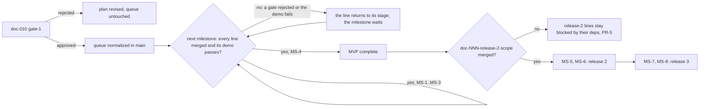
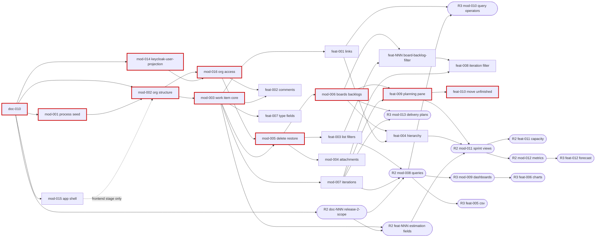

# Spec: Product plan — releases, milestones and the normalized queue (doc-010)

## Context and goal

The seven merged analyses (doc-001..007) and the 25-line queue disagreed on scope, state names, teams and ownership.

The cross-module review ([cross-review.md](cross-review.md), 34 root causes) and the human's answers D-1..D-24 (`status.md` § Decisions) settle those disagreements. This plan is the normative target the orchestrator applies after gate-1. It sets:
- the demo-able milestones of each release;
- the normalized queue, with the exact `scripts/queue.sh` operations that produce it;
- the critical path;
- who owes each ADR, and which line registers each permission code;
- which merged specs were amended, and where the record is.

It gives no calendar dates (D-3). Milestones are `MS-n`: `M0..M6` already name the modules.

## Roles

| Who | With this plan |
|---|---|
| Human (product owner) | approves it at gate-1 and gate-3; the only one who changes a decision D-n or a milestone's content |
| Orchestrator | applies § Queue operations in `main` after gate-1 (queue-only commits); keeps the queue equal to § Normalized queue; reports each milestone reached (PR-12) |
| Amendment pass (this task) | delivers § Amendments to the merged specs on this branch, with a Log line in each amended task (PR-7) |
| Analysts of later tasks | start from doc-001 as amended and from § Releases and milestones; `doc-NNN-release-2-scope` extends release 2 |
| Implementing agents | take lines in the order deps and § Planning rules allow; a founder owes what § ADR debt names and registers what § Permission codes names |

## Stories

One story per milestone. Each is delivered by the queue lines it lists and is not a queue line itself.

| id | Title | depends-on | File |
|----|-------|------------|------|
| US-1 | MS-1 «Организация, проект, команды, процесс засеян» | - | `stories/US-1-ms1-organization-project-teams.md` |
| US-2 | MS-2 «Рабочие элементы с историей, комментариями, вложениями, корзиной» | US-1 | `stories/US-2-ms2-work-items.md` |
| US-3 | MS-3 «Доски и бэклоги по уровням» | US-2 | `stories/US-3-ms3-boards-backlogs.md` |
| US-4 | MS-4 «Итерации и планирование» (MVP complete) | US-3 | `stories/US-4-ms4-iterations-planning.md` |
| US-5 | MS-5 «Сохранённые запросы» | US-4 | `stories/US-5-ms5-saved-queries.md` |
| US-6 | MS-6 «Спринты: оценки, доска задач, ёмкость, метрики» (release 2 complete) | US-5 | `stories/US-6-ms6-sprints-metrics.md` |
| US-7 | MS-7 «Дашборды, диаграммы, CSV» | US-6 | `stories/US-7-ms7-dashboards-csv.md` |
| US-8 | MS-8 «Прогноз, планы поставки, расширенные запросы» (release 3 complete) | US-7 | `stories/US-8-ms8-forecast-plans-operators.md` |

## Releases and milestones

Each release's module scope is stated once, in doc-001's amended § MVP boundary and release plan (D-17); this plan does not restate it. The milestones, the release-2 gate (PR-5) and the lines behind each milestone live only here. The diagram replaces the BPMN.

### MVP — MS-1..MS-4

Scope: doc-001 § MVP boundary and release plan, the MVP table's rows M0–M6, as amended per D-4..D-10, D-13 and D-14; M6 is not founded.

| MS | Demo-able state | Lines |
|---|---|---|
| MS-1 | «Организация, проект, команды, процесс засеян»: an organization with its process, members found in the Keycloak directory, a keyed project with teams, default areas and areas | mod-014-keycloak-user-projection, mod-001, mod-002, mod-016-organization-access |
| MS-2 | «Рабочие элементы с историей, комментариями, вложениями, корзиной»: the full work item, list filters, delete/restore/purge | mod-003, feat-001, feat-002, feat-007, mod-005, mod-004, feat-003 |
| MS-3 | «Доски и бэклоги по уровням»: boards and ordered backlogs for every team, create from a team surface, hierarchy, filter bar | mod-006, feat-004, feat-NNN-board-backlog-filter |
| MS-4 | «Итерации и планирование»: tree, planning pane, iteration filter, moving unfinished work. **MVP complete** | mod-007, feat-008, feat-009, feat-010 |

### Release 2 — MS-5, MS-6

Scope: doc-001's release-2 paragraph, as amended per D-11, D-13, D-15 and D-16. The items with no spec rows yet (A-2 lists them) are doc-NNN-release-2-scope's; it also settles which module owns notifications and audit, which stay cross-module until then (D-18).

| MS | Demo-able state | Lines |
|---|---|---|
| MS-5 | «Сохранённые запросы»: personal and shared queries with "Under" and keyword, results, admin purge | doc-NNN-release-2-scope (entry), mod-008 |
| MS-6 | «Спринты: оценки, доска задач, ёмкость, метрики». **Release 2 complete**, with every line release-2-scope queues | feat-NNN-work-item-estimation-fields, mod-011, feat-011, mod-012 |

### Release 3 — MS-7, MS-8

Scope: doc-001's release-3 paragraph. doc-007's eight process-customization rows stay unqueued (D-21); CSV has one owner, feat-005 (N-25); delivery plans are organization-owned (N-31).

| MS | Demo-able state | Lines |
|---|---|---|
| MS-7 | «Дашборды, диаграммы, CSV» | mod-009, feat-006, feat-005 |
| MS-8 | «Прогноз, планы поставки, расширенные запросы». **Release 3 complete**, process customization aside (D-21) | feat-012, mod-013, mod-010 |

## Normalized queue (target)

Reading the table:
- `*` marks a cell that differs from `main`. On the title, it means the description is reworded; the "MVP." prefix alone is not marked.
- Rows with `NNN` are new.
- Deps follow PR-3 and are normative for the queue. Where an amended decomposition row lists more deps (doc-002's feat-003 row, doc-004's mod-012 row, doc-006's mod-002 row), PR-3's minimal set wins.
- doc-010 is not a queue line; it is shown as the head of the graph.
- Rows added after the merge (D-25, D-27) carry their decision in the source column.

| id | Title (≤ 12 words) | epic | size | deps | rel | MS | source |
|---|---|---|---|---|---|---|---|
| doc-010-backlog-normalization-product-plan | Cross-module review, queue normalization, product plan (in flight) | product/analysis | L | doc-002, …, doc-007 | MVP | head | D-1 |
| mod-014-keycloak-user-projection | Keycloak user projection: event-listener provider, backfill, M1 directory | core/org-access | L | doc-006, doc-010 | MVP | MS-1 | D-9, N-6 |
| mod-001-process-seed | Seeded process: keyed types, D-4 states, categories, read-only screen* | core/process-customization* | L | doc-007, doc-010 | MVP | MS-1 | doc-007 row; D-4, D-5, N-3, N-27 |
| mod-015-app-shell-design-system | App shell, MUI theme, screen patterns, prototype; existing screens restyled | platform/ui | L | doc-001, doc-010 | MVP | MS-1 (alongside; gates mod-002's frontend) | D-27 |
| mod-002-organizations-projects-teams | M1 structure: organizations, keyed projects, teams with deletion, areas; authenticated-only guard* | core/org-access* | L | mod-001* | MVP | MS-1 | doc-006 row; D-6, D-7, D-9..D-11, N-5, N-12; D-25; D-27 (its frontend stage waits for mod-015) |
| mod-016-organization-access | Membership, roles, scoped codes, ADR-0018 amendment, retrofit of checks | core/org-access | L | mod-002, mod-014 | MVP | MS-1 | D-25 |
| mod-003-work-item-core | Work item form, list, identifier, tags, history; two ADRs* | core/work-items | L | mod-002, mod-014, doc-002* | MVP | MS-2 | doc-002 row; D-8, N-15..N-17, N-33; D-25 |
| feat-001-work-item-links | Parent/Child links with atomic replace-parent* | core/work-items | M | mod-003 | MVP | MS-2 | doc-002 row; N-14, N-18 |
| feat-002-work-item-comments | Comments: own edits under the ownership predicate, moderation* | core/work-items | M | mod-003, mod-016* | MVP | MS-2 | doc-002 row; D-11, N-17; D-25 |
| feat-007-work-item-type-fields | «Критерии приёмки» and «Шаги воспроизведения» rich-text fields* | core/work-items | M | mod-003 | MVP | MS-2 | doc-002 row; N-22 |
| mod-005-work-item-delete-restore | Delete to «Удалена», restore, org-admin purge; recycle-bin ADR* | core/work-items | L | mod-003, mod-016* | MVP | MS-2 | doc-002 row; D-13, N-12, N-22; D-25 |
| mod-004-work-item-attachments | Attachments on the organization's Google Drive; storage ADR* | core/work-items | L | mod-005* | MVP | MS-2 | doc-002 row; D-11, N-22 |
| feat-003-work-item-search | List filters incl. «Удалена», former members, keyword* | core/work-items | M | mod-005* | MVP | MS-2 | doc-002 row; D-14 |
| mod-006-boards-backlogs | Boards and backlogs for every team; create from team surfaces* | core/backlogs-boards* | L | mod-005, doc-003* | MVP | MS-3 | doc-003 row; D-4..D-7, D-19, N-30 |
| feat-004-backlog-hierarchy | Backlog hierarchy and parent mapping via replace-parent* | core/backlogs-boards* | M | mod-006, feat-001 | MVP | MS-3 | doc-003 row; N-18 |
| feat-NNN-board-backlog-filter | Filter bar on board and backlog; filtered reorder | core/backlogs-boards | M | mod-006, feat-003 | MVP | MS-3 | D-14, N-21 |
| mod-007-iterations | Iteration tree, team selection, pointer, current iteration, removal* | core/iterations-planning* | L | mod-003, doc-004 | MVP | MS-4 | doc-004 row; D-6, N-14, N-23 |
| feat-008-iteration-filter | Iteration filter on the list and the board/backlog filter bar* | core/iterations-planning* | M | mod-007, feat-NNN-board-backlog-filter* | MVP | MS-4 | doc-004 row; D-14, N-33 |
| feat-009-iteration-planning-pane | Backlog planning pane | core/iterations-planning* | M | mod-007, mod-006 | MVP | MS-4 | doc-004 row |
| feat-010-move-unfinished-work | «Перенести незавершённые» | core/iterations-planning* | M | feat-009 | MVP | MS-4 | doc-004 row |
| doc-NNN-release-2-scope | Release-2 scope: owners for orphan items, double claims settled | product/analysis | L | doc-010 | R2 | MS-5 (entry) | D-18, N-26 |
| mod-008-queries-dashboards | Saved queries: Under, keyword, personal code, admin purge* | core/queries-dashboards* | L | feat-003, mod-007, doc-005, doc-NNN-release-2-scope* | R2 | MS-5 | doc-005 row; D-6, D-11..D-13, D-16, N-33 |
| feat-NNN-work-item-estimation-fields | Estimation fields, the Agile process set, on История, Баг, Задача | core/work-items | M | mod-003, doc-NNN-release-2-scope | R2 | MS-6 | D-15, N-24 |
| mod-011-sprint-views | Sprint backlog and taskboard | core/iterations-planning* | L | feat-004, feat-009, feat-NNN-work-item-estimation-fields* | R2 | MS-6 | doc-004 row; N-24, N-33 |
| feat-011-sprint-capacity | Sprint capacity per member and activity | core/iterations-planning* | M | mod-011 | R2 | MS-6 | doc-004 row |
| mod-012-iteration-metrics | Burndown and velocity; history-derived metrics ADR | core/iterations-planning* | L | mod-011 | R2 | MS-6 | doc-004 row; N-24 |
| mod-009-dashboards-widgets | Team and project dashboards, widgets, admin purge* | core/queries-dashboards* | L | mod-008 | R3 | MS-7 | doc-005 row; D-6, D-13 |
| feat-006-dashboard-charts | Chart widgets backed by a shared query | core/queries-dashboards* | M | mod-009 | R3 | MS-7 | doc-005 row |
| feat-005-csv-import-export | CSV import/export from the Queries hub | core/queries-dashboards* | M | mod-008 | R3 | MS-7 | doc-005 row; N-25 |
| mod-010-query-hierarchy-operators | Was Ever, @Today, Contains Words, In Group, tree queries* | core/queries-dashboards* | L | mod-008, feat-001 | R3 | MS-8 | doc-005 row; D-16, N-33 |
| feat-012-backlog-forecast | Forecast the backlog by velocity | core/iterations-planning* | M | mod-012 | R3 | MS-8 | doc-004 row |
| mod-013-delivery-plans | Organization-owned delivery plans across the organization's projects* | core/iterations-planning* | L | mod-007, mod-006 | R3 | MS-8 | doc-004 row; N-31 |

**Totals:** 31 lines — the 25 lines on `main`, all kept, plus the 4 new lines of this task and 2 more added 2026-09-25 (mod-015, mod-016; D-25, D-27). No existing size changes: every founder and every ADR owner is L, and so is the release-2 scoping line (PR-2); mod-015 and mod-016 are also L; every other line is M.

### Queue operations

Run in `main`, in this order, after gate-1.
- `<A-n>` stands for the number that add A-n issues.
- Descriptions must not contain " · ".
- Adds use `--later`, because doc-010 is not merged yet.
- No withdrawals: doc-008/009 are already withdrawn, and mod-001 is already guarded (630e0d0).

**Adds** (`scripts/queue.sh add`):
- **A-1** `add mod keycloak-user-projection "MVP. Founds the Keycloak user projection: a custom Keycloak event-listener provider pushes user created/updated/disabled into MUSTASK, a backfill of existing users; member search and the «неактивен» marking read the projection; no admin REST call and no production service account, ADR-0023 guards unchanged; owes the user-projection ADR (doc-006 constraint 5, doc-010 D-9)" --epic core/org-access --size L --deps doc-006,doc-010 --note "doc-010 D-9; L: new deployable, external counterparty, secrets, ADR" --later`
- **A-2** `add doc release-2-scope "Release 2. Scope analysis: spec rows and one owning module for the release-2 items that have none (notifications, audit incl. BR-M1-15, bulk edit, templates, copy/move, other link types, change type, tag management, @mentions, WIP limits, custom columns/swimlanes, card styling, several boards, live push, level toggle, parent grouping rows, per-project and per-area overrides, team area sets, instance-rights screen); settles the notification and audit double claims; names the one line that owes the instance-rights ADR-0018 amendment; assigns every new line a milestone" --epic product/analysis --size L --deps doc-010 --note "doc-010 D-18, D-24; gates every release-2 implementation line (doc-010 PR-5); L: scopes authorization overrides across M1/M3/M4 and assigns an ADR (doc-010 PR-2)" --later`
- **A-3** `add feat board-backlog-filter "MVP. Filter bar on the M4 board and backlog (state, assignee, tag, area, keyword) reusing feat-003's filters; a filtered backlog hides rows but reorders against the full list (doc-003 US-2 filtered-order scenario, doc-010 D-14)" --epic core/backlogs-boards --size M --deps mod-006,feat-003 --note "doc-010 D-14" --later`
- **A-4** `add feat work-item-estimation-fields "Release 2. Estimation fields, the ADO Agile set: Story Points on Пользовательская история and Баг; Original Estimate, Remaining Work, Completed Work and Activity («Вид работ», a fixed M3 list) on Задача and Баг; form, list and history (doc-002 § Release 2, doc-010 D-15)" --epic core/work-items --size M --deps mod-003,doc-<A-2> --note "doc-010 D-15; read by mod-011, feat-011, mod-012" --later`

**Manual edits.** `queue.sh` cannot edit a line, so these go into one hand-edited queue-only commit, "Normalize the queue per doc-010" (precedents 486295a, 6d70708). Every MVP description gets the "MVP." prefix.

Rule and decision ids in a line are cited in their post-N-32 form (PR-8): bare BR-n is doc-001's, a module rule is BR-M<k>-n, and a decision carries its task id.

- **E-1 mod-001:** desc → "MVP. Founds M2: the five built-in types with keys EPIC/FEAT/US/TASK/BUG (doc-002 W-11), ordered states per doc-010 D-4 (Задача per doc-002 W-2), the five categories with Russian labels (doc-010 D-5), backlog levels with rank and kind, seeded per organization, plus the read-only process screen; registers process.definition.read; no editing UI"; epic → core/process-customization.
- **E-2 mod-002:** desc → "MVP. Founds M1: organizations (the create right is granted by a Keycloak realm administrator, doc-010 D-10), ORG_MEMBERSHIP with admin/member/viewer and who/when, the last-admin and «неактивен» rules, member search on the user projection; projects with an immutable key (doc-002 W-10); teams: create, rename, membership, per-team default area (doc-010 D-7), soft delete with cascade (doc-010 D-6); the area tree, root owned by the first team; soft deactivate/restore; the organization settings screen mod-004 extends; owes the ADR-0018 amendment (doc-006 constraints 1–8, ownership predicate doc-010 D-11) and the soft-deactivation ADR"; epic → core/org-access; deps → `mod-001,mod-<A-1>` (doc-006 and doc-010 are reached through A-1) — superseded in part by D-25 (2026-09-25): ORG_MEMBERSHIP, roles and the ADR-0018 amendment move to `mod-016-organization-access`; mod-002 keeps only the structure named above, and its deps become `mod-001` alone.
- **E-3 mod-003:** desc → "MVP. Founds M3: create dialog, form and common field set, state changes, the identifier КЛЮЧПРОЕКТА-ТИП-№ resolved inside the organization (doc-010 D-8), stored project tags, the list surface, history, the M3 data model, assignee markings, the area-deletion check counting every item; owes the history/audit ADR (scoped for BR-M1-15, Was Ever, metrics) and the client-visible concurrency-token ADR"; deps → `mod-002,doc-002` (N-33).
- **E-4 feat-001:** desc → "MVP. Parent/Child links across the five types with BR-M3-8's refusals, the atomic replace-parent the backlog mapping uses, unlinking from a deleted parent (BR-M3-9); no link write on a «Удалена» item (doc-001 BR-14)".
- **E-5 feat-002:** desc → "MVP. Обсуждение: add; edit or delete one's own comment under the ownership predicate (doc-010 D-11) with an edited marker; admin moderation; history (BR-M3-12); no comment on a «Удалена» item (doc-001 BR-14)".
- **E-6 feat-007:** desc → "MVP. «Критерии приёмки» on Пользовательская история and «Шаги воспроизведения» on Баг, rich text (doc-002 W-5, US-12); read-only on a «Удалена» item (doc-001 BR-14)".
- **E-7 mod-005:** desc → "MVP. Founds the soft-delete pattern: delete → «Удалена», restore to the previous or a chosen state, the organization administrator's purge (doc-010 D-13), doc-001 BR-14 for the surfaces and writes that exist when it ships, no cascade (BR-M3-9); owes the recycle-bin ADR, which references mod-002's soft-deactivation ADR".
- **E-8 mod-004:** desc → "MVP. Founds attachment storage on each organization's own Google Drive: connect/check/disconnect on the organization settings (doc-002 US-13), upload, list, download, remove one's own (doc-010 D-11), admin moderation, a purge deletes the item's files; per-organization secrets; owes the attachment-storage ADR"; deps → `mod-005` (N-22).
- **E-9 feat-003:** desc → "MVP. List filters on the M3 work item list: state incl. «Удалена» (the way into the recycle bin), assignee incl. former members, tag, area with sub-areas, keyword over Заголовок and the identifier (doc-002 US-11, doc-010 D-14)"; deps → `mod-005`.
- **E-10 mod-006:** desc → "MVP. Founds M4: one board per team per level (Эпики/Фичи/Истории) for every team incl. teams and items that predate it (entries backfilled by identifier), columns mapped per (type, state) (doc-010 D-4/D-5), the ordered backlog with stack rank, create a work item from a team's board or backlog with that team's default area (doc-010 D-7), a deleted team's boards and backlogs hidden (doc-010 D-6), deleted items hidden and restored to position, the stale-move notice; reuses the concurrency ADR; no hierarchy, no filter bar"; epic → core/backlogs-boards; deps → `mod-005,doc-003` (D-19, N-33).
- **E-11 feat-004:** desc → "MVP. Backlog parent/child hierarchy on M4: expand/collapse display of M3 Parent/Child links and the parent-mapping write from the backlog view, one level up, through feat-001's replace-parent (doc-003 US-3, BR-M4-9..BR-M4-11)"; epic → core/backlogs-boards.
- **E-12 mod-007:** desc → "MVP. Founds M5: the iteration tree of releases and numbered sprints (doc-004 E-7, E-10..E-12), team selection and default, the work item's iteration pointer, the current iteration on the server's UTC date (doc-001 BR-9), confirmed soft removal that clears and counts every pointer incl. deleted items, a deleted team's settings dropped (doc-010 D-6) (doc-004 US-1..US-4, US-14)"; epic → core/iterations-planning.
- **E-13 feat-008:** desc → "MVP. Iteration filter on the M3 list and in the board/backlog filter bar; «Текущая итерация» on team surfaces only (doc-004 US-13, BR-M5-9, E-2/E-4)"; epic → core/iterations-planning; deps → `mod-007,feat-<A-3>`.
- **E-14 feat-009, feat-010:** "MVP." prefix; "BR-13" → "BR-M5-13" (feat-009) and "BR-12" → "BR-M5-12" (feat-010); epic → core/iterations-planning.
- **E-15 mod-008:** desc → "Release 2. Founds M6: Query/QueryFolder, the clause-builder model incl. Under on Область and Итерация and a keyword clause (doc-010 D-16), personal «Мои запросы» under the personal-object code in every bundle (doc-010 D-11/D-12), shared «Общие запросы» with org-role permissions, soft delete/restore separate from the project's status, the organization administrator's purge (doc-010 D-13), queries bound to a deleted team stop (doc-010 D-6), results with column selection (doc-005 US-1..US-3)"; epic → core/queries-dashboards; deps → `feat-003,mod-007,doc-005,doc-<A-2>` (N-33).
- **E-16 mod-011:** epic → core/iterations-planning; deps → `feat-004,feat-009,feat-<A-4>`; note → "doc-004 decomposition; L: it changes M4's BR-M4-1 — the Задачи level gains the taskboard, on M4's board".
- **E-17 mod-012:** "BR-16" → "BR-M5-16"; epic → core/iterations-planning; note → "doc-004 decomposition; estimation fields reached through mod-011".
- **E-18 feat-011, feat-012:** "BR-15" → "BR-M5-15" (feat-011); epic → core/iterations-planning.
- **E-19 mod-013:** desc → "Release 3. Founds the delivery plan: an organization-owned timeline of teams' iterations across the organization's projects, written by members and administrators (doc-004 US-10, BR-M5-17; doc-010 N-31)"; epic → core/iterations-planning.
- **E-20 mod-009:** "BR-9" → "BR-M6-9", and the desc gains "; the organization administrator's purge of dashboards and widgets (doc-010 D-13); no dashboard for a deleted team (doc-010 D-6)"; epic → core/queries-dashboards.
- **E-21 mod-010:** desc → "Release 3. Query operators beyond release 2: Was Ever, @Today, Contains Words, In Group, the Дата изменения field, tree and direct-links query types; reads M3 history, a new M3 read surface (doc-005 US-1 remainder, doc-010 D-16)"; epic → core/queries-dashboards; note → "doc-005 decomposition; L: a new M3 read surface changes M3's boundary".
- **E-22 feat-005, feat-006:** "BR-8" → "BR-M6-8" (feat-005); epic → core/queries-dashboards.
- **E-23 backlog.md, § How the queue works, `epic:` paragraph:** lists the product epics core/org-access (M1), core/process-customization (M2), core/work-items (M3), core/backlogs-boards (M4), core/iterations-planning (M5), core/queries-dashboards (M6), and product/analysis.
- **E-24, when doc-010 merges:** move mod-001, mod-`<A-1>` and doc-`<A-2>`, in that order, from § Later to § Next (N-33).

**Count:** 4 adds, 0 withdrawals, 24 edits. Every one of the 25 existing lines is touched, plus the epic paragraph and § Next.

## Critical path and parallelism

The graph shows the target deps, omitting merged spec tasks other than doc-010: rectangles are MVP lines, stadium shapes are release 2/3 lines, and red marks the critical path to MVP. The dotted edge is a stage gate, not a queue dep: mod-002's frontend stage waits for mod-015's merge (D-27).

**Paths to the milestones.** Every path starts at doc-010; `∥` means "in parallel".

| MS | Path | Alongside, off the path |
|---|---|---|
| MS-1 | doc-010 → mod-001 ∥ mod-014 ∥ mod-002 → mod-016 | mod-015 alongside; it gates mod-002's frontend stage (D-27), so it is off the path only while it merges no later than mod-002's backend stage |
| MS-2 | … → mod-002 → mod-003 ∥ mod-016 → mod-005 → mod-004 ∥ feat-003 | feat-001, feat-002, feat-007 next to mod-005 |
| MS-3 | … → mod-005 → mod-006 → feat-004 ∥ feat-NNN-board-backlog-filter | — |
| MS-4 (MVP) | … → mod-006 → feat-009 → feat-010 | tied: … → mod-006 → feat-NNN-board-backlog-filter → feat-008; mod-007 follows mod-003 with one wave of slack (it must merge before feat-009) |
| MS-5 | … → feat-003 → mod-008 | doc-NNN-release-2-scope, any time after doc-010 |
| MS-6 | … → feat-009 → mod-011 → mod-012 ∥ feat-011 | the estimation line |
| MS-7 | … → mod-008 → mod-009 → feat-006 | feat-005 |
| MS-8 | … → mod-011 → mod-012 → feat-012 (depth 9, the longest chain) | mod-010, mod-013 |

**Waves.** Per PR-6, a line in a wave runs only when no line of an earlier release is ready.

| Wave | MVP | Release 2 | Release 3 |
|---|---|---|---|
| 1 | doc-010 (in flight) | | |
| 2 | mod-001, mod-014, mod-002, mod-015 | doc-NNN-release-2-scope | |
| 3 | mod-003, mod-016 | | |
| 4 | mod-005, mod-007, feat-001, feat-002, feat-007 | feat-NNN-work-item-estimation-fields | |
| 5 | mod-006, mod-004, feat-003 | | |
| 6 | feat-004, feat-009, feat-NNN-board-backlog-filter | mod-008 | mod-013 |
| 7 | feat-008, feat-010 | mod-011 | mod-009, feat-005, mod-010 |
| 8 | | feat-011, mod-012 | feat-006 |
| 9 | | | feat-012 |

**Critical path to MVP.** After doc-010, the path runs 4 L waves — mod-001 with mod-002 beside it, mod-003 with mod-016 beside it, mod-005, mod-006 — and 2 M cycles — feat-009, feat-010 — in series. That is 16 human stops on the path after doc-010's 2 (3 per L wave counted once, 2 per M; an M shows gate-1 and gate-2 as one package, routing.md § Route shortcuts). The whole MVP is now 10 L and 9 M lines, so up to 48 stops plus doc-010's 2 (an L with no screen has no gate-2; the projection may be one). The depth is 6, one less than before the split (D-25): mod-002 no longer waits for mod-001, and mod-016 runs beside mod-003. By D-27, mod-002's frontend stage starts only after mod-015 merges: where mod-015 is the slower of the two, the first wave lasts mod-015's whole cycle plus mod-002's frontend stage; the count of L waves does not change.

## ADR debt

Each ADR has exactly one owner (PR-4).

| ADR topic | Owning line | What it must decide |
|---|---|---|
| ADR-0018 amendment: organization-scoped codes | mod-016 | doc-006 constraints 1–8: every code carries a scope; the admin/member/viewer realm roles leave; the contract tests are restated; M0 is unchanged. Constraint 5 names the user projection. Resolution chains for WorkItem, Iteration, Board, BacklogEntry, Query and Dashboard, with "not found" for non-members. Codes reach the panel from Mustask.Api. The realm role inventory (a Keycloak realm administrator grants "create organizations", D-10). The ownership predicate: the code first, then an optional ownership check on the resolved object (D-11, D-12). |
| Keycloak user projection | mod-014-keycloak-user-projection | The event-listener provider as a deployable; the push channel, its authentication and its secret; a backfill without admin REST calls; idempotency and ordering; behaviour while MUSTASK is unreachable. It states that ADR-0023's guards are unchanged (D-9). |
| Application shell and visual language | mod-015-app-shell-design-system | The shell and the visual language of the panel: the context-in-address rule for pages that need an organization, project or team (mod-015 D-7, BR-18); «not found» added to ADR-0007's screen-state canon; the appearance tokens, a closed set whose values `app/theme` holds and which mod-001's seed names (mod-015 D-6); the reflow gap below 640 CSS px (WCAG 1.4.10, mod-015 D-8). |
| Soft deactivation by status | mod-002 | Status-based soft removal, hidden from lists, per entity as doc-001 § Deletion lifecycle states it: organization and project with restore and their name (and a project's key) reserved; team with a cascade, no restore and its name freed, deletion confirmed first (D-6, D-23; doc-006 BR-M1-18). Iterations (no restore, name freed) and M6 reuse it. |
| History / audit | mod-003 | The revision structure. It anticipates BR-M1-15 (R2), Was Ever (mod-010), the metrics (mod-012) and "parent purged". |
| Client-visible concurrency token | mod-003 | The exception to ADR-0010's "xmin never exposed", for doc-001 BR-11's operation → policy table. mod-006 and mod-008 reuse it. |
| Attachment storage | mod-004 | The per-organization Drive connection, credentials, disconnect and recovery, and deleting files on purge. |
| Soft delete / recycle bin | mod-005 | The work-item state as the recycle bin, and purge. It references mod-002's soft-deactivation ADR. |
| History-derived metrics | mod-012 | How burndown and velocity are reconstructed from history. |
| Instance-rights screen (ADR-0018, R2) | the line doc-NNN-release-2-scope creates | release-2-scope must name exactly one owner. |
| Schema-flexible field values (R3) | doc-007 row mod-NNN-process-custom-fields (unqueued, D-21) | As doc-007 states. |

No ADR is owed by the feat-* lines or by mod-001, mod-006, mod-007, mod-008 (it applies mod-016's predicate), mod-009, mod-010, mod-011 or mod-013. ADR-0023 stays unchanged (D-9).

## Permission codes

The analysis-level catalog (N-9): [B § Permission codes](cross-review/B-access-roles.md#permission-codes) with its duplicates and orphans settled by cross-review N-9 — a code guards the entity an operation writes, and each code has one owning line. Each founder fixes the exact strings. mod-014-keycloak-user-projection registers none; doc-NNN-release-2-scope names the codes of the lines it adds.

| Code | Owning line | Release |
|---|---|---|
| `dictionaries.languages.read/write` | M0 (exists) | — |
| `organizations.organization.create` (instance level) | mod-002 | MVP |
| `organizations.{organization, project}.read/write/deactivate`; `organizations.membership.read/write`; `organizations.area.read/write`; `organizations.team.read/write` (team write: create, rename, membership, default area, delete) | mod-016 (mod-002's endpoints run under the authenticated-only guard until then) | MVP |
| `process.definition.read` | mod-001 | MVP |
| `workitems.workitem.read/write` (write also covers card drag, create from a board, pointer writes, pane drop, bulk move, CSV import) | mod-003 | MVP |
| `workitems.link.write` (feat-004 reuses it) | feat-001 | MVP |
| `workitems.comment.write` (own), `workitems.comment.moderate` | feat-002 | MVP |
| `workitems.attachment.write` (own), `workitems.attachment.moderate`, `workitems.attachment-storage.manage` | mod-004 | MVP |
| `workitems.workitem.delete` (with restore), `workitems.workitem.purge` | mod-005 | MVP |
| `boards.backlog.reorder` | mod-006 | MVP |
| `iterations.iteration.read/write`, `iterations.team-settings.write` | mod-007 | MVP |
| `queries.query.read/write`, `queries.query.purge` (queries and folders, D-13); the personal-object code, in every bundle (D-11, D-12) | mod-008 | R2 |
| `iterations.capacity.write` | feat-011 | R2 |
| `dashboards.dashboard.read/write` (with widgets), `dashboards.dashboard.purge` (D-13) | mod-009 | R3 |
| `iterations.delivery-plan.write` | mod-013 | R3 |
| `process.definition.write` | the first of doc-007's unqueued process-customization rows to be queued (D-21) | R3 |

## Amendments to the merged specs

Made on this branch by the amendment pass, in place (D-17, PR-7); the content lives in the amended specs, not here. Rules are renumbered per N-32: bare BR-n is doc-001's, a module's rules are BR-M<k>-n. Outside the specs, `docs/features/README.md` carries the note on the `mod-` prefix (N-33).

| Spec | Summary | Record |
|---|---|---|
| doc-001 | The umbrella, amended in place: § Roles (ownership predicate, personal-object code, create-organizations right, actor rule), glossary, ER and ownership, release plan, BR-2..BR-15 with § Deletion lifecycle and § Concurrency policy, operation completeness, decomposition, US-1..US-10 | see the task's [status.md](../doc-001-domain-map/status.md) Log line and [cross-review.md](cross-review.md) § Amendment map |
| doc-002 | § Types by reference to doc-007's state table (D-4), the single field catalogue, M3 data model, release-2 estimation fields (D-15), BR-M3-n with the ownership predicate (D-11), list-only feat-003 (D-14) and the estimation row, stories | see the task's [status.md](../doc-002-work-items/status.md) Log line and [cross-review.md](cross-review.md) § Amendment map |
| doc-003 | Columns per (type, state) (D-4, D-5), boards and backlogs for every team, create from a team surface (D-7), a deleted team's surfaces hidden (D-6), BR-M4-n, the board-backlog-filter row (D-14), stories | see the task's [status.md](../doc-003-backlogs-boards/status.md) Log line and [cross-review.md](cross-review.md) § Amendment map |
| doc-004 | § Terms moved to doc-001, BR-M5-n, the current iteration in doc-001 BR-9, removal counts deleted items, a deleted team's settings dropped (D-6), working days vs capacity, organization-owned delivery plans (N-31), stories | see the task's [status.md](../doc-004-iterations-planning/status.md) Log line and [cross-review.md](cross-review.md) § Amendment map |
| doc-005 | Personal queries under the personal-object code (D-11, D-12), "Under" and keyword in release 2 (D-16), org-admin purge (D-13), a deleted team's queries stop (D-6), glossary moved to doc-001, BR-M6-n, decomposition rows, stories | see the task's [status.md](../doc-005-queries-dashboards/status.md) Log line and [cross-review.md](cross-review.md) § Amendment map |
| doc-006 | Constraints 5–8 incl. the user projection (D-9), codes with scope, PROJECT.key, one or more teams with a default area and soft delete with cascade (D-6, D-7, D-23; BR-M1-18), BR-M1-2 per D-10, the projection row, US-1..US-7 | see the task's [status.md](../doc-006-org-access/status.md) Log line and [cross-review.md](cross-review.md) § Amendment map |
| doc-007 | One state table per D-4 with type keys, the category table per D-5, BACKLOG_LEVEL rank and kind, BR-M2-n, the mod-001 row, stories | see the task's [status.md](../doc-007-process-customization/status.md) Log line and [cross-review.md](cross-review.md) § Amendment map |

## Planning rules

These are the plan's business rules; they hold from gate-1 onward.

| # | Rule | Source |
|---|------|--------|
| PR-1 | One founder per module or sub-slice: exactly one `mod-` L line creates it, and every other line of the module reaches that founder through deps. M1: mod-002 (`Features/Organizations`); its user-directory sub-slice: mod-014-keycloak-user-projection (`Features/UserDirectory`), which is self-contained — it neither founds nor needs M1's code skeleton, which mod-002 founds (mod-014 D-6). Its access sub-slice: mod-016-organization-access, which follows mod-002 and mod-014 and retrofits the scoped checks onto every endpoint that exists when it merges (D-25). M2: mod-001. M3: mod-003. M4: mod-006. M5: mod-007. M6: mod-008. Patterns and sub-slices: mod-004, mod-005, mod-009..mod-013. | N-33; mod-014 D-6 |
| PR-2 | A line is L if it is a founder, owns an ADR or crosses an L threshold; otherwise it is ≤ M; a doubt means L. An analysis line is sized by what it decides: one that scopes authorization rules or assigns an ADR is L (as doc-006 and doc-010 were). | routing.md |
| PR-3 | Deps are minimal and complete. Every capability a line uses comes from a line it reaches. No listed code dep is reachable through another. The spec task owning the line's decomposition row is listed, unless a listed code line of the same module already depends on it. doc-010 is listed only where nothing else reaches it. No capability is queued after its consumer. | N-21, N-33 |
| PR-4 | Every ADR has exactly one owning line, named in its description. An ADR discovered during work goes to the orchestrator. | N-6, N-12, N-16 |
| PR-5 | No release-2 implementation line starts before doc-NNN-release-2-scope merges. The deps on the release-2 roots enforce this: mod-008 and the estimation line list it, as do doc-005's mod-008 row and doc-002's estimation row, and mod-011 inherits it through the estimation line. The lines that task adds follow the same rule. | D-18, D-24 |
| PR-6 | Release order is a priority, not a dep: a later-release line is taken only when no earlier-release line is ready. A release-2 or release-3 line takes no dep on an MVP line just to wait for the MVP's end; its deps are the capabilities it uses (PR-3). No release-3 scoping line is queued now and no release-3 line has a gate of its own; `doc-NNN-release-3-scope` is queued when MS-6 is reached. The release-3 lines built on mod-008 or mod-011 still wait for doc-NNN-release-2-scope through those deps (PR-5); mod-013 does not. | D-3, D-21, D-22, D-24 |
| PR-7 | A merged spec is amended only by a task that records the change as a Log line in the amended task's `status.md`. Module specs get no errata tables; doc-001 stays the umbrella. | D-2, D-17 |
| PR-8 | A queue line states its full scope. When a spec row grows, the line is reworded in `main` in the same step. A line carries its release prefix, its ADRs and the decisions it implements. It cites rules in their N-32 form — bare BR-n is doc-001's, a module rule is BR-M<k>-n — and a decision with its task id (doc-010 D-6). | N-20, N-32 |
| PR-9 | A later line enforces the cross-cutting rules for its own writes and for data that predates it: BR-14, team deletion, and backfill of existing teams and items. | N-22, N-30 |
| PR-10 | Epics follow E-23. A line takes the epic of the module whose spec owns its stories. | N-33 |
| PR-11 | A reworded line keeps its id. A new line keeps NNN until `queue.sh add`. A withdrawn number is never reused. | numbering.md |
| PR-12 | A milestone is reached when all its lines are merged and its story's scenarios pass on the stand. The orchestrator reports it in the Complete of the last line. | D-3 |

## Operation completeness

Not applicable: the plan defines no product entity. Each module spec owns the operations of its entities.

## Non-functional requirements

None: the plan adds no system behaviour.

## Out of scope

- Calendar dates and estimates (D-3).
- ADR texts and design; § ADR debt names the line that owes each ADR.
- Spec rows for the orphan release-2 items (doc-NNN-release-2-scope).
- Queueing doc-007's release-3 rows, and a release-3 scoping line before MS-6 (D-21).
- Editing `docs/backlog.md` from this branch; renaming or resizing existing ids.

## Decomposition for the backlog

The decomposition is § Normalized queue. Its four NNN rows are the new lines A-1..A-4; their deps on each other are given by slug. No other task is proposed.

## Open questions

None outstanding. The human answered OQ-1..OQ-4 as D-21..D-24 (`status.md` § Decisions): no release-3 scoping line now (PR-6), no deps added to wait for the MVP's terminal lines (PR-6), the amendment pass's three calls confirmed, and the release-2 gate kept (PR-5).
