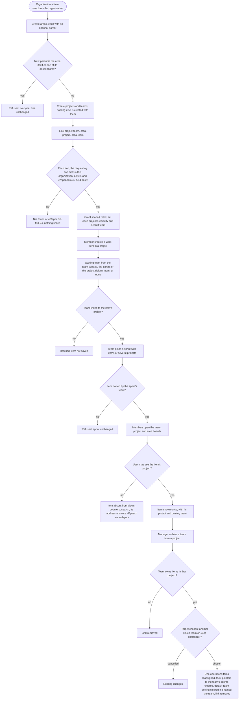

# Spec: Matrix organization model (doc-012)

## Context and goal

Today a project contains its teams and its area tree, and a work item reaches its team only through the area it sits in ([audit 1](audit/1-org-structure.md), [audit 3](audit/3-work-items.md)). A team that works on three projects has to exist three times, a project cannot share a team, and access goes no finer than the organization ([audit 2](audit/2-access.md)).
The human's brief ([input-brief.md](input-brief.md), 2026-10-16) asks for a matrix model. Area, Project and Team become independent objects of the organization, linked many-to-many. A work item gets an optional owning team, sprints belong to teams and span projects, three levels of board read one item collection, and permissions are scoped, with project visibility.
This spec states the target behaviour, the fate of every existing rule it changes ([prior-art.md](prior-art.md) P-1) and the delivery lines. ADR-0028 (model) and ADR-0029 (scoped access) are drafted beside it and go to the human with it at gate-1. Two human decisions bind it (status.md): existing data may be dropped (§ Existing data), and a project has a default team (BR-MX-11).

## Roles

Access is still derived from membership (ADR-0027). An organization-level capability comes from the user's organization role or from a scoped grant held through that membership, never from the token. Instance roles (dictionaries, the right to create organizations) are unchanged and still see no organization content.
Each role is a fixed bundle of codes; ADR-0029 fixes the code strings and the matrix. The UI names describe capabilities, not job titles (brief § 10).

| Scope | Role (UI name) | Capability |
|---|---|---|
| Organization | admin «Администратор» | Everything on every object of the organization, Restricted projects included (OQ-3). Manages memberships. Creates projects, teams and top-level areas |
| Organization | member «Участник» | Reads the organization's structure. Reads and changes the work items of every project whose visibility is «Организация», and orders those projects' backlogs. Orders every team's backlog. All of this is today's behaviour (mod-006 BR-M4-27) |
| Organization | viewer «Читатель» | Reads what a member reads; changes nothing |
| Area | «Чтение» / «Изменение» | Reads, or also changes, the work items of the projects linked to the area or to an area that inherits from it, Restricted projects excepted (BR-MX-22) |
| Area | «Управление» | «Изменение», plus the area's name, description, place in the tree and «Наследовать доступ», its child areas, its grants and the area's end of its links |
| Project | «Чтение» / «Изменение» | Reads, or also changes, the project's work items and orders its backlog, a Restricted project included |
| Project | «Управление» | «Изменение», plus the project's settings (name, description, visibility, default team), its grants and the project's end of its links |
| Team | «Планирование» | Orders the team's backlog, as every «Участник» does; creates, starts and closes the team's sprints |
| Team | «Управление» | «Планирование», plus the team's name, description, members and grants, and the team's end of its links |

Belonging to a team (the people group) grants nothing on its own; ADR-0027 rule 2 is kept (brief § 21.7). A team's roles are team-scope grants. Every grant needs an active organization membership (BR-MX-20).

## Glossary

| Term | Meaning |
|---|---|
| Organization | The tenant: the root object and the only isolation boundary. Every object and relation below belongs to exactly one organization |
| Area («Область») | A workspace of the organization: a name, a description, an optional parent area (so areas form a tree), links to projects and teams, participants, and an inheritance switch. It owns nothing — projects and teams are linked to it, never stored inside it. It replaces the per-project area tree (OQ-1) |
| Project | Owns its work items, their numbering and its identifier key. Independent of teams and areas. Has a description, a visibility and an optional default team |
| Team | A group of the organization's people, with a description, that delivers work in the projects it is linked to. Owns its backlog order and its sprints |
| Link | A many-to-many relation inside one organization: project–team (the team takes part in the project), area–project, area–team. A link has no fields, grants nothing and discloses no project |
| Owning team | The single optional team responsible for a work item, shown as «Команда» («Без команды» when empty). It is always a team linked to the item's project |
| Project default team | The team a new item of the project starts with outside a team context: the team set in the project's settings, else the only linked team, else none |
| Sprint | A team's time-boxed plan («Спринт»). It holds items of any of the team's projects and goes Planned → Active → Closed |
| View | A backlog or a board, at team, project or area level, over the one collection of items; never a copy |
| Grant / participant | A grant is a role of one scope (area, project or team) held by an organization member on one object. An area's participants are the users whose grants reach it (BR-MX-22): held on the area itself (direct) or on an ancestor it inherits from (inherited) |
| Visibility | A project's setting that decides who may see the project at all: «Организация», «Участники областей» or «Ограниченный» |
| Effective permissions | The codes a user holds on one object, computed by one deterministic algorithm (BR-MX-23, ADR-0029) |

## Stories

| id | Title | depends-on | File |
|----|-------|------------|------|
| US-1 | An administrator builds the organization's area tree | - | `stories/US-1-area-workspace-tree.md` |
| US-2 | Projects and teams exist on their own inside the organization | - | `stories/US-2-independent-projects-and-teams.md` |
| US-3 | A manager links and unlinks projects, teams and areas | US-1, US-2 | `stories/US-3-link-and-unlink.md` |
| US-4 | A work item has an optional owning team | US-3 | `stories/US-4-work-item-owning-team.md` |
| US-5 | A manager grants scoped roles, and areas pass them down | US-1, US-2, US-3, US-7 | `stories/US-5-scoped-roles-and-memberships.md` |
| US-6 | Project visibility hides a project from those who may not see it | US-3, US-5, US-7 | `stories/US-6-project-visibility.md` |
| US-7 | Team and project boards and backlogs over one item collection | US-4 | `stories/US-7-team-and-project-boards.md` |
| US-8 | The area board and overview aggregate the linked projects | US-6, US-7 | `stories/US-8-area-board-and-overview.md` |
| US-9 | A team plans sprints with items of several projects | US-4, US-7 | `stories/US-9-team-sprints.md` |
| US-10 | A user moves between areas, projects and teams | US-1, US-2, US-3, US-4, US-5, US-6, US-7, US-8, US-9 | `stories/US-10-area-project-team-navigation.md` |
| US-11 | A user filters team, project and area views | US-7, US-8, US-9 | `stories/US-11-view-filters.md` |

All eleven stories are `shippable: no`. This is an analysis task: each story specifies the delivery lines that § Decomposition maps to it, and none is spun out into a queue line of its own. A clause that needs what a later line brings — an area, a grant, a visibility other than «Организация», a sprint — is marked "owed by" that line, which re-runs it and makes it pass.

## Business process (BPMN)

## Business rules

| # | Rule | Source |
|---|------|--------|
| BR-MX-1 | **Tenant boundary.** Every area, project, team, link, membership, grant, sprint and work item belongs to exactly one organization. Every read, write, lock, counter and search stays inside the organization in the address. An id from another organization anywhere in a request — address, body, link end, owning team, sprint, parent or assignee — gets the same answer as an id that names nothing, and changes nothing. | brief § 3.1; mod-002 BR-M1-22; P-3 |
| BR-MX-2 | **Independent existence.** An area, a project and a team can each exist with no link of any kind, and an organization may have no areas at all. Creating a project creates no team, no area and no team membership; creating a team creates no project and no area. Unlinking or deleting one object never deletes another object or a work item. | brief §§ 3.1-3.2, 4.1-4.2, 5.1, 11.5; SC-07 |
| BR-MX-3 | **Area tree.** An area has at most one parent, which is an area of the same organization. A move carries the area's whole subtree. A move whose destination is the area itself or one of its descendants is refused, so the tree never holds a cycle, concurrent moves included. The tree is at most 10 levels deep. A move needs «Управление» on the area and on its new parent; creating a top-level area, or moving one to the top level, needs the organization admin. | brief § 3.2, SC-08; mod-002 BR-M1-12 |
| BR-MX-4 | **Names and descriptions.** An area's or a team's name is 1–100 characters after trimming and is compared ignoring letter case and surrounding spaces. A team's name is unique among its organization's active teams. An area's name is unique among its siblings, and the organization's top-level areas count as siblings of each other. Project names and keys keep mod-002 BR-M1-1. An area, a project and a team each have an optional description of at most 2 000 characters, kept as typed. | mod-002 BR-M1-1; audit 1 (no uniqueness guard for top-level areas); brief § 11.5 |
| BR-MX-5 | **Links.** There are three kinds: project–team, area–project and area–team. Each is many-to-many, with at most one link per pair. Both ends must be active — a project that is not deactivated, a team that is not deleted — and in the same organization. Linking a pair that is already linked, or unlinking one that is not, changes nothing and is not an error. | brief §§ 3.2, 4.3-4.4, 5.2-5.3, 12 |
| BR-MX-6 | **Who links.** Only a user who holds «Управление» on both ends may create or remove a link; the organization admin holds it on every object. A link gives no power over its other end: nobody renames, moves, deletes or reconfigures an area or a team through a project, or the other way round. | P-6, P-9 |
| BR-MX-7 | **Links disclose nothing.** A link grants no code and never makes a project visible to someone who could not see it without the link (BR-MX-21). | brief §§ 5, 10.3-10.4; SC-05 |
| BR-MX-8 | **Area deletion.** An area can be deleted only when it has no child areas. Its links and the grants held on it end with it, and nothing else changes: no project, team, item or other area. Unlinking an area from a project or a team removes only that link. | brief § 3.2 |
| BR-MX-9 | **Owning team.** A work item belongs to exactly one project, which never changes. It has at most one owning team, and that team must be linked to the item's project when it is set. Changing the owning team does not change the item's project, identifier, assignee, history or estimates. The assignee need not belong to the owning team. | brief § 6 rules 1-8; SC-04 |
| BR-MX-10 | **Creation defaults.** A new item's owning team starts as follows. Created from a team's surface: that team. Created as a child: its parent's owning team, if that team is still linked to the project. Otherwise: the project default team (BR-MX-11), or «Без команды» when the project has none. Before saving, the creator may change it to any linked team or to «Без команды». | human decision; brief § 6 |
| BR-MX-11 | **Project default team.** If the project's settings name a team, that team (it must be linked) is the default, marked «По умолчанию». If they name none and exactly one team is linked, that team is the default, marked «По умолчанию: единственная команда». Otherwise the project has no default team. Unlinking or deleting the team the settings name clears the setting in the same operation, and the rule above applies again. The default affects BR-MX-10 only. | human decision (status.md 2026-10-16) |
| BR-MX-12 | **Unlinking a team that owns items (SC-09).** A team may own items, in any state, in a project it is being unlinked from. The actor then chooses, in the confirmation, one destination for all of those items: another team linked to the project, or «Без команды». In one operation the items take that owning team, lose their pointers to the unlinked team's sprints and arrive unplaced on the destination team's backlog; the default-team setting is cleared if it named the unlinked team; and the link is removed. If an item save or creation sets the unlinked team concurrently, either that save or the unlink is refused. Deleting a team (organization admin; soft; no restore; the name becomes free) applies this unlink to every project, with «Без команды» as the destination, and also ends the team's area links, memberships and grants. The rule reassigns rather than blocks because deleting a team already moves its work in one confirmed operation (mod-002 BR-M1-18). With no bulk edit, a block would leave the manager editing the items one by one. | brief SC-09, § 6 rule 9; P-7 |
| BR-MX-13 | **Sprint and team.** A sprint belongs to exactly one team, permanently, and may hold items of any project. An item's sprint, when set, is always a sprint of the item's current owning team, so an item with no owning team has no sprint. A save that changes the owning team clears the sprint, unless the same save sets a Planned or Active sprint of the new team. | brief §§ 6.10, 8.1-8.4; P-8 |
| BR-MX-14 | **Sprint lifecycle.** A sprint goes Planned → Active → Closed and never back. A team has at most one Active sprint (OQ-6). While a sprint is Planned its dates are optional, but come as a pair with finish ≥ start; starting a sprint needs both dates. Items join only Planned and Active sprints. Closing a sprint moves, in the same operation, every item whose state is outside the Completed category to a Planned sprint of the team, or to no sprint. Closing also records the outcome: the items completed in the sprint, with their project and story points. The record never changes, whatever happens to those items later. A Closed sprint takes no new item and is never removed. A Planned sprint with no items may be removed. | brief § 8.5; P-8 |
| BR-MX-15 | **Sprint numbering.** A team's sprints are numbered 1, 2, 3… in creation order, and a number is never reused. The default name is «Спринт <n>». Names are unique among the team's sprints, and renaming keeps the number. | brief § 8 (the «Sprint 12» case) |
| BR-MX-16 | **No copies.** An item exists once. Every view, list, counter and aggregate shows or counts it at most once, however many areas, links or sprints lead to it. A change of its state shows in every view. | brief §§ 3.2, 7, 21.8; SC-03, SC-06 |
| BR-MX-17 | **View contents.** Views exist per mod-006 level («Эпики», «Фичи», «Истории») and hold every state outside Removed. A team's views hold the items the team owns, in all its projects. A project's views hold every item of the project, whatever its team or with none. An area's views hold the items of the projects linked to the area and, when «Включая дочерние области» is on, to its descendants. Every view then leaves out the items the user may not see (BR-MX-21). | brief §§ 7.1-7.3; SC-01..SC-03, SC-05, SC-08 |
| BR-MX-18 | **Order.** A team's backlog keeps its own order per team and level, and a project's backlog keeps its own per project and level; reordering one never changes the other. An area's views have no order of their own and sort by a chosen column. Unplaced items sort by creation time, then by identifier, so items of different projects never tie. A card move writes only its item's state, in the item's own project. Neither a card move nor a reorder changes an item's project or owning team. | brief § 7; P-2; doc-001 BR-12 |
| BR-MX-19 | **Statuses on shared views.** A view's columns come from the processes of the projects whose items it shows. A move offers only the states of the card's own type in its own project's process. No status is ever rewritten to make columns match. Where a view's projects use different processes, the columns are the state categories and each card shows its own state. While each organization has one process (mod-002 BR-M1-3, OQ-2), every view shows that process's columns. | brief § 7, SC-10 |
| BR-MX-20 | **Grants.** A grant is held by an active organization member; adding a non-member is refused. Removing a user's organization membership ends every grant and team membership they hold in that organization. The roles are the fixed bundles of § Roles: there are no custom roles and no denying grants. Every grant and link records who made it and when. | brief §§ 9-10.2; mod-016 BR-M1-5, -10 |
| BR-MX-21 | **Visibility.** A project has exactly one visibility, «Организация» when it is created. «Организация»: every organization member sees it, through their organization role. «Участники областей»: visible only to organization admins, to holders of a grant that reaches an area linked to it (BR-MX-22) and to holders of a grant on the project. «Ограниченный»: visible only to organization admins and to holders of a grant on the project; area grants and links never reach it. A project a user may not see does not exist for them. It is in no list, switcher, view, counter, aggregate, search, picker, «ещё» flag or overview figure. Its address and the addresses of its items answer «Проект не найден». | brief §§ 10.3-10.4; SC-05, SC-06; P-4 |
| BR-MX-22 | **Inheritance.** A grant on an area reaches that area and its descendants. It stops at a descendant whose «Наследовать доступ» is off: that area and its subtree receive nothing from above, while the grants held on them still apply. An area grant reaches the work items of the projects linked to the areas it reaches, unless the project is «Ограниченный». A team grant reaches only the team itself — its settings, members, backlog order and sprints — and never the items of the team's projects. No grant passes from one area to another through a shared project or team. | brief §§ 10.1, 10.4; SC-05, SC-08 |
| BR-MX-23 | **Effective permissions.** An organization admin holds every code on every object (OQ-3). For any other user, the codes on an object are the union of two sources. The first is the bundle of their organization role, when the object is part of the organization's structure or belongs to a project with visibility «Организация». The second is the bundles of every grant that reaches the object (BR-MX-22). Visibility (BR-MX-21) is applied first. Codes are only ever added. The same memberships, grants, tree and links always give the same result, whatever their order. The server computes it in one policy, for every route, list, counter and search; the panel only reflects it. A change takes effect on the user's next request. | brief § 10.4 items 1-6; P-5 |
| BR-MX-24 | **Answer order.** An organization-addressed request gets the first of these that applies: 401 when the user is not signed in; «Организация не найдена» when they are not a member; «Проект не найден» when the project the request is made in is missing, deactivated or not visible to them; «Команда не найдена» or «Область не найдена» when the team or area the request acts on (for a new child area, its parent) does not exist; 403 when they see that object but lack its code; then the field errors. Every other id the request names — a link's other end, a move's destination, an owning team, a sprint, a parent, an assignee — is checked after those: it answers its own not-found, then 403 if its own code is lacking. A foreign id gets the answer of an id that names nothing, so no answer tells whether a hidden object or another organization's exists. | ADR-0027 rule 4, amended; ADR-0029 § 8 |
| BR-MX-25 | **Assignee.** An item's «Исполнитель» picker offers the active organization members who can read the item's project; setting anyone else is refused. An assignee who later loses that access stays on the item, marked «нет доступа к проекту», and saving other fields is never refused because of it. | brief §§ 6, 10 |
| BR-MX-26 | **People move.** Adding a user to, or removing them from, a team, an area or a grant changes no item's project, owning team, assignee, sprint, history or estimates. What the user may see and do changes on their next request. | brief § 9; SC-04 |
| BR-MX-27 | **Navigation.** «Области», «Проекты» and «Команды» are separate top-level entries, beside «Рабочие элементы» and «Участники». An area, a project and a team each have their own page, whose address names only that object and its organization. No address, breadcrumb trail or menu puts a team under a project, a project under an area, or the other way round. Links are added through a searchable multiselect, and linked objects are shown with a way to open them. | brief §§ 11.1-11.6; ADR-0024 § 2, amended by ADR-0028 |
| BR-MX-28 | **Work context.** The context switcher holds the organization and at most one area, project or team. It lists only objects the user may see, with the user's own teams first. The choice is remembered per user, and an address that names a context sets it. | brief § 11.6.4 |

## Existing rules: keep, replace or retire

This table is the record of which rules this model supersedes (P-1). The merged specs are archives and are not rewritten.

| Existing rule | Fate | Why |
|---|---|---|
| mod-002 BR-M1-1 | kept for organizations and projects; teams and areas → BR-MX-4 | teams and areas no longer belong to a project |
| mod-002 BR-M1-2, -21; mod-016 BR-M1-4, -5, -6, -16, -17, -28, -29, -32, -35, -37 | kept | creation right, creator record, membership, last admin (counting organization admins only), inactive accounts and realm: none of them depends on the structure |
| mod-002 BR-M1-3; mod-003 BR-M3-21 | kept (OQ-2) | one process per organization; any state to any state of the item's type |
| mod-002 BR-M1-9; mod-016 BR-M1-25 | retired → BR-MX-2 | nothing is created with a project, and there is no first team to join |
| mod-002 BR-M1-11; doc-001 D-8, BR-3 | retired → BR-MX-9, BR-MX-17 | the item's owning team replaces area ownership; there is no root area |
| mod-002 BR-M1-12 | replaced → BR-MX-3 | the tree belongs to the organization |
| mod-002 BR-M1-13; mod-003 BR-M3-23, -24 | replaced → BR-MX-8 (OQ-1) | items no longer sit in areas |
| mod-002 BR-M1-14; mod-003 BR-M3-20; mod-006 BR-M4-21; feat-027 BR-T-10 | replaced → BR-MX-10, BR-MX-11 | the project default team (human decision) replaces default areas |
| mod-002 BR-M1-18; mod-006 BR-M4-20; mod-016 BR-M1-36 (deleted team) | replaced → BR-MX-12 | there is no first team to receive the work |
| mod-002 BR-M1-19 | retired | ended when mod-016 merged |
| mod-002 BR-M1-20 | kept for organizations and projects; extended by BR-MX-24 | a deactivated project keeps its links and gets them back on restore (ADR-0026 rule 2) |
| mod-002 BR-M1-22; doc-001 D-2 | replaced → BR-MX-1, BR-MX-2, BR-MX-5 | containment is by organization, with many-to-many links |
| mod-002 BR-M1-23, -24; mod-016 BR-M1-27 | replaced → BR-MX-27, BR-MX-28 | areas, projects and teams get pages of their own; the per-user default team in the switcher goes |
| doc-006 BR-M1-7; doc-001 BR-5, D-1 (scope) | replaced → BR-MX-23 | access resolves through grants and links, and goes finer than the organization |
| doc-006 BR-M1-8 | kept; extended by BR-MX-21, BR-MX-24 | members now also get a project-level «not found» |
| doc-006/mod-016 BR-M1-10; mod-016 BR-M1-36 (membership removed) | kept; extended by BR-MX-20 | removing an organization membership also ends the user's grants |
| mod-016 BR-M1-26; doc-001 BR-13; mod-003 BR-M3-22 | replaced → BR-MX-25 | same answer for «Организация» projects; Restricted projects need the access check |
| mod-016 BR-M1-30, -31, -33, -34; ADR-0027 rules 1-6 | extended by ADR-0029 | the scoped model uses the same catalog and the same check (P-5) |
| doc-006 § Roles "team membership grants no access" | kept; team roles are team grants (BR-MX-20, BR-MX-22) | brief § 21.7 |
| mod-006 BR-M4-1, -5, -26 | BR-M4-1 extended and BR-M4-5 replaced → BR-MX-17; BR-M4-26 kept, with "left this backlog" following BR-MX-17 | project and area views are added; membership comes from the owning team, not the area |
| mod-006 BR-M4-2, -3, -18, -23; BR-M4-6, -8, -13, -25; doc-001 BR-12 | kept per view; extended by BR-MX-19 (columns) and BR-MX-18 (one order per team and one per project) | the item's own process; a second order for the project |
| mod-006 BR-M4-24; doc-001 BR-12's tie-break; feat-027 BR-T-6 | replaced → BR-MX-18 | unplaced items sort by creation time, then identifier, not by number; inside one project that is the same order |
| mod-006 BR-M4-15 | kept on team and project boards, each column in its own view's order; an area board's column sorts as its backlog does (BR-MX-18) | area views have no order |
| mod-006 BR-M4-14; feat-027 BR-T-1 | extended: rows and cards show the project and the owning team (US-7) | brief § 11.6.3 |
| mod-006 BR-M4-27 | replaced → BR-MX-23: its codes are checked on the team and on the project, and a «Участник» keeps every reorder it has today | scoped codes |
| mod-006 BR-M4-28; feat-027 BR-T-4, -5 | kept on team views, over the children the team owns, and on project views, over every child; area views list flat rows (US-8) | area views sort and page |
| feat-027 BR-T-16 | replaced → BR-MX-28: the page head's drop-down offers the organization's teams the user may see, own teams first | no team belongs to a project |
| doc-003 US-2 (a filtered backlog reorders against the full list) | kept on team and project backlogs (US-11) | feat-013's rule, carried over by name |
| mod-003 BR-M3-2, -5; BR-M3-27, -29 | the project half of BR-M3-2 and BR-M3-5 kept, the area half retired (OQ-1); BR-M3-27/-29 extended by BR-MX-21 | visibility applies to every read |
| doc-004 BR-M5-1, -5, -6, E-5; doc-001 D-11, BR-9 | replaced → BR-MX-13, BR-MX-14 | a sprint belongs to a team, and «Active» is stored, not derived |
| doc-004 BR-M5-2, -3, E-7, E-10, E-11 | replaced → BR-MX-15; the release kind is retired | brief § 8.9: releases are not sprints |
| doc-004 BR-M5-7 | replaced → BR-MX-13 | no stale pointers (brief § 6.10) |
| doc-004 BR-M5-4, -11; doc-001 BR-7 | kept, except that a Closed sprint takes no item (BR-MX-14) | one optional pointer per item |
| doc-004 BR-M5-8, -9, -10, -12 | replaced → BR-MX-14 and the sprint filter of US-11 (sprints form no tree) | the lifecycle is stored; closing moves unfinished work |
| doc-004 BR-M5-13, -15, -16, -17 | moved onto team sprints by their own lines; counted after BR-MX-21 | - |
| doc-001 BR-15 | kept for workspace areas: an area matches itself and its descendants | - |
| ADR-0024 § 2; ADR-0026 rules 1, 2, 3, 6, 8, 9 | amended by ADR-0028 | addresses; team names and links (1); team deletion (2); reachability (3); indexes (6); locks (8); the sprint lifecycle (9) |

## Operation completeness

| Entity | Create | Read | Update | Delete/deactivate | Cancel/reverse | Surface (US-10; the team and area ones sit in the organization settings until the navigation line) |
|--------|--------|------|--------|-------------------|----------------|---------|
| Area | org admin for a top-level area; «Управление» on the parent for a child area (US-1) | every org member: names, tree, links; figures per BR-MX-21 | area «Управление»: rename, description, «Наследовать доступ»; a move also needs «Управление» on the new parent, the top level the admin (BR-MX-3) | area «Управление»: only when it has no children (BR-MX-8) | no: a hard delete; create the area again and link it again | «Области»: the tree, create; the area's «Настройки»: the rest |
| Project | org admin, as today (US-2) | users who see it (BR-MX-21) | project «Управление»: name, description, visibility, default team; never the key | org admin: deactivate (ADR-0026); its links stay | org admin: restore, with its links as they were | «Проекты»: create, deactivate, restore; the project's «Настройки»: the rest |
| Team | org admin (US-2) | every org member | team «Управление»: rename, description | org admin: delete per BR-MX-12 | no: there is no restore, as in mod-002 BR-M1-18 | «Команды»: create; the team's «Настройки»: rename, description, delete |
| Project–team link | «Управление» on both ends (BR-MX-6), from either page (US-3) | users who see the project; a team's project list shows only visible projects | no: a link has no fields | «Управление» on both ends: unlink, reassigning items per BR-MX-12 | link again; the reassigned items stay where they went | the project's «Команды» and the team's «Проекты»: multiselect and unlink |
| Area–project link | «Управление» on both ends (US-3) | org members; an area's project list shows only visible projects | no: a link has no fields | «Управление» on both ends; nothing else changes (BR-MX-8) | link again | the area's «Проекты» and the project's «Общие» |
| Area–team link | «Управление» on both ends (US-3) | every org member | no: a link has no fields | «Управление» on both ends | link again | the area's «Команды» and the team's «Обзор» |
| Project default team | project «Управление»: choose among the linked teams (BR-MX-11) | users who see the project | project «Управление» | project «Управление»: clear it, and the inference applies again | set it again | the project's «Настройки»; marked on its «Команды» |
| Project visibility | no: set to «Организация» when the project is created | users who see the project | project «Управление» (US-6) | no: a project always has a visibility | change it back | the project's «Настройки» |
| Owning team of an item | whoever creates the item (BR-MX-10) | whoever reads the item | whoever may change the item: any linked team or «Без команды» (BR-MX-9, BR-MX-13) | updated to «Без команды» | updated again | «Команда» on the card and in the creation dialogs; the list's column and filter |
| Sprint | team «Планирование» (US-9) | every org member; its items per BR-MX-21 | team «Планирование»: rename, dates, start, close (BR-MX-14) | team «Планирование»: remove a Planned sprint that has no items | no: starting and closing are final (BR-MX-14) | the team's «Спринты» and its sprint board |
| Item's sprint | whoever may change the item; only a sprint of its owning team (BR-MX-13) | whoever reads the item | whoever may change the item: another Planned or Active sprint of the team | whoever may change the item: no sprint; also cleared on close and when the team changes | set it again; a Closed sprint's outcome never changes | «Спринт» on the card |
| Grant (area, project, team) | «Управление» on the object: an org member with a role (US-5) | org members; a project's grants only by users who see the project | «Управление» on the object: change the role | «Управление» on the object; ends by itself when the organization membership or the object ends | grant again | the object's «Участники» («Участники и доступ» on a project) |
| Team membership | team «Управление» (US-2) | every org member | no: remove the member and add them again | team «Управление»; ends by itself per BR-MX-12 and BR-MX-20 | add again | the team's «Участники» |

## Existing data (brief § 13)

The human waived § 13 (status.md, 2026-10-16). The delivery lines may drop the rows of the tables they rework — teams, areas, team memberships, backlog places, the areas work items point at — instead of mapping them onto the new model. They owe no conflict report, backup or before/after count.
The waiver does **not** cover: every behaviour this spec keeps, which keeps working along with the tests that prove it; the fate of every changed rule (the table above); the rule that a merged migration is never edited (the form of the drop: OQ-4); the Keycloak realm, which stays untouched because grants live only in the MUSTASK database; and each line stating, in its MR, which data it drops.

## Non-functional requirements

- **Non-disclosure:** each surface BR-MX-21 names has a test comparing a user who cannot see project X with the same data without X. The answers are identical, totals and «ещё» flags included (brief § 10.4 items 4 and 7; P-4).
- **Tenant isolation:** every new route, link and lock passes the containment check that applies to today's routes: foreign ids answer «not found» and change nothing (P-3).
- **Volumes:** an organization with 1 000 areas (10 levels), 200 projects, 200 teams, 2 000 members, 10 000 grants and 100 000 items. A team or project backlog of 5 000 items returns within 2 s, as in mod-006. Area views and the work item list return pages of at most 50 rows within 2 s, including the first page of an area view over 50 000 items. A single-item read returns within 500 ms, its access check included.
- **Client load:** no request returns the items of more than one view, and the panel never loads every item of the organization. A board or backlog draws at most 2 000 rows at a time (feat-027 BR-T-7). Area views and the work item list page on the server; team and project backlogs stay whole-level reads, as in mod-006, because a reorder is made against the whole level, and the 5 000-item budget bounds them.
- **Query shape (brief §§ 14, 17):** a view, a list, a figure or an access check reads its rows, their projects and teams and the caller's access in a number of statements that does not grow with the rows or the projects (no N+1); a statement-count test pins it per surface. The views take their filters from one shared specification, so a filter means the same on every view (US-11).
- **Concurrency:** two requests can each pass on their own yet break a rule together — two area moves that would form a cycle; an unlink and a save that sets that team; a sprint close and a save into the sprint; a link and the deletion of either end; a grant removal and a request that uses the grant. In each case one of them is refused (doc-001 BR-11).
- **Observability (brief § 17):** each refusal by the access policy is logged with the route, the code, the resource scope and the user id, never with a hidden project's name; each migration that drops rows logs, per table, how many it dropped.
- **No new dependencies (brief §§ 11.6.1, 11.6.8, 17, 21.14):** no new library, service or infrastructure. The panel keeps the UI kit (tech-015) and ADR-0024's visual language, and every new page and dialog works down to ADR-0024's 640 CSS px floor.
- **Regression:** every test listed under "Regression surface" in the audits stays green, except tests that encode a rule this spec retires or replaces. Each line retires those tests by name, citing the rule id (P-1). "Green" means `scripts/verify.sh` (P-11).
- **Localization:** all interface copy is Russian (AGENTS.md).

## Out of scope

- Per-project or per-team processes and transition rules: SC-10 goes no further than BR-MX-19 (OQ-2).
- Releases and milestones: none exist, and the sprint carries no release kind (brief § 8.9).
- Custom roles, editable bundles, denying grants, and job titles in authorization.
- Links or sharing across organizations; moving a project, team or area to another organization; moving an item to another project; parent links across projects (feat-001 BR-H-1 is kept).
- Department, Division or any other entity besides the area (brief § 21.1).
- A visibility setting on areas (brief § 3.2): every member reads the area tree, its names, descriptions and links (US-1), because an area holds no work of its own. What an area shows of a project follows that project's visibility (BR-MX-21), which is where § 3.2's visibility settings apply; a second, per-area setting would make what a user sees depend on two settings that can disagree.
- A blockers filter and the overview's blockers figure (brief §§ 7.1, 11.2): no blocked flag and no blocking link exist, and no queued line adds one; the line that adds one owes the filter and the figure.
- Area analytics beyond the overview's figures (mod-008, mod-009). Capacity, burndown, velocity and forecast (mod-011, feat-011, mod-012, feat-012), which move onto team sprints in their own lines.
- Preserving or mapping existing data (§ Existing data); any change to the Keycloak realm; notifications.

## Decomposition for the backlog

| id | Task | size | deps | Rewrites / withdraws | Breaks (P-10: note in the owner's status.md) |
|----|------|------|------|----------------------|---------------------------------------------|
| `feat-NNN-project-board` | A project backlog and board per level over every item of the project, whatever its team or with none, in the project's own order. Its reorder is checked with today's `boards.backlog.reorder` bundle until `mod-NNN-scoped-access` (BR-MX-17, BR-MX-18; US-7, project part) | M: an additive view in the boards slice, with no new code | mod-006 | rewords feat-023 (the «Задачи» level and its order on team and project views alike) and feat-024 (an in-column move keeps the order of the board's own view; area boards offer none) | none: additive |
| `mod-NNN-work-item-owning-team` | An explicit, optional owning team on the work item: on the card, in the creation dialogs, as the list's «Команда» column and filter, and as the project views' team filter. Team views hold owned items; the project default team; creation defaults (BR-MX-9..-11, BR-MX-17). Retires area ownership, team default areas and the first team's special role; a deleted team's items go to «Без команды» (US-4; US-7, team part; US-2, default team) | L: breaking, per its Breaks cell | feat-NNN-project-board | rewords feat-015 (its history records owning-team changes, ADR-0028 rule 10) | mod-002 api-contract §§ 3.5, 4.1, 4.5, 6 (default-area and first-team codes), 7 (the in-process structure contract); mod-003 §§ 1.1, 2; mod-006 §§ 1, 3 (the default-area field), 7; feat-027 (a child's team) |
| `feat-028-org-level-teams` (reworded, id kept) | Teams become the organization's: names unique in the organization, no team created with a project, descriptions on projects and teams. Project–team links, linked and unlinked from both pages; SC-09 reassignment and team deletion (BR-MX-4..-6, BR-MX-12); an owning team must be linked. Team pages in the organization settings (US-2; US-3, project–team) | L: breaking, per its Breaks cell | mod-NNN-work-item-owning-team | rewords feat-028 and mod-009 (team dashboards belong to organization teams, seeded when a team is created); makes tech-009 F2 and F5 obsolete | mod-002 api-contract §§ 0.3-0.4, 3, 6; mod-016 §§ 2, 3.3 and inventory rows 15-26; the project settings' teams address, which answers «Страница не найдена» |
| `feat-NNN-team-surfaces-across-projects` | Team backlogs and boards addressed by the team alone, over all its projects, with a project filter. Rows and cards carry their project and owning team; a card opens in its own project; the tie-break; the page head's team drop-down (BR-MX-17, BR-MX-18; US-7, team part) | L: breaking, per its Breaks cell | feat-028-org-level-teams | takes over tech-011 m2 and m3, and feat-028's card-dialog note | mod-006 api-contract §§ 2-3, 7; mod-016 inventory rows 35-37; feat-027 and feat-032 row and card shapes; feat-027 BR-T-16; the project-nested team addresses (ADR-0024 § 2), which answer «Страница не найдена» |
| `mod-NNN-area-workspace` | The organization's area tree replaces the per-project tree: optional parents, a description, the inheritance switch, area–project and area–team links (BR-MX-3..-8). The item's «Область» per OQ-1. Area pages in the organization settings (US-1; US-3, area links) | L: breaking, per its Breaks cell, and `organizations.area.*` is redefined | feat-028-org-level-teams | makes tech-009 F3 and tech-010 m4 obsolete; rewords feat-003 (area filter) and mod-008 ("Under" on «Область») | mod-002 api-contract §§ 4, 6, 7; mod-003 § 1.1 (the item's area); feat-022 and feat-032 (the item's area field); mod-016 inventory area rows; the meaning of `organizations.area.*`; the project settings' areas address, which answers «Страница не найдена» |
| `mod-NNN-scoped-access` | Area, project and team grants on top of organization membership; inheritance; the effective-permissions policy on every route, served to the panel per object; `boards.projectbacklog.reorder`; the inventory test per scope and the bundle contract (BR-MX-20, -22, -23, -26; US-5) | L: changes the authorization rules | mod-NNN-area-workspace | answers doc-011's `scoped-permission-overrides`; takes over tech-026 OP-7 | mod-016 api-contract §§ 0.2, 1.1; mod-006 BR-M4-27 (its codes checked per team and project); the tests for BR-M1-30, -31 and -33 |
| `feat-NNN-project-visibility` | Project visibility and non-disclosure on every surface that exists when this line merges, each named (BR-MX-21, BR-MX-24, BR-MX-25; US-6) | L: changes the authorization rules and the answer order | mod-NNN-scoped-access, feat-NNN-team-surfaces-across-projects | rewords mod-008's premise that results are readable across the organization | mod-016 api-contract § 0.1 rows 2-4 (403 before a nested 404); mod-003 assignee candidates (gain a project); mod-016 BR-M1-26 |
| `feat-NNN-area-board-and-overview` | Area views with aggregation over child areas, in flat sorted pages, and the area overview: linked projects and teams, participants, counts by status (US-8) | M: an additive view in the boards slice; it applies ADR-0029's set form and changes no rule | mod-NNN-area-workspace, feat-NNN-project-visibility | answers doc-011's `team-area-sets` | none: additive |
| `mod-007-iterations` (reworded, id kept) | Founds M5 on team sprints: lifecycle, numbering, the team's sprint list, the item pointer with the team rule, closing with its outcome record and the move of unfinished items, the team sprint board, active sprints on the area overview (BR-MX-13..-15; US-9) | L: founds a module | feat-NNN-team-surfaces-across-projects, feat-NNN-project-visibility, feat-NNN-area-board-and-overview | rewords mod-007; withdraws feat-010 (absorbed by closing a sprint); rewords feat-008 (to the «Рабочие элементы» list's sprint filter and «Текущий спринт»; the views' sprint filter is feat-013's); rewords feat-009, mod-011 (whose deps cite the withdrawn feat-004 and feat-014), feat-011, mod-012, feat-012 and mod-013 for team sprints, feat-015 (sprint pointer changes and sprint acts) and mod-008 (no Under on «Итерация», since sprints form no tree; a current-sprint clause names its team) | none: no sprint code has shipped |
| `feat-013-board-backlog-filter` (reworded, id kept) | One filter specification for team, project and area views, taking over the team views' project filter and the project views' team filter: project, team (with «Без команды»), assignee, type, state, priority, sprint, target date and keyword. Options and counts after visibility; a filtered backlog reorders against the full list; the level, the filters and «Включая дочерние области» remembered per view (US-11) | M: additive filters in the boards slice | mod-007-iterations, feat-NNN-area-board-and-overview | rewords feat-013: it drops its feat-003 dependency, its tag filter moves to feat-016 (reworded to filter views by tag once tags exist), and its area filter retires with the item's «Область» (OQ-1; under option B it stays, over the classification tree) | none |
| `feat-NNN-area-project-team-navigation` | Top-level «Области», «Проекты» and «Команды»; the object pages with their sections; the «Рабочие элементы» list across projects; breadcrumbs with no false hierarchy; the switcher and the remembered context; empty states (BR-MX-27, BR-MX-28; US-10). A retired address answers «Страница не найдена», and nothing redirects | L: breaks the shell's address and context model (ADR-0024 § 2) | mod-007-iterations, feat-013-board-backlog-filter | takes over tech-009 F4 (the switcher's address ids); makes tech-011 m4 obsolete | the mod-015/mod-002 switcher and address model (ADR-0024 § 2); the team and area pages that feat-028 and `mod-NNN-area-workspace` put in the organization settings, which move onto the objects' own pages |

The lines run in this order; each ships on its own, and none reaches past the line before it: a story clause that needs a later line is marked owed by it (§ Stories). ADR-0028 and ADR-0029 go to the human with this spec at gate-1, the nearest gate (docs/adr/README.md, Process 2), so every line implements accepted ADRs and none accepts one. Eight lines are L, each by the threshold in its size cell; none can be M without understating it (routing.md), because splitting a breaking change does not make it additive.
Notes for the queue: whichever of these lines merges after feat-018 regenerates its migrations, as `docs/conventions/backend.md` requires; feat-038 (onboarding) is unaffected, but must not assume that a project comes with a team; doc-011 is handled by OQ-5.

## Open questions

- [ ] **OQ-1 The item's «Область».** (A, recommended) Retire it: an item keeps its project, owning team and sprint, and a workspace area reaches items only through its project links. The list column, the card field and the area filters go, and BR-M3-23/-24 retire. Its one real duty, team ownership, moves to the owning team; nothing filters, queries or reports by it today; and keeping it would leave two trees named «Область». (B) Keep an optional per-project classification tree under another name, with no ownership or access duty. It keeps the path on cards and lists, but every project then has a second tree to maintain, and `mod-NNN-area-workspace` has to carry both trees.
- [ ] **OQ-2 SC-10: different workflows per project.** (A, recommended) Defer: one process per organization stays, and BR-MX-19 already says how shared views behave once processes differ. No process editor exists yet (doc-007's is release 3), so two projects' statuses could not differ even if each had its own process. (B) Queue `mod-NNN-project-processes` now: several processes per organization, one chosen per project, and category columns on shared views.
- [ ] **OQ-3 The organization admin and «Ограниченный» projects.** (A, recommended) The admin sees and manages every project, Restricted ones included — the brief's "provided administrative access". The admin holds every code today, and someone must be able to rescue a Restricted project whose managers have left. (B) The admin manages a Restricted project's settings and grants, but reads its items only through a grant of their own.
- [ ] **OQ-4 How data is dropped.** (A, recommended) Additive migrations that drop the rows they cannot map, never editing a merged migration. This keeps the migration tests, and the human's stand upgrades in place. (B) One regenerated baseline for the reworked modules, with the human's stand database recreated.
- [ ] **OQ-5 doc-011 (gate-1 pending) overlaps this spec.** Its rows `scoped-permission-overrides` and `team-area-sets` are answered here, and its board rows assume per-team boards inside one project. (A, recommended) doc-011 drops those two rows and restates its board rows against BR-MX-17 and BR-MX-18 after this gate-1. (B) doc-011 goes ahead as written, and the lines here amend it later.
- [ ] **OQ-6 Overlapping sprints.** (A, recommended) A team has at most one Active sprint (BR-MX-14), so «текущий спринт» and the team sprint board are never ambiguous. (B) Several Active sprints per team, with the sprint board asking which one to show.
