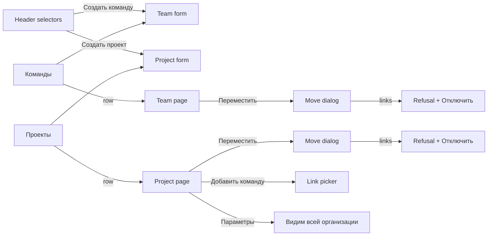

# Design: Teams and projects under departments, cascading selectors, sight (doc-016)

Stage 3 artifact. Rules (BR-TD-n) and scenarios are in `spec.md` and `stories/`; this file is layout, MUI components, states and the final Russian copy. A docs task: nothing is built here, the delivery lines of the spec's § Decomposition build from it. Mark ◆ = copy new in this design (the spec quotes the rest).

- Base: [feat-043 design](../feat-043-area-project-team-navigation/design.md) (the selectors, `SearchMenu`, page frames), [mod-018](../mod-018-area-workspace/design.md) (department pages, move dialogs), [feat-028](../feat-028-org-level-teams/design.md) (team and link dialogs), [mod-019](../mod-019-scoped-access/design.md), [ui-kit.md](../../conventions/ui-kit.md).
- Prototype: `prototype/index.html` (one file, no network). Seed: organizations «Ромашка» and «Другая»; departments «Логистика», «Финансы», «Маркетинг» (empty), the two upgrade departments, «Склад»; teams MARS, VENUS, SATURN, JUPITER, PLUTO, ORION; projects A, B, G, C, D, E, Z. A user switch (Ann the administrator; Olga a member of VENUS and ORION; Max «Менеджер» of «Логистика»; Pavel with nothing) shows sight scoping. § 10 lists the clickable scenarios.

## 1. Reuse: no new component

| Wanted | Verdict |
|---|---|
| Four header selectors | **Not new.** `app/shell/ContextSelectors` + kit `SearchMenu` (groups with `heading`, `options`, search, `InlineNotice`, `InlineEmpty`, `FieldsSkeleton`) stay. Changes: the `OTHERS_HEADING` / `OTHERS_NOTE` group and its code retire; `groupsOf` gives headings per organization (organization «все») and «Мои команды» / «Другие команды» for teams; `selectorFit.ts` is rewritten to the tree invariant (BR-TD-7, -9, -18): fit is "stands in the chosen department" and "linked to the chosen team", no department–team link read. Menus are rebuilt from the sight-scoped offers |
| Team and project forms | `FormDialog` + `InlineTextField` + `InlinePickerField` (single, searchable; MUI `Autocomplete` underneath), as feat-028 and mod-018 |
| Move dialogs, refusals | `FormDialog` + `InlinePickerField`; the refusal is an `ErrorBanner`-style `Alert severity="error"` inside the dialog (inline, not a toast), the dialog stays open |
| Link picker | feat-043 § 8.1 `FormDialog` + `InlineMultiPickerField`, offering the department's teams only |
| «Видим всей организации» | MUI `Switch` with label in a `Section`, change confirmed by `ConfirmDialog` when turning on |
| Department card and colour | MUI `Card` (variant `outlined`, 4 px left border in the department colour), `CardHeader` with tint, `Chip` (counts and objects), `Avatar` of size 10 as the colour dot, `Button variant="outlined"` + `Menu` (§ 7) |
| Lists, empty/loading/error | `DataTable`, `TableSkeleton`, `StateFrame`, `NotFound`, `ErrorBanner`, `InlineNotice`, `Tag`, `useNotice` (feat-043 § 4 frames), unchanged |

No department–team control remains: the «Области» multiselect of a team, the «Добавить команду» / «Отключить» link picker on a department (BR-TD-2) are removed.

## 2. Screen map

| Screen | Where | Stories |
|---|---|---|
| Header selectors, notices | every page | US-3, US-4 |
| Team form «Новая команда»; team move dialog; team page's «Департамент» | «Команды», department page, selector «Создать команду»; team «Обзор» | US-1 |
| Project form «Новый проект» with «Расположение»; project move dialog; link picker | «Проекты», department page, selector «Создать проект»; project «Общие», «Команды» | US-5 |
| «Видим всей организации» | project «Параметры» (the shell's derived last entry) | US-6 |
| «Структура», «Проекты», «Команды», «Обзор» scoped by sight | organization menu | US-6, US-3 |
| Not-found frames for hidden objects | any address | US-6 |
| Upgrade departments | «Структура», department «Обзор» | US-2 |



## 3. Header selectors (US-3, US-4)

### 3.1 Layout

```
+ MUSTASK | Организация Ромашка v / Департамент Логистика v / Команда все v / Проект все v | (АК) +
   popup of one selector (300 px):
   | [Найти…]                          |   search first, always
   | ＋ Создать команду                |   feat-052: first line of the list, only with the code
   | все                               |   always the first value line, whatever the search
   | Мои команды                       |   heading (team selector only)
   |   VENUS                           |
   | Другие команды                    |
   |   MARS                            |
   | Ромашка            (org heading)  |   only with organization «все»
   +-----------------------------------+
```

Order inside a popup, top to bottom: search field, «＋ Создать …» (a separate line, not an option), «все», then values by name. With organization «все» the values sit under one heading per organization (`ListSubheader`), and inside it the team selector keeps «Мои команды» / «Другие команды»; an organization with nothing to offer has no heading. The organization selector has the same shape without «Создать»: «Все организации» is its «все» and moves to the top (feat-052) from the end of the list (ADR-0032 § 5); the organizations follow by name. The «Создать…» line is the feat-052 line, delivered with it; this design fixes where it lands.

### 3.2 What each selector offers (BR-TD-8; sight BR-TD-12..-15)

| Chosen above | Организация | Департамент | Команда | Проект |
|---|---|---|---|---|
| organization «все» | the user's organizations | visible departments of all, by organization heading | visible teams of all, by heading | visible projects of all, by heading |
| organization X | as above | X's visible departments | X's visible teams | X's visible projects |
| + department Д | | not narrowed by lower levels | Д's teams | Д's projects |
| + team Т | | | not narrowed by the project | Т's linked projects (visible ones) |

Never offered: a project node, a sub-area, a deactivated, deleted or foreign object, «Остальные» (retired). A project chosen narrows nothing above it. A department's projects linked to none of its teams stay in the department's offer and leave when a team is chosen.

### 3.3 Choosing (BR-TD-9, -10)

| Action | Result | Notice |
|---|---|---|
| Team / project / department chosen | its organization, and for a team or project its department, are chosen; a project never chooses a team | none |
| A chosen value no longer fits (other department; project not linked to the new team; team not linked to the new project) | resets to «все» | «Выбор сброшен: команда MARS, проект A.» (kind in lower case, joined by «, », team before project) |
| Department replaced by the value's own | silent | none |
| Department «все» | team and project reset | the notice, naming what was chosen; none if nothing |
| Team «все» | nothing else changes; a chosen project that fits stays (decided at gate-2, BR-TD-10) | none |
| Project «все» | nothing else changes | none |
| Organization «все» («Все организации») | all four clear | the notice, none if nothing chosen below |
| Another organization | the lower three read what was last chosen there (ADR-0032 § 6), repaired by § 3.5, else «все» | per § 3.5 |
| A value from an organization «все» popup | opens its organization; the page moves to the value | none |
| A row or link opens an object | as choosing it, its notice included («Выбор сброшен: команда JUPITER.» for A opened under «Финансы» / JUPITER) | per rule |

The notice is an `InlineNotice` (`role="status"`, closable) under the header, replacing the previous one; it never blocks.

### 3.4 Empty, loading, error

| State | The popup shows |
|---|---|
| Nothing to offer | «все» and a muted line: «Нет доступных организаций» / «Нет доступных департаментов» / «Нет доступных команд» / «Нет доступных проектов» |
| Search without match | «Ничего не найдено» (the «все» line stays) |
| Loading | `FieldsSkeleton count={4}` under the search field; the trigger keeps its last value |
| Error | `InlineNotice` «Не удалось загрузить список. Попробуйте ещё раз.» with «Повторить» |
| «Создать …» with organization «все» (decided at gate-2, BR-TD-6) | uses the one organization the user may create in; with several it is shown disabled, «Создать команду — Выберите организацию»; with none, absent |
| «Создать команду» / «Создать проект» | only when the user may create in some department of the organization (administrator: all; «Менеджер»: those he manages); the form's department is pre-set to the chosen department when it is one the user may create in, else to the only one, else empty (BR-TD-6) |
| «Создать департамент» | administrator only; the dialog asks the name; the colour is automatic (§ 7.1) and shown as a helper «Цвет назначается автоматически» ◆ |

Lists: «Проекты» and «Команды» narrowed by the selection carry the `Tag` «сужено: департамент Логистика, команда MARS» and, when empty, «Здесь нет проектов, доступных вам.» / «Здесь нет команд, доступных вам.»; «Структура» empty: «Здесь нет департаментов, доступных вам.» ◆. A department holding no visible team (or project) shows «Команд нет» ◆ («Проектов нет» ◆) in its column.

### 3.5 Repair of a selection (BR-TD-18)

Read against current offers in three occasions; the order is fixed: a chosen team, else a chosen project, gives the department its own; then, least specific first, each chosen value that is gone, hidden or no longer fits resets to «все».

| Occasion | Example | Notice |
|---|---|---|
| Panel opens with a remembered selection | stored «Ромашка / Финансы / VENUS», VENUS now in «Логистика» | «Ранее выбранный контекст недоступен. Выбрано: Ромашка / Логистика / VENUS.» (whenever anything changed, a replaced department included; only chosen levels listed) |
| A move, link, membership or sight change seen while open | «Логистика / VENUS / A», VENUS unlinked from A and moved to «Финансы» | «Выбор сброшен: проект A.» (the department follows VENUS silently; alone it shows nothing) |
| Another user / the next request after a sight change | A leaves Olga's sight | «Выбор сброшен: проект A.» |
| No organization left | | «Ранее выбранный контекст недоступен.» and «Главная» opens (feat-043 § 3) |

### 3.6 Deep link to a hidden object (BR-TD-12..-14)

The address of a hidden project, team or department answers the not-found frame of its kind, the same as for an address that names nothing: «Проект не найден.», «Команда не найдена.», «Область не найдена.» (`NotFound`, menu kept, «К структуре»). The selection does not change and no name, count or heading reveals the object. A `?teamId=` or `?departmentId=` naming a hidden object answers the same for its level.

## 4. Teams (US-1)

### 4.1 «Новая команда» (`FormDialog`)

| Field | Type | Required | Validation | Error text |
|---|---|---|---|---|
| «Название» | `InlineTextField` | yes | not empty; unique in the organization (feat-028 BR-OL-3) | «Введите название» ◆; «Команда с таким названием уже есть в организации» ◆ |
| «Департамент» | `InlinePickerField` (single, search) | yes | one of the offered; the server answers 400 too | «Выберите департамент» |

Helper under «Департамент»: «Команда принадлежит одному департаменту.» ◆. The picker offers the organization's departments the user may create in (administrator: all; «Менеджер»: only those he manages; if one, it is pre-set), never «Верхний уровень», a project node or a sub-area. Submit «Создать»; done: «Команда «NEPTUNE» создана.» and its page opens (feat-043 § 5.3). Opened from a department's «Команды» or «Структура» the department is pre-set. Server: `Недостаточно прав` shows as `ErrorBanner` in the dialog; «Область не найдена.» (department deleted meanwhile) shows under the field.

### 4.2 Team page and move

Team «Обзор»: the line «Департамент: Логистика» (a link: sets the department) replaces the «Области» section; `ActionButton` «Переместить» next to it, shown to the administrator and to a «Менеджер» of the team's department. The department's «Команды» lists the teams standing in it with no link picker and no «Отключить» (BR-TD-2).

«Перемещение команды «SATURN»» (`FormDialog`): `InlinePickerField` «Новый департамент» (required, «Выберите департамент»); offers the organization's other departments (administrator: all; «Менеджер»: those he manages, and only when he manages the team's own department too). Helper: «Участники, доступы и спринты остаются на месте.» ◆ Submit «Переместить»; done: «Команда «SATURN» перемещена в «Финансы».» ◆. No other department to offer: text «Нет другого департамента, в который вы можете переместить команду.» ◆ and «Отмена» only.

**Refusal (BR-TD-4, OQ-9 A):** the dialog stays open with an inline `Alert` under the field: «Команда связана с проектами. Отключите её от них перед перемещением.» and, below, «Проекты: A [Отключить], B [Отключить]» (the team's linked projects; the actor sees all of them, being administrator or manager of the department). «Отключить» opens `ConfirmDialog` «Отключить команду «VENUS» от проекта «A»?» with «Рабочие элементы команды в проекте станут «Без команды».» — in the product it is feat-028's unlink dialog with its choice of destination; the prototype shows the default. After it the move dialog returns with the chosen department kept and the project gone from the list; with none left, «Переместить» succeeds. A team moved to the department it stands in is not offered (the server accepts it as a no-op).

States: loading — `FieldsSkeleton` in the dialog while offers load; error — `ErrorBanner` «Повторить»; permissions — a reader or organization «Участник» without a grant sees no «Создать команду», no «Переместить» (403 «Недостаточно прав» if reached by address).

## 5. Projects (US-5)

### 5.1 «Новый проект» (`FormDialog`)

Fields: «Название» (required; «Введите название»; unique «Проект с таким названием уже есть в организации» ◆), «Ключ» (required; «Ключ: от 2 до 10 латинских букв или цифр» ◆; as today), **«Расположение»** (`InlinePickerField`, required, «Выберите департамент»). «Расположение» offers the departments the user may create in and never «Верхний уровень», a project, a sub-area or a team; it is pre-set per § 3.4 (BR-TD-6). Helper: «Проект всегда стоит в департаменте.» ◆ Entry points: «Новый проект» in «Проекты» and in a department's «Проекты» / «Структура» column, and the selector's «＋ Создать проект». A team chosen in the header does not link the new project (it appears in the team's «Проекты» only after a link). Done: «Проект «Epsilon» создан.»; a department «Менеджер» sees it at once, through his grant.

### 5.2 Project page: place, move, links

«Общие»: «Расположение» section reads «Департамент: Логистика» (a link) with «Переместить» (users with `area.write` on the department). **Move dialog** «Перемещение проекта «A»»: «Новое расположение» (required, «Выберите департамент»), offers departments only, current excluded, «Верхний уровень» gone; for a «Менеджер»: the ones he manages. **Refusal:** inline `Alert` «Проект связан с командами. Отключите их перед перемещением.» and «Команды: MARS [Отключить], VENUS [Отключить]», the same unlink flow as § 4.2. A request to the top level (API only) answers «Проект должен находиться в департаменте.», shown as the banner.

«Команды» (project): `DataTable` «Команды проекта», row action «Отключить от проекта», `ActionButton` «Добавить команду». **Link picker** «Добавление команд в проект «A»» (`InlineMultiPickerField`): offers only the teams of A's department not yet linked; helper «Предлагаются команды департамента «Логистика».» ◆ Submit «Добавить»; none chosen: «Выберите хотя бы одну команду» ◆. Empty offers: «Все команды департамента уже подключены к проекту.» (feat-043 text) or, when the department has no team, «В департаменте «Маркетинг» нет команд. Создайте команду в этом департаменте.» ◆. Stale picker (a move or a link raced): `ErrorBanner` «Команду можно связать только с проектом своего департамента.», nothing changes, the picker is re-read. The team page's «Проекты» picker mirrors this with the team's department's projects.

States as feat-043 § 4. Permissions: the commands are absent without the code; the page itself needs sight.

## 6. «Видим всей организации» and what each role sees (US-6)

### 6.1 The setting

Project «Параметры», `Section` «Видимость»: MUI `Switch` labelled «Видим всей организации», helper «Проект и его команды увидят все участники организации.» ◆ Off at creation and after the upgrade. Turning on opens `ConfirmDialog` «Сделать проект «D» видимым всей организации?» with «Проект, его команды и департамент увидят все участники организации, но не другие проекты департамента.» ◆ (button «Сделать видимым»); done «Проект «D» виден всей организации.» ◆; turning off needs no confirmation: «Проект «D» виден только участвующим.» ◆ The control exists only for a holder of `organizations.visibility.write` on the project: the administrator, the project «Менеджер» and a department «Менеджер» (by inheritance; decided at gate-2); for anyone else the section is absent.

### 6.2 Surfaces by role (BR-TD-12..-17), seeded in the prototype

| Surface | Ann (administrator) | Olga (VENUS, ORION) | Max («Менеджер» «Логистика») | Pavel (no grant, no team) |
|---|---|---|---|---|
| Organization selector | «Ромашка» (not a member of «Другая») | «Ромашка», «Другая» | «Ромашка» | «Ромашка» |
| Department selector («Ромашка») | all five | «Логистика» | «Логистика» | «все», «Нет доступных департаментов» |
| Team selector | all | VENUS (Мои команды), MARS | MARS, VENUS, SATURN | «Нет доступных команд» |
| Project selector | A, B, G, C, D, E | A | A, B, G | «Нет доступных проектов» |
| «Структура» | every department with its teams and projects | «Логистика»: VENUS, MARS, A only | «Логистика» in full | «Здесь нет департаментов, доступных вам.» |
| «Проекты» / «Команды» | all | A / VENUS, MARS | A, B, G / MARS, VENUS, SATURN | «Здесь нет проектов, доступных вам.» / «Здесь нет команд, доступных вам.» |
| Commands | all | none | create and move in «Логистика»; links of its teams | none |
| «Видим всей организации» switch | yes | absent | yes, on «Логистика» projects | absent |

Seeing a team does not show its other projects, and seeing a department shows only its visible children. «Видим всей организации» on D makes D, JUPITER and «Финансы» (showing D and JUPITER only) appear for everyone on their next request. With organization «все» Olga's lists carry an «Организация» column and her pickers headings «Ромашка» / «Другая»; counts and «ещё» are computed after the sight filter, so a hidden object changes none. Loading (`TableSkeleton`) and error (`ErrorBanner` «Повторить») as feat-043 § 4.

## 7. Department colour and the calmer «Структура» (BR-TD-20; gate-2 feedback)

### 7.1 The colour

A department's colour is stored with it, given automatically at creation (and by the upgrade to every existing department, the two fallback ones included) and not editable in this cut: no colour picker anywhere. The API returns it as a palette key; the panel owns the hex. Palette of 12, in order: blue `#0078D4`, orange `#D8661B`, green `#2E8B57`, purple `#8E4EC6`, red `#D13438`, teal `#00A3A3`, amber `#B8860B`, pink `#D6458F`, indigo `#4F52B2`, lime `#7A9B1E`, magenta `#B146C2`, cyan `#0A8FBF`. Rule (spec BR-TD-20): per organization, among active departments, the unused entry with the largest smallest hue-circle distance to those in use (ties by palette order); all in use: the least used. «Ромашка» thus gets blue, orange, magenta, green, lime, indigo. The theme supplies the dark-theme variants of the same hues; the tint is 9 % of the colour over the surface.

The same colour marks a department everywhere, always with the name beside it (colour is never the only signal): a dot (`Avatar` 10 px) before each option and before the selected value in the department selector, the «Департамент» column of «Проекты» and «Команды», the «Департамент: …» line on a team or project page («Расположение»), and the stripe and header tint of its card in «Структура».

### 7.2 «Структура»

```
+-- Структура --------------------------- [Создать департамент] --+
| ! info notice (upgrade; blue stripe)                           |
|#| Логистика  (Команды 3) (Проекты 2)               [＋ Создать v] |  tinted header
|#|   КОМАНДЫ                    ПРОЕКТЫ                          |
|#|   (MARS) (VENUS моя)         (A MSK) (B BET)                  |  chips
+----------------------------------------------------------------+
```

- **Hierarchy:** one `Card` per department, white, hairline border, no shadow, 4 px left stripe in the department colour (the same look as the `InlineNotice` stripe above), header tinted; the name is the card's `h2` (16 px, semibold); counts are small outlined `Chip`s «Команды 3», «Проекты 2». Body: two columns «КОМАНДЫ» / «ПРОЕКТЫ» (caption), each object an outlined `Chip` that links to it (a team chip marks «моя» for the user's own teams, a project chip carries its key); empty column: «Команд нет» / «Проектов нет». The columns stack under 640 px. The organization name is a plain `h4` heading only with organization «все». No grey boxes.
- **Commands:** one outlined `Button` «＋ Создать» per card opening a `Menu` with «Команду» and «Проект» (the department pre-set); the page head keeps one outlined `Button` «Создать департамент» (administrator). No filled buttons on the page; shown only with the code.
- **Fallback departments** «Команды без департамента» and «Проекты без департамента» look like any card (they have a colour) with an extra outlined `Chip` «создан при обновлении» in the amber role colour in the header.
- **States:** loading — two `Skeleton` cards; empty — «Здесь нет департаментов, доступных вам.»; error — `ErrorBanner` with «Повторить»; a card with nothing visible inside shows both empty texts; permissions — the «＋ Создать» menu only for the administrator and for the department's «Менеджер».

## 8. The upgrade's visible outcome (US-2)

Only three things are visible, and none keeps a flag in the data:

1. The departments «Команды без департамента» and «Проекты без департамента» are ordinary departments in every list and selector (a `Chip` «создан при обновлении» ◆ on their «Структура» card, § 7.2), each with its automatic colour.
2. Administrators (and a «Менеджер» of that department) see on «Структура» an `InlineNotice` while either department still holds a team or a project: «После обновления созданы департаменты: «Команды без департамента», «Проекты без департамента». Переместите их команды и проекты в нужные департаменты.» ◆ It disappears by itself when both are empty; others never see it. Moving a project out of «Проекты без департамента» follows § 5.2 (links first).
3. A remembered selection moved by the upgrade is repaired with the § 3.5 notice «Ранее выбранный контекст недоступен. Выбрано: …».

The cut links, the made-«Без команды» items and the log are not in the panel: they are in the MR (BR-TD-19).

## 9. Narrow widths and accessibility

Down to 640 CSS px as feat-043 § 9: selectors wrap to a second row, each popup full width; dialogs full width; tables scroll inside their card; «Создать …» and the refusal `Alert` stay above the fold of the dialog. Keyboard: each selector is a combobox with a labelled listbox; headings are `role="presentation"` group labels; Escape closes a popup or dialog and returns focus to the trigger; Enter picks. A notice is `role="status"`, a refusal `role="alert"`. The disabled «Создать …» line is `aria-disabled`.

## 10. Prototype scenarios (every one exists in `prototype/index.html`)

1. Header cascade: choose MARS from «Все…» (department and organization fill in, no notice); choose «Финансы» (notice «Выбор сброшен: команда MARS.»); choose a project, then a team not linked to it; «все» on department; team «все» keeps the project.
2. Organization «Все организации» as Olga: headings per organization; choose ORION opens «Другая» / «Склад».
3. Search, empty offers (Pavel), loading and error states (the «Состояние» select), «Повторить».
4. «＋ Создать команду» / «＋ Создать проект» in the popup, pre-set department; as Ann with organization «все» it uses «Ромашка».
5. Team create (empty department «Выберите департамент»; duplicate name) and project create (key, department).
6. Team move: VENUS refused with its projects, «Отключить», retry succeeds; SATURN moves at once; as Max only «Логистика» is the source.
7. Project move: A refused, unlink MARS and VENUS, retry; link picker offers the department's teams only, create a project in «Маркетинг» first, then its picker shows the no-team text; the «Гонка» button shows the 409 banner.
8. «Видим всей организации» on D (as Ann), then switch to Olga: D, JUPITER and «Финансы» appear.
9. Switch user: the lists and selectors change; a selection that no longer fits shows «Выбор сброшен: …».
10. «Запомнено «Финансы / VENUS»»: the fallback notice; «Ann переносит VENUS»: the live repair; address buttons for C, JUPITER and «Финансы»: found for Ann, not-found for Olga.
11. «Структура» (Ann): tinted department cards with chips and counts, the «＋ Создать» menu, the upgrade notice and the «создан при обновлении» chips; the notice disappears once the two departments are emptied.
12. Colours: dots in the department popup and trigger, the «Департамент» columns and the object pages; «Создать департамент» gives each new department the next colour by the BR-TD-20 rule (blue, orange, magenta, green, lime, indigo, then «Закупки» etc.).
