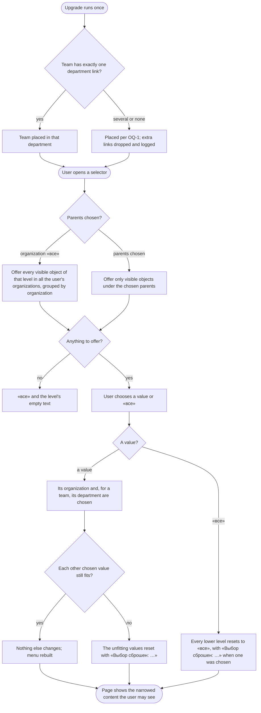

# Spec: Teams under departments, cascading context selectors, sight by participation (doc-016)

## Context and goal

After trying `mod-019-scoped-access` on the stand (2026-11-10) the human asked for a stricter hierarchy: a team stands inside one department and never at the organization level; the four header selectors (Организация / Департамент / Команда / Проект) cascade, each level offering what lies under the chosen parents and choosing a lower object choosing its parents; a project is created at the organization level or in a department; and a user sees only the organizations, departments, teams and projects they take part in or their access allows, in the selectors and in every list. Today a team is the organization's (feat-028), linked many-to-many to departments (mod-018, ADR-0031 rule 4) and to projects; the selectors order each other's offers and keep a group «Остальные» (feat-043, ADR-0032 § 5, D-7); every member sees every project, since visibility (`feat-041-project-visibility`) is not built. This analysis decides how the four requests fit that model, what each prior line and ADR must change, and the delivery lines. «Департамент» in the panel is the stored area of type `Department` (mod-018); departments do not nest (mod-018 OQ-3 A).

## Roles

Organization roles «Администратор», «Участник», «Читатель» (ADR-0027); scoped roles «Читатель», «Участник», «Менеджер» on a department, a project and a team (mod-019, ADR-0038). Team membership (being in a team's «Участники и доступ» list) is distinct from a team grant.

| Role | Sees (BR-TD-12..-15) | Creates a team in a department; moves a team | Creates a project at the top level / in a department |
|---|---|---|---|
| Organization «Администратор» | everything in the organization | yes / yes | yes / yes |
| Department «Менеджер» | its department and what it reaches | in its department (OQ-6 A) / between two departments it manages | no / in its department (ADR-0038) |
| Organization «Участник», «Читатель» with no grant | what they participate in (BR-TD-12) | no: 403 «Недостаточно прав» | no (OQ-7 A) / no |
| Not a member (an instance administrator included) | «Организация не найдена.» | - | - |

## Stories

| id | Title | depends-on | File |
|----|-------|------------|------|
| US-1 | A team stands in exactly one department | - | `stories/US-1-team-in-one-department.md` |
| US-2 | The upgrade places every existing team in a department | US-1 | `stories/US-2-upgrade-places-teams.md` |
| US-3 | Each selector offers what lies under the chosen parents | US-1, US-6 | `stories/US-3-selector-offers-cascade.md` |
| US-4 | Choosing a value chooses its parents and resets what no longer fits | US-3 | `stories/US-4-choice-selects-parents.md` |
| US-5 | A project is created at the organization level or in a department | - | `stories/US-5-project-creation-places.md` |
| US-6 | A user sees only what they take part in or their access allows | US-1 | `stories/US-6-sight-by-participation.md` |

A docs task: no story is delivered here; each is delivered by the line named in § Decomposition. Common cast in every story: organization «Ромашка» (Ann «Администратор»; Max, Olga «Участник»; Vera «Читатель»); departments «Логистика» and «Финансы»; teams MARS and VENUS in «Логистика», JUPITER in «Финансы»; projects A and B in «Логистика», C in «Финансы», D at the top level; project–team links MARS–A, MARS–B, MARS–C, VENUS–A, JUPITER–C, JUPITER–D; Olga is a member of VENUS. Organization «Другая» (Olga «Участник», Ann not a member): department «Склад», team ORION in it, project Z in «Склад» linked to ORION.

## Business process (BPMN)

## Business rules

| # | Rule | Source |
|---|------|--------|
| BR-TD-1 | **A team stands in one department.** Every team has exactly one department of its own organization as its place, chosen at creation and required; no team stands at the organization level. The team is not an area node: the tree keeps its three types, and «Структура» shows a department's teams beside its projects. A department may hold no team. | the human, 2026-11-10, point 1 |
| BR-TD-2 | **Department–team links retire.** The many-to-many department–team link of mod-018 (BR-AW-6) is replaced by the team's place: a department's «Команды» are the teams standing in it, and a team's page shows one «Департамент». No route links or unlinks a team and a department. | supersedes ADR-0031 rule 4 (team half), mod-018 BR-AW-6/-7 |
| BR-TD-3 | **Project–team links stay many-to-many** across departments and with top-level projects (OQ-2 A): MARS in «Логистика» may work on C in «Финансы» and on D. Their rules (feat-028 BR-OL-4..-9, mod-019 BR-SA-15) are unchanged. | ADR-0028 rule 1; OQ-2 |
| BR-TD-4 | **Moving a team** to another department of the same organization changes nothing else: its members, grants, links, owned items, sprints and order stay. Moving to the department it already stands in succeeds and changes nothing. A team of a department being deleted cannot be moved into it (one ends refused, no server error). | new |
| BR-TD-5 | **Deleting a department** is refused while a team or a project node stands in it: «Нельзя удалить департамент, в котором есть команды или проекты». | extends mod-018 BR-AW-9 |
| BR-TD-6 | **Where a project is created.** At the top level («Верхний уровень») or in a department, never in a sub-area, a project node or under a team. «Новый проект» is offered from the organization's «Проекты», a department's «Проекты» and the project selector's «Создать проект», with «Расположение» pre-set to the chosen department, or to «Верхний уровень» when the department selector is «все» and the caller may create there. Who may create where: ADR-0038 § 3 unchanged, at the top level per OQ-7. | the human, point 3; ADR-0038 |
| BR-TD-7 | **The selection.** Four levels, least specific first: organization, department, team, project; each is «все» or one object. **Invariant:** a chosen department is of the chosen organization; a chosen team stands in the chosen department; a chosen project is linked to the chosen team, and, with no team chosen, stands in the chosen department or is linked to one of its teams. When the organization is «все», nothing below is chosen. | the human, point 2; amends ADR-0032 § 5 |
| BR-TD-8 | **Offers cascade (OQ-3 A).** A selector offers only visible, active objects (BR-TD-12..-15) under the chosen levels above it, never a project node, a sub-area, a deactivated, deleted or foreign object: **department** — the chosen organization's departments, or, with organization «все», every department of every organization of the user, under a heading per organization; **team** — the teams of the chosen department, else of the chosen organization, else of all the user's organizations by heading, the user's own teams first; **project** — the chosen team's linked projects, else the projects standing in the chosen department plus those linked to its teams, else every project of the chosen organization, else of all the user's organizations by heading. Each list is by name; «все» is always first (feat-052). The group «Остальные» retires. | the human, point 2 |
| BR-TD-9 | **Choosing a value selects its parents.** Choosing a department, a team or a project chooses its organization; a team also chooses its department. A project chooses no team (it may have several); it keeps the chosen department when it fits it (BR-TD-7), else takes its own department, or «все» when it stands at the top level. Any chosen value the choice leaves unfitting resets to «все» with «Выбор сброшен: <вид> <название>.» (several joined by «, »). A choice that fits resets nothing and shows no notice. | the human, point 2 |
| BR-TD-10 | **Choosing «все».** At a level it resets every lower level to «все»: a lower choice never outlives its parent. Organization «все» is «Все организации» (ADR-0032 § 5), clearing all four. The notice names what was chosen below, none when nothing was. | BR-TD-7 |
| BR-TD-11 | **Empty offers.** A selector with nothing to offer shows «все» and, below it, «Нет доступных организаций», «Нет доступных департаментов», «Нет доступных команд» or «Нет доступных проектов»; a search with no match shows «Ничего не найдено» (unchanged). The lists «Проекты» and «Команды» narrowed by the selection show «Здесь нет проектов, доступных вам.» and «Здесь нет команд, доступных вам.». | the human, point 2 |
| BR-TD-12 | **Sight of a project (OQ-4 A).** A non-admin sees a project when (a) a grant reaches it (a project grant, or a department grant through its node, mod-019 BR-SA-5), (b) they are a member of a team linked to it, or (c) its «Видим всей организации» is on. Otherwise it does not exist for them (doc-012 BR-MX-21's non-disclosure, «Проект не найден»). The organization «Администратор» sees every project. | the human, point 4; replaces BR-MX-21's three values |
| BR-TD-13 | **Sight of a team.** A non-admin sees a team when they are its member, hold a grant on it or on its department, or see a project linked to it. | the human, point 4 |
| BR-TD-14 | **Sight of a department.** A non-admin sees a department when they hold a grant on it, or see a team or a project standing in it. Seeing a department shows only its visible children. | the human, point 4 |
| BR-TD-15 | **Sight of an organization.** Unchanged: an active membership (ADR-0027). The organization selector and «Организации» list only the user's active organizations. | ADR-0027 |
| BR-TD-16 | **Codes on what one sees.** On a project a non-admin sees, the codes are the organization role's bundle plus the reaching grants (ADR-0029 § 6 step 4 reads "on a visible project" for "on a «Организация» project"). Sight adds no code of its own; team membership still grants no code (BR-MX-26), it only makes the linked projects visible, where the organization role then applies. | amends ADR-0029 § 6 |
| BR-TD-17 | **One rule for selectors and lists.** Every surface that names or counts departments, teams or projects (the selectors, «Структура», «Проекты», «Команды», «Обзор», pickers, the multi-project views, search, counts) shows exactly the objects of BR-TD-12..-15, before paging, so a count or an «ещё» never reveals a hidden one. | ADR-0029 § 7 |

## Operation completeness

| Entity | Create | Read | Update | Delete/deactivate | Cancel/reverse |
|--------|--------|------|--------|-------------------|----------------|
| Team (in a department) | admin; department «Менеджер» in its department (OQ-6) — US-1 | BR-TD-13 | rename, describe, staff: as today (`team.write`) | as today (feat-028 BR-OL-9) | no: no restore (feat-028) |
| Team's department (place) | at creation, required (US-1) | whoever sees the team | move: admin, or «Менеджер» of both departments (BR-TD-4) | no: a team always has one | move back |
| Department–team link | no: retired (BR-TD-2) | no: retired | no | removed by the upgrade (US-2) | no |
| Department | as mod-018/mod-019 | BR-TD-14 | as mod-018 | only with no team and no project (BR-TD-5) | no: hard delete |
| Project place | at creation: top level or a department (US-5) | whoever sees the project | move: as mod-018/mod-019 | no: follows the project | move back |
| «Видим всей организации» | off at creation; set by the upgrade per OQ-5 | whoever sees the project | `organizations.visibility.write` (project «Менеджер», admin) | no: always has a value | switch back |
| Selection (four selectors) | by a choice, an address or the remembered value (ADR-0032 § 6) | the user, in the header | a choice; repaired by BR-TD-7 when links or sight change | «все»; «Все организации» | choose again |

## Non-functional requirements

- **Volumes:** with organization «все», a user of 10 organizations, each at doc-012's volumes (1 000 areas, 200 projects, 200 teams), gets each selector's offer within 2 s; typing narrows it within 2 s (feat-043 BR-NV-9). The offers' read takes a statement count that does not grow with organizations or objects; a statement-count test pins it.
- **Non-disclosure:** a hidden object is in no offer, list, count, heading or notice; its address answers like one that names nothing. A test per object kind holds a hidden one out of every surface of BR-TD-17.
- **Tenant:** a cross-organization offer never mixes objects: each value is opened in its own organization's address, and a choice never sets a department, team or project of one organization beside another organization.
- **Next request:** a grant, a team membership, a team move, a link or a «Видим всей организации» change is seen on the user's next request; an open selector that no longer fits is repaired with the notice.
- **Migration:** additive on top of merged migrations; the upgrade logs per organization how many teams it placed by each rule of US-2 and how many department–team links it dropped; the MR names them.
- **Accessibility:** the selectors keep feat-043's keyboard and 640 CSS px criteria.

## Out of scope

- Nested departments (mod-018 OQ-3 A stands). If nesting is ever allowed, the line that allows it decides whether a department's offers include its sub-departments' objects; this spec assumes one level.
- A team inside a project or a sub-area; a team in two departments; moving a team or a project to another organization.
- Restricting project–team links to one department (OQ-2 B is not chosen here); a team's members shown in a department's «Участники».
- The visibility of organizations to an instance administrator (feat-033's rescue stays as it is); a server-side remembered selection (ADR-0032 Revisit).
- The design of the selector popups beyond the copy quoted here: stage 3 (`design.md` and the HTML prototype).

## Changes to prior lines and ADRs

| Line / ADR | Change | Proposed wording |
|---|---|---|
| feat-028 (merged) | amend by the new ADR; a note in its `status.md` | "A team is the organization's" reads "a team stands in one department of the organization (doc-016 BR-TD-1)"; BR-OL-2's "creating a team creates no project" stands; BR-OL-3's name unique in the organization stands |
| mod-018 / ADR-0031 rule 4 | superseded in part by ADR-0040 | "Area–team links stay but join departments only" → "Area–team links are retired; a team's department is its place (ADR-0040 § 1)". BR-AW-6/-7 lose the team link; BR-AW-9 gains BR-TD-5 |
| mod-019 / ADR-0038, ADR-0029 §§ 4, 6 | amended by ADR-0040 | team creation decided by the place (`organizations.area.write` on the department, OQ-6 A), `organizations.team.create` struck like `project.create`; § 6 step 3 is BR-TD-12, step 4 "on a visible project" (BR-TD-16) |
| ADR-0032 § 5 (feat-043) | amended by ADR-0040 | "A selector hides no object … «Остальные»" → BR-TD-8..-11; § 1, § 2, § 6 stand |
| feat-041-project-visibility (queued, L) | reword, resize to M, split | «Project sight by participation (doc-016 BR-TD-12..-16): a non-admin sees a project through a reaching grant, a linked team's membership or its «Видим всей организации», set in the project's «Настройки»; the organization role applies on every visible project; the existing projects' value per doc-016 OQ-5; the answer order (BR-MX-24) with RetrofitAccessTests restated; the assignee picker offers those who see the project · size:M · deps:mod-019, mod-NNN-teams-in-departments». Its surfaces part moves to `feat-NNN-sight-on-every-surface` |
| feat-052-header-selectors-create-and-all-first (queued) | reword | «Header selectors: «Создать департамент / команду / проект» first, offered only with the code, its place pre-set from the selection (doc-016 BR-TD-6); then «все»; then the values, whatever the search · size:S · deps:feat-NNN-cascading-context-selectors» |
| feat-054-scoped-team-links-and-card-flag (queued) | reword | drop "the team place picker" (delivered by mod-NNN-teams-in-departments); keep the department «Менеджер»'s team links while creating a project, the per-card flag and the team's backlog rows · deps:mod-019, mod-NNN-teams-in-departments |
| feat-042, feat-050 (queued) | reword in the same sync | feat-042: "linked teams" → "its teams"; feat-050: "a team's link to a department" → "a team moved to another department" |
| doc-012 BR-MX-21, -27, -28 | marked by the delivery lines | BR-MX-21's three values become BR-TD-12; BR-MX-28 as feat-043 replaced it, then BR-TD-7..-11 |

## Decomposition for the backlog

Proposals for the human; the orchestrator queues them after gate-2. Priority in the order given.

| id | Task | size | deps |
|----|------|------|------|
| `mod-NNN-teams-in-departments` | US-1, US-2: a team's required department, creation in a department by the place's code (OQ-6), move, department deletion guard, department–team links retired, the upgrade (OQ-1), ADR-0040 accepted; panel: the team form's and page's «Департамент», a department's «Команды» | M | mod-019 |
| `feat-041-project-visibility` (reworded) | US-6 core: the sight rule of BR-TD-12..-16 in the evaluator's three forms, «Видим всей организации», the upgrade's value (OQ-5), the answer order, the assignee candidates | M | mod-019, mod-NNN-teams-in-departments |
| `feat-NNN-sight-on-every-surface` | US-6 surfaces: BR-TD-17 on the offers' read, «Структура», «Проекты», «Команды», «Обзор», pickers, multi-project views, search and counts; the sprint clauses owed to mod-007, feat-057, feat-058 | M | feat-041-project-visibility |
| `feat-NNN-cascading-context-selectors` | US-3, US-4 within one organization: BR-TD-7..-11, «Остальные» retired (OQ-3), the repair of remembered and address selections | M | mod-NNN-teams-in-departments, feat-NNN-sight-on-every-surface |
| `feat-NNN-cross-organization-selectors` | US-3, US-4 with organization «все»: offers across the user's organizations by heading, a choice opens the value's organization | S | feat-NNN-cascading-context-selectors |
| `feat-052-header-selectors-create-and-all-first` (reworded) | US-5 and BR-TD-6's entry points: «Создать…» first with the place pre-set, «все» first | S | feat-NNN-cascading-context-selectors |
| `feat-054-scoped-team-links-and-card-flag` (reworded) | as today, without the team place picker | M | mod-019, mod-NNN-teams-in-departments |

## Open questions

- [ ] **OQ-1 The upgrade: a team linked to several departments, or to none.** (A, recommended) Automatic: several → the department holding most of the team's linked projects, ties by name; none → the same rule over its projects; still none (no project in any department) → a department «Команды без департамента» created for that organization; every dropped link and created department logged and named in the MR. Downside: a guess the admin may have to undo by moving teams. (B) The upgrade fails before changing anything, naming each such team; the admin fixes the links with today's link/unlink and reruns (as mod-018 OQ-13 A). Downside: a failed deployment and manual work first. (C) Drop such teams (the feat-028 waiver): their items become «Без команды». Downside: memberships and grants lost.
- [ ] **OQ-2 Project–team links across departments.** (A, recommended) Keep them free (BR-TD-3): the cascade offers a department's projects plus its teams' projects, as the human worded it. Downside: the department selector may read «Логистика» while the chosen project C stands in «Финансы». (B) A team links only to projects of its own department and to top-level projects; the upgrade unlinks the rest, reassigning their items to «Без команды». Downside: cross-department teams (doc-012's matrix) are lost, items lose their team.
- [ ] **OQ-3 The group «Остальные».** (A, recommended) Retire it: lower levels offer only what is under their parents, and «все» on a parent widens them (BR-TD-8). Downside: jumping sideways takes one more click. (B) Keep it below the cascaded values. Downside: contradicts "relative to its parent"; two ways to the same choice.
- [ ] **OQ-4 What makes a project visible to a non-admin.** (A, recommended) A reaching grant, a linked team's membership, or «Видим всей организации» (BR-TD-12). Downside: a team link now discloses a project to the team's members (BR-MX-7 changes). (B) Grants only: team members see their team's projects only once granted. Downside: team boards look empty until an admin grants every member. (C) feat-041 as planned: three values, «Организация» by default. Downside: by default a member still sees everything, against point 4.
- [ ] **OQ-5 «Видим всей организации» of existing projects at the upgrade.** (A, recommended) Off: point 4 applies at once; the MR lists, per project, the members who stop seeing it. Downside: members without a grant or a team lose sight until granted. (B) On: nobody loses sight; the admin turns it off per project. Downside: the stand looks unchanged until each project is switched.
- [ ] **OQ-6 Who creates and runs the teams of a department.** (A, recommended) The place decides, as ADR-0038 did for projects: `organizations.area.write` on the department creates a team there, and the department «Менеджер» holds `team.write`, `.link`, `.grant` on its teams. Downside: widens every department «Менеджер» grant already given. (B) The organization «Администратор» only, as today. Downside: a department manager cannot staff their own department.
- [ ] **OQ-7 Who creates a project at the top level.** (A, recommended) The organization «Администратор» only (`organizations.area.create`, unchanged). Downside: a member must ask an admin for an organization-wide project. (B) Also every organization «Участник». Downside: anyone can add top-level projects; the top level grows unmanaged.

<!-- Requirements-review findings live in review.md, gate transcripts in history.md. -->
