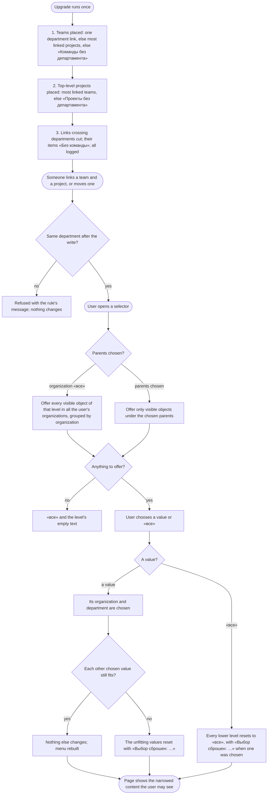

# Spec: Teams and projects under departments, cascading context selectors, sight by participation (doc-016)

## Context and goal

After trying `mod-019-scoped-access` on the stand (2026-11-10) the human asked for a stricter hierarchy, and at gate-1 (2026-11-12) made it a strict tree: **Organization → Department → {Teams, Projects}**. A team stands in one department; every project stands in one department (OQ-8: there are no organization-level projects, which replaces point 3 of the request, "a project can be created at the organization level"); a team links only to projects of its own department (OQ-2 B). The four header selectors (Организация / Департамент / Команда / Проект) cascade, each level offering what lies under the chosen parents and a lower choice choosing its parents; and a user sees only the organizations, departments, teams and projects they take part in or their access allows, in the selectors and every list. Today a team is the organization's (feat-028), linked many-to-many to departments (mod-018, ADR-0031 rule 4) and to any project of the organization; a project may stand at the top level (ADR-0031 rule 2, ADR-0038 § 3); the selectors keep a group «Остальные» (feat-043, ADR-0032 § 5); every member sees every project, since `feat-041-project-visibility` is not built. This analysis decides the target model, the upgrade of existing data, what each prior line and ADR must change, and the delivery lines. «Департамент» in the panel is the stored area of type `Department` (mod-018); departments do not nest (mod-018 OQ-3 A).

## Roles

Organization roles «Администратор», «Участник», «Читатель» (ADR-0027); scoped roles «Читатель», «Участник», «Менеджер» on a department, a project and a team (mod-019, ADR-0038). Team membership (being in a team's «Участники и доступ» list) is distinct from a team grant.

| Role | Sees (BR-TD-12..-15) | Creates a team in a department; moves a team | Creates a project in a department; moves a project |
|---|---|---|---|
| Organization «Администратор» | everything in the organization | yes / yes | yes / yes |
| Department «Менеджер» | its department and what it reaches | in its department (OQ-6 A) / between two departments it manages | in its department (ADR-0038 § 3) / between two departments it manages (mod-018) |
| Organization «Участник», «Читатель» with no grant | what they participate in (BR-TD-12) | no: 403 «Недостаточно прав» | no: 403 «Недостаточно прав» |
| Not a member (an instance administrator included) | «Организация не найдена.» | - | - |

## Stories

| id | Title | depends-on | File |
|----|-------|------------|------|
| US-1 | A team stands in exactly one department | - | `stories/US-1-team-in-one-department.md` |
| US-2 | The upgrade places every team and project in a department | US-1, US-5 | `stories/US-2-upgrade-places-teams.md` |
| US-3 | Each selector offers what lies under the chosen parents | US-1, US-6 | `stories/US-3-selector-offers-cascade.md` |
| US-4 | Choosing a value chooses its parents and resets what no longer fits | US-3 | `stories/US-4-choice-selects-parents.md` |
| US-5 | A project stands in a department and links only its department's teams | US-1 | `stories/US-5-project-creation-places.md` |
| US-6 | A user sees only what they take part in or their access allows | US-1 | `stories/US-6-sight-by-participation.md` |

A docs task: no story is delivered here; each is delivered by the line named in § Decomposition. Common cast in every story: organization «Ромашка» (Ann «Администратор»; Max, Olga «Участник»; Vera «Читатель»); departments «Логистика» and «Финансы»; teams MARS and VENUS in «Логистика», JUPITER in «Финансы»; projects A and B in «Логистика», C and D in «Финансы»; project–team links MARS–A, MARS–B, VENUS–A, JUPITER–C, JUPITER–D; Olga is a member of VENUS. Organization «Другая» (Olga «Участник», Ann not a member): department «Склад», team ORION in it, project Z in «Склад» linked to ORION.

## Business process (BPMN)

## Business rules

| # | Rule | Source |
|---|------|--------|
| BR-TD-1 | **A team stands in one department.** Every active team has exactly one department of its own organization as its place, chosen at creation and required; no team stands at the organization level. A deleted team keeps no department: deleting a team clears it, and the upgrade gives a deleted one none. The team is not an area node: the tree keeps its three types, and «Структура» shows a department's teams beside its projects. A department may hold no team. | the human, 2026-11-10, point 1 |
| BR-TD-2 | **Department–team links retire.** The many-to-many department–team link of mod-018 (BR-AW-6) is replaced by the team's place: a department's «Команды» are the teams standing in it, and a team's page shows one «Департамент». No route links or unlinks a team and a department. | supersedes ADR-0031 rule 4 (team half), mod-018 BR-AW-6/-7 |
| BR-TD-3 | **Links stay inside one department (OQ-2 B).** A project–team link joins a team and a project standing in the same department; otherwise the link is refused, 409 `organizations.team.other_department` «Команду можно связать только с проектом своего департамента.», and nothing changes. Link pickers offer only the other end's department's objects. Within that, feat-028 BR-OL-4..-9 and mod-019 BR-SA-15 stand, but for one point: a link still gives no code, yet under OQ-4 A it makes the project visible to the team's members (BR-TD-12), so BR-SA-15's "no access" and BR-SA-5's "no link, team or shared project passes a grant" read "no code". A link against a move of either end ends in one order: the link refused, or the move refused (BR-TD-4). | the human, gate-1 OQ-2 B; ADR-0028 rule 1 |
| BR-TD-4 | **Moving a team or a project (OQ-9 A).** A team moves to another department of its organization only while it is linked to no project: otherwise 409 `organizations.team.has_links` «Команда связана с проектами. Отключите её от них перед перемещением.» A project moves to another department only while no team is linked to it: otherwise 409 `organizations.area.project_has_teams` «Проект связан с командами. Отключите их перед перемещением.» Unlinking first is feat-028 BR-OL-8, with its destination dialog. A move changes nothing else: members, grants, sprints and order stay. Moving to the department it already stands in succeeds and changes nothing. No project moves to the top level: 409 `organizations.area.project_needs_department` «Проект должен находиться в департаменте.» A move against the destination's deletion ends in one order, no server error. | new; mod-018 BR-AW moves |
| BR-TD-5 | **Deleting a department** is refused while an active team stands in it: 409 `organizations.area.has_teams` «Нельзя удалить департамент, в котором есть команды» (a new code). One holding a project keeps today's `organizations.area.not_empty` and its text; when both hold, the team answer comes first. A deleted team never blocks it (BR-TD-1). | extends mod-018 BR-AW-9 |
| BR-TD-6 | **A project is created in a department only (OQ-8).** Never at the top level, in a sub-area, a project node or under a team; «Верхний уровень» leaves «Расположение» and the move dialog. A request naming no department is refused, 400 «Выберите департамент», and creates nothing. «Новый проект» is offered from the organization's «Проекты», a department's «Проекты» and the project selector's «Создать проект», «Расположение» pre-set to the chosen department, or, with the department «все», to the one department the caller may create in when there is exactly one, else empty. Who creates: ADR-0038 § 3's place rule, `organizations.area.write` on the department (its «Менеджер», the administrator). Under organization «все» the «Создать…» entries use the one organization the user may create in; with several they are disabled with «Выберите организацию», with none absent (decided by the human at gate-2). | the human, gate-1 OQ-8 (replaces point 3); ADR-0038 § 3 |
| BR-TD-7 | **The selection.** Four levels, least specific first: organization, department, team, project; each is «все» or one object. **Invariant:** a chosen department is of the chosen organization; a chosen team and a chosen project stand in the chosen department; a chosen project is linked to the chosen team when both are chosen. When the organization is «все», nothing below is chosen. | the human, point 2; amends ADR-0032 § 5 |
| BR-TD-8 | **Offers cascade (OQ-3 A).** A selector offers only visible, active objects (BR-TD-12..-15) under the chosen levels above it, never a project node, a sub-area, a deactivated, deleted or foreign object: **department** — the chosen organization's departments, or, with organization «все», every department of every organization of the user, under a heading per organization; **team** — the chosen department's teams, else the chosen organization's, else all the user's organizations' by heading, the user's own teams first (feat-043's «Мои команды» and «Другие команды», within each organization's heading); **project** — the chosen team's linked projects, else the chosen department's projects, else the chosen organization's, else all the user's organizations' by heading. A department's teams' projects are a subset of its projects (BR-TD-3), so nothing else is added. Each list is by name; «все» is always first (feat-052). The group «Остальные» retires. | the human, point 2 |
| BR-TD-9 | **Choosing a value selects its parents.** Choosing a department, a team or a project chooses its organization; a team or a project also chooses its own department. A project chooses no team (it may have several): a project's parent is its department, a team is linked to it, not above it, and choosing one would also narrow the project to that team's items (ADR-0032 § 5). Any chosen value the choice leaves unfitting resets to «все» with «Выбор сброшен: <вид> <название>.» (several joined by «, »). A choice that fits resets nothing and shows no notice. A department replaced by the value's own is not a reset and is not named. | the human, point 2 |
| BR-TD-10 | **Choosing «все».** Department «все» resets the team and the project to «все». Team «все» and project «все» reset nothing: a chosen project stands in the chosen department, so it still fits (BR-TD-7, BR-TD-9; decided by the human at gate-2, 2026-11-12). Organization «все» is «Все организации» (ADR-0032 § 5), clearing all four. The notice names the values reset, none when nothing was. | BR-TD-7 |
| BR-TD-11 | **Empty offers.** A selector with nothing to offer shows «все» and, below it, «Нет доступных организаций», «Нет доступных департаментов», «Нет доступных команд» or «Нет доступных проектов»; a search with no match shows «Ничего не найдено» (unchanged). The lists «Проекты» and «Команды» narrowed by the selection show «Здесь нет проектов, доступных вам.» and «Здесь нет команд, доступных вам.». | the human, point 2 |
| BR-TD-12 | **Sight of a project (OQ-4 A).** A non-admin sees a project when (a) a grant reaches it (a project grant, or a department grant through its node, mod-019 BR-SA-5), (b) they are a member of a team linked to it, or (c) its «Видим всей организации» is on. Otherwise it does not exist for them (doc-012 BR-MX-21's non-disclosure, «Проект не найден»). The organization «Администратор» sees every project. | the human, point 4; replaces BR-MX-21's three values |
| BR-TD-13 | **Sight of a team.** A non-admin sees a team when they are its member, hold a grant on it or on its department, or see a project linked to it. Otherwise it does not exist for them: its address, or a `teamId` naming it, answers «Команда не найдена.» (ADR-0029 § 8 item 4, before any 403), and the organization role's team-scope codes apply only on a team they see. | the human, point 4 |
| BR-TD-14 | **Sight of a department.** A non-admin sees a department when they hold a grant on it, or see a team or a project standing in it. Seeing a department shows only its visible children. Otherwise its address, or a `departmentId` naming it, answers «Область не найдена.» as for a missing one. A project node and its sub-areas are visible exactly when their project is. | the human, point 4 |
| BR-TD-15 | **Sight of an organization.** Unchanged: an active membership (ADR-0027). The organization selector and «Организации» list only the user's active organizations. | ADR-0027 |
| BR-TD-16 | **Codes on what one sees.** On a project a non-admin sees, the codes are the organization role's bundle plus the reaching grants (ADR-0029 § 6 step 4 reads "on a visible project" for "on a «Организация» project"). Sight adds no code of its own; team membership still grants no code (BR-MX-26), it only makes the linked projects visible, where the organization role then applies. | amends ADR-0029 § 6 |
| BR-TD-17 | **One rule for selectors and lists.** Every surface that names or counts departments, teams or projects (the selectors, «Структура», «Проекты», «Команды», «Обзор», pickers, the multi-project views, search, counts) shows exactly the objects of BR-TD-12..-15, before paging, so a count or an «ещё» never reveals a hidden one. | ADR-0029 § 7 |
| BR-TD-18 | **Repair of a selection.** When a selection is read against changed offers (a remembered selection, ADR-0032 § 6; a move, a link, a membership or a sight change seen while the panel is open), a chosen team, else a chosen project, first gives the department its own; then, least specific first, each lower chosen value that is gone, hidden or no longer fits resets to «все». The notice is the occasion's: for a remembered selection, ADR-0032 § 6's «Ранее выбранный контекст недоступен. Выбрано: …», whenever the repair changed anything, a replaced department included; for a change seen while open, «Выбор сброшен: …», naming only the values reset to «все» (a replaced department alone shows no notice). | BR-TD-7; replaces the reset direction of ADR-0032 §§ 5-6 |
| BR-TD-19 | **The upgrade (OQ-1 A, OQ-2 B, OQ-8), in this order, once.** (1) Teams: an active team with one department link takes it; else the department holding most of its linked projects, active or deactivated, ties by department name; else, with several links, the first of them by name; else a department «Команды без департамента» of its organization (reused when one exists). (2) Projects: each top-level project, active or deactivated, moves into the department holding most of its linked teams as step 1 placed them, ties by department name; with no linked team, into «Проекты без департамента» (reused when one exists). No name can clash: project names are unique in the organization (mod-002 BR-M1-1) and no project stays at the top level. (3) Links: every project–team link whose ends now stand in different departments is cut as feat-028 BR-OL-8 unlinks with «Без команды» as the destination, the team's items there in any state (mod-005 counts a deleted item as owned) losing their owner, backlog place and sprint pointer, the project's default team cleared if it named the team; as feat-028 BR-OL-13 did, no item's «Изменён» moves and no history entry is written (no actor). Dropped department–team links, created departments, placements per rule, cut links and items made «Без команды» are logged per organization and named in the MR. | the human, gate-1 |
| BR-TD-20 | **A department has a colour, stored and automatic.** Every department gets a colour when it is created, stored with it and returned by the API; nobody chooses it, and editing it is out of scope of this cut. The colour is one of a fixed palette of 12, in this order (the key is stored, the hex is the panel's): blue #0078D4, orange #D8661B, green #2E8B57, purple #8E4EC6, red #D13438, teal #00A3A3, amber #B8860B, pink #D6458F, indigo #4F52B2, lime #7A9B1E, magenta #B146C2, cyan #0A8FBF; hues read on the light and the dark theme, the panel draws the stripe and dot in the colour and its tint at low opacity. Choice, in the department's organization among its active departments: with none, the first palette entry; while an unused entry remains, the unused one whose smallest hue-circle distance (degrees on the 360° hue circle, palette hues 206, 24, 146, 272, 359, 180, 43, 330, 238, 76, 300, 195) to the colours in use is largest, ties by palette order; when every entry is in use, the entry used by fewest active departments, ties by palette order. A deleted department frees its colour; a colour never changes after assignment. Deterministic: the same departments in the same order of creation always get the same colours. The upgrade gives the existing departments their colours in order of creation (ties by name), per organization, then the departments it creates (BR-TD-19). | the human, gate-2 feedback, 2026-11-12 |
$
## Operation completeness

| Entity | Create | Read | Update | Delete/deactivate | Cancel/reverse |
|--------|--------|------|--------|-------------------|----------------|
| Team (in a department) | admin; department «Менеджер» in its department (OQ-6 A) — US-1 | BR-TD-13 | rename, describe, staff: as today (`team.write`) | as today (feat-028 BR-OL-9) | no: no restore (feat-028) |
| Team's department (place) | at creation, required (US-1) | whoever sees the team | move: admin, or «Менеджер» of both departments, only while unlinked (BR-TD-4) | no: a team always has one | move back |
| Department–team link | no: retired (BR-TD-2) | no: retired | no | removed by the upgrade (US-2) | no |
| Project–team link | as feat-028 BR-OL-5, same department only (BR-TD-3) — US-5 | as feat-028 | no: nothing to edit | as feat-028 BR-OL-8; cut by the upgrade when crossing (BR-TD-19) | link again; reassigned items stay |
| Department | as mod-018/mod-019 | BR-TD-14 | as mod-018 | only with no team and no project (BR-TD-5) | no: hard delete |
| Project's department (place) | at creation, required, a department only (BR-TD-6) | whoever sees the project | move between departments: as mod-018/mod-019, only with no linked team (BR-TD-4); never to the top level | no: follows the project | move back |
| «Видим всей организации» | off at creation; off for existing projects at the upgrade (OQ-5 A) | whoever sees the project | `organizations.visibility.write` (project «Менеджер», a department «Менеджер» by inheritance, admin; decided at gate-2) | no: always has a value | switch back |
| Department's colour | at creation, automatic (BR-TD-20); at the upgrade for every department | whoever sees the department | no: not editable in this cut | goes with the department | no |
| Selection (four selectors) | by a choice, an address or the remembered value (ADR-0032 § 6) | the user, in the header | a choice; repaired by BR-TD-18 when places, links or sight change | «все»; «Все организации» | choose again |

## Non-functional requirements

- **Volumes:** with organization «все», a user of 10 organizations, each at doc-012's volumes (1 000 areas, 200 projects, 200 teams), gets each selector's offer within 2 s; typing narrows it within 2 s (feat-043 BR-NV-9). The offers' read takes a statement count that does not grow with organizations or objects; a statement-count test pins it.
- **Non-disclosure:** a hidden object is in no offer, list, count, heading or notice; its address answers like one that names nothing. A test per object kind holds a hidden one out of every surface of BR-TD-17.
- **Tenant:** a cross-organization offer never mixes objects: each value is opened in its own organization's address, and a choice never sets a department, team or project of one organization beside another organization.
- **Next request:** a grant, a team membership, a move, a link or a «Видим всей организации» change is seen on the user's next request; an open selector that no longer fits is repaired with the notice.
- **Migration:** additive on top of merged migrations; the cut of step 3 over up to 5 000 items per organization completes all or nothing (feat-028 NFR); the log of BR-TD-19 is complete enough for the MR to name every created department, placed project and cut link.
- **Accessibility:** the selectors keep feat-043's keyboard and 640 CSS px criteria.

## Out of scope

- Nested departments (mod-018 OQ-3 A stands). If nesting is ever allowed, the line that allows it decides what a department's offers include; this spec assumes one level.
- Editing a department's colour, or choosing it by hand (BR-TD-20).
- Projects at the organization level; a team inside a project or a sub-area; a team or a project in two departments; a team linked to another department's project; moving a team or a project to another organization.
- A move that cuts its links by itself (OQ-9 B, not chosen); a team's members shown in a department's «Участники».
- The visibility of organizations to an instance administrator (feat-033's rescue stays as it is); a server-side remembered selection (ADR-0032 Revisit).
- The design of the selector popups beyond the copy quoted here: stage 3 (`design.md` and the HTML prototype).

## Changes to prior lines and ADRs

| Line / ADR | Change | Proposed wording |
|---|---|---|
| feat-028 (merged) | amend by ADR-0040; a note in its `status.md` | "A team is the organization's" reads "a team stands in one department (doc-016 BR-TD-1)"; BR-OL-4's "both ends … in one organization" reads "in one department (BR-TD-3)"; BR-OL-2, BR-OL-3 (name unique in the organization), BR-OL-8, -9 stand |
| ADR-0028 rule 1; doc-012 BR-MX-5 | superseded in part by ADR-0040 | the cross-department matrix narrows: project–team links join one department's objects; area–team links retire |
| mod-018 / ADR-0031 rules 2, 4 | superseded in part by ADR-0040 | rule 2's "under a department or at the top level" → "under a department"; the project node's move "to the top" retires. Rule 4 "Area–team links stay but join departments only" → "retired; a team's department is its place". BR-AW-6/-7 lose the team link; BR-AW-9 gains BR-TD-5 |
| mod-018 (merged) | extended by BR-TD-20, additively | a department gains a stored colour column, set at creation by the palette rule; no mod-018 rule changes |
| mod-019 / ADR-0038 §§ 1, 3, ADR-0029 §§ 4, 6 | amended / superseded in part by ADR-0040 | § 3: "and at the top level by `organizations.area.create`" struck: a project is created in a department only. § 1: team creation by `organizations.area.write` on the department (OQ-6 A), `organizations.team.create` struck like `project.create`. ADR-0029 § 6 step 3 is BR-TD-12, step 4 "on a visible project" (BR-TD-16) |
| ADR-0032 § 5 (feat-043) | amended by ADR-0040 | "A selector hides no object … «Остальные»" → BR-TD-8..-11; §§ 1, 2, 6 stand |
| feat-048-aggregate-level-views (merged) | unchanged (OQ-8) | a department's views span the projects placed in it, which is now exactly its cascade (BR-TD-8) |
| feat-049-structure-diagram-view (merged) | changed by `mod-NNN-teams-in-departments` | the department–team edges become "a team drawn inside its department"; no project is drawn at the top level once `mod-NNN-projects-in-departments` lands |
| feat-041-project-visibility (queued, L) | reword, resize to M, split | «Project sight by participation (doc-016 BR-TD-12..-16): a non-admin sees a project through a reaching grant, a linked team's membership or its «Видим всей организации», set in the project's «Настройки»; the organization role applies on every visible project; existing projects off (doc-016 OQ-5 A); the answer order (BR-MX-24) with RetrofitAccessTests restated; the assignee picker offers those who see the project · size:M · deps:mod-019, mod-NNN-teams-in-departments». Its surfaces go to `feat-NNN-sight-in-structure-lists` and `feat-NNN-sight-in-work-views` |
| feat-052-header-selectors-create-and-all-first (queued) | reword | «Header selectors: «Создать департамент / команду / проект» first, offered only with the code, its department pre-set from the selection (doc-016 BR-TD-6); then «все»; then the values, whatever the search · size:S · deps:feat-NNN-cascading-context-selectors» |
| feat-054-scoped-team-links-and-card-flag (queued) | reword | drop "the team place picker" (delivered by `mod-NNN-teams-in-departments`); keep the department «Менеджер»'s team links while creating a project, offering the department's teams only (BR-TD-3), the per-card flag and the team's backlog rows · deps:mod-019, mod-NNN-projects-in-departments |
| feat-042, feat-050 (queued) | reword in the same sync | feat-042: "linked teams" → "its teams"; feat-050: "a team's link to a department" → "a team moved to another department" |
| doc-012 BR-MX-21, -27, -28 | marked by the delivery lines | BR-MX-21's three values become BR-TD-12; BR-MX-28 as feat-043 replaced it, then BR-TD-7..-11 |
| Lines citing "after project visibility" / doc-012 BR-MX-21 (mod-008, mod-012, mod-013, feat-013, feat-044, feat-057, feat-058) | reworded in the same queue sync | "project visibility" reads "sight (doc-016 BR-TD-12..-17)"; no other change |

## Decomposition for the backlog

Proposals for the human; the orchestrator queues them after gate-2. Priority in the order given.

| id | Task | size | deps |
|----|------|------|------|
| `mod-NNN-teams-in-departments` | US-1 (but OQ-6's codes), US-2 step 1: an active team's required department, creation in a department under today's `organizations.team.create` (the administrator) with the place checked, the move with BR-TD-4's team refusal, the deletion guard (`organizations.area.has_teams`), department–team links retired, BR-TD-19 step 1, ADR-0040 accepted; panel: the team form's and page's «Департамент», a department's «Команды», the feat-049 diagram's team placement, the selectors' fit stops reading department–team links; BR-TD-20: the stored automatic colour of a department, given at creation and by the upgrade to every existing department, the two fallback ones included | M | mod-019 |
| `mod-NNN-projects-in-departments` | US-5, US-2 steps 2-3: «Верхний уровень» retired from creation and move (BR-TD-6, `project_needs_department`), the project move's refusal while linked, the link rule (`organizations.team.other_department`, pickers by department), BR-TD-19 steps 2-3 with their log | M | mod-NNN-teams-in-departments |
| `mod-NNN-department-managers-run-teams` | US-1's department «Менеджер» scenarios (OQ-6 A): `organizations.team.create` struck, creation by `organizations.area.write` on the place, the department «Менеджер»'s `team.write`, `.link`, `.grant` on its teams decided on the locked team row; the generated matrix, the bundle contract | S | mod-NNN-teams-in-departments |
| `feat-041-project-visibility` (reworded) | US-6 core: the sight rule of BR-TD-12..-16 in the evaluator's three forms, with the team and department gates (BR-TD-13, -14), «Видим всей организации», the upgrade's value (OQ-5 A), the answer order, the assignee candidates | M | mod-019, mod-NNN-teams-in-departments |
| `feat-NNN-sight-in-structure-lists` | US-6 surfaces, part 1: BR-TD-17 on the selector offers' read, «Структура» (tree and diagram), «Проекты», «Команды», «Обзор» and the pickers | M | feat-041-project-visibility |
| `feat-NNN-sight-in-work-views` | US-6 surfaces, part 2: BR-TD-17 on feat-048's multi-project item views, search and counts; the sprint clauses owed to mod-007, feat-057, feat-058 | M | feat-041-project-visibility |
| `feat-NNN-cascading-context-selectors` | US-3, US-4 within one organization: BR-TD-7..-11 and -18, «Остальные» retired (OQ-3 A), the repair of remembered selections | M | mod-NNN-projects-in-departments, feat-NNN-sight-in-structure-lists |
| `feat-NNN-cross-organization-selectors` | US-3, US-4 with organization «все»: a caller-scoped offers route outside the organization prefix (its own inventory entry; each organization's sight set applied; statement count not growing with organizations), offers by heading, a choice opens the value's organization | S | feat-NNN-cascading-context-selectors |
| `feat-052-header-selectors-create-and-all-first` (reworded) | BR-TD-6's selector entry point: «Создать…» first with the department pre-set, «все» first | S | feat-NNN-cascading-context-selectors |
| `feat-054-scoped-team-links-and-card-flag` (reworded) | as today, without the team place picker, team links offered within the department | M | mod-019, mod-NNN-projects-in-departments |

## Open questions

- [x] **OQ-1 The upgrade: a team linked to several departments, or to none.** Answered by the human, 2026-11-12: **A**, automatic placement with «Команды без департамента» as the fallback (BR-TD-19 step 1).
- [x] **OQ-2 Project–team links across departments.** Answered by the human, 2026-11-12: **B**, a team links only to projects of its own department; with no top-level projects (OQ-8), strictly within one department; the upgrade cuts the rest (BR-TD-3, BR-TD-19 step 3).
- [x] **OQ-3 The group «Остальные».** Answered by the human, 2026-11-12: **A**, retired.
- [x] **OQ-4 What makes a project visible to a non-admin.** Answered by the human, 2026-11-12: **A**, a reaching grant, a linked team's membership, or «Видим всей организации».
- [x] **OQ-5 «Видим всей организации» of existing projects at the upgrade.** Answered by the human, 2026-11-12: **A**, off.
- [x] **OQ-6 Who creates and runs the teams of a department.** Answered by the human, 2026-11-12: **A**, the place decides; the department «Менеджер» runs its teams.
- [x] **OQ-7 Who creates a project at the top level.** Moot (2026-11-12): no project stands at the top level (OQ-8).
- [x] **OQ-8 Where projects stand.** Answered by the human, 2026-11-12: every project stands in a department; no organization-level projects; feat-048 unchanged. Top-level projects are upgraded per BR-TD-19 step 2 (the recommended option, chosen).
- [x] **OQ-9 Moving a team or a project that has links.** Answered by the human, 2026-11-12: **A**, refuse the move while links exist. Under BR-TD-3 a move would leave links crossing departments. (A, recommended) Refuse the move while the team (or the project) has any link: the actor unlinks first through feat-028's dialog, which asks where the items go, then moves (BR-TD-4). Downside: moving a working team takes one unlink per project, and its items lose their team. (B) The move cuts every link it would leave crossing, after a confirmation counting per project the items going to «Без команды». Downside: one click silently reassigns many items; a second path that reassigns items, with its own concurrency and counts to test. (C) Moving a team also moves its linked projects. Downside: a project linked to other teams of the old department drags them or cuts them; cascades hard to predict.

<!-- Requirements-review findings live in review.md, gate transcripts in history.md. -->
