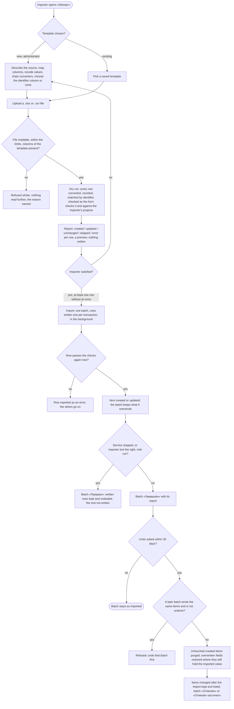

# Spec: Import/export constructor for work items (doc-017)

## Context and goal

Teams keep work in spreadsheets and in other trackers' exports and move it into MUSTASK. The human asked (2026-11-10) for an import/export from .xlsx and .csv with a constructor whose core is the field mapping and the conversion of values, and for a list of what else the team's planning workbook (the «DevEx sheet», [input-brief.md](input-brief.md)) needs. The constructor is generic: §§ Business rules and Converter catalogue never name one file's columns; § DevEx transfer assembles a template for that sheet from the generic pieces, and § Other sources checks the catalogue on two more shapes. This spec supersedes doc-005 US-4 and BR-M6-8 (`feat-005-csv-import-export`) wherever they differ. ADR-0039 (the import batch) is drafted beside it and goes to the human at gate-1.

## Roles

Access is derived from membership (ADR-0027), computed by ADR-0029's one policy, with ADR-0038's role names. "A project the user manages" is one where the user holds the project role «Менеджер», or a department role «Менеджер» that reaches the project (ADR-0038). ADR-0039 proposes the codes.

| Capability | Who | Why |
|---|---|---|
| Create, edit, copy, delete a template | the organization «Администратор»: every template; a «Менеджер» of any project or department: creates and copies templates, and edits and deletes the ones they authored (OQ-12 B) | importers prepare their own files without waiting for the administrator; another manager's template is run, not changed |
| Read a template's settings | the organization «Администратор», and every user who may import (below) | a dry run's result is read against them |
| List the templates, see each one's name and export columns | every organization member, «Читатель» included | export uses them (BR-IE-19) |
| Dry run and import | the organization «Администратор» into any project; a «Менеджер» into the projects they manage (OQ-1 B) | a row aimed at a project the importer may not import into is that row's error (BR-IE-12) |
| Read the batch list and reports; undo a batch | the organization «Администратор»: every batch; a «Менеджер»: the batches they started, while they still manage every project the batch wrote into | one undo reaches every item of the batch |
| Each row's write | also needs `workitems.workitem.write` on the row's project | the row goes through the form's own checks (BR-IE-12) |
| Export by a template | every member who reads items | only items the user may read are exported (BR-IE-19) |
| Add, remove external links; edit participants | whoever may change the item | as any other field of the item |

## Stories

| id | Title | depends-on | File |
|----|-------|------------|------|
| US-1 | An importer describes the source and maps columns to fields | - | `stories/US-1-source-and-column-mapping.md` |
| US-2 | An importer recodes file values into MUSTASK values | US-1 | `stories/US-2-value-recoding.md` |
| US-3 | An importer converts a column's values by a chain of converters | US-1 | `stories/US-3-converter-chains.md` |
| US-4 | A dry run shows what each row would do, writing nothing | US-1, US-2, US-3 | `stories/US-4-dry-run.md` |
| US-5 | An import creates items, and updates them by the MUSTASK identifier, into a batch | US-4 | `stories/US-5-import-run.md` |
| US-6 | An importer undoes an import batch | US-5 | `stories/US-6-undo-batch.md` |
| US-7 | Templates are saved per organization, edited, copied and deleted | US-1 | `stories/US-7-saved-templates.md` |
| US-8 | A member exports items by a template | US-7 | `stories/US-8-export-by-template.md` |
| US-9 | A work item carries external links | - | `stories/US-9-external-links.md` |
| US-10 | A work item has participants besides its assignee | - | `stories/US-10-work-item-participants.md` |

Every story is `shippable: no`: this is an analysis task, and each story specifies the delivery lines § Decomposition maps to it. A clause that needs a later line (tags, comments, participants) is marked "owed by" that line: of that line and the line delivering the clause's import side, the one that merges second adds the field to the mapping catalogue, to undo (BR-IE-16, -17) or to export, and runs the clause. "Importer" is whoever § Roles lets import.

## Business process (BPMN)

## Business rules

| # | Rule | Source |
|---|------|--------|
| BR-IE-1 | **Scope.** An import writes work items of one organization. Each row lands in exactly one project, given by a constant or a recoded column (BR-IE-7); one file may reach many projects. Nothing outside the organization is read or written. Supersedes BR-M6-1's one-project import, BR-M6-8, and BR-M6-12's last sentence (a query's export follows a template: feat-005 as reworded). | outline 2; doc-005 |
| BR-IE-2 | **Formats.** The source is a .xlsx workbook or a .csv file; .xls, .xlsm and anything else are refused («Поддерживаются файлы .xlsx и .csv.»). An online spreadsheet comes in through its .xlsx or .csv download. A .csv is UTF-8 (with or without a BOM) or Windows-1251, and its delimiter «;», «,» or a tab: both detected and changeable in the template. Quoted fields follow RFC 4180, line breaks inside quotes included. | outline 1; BR-M6-8 |
| BR-IE-3 | **Reading a workbook.** The template names the sheet, the header row (1–50) and the first data row (after the header row). A cell gives its typed value: text, number, date, or the last value a formula computed; formulas are never evaluated, macros never run. A merged cell gives its value to its top-left position only. A cell's hyperlink stays available to «URL из гиперссылки». A row whose mapped cells are all empty is skipped and counted. A .csv has one sheet, every value is text, and the header and first data rows apply as for a workbook. | outline 1 |
| BR-IE-4 | **Mapping.** A column is matched by its header text, ignoring letter case and surrounding spaces, never by position. A new template proposes, per column, the field whose Russian name or code equals the header, else «Не переносить». A column may feed several fields, each with its own chain and recoding; a field takes at most one source: a column, a «Константа» or an «Объединить» pattern (both ignore the cell). Project, type and title must have a source before the template is saved («Укажите столбец или константу.»). A later file lacking a mapped column is refused whole, the missing headers named; extra columns are ignored, except BR-IE-10's «Идентификатор». | outline 3 |
| BR-IE-5 | **Fields offered.** Project, type, title, description, state, assignee, priority, owning team, every field of feat-022's table on the types that carry it, the MUSTASK identifier (BR-IE-10), the parent by a MUSTASK identifier (OQ-13 A) and external links (BR-IE-24); tags, the first comment and participants once their lines merge, each later field added by its line. Per mapping, a filled cell whose row's type lacks the field is the row's error (`field_not_on_type`, feat-022 BR-M3-30; the default) or is dropped with a row warning («Не переносить для типов без поля»). | feat-022; gap lines |
| BR-IE-6 | **Empty cells.** Per mapping, an empty cell (after its chain) means «Не менять» (default) or «Очистить». On create both mean "not set": the field takes its creation default (BR-M3-37). «Очистить» on an always-set field (Приоритет, Серьёзность, Вид ценности) stores its default, as the form does (BR-M3-31). | outline 6; feat-022 |
| BR-IE-7 | **Recoding** (the lookup for dictionary fields). Type, state, priority, project, assignee, owning team, participants and any list field get a table: each distinct file value seen → one MUSTASK value. Values compare ignoring case and surrounding spaces. A value missing from the table takes the table's policy: «Ошибка строки» (default), «Значение по умолчанию» (a chosen value), or «Оставить пустым» (optional fields only). For each new value the table suggests the MUSTASK value whose name, key or, for people, name or email equals it; a suggestion applies only when accepted. Targets are only what exists: an active project, a type and its states from the organization's process, an active member, a team linked to the row's project; never a state of the Removed category («Удалена», mod-005 BR-DR-1). A state table may also hold an entry for one type (type, file value → state), which wins over the type-less entry on that type's rows, since the fixed types' state sets differ. Nothing is created by recoding (OQ-6 A). An entry whose target has since ceased to qualify is marked in the table, and each row reaching it is an error with the form's text («Проект не найден.» for a project). States recode into the fixed process (OQ-4 A); several file values may share one target. At most 1 000 entries per table: a column with more distinct values is free text, not a dictionary. | outline 4 |
| BR-IE-8 | **Converters.** The catalogue below, by class. Each takes the previous result and gives text, a number, a date or a list; «Константа» ignores the cell. | outline 5 |
| BR-IE-9 | **Chains.** A mapping's converters run left to right, at most 10, each on the previous result; recoding, when the field has it, runs on the chain's result, and on each part of a list. A converter that cannot convert a value («Число» on «abc», a date outside 2000–2099, BR-M3-35) makes the row an error naming the column, the cell («F12»), the value and the converter. The result must fit the field: a list only for a field holding several values; a number or a date feeding a text field is written as text (1200,5; ДД.ММ.ГГГГ). | outline 5 |
| BR-IE-10 | **Matching rows to items.** Items are matched only by the MUSTASK identifier (OQ-2). A template with no column mapped to «Идентификатор MUSTASK» uses the column its export adds (BR-IE-19) when the file has a column headed «Идентификатор» that the template leaves unmapped (one set to «Не переносить» is mapped, and is not used); with neither it only creates, and its dry run says so («Без столбца идентификатора каждая строка создаёт новый элемент.»). With an identifier column, a row whose identifier names an item updates it; an identifier naming no item, or an item the importer cannot read, is one error («Элемент не найден.») and never creates; an empty identifier creates the row, or skips it, as «Строки без идентификатора» says («Создавать» by default). Identifiers compare ignoring case and surrounding spaces. Two rows with the same identifier are both errors, naming each other. The round trip is export → edit → import back by the same template (BR-IE-19). | OQ-2; BR-M6-8 |
| BR-IE-11 | **Update.** An update writes only mapped fields, under BR-IE-6, and never the type (BR-M3-1) or the project (doc-012 BR-MX-9): a row whose type or project differs from the item's is an error. A row equal to its item is «Без изменений» and writes nothing. Last write wins per row (doc-001 BR-11). An identifier naming an item in «Удалена» that the importer can read is an error («Элемент находится в корзине.»); BR-IE-10's «Элемент не найден.» is checked first. A field holding several values (tags, external links, participants) is merged: values the item lacks are added, none removed, so «Очистить» is not offered for it; the first comment is added on update only when the item has no comment of the same text after trimming. | BR-M6-8; mod-005 |
| BR-IE-12 | **Same checks as the form.** Each row is checked and written as the form does: feat-022's field rules, mod-003's title and description rules, the owning team linked to the project (BR-MX-9), an assignee who can read the project (BR-MX-25), the right to change the project's items, and, for a «Менеджер», a project they manage («Нет прав на импорт в этот проект.»). A new item may start in any state of its type outside «Удалена» (BR-M3-21; replaces BR-M6-8's "first state only"). An imported create is the create followed by the form's save in the row's one transaction, so it sets feat-022's fields (BR-M3-30, -40 unchanged for the dialog). A failed check is the row's error with the form's text. | BR-M6-8; feat-022; doc-012 |
| BR-IE-13 | **Dry run.** Reads the whole file, runs every chain, recoding, match and check, and writes nothing: no item, link, tag or batch. Per row one of «Будет создан», «Будет обновлён», «Без изменений», «Пропущен», «Ошибка», with every reason and warning; totals per result; a preview of the first 50 result rows as fields → values, an update's changes as old → new. The full report downloads as .xlsx. | outline 7 |
| BR-IE-14 | **Import.** «Импортировать» is offered only after a dry run of the same file and template version with at least one row that is not an error. Each row is re-checked when written, so results may differ from the dry run's. Rows are written one per transaction, in file order; a failed row is reported and the rest go on. The run is in the background with «Обработано N из M»; the importer may leave and come back. An organization runs at most one import or undo at a time («Импорт уже выполняется.»). A service stop leaves the batch «Прерван»: written rows stay, undoable; the rest are not written. Each row is written under the importer's rights at that moment: if they lose the right to import, or the organization is deactivated, the run stops before the next row, «Прерван» likewise. The uploaded file is kept until the import ends or 24 h pass, then deleted; the batch keeps the report, not the file. | outline 8 |
| BR-IE-15 | **Batch.** Each import is one batch: who, when, file name, a template snapshot, counts per result, the per-row report, and per written item what it created or the values it overwrote. Editing or deleting the template changes no batch. Once undo is no longer possible, the overwritten values are dropped; the report stays. The list shows batches newest first with their state: «Выполняется», «Завершён», «Прерван», «Отменён», «Отменён частично». | ADR-0039 |
| BR-IE-16 | **Undo.** Within 30 days of the batch's end, once. Refused while a later not-undone batch wrote any of its items, naming it. A created item no one changed after the import (BR-IE-17) is purged with everything the batch added; a changed one is kept and listed (OQ-3 A: undo is "as if never imported", so the corrected import starts over with no wrong items left in the recycle bin beside the right ones, none to restore by mistake). This purge of a live item amends mod-005 BR-DR-12 for this one caller and otherwise takes BR-DR-12..-16's path, log line included. An updated item's overwritten field goes back when it still holds the imported value and the old value still passes BR-IE-12; else it keeps its value and is listed. Links, tags and participants the batch added are removed if present; a comment it added, when unedited. An item now in «Удалена», purged, or in a deactivated project is left and listed. Result «Отменён», or «Отменён частично» with the list. An undo cannot be undone. | OQ-3; ADR-0039 |
| BR-IE-17 | **Changed after the import.** Any write after the batch's own touching the item: a field, state, deletion or restore, owning team, sprint, parent or child link, tag, comment, external link, participant, attachment. A backlog or board reorder does not count, nor does system clean-up (BR-DR-9). | ADR-0039 |
| BR-IE-18 | **Templates.** A template belongs to one organization, records its author (a copy is authored by whoever copied it; the author stays recorded after they lose «Менеджер», and then only the administrator may edit or delete it), and holds the source settings, mappings, chains, recoding tables, policies, the identifier setting, and the export settings. Name 1–100 characters after trimming, unique in the organization ignoring case. «Копировать» makes «Копия <имя>» (a number added while taken). Each save is a new version; of two concurrent saves the later wins and a dry run on the earlier one goes stale. Deletion is final and leaves its batches intact. At most 100 templates per organization. | outline 9 |
| BR-IE-19 | **Export.** From «Рабочие элементы» a member chooses «Экспорт по шаблону», a template and .xlsx or .csv (UTF-8 with a BOM, the template's delimiter). The file holds the items the list's filter shows that user, after project visibility (BR-MX-21), one row each: the template's mapped columns in order under its header texts, and the identifier column (the template's own, else «Идентификатор»). A recoded value goes back by its table: the entry marked «при экспорте» when several share a target, else the first. Dates go out as date cells (.xlsx) or by the template's format (.csv); a link as a hyperlink cell showing its title; a list joined by the «Разделить» delimiter; a «По таблице» number back to its text when exactly one entry gives it, else as the number. | outline 10; BR-M6-8 |
| BR-IE-20 | **What does not reverse.** «Константа» and «Объединить» columns go out empty; «Извлечь по шаблону» and «Дата из ISO 8601» write the field's value, not the original cell; «Обрезать до длины» cannot restore the cut; a column feeding several fields is written from its first mapping. The export dialog lists these columns first. | outline 10 |
| BR-IE-21 | **Limits.** A file of at most 10 MB, 5 000 data rows (BR-M6-8's cap, kept: one batch stays undoable within the NFR budget), 200 columns and 50 sheets; above any it is refused whole before a row is read. An export over 5 000 items is refused («Уточните фильтр: в выгрузке больше 5 000 строк.»), never cut. A regular expression is at most 500 characters. | BR-M6-8 |
| BR-IE-22 | **Formula injection.** An exported cell whose text begins with «=», «+», «-», «@», a tab or a carriage return gets a leading apostrophe. | NFR security |
| BR-IE-23 | **Side effects.** An imported write is the importer's: «Создал»/«Изменил» is the importer, the time is the write's; a source's own created or updated times are not «Создан»/«Изменён». Once feat-015 exists, history records each imported create, update and undo, naming the batch. Once notifications exist, an import or undo sends no per-item notice. | feat-015; doc-010 D-18 |
| BR-IE-24 | **External links.** An item has 0–50 external links: an http(s) address of at most 2 000 characters and an optional title of at most 200 («Укажите адрес, начинающийся с http:// или https://.»). Added, opened in a new tab and removed by whoever may change the item; refused on an item in «Удалена»; an address is on an item once; they leave with the item's purge. An imported link takes the cell's shown text as its title when that differs from the address. Item-to-item links (feat-001) are unchanged. | brief gap 1 |
| BR-IE-25 | **Participants.** An item has 0–50 participants besides the assignee («Участники»): active members who can read its project, set and shown on the card by whoever may change the item; one who later loses access stays, marked as BR-MX-25 marks an assignee. Participants grant nothing. | brief gap 3 |

### Converter catalogue

| Class | Converter | Behaviour | Example |
|---|---|---|---|
| Text | «Обрезать пробелы» | both ends, non-breaking spaces included; optionally inner runs to one space | « Отчёт » → «Отчёт» |
| Text | «Обрезать до длины» | N characters, with a row warning | a 300-character title at 255 |
| Numbers | «Число» | «,» or «.» as the decimal separator, spaces between digit groups ignored | «1 200,5» → 1200,5 |
| Dates | «Дата из числа Excel» | a serial number in the workbook's 1900 or 1904 system | 46023 → 01.01.2026 |
| Dates | «Дата по формату» | a pattern: «ДД.ММ.ГГГГ», «ГГГГ-ММ-ДД», «ДД/ММ/ГГГГ», «ММ/ДД/ГГГГ» | «15.03.2026» |
| Dates | «Дата из ISO 8601» | a date, or a date-time with or without an offset; the date as written, the time and offset dropped | «2026-03-15T23:30:00-05:00» → 15.03.2026 |
| Lists | «Разделить» | by a delimiter into a list, each part trimmed, empty parts dropped | «a; b;; c» → a, b, c |
| Links | «URL из гиперссылки» | the cell's hyperlink target, else the text when it is an http(s) address, else empty | a cell «Документ» → its link |
| Lookup tables | «По таблице» | text → number or text by a table, with BR-IE-7's policy for missing values | «S» → 2, «M» → 8 |
| Patterns | «Извлечь по шаблону» | a regular expression: the first group, else the whole match; no match gives empty | «#(\d+)» on «Задача #4521» → «4521» |
| Patterns | «Объединить» | a text pattern with column placeholders; a placeholder naming a missing column refuses the file (BR-IE-4) | «{Система} / {Модуль}» |
| Constants | «Константа» | a fixed value, ignoring the cell | «Задача» |

Recoding (BR-IE-7) is the lookup table of dictionary fields; «По таблице» is the lookup table of everything else.

## Operation completeness

| Entity | Create | Read | Update | Delete/deactivate | Cancel/reverse |
|--------|--------|------|--------|-------------------|----------------|
| Import template | org admin; a «Менеджер» (US-1, US-7; OQ-12 B) | name and columns: every member; settings: org admin and importers | org admin: any; a «Менеджер»: the ones they authored; copy: both (US-7) | org admin: any; a «Менеджер»: the ones they authored; final; batches keep their snapshot (BR-IE-18) | no: deletion is final; a copy keeps a variant |
| Dry run | importer (US-4) | its author while the file is kept (BR-IE-14) | no: run it again | no: writes nothing, expires with the file | no: nothing to reverse |
| Import batch | importer, after a dry run (US-5) | org admin: all; a manager: their own | no: it records what happened | no: never deleted; its file is (BR-IE-14) | undo within 30 days, per § Roles (US-6) |
| Imported item | the import, under the row's project rights (BR-IE-12) | as any item | the import by identifier; anyone as any item | as any item (mod-005) | the batch's undo (BR-IE-16) |
| External link | whoever may change the item; the import (US-9) | whoever reads the item | no: remove and add again | whoever may change the item | add again; undo removes the batch's links |
| Participant | whoever may change the item; the import (US-10) | whoever reads the item | no: remove and add | whoever may change the item | add again |
| Export file | every member who reads items (US-8) | its author, as a download | no | no: not kept by MUSTASK | no |

## Non-functional requirements

- **Volumes:** a dry run of 5 000 rows × 50 columns within 60 s; an import or undo of 5 000 rows within 5 min; an export of 5 000 items within 30 s.
- **File safety:** a workbook that would expand past 100 MB, references an external file or holds a macro is refused whole. A regular expression runs at most 100 ms per cell; past that the row is an error («Шаблон выполняется слишком долго.»).
- **Audit:** the batch is the audit record (BR-IE-15); every access refusal is logged with the route, the code and the user id (doc-012).
- **Privacy:** an uploaded file is deleted within 24 h (BR-IE-14); examples, tests and fixtures use made-up data only.
- **Localization:** interface copy Russian (AGENTS.md).

## Other sources

The catalogue was checked on two more shapes; each maps with the pieces above.

- **The workbook's `Задачи ТОС_2026`** (system, module, description, deadline): system → project by recoding (or a constant project, and system → a tag); «Объединить» «[{Модуль}] {Описание}» → title with «Обрезать до длины», the description column → description; type by «Константа»; deadline by «Дата из числа Excel» or «Дата по формату» → «Целевая дата», which only Эпик and Фича carry: with «Задача» the deadline is dropped by BR-IE-5's option. No identifier column: the template only creates.
- **A CSV export of another tracker** (id, title, status, assignee by email, created and updated in ISO 8601, labels in one delimited cell, parent id, a multi-line description): title and description as text, line breaks kept (BR-IE-2); status → state by recoding; the assignee by recoding, suggested by email; labels by «Разделить» → tags; the id by «Объединить» «https://tracker.example.com/issues/{id}» → an external link back to the source; created and updated by «Дата из ISO 8601», the one converter this source added, into a date field or the description (BR-IE-23). The parent id names a row of the same file, not a MUSTASK item: OQ-13.

## DevEx transfer

The sheet moves once (OQ-7 B), by one template built from the generic pieces, after the lines marked "yes" in § Decomposition land. With no key (OQ-2), the sheet is not re-imported: a wrong import is undone (BR-IE-16) and run again; later edits go export → edit → import back by identifier.

| Column | Field | Chain |
|---|---|---|
| `Проект` | project | recoding to the 20 projects, created first by hand (OQ-6 A) |
| `Заголовок` | title | «Обрезать пробелы», «Обрезать до длины» |
| `TaskType` | type; and by a second mapping a tag «HotFix» | recoding UserStory → «Пользовательская история», Bug and HotFix → «Баг»; HotFix → tag once tags exist (OQ-10 A) |
| `Changer`, `Team` | assignee; participants | people recoding by name or email (feat-053 first); `Team`: «Разделить» by «,» |
| `Статус` | state | recoding of 11 values into the fixed states (OQ-4 A) |
| `Priority` | priority | recoding «00 urgent» → 1 … «03 low» → 4 |
| `Вес D`, `Оценка` | «Исходная оценка»; «Оценка в пунктах» | «По таблице» «10-20 мин» → 0,5 … «1 месяц» → 160, «Не переносить для типов без поля»; «Число» |
| `Теги`, `Комментарии` | tags; first comment | «Разделить» by «,»; as is |
| `Ссылка` | external link | «URL из гиперссылки» |

Not moved: `Id` (OQ-2; «Объединить» may add it to the description if the team wants it found); `Срок`, which no type in the sheet carries, and `Вес D` on «Пользовательская история» rows, whose type carries no «Исходная оценка» (OQ-5, the human: «игнорим»); `Баг репорт`, `Git branches`, `TG_*`; `Вес A` and the budget line (§ Debts). The sheet's 543 rows run within the NFR budgets.

## Debts

What the transfer leaves in the archived sheet, and why:

- `Вес A` (a second estimate) and the budget line need organization custom fields: doc-007's `mod-NNN-process-custom-fields` stays unqueued under doc-010 D-21 (the human, 2026-11-10, OQ-11). When it is queued, they come in by export → fill the column → import back by identifier.
- The sheet's own 11 state names, recoded into fixed states (OQ-4 A); doc-007's `feat-NNN-process-custom-states` stays unqueued.

## Out of scope

- Importing the change log (`Логи`) as history: history starts at the import (BR-IE-23).
- An external key or any match other than the MUSTASK identifier (OQ-2); a parent given by another row of the same file (OQ-13); attachments (mod-004); the chat bot's service data (`TG_*`, `tg_msg_logs`, `configs`).
- Creating projects, people, teams or types during an import (OQ-6 A); inviting people is feat-053.
- A snapshot-on-a-date report: mod-008 queries over feat-015 history; dashboards are mod-009 and feat-006.
- Scheduled or automatic imports, live sync with an online spreadsheet, imports through an API.
- Custom types (doc-007), a «HotFix» type among them (OQ-10 A); notifications (`mod-NNN-telegram-notifications`).

## Decomposition for the backlog

| id | Task | size | deps | DevEx transfer waits |
|----|------|------|------|----------------------|
| `feat-NNN-work-item-external-links` | External links on the work item: added, opened, removed on the card, merged by an import, removed by undo and purge (US-9; BR-IE-24). Epic `core/work-items` | M: an additive relation, its card section and its purge | mod-003, mod-005 | yes |
| `mod-NNN-import-constructor` | Founds the import module: templates per organization (create, edit, copy, delete), source reading, mapping, recoding tables, the converter catalogue, the identifier setting, and the dry run with its report; registers the template and import codes, managers' scope included (US-1..-4, US-7; BR-IE-1..-10, -13, -18, -21). Epic `core/work-items` | L: founds a module | mod-019 | yes |
| `feat-NNN-import-run-and-undo` | The background run through the work items module's own writes, the batch, its report and list, and the undo (US-5, US-6; BR-IE-11, -12, -14..-17, -23; ADR-0039) | L: a new write contract into the work items module, and undo's purge of a live item changes mod-005 BR-DR-12 (routing.md "breaking") | mod-NNN-import-constructor | yes |
| `feat-NNN-work-item-participants` | «Участники» on the card and as an import target (US-10; BR-IE-25) | M: an additive relation of the work items module | mod-019 | yes |
| `feat-NNN-import-export-by-template` | Export of the list's filtered items by a template to .xlsx or .csv, reverse recoding, the identifier column, the non-reversible columns named, formula-injection guard (US-8; BR-IE-19, -20, -22) | M: additive in the import module | mod-NNN-import-constructor | no |
| `mod-NNN-telegram-notifications` | Delivery task with its own spec stage: notifications on assignment, state change, a daily risk digest and mention groups, delivered to Telegram; relates to doc-010 D-18 | L: an external integration (ADR-level) founding a module | - | no |

Existing lines: `feat-053-invite-member-by-email`, `feat-016` (tags; waits on feat-013 and feat-042) and `feat-002` (comments) are also "yes": the sheet moves once, so whatever it carries must exist first; without feat-053 each assignee signs in once before the transfer. The transfer itself is no line: whoever may import runs the template once these land. Queue changes for the orchestrator: `feat-005-csv-import-export` is reworded (OQ-8 A) to «Release 3. Export a saved query's result by an import template from the Queries hub, with the template's reverse recoding and identifier column (doc-017 BR-IE-19, -20); import lives in doc-017's lines» · S · deps mod-008, feat-NNN-import-export-by-template; feat-015 gains "records each imported create, update and undo, naming the batch (doc-017 BR-IE-23)"; feat-016 and feat-002 gain "an import target, written as the form writes it and merged on update (doc-017 BR-IE-5, -11); its write counts as a change after an import, and undo removes what an import added (BR-IE-16, -17)"; mod-004 gains "an attachment counts as a change after an import (BR-IE-17)"; feat-047 gains "an import undo's purge leaves the same record (BR-IE-16)". The new lines carry no release label: they are the human's direct ask (2026-11-10), queued in Next.

## Open questions

- [x] **OQ-1 Who imports.** Decided B (the human, 2026-11-10): also a department or project «Менеджер», into the projects they manage; a row aimed elsewhere is that row's error (§ Roles, BR-IE-12).
- [x] **OQ-2 External key.** Decided (the human, 2026-11-10): dropped; external links stay; items are matched only by the MUSTASK identifier, and a file without it only creates (BR-IE-10). The key's ADR draft was withdrawn; its number now belongs to the import batch ADR.
- [x] **OQ-3 Undo of a created item.** Decided A (the human, 2026-11-10): purged when untouched, kept when changed (BR-IE-16).
- [x] **OQ-4 A source's own states.** Decided A (the human, 2026-11-10): recoded into the fixed states; configurable states stay doc-007's unqueued row.
- [x] **OQ-5 Fields the story type lacks.** Decided (the human, 2026-11-10, «игнорим»): `Срок` and `Вес D` on «Пользовательская история» rows are not moved; no field is added (§ DevEx transfer).
- [x] **OQ-6 Missing projects.** Decided A (the human, 2026-11-10): an import creates none.
- [x] **OQ-7 The transfer.** Decided B (the human, 2026-11-10): one transfer, once the "yes" lines land.
- [x] **OQ-8 feat-005.** Decided A (the human, 2026-11-10): reworded to the query-result export.
- [x] **OQ-9 Notifications.** Decided (the human, 2026-11-10): their own delivery task, `mod-NNN-telegram-notifications`.
- [x] **OQ-10 HotFix.** Decided A (the human, 2026-11-10): recoded to «Баг», and a tag «HotFix» by a second mapping once tags exist.
- [x] **OQ-11 Custom fields.** Decided (the human, 2026-11-10): not queued; recorded in § Debts, doc-010 D-21 stands.
- [x] **OQ-12 Who manages templates under OQ-1 B.** Decided B (the human, 2026-11-10): a «Менеджер» also creates and copies templates, and edits or deletes the ones they authored; the administrator manages all (§ Roles, BR-IE-18, ADR-0039 decision 5).
- [x] **OQ-13 A parent link.** Decided A (the human, 2026-11-10). «Родитель» is a field fed by a MUSTASK identifier, under the form's parent rules, so a round trip keeps the hierarchy; setting it writes both the child and the parent for BR-IE-16's later-batch rule and BR-IE-17; a parent named by another row of the same file (another tracker's id) stays out of scope until a migration asks for it. (B) Also resolve a parent by another row's id in the same file: lossless hierarchy from other trackers, but a two-pass import that the run line and undo must order. (C) No parent at all now.
