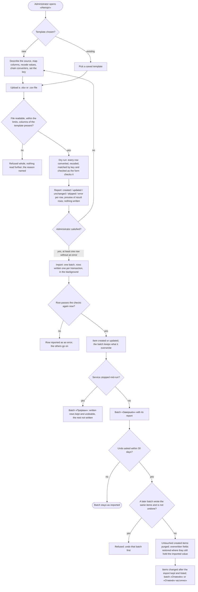

# Spec: Import/export constructor for work items (doc-017)

## Context and goal

The team keeps its work in a planning workbook (the «DevEx sheet», [input-brief.md](input-brief.md)) and moves it into MUSTASK. The human asked (2026-11-10) for an import/export from .xlsx and .csv with a constructor whose core is the field mapping and the conversion of values, and for a list of everything else the move needs. This spec states the constructor's behaviour, the lines that deliver it, the gap lines found in the workbook, and which of them must land before the first transfer. It supersedes doc-005 US-4 and BR-M6-8 (the CSV import/export of `feat-005-csv-import-export`) wherever they differ. ADR-0039 (the external key and links) and ADR-0040 (the import batch) are drafted beside it and go to the human with it at gate-1.

## Roles

Access is derived from membership (ADR-0027) and computed by the one policy of ADR-0029, with the role names of ADR-0038. The import line registers its codes in ADR-0029 § 4's matrix; ADR-0040 proposes them.

| Capability | Who | Why |
|---|---|---|
| Create, edit, copy, delete an import template | organization «Администратор» | a template recodes people and projects of the whole organization |
| Read the templates | every organization member, «Читатель» included | export uses them (BR-IE-19) |
| Dry run, import, undo a batch, read the batch list and reports | organization «Администратор» (OQ-1) | rows of one file land in many projects; one undo must reach them all |
| Each row's write | also needs the right to change items in the row's project (`workitems.workitem.write`) | the row goes through the form's own checks (BR-IE-12) |
| Export by a template | every organization member who reads items, «Читатель» included | only the items the user may read are exported (BR-IE-19) |
| Add, remove external links; edit participants | whoever may change the item | as any other field of the item |

## Stories

| id | Title | depends-on | File |
|----|-------|------------|------|
| US-1 | An administrator describes the source and maps columns to fields | - | `stories/US-1-source-and-column-mapping.md` |
| US-2 | An administrator recodes file values into MUSTASK values | US-1 | `stories/US-2-value-recoding.md` |
| US-3 | An administrator converts a column's values by a chain of converters | US-1 | `stories/US-3-converter-chains.md` |
| US-4 | A dry run shows what each row would do, writing nothing | US-1, US-2, US-3, US-9 | `stories/US-4-dry-run.md` |
| US-5 | An import creates and updates items by key, row by row, into a batch | US-4 | `stories/US-5-import-run.md` |
| US-6 | An administrator undoes an import batch | US-5 | `stories/US-6-undo-batch.md` |
| US-7 | Templates are saved per organization, edited, copied and deleted | US-1 | `stories/US-7-saved-templates.md` |
| US-8 | A member exports items by a template | US-7 | `stories/US-8-export-by-template.md` |
| US-9 | A work item carries an external key and external links | - | `stories/US-9-external-key-and-links.md` |
| US-10 | A work item has participants besides its assignee | - | `stories/US-10-work-item-participants.md` |

Every story is `shippable: no`: this is an analysis task, and each story specifies the delivery lines § Decomposition maps to it. A clause that needs a later line (tags, comments, custom fields, participants) is marked "owed by" that line, which adds it to the mapping catalogue and runs it. Custom fields and custom states keep doc-007's analysis and get no story here; notifications get an analysis line of their own.

## Business process (BPMN)

## Business rules

| # | Rule | Source |
|---|------|--------|
| BR-IE-1 | **Scope.** An import writes work items of one organization. Each row lands in exactly one project, given by a constant or by a recoded column (BR-IE-7); one file may reach many projects. Nothing outside the organization is read or written. Supersedes BR-M6-1's one-project import and BR-M6-8. | brief outline 2; doc-005 BR-M6-8 |
| BR-IE-2 | **Formats.** The source is a .xlsx workbook or a .csv file; .xls, .xlsm and any other file are refused («Поддерживаются файлы .xlsx и .csv.»). An online spreadsheet comes in through its own .xlsx or .csv download. A .csv is read as UTF-8 (with or without a BOM) or Windows-1251: detected, and changeable in the template. Its delimiter is «;», «,» or a tab: detected, and changeable. Quoted fields follow RFC 4180, line breaks inside quotes included. | brief outline 1; BR-M6-8 (UTF-8, «;») |
| BR-IE-3 | **Reading a workbook.** The template names the sheet, the header row (1–50) and the first data row (after the header row). A cell gives its typed value: text, number, date, or the last value a formula computed; formulas are never evaluated and macros never run. A merged cell gives its value to its top-left position only. A cell's hyperlink stays available to «URL из гиперссылки» (BR-IE-8). A row whose mapped cells are all empty is skipped and counted. A .csv has one sheet, every value is text, and the header row and first data row apply as for a workbook. | brief outline 1; DevEx `Срок` (serial dates), `Ссылка` (hyperlinks) |
| BR-IE-4 | **Mapping.** A column is matched by its header text, compared ignoring letter case and surrounding spaces, never by position. A new template proposes, for each column, the field whose Russian name or code equals the header, and «Не переносить» otherwise. A column may feed several fields, each with its own chain and recoding; a field takes at most one source: a column or a constant. Project, type and title must each have a source before the template can be saved. When a later file lacks a column the template maps, the file is refused whole with the missing headers named; extra columns are ignored. | brief outline 3 |
| BR-IE-5 | **Fields offered.** Project, type, title, description, state, assignee, priority, owning team, every field of feat-022's table on the types that carry it, the key (BR-IE-10) and external links (BR-IE-24); then tags, the first comment, participants and custom fields once their lines have merged, each line adding its field. A field the row's type lacks makes the row an error (`field_not_on_type`, feat-022 BR-M3-30) unless the cell is empty. | feat-022; gap lines (§ Decomposition) |
| BR-IE-6 | **Empty cells.** Per mapping, an empty cell (after its chain) means «Не менять» (the default) or «Очистить». On create both mean "not set": the field takes its creation default (feat-022 BR-M3-37). «Очистить» on an always-set field (Приоритет, Серьёзность, Вид ценности) stores its default, as the form does (BR-M3-31). | brief outline 6; feat-022 |
| BR-IE-7 | **Recoding.** A dictionary field — type, state, priority, project, assignee, owning team, participants, a list field — gets a recoding table: each distinct file value seen in the uploaded file → one MUSTASK value of that field. Values are compared ignoring letter case and surrounding spaces. A value missing from the table takes the table's policy: «Ошибка строки» (default), «Значение по умолчанию» (a chosen value), or «Оставить пустым» (optional fields only). The table suggests, for each new value, the MUSTASK value whose name, key or, for people, name or email equals it; a suggestion is applied only when the administrator accepts it. A recoding points only at what exists: an active project, a type and its states from the organization's process, an active organization member, a team linked to the row's project. Nothing is created by recoding (OQ-6). States are recoded into the fixed process (OQ-4); several file values may share one target. | brief outline 4; mod-001 states |
| BR-IE-8 | **Converters.** «Обрезать пробелы» (both ends, non-breaking spaces included; optionally inner runs to one space); «Разделить» by a delimiter into a list, each part trimmed and empty parts dropped; «Дата из числа Excel» (a serial number in the workbook's 1900 or 1904 date system, 46023 → 01.01.2026); «Дата по формату» (a pattern such as «ДД.ММ.ГГГГ», «ГГГГ-ММ-ДД», «ДД/ММ/ГГГГ»); «Число» («,» or «.» as the decimal separator, spaces between digit groups ignored); «По таблице» (text → number or text by a table, e.g. «10-20 мин» → 0,5, «1 месяц» → 160, with BR-IE-7's policy for missing values); «URL из гиперссылки» (the cell's hyperlink target, else the text if it is an http(s) address); «Извлечь по шаблону» (a regular expression: the first group, or the whole match; no match gives empty); «Константа» (a fixed value, ignoring the cell); «Объединить» (a text pattern with column placeholders, e.g. «{Комментарии}\nTG: {TG_id}», for the description); «Обрезать до длины» (N characters, with a row warning). | brief outline 5 |
| BR-IE-9 | **Chains.** Converters of a mapping run left to right, at most 10, each on the previous result; recoding, when the field has it, runs on the chain's result, and on each part of a list. A converter that cannot convert a value («Число» on «abc», a date outside 2000–2099) makes the row an error naming the column, the cell (e.g. «F12»), the value and the converter. The chain's result must fit the field: a list only for a field that holds several values. | brief outline 5 |
| BR-IE-10 | **Key.** A template chooses how rows find items: «Внешний ключ» or «Идентификатор MUSTASK» (the item's full identifier, so an export by the template comes back in: BR-M6-8's round trip). The key is the result of its column's chain, so a computed key is possible. An external key lives on the item with a named source chosen in the template (e.g. «DevEx»), and is unique in the organization per source among items not purged, compared ignoring letter case and surrounding spaces (ADR-0039, OQ-2). A row with a key that names no item creates one carrying the key; a row whose key names an item updates it. A row with an empty key creates an item without a key, or is skipped, as the template says («Строки без ключа»); such an item is never found by a later import. Two rows of one file with the same key are both errors, naming each other's row. | brief outline 6; DevEx `Id` (432/543 filled) |
| BR-IE-11 | **Update.** An update writes only the fields mapped by the template, under BR-IE-6, and never the type (BR-M3-1) or the project (doc-012 BR-MX-9): a row whose type or project differs from the item's is an error. A row whose values equal the item's is «Без изменений» and writes nothing. Last write wins per row (doc-001 BR-11). A key naming an item in «Удалена» makes the row an error («Элемент находится в корзине.»); a purged item frees its key. | BR-M6-8; mod-005 |
| BR-IE-12 | **Same checks as the form.** Each row is checked and written as the form checks and writes it: feat-022's field rules, mod-003's title and description rules, the owning team linked to the project (BR-MX-9), an assignee who can read the project (BR-MX-25), the right to change items in the project. A new item may start in any state of its type, since any state may follow any other (BR-M3-21); this replaces BR-M6-8's "first state only". A failed check is the row's error with the form's own text. | BR-M6-8; feat-022; doc-012 |
| BR-IE-13 | **Dry run.** A dry run reads the whole file, runs every chain, recoding and check, matches every key, and writes nothing: no item, key, tag or batch. It reports per row one of «Будет создан», «Будет обновлён», «Без изменений», «Пропущен», «Ошибка», with reasons and warnings, totals per result, and a preview of the first 50 result rows as fields → values, an update's changes as old → new. The full report downloads as .xlsx. | brief outline 7 |
| BR-IE-14 | **Import.** «Импортировать» is offered only after a dry run of the same file and the same template version with at least one row that is not an error. The import re-checks every row when it writes it, so its results may differ from the dry run's. Rows are written one per transaction, in file order; a failed row is reported and the rest go on. The import runs in the background with «Обработано N из M»; the administrator may leave the page and come back. An organization runs at most one import or undo at a time: a second is refused («Импорт уже выполняется.»). A service stop leaves the batch «Прерван»: rows written stay written and undoable, the rest are not written. The uploaded file is kept until the import ends or 24 h pass, then deleted; the batch keeps its report, not the file. | brief outline 8 |
| BR-IE-15 | **Batch.** Each import is one batch: who, when, file name, a snapshot of the template, the counts per result, the per-row report, and for each written item what it created or the values it overwrote. Editing or deleting the template changes no batch. The batch list shows the organization's batches, newest first, with their state: «Выполняется», «Завершён», «Прерван», «Отменён», «Отменён частично». | ADR-0040 |
| BR-IE-16 | **Undo.** A batch may be undone within 30 days of its end, once. Undo is refused while a later batch that wrote any of its items is not undone, naming that batch. For an item the batch created: purged, with its key and everything the batch added, when no one changed it after the import (BR-IE-17); kept and listed otherwise (OQ-3). For an item the batch updated: each overwritten field goes back to its value before the import when it still holds the imported value; a field changed since keeps its value and is listed. External links and tags the batch added are removed if still present; a comment the batch added is removed when it is unedited. The result is «Отменён», or «Отменён частично» with the list. An undo cannot itself be undone. | brief outline 8; ADR-0040 |
| BR-IE-17 | **Changed after the import.** An item is changed after the import when any write after the batch's own touched it: a field, its state, owning team, sprint, parent or child link, tag, comment, external link, participant or attachment. A backlog or board reorder does not count. | ADR-0040 |
| BR-IE-18 | **Templates.** A template belongs to one organization and holds the source settings, mappings, chains, recoding tables, policies, the key and its source name, and the export settings. Its name is 1–100 characters after trimming, unique in the organization ignoring letter case. «Копировать» makes «Копия <имя>» (a number added while taken). Deletion is final and leaves the batches made with it intact. An organization holds at most 100 templates. | brief outline 9 |
| BR-IE-19 | **Export.** From the «Рабочие элементы» list a member chooses «Экспорт по шаблону», a template and .xlsx or .csv (UTF-8 with a BOM, the template's delimiter). The file holds the items the list's current filter shows to that user, after project visibility (BR-MX-21), one row per item, the template's mapped columns in its order under its header texts, plus the key column. A recoded value is written back by its table: the entry marked «при экспорте» when several file values share one MUSTASK value, else the first. Dates go out as date cells (.xlsx) or by the template's format (.csv); an external link as a hyperlink cell; a list joined by the «Разделить» delimiter; a «По таблице» number back to its text when exactly one entry gives it, else as the number. | brief outline 10; BR-M6-8 |
| BR-IE-20 | **What does not reverse.** «Константа» and «Объединить» columns are written empty; «Извлечь по шаблону» writes the field's value, not the original cell; «Обрезать до длины» cannot restore what it cut; a column mapped to several fields is written from its first mapping. The export dialog lists these columns before the file is made. | brief outline 10 |
| BR-IE-21 | **Limits.** A file of at most 10 MB and 5 000 data rows, 200 columns and 50 sheets; above any of them it is refused whole before any row is read (BR-M6-8's cap, kept). An export of more than 5 000 items is refused with «Уточните фильтр: в выгрузке больше 5 000 строк.», never truncated. A recoding table holds at most 1 000 entries; a regular expression at most 500 characters. | BR-M6-8 |
| BR-IE-22 | **Formula injection.** An exported cell whose text begins with «=», «+», «-», «@», a tab or a carriage return is written with a leading apostrophe, so no spreadsheet runs it. | NFR security |
| BR-IE-23 | **Side effects.** An imported write is the importer's write: «Создал»/«Изменил» is the administrator, the time is the write's. Once feat-015 exists, history records each imported create and update and each undo, naming the batch. Once notifications exist, an import or undo sends no per-item notice. | feat-015; doc-010 D-18 |
| BR-IE-24 | **External key and links on the card.** The card shows the key as «<источник>: <ключ>» («DevEx: 010125 - 01»), read-only; only an import sets it and only an undo or a purge removes it. The list's keyword also finds an item by its key. An item has 0–50 external links, each an http(s) address of at most 2 000 characters with an optional title of at most 200; a link is added, opened in a new tab and removed by whoever may change the item; an address already on the item is not added twice. | ADR-0039; DevEx `Ссылка` (206 links) |
| BR-IE-25 | **Participants.** An item has 0–50 participants besides the assignee («Участники»): active organization members who can read its project. They are set on the card by whoever may change the item and shown on it; a participant who later loses access stays, marked as BR-MX-25 marks an assignee. Participants grant nothing. | DevEx `Team` (462 rows) |

## Operation completeness

| Entity | Create | Read | Update | Delete/deactivate | Cancel/reverse |
|--------|--------|------|--------|-------------------|----------------|
| Import template | org admin (US-1, US-7) | every org member (BR-IE-19) | org admin: everything; copy (US-7) | org admin: final delete; batches keep their snapshot (BR-IE-18) | no: deletion is final; a copy is the way to keep a variant |
| Dry run | org admin (US-4) | its author while the file is kept (BR-IE-14) | no: run it again | no: it writes nothing and expires with the file | no: nothing to reverse |
| Import batch | org admin, after a dry run (US-5) | org admin: list and reports | no: a batch records what happened | no: a batch is never deleted; its file is (BR-IE-14) | org admin: undo within 30 days (US-6) |
| Imported item | the import, under the row's project write right (BR-IE-12) | as any item | the import by key; any user as any item | as any item (mod-005) | the batch's undo (BR-IE-16) |
| External key | the import only (BR-IE-10) | whoever reads the item | no: the key ties the item to its source; a wrong key is fixed by undo and a new import | the undo of the batch that set it, or the item's purge | undo |
| External link | whoever may change the item; the import (US-9) | whoever reads the item | no: remove and add again | whoever may change the item | add again; undo removes the batch's links |
| Participant | whoever may change the item; the import (US-10) | whoever reads the item | no: remove and add | whoever may change the item | add again |
| Export file | every member who reads items (US-8) | its author, as a download | no | no: not kept by MUSTASK | no |

## Non-functional requirements

- **Volumes:** a dry run of 5 000 rows × 50 columns completes within 60 s; an import or an undo of 5 000 rows within 5 min; an export of 5 000 items within 30 s. The DevEx sheet (543 rows) runs in the same budgets.
- **File safety:** a workbook that would expand past 100 MB, references an external file or holds a macro is refused whole. A regular expression runs at most 100 ms per cell; past that the row is an error («Шаблон выполняется слишком долго.»).
- **Audit:** the batch is the audit record (BR-IE-15); every refusal by the access policy is logged with the route, the code and the user id, as doc-012 requires.
- **Privacy:** an uploaded file is deleted within 24 h (BR-IE-14); examples, tests and fixtures use made-up data only.
- **Localization:** interface copy Russian (AGENTS.md).

## Out of scope

- Importing the change log (`Логи`) as item history: history starts at the import (BR-IE-23); the sheet stays archived as a file.
- Parent links by key (no hierarchy in the sheet); attachments (`Баг репорт`, one row; mod-004); the chat bot's service data (`TG_*`, `tg_msg_logs`, `configs`).
- Creating projects, people, teams or types during an import (OQ-6); inviting people is feat-053.
- A snapshot-on-a-date report for the customer: mod-008 queries over feat-015 history, with mod-010's operators; dashboards by project and state are mod-009 and feat-006.
- Scheduled or automatic imports, a live sync with an online spreadsheet, and imports through an API.
- Custom types (doc-007 `feat-NNN-process-custom-types`), a «HotFix» type among them (OQ-10).

## Decomposition for the backlog

| id | Task | size | deps | first transfer |
|----|------|------|------|----------------|
| `feat-NNN-work-item-external-key-and-links` | The external key with its source on the work item, read-only on the card and found by the list's keyword; external links added, opened and removed on the card (US-9; BR-IE-10, -24; ADR-0039). Epic `core/work-items` | M: additive fields and a card section of the work items module; the ADR is accepted at this task's gate-1 | mod-003, mod-005, feat-003 | yes |
| `mod-NNN-import-constructor` | Founds the import module: templates per organization (create, edit, copy, delete), source reading, mapping, recoding tables, converter chains, the key, and the dry run with its report; registers the template and import codes (US-1, US-2, US-3, US-4, US-7; BR-IE-1..-10, -13, -18, -21). Epic `core/work-items` | L: founds a module | feat-NNN-work-item-external-key-and-links, mod-019 | yes |
| `feat-NNN-import-run-and-undo` | The import run in the background through the work items module's own writes, the batch, its report and list, and the undo (US-5, US-6; BR-IE-11, -12, -14..-17, -23; ADR-0040) | L: a new write contract into the work items module, with purge and restore | mod-NNN-import-constructor | yes |
| `feat-053-invite-member-by-email` (queued) | unchanged: the 14 assignees must be members before their rows can be recoded | M | mod-019 | yes |
| `feat-NNN-import-export-by-template` | Export of the list's filtered items by a template to .xlsx or .csv, reverse recoding, the non-reversible columns named, formula-injection guard (US-8; BR-IE-19, -20, -22) | M: additive in the import module | mod-NNN-import-constructor | no |
| `feat-NNN-work-item-dates-and-estimate-on-all-types` | «Целевая дата» on История, Задача and Баг, «Исходная оценка» on История (OQ-5 A): the sheet's `Срок` (76) and `Вес D` (249) are on UserStory rows | S: additive fields per feat-022's rules | feat-022 | no |
| `feat-NNN-work-item-participants` | «Участники» on the card and as an import target (US-10; BR-IE-25) | M: an additive relation of the work items module | mod-019 | no |
| `mod-NNN-process-custom-fields` (doc-007 row, queued now) | Organization custom fields per type: text, number, list, date; on the form, as import and export targets (`Вес A`, the budget line, the source's own state). Reworded from doc-007: it no longer waits for custom types | L: doc-007's founding of the field-value pattern | mod-001, mod-003 | no |
| `feat-NNN-process-custom-states` (doc-007 row) | stays unqueued under OQ-4 A; queued with custom types only if the human picks B | M | doc-007's `feat-NNN-process-custom-types` | no |
| `doc-NNN-notifications-and-telegram` | Analysis: notifications on assignment, state change and a daily risk digest, mention groups, and a Telegram channel as an external integration (the sheet's bot); takes the owner doc-011 settles (doc-010 D-18) | L: an external integration, ADR-level | - | no |

Before the first transfer only the four "yes" lines are needed (OQ-7 A): without the key a repeated import duplicates, and without members the assignees cannot be recoded. Everything else arrives by an enrichment re-import of the archived sheet: a template that maps only the new columns updates the same items by key and touches nothing else (BR-IE-6, -11). Queue changes for the orchestrator: `feat-005-csv-import-export` is reworded (OQ-8 A) to «Release 3. Export a saved query's result by an import template from the Queries hub, with the template's reverse recoding (doc-017 BR-IE-19, -20); import lives in doc-017's lines» · size S · deps mod-008, feat-NNN-import-export-by-template; feat-015 gains "records each imported create and update and each undo, naming the batch (doc-017 BR-IE-23)"; feat-016 and feat-002 gain "an import target, written as the form writes it (doc-017 BR-IE-5)".

## Open questions

- [ ] **OQ-1 Who imports.** (A, recommended) The organization «Администратор» only: one file reaches many projects and one undo must reach them all. (B) Also a department or project «Менеджер», into the projects they manage; rows elsewhere are errors.
- [ ] **OQ-2 Where an external key is unique.** (A, recommended) In the organization, per named source: a row whose project changed is still found, and a second sheet's ids never collide. (B) Per project: simpler, but a project change in the sheet duplicates the item.
- [ ] **OQ-3 Undo of a created item.** (A, recommended) Purge it when untouched, keep it when changed after the import: undo is "as if never imported" and frees the key for the next try. (B) Move it to «Удалена»: restorable, but its key stays taken and a corrected re-import errors on every row.
- [ ] **OQ-4 The sheet's 11 states.** (A, recommended) Recode them into the fixed states now; keep the source state in a custom field by a later enrichment re-import; configurable states stay doc-007's unqueued row. (B) Queue doc-007's custom types and states before the first transfer: the board shows the 11 columns, at two more lines first.
- [ ] **OQ-5 Fields the story type lacks.** (A, recommended) Add «Целевая дата» to История, Задача, Баг and «Исходная оценка» to История, re-deciding feat-022 D-1 for those types. (B) Carry `Срок` and `Вес D` as custom fields.
- [ ] **OQ-6 Missing projects.** (A, recommended) Not created by an import: the administrator creates the 20 projects in their departments first, and recoding points at them. (B) «Создать проект» in the recoding table, with name, key and department typed there; undo would not remove it.
- [ ] **OQ-7 The first transfer.** (A, recommended) The four "yes" lines, then enrichment re-imports as each gap line lands. (B) Wait for every gap line and transfer once, losslessly.
- [ ] **OQ-8 feat-005.** (A, recommended) Reword it to the query-result export above. (B) Withdraw it: the list export covers the need until queries exist.
- [ ] **OQ-9 Notifications.** (A, recommended) Their own analysis line, taking doc-011's owner. (B) Fold them into doc-011.
- [ ] **OQ-10 HotFix.** (A, recommended) Recode HotFix → «Баг» and feed the same column, by a second mapping, to the tag «HotFix» once tags exist. (B) A «HotFix» type, which needs doc-007's custom types.
