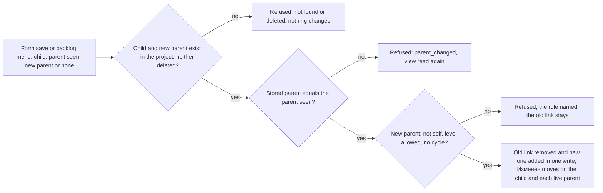

# Spec: Work item hierarchy, the MVP cut (feat-001)

## Context and goal

Work in a project is nested: an epic is made of features, a feature of
stories, a story of tasks. Today every work item stands alone, so nobody can
see what an epic consists of or which feature a story serves. This cut adds
the Parent/Child link, a «Родитель» field on the work item form, the tree on
a team's backlog with a menu that re-parents a row one level up, and one
level drop-down on «Бэклоги» and «Канбан» (`status.md` D-2, D-3). It carries
two queue lines, feat-001 and feat-004 (D-2), on the short route (D-1, D-6).
Rules come from doc-002 (BR-M3-2, -8, -9, US-5), doc-003 (US-3, BR-M4-9..-11),
doc-001 (BR-4, BR-11, BR-14), doc-010 (N-14, N-18) and mod-001 (BR-M2-4);
they are restated here as BR-H-n with their source. Screens are mod-015's
patterns, with mod-003's form and mod-006's pages as the nearest examples.

## Scope

### In scope (D-2, D-3)

- The Parent/Child link across the five types: one parent at most, the type
  pairs, no self-link, no cycle, same project only (BR-H-1..-2).
- One parent write that sets, replaces (atomically) or clears the parent,
  with refusals and a stale-view check (BR-H-3..-5).
- The form's «Родитель» field and its children list (BR-H-6, -7).
- The deleted-item rules of doc-001 BR-14 and doc-002 BR-M3-9 for links
  (BR-H-8; OQ-1).
- The backlog tree: expand/collapse, depth, order, the «Родитель» column
  (BR-H-9..-13).
- The parent mapping from a backlog row, one level up (BR-H-14).
- The level drop-down in place of the three tabs on «Бэклоги» and on the
  board page, and the board page's new name «Канбан» (BR-H-15, -16; the
  human's decision of 2026-10-06, recorded by the orchestrator as D-7).

### Out of scope

| Item | Carried by |
|---|---|
| Deleting, restoring and purging items; the read-only form of a deleted item; the purge recorded on surviving children (doc-002 BR-M3-9 no-cascade) | mod-005-work-item-delete-restore (amended at gate-3, § Decomposition) |
| Link kinds other than Parent/Child; the form's «Связи» tab with «Добавить связь» (mod-015 § 10.3) | D-2 OUT; doc-011-release-2-scope |
| History records of link acts (doc-001 BR-4) | feat-015-work-item-history (amended at gate-3) |
| The «Задачи» backlog and tasks nested under stories there | feat-023-tasks-backlog (OQ-5) |
| The sprint planning views | mod-007, feat-009 (D-2) |
| Membership, roles, a reader's read-only view | mod-016-organization-access (D-5) |

The board itself does not change (BR-H-17). Further reference-tracker
features that are not here: § Left out of this cut.

## Access

D-5: until mod-016, mod-002 D-a unchanged (BR-H-18).

| Who | What they may do |
|---|---|
| Any signed-in user | in every active organization and project: see links on the form and the backlog, set, replace and clear a parent from the form or a backlog row, expand and collapse rows, choose a level |
| Anonymous caller | nothing: every page shows mod-015's auth card, every request answers 401 |

## Stories

| id | Title | depends-on | File |
|----|-------|------------|------|
| US-1 | A user sets, replaces and clears a work item's parent on its form | - | `stories/US-1-parent-on-the-form.md` |
| US-2 | A parent that breaks the hierarchy is refused | US-1 | `stories/US-2-hierarchy-refusals.md` |
| US-3 | A user sees a work item's children on its form | US-1 | `stories/US-3-children-on-the-form.md` |
| US-4 | A user expands a backlog row to see its children | US-1 | `stories/US-4-backlog-tree.md` |
| US-5 | A user changes a row's parent from the backlog | US-2, US-4 | `stories/US-5-parent-mapping-on-the-backlog.md` |
| US-6 | A user picks the level from a drop-down on «Бэклоги» and «Канбан» | - | `stories/US-6-level-drop-down-and-kanban.md` |
| US-7 | A deleted item takes no new link and frees its children | US-2, US-4 | `stories/US-7-deleted-items-and-links.md` |

All seven are `shippable: no`; the task is not split (§ Decomposition).

## The parent write

## Business rules

| # | Rule | Source |
|---|------|--------|
| BR-H-1 | Parent/Child is the only link kind. A work item has at most one parent and any number of children. Parent and child are items of the same project: an item of another project or organization is never offered and, named directly, is refused as `workitems.link.parent_not_found` — the answer does not say whether it exists elsewhere. | doc-002 BR-M3-2, BR-M3-8; D-2 |
| BR-H-2 | A parent's backlog level is the child's own or a higher one, by mod-001's level rank — never lower. With the seeded process: «Эпик» may have an «Эпик»; «Фича» an «Эпик» or «Фича»; «Пользовательская история» and «Баг» an «Эпик», «Фича», «Пользовательская история» or «Баг»; «Задача» any of the five. An item is never its own parent, and a link that would make an item its own ancestor (a cycle, possible only within one level) is refused. There is no depth limit. | doc-002 BR-M3-8, W-1; mod-001 BR-M2-4; doc-010 N-18 |
| BR-H-3 | One parent write names the child and its new parent or none. It sets a parent, replaces one — the old link removed and the new one added in one write, M3's atomic replace parent — or clears it. A refused write changes nothing: the old link stays. The write answers with the child's parent as stored after it (identifier, type, title, state, or none). | doc-002 BR-M3-8; doc-010 N-18 |
| BR-H-4 | A parent write also names the parent its user saw (or none). If the stored parent differs, the write is refused with `workitems.link.parent_changed` and nothing changes; so of two writes for one child made from the same view, the later is refused (the one-parent invariant holds, the loser is refused). A write that saw no parent also matches a stored parent in «Удалена» (BR-H-8). | doc-001 BR-11 (backlog parent mapping); doc-003 US-3; this cut's call |
| BR-H-5 | An accepted parent write moves the «Изменён» time of the child and of each live parent it adds or removes — doc-002's three records (a removal on the old parent, an addition on the new, one revision on the child), the records themselves coming with feat-015. It changes no other field, no backlog place, no state. | doc-002 BR-M3-8; mod-003 BR-M3-28; this cut's call |
| BR-H-6 | The form's «Родитель» is a field of mod-003's draft: changed in the picker, saved by «Сохранить» with every other changed field, all of them or none (mod-003 BR-M3-25). Choosing another parent where one is stored replaces it (OQ-2). The picker offers the project's items of the types BR-H-2 allows, never the item itself and never a deleted item; its first option «Нет родителя» clears. | mod-003 BR-M3-25; doc-002 US-5; OQ-2 |
| BR-H-7 | The form lists the item's children, read-only, every type, deleted ones excepted (OQ-3). | doc-002 US-5; OQ-3 |
| BR-H-8 | No link write touches an item in «Удалена»: it can be neither the child nor the new parent (`workitems.link.item_deleted`). A parent's deletion never removes its links. While a parent is in «Удалена», its child counts as unparented on the backlog: it nests under no row, its «Родитель» cell reads «Нет», the mapping may give it a parent, which replaces that link. Its form shows the deleted parent with the state «Удалена», and a save of «Нет родителя» or another parent clears or replaces it. Such a write leaves the deleted parent unchanged, its «Изменён» time included. In this cut no item can reach «Удалена» (mod-003 BR-M3-21; mod-005 not built), so these rules are unreachable from the screens; OQ-1 decides whether the server enforces them now. | doc-001 BR-14 (c); doc-002 BR-M3-9; doc-010 N-14; mod-006 D-5 |
| BR-H-9 | The backlog tree reads the links; M4 stores no hierarchy. Expanding or collapsing a row changes only what is shown, never an order or a link. | doc-003 BR-M4-9 |
| BR-H-10 | A level's backlog lists its own items as top-level rows, in mod-006's order. Beneath an expanded row show its children that are on the same team's backlog exactly one level below, and so on down: «Эпики» shows up to three tiers (epic, feature, story), «Фичи» two, «Истории» one — no «Задачи» backlog exists in this cut (OQ-5). An item with no parent, a parent on its own level or two levels up, a parent on another team's backlog or in «Удалена» nests under no row; it stays a top-level row of its own level's backlog only. A lower level's backlog shows no parent rows of the level above. | doc-003 BR-M4-11, US-3; mod-006 D-6 (OQ-3) |
| BR-H-11 | Children under a row follow their own backlog's order (mod-006 BR-M4-24: placed, then unplaced by number). A nested row has no «Порядок», no handle and no reorder. A reorder moves a top-level row together with its shown children and changes no link; nothing on the backlog moves an item to another parent except the mapping (BR-H-14). | doc-003 BR-M4-9; mod-006 BR-M4-8, -24 |
| BR-H-12 | Every row starts collapsed. What is expanded is kept, by item, for the visit to that page, across its re-reads; a reload, another level or another team starts collapsed. A row with no child to show has no expand control. | this cut's call (mod-002 design § 11.2) |
| BR-H-13 | Every backlog row, top-level and nested, shows a «Родитель» column: the parent's identifier as a link to its form, whatever its level or team, or «Нет» (OQ-4). | this cut's call; OQ-4 |
| BR-H-14 | On «Фичи» and «Истории», each top-level row has the menu «Изменить родителя…» and «Убрать родителя», both the BR-H-3 write. «Изменить родителя…» offers only items of the level directly above (an «Эпик» for a «Фича»; a «Фича» for a story or a bug) — M4's narrowing; a parent on the same level or further up is set on the form. «Убрать родителя» is disabled when the row has no parent. «Эпики» rows and nested rows have no such menu. The menu is the complete path: no pointer drag maps a parent in this cut. | doc-003 BR-M4-10, US-3; doc-010 N-18; mod-006 BR-M4-8 |
| BR-H-15 | On «Бэклоги» and «Канбан» one level drop-down replaces the tabs «Эпики», «Фичи», «Истории». Choosing a level changes only the address's `:level` segment, so each level keeps its own address, the browser's back returns to the previous one, and the landing stays «Истории». | D-3; mod-006 § Navigation |
| BR-H-16 | The board page and its navigation entry are named «Канбан»; every text that names the board follows (§ Screens and copy). The address segment `boards`, the error codes and the backend do not change. | the human, 2026-10-06 (D-7, recorded by the orchestrator) |
| BR-H-17 | The board is otherwise mod-006's: the same items, columns, cards, card menu, moves and creation. A card shows no parent and no children. | D-2; mod-006 BR-M4-2, -3, -14, -15 |
| BR-H-18 | Every request needs a signed-in user and runs behind mod-002's organization-context filter. A parent write declares `workitems.link.write`, which this task registers as an organization-scoped code outside the realm import; reads declare `workitems.workitem.read`. Nothing checks them until mod-016. | D-5; doc-010 § Permission codes; mod-006 BR-M4-27 |
| BR-H-19 | No live push: a link written elsewhere shows at the next read — on «Бэклоги» as mod-006 BR-M4-28 (opening, after its user's write, the tab regaining focus); on the form when it is opened, reloaded or saved (mod-003). | mod-006 BR-M4-28; mod-003 |

## Operation completeness

| Entity | Create | Read | Update | Delete/deactivate | Cancel/reverse |
|--------|--------|------|--------|-------------------|----------------|
| Parent/Child link | any signed-in user: the form (US-1), the backlog menu (US-5) | any signed-in user: the form (US-1, US-3), the backlog (US-4) | any signed-in user: replace parent, one write (US-1, US-5) | any signed-in user: «Нет родителя» (US-1), «Убрать родителя» (US-5); a live child of a deleted parent (US-7); never by a parent's deletion (mod-005) | no undo: another parent write |
| Expanded rows (per page visit) | any signed-in user: expand (US-4) | as the backlog | collapse (US-4) | system: reload, another level or team (BR-H-12) | n/a |

## Screens and copy

mod-015's patterns only; the shell and the theme are not edited. Type icons
and category dots as mod-003 (`TypeMark`, mod-015 § 2.3).

### The rename «Доски» → «Канбан» (BR-H-16)

| Where | Was | Becomes |
|---|---|---|
| Navigation entry (icon `ViewWeekOutlined`, landing `…/teams/:t/boards/stories`) | «Доски» | «Канбан» |
| Page `h1` / browser tab | «Доски» / «Доски — Mustask» | «Канбан» / «Канбан — Mustask» |
| Board region `aria-label` | «Доска» | «Канбан» |
| «Бэклоги»' secondary command (`ViewWeekOutlined`) | «Показать доску» | «Показать канбан» |
| Empty frame heading (hint and action unchanged) | «На доске нет рабочих элементов» | «Канбан пуст» |

No notice, column text or error text names the board; they stay as they
are. «Показать бэклог» on «Канбан» is unchanged.

### Level drop-down (US-6)

In mod-015 § 6.1's views row, where mod-006's tabs stood, left-aligned under
the `h1`, on both pages: `Button variant="text"` reading «Уровень: <уровень>»
with `endIcon` `ExpandMore`, `aria-haspopup="menu"`, `aria-expanded` → `Menu`
of «Эпики», «Фичи», «Истории» in rank order, each a link to its address
(`…/backlogs/<level>` or `…/boards/<level>`), the current one `selected` with
`aria-current="page"`. Keyboard per mod-015 § 12.4: Enter, Space or
ArrowDown opens with focus on the current level; ArrowUp/ArrowDown, Home/End
move; Enter chooses; Escape closes and returns focus. After a choice the
page shows that level and focus is on the drop-down, which reads the new
level. It sits in the tab order where the tabs did, after the command bar.

### Work item form: section «Связанная работа» (US-1, US-3)

Below «Описание», an `h2` section «Связанная работа» (mod-015 § 10.3):

| Control | Content and copy |
|---|---|
| «Родитель» | `Autocomplete`, label «Родитель», helper «Родителем может быть: <типы через запятую>.» (BR-H-2's types for this item). First option always «Нет родителя». With an empty input: the 20 most recently changed allowed items; typing filters by identifier or «Заголовок», case-insensitive, most recently changed first. An option: type icon, «<ID> <Заголовок>», the state (category dot + name) as secondary text. While searching «Поиск…»; no match «Ничего не найдено»; more than 20 a last, non-selectable «Показаны первые 20. Уточните запрос.»; failure «Не удалось выполнить поиск. Попробуйте ещё раз.». The value reads as an option; empty, «Нет родителя» |
| Open | `IconButton` `OpenInNew` «Открыть <ID родителя>» beside the field while a parent is stored: a link to its form |
| «Дочерние элементы» | `subtitle2` «Дочерние элементы (<n>)»; a `List`: type icon, the identifier as a link to the child's form, «Заголовок», state (category dot + name); by level, highest first, then by number. None: «Дочерних элементов нет.» |

The field joins the form's draft: «Сохранить» enables when it differs from
the loaded value; while saving it is disabled with the other fields; on
success «Изменения сохранены.» and the field and the list show the stored
values. A `workitems.link.*` refusal is the field's error text, the input
kept; `workitems.link.parent_changed` also sets the field to the stored
parent from a fresh read, other drafted fields kept. Any other refusal is
mod-003's (the `Alert` above the band, a frame). Loading: `FormSkeleton`
covers the section.

### Page «Бэклоги»: the tree and the mapping (US-4, US-5)

mod-006's page with these changes; everything else stays.

| Block | Change |
|---|---|
| Header | the level drop-down in place of the tabs; «Показать канбан» |
| Table | columns «Порядок», «Перемещение» (hidden header), «ID», «Тип», «Заголовок», «Родитель», «Исполнитель», «Статус», and on «Фичи» and «Истории» «Действия» (visually hidden header) |
| «Заголовок» cell | indent 24 px per tier below the top, then the expand control or a 28 px gap, then the title link |
| Expand control | `IconButton size="small"` `ChevronRight` / `ExpandMore`, «Развернуть <ID>» / «Свернуть <ID>», `aria-expanded`; a tab stop; focus stays on it after the toggle |
| Nested row | the same cells, no «Порядок», no handle, no «Действия» |
| «Родитель» cell | the parent's identifier as a link to its form, its «Заголовок» as tooltip; «Нет» |
| «Действия» | `IconButton` `MoreHoriz` «Ещё действия: <ID>», `aria-haspopup="menu"` → `Menu` «Изменить родителя…» (`AccountTreeOutlined`), «Убрать родителя» (`LinkOff`, disabled without a parent) |

Dragging and the handle's menu work on top-level rows only: drop lines sit
between top-level blocks (a row with its shown children), and «Выше» /
«Ниже» step over blocks. The table stays a `Table` whose controls are tab
stops, as mod-006 built it — not mod-015 § 10.7's treegrid with arrow-key
row focus, which would replace mod-006's keyboard path; the indent and the
«Родитель» column carry the nesting.

**Dialog «Изменить родителя»** (mod-015 § 9.5, `maxWidth="sm"`): text
`body2` «<Тип> <ID> «<Заголовок>»»; «Родитель» — the form's picker without
«Нет родителя», offering only the level above, the current parent
preselected whatever its level,
helper «Предлагаются элементы уровня «<уровень выше>». Родителя другого
уровня можно выбрать в форме рабочего элемента.»; footer «Отмена»,
«Сохранить» (disabled until a different parent is chosen). Busy per mod-015
§ 9.1. A `workitems.link.*` refusal is the field's error, the dialog open;
`parent_changed` also reads the backlog again and preselects the stored
parent. Any other refusal, or no answer, is the dialog's `Alert` with § Notices'
text. On success the dialog closes,
focus returns to «Ещё действия: <ID>», the notice reads «У <ID> теперь
родитель <ID родителя>.», and the backlog is read again.

**«Убрать родителя»**: no dialog. The row's «Родитель» shows «Нет» at once;
while saved, every handle and «Ещё действия» is off, as in mod-006's move;
then the notice «У <ID> больше нет родителя.» and a re-read. A refusal puts
the cell back (§ Notices).

States: mod-006's (loading, error, empty «Бэклог пуст», not found). If a
row's children are read on expanding, a one-row skeleton shows beneath it
meanwhile; a failed read collapses the row with the notice «Не удалось
загрузить дочерние элементы. Попробуйте ещё раз.».

### Notices on «Бэклоги»

mod-006's `Snackbar`: success `Alert severity="success"`, refusals `severity="error"`, 6 s, bottom left.

| Case | Text |
|---|---|
| a refusal with a code | the code's text; after `parent_changed` the page is read again first |
| no answer or no code | «Не удалось сохранить родителя. Попробуйте ещё раз.» |

### Error codes

New, `contracts/errors/workitems.json`; Kazakh texts at stage 4 with
`kkNeedsReview`. Codes that only answer a panel defect are the backend
stage's.

| Code | Status | Params | ru |
|---|---|---|---|
| `workitems.link.parent_not_found` | 404 | — | «Родитель не найден в этом проекте.» |
| `workitems.link.parent_level_not_allowed` | 409 | — | «Родителем может быть только рабочий элемент того же или более высокого уровня.» |
| `workitems.link.self_parent` | 409 | — | «Рабочий элемент не может быть родителем самого себя.» |
| `workitems.link.cycle` | 409 | `parent`, `item`, `path` | «Нельзя выбрать родителем {parent}: он вложен в {item} ({path}).» — `path` from `item` down to `parent`, «MSK-TASK-1 → MSK-TASK-2 → MSK-TASK-3» |
| `workitems.link.parent_changed` | 409 | — | «Родитель уже изменён другим участником. Данные обновлены — проверьте и повторите.» |
| `workitems.link.item_deleted` | 409 | — | «Удалённый рабочий элемент нельзя связывать.» (OQ-1) |

Reused: mod-003's `workitems.workitem.not_found` and its form codes;
mod-002's three not-found frames; mod-006's codes, unchanged.

## Non-functional requirements

- **Volumes and speed** (doc-001 NFR): with 5 000 items on each of a team's
  three levels, every feature and story linked under one, a backlog read
  with what its tree needs is served within 2 s, and expanding a row shows
  its children within 1 s; a parent write, a form save with a parent and a
  picker search over 5 000 project items within 1 s each. Nested rows are
  rendered only while shown; there is no «expand everything».
- **Concurrency:** BR-H-4's stale check; two writes that would together
  close a cycle never both succeed; a parent write and a reorder of the same
  item both take effect.
- **Accessibility:** every action has a keyboard path; the «Родитель» column
  carries the nesting for a screen reader; at 640 CSS px the table scrolls
  inside its container (mod-015 § 12.6).
- **Audit:** none in this cut; feat-015 records link acts (BR-H-5).
- **Language:** copy Russian; codes and address segments Latin; the
  reference tracker is never named.

## E2E (E2E: yes)

New file `24-work-item-hierarchy.spec.ts`, on the menu and keyboard paths:

| Test | Story | What |
|---|---|---|
| 24.1 | US-1, US-3 | a story given a feature on its form, replaced by another feature, cleared; the feature's «Дочерние элементы» follows |
| 24.2 | US-2 | a «Задача» chain: the cycle refused with its path; a «Фича» not offered as an epic's parent |
| 24.3 | US-4 | «Эпики» of «Платформа»: an epic expanded to its features and a feature to its stories, collapsed; a reorder of epics keeps the children |
| 24.4 | US-5 | «Истории»: «Изменить родителя…» to a feature, the epic's tree shows it; «Убрать родителя» |
| 24.5 | US-6 | the drop-down on «Бэклоги» and «Канбан» by keyboard, the address and back; the entry, `h1` and «Показать канбан» read «Канбан» |

US-7 has no E2E: no item can be deleted through the panel before mod-005.
23.1–23.3 and 19.5 are brought in line (the drop-down for the tabs,
«Канбан» for «Доски»).

## Decomposition for the backlog

| id | Task | size | deps |
|----|------|------|------|
| feat-001-work-item-links (this task; carries feat-004, D-2) | Backend A, links: the link and its rules, the parent write in the form's save and on its own, the children read, the parent search, the codes, `workitems.link.write` — US-1, US-2, US-3, US-7. Backend B, the backlog: the read with each row's parent and its tree, the mapping through A's write — US-4, US-5. Frontend A: the form's section — US-1, US-2, US-3. Frontend B: the tree, the «Родитель» column, the row menu and dialog, the level drop-down on both pages, the rename «Доски» → «Канбан» (copy only), E2E 24 and 23/19.5 aligned — US-4, US-5, US-6. Each pass ends green | M | mod-003, mod-006 |

Amended at gate-3, not new: feat-015-work-item-history records link acts
(BR-H-5); mod-005 re-runs US-7 through its Delete and owns the purge on
children; feat-023-tasks-backlog nests tasks under stories and maps them one
level up (OQ-5). Not split: the mapping is the parent write, and the tree
reads the links it writes.

## Open questions

- [ ] **OQ-1. Deleted-item rules now or with mod-005.** (a) Recommended: the
      server enforces BR-H-8 now on the state's Removed category — a check
      and a filter it already reads — tested by placing an item's state in
      Removed directly; the screens of a deleted item stay mod-005's, and
      mod-005 re-runs US-7. The queue line names these rules. (b) mod-006
      D-5's pattern: state them, build none, mod-005's line carries them.
- [ ] **OQ-2. Another parent chosen on the form.** (a) Recommended: the save
      replaces it (BR-H-6) — the field has no "add a second link" gesture,
      and one rule serves both surfaces; BR-H-4 still refuses a stale
      choice. Amends doc-002 US-5's "the form refuses a second parent".
      (b) doc-002 literally: the picker is disabled while a parent is
      stored; clear, save, then pick.
- [ ] **OQ-3. Children on the form.** (a) Recommended: the read-only list
      (BR-H-7) — the link is then visible from both ends (doc-002 US-5), and
      a story's tasks, which no backlog nests here, are seen somewhere.
      (b) Not in this cut.
- [ ] **OQ-4. The «Родитель» column.** (a) Recommended: on every row
      (BR-H-13) — without it a mapping on «Истории» changes nothing visible
      there, a parent on another team or level shows nowhere, and a screen
      reader gets no nesting. (b) No column; the parent shows only on the
      form and by expanding the level above.
- [ ] **OQ-5. Tasks under stories on «Истории».** (a) Recommended: no — no
      «Задачи» backlog exists (mod-006 D-6) and BR-M4-11 nests only items
      of the same team's backlog; feat-023 adds both. (b) Nest a story's
      tasks whose area resolves to the team, read-only.

## Left out of this cut

Hierarchy features of the reference tracker that are not here, one reason each:

- **Other link kinds** (related, predecessor/successor, duplicate, hyperlinks) and the «Связи» tab — D-2 OUT; release 2.
- **Parent rows of the level above** shown as grouping context on a lower backlog ("show parents") — doc-003 BR-M4-11, release 2.
- **The mapping side pane** (drag a row onto a parent listed beside the backlog) — the menu is complete; the side slot is the planning pane's (feat-009).
- **Multi-level mapping** (a same-level or two-levels-up parent from the backlog) — doc-003 BR-M4-10 narrows to one level up; the form covers the rest.
- **Re-parenting by dragging a nested row, and reordering children inside their parent** — one gesture writing a link and an order is defined by neither M3 nor M4; reorder stays on the item's own level.
- **Bulk re-parenting** of several selected rows — no multi-select; bulk edit is release 2 (doc-010 D-18).
- **Hierarchy on the board** (parent on a card, child-item checklists, swimlanes by parent) — card and swimlane settings are doc-011's.
- **«Expand / collapse one level» for all rows** — per-row toggles are complete; expanding 5 000 rows needs a virtualised table.
- **Tasks on the stories backlog and a «Задачи» backlog** — feat-023 (OQ-5).
- **Roll-up columns** (progress or estimate sums from children) — no analysis specifies them; estimates arrive with feat-022.
- **Backlog view options** ("in progress items", "completed child items") — the filter bar is feat-013; view toggles are release 2.
- **Tree and direct-links queries** — mod-010, release 3.
