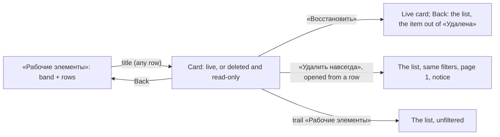

# Design: Work item list filters (feat-003)

Stage 3 artifact. The rules (BR-WS-n) and the scenarios (US-1..US-3) are in `spec.md` and `stories/`; this file is the layout, the MUI and kit parts, every state and every Russian string of what changes, and nowhere else. The page is mod-003's, with mod-017's band; what it already draws is named, not redrawn. Every string in «» is final; ◆ marks a string the spec does not quote or a story only proposed.

- Base: [mod-017](../mod-017-work-item-owning-team/design.md) § 5 (the list, the band, the filtered-empty frame, D-7 "rows stay while a change is read"), [mod-005](../mod-005-work-item-delete-restore/design.md) §§ 4, 6, 7 (the deleted card; this line is its "way in"), feat-040's design § 4 (on its branch, not in main yet: a filter in the address, «Фильтр задан»), [ui-kit.md](../../conventions/ui-kit.md), ADR-0024 (the 640 px floor), ADR-0030.
- **No prototype, no new kit part, token, colour, icon, dependency, permission or error code.** Nothing is new in kind: three fields join a band of one, and a row reads like every row. Every control is a kit part that exists (`InlineTextField`, `InlineMultiSelectField`, `InlineMultiPickerField`, `StateFrame`, `LiveRegion`), on the page's older table and band, which tech-017 restyles.
- Examples use the spec's data: «Альфа», project «Платформа» (MSK), Mia «Участник», Ann «Администратор», Rita «Читатель».
- **The tag filter is not drawn** (OQ-1 A): feat-016 adds «Теги» to this band; the band is built so a field is added by adding one child (§ 2).

## 1. Screen map

One page, no new route. The card page, the creation dialog and the notices are unchanged except where § 6 says.

| Surface | Address (below `/organizations/:o/projects/:p`) | Stories | Change |
|---|---|---|---|
| «Рабочие элементы» | `/workitems` | US-1..US-3 | the band gains «Поиск», «Статус», «Исполнитель» (§ 2); the address carries them (§ 3); «Исполнитель» cell marks, deleted rows (§ 4); states (§ 5) |
| The card page | `/workitems/:identifier` | US-1 | a purge returns to the list it was opened from (§ 6); nothing is redrawn |



## 2. The band «Фильтры»

`FilterBar` as today (a `Paper` band, `role="group"` named «Фильтры», the filter glyph at the left, «Очистить фильтры» at the right end while a filter is set). Its children, in the spec's order (BR-WS-1):

```
Рабочие элементы                                         [+ Новый рабочий элемент ⌄]
+----------------------------------------------------------------------------------+
| ⚲  Поиск                 Статус           Исполнитель              Команда        |
|    [ Заголовок или ID  ] [ Все статусы ⌄] [ Все исполнители     ⌄] [ Все команды ⌄] |
|                                                         ⊘ Очистить фильтры       |
+----------------------------------------------------------------------------------+
| ID | Тип | Заголовок | Исполнитель | Статус | Команда | Область | Изменён         |
```

| Field | Kit part | Width | Rests as |
|---|---|---|---|
| «Поиск» | `InlineTextField`, `frame="always"`, label above, `maxLength` 255, `hint` and `emptyText` «Заголовок или ID» | `spacing(30)` | the hint in `text.secondary` |
| «Статус» | `InlineMultiSelectField<string>`, `frame="always"` | `spacing(25)` | «Все статусы» |
| «Исполнитель» | `InlineMultiPickerField<AssigneeOption>`, `frame="always"` (D-1) | `spacing(35)` | «Все исполнители» |
| «Команда» | `TeamFilter`, as mod-017 § 5.2 | `spacing(30)` | «Все команды» |

Every width has `maxWidth: 100%`. The fields stand at the top of the band (an `alignSelf: 'flex-start'` wrapper each, so a taller «Исполнитель» box, tags in rows, does not move its neighbours); the glyph and «Очистить фильтры» keep the band's centring. `FilterBar` itself is not changed (D-5), and it is used by the languages registry too.

**Common to the fields.** A choice sets the address at once, by replace, and the list goes to page 1 (§ 3). Ticking keeps a list open; Esc closes it with focus on the field; focus stays on the field after every choice. «Очистить фильтры» shows while any filter is set, **including a value the address carries and no field can name** (BR-WS-10); it removes the four parameters in one replace and sends focus to «Поиск» (the button is gone after the click; focus must not fall to the page). A field holds its own text only while the user types in it (§ 2.1); every other field shows the address.

### 2.1 «Поиск» (US-3)

- The field keeps the text typed, in the page's state. The address takes the **trimmed** text after a pause of `SEARCH_DEBOUNCE_MS` (250 ms, the assignee search's pause), on Enter, and on leaving the field; focus stays in the input throughout (the replace does not remount the page). Enter submits nothing else. On leaving, the field shows the trimmed text; a text of spaces only reads blank again and the hint returns.
- A blank text sets no parameter. When the address's keyword changes for any other reason (Back, a link, a clear), the field takes the address's text.
- At most 255 characters: `maxLength` stops typing and pasting. A longer keyword in a link is shown whole (the field cannot cut what it did not type) and lists nothing (BR-WS-9).
- The panel does not match, highlight or cut the text: the server judges it (letter case, «ё», identifier, number). No clear glyph inside the field (the kit has none): the text is cleared by hand or by «Очистить фильтры».

### 2.2 «Статус» (US-1)

- Options: the state names of the process the page already reads (`useProcessDefinition`), each once, in the order they first appear across its types: «Новая», «Активна», «Разрешена», «Закрыта», «Удалена». Names only: the multi-select draws a checkbox and the name, no category dot; the category shows in the rows. No counts. The panel keeps no list of "deleted names": it sends the names chosen, the server judges by category (BR-WS-4).
- The value is the chosen names joined by «, », cut to one line, the full text in the hover title (the kit's rule).
- Process being read: the field works, its list says «Загрузка…». Failed: its list says ◆ «Не удалось загрузить статусы. Попробуйте ещё раз.»; opening it again reads again, as «Команда» does.
- A name in the address that is no option (`готово`, `новая`) is kept, selects nothing and is not named (D-4).

### 2.3 «Исполнитель» (US-2)

```
Исполнитель
[ Иван Кот                                                         ⌄ ]
  ☐ Иван Котов (не в организации)
  ☑ Мия Петрова
  ☐ Пётр Ли (неактивен)
  ☐ Не назначен
```

- **Control (D-1).** The kit's multi-picker: the user types to narrow the list, the chosen are `Tag`s with a remove button («Убрать «Мия Петрова»»), Backspace in an empty input removes the last. The list is whole, in the read's order, filtered on the client by the typed text (the kit's default filter: contains, ignoring case and accents, so «ё» finds «е»; an alike option is found by its e-mail too). `getOptionKey` is the user id, because labels can repeat; `isOptionEqualToValue` compares ids. `noOptionsText`: «Никого не найдено» (the card picker's words). No cap on the list: the kit is not virtualised, so the developer measures a list of 2 000 and reports (§ 11).
- **Options** (BR-WS-6): as the read returns them: people by display name, users the directory does not know last, by id, then «Не назначен». The panel does not sort. Each option's text is `userNameWithMarks` (mod-005's one helper): «Иван Котов (не в организации)», «Пётр Ли (неактивен)», «Неизвестный пользователь», and the column uses the same call (OQ-2 A). The tag shows the same text.
- **Alike options (D-2).** Two options whose full text is equal are told apart in the text itself, in the list and in the tag, and only for them: a known person whose e-mail differs from the other alike options' gets «<текст> — <e-mail>» («Иван Котов — ivan.k@alfa.test», «Иван Котов — i.kotov@beta.test»); the rest (unknown users, no e-mail, equal e-mails) get «№ <n>» after the name, n their place among the alike, 1-based, in the list's order («Неизвестный пользователь № 2 (не в организации)»). A pair that reads differently (with and without «(неактивен)») gets nothing.
- **Which people** depend on the chosen states (BR-WS-6): the options re-read when a chosen state enters or leaves the Removed category (the plan: a flag or the states, the server judges). The previous options stay in the field while the new ones come; when they arrive, a chosen person who is no longer an option leaves the tags (the address keeps the id, § 3).
- States of the list: reading — «Загрузка…» (the field works); failed — ◆ «Не удалось загрузить исполнителей. Попробуйте ещё раз.»; opening it again reads again. «Не назначен» is always present, so the list is never empty before a search.

### 2.4 «Команда»

`TeamFilter` unchanged (mod-017 § 5.2), but for D-4. It stays last, after the fields this line adds.

## 3. The address

BR-WS-11, drawn. The names below are **provisional**: the contract fixes them at the backend stage, after `teamId`; they are written here only so the examples read.

| Dimension | Parameter | One per | Value |
|---|---|---|---|
| Статус | `state` | chosen state | the state's name, as stored |
| Исполнитель | `assigneeId` | chosen option | the user id, or `none` for «Не назначен» |
| Поиск | `search` | the field | the trimmed text |
| Команда | `teamId` | chosen option | mod-020's |

Example: `…/workitems?state=Новая&state=Разрешена&assigneeId=5d1e…&assigneeId=none&search=оплат&teamId=…` (names percent-encoded on the wire, shown decoded).

- **One writer.** A new `useWorkItemFilter` reads and writes all four in one `navigate` (replace, router state, hash and every other parameter kept), so a clear, a pair of fast changes or Back never loses one dimension to another's write. `useTeamFilter` (mod-020) stays for the project views.
- **Values.** Blank values are left out; the same value twice counts once; any other value is kept as written, whether it names anything or not (BR-WS-10). The first `search` counts.
- **Page.** Not in the address: any change of a filter's content (trimmed keyword, values as a set) shows page 1; a link, a reload and Back open page 1. The page's key is the content of the four filters, compared by content as mod-020 does for the team.
- **Links that open the list unfiltered:** the main navigation's «Рабочие элементы», the card page's trail, the switcher's change of project. The card's Back keeps the filter (it is a history step). A filter is not remembered anywhere: no storage, no saved view.
- **Options and the address.** An id in the address that is no option is not a tag, and not an error (§ 5, state 9).

## 4. The rows

The table is today's: `ID`, `Тип`, `Заголовок`, `Исполнитель`, `Статус`, `Команда`, `Область`, `Изменён`; 50 a page; `TablePagination` with the matching count. Nothing is added or reordered.

- **«Исполнитель» cell (OQ-2 A).** The avatar and `userNameWithMarks`: «Иван Котов (не в организации)», «Пётр Ли (неактивен)», «Неизвестный пользователь», «Не назначен» in `text.secondary` for nobody. One text node, so the cell and the option read the same.
- **A deleted row (BR-WS-5, OQ-3 A)** is drawn as every row: «Статус» shows the Removed category's `CategoryMarker` and «Удалена»; «Изменён» shows its last change. No row action, no column of its own, no strike-through or dimming (colour would be the only cue). It is listed only while «Удалена» is chosen, and then among the live rows of the other chosen states, latest change first.
- **Opening.** The title is the link, as on every row, to the card page. The card is the deleted one of mod-005 § 4 (read-only, «Удалил(а): …», «Восстановить» for a holder of `workitems.workitem.delete`, «⋮» → «Удалить навсегда» for `…purge`). Back returns to the list under the same filters, page 1, and the list reads again (mod-005 invalidates the list on a restore or a purge).
- **A restored item** is listed under its new state at the next read; the row of a restore made meanwhile by someone else stays until the list reads again (BR-WS-17), and its card shows the item as it is.

## 5. States of the list

| # | State | The user sees |
|---|---|---|
| 1 | First read pending | the band at once, its fields working; `RegistrySkeleton` (eight headers, «Загрузка данных») |
| 2 | First read failed | the band; `ErrorBanner` with «Повторить» |
| 3 | A change being read | the previous rows stay, the table `aria-busy="true"`, no skeleton, page 1 (mod-017 D-7) |
| 4 | That read failed | `ErrorBanner` «Повторить» replaces the rows, which no longer match; the band stays. A choice past the request line (some 150 people, spec § Option sizes) ends here too |
| 5 | Not found | `NotFound` of the level («Организация не найдена.» / «Проект не найден.») in place of the page; no band |
| 6 | No filter, no live item | `StateFrame` «Рабочих элементов пока нет» with today's hint and action, **under the band**, so «Удалена» still reaches a project whose items are all deleted |
| 7 | A filter set, nothing matches | `StateFrame`, `FilterListOffIcon`, «Ничего не найдено», «Ни один рабочий элемент не подходит под заданные условия фильтра.», action «Сбросить фильтр»; the band stays above it. Both clears (it and «Очистить фильтры») remove all four filters, the team's included (BR-WS-13), and send focus to «Поиск». A bin with nothing in it reads the same frame |
| 8 | The process or an option read failed | only that field's list says so (§ 2.2, § 2.3); the rows are unaffected; the page's `ErrorBanner` for a failed process read is today's |
| 9 | The address carries a value no field can name | the band shows «Очистить фильтры»; the field reads «Фильтр задан» (D-4); the list is state 7 (or the rows of the known values beside it) |
| 10 | Permissions | § 7 |

Filtered means any of the four has a value in the address, a blank keyword and a value that names nothing included: a value that selects nothing is a filter that is on.

## 6. While filtered: creating, restoring, purging

- **Creating (BR-WS-14).** «Новый рабочий элемент» is unchanged. The notice reads «Рабочий элемент MSK-BUG-43 создан.», and «Рабочий элемент MSK-BUG-43 создан. Он не подходит под текущий фильтр.» when the new item fails any of the four, judged on the item the create returns (state, assignee, team, title, identifier) by one pure function that carries the server's meaning (the keyword by title, identifier and number, letter case and «ё» ignored). The list keeps the filter and goes to page 1.
- **Restoring.** On the deleted card the restore dialog is mod-005 § 5, unchanged; after it Back shows the list under its filters, page 1, the item gone from «Удалена».
- **Purging (BR-WS-5, amends mod-005 § 6's landing).** From a card opened from a row of the list, the page returns to that list's address (filters included, page 1) with mod-005's notice «Рабочий элемент MSK-FEAT-6 удалён навсегда.»; from a card reached any other way (its address, another card's «Родитель»), to the list unfiltered, as before. Either way the purged address is replaced, so Back never meets it, and focus goes to `main` (mod-005 § 6's `restoreFocus`). The card page knows it came from the list by a mark on the row's link (router state, § 11); without the mark it goes to the unfiltered list.
- **The trail.** «Рабочие элементы» in the card page's trail opens the list unfiltered; Back is the way back under the filters.

## 7. Roles

| Part | Администратор | Участник | Читатель | Not a member |
|---|---|---|---|---|
| Band, all four fields, «Удалена» | yes | yes | yes | «Организация не найдена.» |
| Rows of «Удалена», opening the deleted card | yes | yes | yes, no action | same |
| «Восстановить» / «Удалить навсегда» on that card | both | «Восстановить» | none | same |
| «Новый рабочий элемент» | yes | yes | not drawn | same |

The list and the options need only `workitems.workitem.read` (spec § Roles). A role without it gets today's «Недостаточно прав» from the list's read (state 2/4); no field is hidden by a missing code.

## 8. Narrow widths (down to 640 CSS px, ADR-0024)

- **Band:** wraps field by field; every field is at most the row's width (`maxWidth: 100%`), so at 640 two fields stand side by side at most and below about 560 px of content each takes a row. «Очистить фильтры» wraps under the last field. The «Исполнитель» box grows by rows, never in width.
- **Lists:** a field's popup is no wider than its field and no wider than the window.
- **Table:** scrolls inside its container as today; the page never scrolls sideways. The pager stays under the table.
- Below 640 nothing is claimed.

## 9. Keyboard and screen reader

| Element | Role | Name |
|---|---|---|
| the band | `group` | «Фильтры» |
| «Поиск» | `textbox` | «Поиск», described by «Заголовок или ID» |
| «Статус» | `combobox`, multiselectable `listbox` | «Статус»; options `option` with `aria-selected` |
| «Исполнитель» | `combobox` (the input), multiselectable `listbox` | «Исполнитель»; the chosen are tags: the remove buttons «Убрать «<текст>»» |
| «Команда» | `combobox` | «Команда» |
| «Очистить фильтры» | `button` | «Очистить фильтры» |
| the table | `table` | «Рабочие элементы», `aria-busy` while a change is read |
| the result | `status` | § 10 |

- **Tab order:** «Новый рабочий элемент», «Поиск», «Статус», «Исполнитель» (each tag's remove button, then the input), «Команда», «Очистить фильтры», the table's links, the pager.
- **Keys.** «Статус» and «Команда»: Enter, Space or Down opens on the current option; arrows and Home/End move; Space or Enter ticks and the list stays open; Esc closes, focus on the field; typing a letter jumps to a name. «Исполнитель»: Down opens; typing narrows; Up/Down, Home/End move; Enter ticks; Backspace in an empty input removes the last tag; Esc closes. «Поиск»: Enter applies at once. All of them reach every option (2 000 included) without the pointer.
- **Announcements.** A page-level `LiveRegion`, from the first frame, says ◆ «Найдено: 5» when a read after a change of a filter settles with rows, and «Ничего не найдено» with none (not on the first read). A tag added or removed is spoken by the kit. Colour is never alone: «Удалена» has its dot and its name.
- **Focus.** After a clear (either), «Поиск». After a choice, the field. After Back from a card, the browser's.

## 10. Interface texts

All final; ◆ new. The rest exists and is listed so the developer copies it.

| Where | Text |
|---|---|
| band | «Фильтры» (group), «Очистить фильтры» |
| search | «Поиск», hint and rest text «Заголовок или ID» |
| state | «Статус», «Все статусы», «Загрузка…», ◆ «Не удалось загрузить статусы. Попробуйте ещё раз.» |
| assignee | «Исполнитель», «Все исполнители», «Не назначен», «Загрузка…», «Никого не найдено», ◆ «Не удалось загрузить исполнителей. Попробуйте ещё раз.»; tag: «Убрать «<текст>»» (kit) |
| marks | «(неактивен)», «(не в организации)», «Неизвестный пользователь» (no «(неактивен)» for it, mod-005 H-1 A); alike: ◆ « — <e-mail>», ◆ « № <n>» |
| unnameable value | ◆ «Фильтр задан» in place of «Все …» |
| team | «Команда», «Все команды» |
| empty | «Рабочих элементов пока нет» (hint as today), «Ничего не найдено», «Ни один рабочий элемент не подходит под заданные условия фильтра.», «Сбросить фильтр» |
| announced | ◆ «Найдено: <n>», «Ничего не найдено» |
| notices | «Рабочий элемент MSK-BUG-43 создан.», «… Он не подходит под текущий фильтр.», «Рабочий элемент MSK-FEAT-6 удалён навсегда.» |
| frames | «Организация не найдена.», «Проект не найден.», «Недостаточно прав» |

## 11. For the developer and the tests

- **Files** (`features/workitems`). New: `components/StateFilter.tsx`, `AssigneeFilter.tsx`, `KeywordFilter.tsx` beside `TeamFilter.tsx` (feat-013 reuses them on the views, BR-WS-16, so they take values and `onChange`, not the page), exported from `index.ts`; `hooks/useWorkItemFilter.ts` (§ 3); `lib/workItemFilter.ts` (`filterOf(search)`, `isFiltered`, `filterMismatch(item, filter)` for the notice, `stateOptions(process)`); `lib/assigneeFilterOptions.ts` (`tellApart` of D-2). The page composes the band, derives its key from the filters' content and passes them to `useWorkItems`. `userNameWithMarks` (`lib/deletion.ts`) serves the options, the tags and the column.
- **Needs from the contract (backend stage).** The list read takes the three parameters beside `teamId`; its rows' `assignee` gains the marks (`isActive`, `isMember`, as mod-005's deleter has them, OQ-2 A); an options read under the organization and the project returns, in BR-WS-6's order, `{ id, displayName | null, email, isActive, isMember }` and answers the list's 404s; state names travel as stored. The panel never sorts, never computes who is deleted, never holds more than a page of rows.
- **Shared files, to take in before editing** (the line merges after mod-020, which is in main, and expects to merge before feat-040):

| File | Also changed by | What this line does |
|---|---|---|
| `hooks/useTeamFilter.ts` | mod-020 (merged); feat-040 copies its form for `projectId` | not edited: `useWorkItemFilter` imports `TEAM_FILTER_PARAM` and `teamFilterOf` |
| `pages/WorkItemsPage.tsx` (+ test) | mod-020 (merged) | takes the band, key, states and notice from § 2-§ 6; start from main |
| `components/TeamFilter.tsx` | mod-017, mod-020; feat-040's `FilterRow` hosts it | one line, only if D-4 is A: `emptyText` follows the address |
| `lib/teams.ts` (`createdNotice`) | feat-040 adds the team reason | not widened: the page asks `filterMismatch` and composes; feat-040's change is then a one-line reconcile |
| `shared/ui/FilterBar.tsx`, `boards/components/ProjectFilterRow.tsx` | feat-040 (`FilterRow`) | neither edited (D-5); the new fields do not go to project views (feat-013) |
| `index.ts`, `api/workItemsApi.ts`, `api/queryKeys.ts`, `hooks/queries.ts` | mod-020 (`index.ts`); feat-040 (reads) | additions only; keys gain the three dimensions and the options read |
| `pages/WorkItemFormPage.tsx` | none in flight | the purge landing (§ 6); the row's link carries the list's address in router state; after a purge the page `replace`s to that address when its own entry carries the mark, else to the unfiltered list |

  If feat-040 merged first, follow its `FilterRow` and `createdNotice`; if not, whichever merges second reconciles and logs it in its `status.md`. A note goes into mod-005 design § 6 (the landing) and mod-003's `status.md` (the column), as the spec says.
- **Kit guard:** no new site, no allow-list entry; the three fields are kit parts, the band is `FilterBar`.
- **Tests (Vitest + MSW).** Each field's options, texts and empty rest; the debounce, Enter and leave of «Поиск», trimming and 255; the address round trip of the four (replace, others kept, blank left out, one clear = one replace, page 1); unnameable values (state 9) per field; alike options (D-2, a table of cases incl. unknown users); the deleted row (status cell, no action, title opens); every state of § 5; the band at 640 and the announcements; the notice judged by all four; the purge landing both ways and Back. A list of 2 000 people in the picker: open, type, tick, in a measured test; if it is slow, say so before QA (D-1 B is the fallback). E2E: none (standing answer).

## 12. Decisions for gate-2

Each stands alone; the design is drawn on A.

- [x] **D-1 The «Исполнитель» control.** (A, recommended) The kit's multi-picker (§ 2.3): type to narrow a list that can hold 2 000 people, the chosen shown as tags you can read and remove one by one, long names with marks never cut to «Иван Котов (не в организ…». Cost: the box grows by rows, and the field differs from its neighbours. (B) The plain multi-select like «Статус» and «Команда»: one pattern and a fixed-height band, but no search in a list of up to 2 000 names, and several chosen names are joined and cut to one line. The spec leaves the search to the design. Answered A by the human at gate-2, 2026-10-18.
- [x] **D-2 Telling alike options apart (BR-WS-6).** (A, recommended) Only for options whose text is equal: the e-mail after a dash, or «№ n» when the e-mail does not tell them apart (§ 2.3): nothing is added to the people who read differently. (B) The e-mail after the name for everyone known: one rule, but noise on 2 000 lines and an e-mail shown beside every tag. The e-mail is already in the list read and in the card's picker. Answered A by the human at gate-2, 2026-10-18.
- [x] **D-3 When the keyword applies.** (A, recommended) After a 250 ms pause, on Enter and on leaving the field (§ 2.1): the list follows the typing without a button. (B) Only on Enter or a «Найти» button: fewer reads, but a user who types and waits sees nothing happen. (C) On every keystroke: no pause, a read and a history replace per letter. Answered A by the human at gate-2, 2026-10-18.
- [x] **D-4 A value in the address that the field cannot name.** (A, recommended) The field reads «Фильтр задан» in place of «Все …», for «Статус», «Исполнитель» and «Команда» (feat-040 draws its project filter so): the user sees which field holds the filter that empties the list. Cost: one line in the shared `TeamFilter`. (B) «Все …» stays and only «Очистить фильтры» says a filter is on: the spec's minimum, but a field reading "all" above an empty list. (C) The two new fields only; «Команда» keeps mod-017's reading: no shared edit, two readings in one band. Answered A by the human at gate-2, 2026-10-18.
- [x] **D-5 The band's look.** (A, recommended) The list's own `FilterBar` as today, the fields inside it: one band, restyled with the table by tech-017; no coupling to feat-040. (B) feat-040's borderless `FilterRow`: the kit's look on the list now, but over the legacy table, and this line then waits for feat-040 to merge. Answered A by the human at gate-2, 2026-10-18.
- [x] **D-6 A line about restoring when «Удалена» is chosen.** (A, recommended) None: the rows say «Удалена», the card says what can be done (mod-005 § 4), and a reader is not told of what they cannot do. (B) An `InlineNotice` over the table while «Удалена» is chosen, ◆ «В списке есть удалённые рабочие элементы. Откройте элемент, чтобы вернуть его на место.»: the way back is discoverable, but the sentence is false for a reader, comes and goes with the filter, and is one more block. Answered A by the human at gate-2, 2026-10-18.

## 13. Stories to screens

| Story | Closed by |
|---|---|
| US-1 (state, «Удалена», the bin, address, empty, creation) | § 2.2, § 3, § 4, § 5, § 6, § 7 |
| US-2 (assignee, former members) | § 2.3, § 3, § 4 (the cell), § 5 state 9 |
| US-3 (keyword) | § 2.1, § 3, § 5, § 6 (the notice) |
