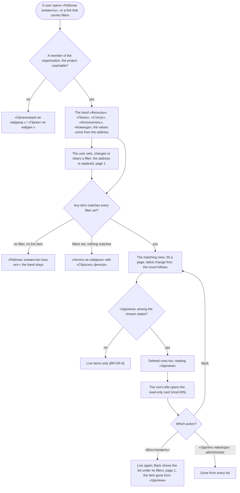

# Spec: Work item list filters (feat-003)

## Context and goal

A project's «Рабочие элементы» list (mod-003) shows every live item, latest change first, 50 a page, with one filter, the owning team's (mod-017 BR-OT-8), which mod-020 (in flight) moves into the page address. A member who remembers a word of a title or an identifier, or wants one person's or one state's work, has to page through it. mod-005 (merged 2026-10-18) made «Удалена» the recycle bin and built no way to list it (its OQ-2 A): this line's «Удалена» state option is the way in, and until it ships a deleted item with no live relative is reached by its address alone.
The line adds three dimensions to the shared filter specification: the state, «Удалена» included; the assignee, former members included; and a keyword over «Заголовок» and the identifier (doc-002 US-11, doc-010 D-14). The area filter retires with the item's «Область» (doc-012 OQ-1 A); the tag filter goes to feat-016, which stores tags (OQ-1). Rule ids: BR-n is doc-001's, BR-M3-n doc-002's and mod-003's, BR-MX-n doc-012's, BR-OT-n mod-017's, BR-DR-n mod-005's, BR-TS-n feat-040's, BR-NE-n doc-013's; BR-WS-n are this spec's.

## Roles

Access is the organization role's bundle (ADR-0027). The list and the filter options are a read inside one project: they need only the gate `workitems.workitem.read` (ADR-0029 § 7, "a read inside one project … needs only the gate"), checked on the organization role until `mod-019-scoped-access`. No code is added. Belonging to a team grants nothing.

| Role | Lists and filters, «Удалена» included | Opens a deleted row's card | Restores it / purges it (mod-005) |
|---|---|---|---|
| «Администратор» | yes | yes, read-only | «Восстановить» / «Удалить навсегда» |
| «Участник» | yes | yes, read-only | «Восстановить» / no |
| «Читатель» | yes | yes, read-only, no action | no / no |
| Not a member of the organization, an instance administrator included | «Организация не найдена.» | same | same |

## Common data

Used by the stories; a scenario may add to it.

- Organization «Альфа»: project «Платформа» (key MSK), teams MARS and VENUS. Users: Ann «Анна Смирнова», «Администратор»; Mia «Мия Петрова», «Участник»; Rita «Рита Орлова», «Читатель»; Zoya «Зоя Ким», «Участник»; Ivan «Иван Котов», whose membership was removed; Petr «Пётр Ли», a «Участник» whose account is disabled. Organization «Другая»: project «Чужой» (key OTH), its administrator Oleg «Олег Сидоров», the item OTH-US-1 «Оплата картой», assigned to Oleg.
- The items of «Платформа», latest change first. Live: MSK-BUG-42 «Падение при входе» («Новая», Mia, VENUS); MSK-US-3 «Отчёт склада: 100%» («Разрешена», no assignee, «Без команды»); MSK-TASK-4 «Проверить 42 сценария» («Закрыта», Petr, MARS); MSK-BUG-2 «Ошибка оплаты» («Разрешена», Ivan, VENUS); MSK-US-1 «Оплата картой» («Активна», Mia, MARS; its «Описание» reads «Через Stripe»). Deleted, both changed after every live item: MSK-FEAT-6 «Импорт склада» (Zoya, VENUS; Ann deleted it on 18.10.2026 09:00, it held «Новая»), then MSK-US-5 «Возврат оплаты» (Ivan, MARS; Mia deleted it on 17.10.2026 10:00, it held «Активна»). The numbers 7 to 41 belonged to items purged earlier (BR-M3-5: gaps are normal).
- So the unfiltered list reads MSK-BUG-42, MSK-US-3, MSK-TASK-4, MSK-BUG-2, MSK-US-1, and its count is 5.

## Stories

| id | Title | depends-on | File |
|----|-------|------------|------|
| US-1 | A member narrows the list by state and finds deleted items under «Удалена» | - | `stories/US-1-state-filter-and-recycle-bin.md` |
| US-2 | A member narrows the list by assignee, former members included | US-1 | `stories/US-2-assignee-filter.md` |
| US-3 | A member finds an item by a keyword over its title and identifier | US-1 | `stories/US-3-keyword.md` |

All three are `shippable: no`: they are one band on one list, one M and one MR; each needs US-1's band, address and empty states, and none is spun out.

## Business process (BPMN)

## Business rules

| # | Rule | Source |
|---|------|--------|
| BR-WS-1 | **The band.** The list's band «Фильтры» holds «Поиск» (the keyword), «Статус», «Исполнитель» and mod-017's «Команда»; their order and look are the design's. A filter narrows the list and nothing else: no item changes, the rows still shown keep their relative order, and the count and every page follow it. | doc-002 US-11; BR-OT-8; doc-001 BR-12 |
| BR-WS-2 | **Combination.** An item is listed when it matches every filter that is set. Within «Статус», «Исполнитель» and «Команда» any chosen value matches. A filter with no value sets no condition. | doc-012 US-11 ("every filter chosen, and any one value chosen within a filter"); BR-OT-8 |
| BR-WS-3 | **«Статус».** The options are the state names of the organization's process, each once, in the order they first appear across its types: today «Новая», «Активна», «Разрешена», «Закрыта», «Удалена». A chosen name matches every item whose state, on its own type, bears that name, whatever the type: «Разрешена» finds a «Пользовательская история» and a «Баг» alike, and no «Задача», whose type has no such state. A state name has one category on every type of a process (`StateNameRule`, BR-2), so a name and its category never disagree. No option shows a count. With nothing chosen the field reads «Все статусы». | doc-002 US-11 («Разрешена» spans two categories); mod-001 seed |
| BR-WS-4 | **Deleted items.** While «Удалена» is not chosen, a deleted item is in no row, no count, no option of «Исполнитель» and no keyword result. With it chosen, the deleted items that match every other filter are listed beside the live items the other chosen states match. «Удалена» is the state of the Removed category; the server judges "deleted" by that category, never by the name. There is no «Корзина» page: this option is the recycle bin. | mod-005 BR-DR-1, BR-DR-6; doc-001 D-5, BR-14 (a) |
| BR-WS-5 | **A deleted row (OQ-3 A).** It reads like any row: «Статус» shows «Удалена» with the Removed category's mark, and «Изменён» its last change, which is the deletion unless a clean-up changed it since (BR-DR-9). There is no row action and no column of its own. Its title opens its card, read-only (BR-DR-7): the card tells who deleted it and when, and offers «Восстановить» to a holder of `workitems.workitem.delete` and «Удалить навсегда» to a holder of `workitems.workitem.purge`. Back from the card shows the list under the same filters. After a restore it is listed under its new state, and after a purge nowhere, from the next read on. | mod-005 BR-DR-7, -10, -12; design § 4 |
| BR-WS-6 | **«Исполнитель», its options.** The people assigned to the project's items outside «Удалена», and also to its deleted items while «Статус» names «Удалена»; then «Не назначен». Members, former members and disabled accounts alike; nobody else: no member who is assigned nothing, no assignee of another project. People are ordered by display name (mod-014 BR-UP-15), users the directory does not know last, and «Не назначен» ends the list. No option shows a count. With nothing chosen the field reads «Все исполнители». These are not the «Исполнитель» picker's candidates, which are active members only and are read with `workitems.workitem.write` (mod-016 BR-M1-26, inventory row 34). | doc-002 US-11; doc-012 US-11 (the «Исполнитель» options) |
| BR-WS-7 | **How a person reads.** The display name, then «(неактивен)» when the account is disabled or deleted, or «(не в организации)» when the membership has ended, which prevails. A user the directory does not know reads «Неизвестный пользователь», with no «(неактивен)», and still «(не в организации)» when the membership says so (mod-005 H-1 A); two such users are two options. The marks follow each read: a former member added back loses «(не в организации)». The same words, from mod-005's one helper, stand in the options and in the list's «Исполнитель» column (OQ-2 A). | doc-001 BR-13; doc-002 § Fields (W-3); mod-005 BR-DR-7 |
| BR-WS-8 | **«Исполнитель», its match.** A chosen person matches the items assigned to them now; «Не назначен» matches the items with no assignee. | doc-002 US-11 |
| BR-WS-9 | **The keyword.** One field «Поиск», hint «Заголовок или ID». It is trimmed at both ends; a blank one sets no filter; the field takes at most 255 characters, the title's limit (BR-M3-3), and the server treats a longer one like any other. An item matches when (a) its «Заголовок» contains the keyword as one piece of text, ignoring letter case, «ё» equal to «е»; or (b) the keyword is its identifier, ignoring letter case («MSK-BUG-42», «msk-bug-42»); or (c) the keyword is its number, in digits as the identifier writes it («42»), which is unique in the project. Every character is literal: «%», «_» and «\» find only themselves. A part of an identifier («MSK-BUG-4», «BUG-42»), an identifier with another type's key, and another project's identifier match no identifier; they still match a title that contains them. «Описание», other fields and comments are not searched, and words are not reduced to their stems. A deleted item matches only while «Удалена» is chosen (BR-WS-4). | doc-002 US-11 (keyword), § Out of scope; doc-010 D-14; doc-012 US-11; mod-014 BR-UP-14 («ё») |
| BR-WS-10 | **A value that names nothing** selects nothing, alike for every kind: status and body are those of an unknown value, and it is never an error. Beside a valid value it adds nothing. For «Статус»: a name that is no state of the process. For «Исполнитель»: an id of nobody assigned to an item of the project: malformed, unknown, another organization's user, a member assigned nothing. Whenever the address carries a value, one that selects nothing included, the band shows that a filter is on and offers «Очистить фильтры»; the field names only values it knows. | BR-OT-8; feat-040 BR-TS-8; BR-MX-1 |
| BR-WS-11 | **The address.** Every filter lives in the page's address, so a link, a reload and Back from a card carry it: «Статус» and «Исполнитель» as one repeated parameter per chosen value, the keyword as one parameter, in the form mod-020 founded for `teamId` and named as the list's read names them (the contract's, at the backend stage). A change replaces the address's history entry, so Back leaves the page instead of stepping through filters, and keeps every other parameter. The page number is not in the address: it returns to 1 whenever any filter's content changes, and a link or Back opens page 1. A blank value names nothing. A link without these parameters, the main navigation's «Рабочие элементы» among them, opens the list unfiltered. The server stores nothing, and no filter is a saved query. | mod-017 OQ-9 B (mod-020); feat-040 OQ-2 A, BR-TS-8; doc-002 US-11; doc-010 D-4 |
| BR-WS-12 | **Count, paging and order.** 50 rows a page, latest change first, then by number descending, as today. The pager's count is the number of matching items; a page past the last answers no rows and the right count. The server pages: the panel never holds more than the page. | mod-003 BR-M3-29, api-contract § 2.1; doc-012 NFR Client load |
| BR-WS-13 | **Empty results.** When filters are set and nothing matches: the filtered-empty frame «Ничего не найдено», «Ни один рабочий элемент не подходит под заданные условия фильтра.», with «Сбросить фильтр», which clears every filter, the team's included. With no filter set and no live item: the project's empty state «Рабочих элементов пока нет», unchanged. The band stays on both, so «Удалена» still reaches the deleted items of a project that has no live one. | mod-003 (the list's states); mod-017 design § 6.3 |
| BR-WS-14 | **Creating while filtered.** «Новый рабочий элемент» stays as it is. The notice reads «Рабочий элемент <ID> создан.», followed by «Он не подходит под текущий фильтр.» when the new item fails any filter that is set: today the notice judges the team filter alone, and from this line all four. | mod-017 design § 4 |
| BR-WS-15 | **Containment.** The list is addressed under the organization and the project, as today: a non-member gets «Организация не найдена.», a deactivated, unknown or foreign project «Проект не найден.» (mod-003 § 0.3, ADR-0026). A value that names another organization's or another project's object selects nothing (BR-WS-10). The options name only people assigned to this project's items. A keyword never finds another project's item, by its identifier or otherwise. | BR-MX-1; ADR-0026; ADR-0027 |
| BR-WS-16 | **One specification.** State, assignee and keyword join the shared filter specification that mod-017 founded with the team and feat-040 extends with the project: one meaning per dimension wherever it appears. feat-013 brings them to the team, project and area views, and feat-043 to its cross-project list (§ Owed by later lines). | doc-012 NFR Query shape; doc-010 D-14; doc-013 BR-NE-8 |
| BR-WS-17 | **Freshness.** There is no push. A row that another user changed, deleted or restored shows as it was until the list reads again; its card shows the item as it is (mod-005 design § 4, the mode follows the read). One read of a page shows an item at most once. | BR-MX-16; mod-005 US-2 |

## Error codes

None is added; a filter value is never an error (BR-WS-10). The list keeps its answers: 404 `organizations.organization.not_found` «Организация не найдена.», 404 `organizations.project.not_found` «Проект не найден.», 400 `workitems.validation_failed` with `workitems.invalid_page` «Некорректный номер страницы.» for a page below 1, and 403 `organizations.access.forbidden` «Недостаточно прав» for a role without the gate.

## Operation completeness

| Entity | Create | Read | Update | Delete/deactivate | Cancel/reverse |
|--------|--------|------|--------|-------------------|----------------|
| The list's filters (values in the address) | every reader: choosing or typing a value, or opening a link (US-1..US-3) | every reader | every reader: changing the values | every reader: a field's clearing, «Очистить фильтры», «Сбросить фильтр» | no: a change replaces the history entry (BR-WS-11); choosing again is the reversal |
| A deleted item listed under «Удалена» | no: only mod-005's Delete puts it there | every reader (US-1) | no: read-only (BR-DR-8) | administrator: «Удалить навсегда» on its card (mod-005 US-6) | «Участник», «Администратор»: «Восстановить» on its card (mod-005 US-4) |
| The «Исполнитель» options | no: derived from the items' assignees | every reader | no | no: a person leaves the options when no item is assigned to them | n/a |

## Non-functional requirements

- **Speed.** At doc-012's volumes (an organization of 100,000 items), a project of 5,000 items, 500 of them in «Удалена»: the first page and its count arrive within 2 s unfiltered, with each filter alone and with all four set, «Удалена» among them; the «Исполнитель» options arrive within 2 s with 2,000 people assigned (doc-002 NFR; doc-012 NFR Volumes; mod-005 NFR).
- **Query shape.** The list's read and the options' read each take a number of statements that does not grow with rows, chosen values or assignees; a statement-count test pins each (doc-012 NFR Query shape).
- **Option sizes.** «Исполнитель» holds up to the organization's 2,000 members and «Статус» the process's states; both are reached whole by keyboard, and whether «Исполнитель» needs a search is the design's.
- **Non-disclosure.** BR-WS-10 and BR-WS-15: a test per kind of value (malformed, unknown, another project's, another organization's) proves the same status and body.
- **Accessibility.** Every field works by keyboard and down to 640 CSS px (ADR-0024).
- **Localization.** Interface copy is Russian, quoted above and in the stories. No error code is added, so no Kazakh text is owed.

## Out of scope

- The tag filter: feat-016, once tags are stored (OQ-1). The area filter: it retires with the item's «Область» (doc-012 OQ-1 A).
- «Тип», «Приоритет», «Спринт» and «Целевая дата» on this list: none is in this line's queue line; the sprint filter of the list is feat-008's, and the views' filters are feat-013's.
- Sorting by a column: the order stays mod-003's (BR-WS-12). Counts on options. Searching «Описание», other fields or comments; word forms (doc-002 § Out of scope: release 2/3).
- Saved, shared or remembered filters, «Мои» shortcuts (mod-008, feat-013; doc-010 D-4). A «Корзина» page; restore, purge or delete from a row; bulk restore or purge (mod-005 § Out of scope; OQ-3).
- The cross-project «Рабочие элементы» list (feat-043), and hiding projects a user may not see (feat-041).

## Owed by later lines

| Line | Owes |
|---|---|
| feat-043-area-project-team-navigation | doc-013 BR-NE-8: whichever of it and this line merges second carries these filters and the keyword onto feat-043's cross-project «Рабочие элементы» list and the project's «Рабочие элементы» section, logged in its status.md. This line is expected to merge first, so feat-043 carries them; across projects the keyword's number alone (BR-WS-9 (c)) is no longer unique, which feat-043 settles |
| feat-016-work-item-tags | the list's tag filter in this band, with this line's meaning: any chosen tag matches, a tag of another project is never offered, a tag carried only by deleted items is offered only while «Удалена» is chosen (OQ-1 A; doc-002 BR-M3-11) |
| feat-017-work-item-assignee-marks | the marks on the card's «Исполнитель» field and picker; the list's column takes them here (OQ-2 A) |
| feat-013-board-backlog-filter | state, assignee and keyword on the views with this line's meaning (BR-WS-16); remembering filters per view |
| feat-008-iteration-filter | the list's «Спринт» filter, a dimension added to this band |
| feat-041-project-visibility | the «нет доступа к проекту» mark on an assignee in the options and the column (BR-MX-25); non-disclosure on feat-043's list |
| mod-008-queries-dashboards | saved queries' clauses mean what these filters mean; a query excludes a deleted item unless a clause names «Удалена» (ADR-0030) |

## Decomposition for the backlog

None: one M task, one MR. Queue amendments the orchestrator makes after gate-1 (this task edits no queue file):

- `feat-016-work-item-tags`: add the list's tag filter (OQ-1).
- `feat-017-work-item-assignee-marks`: the list's column leaves it, the card's field and picker stay (OQ-2).

**Lines in flight.** mod-020 (S, its PR opening) and feat-040 (L, in development) change files this line changes too. Development starts on a main that holds mod-020; if feat-040 has not merged by then, whichever of the two merges second reconciles the shared files, logged in its status.md. Frontend: `src/frontend/src/features/workitems/pages/WorkItemsPage.tsx` and `WorkItemsPage.test.tsx`, `hooks/useTeamFilter.ts` and `index.ts` (mod-020: the address form this line reuses); `lib/teams.ts` (`createdNotice`, feat-040's team reason); `api/workItemsApi.ts`, `api/queryKeys.ts` and `hooks/queries.ts` (the list's read); `src/frontend/src/shared/ui/FilterBar.tsx` and `src/frontend/src/features/boards/components/ProjectFilterRow.tsx` (feat-040's one `FilterRow`). Backend: `src/backend/Mustask.Domain/WorkItems/WorkItemFilter.cs` and `src/backend/Mustask.Infrastructure/WorkItems/WorkItemFilterPredicate.cs` (feat-040's project dimension); `Mustask.Infrastructure/WorkItems/WorkItemReadModel.cs` (`GetPageAsync`), `Mustask.Application/Features/WorkItems/GetWorkItems/`, `Mustask.Api/Features/WorkItems/WorkItemEndpoints.cs`. Docs: mod-017 api-contract § 3, the shared filter specification, which mod-020 amended and feat-040 extends; this line's api-contract restates it with a note in mod-017's status.md (AGENTS.md).

| id | Task | size | deps |
|----|------|------|------|
| - | none: this is the whole task | - | - |

## Open questions

- [ ] **OQ-1 The tag filter.** Tags are not stored yet: feat-016 stores them, and feat-016 waits for feat-013, which waits for this line, so this line cannot wait for feat-016 without a cycle. (A, recommended) Move the list's tag filter to feat-016, as doc-012 moved feat-013's: feat-016 adds «Теги» to this band once tags exist, with this line's meaning (§ Owed by later lines), and the orchestrator rewords its queue line. (B) Keep it here and wait: feat-003 then depends on feat-016, feat-016 drops its dependency on feat-013, and the recycle bin stays reachable by address only until both ship, against mod-005 OQ-2's "queue it next". (C) Store tags in this line: it takes feat-016's data model into a filter line and grows past an M. The analysis goes on with A. For the human at gate-1.
- [ ] **OQ-2 The marks in the list's «Исполнитель» column.** feat-017 (S, queued) owns «(неактивен)» and «(не в организации)» on the card and in the list; this line's filter must name a former member, so its options carry the marks either way. (A, recommended) This line shows the marks in the options and in the list's column, with mod-005's one helper, and feat-017 keeps the card's field and picker: an option «Иван Котов (не в организации)» then picks rows that read the same; the orchestrator rewords feat-017's queue line. (B) The marks in the options only; the column waits for feat-017: a smaller change, but until feat-017 a row reads «Иван Котов» while the filter that found it reads «Иван Котов (не в организации)». The analysis goes on with A. For the human at gate-1.
- [ ] **OQ-3 What a deleted row shows and offers.** (A, recommended) It reads like any row, «Удалена» in «Статус» with its mark; its title opens the read-only card, which tells who deleted it and when and offers «Восстановить» and, to the administrator, «Удалить навсегда» (mod-005); no row action and no column of its own (BR-WS-5). The latest deletions come first, since a deletion is a change. (B) While «Статус» names «Удалена», the list gains the columns «Удалил(а)» and «Дата удаления» and a row action «Восстановить»: the bin reads at a glance and restores in one click, but that is a second restore surface with its own dialog, refusals and races (mod-005 BR-DR-11), and columns that come and go with a filter. The analysis goes on with A. For the human at gate-1.
