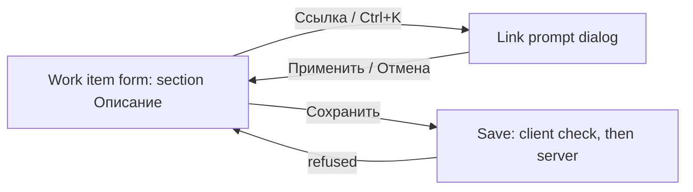

# Design: Описание of a work item as rich text

Stories: US-1 (the editor; this design), US-3 (what the editor shows for existing
text), US-4 (the limits the editor mirrors). US-2 is server-only: no screen.
The engine is TipTap, decided by the editor ADR (proposed): this design names no
library, version or extension, only behaviour and MUI parts. Interface copy is
final Russian; US-1's table is reused as is, and what this design adds is listed
in § Interface texts. No E2E; QA is jsdom plus the manual items of US-1 § Verification.

## Screen map

One existing screen changes: the work item form
(`…/projects/:projectId/workitems/:identifier`, `WorkItemFormPage`), section
«Описание». One new sub-surface, the link prompt, a dialog opened from the editor.
No new route, no new navigation entry.



| Screen | Route | Stories covered | Access (roles) |
|---|---|---|---|
| Work item form, section «Описание» (editor) | unchanged | US-1, US-3 (display), US-4 (limits shown) | any signed-in user who may edit the item (BR-M3-27); no new permission |
| Link prompt (dialog over the form) | none (a dialog) | US-1 | same |

The other text fields of the type («Критерии приёмки», «Шаги воспроизведения»,
«Сведения о системе») stay plain `TextField`s: out of scope (spec § Out of scope).
They sit beside the editor, so it looks like a sibling of an outlined field.

## Screen: Work item form, section «Описание»

### Layout

The section keeps its place in the 8/4 «Детали» grid, left column, first
(feat-022): `FormSection` `h2` «Описание», then the editor card, then one helper
row. The page's own `h1`, band, pickers and «Сохранить» are unchanged.

```
FormSection  h2 «Описание»  ─────────────────────────────────
+------------------------------------------------------------+  <- editor card: 1 px input border,
| toolbar  role=toolbar «Форматирование описания»            |     theme radius, focus-within 2 px accent
| [↶][↷] | [H3][H4] | [B][I][‹›] | [•][1.][⇥][⇤] | [🔗][⊘] | [{}][▦][▦▾] |
|------------------------------------------------------------|  <- divider rule
| editor body  role=textbox  «Описание»                      |
|  placeholder «Добавьте описание» when empty                |
|  min 6 lines, grows, then scrolls inside (max 70 vh)       |
+------------------------------------------------------------+
 ⓘ Изображения в описание не вставляются.   <- notice (live), only after a drop/paste
 До 100 000 символов                          98 450 / 100 000   <- helper | counter
```

### Components (MUI)

| Block | MUI component | Notes |
|---|---|---|
| Section frame | `FormSection` (existing) | unchanged; its `h2` is the visible label, so the editor has no floating `InputLabel` |
| Editor card | `Box` styled as the outlined field: `theme.palette.shell.inputBorder`, `theme.shape.borderRadius`, hover `text.primary`, `:focus-within` 2 px `primary.main`, error `error.main`, disabled `action.disabled` | mirrors `MuiOutlinedInput` in `app/theme/components.ts`; no colour literal |
| Toolbar | `Toolbar` (`variant="dense"`, `disableGutters`) with `role="toolbar"`, `aria-label` «Форматирование описания», `flexWrap: 'wrap'` | one `Divider orientation="vertical" flexItem` between groups |
| Mark and block toggles | `ToggleButton` (`size="small"`, `value`, `selected` mirrors the caret's formatting, so `aria-pressed`) | headings, bold, italic, inline code, both lists, code block |
| Actions | `IconButton` (`size="small"`) | undo, redo, indent, outdent, link, unlink, insert table |
| Every control | wrapped in `Tooltip` with the control's name and its shortcut; the control's `aria-label` is the bare name from US-1, which the tooltip must not replace | a disabled control sits in a `span` so the tooltip still shows |
| Table operations | one `IconButton` «Операции с таблицей» opening a `Menu` of `MenuItem`s (the «Строка заголовка» item is a `MenuItem` with `aria-checked` and a leading `Check` icon) | see D-2; names are exactly US-1's; «Удалить таблицу» last, after a `Divider` |
| Body | `Box` (`role="textbox"`, `aria-multiline`, `aria-label` «Описание», `aria-placeholder` «Добавьте описание») holding the engine's editable element | the engine's DOM is the only place raw markup is built; `react/no-danger` stays an error (BR-RT-12) |
| Helper row | `FormHelperText` (`error` when refused) + a right-aligned `Typography variant="caption"` counter, in one `Box` with `justifyContent: 'space-between'`, `flexWrap` | helper and error share one slot, as on the form's other fields |
| Notice | `FormHelperText`-styled `Box` with `role="status"` and a small `InfoOutlined` icon | polite live region, always in the DOM, empty by default |
| Link prompt | `FormDialog` (existing in `shared/ui`) with one `TextField` | § Link prompt |
| Loading of the editor chunk | `Skeleton variant="rounded"` | § States |
| Chunk load failure | `Alert severity="error"` with a «Повторить» `Button` (`ErrorBanner`'s shape) | § States |
| Icons | `@mui/icons-material` only (ADR-0019): `Undo`, `Redo`, `FormatBold`, `FormatItalic`, `Code`, `FormatListBulleted`, `FormatListNumbered`, `FormatIndentIncrease`, `FormatIndentDecrease`, `InsertLink`, `LinkOff`, `DataObject`, `TableChart`, `ArrowDropDown` | headings are the text glyphs «H3» «H4» (a numeral-only icon is ambiguous); the developer confirms each name against the installed package |

Placement of the component: it is wanted by this form, by the follow-up that puts
the same editor on the type's three texts, and by comments (feat-002, another
slice). It is therefore a `shared/ui` wrapper with no business logic: the
canonical string in, the canonical string out, limits and copy passed by the
caller where they are domain values. The format-neutral pure functions
(normalisation, BR-RT-8 count, legacy conversion) go to `shared/lib` beside it.
The final split is `plan-frontend.md`'s.

### Toolbar groups

Order, left to right. A group separator is a `Divider`; on wrapping, a group is
kept whole where it fits.

| # | Group | Controls (accessible name, US-1) | Shortcut | Enabled / pressed |
|---|---|---|---|---|
| 1 | History | «Отменить», «Повторить» | Ctrl+Z; Ctrl+Y or Ctrl+Shift+Z (⌘ on macOS) | enabled while there is something to undo or redo |
| 2 | Headings | «Заголовок 3», «Заголовок 4» | none beyond the engine's own for these two levels | pressed when the caret's block is that level; exclusive; pressing a pressed one returns the block to a paragraph |
| 3 | Inline | «Полужирный», «Курсив», «Код в строке» | Ctrl+B, Ctrl+I, none | pressed at the caret; inline code is not combinable with other marks (BR-RT-5), so bold and italic are disabled inside it |
| 4 | Lists | «Маркированный список», «Нумерованный список», «Увеличить отступ списка», «Уменьшить отступ списка» | none (Tab never indents) | list toggles pressed in a list of that kind; the two indent buttons enabled only in a list item, «Увеличить» not at depth 3, «Уменьшить» not at depth 1 |
| 5 | Link | «Ссылка», «Убрать ссылку» | Ctrl+K | «Ссылка» enabled with a non-empty selection or the caret in a link; «Убрать ссылку» only in a link |
| 6 | Blocks | «Блок кода», «Таблица», «Операции с таблицей» | none | «Блок кода» pressed in a code block; «Таблица» inserts 3 × 3 with a header row (disabled inside a table: no nesting, BR-RT-5); «Операции с таблицей» enabled only with the caret in a table |

Table menu items, in order: «Добавить строку», «Удалить строку»,
«Добавить столбец», «Удалить столбец», «Строка заголовка» (a check item),
divider, «Удалить таблицу». Deleting the last row or column is not offered (the
item is disabled at one row or one column; the table is removed only by «Удалить
таблицу»). No merge, no split, no cell colour. «Удалить таблицу» asks no
confirmation: it is one undo step and the toolbar holds «Отменить» (D-3).

Anything the editor engine binds by default outside this subset (other heading
levels, strike-through, blockquote, task lists, horizontal rule) is switched off,
so a shortcut cannot create what the toolbar does not offer. Markdown-style input
rules stay on only where the result is in the subset (D-4).

### Content appearance (theme tokens, no literals)

The body takes the `body1` scale (14/20) on `background.paper`. The content styles
are one `styled` root in the component reading the theme object; none duplicates
`app/theme`.

| Element | Token |
|---|---|
| Paragraph | `body1`, `spacing(1)` between paragraphs; whitespace preserved (BR-RT-9) |
| Heading 3 / 4 | the `h2` scale (16/24, 600) / the `h3` scale (14/20, 600); `spacing(2)` above, `spacing(0.5)` below |
| Bold, italic | weight 600 / italic |
| Link | `primary.dark` (the `MuiLink` colour, 4.5:1 text floor) and underline |
| Inline code, code block | monospace stack from the theme if it has one, else the generic `monospace`; background `palette.shell.tableHeader`; block has `spacing(1)` padding and scrolls horizontally inside itself |
| Lists | indent `spacing(3)` per level, three levels |
| Table | `divider` borders, header row on `palette.shell.tableHeader` with weight 600, cell padding `spacing(0.5, 1)`; a wide table scrolls horizontally inside its own wrapper (ADR-0024 § 5: no page scroll) |
| Placeholder | `text.secondary` (6.2:1 on white) |
| Selection / caret | browser defaults |

### States

- **Loading (form data).** The form's own `FormLoading` is unchanged: the left
  column's `FormSkeleton`. The editor is not mounted until the item is read, so
  stored text never flashes as plain.
- **Loading (editor code).** The engine is loaded lazily on the form route (spec,
  owed items). While the chunk loads, the card's footprint is a `Skeleton
  variant="rounded"` of toolbar-plus-six-lines height inside `aria-busy="true"`,
  with the visually hidden text «Загрузка редактора»; the helper row already
  shows «До 100 000 символов». «Сохранить» stays as it is: a save with no
  description change carries no description (BR-RT-11), so the other fields can
  be saved while the editor loads.
- **Chunk load failure.** An `Alert severity="error"` «Не удалось загрузить
  редактор.» with «Повторить» (re-requests the chunk). Nothing in Описание is
  lost or rewritten: the stored value is untouched and not shown as plain.
- **Empty.** Toolbar enabled (except the context-dependent controls above), body
  shows the placeholder «Добавьте описание» (also `aria-placeholder`), helper
  «До 100 000 символов». An empty or whitespace-only result is stored as `""`
  (BR-RT-6); nothing to show for it in the UI.
- **Filled, unfocused.** Border `inputBorder`; the toolbar stays visible (it is
  not a popup that appears on focus), so the surface does not change size on focus.
- **Focused.** 2 px accent border on the card as a whole (focus anywhere inside:
  toolbar or body), as `MuiOutlinedInput`. The toolbar buttons keep the theme's
  focus ring (2 px outline, 2 px offset) when reached by keyboard.
- **Disabled while saving.** Body not editable (`contenteditable="false"`,
  `aria-disabled="true"`), every toolbar control and the table menu button
  disabled, the link prompt cannot be open. Same content, same size, disabled
  border; the text stays selectable and readable, as the disabled `TextField` it
  replaces. Focus is not moved by the editor on entering or leaving this state.
- **Over the visible limit (live).** The visible text is counted by BR-RT-8, on
  the same function the save check uses. From 90 000 the counter «98 450 / 100 000»
  appears in the helper row; above 100 000 it turns `error.main` with weight 600,
  the card's border turns to error, and the helper slot shows «Не более 100 000
  символов.» at once (a `role="alert"` message, so it is announced once as it
  appears; it is not re-announced per keystroke). It clears when the count is back
  within the limit. «Сохранить» is not disabled by this (the form validates on
  «Сохранить»): pressing it sends nothing (US-1). Exactly 100 000 is within.
- **Over the markup ceiling.** Not counted live (the normalised string is built
  on save, not per keystroke): on «Сохранить» nothing is sent and «Слишком много
  разметки. Упростите форматирование или сократите текст.» takes the helper slot;
  it wins when both limits are exceeded (US-1, BR-RT-7). The member's input stays.
- **Refused by the server.** The same slot shows the reason text of
  `description_too_long` or `description_markup_too_large` (same two texts; the
  form's `placeRefusal` puts it on `description`); the editor keeps what the
  member typed. Any other failure uses the form's existing banner.
- **After a successful save.** The editor shows the server's returned value. If it
  equals what the editor already holds, the editor is left alone (caret and undo
  history kept); if the server reduced something, the content is replaced and the
  undo history cleared, so «Отменить» never restores unstored markup. The form is
  not dirty.
- **Paste/drop notice.** After an image or file is dropped or pasted, or an image
  is dropped from rich pasted content, «Изображения в описание не вставляются.»
  appears in the polite live region under the card with an info icon (D-5). It
  stays until the next edit in the editor or until the editor loses focus; a
  second drop re-announces it. No timer.
- **Read-only.** Not a state of this task: no role is limited to reading
  (BR-M3-27) and no other surface shows the description (BR-RT-12, spec § Out of
  scope). «Disabled while saving» is the only non-editable state and is built.
  The follow-up that shows the stored value renders it through the same schema
  without toolbar or border; this task does not build it.
- **Permissions.** Unchanged from mod-003: the form is open to any signed-in
  user, and a failed or revoked permission is the form's existing frame.

### Keyboard behaviour and focus order

Focus order through the form: … «Область» picker → **toolbar (one tab stop)** →
**editor body** → the next field. Shift+Tab goes back along the same path. The
editor never captures Tab or Shift+Tab: not as indent, not in a list item, a
code block or a table cell.

| Keys | In the toolbar | In the body |
|---|---|---|
| Tab / Shift+Tab | leaves the toolbar to the next / previous stop; the toolbar remembers its last control | leaves the body, never indents |
| ← → | previous / next enabled control (roving tabindex, wraps) | the caret |
| Home / End | first / last enabled control | start / end of the line |
| Enter / Space | activates the control; a toggle flips; the menu button opens the `Menu`, where ↑ ↓ Enter Esc work as MUI's `Menu` does and Esc returns focus to the button | Enter new paragraph or list item; Shift+Enter a line break; in a code block a new line |
| Ctrl+B, Ctrl+I, Ctrl+K, Ctrl+Z, Ctrl+Y / Ctrl+Shift+Z (⌘ on macOS) | — | as in the toolbar table |
| Ctrl+Enter | — | exits a code block into a new paragraph below it; ↓ at the end of a table or code block that is the last block does the same |
| Esc | closes the menu | nothing (it does not clear selection or leave the editor, so it never hides a dialog behind it) |

A toolbar control activated by mouse or keyboard does not take focus from the
text: the selection is preserved on `mousedown`; after a keyboard activation
focus stays on the control, and the member returns to the text with Tab (or
Shift+Tab from the next field). After a toggle activated by Enter or Space the
state change is announced through `aria-pressed`. Moving by ← → inside the
toolbar must not need an engine-specific key.

The roving model is the one place this design needs custom behaviour: MUI has
no toolbar roving primitive. It is one small hook in the component, not a
dependency, and it is tested with `userEvent.tab` and arrow keys (US-1 § Verification).

### Accessibility

- Body: `role="textbox"`, `aria-multiline="true"`, `aria-label` «Описание» (the
  existing tests query `getByRole('textbox', { name: 'Описание' })`; the toolbar
  is a toolbar, not a textbox, and no other control has the name «Описание»).
  `aria-invalid` and `aria-describedby` point at the helper/error text and the
  counter while refused; `aria-placeholder` carries the placeholder.
- Toolbar: `role="toolbar"`, `aria-orientation="horizontal"`, Russian
  `aria-label`; every control has an `aria-label`, a toggle `aria-pressed`;
  tooltips are not the only carrier of the name (icons carry no text).
- Counter: visible `98 450 / 100 000`, accessible name «Символов: 98 450 из
  100 000»; not a live region per keystroke.
- Colour is never the only carrier of an error: the message text appears
  beside the red border and counter.
- Targets: toolbar controls use `density.controlHeight` (32 px) as the other
  small controls of the panel.
- The link prompt is a modal `Dialog`: focus enters it, stays in it by design
  (a modal's own trap, closed by «Отмена» / Esc), and returns to the control or
  the text that opened it. This is the only trap; the editor itself has none.
- The notice and the error are announced; the screen-reader checks stay in
  manual QA (US-1 § Verification).

### Responsive

The page is supported from 640 CSS px; below 1280 px the form is one column and
the editor spans it (above 1280 px it is the 8/4 left column, about 640 px).
There is no horizontal page scroll: the toolbar wraps by group onto further
rows (it fits one row near 600 px and wraps in narrower cards; the body moves
down by whole rows only when the width changes, never with the caret), and a wide
table or code block scrolls inside its own container. The helper row wraps the
counter under the helper text. The link prompt is the `FormDialog`
(`maxWidth="sm"`, `fullWidth`): full width inside the viewport at 640 px.

### Forms and validation

| Field | Type | Required | Validation | Error text (RU) |
|---|---|---|---|---|
| Описание | rich text, canonical html string (format declared by the caller, US-4) | no (empty is `""`) | client: visible text ≤ 100 000 (live, BR-RT-8), then normalised markup ≤ 1 000 000 on save; server repeats both (BR-RT-7) | «Не более 100 000 символов.» / «Слишком много разметки. Упростите форматирование или сократите текст.» |
| Адрес ссылки (prompt) | text | yes, in the prompt | trimmed; absolute `http:`, `https:` or `mailto:` only, scheme case-insensitive; `javascript:`, `data:`, relative and `//host` refused | «Допустимы адреса, начинающиеся с http://, https:// или mailto:.»; empty: «Укажите адрес ссылки.» |

How it sits in the existing form: the editor replaces the `TextField` in the
«Описание» `FormSection`; `busy` becomes `disabled`; `errors.description`
and `TEXT_HELPER` fill the helper slot exactly as today (error replaces the
helper). The draft's baseline is the normalised serialisation of the loaded value
(BR-RT-5, BR-RT-11): opening never makes the form dirty and the editor's own
normalisation is not a change. An unchanged Описание is not sent. The create
dialog has no description field and is untouched.

### Link prompt

`FormDialog`, title «Ссылка», one `TextField` «Адрес ссылки» with the hint
«https://…» as placeholder, `autoFocus`, `autoComplete="off"`; footer «Отмена»
and the filled «Применить» (the form's one-accent rule: the dialog has its own
single primary). Enter in the field applies. States: **new link**, empty field;
**existing link**, field prefilled with its address and «Применить» changes it
(«Убрать ссылку» in the toolbar removes it and keeps the text); **error**, the
field's `error` and `helperText` show the text from the table above and the
dialog stays open; **closed**, by «Отмена», the title bar's close, Esc, or a
successful apply: focus returns to the editor with the selection restored.
A link is never followed inside the editor: a click places the caret in it.

Gotcha for the developer: the dialog renders in a portal inside the page's
`<form onSubmit>` React tree, so the prompt's submit event would bubble to the
page form and press «Сохранить». `FormDialog`'s submit handler must stop
propagation (a one-line change in `shared/ui`, with a test that applying a link
does not call the page's save).

### Interface texts

All US-1's texts are used verbatim:

| Where | Text |
|---|---|
| Toolbar | «Форматирование описания» |
| Controls | «Заголовок 3», «Заголовок 4», «Полужирный», «Курсив», «Маркированный список», «Нумерованный список», «Увеличить отступ списка», «Уменьшить отступ списка», «Ссылка», «Убрать ссылку», «Код в строке», «Блок кода», «Таблица», «Добавить строку», «Удалить строку», «Добавить столбец», «Удалить столбец», «Строка заголовка», «Удалить таблицу», «Отменить», «Повторить» |
| Placeholder / helper | «Добавьте описание» / «До 100 000 символов» |
| Link prompt | «Ссылка», «Адрес ссылки», «https://…», «Применить», «Отмена» |
| Unsupported address | «Допустимы адреса, начинающиеся с http://, https:// или mailto:.» |
| Image or file | «Изображения в описание не вставляются.» |
| Over the visible limit | «Не более 100 000 символов.» |
| Over the markup ceiling | «Слишком много разметки. Упростите форматирование или сократите текст.» |

Additions this design makes, final wording, for the human to see at gate-2 (US-1's
table does not cover them; none changes an existing text):

| Where | Text |
|---|---|
| Button of the table menu (not in US-1 because it replaces six toolbar buttons, D-2) | «Операции с таблицей» |
| Empty address in the prompt | «Укажите адрес ссылки.» |
| Counter, visible | «98 450 / 100 000» (numbers grouped by `Intl.NumberFormat('ru-RU')`) |
| Counter, accessible name | «Символов: 98 450 из 100 000» |
| Editor code loading (hidden text) | «Загрузка редактора» |
| Editor code failed | «Не удалось загрузить редактор.», button «Повторить» |
| Tooltip with shortcut | name, then the shortcut: «Полужирный (Ctrl+B)»; ⌘ replaces Ctrl on macOS: «Курсив (⌘I)», «Ссылка (⌘K)», «Отменить (⌘Z)», «Повторить (⌘⇧Z)» |

## Decisions made in this design

| # | Decision | Why |
|---|---|---|
| D-1 | Placeholder and counter thresholds are as above: the counter shows from 90 000 visible code units | the helper «До 100 000 символов» already states the limit; a counter on every description is noise |
| D-2 | The six table operations are a `Menu` behind one toolbar button, not six always-visible icon buttons | six icon-only buttons with no unambiguous glyph make the toolbar 22 controls and push it to two rows at the form's usual width; a `Menu` brings the full arrow-key model for free; the names stay exactly US-1's. Cost: operations are a click deeper, and tests find them as `menuitem`s after opening the menu |
| D-3 | «Удалить таблицу» has no confirmation | one undo step away; a `ConfirmDialog` for a content edit would interrupt writing |
| D-4 | Markdown-style input rules (`### `, `#### `, `- `, `* `, `1. `, `` ` ``, ```` ``` ````) stay on; `#`, `##`, `#####` stay literal text | users coming from other trackers type them; each produces only what the toolbar offers; Backspace right after reverts it |
| D-5 | The paste notice also appears when only an image of a rich paste was dropped | otherwise content is lost silently |
| D-6 | «Ссылка» is disabled with an empty selection outside a link | a link with no text would be dropped by BR-RT-6 and a free-typed address as text is a second behaviour to specify |

## Prototype

[`prototype/index.html`](prototype/index.html): one self-contained file with the
toolbar, the states switcher (empty, filled, focus, saving, over the limit,
markup refusal, server refusal, image notice, editor loading and load failure),
the link prompt with its validation, the roving toolbar and the live notice.
Formatting there is simplified (browser commands); the build uses the engine.
