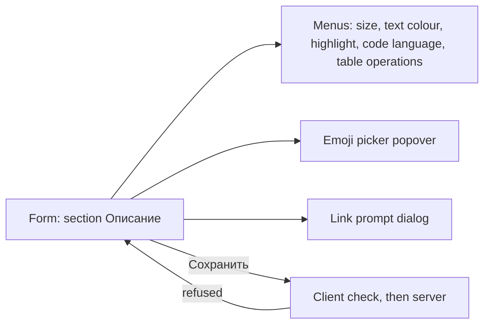

# Design: Описание of a work item as rich text

Stories: US-1 (core, lists, paste, limits), US-5 (marks, palettes, emoji,
links), US-6 (tables, code), US-3 (what the editor shows for existing text),
US-4 (limits mirrored); US-2 and US-7 are server-only, so they have no screen
(their client half is the normalisation in BR-RT-5). The engine is TipTap,
decided by the editor ADR (proposed): this design names no library or version,
only behaviour and MUI parts. Interface copy is final Russian: the stories'
copy tables are reused verbatim, and § Interface texts lists what this design
adds. Prototype: [`prototype/index.html`](prototype/index.html), clickable.

## Screen map

One existing screen changes: the work item form
(`…/projects/:projectId/workitems/:identifier`), section «Описание». Four
sub-surfaces open from the editor; none is a route.



| Screen | Route | Stories | Access (roles) |
|---|---|---|---|
| Work item form, section «Описание» | unchanged | US-1, US-3, US-4, US-5, US-6 | any signed-in user who may edit the item (BR-M3-27); no new permission |
| Menus, emoji picker, link prompt | none | US-5, US-6 | same |

The type's other texts («Критерии приёмки» and the rest) stay plain
`TextField`s (spec § Out of scope); the editor card is styled as a sibling of
an outlined field.

## Screen: Work item form, section «Описание»

### Layout

Left column of the «Детали» grid, first section (feat-022): `FormSection` `h2`
«Описание», the editor card, a notice line, one helper row.

```
FormSection  h2 «Описание» ──────────────────────────────────────────
+--------------------------------------------------------------------+ card = outlined field
| toolbar role=toolbar «Форматирование описания» (wraps, 2 rows ≈640) |
| [↶ ↷]|[H3 H4 Aa▾]|[B I U S ‹› A▾ ▮▾ Tₓ]|[•≡ 1≡ ⇥ ⇤]|[🔗 ⊘ ↗ ☺]|[{ } Язык▾ ⧉]|[▦ ▦▾] |
|--------------------------------------------------------------------|
| body role=textbox «Описание»; placeholder «Добавьте описание»      |
|  min 6 lines, grows, then scrolls inside (max 70 vh)               |
+--------------------------------------------------------------------+
 ⓘ notice (polite live region: image refused, or the Tab hint)
 До 100 000 символов                                98 450 / 100 000
```

### Components (MUI)

| Block | MUI component | Notes |
|---|---|---|
| Card | `Box` styled as `MuiOutlinedInput`: `shell.inputBorder`, `shape.borderRadius`, hover `text.primary`, focus-within 2 px `primary.main`, error `error.main`, disabled `action.disabled` | one border for toolbar and body; no floating label (the `h2` is the label) |
| Toolbar | `Toolbar variant="dense" disableGutters`, `role="toolbar"`, `flexWrap` | `Divider orientation="vertical" flexItem` between groups |
| Marks, blocks, lists | `ToggleButton size="small"` (`selected` is `aria-pressed`) | headings, B, I, U, S, inline code, both lists, code block |
| Actions | `IconButton size="small"` | undo, redo, indent, outdent, clear, link, unlink, open, emoji, table, copy |
| Pickers and menus | `Menu` of `MenuItem` (radio-style, `Check` on the current one) | size, text colour, highlight, code language, table operations; swatch in `ListItemIcon`, name in `ListItemText`; a built-in arrow-key model |
| Emoji | `Popover` (`role=dialog`, «Эмодзи») with a `TextField` «Поиск эмодзи» and a grid of `ButtonBase` options (roving, 8 columns) | bundled data, no request (BR-RT-19) |
| Link prompt | `FormDialog` (`shared/ui`), `TextField`s | § Links |
| Every control | `Tooltip` = name + shortcut; `aria-label` = the bare name | disabled control wrapped in a `span` |
| Code block chrome | inside the editor: a language label and «Копировать код» `IconButton` for pointer users (`tabIndex=-1`) | the same two actions are in the toolbar for the keyboard (D-3); chrome is never stored |
| Helper row | `FormHelperText` + `Typography variant="caption"` counter | error replaces helper |
| Chunk loading / failure | `Skeleton variant="rounded"`; `Alert severity="error"` + «Повторить» | § States |
| Icons | `@mui/icons-material` (ADR-0019) | names confirmed against the installed package by the developer; headings are the text «H3», «H4» |

Placement: `shared/ui` wrapper, no business logic (the follow-up type-fields
line and comments need it); pure functions (normalisation, BR-RT-8 count,
legacy conversion, link and auto-link rules) in `shared/lib`. Limits and copy
are props. The split is `plan-frontend.md`'s.

### Toolbar

Control list is data (an ordered array of groups), one entry per control, so
tasks B and C append without touching layout.

| # | Group | Controls | Shortcut | Enabled / pressed |
|---|---|---|---|---|
| 1 | History | «Отменить», «Повторить» | Ctrl+Z; Ctrl+Y, Ctrl+Shift+Z (⌘ on macOS) | while there is a step |
| 2 | Block and size | «Заголовок 3», «Заголовок 4»; «Размер шрифта» (menu) | — | headings exclusive, pressed at the caret; size disabled in a heading, in code and in a code block |
| 3 | Marks | «Полужирный», «Курсив», «Подчёркнутый», «Зачёркнутый», «Код в строке»; «Цвет текста», «Выделение цветом» (menus); «Очистить форматирование» | Ctrl+B, Ctrl+I, Ctrl+U | all but «Код в строке» and clear disabled inside inline code and in a code block (BR-RT-15); «Код в строке» disabled in a code block |
| 4 | Lists | «Маркированный список», «Нумерованный список», «Увеличить отступ списка», «Уменьшить отступ списка» | Ctrl+], Ctrl+[ (Tab never) | lists disabled in a table cell and a code block; «Увеличить» not at level 3 or on a first item, «Уменьшить» only at level 2–3 |
| 5 | Links and emoji | «Ссылка», «Убрать ссылку», «Открыть в новой вкладке», «Эмодзи» | Ctrl+K | «Убрать» and «Открыть» only in a link; «Ссылка» disabled in a code block |
| 6 | Code | «Блок кода», «Язык кода» (menu), «Копировать код» | — | «Блок кода» pressed in a block, disabled in a cell or list item; the other two only in a block |
| 7 | Table | «Таблица»; «Операции с таблицей» (menu) | Ctrl+Enter leaves a table | «Таблица» disabled in a table, list item, code block; the menu only in a table |
| — | **Reserved slot** | end of group 5, between «Эмодзи» and group 6 | — | task B adds «Изображение»; task C adds «Упомянуть» (@) and «Ссылка на рабочий элемент» (#). Nothing is drawn for them now (no disabled placeholder). If group 5 then makes the toolbar exceed two rows at 640 px, B/C move group 5 into an overflow `Menu` «Ещё» (`MoreHoriz`) at the end of the toolbar |

«Операции с таблицей» menu, in order: «Добавить строку выше», «Добавить
строку ниже», «Добавить столбец слева», «Добавить столбец справа», «Удалить
строку», «Удалить столбец», «Строка заголовка» (check item), divider,
«Удалить таблицу». «Добавить строку выше» is disabled in the header row;
«Удалить строку» and «Удалить столбец» at one row or one column (the table
goes by «Удалить таблицу»). No merge, split or widths. «Удалить таблицу» asks
no confirmation: it is one undo step and «Отменить» is in the toolbar.
Anything the engine binds outside the subset (levels 1, 2, 5, 6, blockquote,
task lists, rules, alignment) is switched off, so no shortcut creates it.
Markdown input rules stay on only where the result is in the subset (D-4).

### Palettes (BR-RT-14, ADR-0024)

The token is the contract; the colour is the theme's. Mapping lives in
`app/theme` as one keyed table (`theme.richText`, light and dark values), read
through the theme object. The panel has no dark theme yet (`mode: 'light'`), so
the dark column is specified now and used when it ships. Surfaces assumed for
the dark column: paper `#1F1F1F`, raised `#2B2B2B`. Numbers are WCAG contrast
(computed, scratch script; manual look at QA, US-5).

| Token (text colour) | Light | on `#FFFFFF` | Dark | on `#1F1F1F` |
|---|---|---|---|---|
| `rt-color-gray` «Серый» | `#616161` | 6.19 | `#B8B8B8` | 8.31 |
| `rt-color-red` «Красный» | `#C42B1C` (= `semantic.error`) | 5.66 | `#FF8F85` | 7.47 |
| `rt-color-orange` «Оранжевый» | `#9D5D00` (= `warning`) | 5.25 | `#F2A93B` | 8.25 |
| `rt-color-green` «Зелёный» | `#107C10` (= `success`) | 5.37 | `#6CCB6C` | 8.16 |
| `rt-color-teal` «Бирюзовый» | `#00796B` | 5.32 | `#4DD0C0` | 8.71 |
| `rt-color-blue` «Синий» | `#0B5CAD` (not the accent) | 6.67 | `#6CB6F5` | 7.57 |
| `rt-color-purple` «Фиолетовый» | `#773B93` (= `feature`) | 7.42 | `#C9A0F0` | 7.67 |
| `rt-color-pink` «Розовый» | `#B4236B` | 6.19 | `#FF8FC2` | 7.82 |

| Token (highlight, text stays `text.primary`) | Light bg | text on it | Dark bg | text `#F5F5F5` on it |
|---|---|---|---|---|
| `rt-hl-yellow` «Жёлтый» | `#FFE680` | 12.5 | `#6B5800` | 6.38 |
| `rt-hl-orange` «Оранжевый» | `#FFC58A` | 10.1 | `#7A4300` | 7.32 |
| `rt-hl-red` «Красный» | `#FFB4AB` | 9.1 | `#8C2A22` | 7.80 |
| `rt-hl-green` «Зелёный» | `#B5E5AE` | 10.9 | `#1E5E26` | 7.18 |
| `rt-hl-teal` «Бирюзовый» | `#9FE0D8` | 10.4 | `#0E5E56` | 6.99 |
| `rt-hl-blue` «Синий» | `#B0D6F7` | 10.2 | `#1D4E82` | 7.82 |
| `rt-hl-purple` «Фиолетовый» | `#D9C2F0` | 9.6 | `#5A3880` | 8.33 |
| `rt-hl-gray` «Серый» | `#D4D4D4` | 10.5 | `#4D4D4D` | 7.75 |

Notes. A text colour on a highlight is the member's pairing; the worst of 64
is 3.09:1 (light, orange on red) and 3.15 (dark), under 4.5, so a pairing is
not guaranteed readable; the picker shows both names, nothing blocks it (D-5).
Highlight is a surface, so no 3:1 against the page is claimed (1.2–1.7 light,
1.8–2.4 dark); meaning never rests on colour alone: each choice has its name in
the menu and tooltip, and the stored token is the name. Sizes
(`rt-size-*`): 12, 13, 18, 24 px at line height 1.4, normal 14 px; the first
two are the theme's `caption` and `tableCell` scales, the other two new
`theme.richText` values. Headings carry no size.

### Code blocks (BR-RT-16)

Monospace stack from the theme (`monospace` if none), 13 px / 20 px, `tab-size`
4, whitespace kept, no wrap: a long line scrolls inside the block; background
`shell.tableHeader`, `divider` border, radius from the shape. A header strip
(not stored): the language name left, «Копировать код» right. Language is
chosen in the toolbar's «Язык кода» menu (13 items: «Простой текст» and the 12
of BR-RT-16; the current one checked; the label of the strip follows). Copy puts
the exact text on the clipboard and announces «Код скопирован» (polite).
Colouring: § Syntax colouring. Nothing is executed or fetched. Entry announces
and shows the Tab hint (§ Keyboard).

#### Syntax colouring (ADR-0027; supersedes the earlier D-2)

The grammars are lowlight's; the result is applied as **editor decorations over
the text nodes**, never as a highlighter's HTML string, and **never stored**:
no class, element or attribute for a token appears in the stored value or in
the normalised string, so the canonical form (BR-RT-5, US-7) is unchanged and
a colour-only change is never a dirty form. Theme tokens, `theme.richText.code`
(read through the theme object, no literals), contrast measured against the
code block background (light `shell.tableHeader` `#F3F3F3`, dark assumed
`#2B2B2B`), 4.5:1 required:

| Token class (decoration) | Covers | Light | on bg | Dark | on bg |
|---|---|---|---|---|---|
| `keyword` | keywords, built-in literals, tag names | `#8F2D9E` | 6.23 | `#D9A0F0` | 6.90 |
| `string` | strings, template parts, regex | `#0F6B2B` | 5.99 | `#8FD6A0` | 8.29 |
| `number` | numbers, units, colour literals | `#B3410A` | 5.15 | `#FFB085` | 7.96 |
| `comment` | comments (also italic) | `#5C5C5C` | 6.03 | `#ABABAB` | 6.17 |
| `function` | function and method names, titles | `#0B5CAD` | 6.01 | `#7DBEF7` | 7.13 |
| `type` | class and type names | `#8A5A00` | 5.34 | `#EBC25A` | 8.36 |
| `attribute` | attributes, properties, keys | `#006D77` | 5.48 | `#6FD6DE` | 8.33 |
| `punctuation` | operators, brackets, separators | `#4F4F4F` | 7.38 | `#C4C4C4` | 8.12 |

Anything the grammar does not classify keeps `text.primary`. Rules:
- **Scope.** Only the 12 languages of BR-RT-16. `plain` and a value outside
  the list (shown as plain) are not coloured, and their grammar is not loaded.
- **Loading.** The 12 grammars ship in the editor's lazy chunk (the form
  route), no other grammar and no request at run time; a grammar that is not
  ready simply leaves the block uncoloured until it is, with no layout change.
- **Size cap.** A block of more than 20 000 code points or 1 000 lines is not
  coloured (D-9); the decorations are recomputed for the edited block only,
  after a 150 ms idle, never per keystroke, so typing is not delayed.
- **No effect on behaviour.** Decorations are not nodes: caret, selection,
  Tab and Shift+Tab, Esc then Tab, the three exits, the gap cursor, undo, paste
  and the copied text (plain text, exact) are as without colouring; the
  decorated text is the same characters, so BR-RT-8 counts are unchanged.
- **Accessibility.** Colour carries no meaning the text does not: the language
  is named in the strip and the menu, comments are also italic, and every
  token colour meets 4.5:1 on the block in both themes. Assistive technology
  reads the block as plain text (decorations add no elements to the reading).

### Tables (BR-RT-17)

Rectangular grid, `divider` borders, header row on `shell.tableHeader` with
weight 600, cell padding `spacing(0.5, 1)`, minimum cell width so a table never
collapses; wider than the card it scrolls horizontally inside its own wrapper
(ADR-0024 § 5). No resize handles. The cell with the caret shows a 2 px accent
inset frame (colour is not the only cue: the frame is a shape). Insert is 3 × 3
with a header row, caret in the first cell. Cells hold paragraphs only; no
table in a table, list item or cell, so «Таблица» is disabled there.

### Links (BR-RT-18)

A link is underlined in `primary.dark`; a plain click places the caret (no
navigation), Ctrl/Cmd+click and «Открыть в новой вкладке» open it with
`noopener noreferrer`. Prompt: `FormDialog`, title «Ссылка», «Адрес ссылки»
(placeholder «https://…», autofocus) and, when nothing is selected and the
caret is not in a link, «Текст ссылки»; «Отмена» and the filled «Применить»;
Enter applies; a refusal sits on the field (`error`, `helperText`) and the
dialog stays; on close focus and the selection return to the editor. With the
caret in a link the field holds its address. Auto-link and paste rules are as
BR-RT-18; the first Ctrl/Cmd+Z after an auto-link removes only the link.

### Emoji (BR-RT-19)

Popover under «Эмодзи»: search field first, then the grid. Typing filters by
Russian name; arrows move over the grid (←→ by one, ↑↓ by a row, ↑ from the
first row to the search); Enter on the first match or on a focused emoji
inserts it and returns focus to the editor; Esc closes and returns to the
button. The data set (names are Russian, glyphs native) ships in the editor
chunk; the ADR names the set (open at gate-2, D-6). No image, no network.

### States

- **Loading, form.** The form's `FormLoading` is unchanged; the editor is not
  mounted before the item is read, so stored text never flashes as plain.
- **Loading, editor code.** The engine, emoji data and menus are one lazy chunk
  on the form route. Until it arrives: `Skeleton variant="rounded"` of toolbar
  plus six lines inside `aria-busy`, hidden text «Загрузка редактора», helper
  row already shown. «Сохранить» works: a save without a description change
  carries none (BR-RT-11).
- **Chunk failure.** `Alert severity="error"` «Не удалось загрузить редактор.»
  with «Повторить»; nothing stored changes.
- **Empty.** Placeholder «Добавьте описание» (also `aria-placeholder`),
  toolbar enabled where context allows, helper «До 100 000 символов». Blank
  results store `""` (BR-RT-6).
- **Focused.** 2 px accent border on the card for focus anywhere inside;
  toolbar controls show the theme's focus ring.
- **Disabled while saving.** Body non-editable (`aria-disabled`), every
  toolbar control disabled, menus and prompt closed; same content, size and
  look as a disabled field. Focus is not moved by the editor.
- **Over the visible limit, live.** Count by BR-RT-8 on the same function the
  save check uses. From 90 000 the counter «98 450 / 100 000» appears; above
  100 000 it turns `error.main` at weight 600, the border turns to error and
  the helper slot shows «Не более 100 000 символов.» at once (`role="alert"`,
  once when it appears). «Сохранить» is not disabled (the form validates on
  save): pressing it sends nothing. 100 000 exactly is within.
- **Over the markup ceiling.** Not live (the normalised string is built on
  save): «Слишком много разметки. Упростите форматирование или сократите
  текст.» takes the helper slot on «Сохранить»; it wins when both limits are
  exceeded; input kept.
- **Refused by the server.** The reason text of `description_too_long` or
  `description_markup_too_large` in the same slot (the form's `placeRefusal`);
  input kept; any other failure uses the form's banner.
- **After a save.** The editor shows the server's value; if equal to what it
  holds it is left alone (caret, undo kept), else replaced and the undo history
  cleared. Not dirty.
- **Notice.** One polite live region under the card, always in the DOM:
  «Изображения в описание не вставляются.» after a file or image drop or paste
  (also when only an image of rich pasted content was dropped, D-7), until the
  next edit or blur; the Tab hint (below) while the caret is in a code block or
  table. A second drop re-announces.
- **Read-only.** Not built: no role is read-only (BR-M3-27) and no other
  surface shows the description (BR-RT-12). The follow-up that shows a stored
  value renders it through the same schema without toolbar or border.
- **Permissions.** Unchanged from mod-003.

### Keyboard, focus order, Tab exceptions

Focus order: previous field → **toolbar (one tab stop)** → **body** → next
field; Shift+Tab reverses. The toolbar uses a roving tabindex: ←/→ move over
enabled controls (wrapping), Home/End to the first/last, Enter/Space activate,
Tab leaves; it remembers its last control. MUI has no roving primitive: one
small hook in the component, no dependency. Toolbar buttons keep the selection
(`mousedown` default prevented); after a keyboard activation focus stays on the
control, and a menu pick or an emoji returns focus to the body.

| Keys | Behaviour |
|---|---|
| Tab / Shift+Tab, body | leaves the editor; never an indent; in a list item too |
| Tab, **code block** (exception 1) | inserts a tab; Shift+Tab removes one leading level (a tab, else up to four spaces) on each selected line |
| Tab, **table cell** (exception 2) | next cell; Shift+Tab previous; in the last (first) cell it leaves the editor and adds no row |
| Esc, then Tab / Shift+Tab | leaves the editor forward / backward from a block or cell. Esc arms exactly the next keystroke; any other key disarms; an Esc that closed a menu, the emoji popover or the prompt does not arm (those handle their own Esc and stop it at their root) |
| Enter in code | new line; Enter twice at the end, Ctrl/Cmd+Enter, or ↓ at the end of its text leaves the block (trailing line feeds removed) |
| Ctrl/Cmd+Enter in a cell | caret after the table |
| Ctrl/Cmd+B, I, U, K, ], [, Z, Y, Shift+Z | as in the toolbar table |
| Ctrl/Cmd+Shift+V | paste text only: no table, link or format |
| Esc in a menu / popover / prompt | closes it, focus to the opener |

**Announcement.** On entering a code block the notice shows and announces
«Tab вставляет отступ. Esc, затем Tab — выйти из блока.»; on entering a table
«Tab переходит между ячейками. Esc, затем Tab — выйти из таблицы.»; each on
the transition into the context, not per caret move; cleared on leaving or blur.

**Exits and isolating nodes (spec's design hand-off, m-15).** Table cells and
code blocks are isolating in the editor schema, so the default
arrows/Backspace never leave or merge across them; every exit is therefore an
explicit keymap entry: the three code exits above and Ctrl/Cmd+Enter for a
table. When the block is the document's last, the exit puts a **gap cursor**
after it: no paragraph is stored, one is created only when the member types
there. The **trailing-node behaviour is off** (no extension appends a
paragraph, no transaction hook does). Moving the caret or focus into and out of
a final table or code block dispatches no document change, so the serialised
value is unchanged and the form not dirty (US-6). Rows are never added by Tab.

### Accessibility

Body: `role="textbox"`, `aria-multiline`, `aria-label` «Описание» (existing
tests query `getByRole('textbox', { name: 'Описание' })`; they type into a
contenteditable now: expect a jsdom adaptation), `aria-invalid`,
`aria-describedby` → helper, counter, notice. Toolbar: `aria-label`,
horizontal; toggles `aria-pressed`; menus `aria-haspopup="menu"`, the emoji
button `"dialog"`; the options of palettes have names, never colour only.
Counter name «Символов: 98 450 из 100 000», not live per keystroke. The only
trap is the modal link prompt, closed by «Отмена» or Esc. Targets 32 px
(`density.controlHeight`). Screen-reader checks are manual QA.

### Responsive and theming

From 640 px: one column below 1280 px and the editor spans it; the toolbar
wraps by group (26 controls: about two rows at the 8/4 column); body, wide
tables and code scroll inside themselves; the helper row wraps the counter
under the text; dialogs and popovers stay inside the viewport (popover width
min(340 px, viewport)). All values come from the theme object; content styles
are one `styled` root in the component reading tokens; the palette table is
added to `app/theme` (a token table, as `workTracking`, not a new component
style) and the colour-literal test keeps passing.

### Forms and validation

| Field | Type | Required | Validation | Error text (RU) |
|---|---|---|---|---|
| Описание | canonical html string (format declared, US-4) | no | visible ≤ 100 000 live; normalised markup ≤ 1 000 000 on save; the server repeats both | «Не более 100 000 символов.» / «Слишком много разметки. Упростите форматирование или сократите текст.» |
| Адрес ссылки | text | yes | trimmed; `http://`, `https://`, `mailto:`, or `www.` (stored as `https://www.…`); `javascript:`, `data:`, relative, `//host` refused | «Допустимы адреса, начинающиеся с http://, https://, mailto: или www.»; empty: «Укажите адрес ссылки.» |
| Текст ссылки | text | no | empty: the address is the text | — |

The editor replaces the `TextField` in the section: `busy` is `disabled`,
`errors.description` and `TEXT_HELPER` fill the helper slot, the baseline is the
normalised serialisation of the loaded value (opening is not dirty), and an
unchanged Описание is not sent.

**Portal submit bubbling (spec hand-off).** The link prompt renders in a
portal inside the page's `<form onSubmit>` React tree; its submit would bubble
to the page's save. `FormDialog`'s submit handler must stop propagation (one
line in `shared/ui`, with a test that applying a link does not call save). The
menus and popover contain no `<form>` and need nothing.

### Interface texts

All strings of US-1, US-5 and US-6 copy tables are used verbatim (toolbar,
control names, pickers, colours, sizes, link texts, languages, hints, limits,
placeholder, helper). Additions, final wording:

| Where | Text |
|---|---|
| Table menu button (opens the eight operations; D-1) | «Операции с таблицей» |
| Empty address in the prompt | «Укажите адрес ссылки.» |
| Counter; its accessible name | «98 450 / 100 000» (`Intl.NumberFormat('ru-RU')`); «Символов: 98 450 из 100 000» |
| Editor code loading (hidden) / failed | «Загрузка редактора» / «Не удалось загрузить редактор.», «Повторить» |
| Emoji with nothing found | «Ничего не найдено» |
| Tooltip | name and shortcut, «Полужирный (Ctrl+B)»; ⌘ replaces Ctrl on macOS |
| Table menu, «Строка заголовка» | a check item; no extra text |

## Decisions in this design (for gate-2)

| # | Decision | Why / cost |
|---|---|---|
| D-1 | Table operations are one toolbar button with a `Menu`, not eight buttons | eight glyph-only buttons do not fit the toolbar's two rows; names are exactly US-6's; the cost is one extra click and a new name «Операции с таблицей» |
| D-2 | ~~No syntax colouring~~ **Superseded at gate-2:** colouring is in this task (lowlight decorations, ADR-0027), 8 token classes as theme tokens, not stored | see § Syntax colouring |
| D-3 | «Язык кода» and «Копировать код» live in the toolbar; the in-block strip repeats them for the pointer only (`tabIndex=-1`) | otherwise Tab leaving the editor would stop on every block's controls, against BR-RT-16 |
| D-4 | Markdown input rules on for `### `, `#### `, `- `, `* `, `1. `, backticks, ``` ``` ```; `#`, `##` stay text | familiar to tracker users; each yields only what the toolbar offers; Backspace right after reverts |
| D-5 | A text colour on a highlight is the member's choice, not blocked | 64 pairs, worst 3.09:1; blocking would hide valid pairs; a note, not a rule |
| D-6 | Emoji set and picker data: the ADR must name it; the design assumes a bundled data set of Russian names loaded with the editor chunk | spec § Open questions; picker UI does not depend on which |
| D-7 | The image notice also appears when only an image of a rich paste is dropped | otherwise content is lost silently |
| D-9 | Colouring cap: 20 000 code points or 1 000 lines per block, skipped silently above it | keeps typing and opening fast; the number is the developer's to confirm by measurement (QA observation) |
| D-8 | «Ссылка» opens with «Текст ссылки» when nothing is selected, as US-5 says; with the caret in a link the field is prefilled | no disabled state needed |

## Prototype and verification

`prototype/index.html`: self-contained, no network. It has the full toolbar and
its context rules, roving tabindex, menus (size, colour, highlight, language,
table operations incl. every direction, header row, delete table), emoji search,
code block (Tab, Shift+Tab, Enter twice, Ctrl+Enter, ↓, language, copy), table
(Tab between cells, Esc then Tab, Ctrl+Enter), link prompt with validation,
auto-link and the first-undo rule, paste reduction, file drop notice, live
counter, light and dark and 640 px switches, and the states strip (empty,
filled, saving, over limit, markup refusal, server refusal, editor loading and
failure), and coloured code for the 12 languages (a small hand-rolled,
approximate tokenizer; the build uses lowlight grammars; plain and blocks over
the cap show none, and the stored value is the text only). Its document model is
simplified DOM code, not the engine; its
«stored value» panel is a sketch of the canonical form, not the server's.
