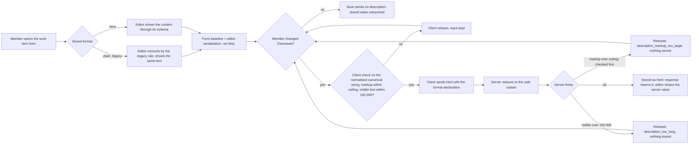

# Spec: Описание of a work item as rich text

## Context and goal

Описание is plain text today (mod-003 BR-M3-19): a member cannot give a
description a heading, a list, a link or a code block, which the reference
tracker's work items routinely carry (doc-002 BR-M3-4). This task makes
Описание a rich-text field edited in a WYSIWYG editor on the work item form,
limited to a fixed safe subset enforced on the server, and keeps every
description already stored showing exactly what it showed before. The human
confirmed the scope on 2026-10-12: **Описание only**, no E2E tests. Size is
`L` (an ADR is accepted before code, `routing.md`).

## Roles

| Who | What they may do |
|---|---|
| Any signed-in user | as mod-003 BR-M3-27: edit Описание of any work item they may edit today, and read it wherever it is shown |
| Anonymous caller | nothing: unchanged (mod-003) |

No new permission and no new role: rich text changes the content of a field, not who may write it.

## Decisions taken by the human (2026-10-12)

| # | Decision |
|---|---|
| D-1 | Storage is sanitized HTML; the browser editor is TipTap (ProseMirror); a server-side HTML sanitizer reduces every write (was OQ-1). |
| D-2 | The new dependencies are accepted (was OQ-4). The ADR (library, sanitizer, the departure from ADR-0007's fixed UI stack, the rollback story) is a **design-stage deliverable**, written and accepted by the human before any code; this spec does not write it. |
| D-3 | Legacy plain text is converted lazily, at read, under a stored-format marker; no data migration rewrites a row (was OQ-2). |
| D-4 | The 100 000 limit counts visible text; the physical storage ceiling above it is higher (was OQ-3). |

## Stories

| id | Title | depends-on | File |
|----|-------|------------|------|
| US-1 | A member edits Описание in a WYSIWYG editor | - | `stories/US-1-edit-description-in-editor.md` |
| US-2 | The server reduces an HTML description to the safe subset | US-4 | `stories/US-2-sanitize-and-limit-on-save.md` |
| US-3 | Existing descriptions keep their text and an unchanged Описание is never rewritten | US-1, US-4 | `stories/US-3-existing-text-and-no-spurious-rewrite.md` |
| US-4 | The API tells plain text from HTML, and bounds the size | - | `stories/US-4-format-contract-and-limits.md` |

All four ship in one MR: US-1 without US-2 would put an unfiltered editor in
front of the store, US-2 and US-4 without US-1 have nothing to protect or carry,
US-3 is what keeps the editor from mangling what exists.

## Business process (BPMN)

## Business rules

Local prefix `BR-RT-`, so as not to collide with mod-003's `BR-M3-N`.

| # | Rule | Source (document / decision) |
|---|------|------------------------------|
| BR-RT-1 | Описание in html format is limited to a fixed safe subset: headings of levels 3 and 4, bold, italic, bulleted and numbered lists (nested up to 3 levels), links, inline code, code blocks, tables. Nothing else survives a save. | doc-002 BR-M3-4 |
| BR-RT-2 | The subset is enforced on the server on every html write, whatever the client sent; the editor's own restrictions are a convenience, not the safeguard. | doc-002 BR-M3-4 ("stripped on save") |
| BR-RT-3 | Reduction is an allow-list of elements **and** their attributes (US-2 § Allow-list): elements outside it are dropped with content (script, style, iframe, object, embed, template, svg, math, noscript and the like) or unwrapped with the text kept (every other unknown element); every attribute not named is removed; a link keeps only an absolute http, https or mailto address; the server strips `target` and forces `rel="noopener noreferrer"`. | doc-002 BR-M3-4 |
| BR-RT-4 | Images are never inline: an image element or a data address is dropped, also when pasted or dropped as a file. Images are attachments (mod-004). | doc-002 BR-M3-4; D-8 |
| BR-RT-5 | **One canonical form.** The server's reduced output is the editor's canonical form: the editor schema is configured to hold exactly what the allow-list keeps (US-2 § Canonical structure: header rows in the table body, list items and cells holding only paragraphs and nested lists, no marks inside inline code, no list `start`, no merged cells). The client's serialisation is the editor's raw output **plus a normalisation step** that removes what the editor adds beyond the form (`colgroup`/`col`, `style`, `colspan="1"`/`rowspan="1"`, link `target` and `nofollow`) and applies the same canonical rules; that normalised string is what the dirty baseline, the request and the client-side ceiling check use. Hence: reduction is idempotent, and a value the server stored, loaded into the editor and serialised without edits, equals itself. A shared fixture file holds (input, canonical, editor output) triples run by both suites (US-2, US-3). | quality rule for BR-RT-2 |
| BR-RT-6 | A description with no non-whitespace character in its visible text is stored as the empty description `""`. This covers empty paragraphs, a table of empty cells, a code block of whitespace only and a link with no text. | mod-003 spec § Fields (empty default) |
| BR-RT-7 | Two limits. (1) **Visible text** at most 100 000 UTF-16 code units, else `workitems.workitem.description_too_long` (message unchanged, «Не более 100 000 символов.»). (2) **Stored markup** (the reduced html) at most 1 000 000 UTF-16 code units, else the new reason `workitems.workitem.description_markup_too_large`. Ceiling derivation: the worst legal legacy text (100 000 characters) converts to 700 007 code units (100 001 empty paragraphs, each `

`; 100 000 `&` in one paragraph is 500 007), so 1 000 000 never trips for legacy content. A raw request description above 2 000 000 code units is refused with the markup reason before any parsing. **One reason per field, checked in this order:** the pre-parse cap, then the ceiling on the reduced markup, then the visible limit; so a value over both limits gets `description_markup_too_large`. | doc-002 § NFR (size); mod-003 BR-M3-19; D-4 |
| BR-RT-8 | **Visible text** is the text of the reduced html with entities decoded, in order, with one U+000A between consecutive **leaf blocks** (the blocks that hold text directly: paragraph, heading, code block; a list item or table cell is a container and adds none of its own, so `<li>
a
</li><li>
b
</li>` is "a\nb") and one U+000A for each ` `, none before the first or after the last (an empty paragraph is a leaf block of zero length); counted in UTF-16 code units, as `WorkItemText` counts today. The client counts exactly so; a fixture set of (html, count) pairs is run by both suites. | mod-003 `WorkItemText` unit; D-4 |
| BR-RT-9 | A plain-format description shows exactly the characters it had, line breaks, runs of spaces and tabs included; nothing in it is interpreted as markup (`<b>` stays three characters). **Legacy rule**: CR LF and lone CR become LF (the one accepted invisible difference); the text is split at LF; each line becomes one paragraph (an empty line an empty paragraph); `<`, `>`, `&` are escaped as text; spaces and tabs are kept and shown with whitespace preserved; nothing is auto-linked or read as markdown. A legacy value cannot hold U+0000 (the store refuses it); U+0000 in new html input is removed. The visible count of a converted value never exceeds its original length. | mod-003 BR-M3-19 (what it promised) |
| BR-RT-10 | **Contract, additive.** A write carries `description` and an explicit format declaration (`plain` or `html`; working field name `descriptionFormat`, fixed in the api-contract at the backend stage). No declaration means `plain`: stored exactly as sent, limit 100 000 code units, as BR-M3-19 today. A read returns `description` and its format; a legacy and a never-written value are reported `plain`. The server never rewrites a stored value except on a write; the plain-to-html conversion is the legacy rule above, applied by the client that displays it. An unknown declared format is refused with a field reason, with or without a description; a valid declaration with no description is ignored. A write changes the description when its (value, format) pair differs from the stored pair: a plain "
a
" over a stored html "
a
" is a change, an html re-send of the stored canonical value is not. | mod-003 api-contract § 0.6; R-2 |
| BR-RT-11 | A save that does not change Описание does not carry it, and the stored description is byte-for-byte unchanged, legacy or formatted. Opening the form never makes it dirty; the editor's own normalisation of a loaded value is not a change. "First save" of a legacy description means the first save that changes Описание. | R-3 |
| BR-RT-12 | The only surface that shows Описание in this task is the form's editor (editable, disabled while a save is in flight). Any surface that later shows a stored value renders it through the editor's schema or the same reduction, never by assigning raw html to the page, and shows paragraphs with whitespace preserved. | doc-002 BR-M3-4; R-8 |
| BR-RT-13 | Amendments owed, all additive (a client that sends no declaration sees no change): mod-003 BR-M3-19 and `docs/features/mod-003-work-item-core/api-contract.md` § 0.6 (Описание), § 1.1 shape, the save body, the reason table and `errors.description`, and § 2.4's "a value equal to the stored one changes nothing" read as equality of (value, format), each with a note in mod-003's `status.md`; feat-022 BR-M3-36 reworded to "as BR-M3-19 has it for a plain-format description" (its three texts stay plain) and its decomposition note extending this task superseded. | R-1, R-2 |

## Operation completeness

| Entity | Create | Read | Update | Delete/deactivate | Cancel/reverse |
|--------|--------|------|--------|-------------------|----------------|
| Описание (a field of the work item) | no: set only by Update; the create dialog has no such field and the form opens with it empty (mod-003) | any signed-in user (BR-M3-27); the form's editor (US-1, US-3) | any signed-in user who may edit the work item, in the editor (US-1) through the server's reduction (US-2) and limits (US-4) | no: a field is cleared, not deleted; clearing stores `""` (BR-RT-6) | no: reverting a save is the history task (feat-015); until then undo in the editor before saving (US-1) |
| Stored legacy plain value | no: a plain-format write is still accepted for old clients (BR-RT-10), the panel writes html | any signed-in user, visibly unchanged (US-3) | yes: the first save that changes Описание stores html | no: nothing is deleted or rewritten by this task, no migration touches a row | the conversion is not stored, so nothing to reverse until the member's first save; after it, see Rollback below |

## Non-functional requirements

- **Safety:** a hostile-payload corpus (a checked-in fixture: script, iframe,
  style, event attributes, `javascript:`/`data:`/`vbscript:` links, entity- and
  whitespace-obfuscated schemes, nested and unclosed tags, DOM-clobbering ids,
  mutation-style payloads) runs in the server's automated tests; none of it
  survives, and every stored value re-parses and re-reduces to itself (US-2).
  `react/no-danger` is an error on the frontend.
- **Speed (server):** GET and PATCH of a work item with a 100 000-character
  visible description within 1 s each; a PATCH at the 1 000 000-code-unit
  ceiling within 2 s (mod-003's bound extended). Editor opening speed in a real
  browser is a manual QA observation, not a gate (R-5).
- **Accessibility:** the editor is operable by keyboard alone and never
  captures Tab; toolbar controls have the Russian names in US-1; the editor
  keeps the accessible name «Описание».
- **Language:** interface copy Russian, quoted in US-1 and US-4; the reference
  tracker is never named.
- **Tests:** no E2E for this task (the human's instruction). Unit, integration
  (API) and jsdom component tests with the real editor; what jsdom cannot
  check is listed per scenario as manual QA (US-1 § Verification).
- **Rollback:** widening the stored bound is additive, but its down migration
  fails once any row exceeds 100 000; and an older release shows saved html
  as raw tags in a plain field. Both are consequences the ADR states with a
  runbook (design stage); the marker stays so the release can be rolled
  forward again.

## Out of scope

- «Критерии приёмки», «Шаги воспроизведения», «Сведения о системе» and
  comments: the human confirmed «Описание» only; they are the follow-up line
  below. feat-022's note extending this task to the three fields is superseded.
- A read-only renderer for a consumer that does not exist: the list, board and
  backlog never return the description. BR-RT-12 binds future surfaces.
- Inline images, image upload and paste of images (images are attachments,
  mod-004). Mentions, emoji, colours, fonts, alignment, task lists, embeds,
  table cell merge/split, syntax highlighting.
- Full-text search over the description (feat-003) and its handling of markup.
- History of description changes (feat-015) and the revision check (feat-021).
- CSV import and export of the description; a downgrade of html to plain for
  old clients (an old client reading an html description sees its markup, the
  panel is the only client).

## Decomposition for the backlog

| id | Task | size | deps |
|----|------|------|------|
| feat-018-work-item-rich-text (this task) | US-1..US-4: the editor, the server reduction, the format contract and limits, legacy text; the ADR is its first design artifact | L | mod-003-work-item-core |
| feat-NNN-work-item-rich-text-type-fields | «Критерии приёмки», «Шаги воспроизведения», «Сведения о системе» **and comment text** (doc-002 BR-M3-4) as rich text on this task's editor and sanitizer; includes the first read-only renderer for comments | M | feat-018-work-item-rich-text, feat-022-work-item-form-fields, feat-002-work-item-comments |

Amendments for the orchestrator in `main`: feat-022's note extending
feat-018 to those three fields is superseded by the line above; feat-002 needs
a note that comment rich text is owned by `feat-NNN-work-item-rich-text-type-fields`.

## Open questions

None for the human: OQ-1..OQ-4 are settled (§ Decisions). Owed at the design
stage, not questions: the ADR (D-2), the editor-bundle weight measured and
loaded lazily on the form route, TipTap themed in MUI's tokens, the api-contract
field names (BR-RT-10), the error-code entries for `description_markup_too_large`
and the unknown-format reason in `docs/error-codes.md` and `contracts/errors/*.json`.
