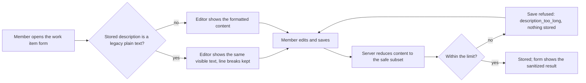

# Spec: Описание of a work item as rich text

## Context and goal

Описание is plain text today (mod-003 BR-M3-19): a member cannot give a
description a heading, a list, a link or a code block, which the reference
tracker's work items routinely carry (doc-002 BR-M3-4). This task makes
Описание a rich-text field edited in a WYSIWYG editor on the work item form,
limited to a fixed safe subset enforced on the server, and keeps every
description already stored showing exactly what it showed before. The human
confirmed the scope on 2026-10-12: **Описание only**.

## Roles

| Who | What they may do |
|---|---|
| Any signed-in user | as mod-003 BR-M3-27: edit Описание of any work item they may edit today, and read it wherever it is shown |
| Anonymous caller | nothing: unchanged (mod-003) |

No new permission and no new role: rich text changes the content of a field, not who may write it.

## Stories

| id | Title | depends-on | File |
|----|-------|------------|------|
| US-1 | A member edits Описание in a WYSIWYG editor | - | `stories/US-1-edit-description-in-editor.md` |
| US-2 | The server reduces a saved description to the safe subset and enforces the limit | - | `stories/US-2-sanitize-and-limit-on-save.md` |
| US-3 | Descriptions written before this task keep their text, and the subset renders read-only | US-1, US-2 | `stories/US-3-existing-text-and-read-only-rendering.md` |

All three ship in one MR: US-1 without US-2 would put an unfiltered editor in
front of the store, US-2 without US-1 has nothing to protect.

## Business process (BPMN)

## Business rules

Local prefix `BR-RT-`, so as not to collide with mod-003's `BR-M3-N`.

| # | Rule | Source (document / decision) |
|---|------|------------------------------|
| BR-RT-1 | Описание is rich text limited to a fixed safe subset: headings, bold, italic, lists, links, inline code, code blocks, tables. Nothing else survives a save. | doc-002 BR-M3-4 |
| BR-RT-2 | The subset is enforced on the server on every save, whatever the client sent; the editor's own restrictions are a convenience, not the safeguard. | doc-002 BR-M3-4 ("stripped on save") |
| BR-RT-3 | Script, iframe, style elements, event-handler attributes and inline style are removed. A link keeps only http, https and mailto addresses; any other scheme leaves the text without the link. | doc-002 BR-M3-4 |
| BR-RT-4 | Images are never inline: an image element or a data address is dropped, also when pasted. Images are attachments (mod-004). | doc-002 BR-M3-4; D-8 |
| BR-RT-5 | Reduction is idempotent: saving an already-reduced description unchanged changes nothing. | quality rule for BR-RT-2 |
| BR-RT-6 | A description with no visible content (nothing or only empty blocks and whitespace) is stored as the empty description, as an untouched field is. | mod-003 spec § Fields (empty default) |
| BR-RT-7 | The size limit is 100 000 and a longer description is refused with the existing reason `workitems.workitem.description_too_long`; what the limit counts is OQ-3. | doc-002 § NFR (size); mod-003 BR-M3-19 |
| BR-RT-8 | A description stored before this task shows exactly the visible text and characters it had, line breaks included; nothing in it is ever interpreted as markup (`<b>` stays the five characters it was). | mod-003 BR-M3-19 (what it promised) |
| BR-RT-9 | Wherever the description is shown, it is shown as the same subset, read-only, and never executes anything. | doc-002 BR-M3-4 |

## Operation completeness

| Entity | Create | Read | Update | Delete/deactivate | Cancel/reverse |
|--------|--------|------|--------|-------------------|----------------|
| Описание (a field of the work item) | no: set only by Update; the create dialog has no such field and the form opens with it empty (mod-003) | any signed-in user (BR-M3-27); form and read-only renderings (US-3) | any signed-in user who may edit the work item, in the editor (US-1), through the server's reduction (US-2) | no: a field is cleared, not deleted — clearing stores the empty description (BR-RT-6) | no: reverting a save is the history task (feat-015); until then the user undoes in the editor before saving (US-1) |
| Stored legacy plain text | no: no longer written; new saves are rich text | any signed-in user, visibly unchanged (US-3) | yes: first save from the editor stores the new format | no: nothing is deleted or rewritten by this task | see OQ-2: whether the conversion is reversible depends on the option |

## Non-functional requirements

- **Safety:** a hostile-payload corpus (script, iframe, style, event
  attributes, `javascript:` and `data:` links, nested/malformed markup,
  mutation-style payloads) is part of the automated tests of the server
  reduction; none of it survives (US-2).
- **Speed:** mod-003's bound holds — opening and saving the form within 1 s
  each, for a description of 100 000 characters too.
- **Accessibility:** the editor is operable by keyboard alone and does not trap
  Tab; its toolbar controls have Russian names; the editor keeps the
  accessible name «Описание», the form's label today.
- **Language:** interface copy Russian (toolbar, link prompt, messages); the
  reference tracker is never named.
- **Tests:** no E2E tests for this task (the human's instruction); unit and
  integration tests only.

## Out of scope

- «Критерии приёмки», «Шаги воспроизведения», «Сведения о системе» and
  comments: the human confirmed «Описание» only. They become the follow-up
  line below. feat-022's amendment to this line (converting those three
  fields too, doc-002 BR-M3-4; feat-022 D-6) is superseded by that.
- Inline images, image upload and paste of images (images are attachments,
  mod-004).
- Mentions, emoji, colours, fonts, alignment, task lists, embeds.
- Full-text search over the description (feat-003) and its handling of markup.
- History of description changes (feat-015) and the revision check (feat-021).
- CSV import and export of the description.

## Decomposition for the backlog

| id | Task | size | deps |
|----|------|------|------|
| feat-018-work-item-rich-text (this task) | US-1..US-3: the editor, the server reduction and limit, legacy text and read-only rendering | M (L if OQ-1 is answered "ADR first, escalate") | mod-003-work-item-core |
| feat-NNN-work-item-rich-text-type-fields | «Критерии приёмки», «Шаги воспроизведения», «Сведения о системе» as rich text on the mechanism of this task; the same sanitizer and editor | S | feat-018-work-item-rich-text, feat-022-work-item-form-fields |

Amendment for the orchestrator in `main`: feat-022's note extending
feat-018 to those three fields is superseded by the line above.

## Open questions

Each question stops at gate-1. Options carry a recommendation (⭐) and pros
(➕) / cons (➖).

- [ ] **OQ-1. Storage format and editor library** (the decision that sets
  the size). A new library with long-term consequences needs an ADR
  (`docs/adr/README.md`), and an accepted ADR is an `L` threshold
  (`routing.md`). The size is `M` only if the human chooses "keep M, the ADR
  is the first design artifact"; otherwise the task escalates to `L`.
  - (a) ⭐ Sanitized HTML, a ProseMirror-based editor (for example TipTap,
    MIT) in the browser, an HTML sanitizer (for example HtmlSanitizer on
    AngleSharp, MIT) on the server. ➕ matches BR-M3-4's wording ("html",
    "stripped"); ➕ read-only rendering is the same HTML; ➕ legacy text
    converts by escaping. ➖ two new dependencies; ➖ a sanitizer is a
    security-critical component to keep patched.
  - (b) Markdown, a markdown editor in the browser, a parser on the server.
    ➕ readable raw, small stored text. ➖ tables, nested lists and code
    blocks vary by dialect, so a "WYSIWYG" round trip is lossy; ➖ rendering
    to HTML still needs a sanitizer, so the saving is smaller than it looks;
    ➖ departs from BR-M3-4's wording.
  - (c) The editor's JSON document, validated against a schema on the server.
    ➕ no HTML parsing, strongest allow-list. ➖ ties storage to one editor
    library, replacing it means a data migration; ➖ search, export and
    comments need a renderer for it; ➖ unreadable without the library.
  - ⛔ Not recommended: (b) and (c) for this field set; (c) in particular
    makes the first library choice irreversible with respect to data.
  - Whichever is chosen, the ADR is written and the human accepts it before
    code: say "keep M, ADR as the first design artifact" or "escalate to L".
- [ ] **OQ-2. Conversion of the stored plain text** (migration threshold).
  - (a) ⭐ Lazy, at read: the stored value carries a format marker; a
    plain-text value is shown by escaping it and keeping line breaks, and is
    written in the new format on the first save. ➕ additive and reversible,
    no data migration, nothing populated is rewritten; ➕ BR-RT-8 holds by
    construction. ➖ two formats coexist until each item is saved; ➖ every
    reader (list read model, future export) must honour the marker.
  - (b) One-time rewrite of every row to the new format. ➕ one format
    afterwards. ➖ irreversible with respect to data on a populated table:
    an `L` migration threshold; ➖ one defect corrupts every description.
  - (c) A migration that keeps the original plain text beside the new
    value. ➕ the original survives, reversible. ➖ doubles storage of the
    largest field; ➖ two values to keep consistent.
  - ⛔ Not recommended: (b) — no rollback by data, and `L`.
- [ ] **OQ-3. What the 100 000 limit counts.** Plain text stored today is up
  to 100 000 characters and the database enforces that bound on the stored
  value; escaped markup of a legacy value can exceed it.
  - (a) Count the markup, with a higher physical ceiling in storage. ➕
    simple to state and verify. ➖ the user sees a limit they cannot see
    (tags count); ➖ the ceiling still has to be chosen.
  - (b) Count the markup and accept that some legacy values cannot be
    re-saved without trimming. ➕ no change to the stored bound. ➖ a member
    opening an old long description may be unable to save it, which is a
    regression.
  - (c) ⭐ Count visible text, with a physical ceiling above it so legitimate
    content never trips it. ➕ matches what the member sees and "100 000
    characters" in the documents; ➕ legacy values always re-save. ➖ two
    numbers (the visible limit and the ceiling) to specify and test; ➖ the
    stored bound is raised, which touches a constraint on a populated table
    (a widening, additive).
  - US-2's limit scenarios are written for (c); on another answer they are
    re-stated at gate-1.
- [ ] **OQ-4. A new editor dependency beside MUI.** MUI (ADR-0007, ADR-0019)
  has no rich-text editor, and none is in the frontend dependencies. Confirm
  that adding one is acceptable, so long as it is themed in MUI's tokens and
  passes the accessibility bounds above. ➕ unblocks US-1; ➖ the editor's
  own bundle weight on the form route, to be loaded lazily and measured at
  the design stage. ⭐ recommended: accept.
