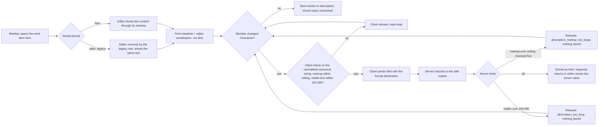

# Spec: Описание of a work item as rich text

## Context and goal

Описание is plain text today (mod-003 BR-M3-19): a member cannot give a
description a heading, a list, a link or a code block, which the reference
tracker's work items routinely carry (doc-002 BR-M3-4). This task (A of three
consecutive tasks, see Decomposition) makes Описание a rich-text field edited
in a WYSIWYG editor on the work item form: all text formatting, proper tables,
proper code and links, limited to a fixed safe subset enforced on the server,
and keeps every description already stored showing exactly what it showed
before. Scope is **Описание only**, no E2E tests. Size is `L` (an ADR is
accepted before code, `routing.md`). Images (task B) and @mentions / # work-item
links (task C) are not in A.

## Roles

| Who | What they may do |
|---|---|
| Any signed-in user | as mod-003 BR-M3-27: edit Описание of any work item they may edit today, and read it wherever it is shown |
| Anonymous caller | nothing: unchanged (mod-003) |

No new permission and no new role: rich text changes the content of a field, not who may write it.

## Decisions taken by the human

| # | Decision |
|---|---|
| D-1 | Storage is sanitized HTML; the browser editor is TipTap (ProseMirror); a server-side HTML sanitizer reduces every write (was OQ-1; 2026-10-12). |
| D-2 | The new dependencies are accepted (was OQ-4). The ADR (library, sanitizer, the departure from ADR-0007's fixed UI stack, the rollback story) is a **design-stage deliverable**, written and accepted by the human before any code; this spec does not write it. |
| D-3 | Legacy plain text is converted lazily, at read, under a stored-format marker; no data migration rewrites a row (was OQ-2). |
| D-4 | The 100 000 limit counts visible text; the physical storage ceiling above it is higher (was OQ-3). |
| D-5 | 2026-10-13, after the prototype: delivery as three consecutive tasks. A (this): the editor with all text formatting, tables, code, links. B: images (upload as attachments, shown in the text, crop). C: @mentions and # work-item links. |
| D-6 | Colour, highlight and font size are a closed palette stored as classes, never inline style (BR-RT-14). |
| D-7 | The reference tracker's "PR link" button is omitted: the product has no pull-request entity; an ordinary link covers it. |

## Stories

| id | Title | depends-on | File |
|----|-------|------------|------|
| US-1 | A member edits Описание in a WYSIWYG editor: core, lists, paste, limits | - | `stories/US-1-edit-description-in-editor.md` |
| US-2 | The server reduces an HTML description to the safe subset | US-4 | `stories/US-2-sanitize-and-limit-on-save.md` |
| US-3 | Existing descriptions keep their text and an unchanged Описание is never rewritten | US-1, US-4 | `stories/US-3-existing-text-and-no-spurious-rewrite.md` |
| US-4 | The API tells plain text from HTML, and bounds the size | - | `stories/US-4-format-contract-and-limits.md` |
| US-5 | Text marks, palettes, clear formatting, emoji and links | US-1, US-7 | `stories/US-5-text-marks-emoji-links.md` |
| US-6 | Tables and code blocks | US-1, US-7 | `stories/US-6-tables-and-code.md` |
| US-7 | The server's canonical form: closed vocabularies, mark order, tables, code | US-2, US-4 | `stories/US-7-canonical-form-and-vocabularies.md` |

All seven ship in one MR: US-1, US-5 and US-6 without US-2 and US-7 would put an
unfiltered editor in front of the store, US-2, US-4 and US-7 without the
editor have nothing to protect or carry, US-3 is what keeps the editor from
mangling what exists.

## Business process (BPMN)

## Business rules

Local prefix `BR-RT-`, so as not to collide with mod-003's `BR-M3-N`.

| # | Rule | Source (document / decision) |
|---|------|------------------------------|
| BR-RT-1 | Описание in html format is limited to a fixed safe subset: headings of levels 3 and 4; the marks bold, italic, underline, strikethrough, highlight, text colour, font size, inline code and link; bulleted and numbered lists nested up to 3 levels; code blocks with a language from a closed list; merge-free tables; emoji as ordinary Unicode text. Nothing else survives a save. | doc-002 BR-M3-4; D-5 |
| BR-RT-2 | The subset is enforced on the server on every html write, whatever the client sent; the editor's own restrictions are a convenience, not the safeguard. | doc-002 BR-M3-4 ("stripped on save") |
| BR-RT-3 | Reduction is an allow-list of elements **and** their attributes (US-2 § Allow-list): elements outside it are dropped with content (script, style, iframe, object, embed, template, svg, math, noscript and the like) or unwrapped with the text kept (every other unknown element); every attribute not named is removed; `class` survives only as a token of the closed vocabularies of BR-RT-14 and BR-RT-16 on the one element each belongs to; a link keeps only an absolute http, https or mailto address; the server strips `target` and forces `rel="noopener noreferrer"`. | doc-002 BR-M3-4 |
| BR-RT-4 | In this task images are never inline: an image element or a data address is dropped, also when pasted or dropped as a file. Task B amends this rule (images as attachments shown in the text); until it merges BR-RT-4 is in force. | doc-002 BR-M3-4; doc-002 D-8; D-5 |
| BR-RT-5 | **One canonical form.** The server's reduced output is the editor's canonical form: the editor schema is configured to hold exactly what the allow-list keeps (US-7 § Canonical structure: marks in one fixed order, palette classes only, header rows in the table body, list items and cells holding only paragraphs and nested lists, no marks in a code block and none but a link on inline code, no list `start`, rectangular tables without merged cells). The client's serialisation is the editor's raw output **plus a normalisation step** that removes every element and attribute the allow-list does not name (the editor's `colgroup`/`col`, `style`, `colspan="1"`/`rowspan="1"`, `data-*`, `ol` `start` and `type`, link `target` and `nofollow`, code-block chrome among them, not a closed list) and applies the same canonical rules; that normalised string is what the dirty baseline, the request and the client-side ceiling check use. Hence: reduction is idempotent, and a value the server stored, loaded into the editor and serialised without edits, equals itself, byte for byte. A shared fixture file holds (input, canonical, editor output) triples run by both suites (US-2, US-3, US-7). | quality rule for BR-RT-2 |
| BR-RT-6 | A description with no non-whitespace character in its visible text is stored as the empty description `""`. This covers empty paragraphs, a table of empty cells, a code block of whitespace only and a link with no text. | mod-003 spec § Fields (empty default) |
| BR-RT-7 | Two limits, both counted in Unicode code points for an html description. (1) **Visible text** at most 100 000, else `workitems.workitem.description_too_long` (message unchanged, «Не более 100 000 символов.»). (2) **Stored markup** (the reduced html) at most 1 000 000, else the new reason `workitems.workitem.description_markup_too_large`. Ceiling derivation: the worst legal legacy text (100 000 characters) converts to 700 007 (100 001 empty paragraphs, each `

`; 100 000 `&` in one paragraph is 500 007), so 1 000 000 never trips for legacy content. A raw request description above 2 000 000 UTF-16 code units is refused with the markup reason before any parsing. **One reason per field, checked in this order:** the pre-parse cap, then the ceiling on the reduced markup, then the visible limit; so a value over both limits gets `description_markup_too_large`. The limits are checked before BR-RT-6: a blank value over the ceiling is refused, not stored as `""`. **The reduction aborts as soon as its output passes 1 000 000 code points** (re-nesting marks can amplify input several times; nothing is built past the ceiling). A plain-format description keeps BR-M3-19's 100 000 UTF-16 code units. | doc-002 § NFR (size); mod-003 BR-M3-19; D-4 |
| BR-RT-8 | **Visible text** is the text of the reduced html with entities decoded, in order, with one U+000A between consecutive **leaf blocks** (the blocks that hold text directly: paragraph, heading, code block; a list item or table cell is a container and adds none of its own, so `<li>
a
</li><li>
b
</li>` is "a\nb") and one U+000A for each ` `, none before the first or after the last (an empty paragraph is a leaf block of zero length). **It is counted in Unicode code points**, by server and client alike: an emoji such as 😀 counts 1, not its two UTF-16 units, and a ZWJ sequence counts each of its code points (variation selectors and joiners included); no grapheme clustering. A lone surrogate is replaced by U+FFFD before counting, in the stored html as well, and counts 1, on the server and in the client alike. The count of a converted legacy value never exceeds its length in UTF-16 units. A fixture set of (html, count) pairs, emoji included, is run by both suites. | mod-003 `WorkItemText` unit; D-4 |
| BR-RT-9 | A plain-format description shows exactly the characters it had, line breaks, runs of spaces and tabs included; nothing in it is interpreted as markup (`<b>` stays three characters). **Legacy rule**: CR LF and lone CR become LF (the one accepted invisible difference); the text is split at LF; each line becomes one paragraph (an empty line an empty paragraph); `<`, `>`, `&` are escaped as text; spaces and tabs are kept and shown with whitespace preserved; nothing is auto-linked or read as markdown. A legacy value cannot hold U+0000 (the store refuses it); U+0000 in new html input is removed. | mod-003 BR-M3-19 (what it promised) |
| BR-RT-10 | **Contract, additive.** A write carries `description` and an explicit format declaration (`plain` or `html`; working field name `descriptionFormat`, fixed in the api-contract at the backend stage). No declaration means `plain`: stored exactly as sent, limit 100 000 code units, as BR-M3-19 today. A read returns `description` and its format; a legacy and a never-written value are reported `plain`. The server never rewrites a stored value except on a write; the plain-to-html conversion is the legacy rule above, applied by the client that displays it. An unknown declared format is refused with a field reason, with or without a description; a valid declaration with no description is ignored. A write changes the description when its (value, format) pair differs from the stored pair: a plain "
a
" over a stored html "
a
" is a change, an html re-send of the stored canonical value is not. | mod-003 api-contract § 0.6; R-2 |
| BR-RT-11 | A save that does not change Описание does not carry it, and the stored description is byte-for-byte unchanged, legacy or formatted. Opening the form never makes it dirty; the editor's own normalisation of a loaded value is not a change. "First save" of a legacy description means the first save that changes Описание. | R-3 |
| BR-RT-12 | The only surface that shows Описание in this task is the form's editor (editable, disabled while a save is in flight). Any surface that later shows a stored value renders it through the editor's schema or the same reduction, never by assigning raw html to the page, and shows paragraphs with whitespace preserved. | doc-002 BR-M3-4; R-8 |
| BR-RT-13 | Amendments owed, all additive (a client that sends no declaration sees no change): mod-003 BR-M3-19 and `docs/features/mod-003-work-item-core/api-contract.md` § 0.6 (Описание), § 1.1 shape, the save body, the reason table and `errors.description`, and § 2.4's "a value equal to the stored one changes nothing" read as equality of (value, format), each with a note in mod-003's `status.md`; feat-022 BR-M3-36 reworded to "as BR-M3-19 has it for a plain-format description" (its three texts stay plain) and its decomposition note extending this task superseded; **doc-002 BR-M3-4's stored subset** (headings, lists, links, code blocks, tables) **is widened** by underline, strikethrough, highlight, text colour and font size (closed class palettes) and the code-block language class; the subset is shared by every BR-M3-4 field, so the type-fields and comments line inherits the palettes. List indent, emoji and auto-link are editor behaviour, not subset changes. B and C carry their own amendments. The orchestrator applies it as a note in doc-002's `status.md`, with the amendments above. | R-1, R-2; D-5 |
| BR-RT-14 | **Closed palettes, stored as classes, never inline style.** Text colour: `rt-color-gray`, `-red`, `-orange`, `-green`, `-teal`, `-blue`, `-purple`, `-pink` (8). Highlight: `rt-hl-yellow`, `-orange`, `-red`, `-green`, `-teal`, `-blue`, `-purple`, `-gray` (8). Font size: `rt-size-xs`, `-sm`, `-lg`, `-xl` (4; normal size is no class). Colour and size are carried by `span`, highlight by `mark`. The server accepts only these tokens: the `class` value is split on ASCII whitespace and each part matched exactly and case-sensitively (`RT-COLOR-RED` is not a token); any other class, any `style` and any free-form value is dropped, and the stored token is written from the server's own table, never echoed from the input. The token names are the contract; design.md maps each to an ADR-0024 theme token including dark mode, and the palette is the same in light and dark (the mapped colour differs, the token does not). A heading carries no size class. | D-6 |
| BR-RT-15 | **Mark nesting is canonical:** outermost to innermost link, bold, italic, underline, strikethrough, highlight, colour, size; adjacent equal marks merge; empty inline elements are removed; each element carries one class token (several are split into nested elements in that order, within a family the first valid token wins). Nested elements of one family keep the inner one. Inline code carries no mark but a link: code wins over bold, italic and the rest, and a link around it, or inside it (hoisted outward), stays, keeping its own extent when it covers only part of the code (`<code>a<a>b</a>c</code>` becomes code "a", linked code "b", code "c"); a code block carries no marks. Pasted foreign colour, background and font size are dropped, never mapped to the palette; bold, italic, underline and strikethrough are recognised from tags and from `font-weight` (bold from 600), `font-style` and `text-decoration` of pasted content, a wrapper declaring `font-weight:normal` being not bold. | BR-RT-5; D-6 |
| BR-RT-16 | **Code blocks.** A block has a language from the closed list `plain` (no class), `javascript`, `typescript`, `json`, `html`, `xml`, `css`, `sql`, `csharp`, `python`, `bash`, `yaml`, `markdown`, stored as the class `language-<name>` on the block's `code`; any other value is dropped (shown as plain). Content is plain text, monospace, whitespace and tabs kept. **Tab has two exceptions to "never captured", both announced on entry and both left by Esc then Tab:** inside a code block Tab inserts a tab character and Shift+Tab removes one leading level (one tab, or up to four leading spaces, on every selected line); inside a table cell Tab and Shift+Tab move to the next and previous cell (BR-RT-17). Esc arms exactly the next keystroke: if that is Tab (Shift+Tab) focus leaves the editor forward (backward), any other key disarms it, and an Esc that closed a prompt or picker does not arm. The code block is left by Enter twice at its end (the two trailing line feeds are removed), Ctrl/Cmd+Enter, or ArrowDown at the end of its text; leaving a block that is last in the document puts the cursor after it without storing a paragraph (BR-RT-5), typing there creates one. A copy button puts the block's exact text on the clipboard; it is chrome, never stored. Nothing in a block is executed or fetched; any colouring by language is applied as decorations over the text nodes by the client's own code, never by inserting a highlighter's HTML string, and never stored. A pasted block is reduced per US-6. | D-5 |
| BR-RT-17 | **Tables** are merge-free: a header row (cells `th`, toggled), rows and columns added above/below and left/right and deleted, the table deleted. No `colspan`/`rowspan`. **The canonical table is rectangular:** a merged cell keeps its content at its top-left position and every other position it spanned becomes an empty cell of the same element (`th` stays `th`); a short row is padded at its end to the widest row with empty cells of the row's last cell's element; a row with no cell and a table with no row are removed. The reason is one canonical form that spreadsheet and editor round-trip without choices. Cells hold paragraphs only; a table is never inside a table or a list item; column widths are not stored and not editable. Tab and Shift+Tab move between cells, announced on entering a table; in the last (first) cell they leave the editor and add no row; Esc then Tab leaves from any cell (BR-RT-16); Ctrl/Cmd+Enter in a cell puts the cursor after the table (a gap cursor when it is last, nothing stored). A pasted spreadsheet range becomes a table only under the narrow rule of US-6. | D-5 |
| BR-RT-18 | **Links** are added, edited and removed through one prompt; the scheme allow-list of BR-RT-3 is unchanged, and the prompt accepts exactly what auto-link does (`http://`, `https://`, `mailto:`, and `www.` taken as `https://www.`). A link is never followed by a plain click inside the editor; it is opened in a new tab by an explicit control or Ctrl/Cmd+click, with `noopener noreferrer`. **Auto-link** applies only to text that starts with `http://`, `https://`, `mailto:` or `www.` (scheme case-insensitive) and has a non-empty host: never a bare domain, a bare e-mail or a file name (`example.org`, `a@b.ru`, `setup.py`). It fires when such text is typed and followed by a space or Enter, or pasted (alone or inside plain text); trailing `.` `,` `;` `:` `!` `?` `»` `"` `'` and an unbalanced `)` or `]` are not part of the address; it never fires inside inline code, a code block or an existing link. Pasting such an address over a non-empty selection links the selection and keeps its text. Ctrl/Cmd+Shift+V pastes plain text with no auto-link and no link-over-selection. The first Ctrl/Cmd+Z right after an auto-link (typed or pasted) removes only the link and keeps the text (custom behaviour; the editor's default would remove the text); the next undoes the typing. A legacy value is never auto-linked on open (BR-RT-9). | D-5 |
| BR-RT-19 | **Emoji** are inserted by a picker as Unicode characters in ordinary text, never as images; the server treats them as text, and they count by BR-RT-8. The picker's emoji data is bundled with the panel and shown with the system's native glyphs: no request to a CDN or any other host. | D-5 |
| BR-RT-20 | **Lists and clear formatting.** Indent and outdent nest a list item by buttons (and Ctrl/Cmd+] and Ctrl/Cmd+[) up to 3 levels; Tab does not indent. Clear formatting removes bold, italic, underline, strikethrough, highlight, colour, size and inline code from the selection and turns selected headings into paragraphs; links, lists, tables and code blocks are unchanged. | D-5 |

## Operation completeness

| Entity | Create | Read | Update | Delete/deactivate | Cancel/reverse |
|--------|--------|------|--------|-------------------|----------------|
| Описание (a field of the work item) | no: set only by Update; the create dialog has no such field and the form opens with it empty (mod-003) | any signed-in user (BR-M3-27); the form's editor (US-1, US-3) | any signed-in user who may edit the work item, in the editor (US-1, US-5, US-6) through the server's reduction (US-2, US-7) and limits (US-4) | no: a field is cleared, not deleted; clearing stores `""` (BR-RT-6) | no: reverting a save is the history task (feat-015); until then undo in the editor before saving (US-1) |
| Stored legacy plain value | no: a plain-format write is still accepted for old clients (BR-RT-10), the panel writes html | any signed-in user, visibly unchanged (US-3) | yes: the first save that changes Описание stores html | no: nothing is deleted or rewritten by this task, no migration touches a row | the conversion is not stored, so nothing to reverse until the member's first save; after it, see Rollback below |

## Non-functional requirements

- **Safety:** a hostile-payload corpus (a checked-in fixture: script, iframe,
  style, event attributes, `javascript:`/`data:`/`vbscript:` links, entity- and
  whitespace-obfuscated schemes, nested and unclosed tags, DOM-clobbering ids,
  hostile class and style values, mutation-style payloads, scripts inside code
  blocks) runs in the server's automated tests; none of it survives, and every
  stored value re-parses and re-reduces to itself (US-2). `react/no-danger` is
  an error on the frontend.
- **Speed (server):** GET and PATCH of a work item with a 100 000-character
  visible description within 1 s each; a PATCH at the 1 000 000-code-point
  ceiling within 2 s, and a hostile 2 000 000-code-unit input that amplifies on re-nesting is refused within 2 s (mod-003's bound extended). Editor opening speed in a real
  browser is a manual QA observation, not a gate (R-5).
- **Accessibility:** the editor is operable by keyboard alone; Tab is never
  captured except in the two named places, a code block and a table, each
  announced on entry and each left by Esc then Tab (BR-RT-16, BR-RT-17); toolbar controls have Russian names; the
  editor keeps the accessible name «Описание»; palette choices are named, not
  colour-only; mapped colours meet contrast in light and dark (design.md).
- **Language:** interface copy Russian, quoted in US-1, US-5, US-6 and US-4;
  design.md carries the remainder; the reference tracker is never named.
- **Tests:** no E2E for this task (the human's instruction). Unit, integration
  (API) and jsdom component tests with the real editor; what jsdom cannot
  check is listed per scenario as manual QA (§ Verification of each story).
- **Rollback:** widening the stored bound is additive, but its down migration
  fails once any row exceeds 100 000; and an older release shows saved html
  as raw tags in a plain field. Both are consequences the ADR states with a
  runbook (design stage); the marker stays so the release can be rolled
  forward again.

## Out of scope

- «Критерии приёмки», «Шаги воспроизведения», «Сведения о системе» and
  comments: they are the type-fields follow-up line below. feat-022's note
  extending this task to the three fields is superseded.
- **Images**, image upload, shown-in-text images and crop: task B
  (`feat-NNN-work-item-description-images`), which amends BR-RT-4.
  **@mentions and # work-item links:** task C
  (`feat-NNN-work-item-mentions-links`), which needs the user directory and
  work-item search that do not exist yet. The reference tracker's "PR link"
  button: omitted (D-7).
- A read-only renderer for a consumer that does not exist: the list, board and
  backlog never return the description. BR-RT-12 binds future surfaces.
- Alignment, task lists, embeds, free-form colours, fonts and sizes, table cell
  merge/split, column widths, lists inside table cells, stored syntax
  highlighting.
- Full-text search over the description (feat-003) and its handling of markup.
- History of description changes (feat-015) and the revision check (feat-021).
- CSV import and export of the description; a downgrade of html to plain for
  old clients (an old client reading an html description sees its markup, the
  panel is the only client).

## Decomposition for the backlog

| id | Task | size | deps |
|----|------|------|------|
| feat-018-work-item-rich-text (this task, A) | US-1..US-7: the editor with all text formatting, tables, code and links; the server reduction, canonical form, format contract and limits; legacy text; the ADR is its first design artifact | L | mod-003-work-item-core |
| feat-NNN-work-item-description-images | B: images in Описание (upload as attachments, shown in the text, crop); amends BR-RT-4 and the allow-list | L | feat-018-work-item-rich-text, mod-004-work-item-attachments |
| feat-NNN-work-item-mentions-links | C: @mention of a user and # link to a work item in Описание; needs the user directory (tech-025-user-projection-without-provider) and work-item search (feat-003-work-item-search) | M | feat-018-work-item-rich-text, tech-025-user-projection-without-provider, feat-003-work-item-search |
| feat-NNN-work-item-rich-text-type-fields | «Критерии приёмки», «Шаги воспроизведения», «Сведения о системе» **and comment text** (doc-002 BR-M3-4) as rich text on this task's editor and sanitizer; includes the first read-only renderer for comments | M | feat-018-work-item-rich-text, feat-022-work-item-form-fields, feat-002-work-item-comments |

Amendments for the orchestrator in `main`: feat-022's note extending
feat-018 to those three fields is superseded by the type-fields line; feat-002
needs a note that comment rich text is owned by that line; the queue lines for
B and C are entered by the orchestrator (numbers not issued here).

## Open questions

None for the human: OQ-1..OQ-4 are settled (§ Decisions). Owed at the design
stage, not questions: design.md must settle how the code-block exits of
BR-RT-16 and the table exit of BR-RT-17 work with the editor's isolating
nodes, and that its trailing-node behaviour is off (no stored trailing
paragraph, BR-RT-5); the ADR (D-2), which at acceptance must also cover the
dependencies the amendment adds beyond D-2 (an emoji picker or data set, a
syntax-highlighting library if one is used; ADR-0039 is `proposed` and names
neither) or state them built in-house; the editor-bundle weight measured and
loaded lazily on the form route, TipTap themed in MUI's tokens, the palette
token mapping including dark mode (BR-RT-14, ADR-0024), the emoji set and
picker, the api-contract field names (BR-RT-10), the error-code entries for
`description_markup_too_large` and the unknown-format reason in
`docs/error-codes.md` and `contracts/errors/*.json`.
