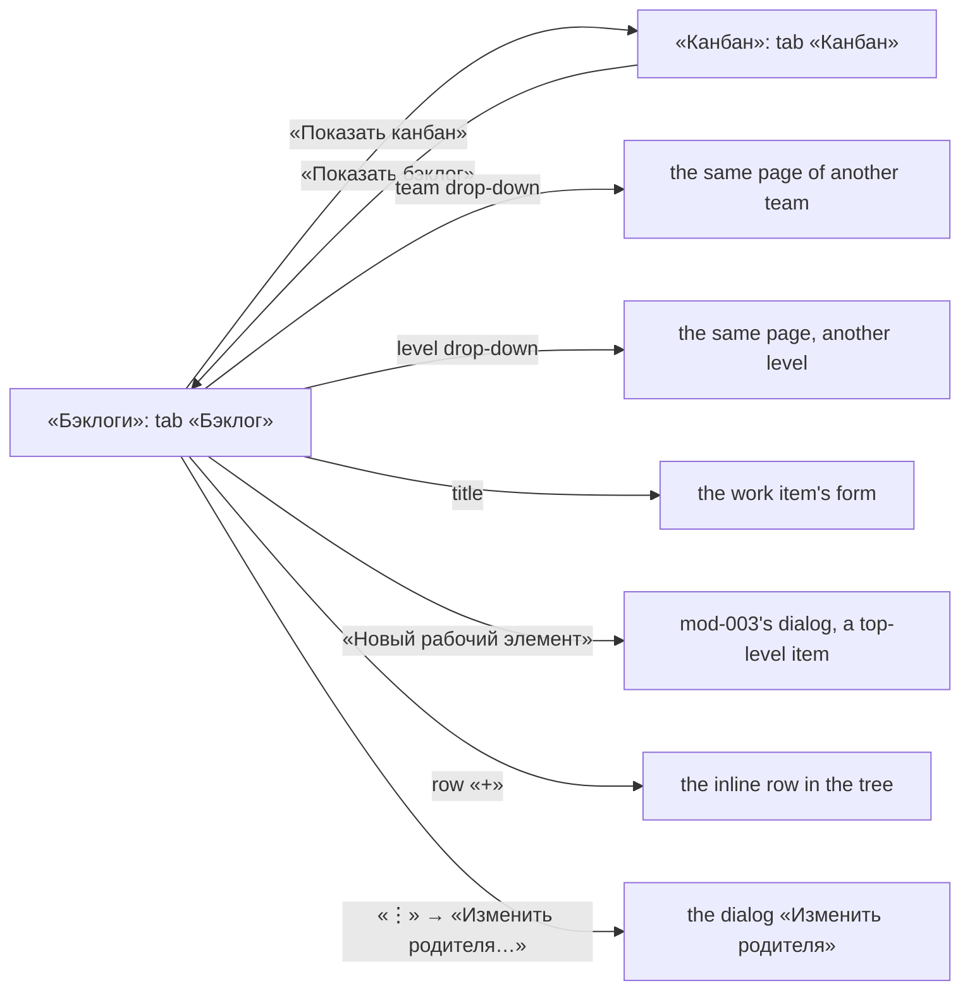

# Design: The backlog as the reference screen (feat-027, D-7)

Stage 3 artifact of the short route (`status.md` D-4), written for the human's
correction D-7 of 2026-10-09: the page «Бэклоги» and the head of «Канбан» look
**visually like the reference screenshot**. It replaces the design that stood
folded in `spec.md` § Screens and copy (D-4): layout, MUI components, every
state and every Russian string of this task are here, and nowhere else. The
rules (BR-T-n) and the scenarios (US-1..US-6) are in `spec.md` and
`stories/`; they point here.

- **The reference screenshot** lives outside the repository and is never
  copied into it; the tracker it shows is never named (mod-015 BR-16,
  tech-001 D-1). The measurements below were taken from it at a window 1 349 px
  wide (its text widths checked against Segoe UI's own metrics) and are given
  as the **look to reach**, in the theme's tokens: stage 3
  fixes structure, components and states, not pixel promises — but this task's
  one acceptance test is a side-by-side look, so the numbers are here for the
  developer to check against.
- mod-015's design (`../mod-015-app-shell-design-system/design.md`) is the
  base: its theme, `PageHeader`, tables, menus, notices and focus rules apply
  unless this file says otherwise. Where it does, it is superseded **for the
  two pages named here only**, but for the font with its weights, the type
  icons and their colours, the state dots and the accent, which change
  panel-wide (§ 2.1, § 2.2, § 2.4); § 8 lists each. The two choices that were
  the human's (§ 9) are answered: D-10.
- No prototype: not required on the short route (stage 03 makes it mandatory
  for `L` only), and the reference screenshot is the model.
- The data of every example is `stories/US-1`'s: team «Платформа», project
  key `MSK`.

## 0. D-7 and where it lands

| D-7 | Section |
|---|---|
| 1 columns, in order; none of ID, «Родитель», «Исполнитель», «Приоритет», «Действия», no handle column | § 4.3 |
| 2 «Тип» plain text; «Заголовок» holds the tree, the type icon, the plain title, «⋮» | § 4.3, § 4.4, § 2.4 |
| 3 the hierarchy column: header «+» «−», the row's «+» (D-7 said orange; D-10: the reference's pale grey) | § 4.5 |
| 4 add child inline in the tree | § 4.8 |
| 5 drag and drop: the whole row is the source (D-11); the dotted grip at the row's edge is the hint, not a column | § 4.9 |
| 6 rows and table: compact, white, no row lines, states, sticky header | § 4.2, § 4.6, § 4.12 |
| 7 «Статус»: a dot by category + the state name | § 4.3 |
| 8 page head: team name, team drop-down, one tab, level drop-down, two buttons | § 3 |
| 9 font: the system stack, Segoe UI first, in the whole panel | § 2.1 (with the weights Segoe UI has) |
| 10 out: analytics tab, star, members, filters, view options, column options, full screen | none drawn; the reasons are the spec's § Left out of this cut. The reference's static header separators are not column options and are drawn (§ 4.3) |

## 1. Screen map

| Screen | Address | Stories | Access |
|---|---|---|---|
| «Бэклоги» — the head (§ 3) and the table (§ 4) | `…/teams/:teamId/backlogs/:level` | US-1..US-6 | any signed-in user (D-3); anonymous: mod-015's auth card |
| «Канбан» — the head only (§ 3); its columns and cards are unchanged | `…/teams/:teamId/boards/:level` | US-1 (head) | as above |



## 2. Theme changes (`app/theme`)

The only place for appearance (frontend.md "Theme"): every value below is a
theme token, read through the theme object, no colour literal outside
`app/theme`.

### 2.1 Font (D-7 9)

`fontFamily` becomes `"Segoe UI", -apple-system, BlinkMacSystemFont,
"Helvetica Neue", Arial, sans-serif` for the whole panel — body, headings,
buttons, tables, dialogs, the board. `main.tsx` stops importing
`@fontsource/roboto` (the four CSS imports go); the package entry stays in
`package.json` (removing a dependency is not this task's). mod-015 § 2.4's
"Family: Roboto" is superseded panel-wide, not only on these pages.

**Weights change with the family.** Segoe UI on Windows has no 500 face — it
ships 300, 350, 400, 600 and 700 — so CSS font matching would draw every 500
of mod-015's scale as Regular 400, and the heading, the tabs and the buttons
would look lighter than the reference's Semibold (its heading is Segoe UI
Semibold 20 px, its selected tab and its primary button label are semibold
too). So wherever mod-015 § 2.4 says 500 the weight is **600**:

| Token (`tokens.ts`) | Size / line | Weight now (was 500) |
|---|---|---|
| `typeScale.h1` | 20 / 28 | 600 |
| `typeScale.h2` | 16 / 24 | 600 |
| `typeScale.h3` | 14 / 20 | 600 |
| `typeScale.subtitle2` | 12 / 16 | 600 |
| `typeScale.button` | 14 / 20 | 600 |
| `typeScale.avatarInitials` | 13 / 16 | 600 |
| `typography.fontWeightMedium` (MUI's "medium" role; read by the settings navigation and the user menu through `fontWeight: 'fontWeightMedium'`) | — | 600 (MUI's default is 500) |

`body1`, `body2` and `caption` stay 400, sizes and line heights unchanged.
One named value, `fontWeightMedium = 600` in `tokens.ts`, feeds all seven.
The **tab** needs its own line: MUI draws a `Tab` in `typography.button`, so
with the scale above every tab would be 600. `MuiTab` sets the unselected tab
to `typography.fontWeightRegular` (400) and keeps the selected one at 600
(`typeScale.button.weight` — `components.ts` already names it), as the
reference's selected «Backlog» / unselected «Analytics» pair.

`theme.test.tsx` gains a scenario for this: the family starts with
`"Segoe UI"` and names no Roboto; no `typeScale` entry is 500 — the six above
are 600, `body1`, `body2`, `caption` 400; `typography.fontWeightMedium` is 600;
a rendered selected `Tab` computes to 600 and an unselected one to 400. The
file comment in `tokens.ts` is brought in line. § 8 lists this as superseding
mod-015 § 2.4's weights and § 2.6's "selected label weight 500".

### 2.2 Colour tokens to add

| Token | Value | Used by | Contrast |
|---|---|---|---|
| `palette.shell.addAction` | `#8A8886` | the row's «+» — the reference's pale grey cross, a little darker so it stays findable (D-10) | 3.5:1 on white, 3.3:1 on `background.default`, 3.1:1 on `action.hover`, 3.06:1 on `shell.rowSelected` — above 3:1 for a UI component |
| `palette.shell.buttonNeutral` | `#EBEBEB` | the grey secondary button of the head (§ 3.5) | the label `text.primary` 13.0:1 |
| `palette.shell.buttonNeutralHover` | `#E2E2E2` | its hover | `text.primary` 12.0:1 |

Added to `ShellPalette` in `tokens.ts`, to the module augmentation and to the
theme's contrast test.

`shell.addAction` was D-7 3's orange (`#C05600`, 4.6:1). The reference's own
«+» is a thin light-grey glyph — the orange the orchestrator saw was display
colour fringing (the designer's pixel check) — and the human chose the grey
(D-10, Q-2): `#8A8886`, darker than the reference's `#B0B0B0` (2.2:1, under the
3:1 of a UI component), so the control is still found at a glance. The orange
and its contrast row are gone.

**The accent and the colours D-10 takes from the reference, panel-wide:**

| Token (`tokens.ts`) | Was | Now | Note |
|---|---|---|---|
| `colourRoles.accent` (`palette.primary.main`) | `#0F6CBD` | `#0078D4` | the filled primary action, the tab underline, the selected row's frame, the focus ring. A white label on it is 4.53:1. `accentDark` `#0C5598` and `rowSelected` `#E5F0FA` stay: the contrast test checks the selected row's icon (6.6:1) and the focus ring on every surface (3.3:1 on `navigation selected` at the least) |
| link text (`MuiLink`) | the accent | `palette.primary.dark` (`#0C5598`) | **a deviation D-10 did not foresee:** the accent as text is 4.26:1 on `#F8F8F8`, under the 4.5:1 text floor (mod-015 BR-5), so a link in the default colour takes the accent's dark companion (7.2:1); a link with another `color` (`inherit`: the title link) is untouched |
| `typeColours` | § 2.4 | § 2.4 | the reference's |
| `categoryColours.Proposed` | `#707070` | `#B2B2B2` | the «Новые» dot |
| `categoryColours.Completed` | `#107C10` | `#339933` | the «Завершённые» dot |

Used from existing tokens, no new ones: the row hover is
`palette.background.default` (`#F8F8F8`, the reference's value); the selected
row is `palette.shell.rowSelected` with a `palette.primary.main` frame (2 px on
the left, 1 px elsewhere: § 4.6) and its type icon in `palette.primary.dark`;
header labels are `text.secondary` on `background.paper`, the header
separators `palette.divider`; the dotted grip is `palette.action.disabled`.
The card's shadow is a token of its own (§ 2.6).

### 2.3 Layout tokens to add: `theme.layout.backlogTable`

| Key | px | Meaning |
|---|---|---|
| `hierarchyColumn` | 72 | the hierarchy column: 16 + 24 + 4 + 24 for its two header buttons, 4 over |
| `orderColumn` | 68 | «Порядок»: the 12 px label sets at 49 px in Segoe UI, plus 2 × 8 px of cell padding is 65 — a 56 px column would cut it |
| `typeColumn` | 184 | «Тип»: «Пользовательская история» sets at 165 px in Segoe UI 13 px, plus 2 × 8 px of cell padding is 181, so it fits in one line (the reference's 104 px holds «User Story»); a longer name of a customised process ends in an ellipsis |
| `titleColumnMin` | 400 | «Заголовок», takes the rest of the width |
| `stateColumn` | 104 | «Статус» |
| `effortColumn` | 64 | «Трудоёмкость»; its header is cut to «Трудо…» like the reference's «Busin…» (§ 4.3) |
| `businessValueColumn` | 64 | «Бизнес-ценность»; cut the same way |
| `valueAreaColumn` | 104 | «Вид ценности»: «Архитектура» is about 74 px at 13 px |
| `treeIndent` | 16 | the indent of one depth |
| `chevronSlot` | 24 | the chevron's box, and the empty box of a row with no children |
| `rowControl` | 24 | the box of the row's «+» and «⋮» |
| `headerButton` | 24 | the two square buttons of the hierarchy header |
| `typeIcon` | 16 | the type icon of the title cell |
| `chevronGlyph` | 20 | the tree chevron and the team chevron: the slice's thin chevron (§ 4.4) at 20 px is about 12.5 × 6 px with a 1.25 px stroke, the reference's hairline 11 × 6 |
| `actionGlyph` | 16 | the glyph of «+» and «⋮» |
| `headerGlyph` | 18 | the glyph of the two square header buttons (the cross is about 10.5 px, the reference's 11) |
| `gripHitWidth` | 16 | the hint strip at the row's left edge (the whole row is the drag source, D-11) |
| `gripDotOffset` | 7 | the dotted line's distance from the card's left edge: the 8th pixel column |
| `gripMarkHeight` | 20 | the dotted mark's height: four 2 px dots 6 px apart, centred on the row (§ 4.9) |
| `separatorHeight` | 20 | the static separator at a header cell's right edge (§ 4.3) |
| `viewportOffset` | 204 | what the page keeps above and below the card: top bar 48 + head 132 (§ 3.2: 28 + 32 + 12 + 40 + 20) + bottom padding 24 |

The seven fixed columns sum to 660 px (72 + 68 + 184 + 104 + 64 + 64 + 104);
with `titleColumnMin` the table's `minWidth` is **1 060 px**. The check is
against the content width less a classic 17 px vertical scrollbar of the card,
because the scrollbar appears as soon as the rows outgrow the card:

| Window | Navigation | Content | Less 17 px | Result |
|---|---|---|---|---|
| 1 440 px | expanded (240) | 1 152 | 1 135 | no sideways scroll (75 px to spare); «Заголовок» about **475 px** (492 with an overlay scrollbar) — the reference's is about 553 px of its 1 298 px card |
| 1 280 px | expanded (240) | 992 | 975 | the table scrolls inside its card, the page does not (US-1) |

`theme.test.tsx` asserts `1 060 ≤ 1 135` and `1 060 > 975` from the tokens, so
a later change to a width cannot break either acceptance size unnoticed.
Existing: `density.registryRowHeight` 36 px is the row, `density.controlHeight`
32 px the head's buttons.

### 2.4 Type icons (D-7 2)

The one lookup `theme.workTracking.typeAppearance(token)` (mod-015 § 2.3)
changes three icons, so every place that draws a type — the backlog, the board
card, the form, the pickers — changes with it, which is intended: one type,
one look.

| Token | Icon | Was | Colour now (D-10: the reference's) | Was (mod-015 § 2.3) |
|---|---|---|---|---|
| `epic` | a crown: the inline `CrownIcon` below | `Landscape` | `#E06C00` | `#C05600` |
| `feature` | `EmojiEvents` (a trophy) | same | `#773B93` | `#773B93` |
| `story` | an open book of two solid pages: the inline `StoryIcon` below (review V-8) | `MenuBook` | `#0098C7` | `#00739E` |
| `bug` | `BugReport` (a bug) | same | `#CC293D` | `#B4233A` |
| `task` | `AssignmentTurnedIn` (a clipboard with a check) | `Assignment` | `#A4880A` | `#8A6A00` |

`@mui/icons-material` has no crown. `app/theme/CrownIcon.tsx` builds one with
MUI's own `createSvgIcon` (`@mui/material/utils`, no dependency) from **one
closed path, no separate band**, in the 24 × 24 box:
`M1.5 5L7 12l5-9 5 9 5.5-7V21H1.5z`, `displayName` `Crown`. It is the
reference crown's shape: a rectangular body with vertical sides, three spikes
of nearly equal height — the middle tip at y 3, the outer tips at y 5, about
1.3 px lower at 16 px — and V notches that run down to y 12, the mid-height of
the 18-unit glyph. It spans 21 × 18 units, which at the 16 px of the title cell
is the reference's measured 14 × 12 px. (An earlier draft's detached base band
left a light gap of about 1.3 px at 16 px, and its body tapered inward, so it
read as another crown.) The developer checks it at 16 px beside the
screenshot.

**`app/theme/StoryIcon.tsx`** (review V-8) builds the story's book the same
way, with `createSvgIcon`, `displayName` `Story`, from one path of two closed
subpaths in the 24 × 24 box — each a page 9 units wide and 13 tall with a
curved top and bottom edge, the two 2 units apart at the spine:

```
M2 5.5c2.5-.9 5.5-.9 9 .5v13c-3.5-1.4-6.5-1.4-9-.5zM22 5.5c-2.5-.9-5.5-.9-9 .5v13c3.5-1.4 6.5-1.4 9-.5z
```

`MenuBook`, which the story had, draws a solid left page and a right page of
horizontal text lines; at 16 px the right half read as a list, a different
glyph from the reference's two solid pages.

**The colours are the reference's own** (D-10, Q-1 (a)): panel-wide through
the one lookup, so the board's cards, the form and the pickers change with the
backlog. They are lighter than mod-015 § 2.3's accessible variants (≥ 3.98:1):
the epic, the story and the task are 3.3–3.4:1 on white and just under 3:1 on
the selected row, and the «Новые» dot (`#B2B2B2`, § 4.3) about 2:1. Each of
these graphics repeats text on the same row — the «Тип» column names the type,
the state's name follows the dot, a card's icon sits beside the identifier — so
WCAG 1.4.11 does not ask 3:1 of them, and **the contrast test exempts them,
each with its reason** (`contrast.test.ts`, `REPEATED_IN_TEXT`): the epic,
story and task icons, the «Новые» dot and the drag grip's dots (§ 4.9). The
list is closed — an entry must still miss 3:1 somewhere, or it is tested
strictly again — and its entries must still show at 1.5:1. The graphics that
are the only carrier — the focus ring, input borders, the selected markers,
the idle level buttons — keep 3:1, and so do the feature and the bug icons
(`#773B93`, `#CC293D`: 4.6:1 at the least) and the «В работе», «Решённые»,
«Завершённые» (`#339933`, 3.2:1 at the least: it needs no exemption) and
«Удалённые» markers. `workTracking.test.tsx` pins the values and the icons.

### 2.5 The grey button

`MuiButton` variant `{ variant: 'contained', color: 'inherit' }`: background
`shell.buttonNeutral`, label `text.primary`, hover `shell.buttonNeutralHover`,
`disableElevation`, the leading icon `text.primary` — the reference's grey
secondary button. It is neutral, so the page still has one accent action
(frontend.md "One accent"). Only the two heads of § 3 use it.

### 2.6 The card's shadow and the table's text

- **`theme.cardShadow`** (a custom theme key beside `layout` and `density`,
  declared in the module augmentation): `0 3px 7px rgba(0,0,0,0.13), 0 0.6px
  1.8px rgba(0,0,0,0.11)`. The reference card's shadow is a soft glow — it
  fades over about 8 px at the sides and about 11 px below, from `#E2E2E2` at
  the edge to `#F8F8F8` — not MUI's elevation 1, which is a tight 1–3 px shadow
  darker at the bottom. The card is a `Paper` with `elevation={0}` and
  `boxShadow: theme.cardShadow`; the rgba literals live in `app/theme`, where
  the colour-literal check allows them. Elevation 1 is unchanged for the
  board's cards.
- **Card corners:** `shape.borderRadius`, the theme's 4 px (the reference's
  about 4), so the card takes no `borderRadius` of its own.
- **`typography.tableCell`** (`typeScale.tableCell`: **13 / 20, weight 400**;
  a custom variant, declared in the module augmentation): the text of the
  backlog table's body cells — the type, the title, the state, the numbers,
  the value area, the add row's input. The reference's row text measures
  nearer 13 px than 14: its first epic's title is 421 px of ink, which Segoe UI
  sets at about 434 px at 13 px and 451 px at 14; its second, 387 against 395
  and 416. The 12 px header labels match 12 px exactly, so they stay
  `typography.caption`. The rest of the panel keeps mod-015's 14 px (§ 8).

## 3. Page head, «Бэклоги» and «Канбан»

### 3.1 Layout

```
                                                                  (28 px under the top bar)
[bars] Платформа ⌄                       [+ Новый рабочий элемент] [(→) Показать канбан]     <- row 1, h1, 32 px
                                                                  (12 px)
Бэклог                                                                         Эпики ⌄       <- the tab row, 40 px
━━━━━━                                                                                        (20 px)
+--------------------------------------------------------------------------------------+
|  table card (§ 4)                                                                    |
```

On «Канбан»: the same, the tab «Канбан», no primary action (a board has none,
mod-015 § 10.4), the one command «Показать бэклог». The primary has a leading
plus and **no trailing chevron**, as the reference's «+ New Work Item».

### 3.2 Components

| Block | MUI | Notes |
|---|---|---|
| Head | `shared/ui/PageHeader` `variant="team"` with the additions of § 3.5 | the shell's trail, the title registration and the command overflow stay |
| Leading icon | on «Бэклоги» the inline `BacklogIcon` (below); on «Канбан» `ViewWeekOutlined` (its navigation entry's icon, mod-015 § 2.8); 24 px, `text.primary`, `aria-hidden` | the reference's glyph left of the team name |
| `h1` | `Typography variant="h1"` — **the team's name** | text rule § 3.3 |
| Team drop-down | `IconButton size="small"` `ExpandMore` + `Menu` | § 3.3; present whenever the team list is read, one team included |
| Primary | `Button variant="contained"` with `Add`, «Новый рабочий элемент», the type picker of mod-003 as before (`useNewWorkItem`) | «Бэклоги» only; **no trailing chevron** (`hideMenuIndicator`, § 3.5) — `aria-haspopup="menu"` and `aria-expanded` still announce the picker |
| Secondary | `Button variant="contained" color="inherit"` (§ 2.5), a `RouterLink` | «Показать канбан» with `ArrowCircleRightOutlined`; «Показать бэклог» with `ArrowCircleLeftOutlined` |
| Tab row | `Tabs` with one `Tab component={RouterLink}`, selected, indicator 2 px accent (theme) | «Бэклог» / «Канбан»; the tab is the page's own address; `px: 0`, `minWidth: 0`, so the label stands flush with the table's left edge and the underline is the label's width, as in the reference; its own vertical padding, `pt` 16 px and `pb` 6 px (the theme's default 12 + 12 around the 17.5 px line made the row 42 px, the label 14 px above the underline against the reference's 8) |
| Level drop-down | `LevelMenu`, at the tab row's right end | § 3.4 |

**`BacklogIcon`** — the glyph of the reference's team head is three
right-aligned horizontal bars, 13, 17 and 11 px long, about 2 px thick, about
5 px apart, 17 × 13 px overall, with **no numerals**; `FormatListNumbered`
draws «1 2 3» beside its lines, which reads as another glyph. So the head
builds its own with `createSvgIcon` (as `CrownIcon`) from
`M8 6h13v2H8zM3 11h18v2H3zM9 16h12v2H9z`, `displayName` `Backlog`, in
`features/boards/components/BacklogIcon.tsx` (a slice-local inline SVG: only
that page draws it, and a slice does not import `app/`). Its bars are 13, 18
and 12 units long, 2 thick, 5 apart, 18 × 12 overall, so it is drawn at the
**24 px** of the head's icons (the reference's 17 × 13 within a px); at 20 px
it would come out 15 × 10. The navigation entry keeps `FormatListNumbered`
(§ 8).

**Spacing of the team head** (`PageHeader variant="team"`, § 3.5), set against
the reference: row 1 stands **28 px** under the top bar (the reference's 27;
the page content has no top padding of its own, so this is the head's `pt`)
and is `density.controlHeight` (32 px) high; the tab row follows **12 px**
below it, 40 px high (`density.tabHeight`: the tab's 16 px over its 17.5 px
line and 6 px under add up to 39.5, the tab's minimum height makes it 40), so
the underline's bottom is 52 px
below row 1 (the reference's 53); the card follows **20 px** below the tab row
(the head's `pb`). The head is therefore 28 + 32 + 12 + 40 + 20 = 132 px, and
`viewportOffset` is 48 + 132 + 24 = 204 px. Row 1 is `display: flex;
align-items: center` with the title group — the icon, the `h1` and the
team drop-down — at the left, **10 px apart** (`gap: 1.25`): the name starts
34 px from the content edge, as in the reference, and the chevron's ink
starts about 12 px after the name (the reference's 13): 10 px of gap, less the
4 px the chevron's button is pulled in (`ml: -0.5`, review V-6), plus the about
6 px the thin chevron's ink is inset in its 24 px box (2 px of the 20 px glyph's
own inset and the path's 4.5 units). The tab row is `display: flex;
justify-content: space-between; align-items: center`.

### 3.3 The heading and the team drop-down (D-7 8)

The panel already reads a project's teams: the shell's switcher source
(`useWorkContext()`, mod-002) holds the organization → project → teams list,
so the drop-down is built from it, with **no new request**.

- **`h1` text:** the team's name from the page's own read
  (`query.data.team.name`) once it is there; until then the name from the
  context source for the address's `teamId`; if neither is known (the source
  still loading or failed, the read pending), the page's own name — «Бэклоги»
  or «Канбан» — so the page never has an empty `h1`.
- **The browser tab** keeps the page: «Бэклоги — Mustask» / «Канбан — Mustask»
  (`documentTitle`, § 3.5) — the `h1` is the team, the tab says which page of
  it.
- **Drop-down:** shown **whenever the context source is ready** — the panel
  does read the project's teams (D-7 8's condition), and the reference always
  draws the chevron after the team's name, so a project with only its first
  team, the usual stand project, shows it too. With one team the menu lists
  that team alone, `selected`, with `aria-current="page"`; the team's name
  never stands bare once the source is ready. While the source is loading or
  failed there is no button (the `h1` falls back by the rule above). The
  button is an `IconButton` (a 24 px box, glyph `chevronGlyph`, 20 px, in
  **`text.primary`** — not the theme's grey `action.active`; sizing as § 4.4's
  chevron, pulled in 4 px by `ml: -0.5` so its ink stands about 12 px after the
  name, § 3.2) with the thin chevron of § 4.4, `aria-label` «Сменить команду»,
  `aria-haspopup="menu"`, `aria-expanded`, tooltip «Сменить команду»; `Menu`
  with `aria-label` «Команды проекта» (a `variant="selectedMenu"` as
  `LevelMenu`'s), one `MenuItem component={RouterLink}` per team in the
  source's order, the team's name as its label, the current one `selected`
  with `aria-current="page"`. Choosing one goes to **the same page of that team at
  the same level** (`backlogPath` / `boardPath`); the address carries the
  context (mod-015 BR-18), so the shell's switcher follows, and the page,
  keyed by its team, starts afresh (expansion, selection). Keyboard per
  mod-015 § 12.4. **Focus after a choice (F-9):** the page of the other team is
  made anew, with its own «Сменить команду», and the one that was pressed is
  gone with the old page — so the item carries a one-shot navigation state, and
  the new page's «Сменить команду» takes focus on arrival (the state is spent at
  once, so going back to the entry later moves no focus).

### 3.4 The level drop-down (D-7 8)

`LevelMenu` keeps its behaviour (feat-001 US-6: a menu of three links, the
current one `selected`, `aria-current="page"`, Enter, Space or ArrowDown
opens on the current level, focus back on the button) and changes its look
and its place: it is the tab row's right end, a text button `variant="text"`
`size="small"` with `ExpandMore`, **visible label «Эпики»** (resp. «Фичи»,
«Истории»), `aria-label` «Уровень: Эпики» — the name contains the visible
label (WCAG 2.5.3) and stays what the E2E selects by. The menu's name is the
same «Уровень: Эпики»; its entries «Эпики», «Фичи», «Истории».

### 3.5 What `shared/ui/PageHeader` gains

Additive and optional; every other page is unchanged.

| Addition | Meaning |
|---|---|
| `documentTitle?: string` | what the browser tab reads when it is not the `title` |
| `titleIcon?: ReactElement` | the leading icon of row 1 |
| `titleControl?: ReactNode` | a control right after the `h1`, in the same row (the team drop-down) |
| `viewsEnd?: ReactNode` | the right end of the views row (the level drop-down) |
| `Command.tone?: 'neutral'` | the command is the grey `contained` button of § 2.5 instead of a text button |
| `Command.hideMenuIndicator?: boolean` | the command opens a menu (`menuOpen` is set) but draws no trailing `ExpandMore`; `aria-haspopup="menu"` and `aria-expanded` stay, so the picker is still announced. Absent: as before. «Новый рабочий элемент» on «Бэклоги» sets it (the reference's button is «+ New Work Item», no chevron); the other pages that use `useNewWorkItem` keep their chevron |
| `variant?: 'team'` | the spacing of § 3.2 — `pt` 28 px, the views row 12 px under row 1, `pb` 20 px — and the title group's 10 px gap. Absent: `pt` 16 px, `pb` 8 px, views `mt` 8 px, as before |

A single entry in `views` draws one tab (it did already). `viewsLabel` is
«Вид страницы». This supersedes mod-015 § 6.1's "secondary command is a text
button" and frontend.md's "One accent" wording **for these two heads**
(D-7 8); the rule's point — one filled accent action — still holds.

### 3.6 States of the head

- **Loading:** the head stands complete at once — the `h1` by § 3.3, the tab,
  the level button (its level is the address's), the grey button; the primary
  is absent until the read gives the level's types, as today (`useNewWorkItem`),
  and the team drop-down until the context source is ready (§ 3.3).
- **Read error:** the head stays, `ErrorBanner` with «Повторить» replaces the
  table (§ 4.12). **Team, project or organization not found:** the shared
  `NotFound` frame of that level replaces the whole page, as today.
- **Permissions:** none until mod-016 (D-3).
- **Narrow:** at 640–1 023 px the trail stands above the `h1` (mod-015 § 3.6);
  the grey button moves into «Ещё действия» when the row is full (mod-015
  § 6.1) — the primary never moves; the tab row keeps the tab at the left and
  the level button at the right.

## 4. The backlog table

### 4.1 Layout

```
+--------------------------------------------------------------------------------------------------------------+
| [+][−]  Порядок   Тип                      | Заголовок                    | Статус    | Трудо…| Бизн…| Вид ценности |  header, 40 px, white,
|--------------------------------------------------------------------------------------------------------------|  1 px divider; "|" are the
| ⁞ (+)   1         Эпик                       ⌄ [crown] Вход и регистрация ⋮  ● Новая      20    300  Бизнес       |  separators (§ 4.3)
|                   Фича                         ⌄ [cup] Вход через SSO        ● Новая      2,5        Бизнес       |  row 1 hovered: grey, grip, «+», «⋮»
|                   Пользовательская история       ⌄ [book] Письмо со ссылкой  ● В работе              Бизнес       |
|                   Баг                               [bug] [ Заголовок нового ____ ]                              |  the add row, selected
|                   Задача                            [clip] Шаблон письма      ● Новая                            |
|         2         Эпик                       ⌄ [crown] Отчётность             ● Новая                 Архитектура |
+--------------------------------------------------------------------------------------------------------------+
   «Порядок» is blank on every nested row and on the add row (BR-T-2); no lines between rows; rows 36 px;
   the card scrolls inside itself, its header stays
```

### 4.2 The card, header and rows

| Block | MUI | Look |
|---|---|---|
| Card | `TableContainer component={Paper} elevation={0}`, `boxShadow: theme.cardShadow`; the corners are the theme's `shape.borderRadius` (4 px), no override of its own (§ 2.6) | white on the grey page; no outline: the reference's glow, not elevation 1; starts 20 px under the tab row (§ 3.2) |
| Scrolling | the container, `overflow: auto`, `position: relative`, `maxHeight: calc(100dvh - viewportOffset)`, at least 240 px, `scroll-padding-top` the header's 40 px | the card scrolls inside itself, so the header can stay (below); the page does not scroll for the table's height — the card is `position: relative` because the rows' visually hidden descriptions (§ 5) are `position: absolute` and would otherwise sit below the card and stretch the document (F-3); the scroll padding keeps a row focused or scrolled to clear of the sticky header (F-10) |
| Table | `Table size="small" stickyHeader aria-label="Бэклог"`, `tableLayout: fixed`, `width: 100%`, `minWidth` = the fixed columns + `titleColumnMin` (§ 2.3, 1 060 px) | a plain table (feat-001 D-9), not a treegrid; `<colgroup>` carries the widths |
| Header row | `TableHead`, cells white (`background.paper`, not the registries' grey), `top: 0`, 40 px, a 1 px `divider` line under it; labels `typography.caption` (12/16, 400), `text.secondary`, `component="th" scope="col"`; the static separators of § 4.3 | sticky: it stays while the rows scroll; the labels are small and grey, as the reference's |
| Body row | `TableRow`, `density.registryRowHeight` (36 px), no `hover` prop; cells `padding: 0 8px`, no bottom border, `typography.tableCell` (13/20, § 2.6), `text.primary`, vertically centred | white, no lines between rows, no zebra |
| Re-reads | rows are replaced in place | scroll position, the expanded set and the selection survive a re-read (tech-012 m2) — a failed re-read keeps the table (§ 4.12) |

Measured on the reference, for the side-by-side look: row 36 px, header
40 px, one depth 16 px, type icon 16 px, the icon to the title 4 px, the
chevron's centre 24 px before the icon's centre, header labels 12 px grey,
body text 13 px (§ 2.6), the state's dot 8 px with 6 px to its name, the
title cell's right edge holds «⋮».

### 4.3 Columns (D-7 1, 2, 7)

In this order; **no ID, «Родитель», «Исполнитель», «Приоритет» column, no
handle column, no «Действия» column** — the same columns on every level.

| # | Header (visible) | Width | Align | Cell |
|---|---|---|---|---|
| 1 | two buttons (§ 4.5); the cell is named «Иерархия» by its `aria-label` | 72 | left | the row's «+» (§ 4.5) and the grip (§ 4.9); nothing else |
| 2 | «Порядок» | 68 | left | top-level rows: 1..n; nested rows and the add row: **empty** — no «·», no dash (BR-T-2) |
| 3 | «Тип» | 184 | left | the type's name as plain text, no icon, one line (`noWrap`, ellipsis, the `title` attribute carries the full name) |
| 4 | «Заголовок» | the rest, ≥ 400 | left; the label starts 36 px in — the depth-0 icon's left edge (4 px of cell padding, the 24 px chevron slot and 4 px of gap) and a few px more — so it stands over the depth-0 icons, as in the reference | the tree: § 4.4 |
| 5 | «Статус» | 104 | left | the category dot (`CategoryMarker`, 8 px), **6 px** (`gap: 0.75`) and the state's name, one line, `noWrap` with ellipsis and the full name in the `title` attribute; the dot by the state's category through `categoryColour`: «Новые» light grey `#B2B2B2`, «В работе» blue, «Решённые» teal, «Завершённые» green `#339933` (the two the reference's, D-10); «Удалённые» are never on the page (BR-T-4) |
| 6 | «Трудоёмкость» | 64 | left (header too: D-10; the reference draws the numbers at the left edge of their columns) | BR-T-3: a number with «,», no trailing zeros; blank when the type has none |
| 7 | «Бизнес-ценность» | 64 | left (header too) | BR-T-3 |
| 8 | «Вид ценности» | 104 | left | BR-T-3: «Бизнес», «Архитектура»; blank on a task and a bug |

**Headers that do not fit.** «Трудоёмкость» (77 px at 12 px) and
«Бизнес-ценность» (94 px) do not fit their 64 px columns, and the reference
cuts its own «Business Value» to «Busin…». Their headers are `noWrap` with
`text-overflow: ellipsis` and carry the full label in the `th`'s `title`
attribute (the hover tooltip); the accessible name stays complete because the
text node is whole — the ellipsis is drawn, not the text. The other headers
fit; any header cut by a customised label does the same.

**Header separators.** The reference's header draws static thin vertical
lines: 1 px, 20 px tall (`separatorHeight`), centred in the 40 px header, at
the right edge of every header cell **but the hierarchy column's, «Порядок»'s
and the last one's**. Here they are a pseudo-element of the `th` (`::after`,
`position: absolute; right: 0; top: 50%; transform: translateY(-50%)`, the
`th` `position: relative`), `palette.divider` — on «Тип», «Заголовок»,
«Статус», «Трудоёмкость» and «Бизнес-ценность». **The pseudo-element's width is
given as the string `1px`** (`${layout.dividerWidth}px`): `sx` reads a bare
number of 1 or less as a fraction of the parent, so `width: 1` drew a bar as
wide as the cell, one grey band across five headers that hid their labels
(review V-1; E2E 26.6 reads the computed `1px × 20px`). The reference has one after
«Value Area» too because «Tags» follows; here «Вид ценности» is the last
column and a separator before nothing would be noise. They carry **no resize
behaviour**: no handle, no drag, no cursor change (column options are out,
D-7 10); the sticky header keeps them.

«Приоритет» stays on the board's card (feat-022) and on the form; the read
still answers `priority`, `assignee` and `parent` (the contract is not
changed): the panel does not draw the first two on the row and keeps
`parent` for a drop's seen parent (BR-H-4).

### 4.4 The title cell

```
|<4>|<depth × 16>|[chevron 24]|<4>|[icon 16]|<4>| title (ellipsis ............) |<4>|[⋮ 24]|<4>|
```

`TableCell` padding `0 4px`; inside, a flex box (`align-items: center`,
`min-width: 0`):

1. **Indent:** `depth × treeIndent`; depth 0 is a top-level row.
2. **Chevron slot, 24 px:** a row with a child to show has an `IconButton
   size="small"`, `ThinChevronRightIcon` (collapsed) or `ThinChevronDownIcon`
   (expanded) — the slice's own hairline chevrons, below —
   `text.primary`; a row with none keeps an empty 24 px box (`aria-hidden`) so
   the icons of one depth line up (BR-T-7). **The button's size is spelled out,
   because the theme's `MuiIconButton.sizeSmall` would otherwise decide it:**
   that override sets padding to 4 px and forces every `SvgIcon` inside to
   20 px through `& .MuiSvgIcon-root`, which wins over an icon's own `fontSize`
   or `sx`; left alone, a `size="small"` button is a 28 px box (20 + 2 × 4),
   it overflows the 24 px slot, and rows with a chevron sit 4 px off rows with
   the empty box, so the icons stop lining up. The button's own `sx` is
   `{ width: 24, height: 24, p: 0, '& .MuiSvgIcon-root': { fontSize: <glyph> } }`
   (through the tokens `chevronSlot`, `chevronGlyph`) — the same selector as the
   theme's, written later, so it wins; with `p: 0` the glyph fits the box by
   construction (with the 4 px padding the 20 px glyph would not fit the 16 px
   content box). The glyph is **`chevronGlyph`, 20 px**.

   **The chevrons are hairlines** (review V-5). Material's `ExpandMore` and
   `ChevronRight` are filled shapes with a 2-unit stroke: at 20 px about 10 × 5
   px, bolder and more compact than the reference's 1 px line, 11 × 6 px.
   `features/boards/components/ThinIcons.tsx` builds the slice's own with
   `createSvgIcon` (as `BacklogIcon`; a slice does not import `app/`) — one open
   stroked path each in the 24 × 24 box, `fill="none"`, `stroke="currentColor"`,
   `strokeWidth` 1.5: `ThinChevronDownIcon` `M4.5 8.5 12 16l7.5-7.5` and
   `ThinChevronRightIcon` `M8.5 4.5 16 12l-7.5 7.5` — about 12.5 × 6 px at 20 px
   with a 1.25 px stroke. They serve the tree and the team drop-down (§ 3.3).
3. **Type icon:** `TypeMark` at `typeIcon` 16 px (the component gets `compact`
   and an optional `colour` override), after a 4 px gap; the lookup of § 2.4;
   `aria-hidden`. **On the selected row** (§ 4.6) the icon takes
   `palette.primary.dark` (the reference's selected bug is dark blue, the
   other bugs red): contrast 6.6:1 on `shell.rowSelected`; the type's name
   stays in «Тип», so colour is not the only carrier.
4. **Title:** a `Link component={RouterLink}` to the form, `color="inherit"`,
   `underline="hover"`, `typography.tableCell`, `noWrap` with ellipsis — it
   **reads as plain text** (not blue, not underlined at rest) and opens the
   item on a click. The identifier is not drawn (no «ID» column, D-7 1); it is
   still reachable: the link's `title` attribute is «<ID>: <заголовок>» (the
   hover tooltip, full text of a truncated title), and a visually hidden
   description gives assistive technology «<ID>. Уровень вложенности: <n>.»
   (`aria-describedby`, n = depth + 1) — the nesting cue the removed
   «Родитель» column used to carry.
5. **«⋮»:** § 4.7, a 24 px slot at the cell's right edge, reserved whether or
   not the button shows, so a long title never runs under it.

### 4.5 The hierarchy column (D-7 3)

**Header cell** (padding-left 16 px): **`aria-label="Иерархия"` on the `th`**
itself (no hidden text node), then two **square outlined buttons**, 24 × 24 px
(`headerButton`), 4 px apart, 1 px `text.primary` border, 2 px radius, white,
glyph `headerGlyph` (18 px) in `text.primary` (the reference's glyph is
near-black):

| Button | MUI | Accessible name | Tooltip |
|---|---|---|---|
| expand one level | `IconButton` `Add` | «Развернуть на один уровень» | «Развернуть на один уровень» |
| collapse one level | `IconButton` `Remove` | «Свернуть на один уровень» | «Свернуть на один уровень» |

Each button's `sx` is `{ width: 24, height: 24, p: 0, border: 1, borderColor:
'text.primary', borderRadius: 0.5 (× `shape.borderRadius` = 2 px), '&
.MuiSvgIcon-root': { fontSize: <headerGlyph> } }` (sizes through the tokens): a default
`IconButton` is 40 px (8 px padding, 24 px glyph) and a `size="small"` one is
28 px with a forced 20 px glyph (§ 4.4), so without it the square buttons would
not be square 24 px ones.

**Why `aria-label` on the `th`:** a `columnheader` takes its name from its
content, so with the two buttons inside and a hidden «Иерархия» text beside
them the computed name would be «Иерархия Развернуть на один уровень Свернуть
на один уровень» — not the «Иерархия» that § 5, US-1 and E2E 26.1 select by. An
`aria-label` on the `th` replaces the content-derived name; the buttons keep
their own names and stay reachable by them.

Behaviour is BR-T-8: when it has nothing to do a button is
`aria-disabled="true"`, still focusable, its border and glyph
**`text.secondary`** (6.2:1 on white; review V-3 — `action.disabled`, about
1.9:1, left «+» looking broken beside the black «−»; the reference draws the
pair alike), so the idle look is lighter than the active one without
disappearing; activating it then changes nothing and announces nothing. While a
write is in flight (§ 4.6) the two buttons are `aria-disabled` and look the
same.
After either, the status region (`role="status"`) says «Показано строк: <m>.»
and focus stays on the button.

**Row cell** (padding-left 12 px; **`position: relative`**, because it also
holds the grip, § 4.9): the row's **add-child «+»**, an `IconButton
size="small"` of `rowControl` 24 px with `ThinAddIcon` at `actionGlyph` 16 px
in `shell.addAction`, the pale grey of § 2.2 (sized as § 4.4: `{ width: 24, height: 24, p: 0, '&
.MuiSvgIcon-root': { fontSize: 16 } }`; the cross is `ThinIcons.tsx`'s stroked
`M12 5v14M5 12h14`, 1.5 units — about 9 px across with a 1 px stroke at 16 px,
review V-5: Material's `Add` drew strokes about 2 px, twice the reference's),
**in flow** at padding-left 12 px —
so its box spans 12–36 px and its centre stands 24 px from the card's edge (the
reference's 23) — and drawn **above** the grip (`position: relative; z-index:
1`) where the two overlap (§ 4.9). Shown on row hover, on focus within the row,
on selection and while its menu is open (§ 4.6). By the row's type (BR-T-9;
types recognised by appearance, named by the process's own name for that
appearance):

| Row | The control | Choosing |
|---|---|---|
| epic | one entry: `aria-label` «Добавить: Фича (<ID>)», tooltip «Добавить: Фича» | opens the add row for «Фича» at once (§ 4.8) |
| feature | two: `aria-label` «Добавить дочерний элемент (<ID>)», tooltip «Добавить дочерний элемент», `aria-haspopup="menu"`, `aria-expanded` → `Menu` of «Добавить: Пользовательская история», «Добавить: Баг» | the chosen type's add row |
| story | two: the same name; menu «Добавить: Задача», «Добавить: Баг» | the chosen type's add row |
| bug, task | none: no button, no tab stop (D-6 OQ-6 → (b): no «Добавить: Задача» on a bug) | — |

The menu's `aria-label` is the button's; each `MenuItem` has the type's
`TypeMark` and its text, in the process's display order; keyboard per mod-015
§ 12.4. A type no process has gives no entry. While the process definition
is loading no «+» is drawn (a name is needed).

### 4.6 Row states (D-7 6)

| State | Look |
|---|---|
| Rest | `background.paper`, no line, the grip, «+», «⋮» present but transparent (`opacity: 0`, not `visibility` or `display`, so «+» and «⋮» stay in the Tab order; the grip is `aria-hidden` and no stop, F-5) |
| Hover | `background.default` (`#F8F8F8`); grip, «+», «⋮» shown |
| Keyboard focus | the 2 px accent ring of mod-015 § 2.6 on the focused control; the row as on hover, its controls shown |
| Selected | `shell.rowSelected` and a `primary.main` frame round the whole row, drawn as the cells' inset shadows (as the drop line is today): **2 px on the left** — an `inset 2px 0 0` shadow on the first cell (the reference's frame is 2 px at its left edge, 1 px at the top and bottom) — and 1 px at the top and bottom of every cell and at the last cell's right edge; the type icon in `primary.dark` (§ 4.4); grip, «+», «⋮» shown. A click anywhere in a row selects it (one row at a time), except on the row «+», which does not select the row (§ 4.8, F-8); starting a drag selects the dragged row; a created row is selected (§ 4.8). Not exposed as `aria-selected` — that is not valid in a plain table; the focus ring and the names carry the keyboard |
| Dragging (the source) | the row's content at 0.6 opacity |
| Drop target allowed | a 2 px `primary.main` frame round the row, background `action.selected` (BR-T-12) |
| Drop target refused | a 2 px dashed `error.main` frame |
| Drop line | mod-006's 2 px `primary.main` line between top-level blocks, unchanged (BR-T-13) |
| Write in flight | «+» and «⋮» `aria-disabled` and `text.disabled`, the two header buttons `aria-disabled` in their idle look (§ 4.5), no row draggable (BR-T-15) |

Touch: there is no hover; a tap selects the row, which shows its controls.

### 4.7 «⋮» — «Ещё действия» (D-7 2; BR-T-14)

`IconButton size="small"` of `rowControl` 24 px with `MoreVert` at `actionGlyph`
16 px (sized as § 4.4: `{ width: 24, height: 24, p: 0, '& .MuiSvgIcon-root':
{ fontSize: 16 } }`), in **`text.primary`** — the theme's default for an
`IconButton` is `action.active`, a grey of about `#757575`, and the reference's
«⋮» is near-black — `aria-label` «Ещё действия: <ID>», `aria-haspopup="menu"`,
`aria-expanded`, `aria-controls`; Enter, Space or ArrowDown opens it (mod-015
§ 12.4). Every row, every level, has it. The `Menu` carries `aria-label` «Ещё
действия: <ID>».

| Entry | Rows | Notes |
|---|---|---|
| subheader «Переместить» (`ListSubheader`) | top-level rows | the keyboard path of mod-006's reorder, moved here from the handle that D-7 removes (mod-006 BR-M4-8: dragging is never the only way) |
| «В начало», «Выше», «Ниже», «В конец» | top-level rows | the four of mod-006, disabled by position as before: the first two on the first row, the last two on the last row, all four when there is one row; the row moves with its shown children. The subheader is not spoken while the arrows walk the items, so each of the four has it as its `aria-describedby` (F-12): the names stay as they are, «Выше» is heard as a move |
| `Divider` | top-level rows | — |
| «Изменить родителя…» (`AccountTreeOutlined`) | every row | opens the dialog of § 4.10 |
| «Убрать родителя» (`LinkOff`) | every row | `disabled` with no parent; the write is the parent write with `parentId: null` and the row's parent as seen (BR-H-4) |

After a move, focus is on this row's «Ещё действия: <ID>» (it was the handle)
and the status region says «<ID> перемещён: позиция <n> из <m>.»; after the
dialog or «Убрать родителя», focus returns to it too. After the dialog's save
the row's whole way down from the top — the new parent and every ancestor it
may be folded away under — is expanded in the same update, so the row is drawn,
selected, scrolled to and able to take the focus (F-4); no scroll is left
pending for a row that is not drawn. A row that left the page leaves focus to the
browser, as today.

### 4.8 The inline add row (D-7 4; BR-T-10)

Opened by a «+» entry (§ 4.5) on a parent row.

- **Where:** a new row directly **beneath the parent row**, one depth deeper,
  before the parent's other children; the parent is expanded to show it (the
  expanded set gains the parent). It is scrolled into view
  (`scrollIntoView({ block: 'nearest' })`) and drawn **selected** (§ 4.6).
- **Cells:** hierarchy, «Порядок», «Статус», the three values: empty; no grip,
  no «+», no «⋮» (there is no item yet). «Тип»: the fixed type's name as plain
  text. «Заголовок»: the indent, the empty chevron box, the type's icon, then
  the field.
- **Field:** `TextField variant="outlined" size="small" hiddenLabel
  fullWidth`, 28 px high (input padding 4 × 8 px), its text
  `typography.tableCell` (13/20, like the titles around it), 1 px
  `primary.main` border (the theme's 2 px on focus), `autoFocus`;
  `placeholder` «Введите заголовок»;
  `aria-label` «Заголовок: <Тип> (<ID родителя>)»; `maxLength` not set (the
  check is the text's); one line.
- **Keys:**
  - **Enter** — creates: mod-003's create with `parentId` the row's id, the
    type fixed, no `teamId` (api-contract § 3), **one `requestId` made at the
    first Enter and kept for every retry of this add row** (a double Enter, a
    resend after a lost answer, a retry after a refusal — BR-M3-26; the row is
    unmounted after success or cancel, so the next one starts afresh). An
    empty title (blank after trimming) is not a refusal: the row is cancelled.
  - **Escape** — cancels the row; nothing is sent.
  - **Leaving the field** (blur) **empty** cancels it; **with text typed** the
    row stays open with its text — the user finishes with Enter or Escape.
    Opening another add row while one holds text does nothing but return focus
    to that row's field; with an empty one open it is closed first.
- **Checks in the browser:** mod-003's `titleError` after trimming: «Не более
  255 символов.» shows at the field and nothing is sent (the empty case is the
  cancel above; a single-line input has no «Заголовок должен быть в одну
  строку.» case).
- **Pending:** from Enter until the backlog has been read again, the field is
  `readOnly`, `aria-busy="true"`, with a `CircularProgress size={16}` as its
  end adornment; every other write control is off (BR-T-15) and a second
  Enter is ignored.
- **A refusal** shows **at the field**: `error`, `aria-invalid`, the text in
  its `FormHelperText` under it (`role="alert"`; the row grows to hold it), the
  typed title kept, focus in the field. The text is the code's own: for
  `workitems.link.parent_not_found` «Родитель не найден в этом проекте.», for
  `workitems.link.item_deleted` «Удалённый рабочий элемент нельзя связывать.»,
  for `workitems.link.parent_level_not_allowed` «Родителем может быть только
  рабочий элемент того же или более высокого уровня.», and mod-003's create
  refusals as its dialog shows them; a refusal that names no field («Проверьте
  правильность заполнения полей.», no answer) shows the same way. Enter retries.
  **When a refused row is closed** (Escape, or emptied and left) the backlog is
  read again, so a parent that is gone leaves the page (as the dialog did).
  A not-found team, project or organization reads the page again and shows its
  frame (as `onContextGone` today).
- **Success:** the row closes; the backlog is read again; the parent stays
  expanded; the new row stands **where the tree's order puts it** — the last
  of its parent's children of its level (BR-T-10, BR-T-6) — and is selected and
  scrolled into view; the notice reads «Рабочий элемент <ID> создан.» (mod-003's
  plain notice); **focus returns to the control that opened the row** (the
  parent's «+»).
- One add row at a time; none on a task or a bug (§ 4.5).
- **An ancestor collapsed over the open row (F-7):** the row is not drawn while
  its parent is not, but it is not gone: the table keeps its title and its
  `requestId` (so a resend after a lost answer is still the same create), and
  drawing it again — the ancestor expanded, «Развернуть на один уровень» — brings
  it back with both and **without taking focus**: its field takes focus only
  when the row is opened. A «+» pressed meanwhile while the row holds text draws
  the row again (the rows on the way to its parent are expanded) and focuses its
  field, instead of replacing it; a refusal that arrives while it is folded away
  draws it again at its field. A row whose parent has gone from a read is gone
  with it.
- **Selection (F-8):** pressing «+» does not select its row (the click does not
  reach the row): when the row opens, only the add row is selected.

### 4.9 Drag and drop (D-7 5, D-11; BR-T-11..-13)

- **The source (D-11):** **the whole row.** The row (`tr`) is `draggable` while
  no write is in flight (BR-T-15) and the drag starts from any point of it that
  is not a text field — «Тип», «Заголовок», «Статус», a value, the title link,
  the grip, and the buttons inside the row («+», the chevron, «⋮»): a click on a
  button is still only a click, and a drag that starts on one drags the row.
  The title link is `draggable={false}`, or the browser would drag its address
  instead of the row. The inline add row (§ 4.8) and its field are never
  draggable. The human tried the row itself on the stand (2026-10-11) when the
  first build offered only the 16 px strip, which was invisible at rest, and
  nothing moved; the reference drags the row.
- **The grip is the hint** that the row can be taken, and nothing more: a `Box
  component="span"`, **`position: absolute; left: 0;
  top: 0; bottom: 0; width: gripHitWidth` (16 px)** inside the hierarchy cell,
  which is `position: relative` (§ 4.5) — so the strip is the cell's full
  height at the card's left edge, and takes no room in the flow. Not
  `draggable` itself (the row is the source), `aria-hidden`, `tabIndex={-1}`,
  `cursor: grab`. It draws the reference's
  dotted mark: a **1 px column of four 2 px dots, 6 px apart — 20 px tall
  (`gripMarkHeight`), centred on the row**, so in a 36 px row the dots stand at
  8, 14, 20 and 26 px (a `repeating-linear-gradient(to bottom, c 0, c 2px,
  transparent 2px, transparent 6px)` in `action.disabled`, `backgroundSize` `1px
  20px`, `backgroundRepeat` `no-repeat`, `backgroundPosition` **`gripDotOffset`
  (7 px from the card's left edge, the 8th pixel column — measured on the
  reference) `center`**). The mark is drawn once, not repeated down the strip: the first build's five dots 8
  px apart ran the row's whole height and on a hovered or selected row touched
  the frame, reading as a longer, sparser dotted line (review V-4); the strip
  itself keeps the cell's full height as the hit area. The dots are pale
  (about 1.9:1) as the reference's are: the grip is `aria-hidden`, a pointer
  convenience whose keyboard path is «Ещё действия», so the contrast test
  exempts it with that reason (D-10; § 8). The row's «+» is in flow at padding-left 12 px, so its
  24 px box (12–36 px) overlaps the strip's last 4 px (12–16); the «+» stands
  **above** the grip there. Shown on hover, focus within and selection like the other row controls
  (§ 4.6). It is not a column and not a button: **the keyboard path is
  «Ещё действия»** (§ 4.7), as for every row since feat-027's US-6.
- **Dragging** is the browser's own (as mod-006); `dragstart`, fired on the
  row, selects the row and uses the row as the drag image. Over an allowed row: § 4.6's allowed
  frame; over a refused one: the dashed frame; the item itself and its
  current parent are no targets and show nothing. Dragging a top-level row,
  the upper or lower quarter of a row that begins or ends a top-level block
  gives mod-006's drop line instead. Escape cancels. Touch: the drag does not
  start (feat-025); «Ещё действия» is the path.
- **After an accepted drop** (BR-T-15): the backlog is read again, the new
  parent row is expanded with the item beneath it and selected, focus is on
  that row's «Ещё действия», and the notice reads «У <ID> теперь родитель
  <ID родителя>.».

### 4.10 Dialog «Изменить родителя» (moved here from the spec, changed by feat-027)

mod-003/feat-001's `FormDialog`, as it stands, with: it searches every type
BR-H-2 allows (the form's search, no `levelAbove`); the helper «Родителем
может быть: <типы через запятую>.» as on the form; still no «Нет родителя»
(that is «Убрать родителя»); preselection, «Сохранить» waiting for a different
parent, the refusals (a field error under «Родитель»), the seen parent and
focus unchanged. It opens from «Изменить родителя…» on any row.

### 4.11 Keyboard

The table stays a plain `Table` with Tab stops (feat-001 D-9); no arrow-key
row navigation.

- **Tab order**, row by row: «+» (when the row has one), the chevron (when
  it has a child), the title link, «Ещё действия: <ID>». The grip is not a
  stop. The header: «Развернуть на один уровень», «Свернуть на один уровень».
- **Enter / Space** on a button activates it; on the title link Enter opens
  the form. **Enter, Space or ArrowDown** on a «+» with two entries, on «Ещё
  действия», on the team and level buttons opens the menu on its first (the
  level's: the current) entry; arrows, Home/End move, Enter chooses, Escape
  closes with focus back on the opener (mod-015 § 12.4).
- **The add row:** Enter, Escape (§ 4.8). **Dragging:** Escape cancels.
- Focus after each write is named where the write is (§ 4.7, § 4.8, § 4.9).

### 4.12 States of the table

| State | What the user sees |
|---|---|
| Loading | the head complete (§ 3.6); in place of the card the shared `RegistrySkeleton` (`role="status"`, «Загрузка данных») with the headers «», «Порядок», «Тип», «Заголовок», «Статус», «Трудоёмкость», «Бизнес-ценность», «Вид ценности» (the first blank: its buttons are the table's), five skeleton rows; the skeleton keeps the shared outlined panel rather than the elevated card — the one place the loading state differs from the loaded look |
| Empty | `StateFrame` in place of the card: «Бэклог пуст», «Добавьте рабочий элемент — он встанет в конец бэклога.», action «Новый рабочий элемент» (`Add`) — unchanged |
| Read error | `ErrorBanner` (the server's text, «Повторить») in place of the card, the head kept — unchanged |
| A failed re-read, the table already shown | the table **stays** with what it showed (rows, expanded set, selection, scroll); the `ErrorBanner` stands above the card. A retry that succeeds takes it away (tech-012 m2, folded by D-6) |
| Not found | `NotFound` of the level in place of the whole page — unchanged |
| A refused write | a drop, a parent write: the notice (§ 6, the spec's table); a create: at the field (§ 4.8) |
| One write at a time | § 4.6 «Write in flight» |
| Permissions | none until mod-016 (D-3); anonymous: the auth card |
| Expanded first state | by BR-T-7: as deep as the 2 000 drawn rows allow (D-6 OQ-2 (d)); the header buttons are enabled by what that state leaves them. It is the first state **of the answer read now**: a table that mounts on a cached answer (a level or team visited before) follows the answers it is given until the user expands or collapses something, so a row that gained a child meanwhile opens (F-2); what the user sets is then kept across the re-reads |
| The status region | says «Показано строк: <m>.» after either header button, and the message is spoken again when it repeats the last one — each message replaces the text node (F-11) |

### 4.13 Narrow widths

The window is supported down to 640 CSS px (frontend.md); with the overlay
navigation below 1 024 px. The table keeps `minWidth` = its columns' sum
(§ 2.3, 1 060 px) and scrolls sideways inside the card; the page never does
(US-1). At 1 440 px with the navigation expanded it does not scroll even with
the card's 17 px vertical scrollbar (§ 2.3); at 1 280 px expanded it does. The
header stays at the top while the rows scroll vertically and moves
sideways with the table; the first column does not stick.

## 5. Accessible names

Exact, in Russian; the E2E selects by them. `<ID>` is the identifier
(«MSK-EPIC-1»), `<Тип>` the process's name of the type.

| Control | Role | Name |
|---|---|---|
| the page's heading | heading level 1 | the team's name («Платформа»); «Бэклоги» / «Канбан» while it is unknown |
| the team drop-down | button, `aria-haspopup="menu"` | «Сменить команду» (present whenever the team list is read, one team included) |
| its menu / entries | menu / menuitem, `aria-current="page"` on the current | «Команды проекта» / the team's name |
| the views | tablist / tab | «Вид страницы» / «Бэклог» (on «Канбан»: «Канбан») |
| the level drop-down | button, `aria-haspopup="menu"` | «Уровень: Эпики» (visible «Эпики»), «Уровень: Фичи», «Уровень: Истории» |
| its menu / entries | menu / menuitem | «Уровень: Эпики» / «Эпики», «Фичи», «Истории» |
| primary | button (menu), `aria-haspopup="menu"`, `aria-expanded`, no drawn chevron | «Новый рабочий элемент» (mod-003's picker, unchanged) |
| to the board / back | link | «Показать канбан» / «Показать бэклог» |
| the table | table | «Бэклог» |
| the column headers | columnheader | «Иерархия» (an `aria-label` on the `th`, which holds the two buttons — the name is that label, not the buttons' texts), «Порядок», «Тип», «Заголовок», «Статус», «Трудоёмкость», «Бизнес-ценность», «Вид ценности» («Трудоёмкость» and «Бизнес-ценность» drawn cut with an ellipsis, named in full) |
| expand / collapse one level | button, `aria-disabled` when idle | «Развернуть на один уровень» / «Свернуть на один уровень» |
| a row's chevron | button, `aria-expanded` | «Развернуть <ID>» / «Свернуть <ID>» |
| a row's title | link | the title; description «<ID>. Уровень вложенности: <n>.» |
| the row «+», one entry | button | «Добавить: Фича (<ID>)» (epic); tooltip «Добавить: Фича» |
| the row «+», two entries | button, `aria-haspopup="menu"`, `aria-expanded` | «Добавить дочерний элемент (<ID>)»; its menu has the same name; entries «Добавить: Пользовательская история», «Добавить: Баг» (feature) and «Добавить: Задача», «Добавить: Баг» (story) |
| the row's «⋮» | button, `aria-haspopup="menu"`, `aria-expanded` | «Ещё действия: <ID>»; its menu has the same name; entries «В начало», «Выше», «Ниже», «В конец» (top-level rows, under the subheader «Переместить»), «Изменить родителя…», «Убрать родителя» |
| the grip | — | none: `aria-hidden`, not a tab stop |
| the add row's field | textbox | «Заголовок: <Тип> (<ID родителя>)»; placeholder «Введите заголовок»; a refusal in its `role="alert"` helper |
| the dialog | dialog | «Изменить родителя» (unchanged) |
| the status region | status | «Показано строк: <m>.»; «<ID> перемещён: позиция <n> из <m>.» |

## 6. Interface texts

All final. New or changed are marked ◆; the rest is unchanged and listed for
the developer's convenience.

| Where | Text |
|---|---|
| ◆ heading | the team's name; «Бэклоги» / «Канбан» as the fallback |
| ◆ tab | «Бэклог» / «Канбан» |
| ◆ team drop-down | «Сменить команду», menu «Команды проекта» |
| ◆ level button | «Эпики» / «Фичи» / «Истории» (name «Уровень: …») |
| primary, secondary | «Новый рабочий элемент»; «Показать канбан», «Показать бэклог» |
| ◆ column headers | «Порядок», «Тип», «Заголовок», «Статус», «Трудоёмкость», «Бизнес-ценность», «Вид ценности»; the same words are the `title` of the two cut headers (§ 4.3); the hierarchy header's `aria-label` «Иерархия» |
| header buttons | «Развернуть на один уровень», «Свернуть на один уровень» |
| ◆ row «+» | «Добавить: <Тип>», «Добавить: <Тип> (<ID>)», «Добавить дочерний элемент», «Добавить дочерний элемент (<ID>)» |
| ◆ add row | placeholder «Введите заголовок»; «Заголовок: <Тип> (<ID родителя>)»; «Не более 255 символов.»; the refusals of § 4.8 |
| ◆ «⋮» menu | «Переместить» (subheader), «В начало», «Выше», «Ниже», «В конец», «Изменить родителя…», «Убрать родителя» |
| ◆ title description | «<ID>. Уровень вложенности: <n>.» |
| states | «Загрузка данных»; «Бэклог пуст»; «Добавьте рабочий элемент — он встанет в конец бэклога.»; «Повторить» |
| status region | «Показано строк: <m>.»; «<ID> перемещён: позиция <n> из <m>.» |
| notices (`Snackbar`, 6 s, bottom left; the spec's table) | «Рабочий элемент <ID> создан.»; «У <ID> теперь родитель <ID родителя>.»; «У <ID> больше нет родителя.»; the type, descendant, `parent_changed` and no-answer texts as in the spec |
| dialog | «Изменить родителя», helper «Родителем может быть: <типы через запятую>.» |

## 7. For the developer and the E2E author

- **Row hooks for tests:** each `tr` carries `data-identifier` (the item's
  identifier), `data-tier` (the depth, 0 at the top — kept), `data-block` (the
  top-level block — kept), `data-selected="true"` on the selected row, and
  `data-drop-line` as today; the add row carries `data-add-row` with the
  parent's identifier; the grip (aria-hidden, so no name to select by)
  carries `data-grip`. There is no ID cell to read: rows are found by
  `data-identifier`, cells by their column's position in § 4.3, controls by
  § 5's names.
- **Files this design touches:** `app/theme` (font and weights, the tokens of
  § 2.3 and § 2.6, `CrownIcon`, `StoryIcon`, the other icons, the grey button, `MuiTab`),
  `main.tsx`, `shared/ui/PageHeader` (§ 3.5: `variant`,
  `Command.hideMenuIndicator`, the title group), `shared/ui/WorkTrackingMarks`
  (`TypeMark` gets `compact` and `colour`), `features/boards` (`BacklogPage`,
  `BoardPage`, `BacklogTable` and its columns, `LevelMenu`, `BacklogIcon`,
  `ThinIcons`, the new head parts and add row), mod-003's create body (`parentId`, api-contract
  § 3). The Vitest page tests of the backlog and the board are rewritten with
  the table and the head; `PageHeader.test.tsx` gains the `variant`'s spacing
  and the command without a chevron (the `aria-haspopup` kept); the theme test
  gains § 2.1's weights and § 2.3's width checks.
- **The mod-006 reorder** is reached only through «⋮» now; its status
  announcement and the block-with-children behaviour are unchanged.
- **No new dependency**, no new route, no new error code, no change to
  `api-contract.md`.

## 8. Deviations from D-7 and consequences

| Item | What and why |
|---|---|
| Type colours and the «Новые» / «Завершённые» dots | **Settled by D-10 (Q-1 (a)).** The reference's own values panel-wide (§ 2.4, § 2.2): lighter than mod-015's accessible variants, so the contrast test exempts the epic, story and task icons and the «Новые» dot — graphics whose meaning the row's text repeats — each with its reason; mod-015's floor of 3.98:1 is lowered for them everywhere, WCAG's 3:1 holds for every graphic that is the only carrier. «Завершённые» `#339933` clears 3:1 and needs no exemption |
| The accent | **Settled by D-10.** `#0078D4`, the reference's, panel-wide (was `#0F6CBD`): a white label stays 4.53:1. As text it is 4.26:1 on the application background, so links take `accentDark` (§ 2.2) — the one consequence D-10 did not name |
| The status dot's gap | 6 px, the reference's (it was mod-003's 8 px); the dot's colour is D-10's |
| Left-aligned numbers | **Settled by D-10.** D-7 6 said right-aligned and § 4.3 drew them so; in the reference screenshot the numbers sit at the left edge of their narrow columns, their headers too, and the human took the reference's look. The two columns and their headers are left-aligned (review V-7) |
| The row «+»'s colour | **Settled by D-10 (Q-2).** D-7 3 said orange and § 2.2 drew orange (`#C05600`). A pixel check of the reference shows its «+» is a thin 1 px light-grey cross (about `#B0B0B0`): the orange and blue pixels along its vertical stroke are the display's colour fringes, which average to grey — the same fringes every text glyph in the screenshot shows. The human chose grey, `#8A8886`, a little darker than the reference's so it stays findable (3.5:1 on white, 3.06:1 on the selected row); the orange token is gone |
| Weights | mod-015 § 2.4's 500 is 600 now (§ 2.1) — the family has no 500 face. Supersedes mod-015 § 2.4's weights and § 2.6's "selected tab label weight 500", panel-wide with the font |
| The table's text size | 13 px, not mod-015 BR-3's 14 px base (§ 2.6): measured on the reference. Only the backlog table's body cells; the rest of the panel, the header labels (12 px) and the theme test's 14 px body stay |
| The card | A soft glow token (`theme.cardShadow`) and the theme's 4 px corners instead of a `Paper` at elevation 1 (§ 2.6); the board's cards keep elevation 1 (mod-015 § 2.6) |
| The selected row | A 2 px left edge and a dark-blue type icon, as in the reference (§ 4.6, § 4.4) — the icon's colour is not the type's on that row; the «Тип» column names it |
| The tree chevron | The slice's own hairline chevron, 1.5 units stroked, 20 px (§ 4.4; review V-5) — the side-by-side asked for it: Material's `ExpandMore` at 20 px was a heavier, shorter glyph than the reference's |
| The «Тип» column | 184 px, wider than the reference's 104 px, so that «Пользовательская история» stays on one line (the reference's longest name is «User Story»); every other column is narrowed toward the reference's width (§ 2.3) |
| The identifier | Not drawn (D-7 1); a hover title, the controls' names, the title's description and `data-identifier` carry it. Notices still quote it («Рабочий элемент MSK-US-24 создан.») |
| «Родитель» gone | A re-parent of a top-level feature under an epic on «Фичи» changes nothing visible on the page, as in the reference: the notice «У <ID> теперь родитель <ID>.» and the form carry it. D-6 OQ-1 (a) had kept the column for that reason; D-7 overrides |
| The drag source | **Settled by the human on the stand (2026-10-11), D-11.** D-7 5 had the drag start from the dotted grip at the row's left edge, a 16 px strip that is transparent at rest; the first build offered only that, and the human pressed on the row and nothing moved. The whole row is the source now, as the reference's (§ 4.9); the grip is only the hint |
| The reorder's handle | D-7 removes the handle column; the keyboard path of the reorder moves into «⋮» (§ 4.7) so mod-006 BR-M4-8 holds — D-7 does not say where it goes |
| The head's leading icon, the circled arrow on the grey buttons | Taken from the reference screenshot though D-7's list does not name them; both are one prop to drop. The «Бэклоги» head's glyph is the custom `BacklogIcon` (three right-aligned bars), not its navigation entry's `FormatListNumbered`, so the two differ — the navigation keeps mod-015 § 2.8's icon |
| The reference's header column separators | **Drawn** (§ 4.3): static 1 px, 20 px lines at the right edge of the headers «Тип» to «Бизнес-ценность», none after the hierarchy column, «Порядок» or the last header; they are not resize handles and do nothing. The reference's one after its last visible header exists only because «Tags» follows |
| The add row's width | The field spans the title cell; the reference's is as wide as its text, which makes a poor typing target |
| Selection | A pointer convenience, not a data state; it is not an `aria-selected` row (§ 4.6) |
| frontend.md, mod-015 | § 3.5 supersedes "secondary commands are text buttons" for these two heads, and adds a spacing variant and a command without a chevron to `PageHeader`; § 2.1 supersedes mod-015 § 2.4's Roboto **and its weights** panel-wide (and § 2.6's selected-tab weight); § 2.4 changes three icons and the five type colours panel-wide, § 2.2 the two state dots, the accent and the link text (D-10: mod-015 § 2.1's accent `#0F6CBD`, § 2.3's type and category colours and its 3.98:1 floor for them). frontend.md is not edited here; mod-015 carries a short "changed by feat-027" note at those places; the orchestrator notes both at gate-3 with the other owed notes |

## 9. Questions for the human (gate-2) — answered

**Both are answered (status.md D-10, the human, 2026-10-11): Q-1 → (a), Q-2 →
grey** — a variant of (b), the reference's pale cross made a little darker,
`#8A8886`, instead of `text.secondary`. The sections above carry the answers:
§ 2.2 (the colours, the accent), § 2.4 (the type colours and the contrast
test's exemption), § 4.3 (the dots), § 4.5 (the «+»), § 8. The questions and the
options stay below as the record of what was put to the human.

Two places where the side-by-side look and a standing rule pulled apart. Each
was decided by the human, not by a footnote.

**Q-1. The colours of the type icons and of the «Новые» dot — answered (a);
D-10 added the «Завершённые» dot `#339933` and the accent `#0078D4` to it.** D-7 2 says the
icons are «matched to the reference»; mod-015 BR-5 set a floor of 3.98:1 for
type and category colours on every surface they sit on, and its contrast test
enforces 3:1. The reference's values and their contrast (white / the selected
row):

| | Ours (mod-015) | Reference | Reference contrast |
|---|---|---|---|
| epic | `#C05600` | `#E06C00` | 3.3 / 2.9 |
| feature | `#773B93` | `#773B93` | same as ours |
| story | `#00739E` | `#0098C7` | 3.3 / 2.9 |
| bug | `#B4233A` | `#CC293D` | 5.3 / 4.6 |
| task | `#8A6A00` | `#A4880A` | 3.4 / 3.0 |
| «Новые» dot | `#707070` | `#B2B2B2` | 2.1 / 1.8 |

- **(a) The reference's values**, panel-wide through the one lookup — the board
  card, the form and the pickers change with the backlog (one type, one look).
  These graphics repeat text on the same row — the «Тип» column names the type,
  the state's name follows the dot, a card's icon sits beside the identifier —
  so WCAG 1.4.11 does not require 3:1 of them, and the contrast test would
  exempt them with a comment saying so, keeping 3:1 for graphics that are the
  only carrier (the focus ring, input borders, the selected markers). ➕ the
  backlog matches the reference's colours. ➖ mod-015's floor is lowered for
  these graphics, everywhere.
- **(b) mod-015's accessible values** (the design as written). ➕ the floor
  holds. ➖ the epic is a darker brown-orange, the task an olive, the story a
  deeper blue, the «Новые» dot a darker grey than the reference's — visible
  side by side, against «visually exactly the reference».

Recommendation: **(a)** — D-7 asks for the reference's look, and the floor's
point (information carried by colour alone) is not at stake where the text
repeats it.

**Q-2. The colour of the row «+» — answered: grey `#8A8886`.** D-7 3 says orange. The reference's glyph is
a thin light-grey cross (§ 8); the orange the eye sees is display colour
fringing.

- **(a) Orange `#C05600`**, as D-7 and § 2.2 have it. ➕ the human's own word;
  an add control that is found at a glance (4.6:1). ➖ stronger than the
  reference's pale cross.
- **(b) Grey, as the reference draws it:** `text.secondary` (`#616161`, 6.2:1;
  the reference's own `#B0B0B0` is 2.2:1 and would fail the 3:1 of a UI
  component), and the `shell.addAction` token goes. ➕ the quiet look of the
  reference. ➖ the add control is harder to spot, and contradicts D-7's word.

Recommendation: **(a)** — D-7 is binding and names the colour; (b) is one
token's removal if the human prefers the reference's.
