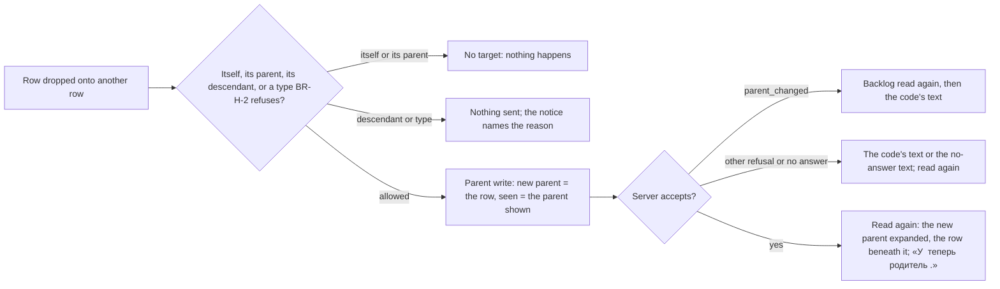

# Spec: Backlog tree editing, the reference layout (feat-027)

## Context and goal

The human wants the team backlog to look and work like the reference
tracker's backlog in their screenshot of 2026-10-09 (`status.md` D-1): a
first column that expands or collapses the whole tree one level and adds a
child to a row, the tree at full depth with a chevron left of the title,
the planning columns, and re-parenting by drag and drop. feat-026 built the
tree one level below on the same team's backlog, the «Родитель» column and a
menu that maps one level up; feat-022 adds the fields the new columns show.
This cut (D-2) changes the page «Бэклоги» only, on the short route with the
design folded in here (D-4). Rules restated from feat-001 (BR-H-n), mod-006
(BR-M4-n), mod-003 and feat-022 (BR-M3-n) keep their ids; new ones are BR-T-n.

**D-7 (the human, 2026-10-09, after comparing the first build with the
reference screenshot): the backlog looks visually exactly like the reference.**
The columns, the title cell, the hierarchy column, adding a child inline, the
drag grip, the rows and the page head are redrawn after it; the design that
stood folded in this file (D-4) moves to `design.md`, which is now the one
place for layout, components, states and interface texts. Rules changed by D-7
are marked «(D-7)», those changed by D-6's decisions of the open questions
«(D-6)»; the numbering is stable.

## Scope

### In scope (D-2, widened by D-7)

- The table laid out as the screenshot, with this product's columns and copy:
  the hierarchy column, «Порядок», «Тип», «Заголовок», «Статус»,
  «Трудоёмкость», «Бизнес-ценность», «Вид ценности» — and no more (BR-T-1..-3;
  D-7).
- The full-depth tree on every level, tasks and bugs under their stories
  included (BR-T-4..-7).
- «Развернуть на один уровень» / «Свернуть на один уровень», the two small
  square buttons of the hierarchy column's header (BR-T-8; D-7).
- Adding a child of the type the row allows, **inline in the tree**, from the
  row's «+» (BR-T-9, -10; D-7).
- Re-parenting by dragging a row (any point of it, D-11) onto another, the keyboard path
  complete (BR-T-11..-15; D-7).
- The page head as the screenshot has it: the team's name with a drop-down to
  another team of the project, one tab, the level drop-down at the tab row's
  right end, «Новый рабочий элемент» and «Показать канбан» (BR-T-16; D-7); the
  same head on «Канбан».
- The panel's font: the system stack, Segoe UI first (D-7).

### Out of scope

| Item | Carried by |
|---|---|
| Everything of the screenshot D-2 puts OUT | § Left out of this cut |
| The «Задачи» backlog and board, and a task order of its own | feat-023-tasks-backlog (amended at gate-3, § Decomposition) |
| Touch drag | feat-025-boards-touch-drag |
| History of link acts and creations | feat-015-work-item-history |
| The board («Канбан»), but for its head (BR-T-16; D-7) and the font | unchanged |

## Access

D-3: until mod-016, mod-002 D-a unchanged — any signed-in user may do
everything below in every active organization; an anonymous caller gets
mod-015's auth card and 401 (BR-T-17).

## Stories

| id | Title | depends-on | File |
|----|-------|------------|------|
| US-1 | A user reads the backlog laid out as the reference screen | - | `stories/US-1-backlog-layout.md` |
| US-2 | A user sees the whole tree under a row | US-1 | `stories/US-2-full-depth-tree.md` |
| US-3 | A user expands or collapses the whole table one level | US-2 | `stories/US-3-expand-collapse-one-level.md` |
| US-4 | A user adds a child to a row | US-2 | `stories/US-4-add-child.md` |
| US-5 | A user drops a row onto another to re-parent it | US-2 | `stories/US-5-drag-to-reparent.md` |
| US-6 | A user re-parents any row by keyboard | US-5 | `stories/US-6-reparent-by-keyboard.md` |

All six are `shippable: no`: each needs US-2's tree or US-1's table.

## A drop onto a row

## Business rules

| # | Rule | Source |
|---|------|--------|
| BR-T-1 (D-7) | The table's columns, in order: the hierarchy column, «Порядок», «Тип», «Заголовок», «Статус», «Трудоёмкость», «Бизнес-ценность», «Вид ценности» — and no other: no «ID», «Родитель», «Исполнитель» or «Приоритет» column (the reference adds those through column options, which are out of scope), no handle column and no «Действия» column; «Теги» comes with feat-016. The same columns on every level (OQ-7). «Тип» is plain text, the type's name; «Заголовок» holds the tree — indent, chevron, the type's icon, the title as plain text that opens the item, «⋮» at the cell's right edge. The identifier is not drawn on the row; it stays in the controls' names, the title's tooltip and description. | D-7 1, 2; supersedes D-6 OQ-1 (a), D-2's columns, doc-003 BR-M4-14, feat-001 BR-H-13; design.md § 4.3, § 4.4 |
| BR-T-2 | «Порядок» numbers the top-level rows 1..n, dense, in mod-006's order; a nested row shows none. | D-1 (the screenshot); feat-001 BR-H-11 |
| BR-T-3 (D-7) | «Трудоёмкость», «Бизнес-ценность» and «Вид ценности» show the item's stored value as its form shows it: numbers with «,» and no trailing zeros, right-aligned, and the list's label («Бизнес», «Архитектура»). A field the row's type does not have, or an empty value, leaves the cell blank. Which type has which field is feat-022's field table, by `type.appearance`. «Приоритет» is no longer on the backlog row (it stays on the kanban card and the form). «Статус» is the category dot by the state's category and the state's name. | feat-022 BR-M3-30, -31, -32; D-7 1, 7; supersedes feat-022 BR-M3-39 on the backlog row |
| BR-T-4 | Beneath a row stand its direct children that are live and on this team's surfaces — their Область resolves to the team (mod-006 § Model, condition 3) — whatever their level, the «Задачи» level included; each with its own children, recursively, to the depth the hierarchy allows: a chain of parents holds at most 64 items, a bound the writes of a link keep (D-9; `workitems.link.depth_exceeded`), so the tree is never more than 64 rows deep. A child of another team, or in «Удалена», stands beneath no row of this team. So «Эпики» shows epic → feature → story or bug → task (and any link BR-H-2 allows, a story directly under an epic included), «Фичи» feature → story or bug → task, «Истории» story or bug → bug or task. | D-2, D-9; supersedes feat-001 BR-H-10 and D-8 OQ-5 on this page, and feat-001 BR-H-2's «no depth limit» |
| BR-T-5 | Top-level rows are the page level's backlog (mod-006 BR-M4-5) minus the items that nest beneath another of its rows: an item whose live parent is of the same level and on the same team stands beneath that parent only (OQ-5). An item shows at most once on a page. An item with no parent, or a parent of a higher level, of another team or in «Удалена», is a top-level row. | D-1 (the screenshot); OQ-5 |
| BR-T-6 | Children stand by level, highest first; within a level in that level's backlog order (placed, then unplaced by number, mod-006 BR-M4-24); tasks, which have no backlog order before feat-023, by number. | feat-001 BR-H-7, BR-H-11; mod-006 BR-M4-24 |
| BR-T-7 (D-6) | The first state is expanded, as the reference shows it, as deep as the 2 000 drawn rows of the NFR allow (D-6 OQ-2 (d)): every row with children at depth 0 is expanded, then every one at depth 1, and so on, stopping before the depth that would draw more than 2 000 rows. A row has the chevron exactly when it has a child to show. What the user expands or collapses is kept by item for the visit to the page, across its re-reads — a failed re-read included (tech-012 m2); a reload, another level or team starts at the first state again — the first state of the answer read now: a table shown from a cached answer follows the answers it is given until the user first expands or collapses something (F-2). Expanding or collapsing changes only what is shown. | feat-001 BR-H-9, BR-H-12; D-6 OQ-2 (d) |
| BR-T-8 | Call a row's depth 0 at the top, 1 beneath it, and so on. «Развернуть на один уровень» finds the smallest depth at which a shown row with children is collapsed and expands every row with children at that depth. «Свернуть на один уровень» finds the greatest depth at which a shown row is expanded and collapses every row at that depth or deeper. The first does nothing when every row with children is expanded, the second when none is; each is then marked unavailable. | D-1 (1); this cut's precision |
| BR-T-9 (D-6, D-7) | The row's add-child entries, by the appearance of the row's type → the appearance of the new item's type: `epic` → `feature`; `feature` → `story`, `bug`; `story` → `task`, `bug`; `bug` → none (D-6 OQ-6 (b): the human listed no «Добавить: Задача» for a bug; one line to add if asked); `task` → none. Each pair is one BR-H-2 allows. Types are recognised by `type.appearance` at both ends, never by name; the entry names the process's type of that appearance by its own name, and a token no type of the process has gives no entry. The row's «+» (pale grey, D-10; D-7 had said orange) is the control (D-7): with one entry (an epic) it adds that type at once, with two (a feature, a story) it opens a small menu of the types; a bug and a task have none. Every other row has it, top-level and nested, on every level; it shows on row hover, focus and selection. | D-1 (1); D-6 OQ-6; D-7 3; BR-H-2; mod-001 BR-M2-9; design.md § 4.5 |
| BR-T-10 (D-7) | An entry adds the child **inline in the tree** (supersedes D-6 OQ-3 (a), mod-003's dialog): an editable row appears directly beneath the parent, one depth deeper, with a title field focused and the type fixed; the parent is expanded. **Enter** makes one create that carries the parent (OQ-4): all or none, one item per add row — one `requestId` made at the first Enter and kept for its retries (BR-M3-26). **Escape**, or an empty title (Enter or leaving the field with nothing typed), cancels with nothing sent. A refusal shows at the field and the typed title is kept. The item takes the parent's Область as stored at that moment — so it lands on the parent's team — its type's initial state, no assignee, feat-022's defaults, and the row as its parent; it comes onto its backlog unplaced (BR-M4-6), so after the read it stands beneath its parent as the last of its parent's children of its level, the parent expanded, selected. The parent's «Изменён» moves (BR-H-5). Refused, with nothing created: a parent gone or of another project (`workitems.link.parent_not_found`), a parent in «Удалена» (`workitems.link.item_deleted`), a pair the process does not allow (`workitems.link.parent_level_not_allowed`), a parent whose chain of ancestors already holds 64 items (`workitems.link.depth_exceeded`, D-9); and mod-003's create refusals. | D-2; D-7 4; D-9; mod-003 BR-M3-20, -26; BR-H-1, -2, -5, -8; design.md § 4.8 |
| BR-T-11 | Dropping a row onto another is the parent write (BR-H-3): new parent the target row, seen parent the dragged row's parent as the page showed it when the drag began (BR-H-4). It changes no place and no other field (BR-H-5). The item then stands beneath its new parent by BR-T-6, and leaves or joins the top level by BR-T-5. | D-1 (2), D-2; feat-001 BR-H-3..-5 |
| BR-T-12 | A drag offers as targets every row of the page except the item itself and its current parent. A target is refused when it is of a type BR-H-2 does not allow above the item's, by the process's level ranks, or else one of the item's descendants in the read (collapsed ones included) — the parent write's own order: hovering marks it refused, releasing sends nothing and the notice names the reason. A refusal from the server — a descendant on another team, a parent changed or deleted meanwhile, a chain that would pass 64 items (`workitems.link.depth_exceeded`, D-9) — is its code's text; after `parent_changed` the backlog is read again first. | D-2 («a refused drop says why»); BR-H-2, -4 |
| BR-T-13 (D-7) | Dropping between rows stays mod-006's reorder, unchanged: a top-level row only, between top-level blocks only (feat-001 BR-H-11). The drag starts from **any point of the row** (D-11: the human on the stand, 2026-10-11, tried the row and nothing moved — the whole row is the drag source, as the reference's; the title link does not drag its address instead, and the buttons in the row still click and, pressed to drag, drag the row; the add row is never a source). A dotted **grip** at the row's left edge, shown on hover, focus and selection, is the hint that the row can be taken — not a column, not a button and not a source of its own (D-7 5). A nested row's drag has only row targets. No gesture writes a link and a place together, so a drop never re-orders children inside a parent. mod-006's keyboard path of the reorder (BR-M4-8), the handle's menu «Переместить <ID>», moves into the row's «Ещё действия» — a top-level row's menu holds «В начало», «Выше», «Ниже», «В конец» — because the handle column goes. | mod-006 BR-M4-8, -25; feat-001 BR-H-11; D-7 1, 5; design.md § 4.7, § 4.9 |
| BR-T-14 (D-7) | Every row, top-level and nested, on every level, has «Ещё действия» (the «⋮» at the title cell's right edge, shown on hover, focus and selection) with «Изменить родителя…» and «Убрать родителя» (disabled with no parent), and on a top-level row the four moves of BR-T-13 above them. The dialog offers every parent type BR-H-2 allows, as the form's picker does, so the keyboard reaches every parent a drop reaches; on touch, where the browser's drag does not start, the menus are the path (feat-025). | mod-006 BR-M4-8 (drag never the only way); D-7 2; supersedes feat-001 BR-H-14 and doc-003 BR-M4-10's level-above narrowing on this page; design.md § 4.7 |
| BR-T-15 (D-7) | One write at a time: while a create (the add row's Enter included), a parent write or a reorder of this page is saved, every row drag, row «+», «Ещё действия» and both header buttons is off; then the backlog is read again. A link or a child made elsewhere shows at the next read (mod-006 BR-M4-28). | mod-006 BR-M4-28; feat-001 BR-H-19 |
| BR-T-16 (D-7) | The page head, on «Бэклоги» and «Канбан» alike: the **team's name as the `h1`** (the browser tab keeps the page: «Бэклоги — Mustask», «Канбан — Mustask»), with a drop-down to another team of the project — built from the team list the shell's switcher already reads, shown whenever that list is read — a project with one team has it too, its menu listing that team alone, as the reference always draws the chevron; under it **one tab**, «Бэклог» / «Канбан», underlined; at the tab row's right end the level drop-down, its visible label the level («Эпики»), its accessible name «Уровень: Эпики» (OQ-8); at the top right, on «Бэклоги» the primary «Новый рабочий элемент» (mod-006 BR-M4-21, no parent; a leading plus and no trailing chevron) and «Показать канбан» as a grey secondary button with its icon, on «Канбан» «Показать бэклог» the same way and no primary. | D-2; D-7 8; feat-001 BR-H-15, -16; design.md § 3 |
| BR-T-17 | The backlog read answers the whole tree at full depth in one answer — no read per expand — with «Порядок» on top-level rows only and the values of BR-T-3 on every row (the contract still carries `priority`, `assignee` and `parent` on every row — D-7 does not change it: the panel draws neither of the first two on the row and keeps `parent` for a drop's seen parent). Reads declare `workitems.workitem.read`; a create `workitems.workitem.write`, plus `workitems.link.write` for its parent; a drop is the parent write's `workitems.link.write`. Nothing checks them until mod-016. | D-3; feat-001 BR-H-18; mod-006 BR-M4-27 |

### What this supersedes on «Бэклоги»

| Rule | Was | Now |
|---|---|---|
| feat-001 BR-H-10, D-8 OQ-5 | children one level below on the team's backlog; «Истории» rows never expand | BR-T-4, BR-T-5 |
| feat-001 BR-H-2 (D-9) | «no depth limit» | a chain of parents holds at most 64 items, refused by `workitems.link.depth_exceeded` (BR-T-4) |
| feat-001 BR-H-11 | a nested row has no «Порядок», handle or reorder | no «Порядок», no reorder; every row, a nested one included, drags as a whole onto another row, and the dotted grip at its edge is only the hint that it can be taken (BR-T-13; D-7, D-11) |
| feat-001 BR-H-13, D-6 OQ-1 (a) | «Родитель» after «Заголовок», kept as the last data column | no «Родитель» column (BR-T-1; D-7) |
| feat-001 BR-H-14 | the menu on top-level «Фичи» / «Истории» rows, the level above only, no drag | BR-T-11, BR-T-14 |
| mod-006 BR-M4-14 (the backlog's columns, «ID» and «Исполнитель» among them) | «Порядок», handle, «ID», «Тип», «Заголовок», «Исполнитель», «Статус» | BR-T-1: the columns of D-7, none of «ID», «Исполнитель» and the handle |
| feat-022 BR-M3-39 | «Приоритет» on the backlog row after «Статус» | not on the row (BR-T-3; D-7); it stays on the kanban card and the form |
| mod-006 BR-M4-8's keyboard path of the reorder | the handle's menu «Переместить <ID>» | the «В начало», «Выше», «Ниже», «В конец» entries of a top-level row's «Ещё действия» (BR-T-13; D-7) |
| D-6 OQ-3 (a) | adding a child through mod-003's dialog with the type fixed | the inline add row (BR-T-10; D-7) |
| D-6 OQ-2 (d) over this file's first draft | every row starts collapsed | the first state is expanded as deep as 2 000 drawn rows allow (BR-T-7) |
| feat-001 BR-H-15 | the level drop-down reads «Уровень: <уровень>» | its visible label is the level; «Уровень: <уровень>» is its accessible name (BR-T-16) |
| mod-015 § 2.4, § 2.6 | the panel's font is Roboto; headings, buttons and the selected tab are weight 500 | the system stack, Segoe UI first, in the whole panel (D-7 9); weight 600 where 500 stood — Segoe UI has no 500 face — and the unselected tab 400 (design.md § 2.1) |
| mod-015 § 2.3 | `epic` is `Landscape`, `task` is `Assignment` | `epic` a crown, `task` `AssignmentTurnedIn`, panel-wide through the one lookup (design.md § 2.4) |
| mod-015 § 2.4 (table cells, BR-3's 14 px base) | a table's body text is 14 / 20 | the backlog table's body cells are 13 / 20, as measured on the reference; the rest of the panel stays 14 px (design.md § 2.6) |
| mod-015 § 6.1, frontend.md "One accent" | a secondary command is a text button | «Показать канбан» / «Показать бэклог» are grey filled buttons on these two heads (design.md § 3.5) |
| mod-015 § 10.5 | the page head is «Бэклоги» with a level drop-down under it | BR-T-16 |

feat-001 US-4's scenarios "A link that does not nest" (MSK-US-22, MSK-FEAT-23
rows) and "«Истории» rows do not expand", and US-5's "What a row's menu
offers" and the level-above helper, no longer hold on this page.

## Operation completeness

| Entity | Create | Read | Update | Delete/deactivate | Cancel/reverse |
|--------|--------|------|--------|-------------------|----------------|
| Parent/Child link from the backlog | any signed-in user: the row's «+» and its inline add row (US-4), a drop of a dragged row (US-5), the dialog from «Ещё действия» (US-6) | any signed-in user (US-2) | replace by a drop or the dialog, one write (US-5, US-6) | «Убрать родителя» on any row (US-6) | no undo: another write |
| Work item created as a child | any signed-in user, from a row (US-4) | the tree (US-2), the form | the form (mod-003, feat-022) | no: mod-005 | no: mod-005 |
| Expanded rows (per visit) | system: as deep as 2 000 drawn rows allow at the start (BR-T-7) | as the backlog | a chevron, the two header buttons (US-2, US-3) | system: a reload, another level or team | collapse again |
| Backlog place | unchanged: mod-006 | as the backlog | top-level rows only: by a drag of the row or «Ещё действия» (BR-T-13) | mod-006 | another reorder |

## Screens and copy

**The design is `design.md` (D-7).** What stood here — the table's columns,
the chevron, «Добавить…», the dialog from a row, the dragging, the dialog
«Изменить родителя» — was the folded design of D-4; it is replaced by
`design.md` and kept nowhere else, so the two cannot drift. There: § 3 the
page head (both pages), § 4 the table (columns § 4.3, the title cell § 4.4,
the hierarchy column § 4.5, row states § 4.6, «⋮» § 4.7, the inline add row
§ 4.8, drag and drop § 4.9, the dialog § 4.10, every state § 4.12), § 5 the
accessible names, § 6 the interface texts, § 2 the theme changes. The stories'
"Spec …" lines point to its sections. Type icons and category dots are
mod-003's (`TypeMark`, mod-015 § 2.3) through the one theme lookup. The
notices below stay here: they are the rules' copy.

### The reference labels in this product's copy

| Reference label | Here |
|---|---|
| [+] / [−] in the first column's header | «Развернуть на один уровень» / «Свернуть на один уровень» |
| the pale grey [+] on a row (D-10) | «Добавить: Фича (<ID>)» on an epic; «Добавить дочерний элемент (<ID>)» opening a menu of «Добавить: Пользовательская история» / «Добавить: Баг» (feature) or «Добавить: Задача» / «Добавить: Баг» (story) — the type's own name after the colon |
| «Order», «Work Item Type», «Title», «State» | «Порядок», «Тип», «Заголовок», «Статус» (the glossary's term; D-2's «Состояние» is rendered so) |
| «Effort», «Business Value», «Value Area» | «Трудоёмкость», «Бизнес-ценность», «Вид ценности» (feat-022) |
| «New Work Item», «View as Board», the level picker «Epics» | «Новый рабочий элемент», «Показать канбан», the level button «Эпики» (accessible name «Уровень: Эпики») |
| the team's name and its drop-down, the tab «Backlog» | the team's name as the `h1`, «Сменить команду»; the tab «Бэклог» (on «Канбан» «Канбан») |
| the row's «⋮» | «Ещё действия: <ID>» |

### Notices on «Бэклоги»

mod-006's `Snackbar`, 6 s, bottom left.

| Case | Text |
|---|---|
| a child created | «Рабочий элемент <ID> создан.» (mod-003's plain notice, as «Новый рабочий элемент» shows it) |
| a parent set by a drop or the dialog | «У <ID> теперь родитель <ID родителя>.» (success) |
| a parent cleared | «У <ID> больше нет родителя.» (success) |
| a drop refused for the type | «Родителем может быть только рабочий элемент того же или более высокого уровня.» |
| a drop onto a descendant | «Нельзя выбрать родителем <ID цели>: он вложен в <ID> (<путь>).» — the path from the item down to the target, « → » |
| a drop or a create refused for the depth (D-9) | «Слишком глубокая вложенность: в цепочке родителей может быть не больше 64 элементов.» |
| a refusal with a code | the code's text; after `parent_changed` the page is read again first |
| a drop or a clear with no answer | «Не удалось сохранить родителя. Попробуйте ещё раз.» |

One new error code, from the code review (D-9): `workitems.link.depth_exceeded`.
The create with a parent and the drop otherwise answer feat-001's
`workitems.link.*` codes and mod-003's create codes.

## Non-functional requirements

- **Volumes and speed** (doc-001 NFR): with 5 000 items on each of a team's
  four levels, every one linked under an item of the level above, the
  backlog read of «Эпики» and of «Истории», tree included, is served within
  2 s; a create with a parent and a parent write within 1 s each. A chevron
  or a header button shows its rows within 1 s, with no request, while the
  table draws at most 2 000 rows; more at once is not promised in this cut.
- **Concurrency:** a create with a parent runs under the parent write's
  ordering (feat-001 api-contract § 3.2), so a parent changed or deleted
  meanwhile is seen; a drop is BR-H-4's stale check.
- **Accessibility:** every drop and every reorder has a keyboard path
  (BR-T-13, BR-T-14); the table stays a plain `Table` with Tab stops
  (feat-001 D-9) — the indent, the chevrons' names and the title's
  description «<ID>. Уровень вложенности: <n>.» carry the nesting now that
  there is no «Родитель» column (D-7). The row's hidden controls «+» and
  «⋮» stay in the Tab order and show on focus; the grip is `aria-hidden` and
  no stop, its keyboard path is «Ещё действия» (F-5); colour is never the only
  carrier.
- **Look (D-7):** the backlog and the head are accepted side by side with the
  reference screenshot at 1 440 × 900, the navigation expanded: no horizontal
  scroll, rows 36 px, the columns of BR-T-1 in that order, nothing of the
  reference's drawn that D-7 left out. The measures are `design.md` § 4.2; the
  few places where the look is not matched on purpose are its § 8.
- **Audit:** none here; feat-015 records link acts and creations.
- **Language:** copy Russian; the reference tracker is never named.

## E2E (E2E: yes)

New file `26-backlog-tree-editing.spec.ts`, team «Платформа». Rows are found by
`data-identifier` (there is no ID cell, D-7 1), controls by `design.md` § 5's
names, the grip by `data-grip` (design § 7).

| Test | Story | What |
|---|---|---|
| 26.1 | US-1 | the head: the team's name as the `h1` («Платформа»), the one tab «Бэклог», «Уровень: Эпики» at the tab row's right end, «Новый рабочий элемент», «Показать канбан»; the headers in order — the hierarchy column (found as the `columnheader` named «Иерархия», an `aria-label` on the header cell that holds the two level buttons), «Порядок», «Тип», «Заголовок», «Статус», «Трудоёмкость», «Бизнес-ценность», «Вид ценности» («Трудоёмкость» and «Бизнес-ценность» drawn cut with an ellipsis, named in full) — and none of «ID», «Родитель», «Исполнитель», «Приоритет», «Действия»; «Порядок» on top-level rows only; the values and blanks of MSK-EPIC-1, MSK-US-2, MSK-TASK-3 |
| 26.2 | US-2, US-3 | «Эпики» opens expanded as far as the data go (D-6 OQ-2 (d)); «Свернуть на один уровень» three times leaves the epics; «Развернуть на один уровень» three times reaches MSK-TASK-3; «Истории»: MSK-BUG-5 only beneath MSK-US-2 |
| 26.3 | US-4 | an epic's «Добавить: Фича (MSK-EPIC-1)» opens the inline row at once, Escape cancels it; MSK-US-2's «Добавить дочерний элемент (MSK-US-2)» → «Добавить: Задача» opens the row, «Заголовок: Задача (MSK-US-2)» typed, Enter: the task stands last beneath MSK-US-2, selected, its area «Платформа», the notice «Рабочий элемент <ID> создан.», focus back on the «+» |
| 26.4 | US-5 | MSK-US-22 dragged by its «Заголовок» cell onto MSK-FEAT-8, then a refused drop of MSK-FEAT-6 onto MSK-US-2 with its notice |
| 26.5 | US-6 | a nested MSK-BUG-4 given MSK-US-2 by keyboard through «Ещё действия: MSK-BUG-4» |

Files 22–25 that must be aligned (24 and 25 read what D-7 removes; 23 the
handle and the head; **22 is not touched**: it reads the list «Рабочие
элементы», not the backlog):

- **23.1** — the `h1` is the team's name (the tab title stays «Бэклоги —
  Mustask»), and `getByRole('tab')` finds one tab «Бэклог», not none; the
  backlog's rows are read by `data-identifier` and the «Порядок» cell, not by
  cells 2 and 0; the reorder goes through «Ещё действия: <ID>» → «В начало»
  (the menu's name, the disabled «Ниже», the focus and the status text
  unchanged) instead of the handle «Переместить <ID>»; the `h1` «Канбан» of the
  board is the team's name with the tab «Канбан»; the other `h1` «Бэклоги»
  assertions likewise.
- **24.3** — the tree opens expanded (D-6): the test collapses to the epics
  first or reads the expanded state; `outline()` and `row()` read
  `data-identifier` and `data-tier`, not the ID cell; the «Родитель» cell
  assertions go (the tier is the nesting); the nested row's missing handle
  becomes a nested row's «Ещё действия» menu without the moves; the reorder of
  epics is «Ещё действия: <ID>» → «Выше».
- **24.4** — the «Родитель» «Нет» / identifier cell assertions go (the notices
  and the tree carry them); the dialog's helper reads «Родителем может быть:
  Эпик, Фича, Пользовательская история, Баг.», the picker offers the epic too
  (the "level above only" assertions are dropped); the story under the feature
  is read in the epic's expanded tree; focus returns to «Ещё действия: <ID>».
- **24.5** — the `h1` is the team's name on both pages and `getByRole('tab')`
  finds the one tab; the level button keeps its name «Уровень: <уровень>»
  while its visible label is the level; «Показать канбан» and the board's
  title «Канбан — Mustask» are unchanged.
- **25.6** — «Приоритет» is no longer a column: the backlog half asserts the
  headers hold none of it and the kanban half stays; the test's title drops
  "on the backlog row".

## Decomposition for the backlog

| id | Task | size | deps |
|----|------|------|------|
| feat-027-backlog-tree-editing (this task) | Backend: the read at full depth (BR-T-4..-6, -17: the «Задачи» level by area, same-level nesting, «Порядок» over top-level rows, `effort`, `businessValue`, `valueArea` beside feat-022's `priority`), the create's optional parent (BR-T-10) — US-1, US-2, US-4. Frontend A: the font, the theme tokens and the two type icons, `PageHeader`'s additions and the two heads (design § 2, § 3), the columns, title cell, hierarchy column and row states, the tree, the two header buttons, the row «+» and its inline add row, tech-012's m2 (D-6) — US-1..US-4. Frontend B: the drop onto a row, dragged from any point of the row (D-11; the grip is the hint), «Ещё действия» on every row with the reorder moved into it and the widened dialog, E2E 26 and the aligned files — US-5, US-6. Each pass ends green | M | feat-026, feat-022 |

Owed at gate-3, not new lines: feat-023's line loses "tasks nest under their
stories" (done here) and keeps the «Задачи» level and its order (D-2);
superseded-in-part notes in feat-001's spec (BR-H-10, -11, -13, -14, -15),
mod-006's § Page «Бэклоги» and BR-M4-14, mod-015 § 2.3, § 2.4, § 6.1 and
§ 10.5, frontend.md's "One accent" line and feat-022's BR-M3-39 (the list is
§ What this supersedes and `design.md` § 8). tech-012's line loses m2 (D-6
folds it into frontend A).

## Open questions

None open. D-6 (2026-10-09) decided OQ-1..OQ-8; D-7 (the same day) overrode
two of them.

| OQ | Decision |
|---|---|
| OQ-1 «Родитель» | D-6 (a), the last data column — **overridden by D-7**: no «Родитель» column (BR-T-1) |
| OQ-2 the tree's first state | D-6 (d): expanded as deep as 2 000 drawn rows allow (BR-T-7) |
| OQ-3 adding a child | D-6 (a), mod-003's dialog — **overridden by D-7**: the inline add row (BR-T-10) |
| OQ-4 one create with the parent | D-6 (a): mod-003's create gains an optional parent (BR-T-10) |
| OQ-5 same-level children | D-6 (a): beneath the parent only (BR-T-5) |
| OQ-6 a bug's «Добавить: Задача» | D-6 (b): none on a bug (BR-T-9) |
| OQ-7 the estimate on «Истории» | D-6 (a): the same columns on every level (BR-T-1) |
| OQ-8 the drop-down on «Канбан» | D-6 (a): it moves right on both pages (BR-T-16) |

## Left out of this cut

Elements of the screenshot D-2 puts OUT, and reference behaviour (doc-003),
one reason each:

- **The «Planning» side pane** — sprints are put off by the human (2026-10-05).
- **«Column Options»** — column customization is doc-011's; with it go the «ID», «Родитель», «Исполнитель» and «Приоритет» columns the reference adds through it (D-7 1) and column resizing; the header's thin separators are drawn as static lines, with no resize behaviour (design § 4.3).
- **The «Analytics» tab** — velocity and cumulative flow are release 2 (doc-003 § Out of scope). The one tab «Бэклог» / «Канбан» is in (D-7 8).
- **View options and filter icons** — the filter bar is feat-013.
- **Full screen** — a shell mode mod-015 does not define.
- **The team's favourite star and members** — no analysis specifies favourites, members are mod-016's. The team's name as the heading, with its drop-down, is in (D-7 8).
- **The «Tags» column** — no tags before feat-016.
- **Parent rows of the level above as context ("show parents")** — a view option, release 2 (doc-003 BR-M4-11).
- **Reordering children inside their parent, and a drop between another parent's children** — one gesture writing a link and a place is defined by neither M3 nor M4 (BR-T-13).
- **Creating a child at a chosen position, or several add rows at once** — doc-003 BR-M4-8: creation lands last; one add row is open at a time (design § 4.8).
- **Bulk re-parenting of selected rows** — no multi-select; bulk edit is release 2 (doc-010 D-18).
- **Virtualised rendering beyond 2 000 shown rows** — a table library change, not needed at today's volumes.
- **Touch drag** — feat-025 (an ADR and the human's choice).
