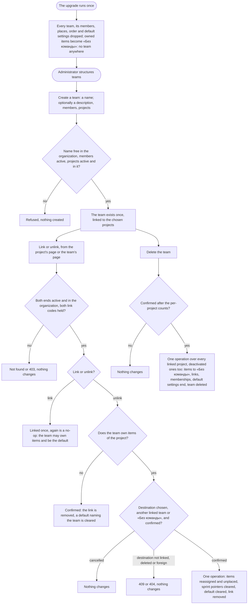

# Spec: Organization-level teams (feat-028)

## Context and goal

Today a team is born inside one project: its name is unique only there, its page sits in that project's settings, a project is always created with one, deleting it sends its items to «Без команды» in that project alone, and a project's last team cannot be deleted (mod-017 BR-OT-11, an interim guard). doc-012 (`docs/features/doc-012-matrix-organization-model/`, gate-1 approved 2026-10-17) and the human's decision of 2026-10-11 make teams the organization's, linked to projects many-to-many.
This line, the third of doc-012's after feat-039 and mod-017, moves the teams: names unique in the organization, no team created with a project, descriptions on projects and teams, links made and removed from both pages, SC-09's reassignment when a team leaves a project or is deleted, and team pages in the organization's settings. It is breaking (doc-012 § Decomposition, Breaks cell), the human's waiver of existing data (doc-012 § Existing data) applies and the human chose at gate-1 to use it in full (OQ-1 C): the upgrade drops every existing team, and every owned item becomes «Без команды» (BR-OL-13), and the human put mod-017's finding S-2 into it on 2026-10-17. BR-MX-n, OQ-n, P-n and US-n without a prefix are doc-012's; BR-OL-n are this spec's restatements.

## Roles

Access is derived from the organization membership (ADR-0027, ADR-0029): belonging to a team grants nothing. This line registers four codes, as ADR-0029 § "What the delivery lines implement" says: `organizations.team.create`, `organizations.team.delete`, `organizations.team.link` and `organizations.project.link`; it narrows `organizations.team.write` to a team's name, description and members. Until `mod-019-scoped-access` a new code is checked against the organization role alone, so only «Администратор» holds the four, and the existing codes keep today's bundles. The naming of a project's default team and a project's description are `organizations.project.write`'s (ADR-0029 § 4); mod-017 checked the default with `team.write`. The deletion's per-project counts are read with `team.delete`, and the deletion needs no code of the projects it reaches (ADR-0029 § 6, consequence writes); the unlink's count is read with the two link codes; a creation that links (a team with its projects, a project with its teams) also needs both link codes.

| Role | Reads teams, links, team pages | Creates, deletes a team; the deletion's counts | Renames, describes, staffs a team; describes a project; names the default team | Links, unlinks; the unlink's count |
|---|---|---|---|---|
| «Администратор» | yes (`organizations.team.read`) | yes (`team.create`, `team.delete`) | yes (`team.write`; `project.write`) | yes: `team.link` and `project.link`, both |
| «Участник» | yes | no: 403 «Недостаточно прав» | no: 403 | no: 403 |
| «Читатель» | yes | no: 403 | no: 403 | no: 403 |
| Not a member of the organization (an instance administrator included) | «Организация не найдена.» | - | - | - |

A holder of «Управление» on one end only is owed by `mod-019-scoped-access`. Visibility is `feat-041-project-visibility`'s: until it merges every project is «Организация».

## Stories

| id | Title | depends-on | File |
|----|-------|------------|------|
| US-1 | Teams are the organization's, with pages in its settings | - | `stories/US-1-organization-teams.md` |
| US-2 | A project starts with no team, and has a description | US-1, US-3 | `stories/US-2-projects-without-teams.md` |
| US-3 | A manager links a project and a team from either page | US-1 | `stories/US-3-link-project-and-team.md` |
| US-4 | Unlinking a team reassigns the items it owns (SC-09) | US-3 | `stories/US-4-unlink-reassigns-items.md` |
| US-5 | Deleting a team reaches every project it works on | US-3, US-4 | `stories/US-5-delete-a-team.md` |
| US-6 | A team that works on several projects | US-3, US-4 | `stories/US-6-team-across-projects.md` |
| US-7 | The upgrade drops every existing team | US-1, US-2, US-3 | `stories/US-7-upgrade-existing-teams.md` |
| US-8 | Tenant containment and permissions on every step | US-1, US-3, US-4, US-5 | `stories/US-8-tenant-containment-and-access.md` |

Every story is `shippable: no`: the line is one L and one MR, and splitting a breaking change does not make it additive (doc-012 § Decomposition). A clause that needs a later line is in the story's block "Owed by later lines" and in § Owed by. Common cast: organization «Ромашка» (Ann and Ivan «Администратор», Max «Участник», Vera «Читатель»; Oleg's membership was removed); projects Alpha (ALP), Beta (BET), Gamma (GAM); teams MARS, VENUS, JUPITER; organization «Другая» with project Zeta and team Orion. New interface copy is proposed in the stories and fixed by the design; the criteria hold whatever its wording.

## Business process (BPMN)

## Business rules

| # | Rule | Source |
|---|------|--------|
| BR-OL-1 | **Tenant.** A team belongs to exactly one organization, and every team read, write, lock, link and search stays inside the organization in the address. An id of another organization anywhere in a request (a team, a project, a destination, a default, a member) answers as an id that names nothing and changes nothing. The in-process structure contract takes the organization in every by-id read (`FindProjectAsync`, `FindTeamAsync`, a project's linked teams, a team's linked projects) and answers null for an object of another one, so no caller compares organizations itself (mod-017 S-2). | BR-MX-1; ADR-0028 §§ 4, 8; the human, 2026-10-17 |
| BR-OL-2 | **Independent existence.** Creating a project creates no team and no team membership, its creator's included; creating a team creates no project. The project's root area stays with it until `mod-018-area-workspace`. A team may have no project, a project no team, a team several projects. Unlinking or deleting a team deletes no project and no work item. | BR-MX-2; SC-07 |
| BR-OL-3 | **Names and descriptions.** A team's name is 1–100 characters after trimming, compared ignoring letter case and surrounding spaces, and unique among the organization's active teams; a deleted team frees its name; two organizations may share a name. A project and a team each have an optional description of at most 2 000 characters, kept as typed; an empty one is no description. Project names and keys keep mod-002 BR-M1-1. | BR-MX-4; brief § 11.5 |
| BR-OL-4 | **Links.** Only project–team links exist here (area links: `mod-018-area-workspace`). Many-to-many, at most one per pair; both ends active (a team not deleted, a project not deactivated) and in one organization. Linking a linked pair, or unlinking an unlinked one, succeeds and changes nothing. A link records who made it and when. | BR-MX-5, BR-MX-20 |
| BR-OL-5 | **Who links.** A link is made, and removed, by a holder of `organizations.team.link` and `organizations.project.link`, both, because a link joins two ends and an unlink reassigns items: «Администратор» until mod-019. Either page offers it. A link grants no code and discloses nothing: members of a linked team gain nothing on the project. Nobody renames, deletes or reconfigures a team through a project, or the other way round. | BR-MX-6, BR-MX-7; ADR-0029 § 4 |
| BR-OL-6 | **Linked means bindable.** An item's owning team and a project's default team must be a team linked to that project. Another active team of the organization answers `organizations.team.not_in_project` (409); a deleted, unknown or other-organization team `organizations.team.not_found` (404), alike. "Of the project" in mod-017 BR-OT-2 and BR-OT-4 reads "linked". | BR-MX-9, BR-MX-11 |
| BR-OL-7 | **Default team.** The team the project's settings name, marked «По умолчанию»; else the only linked team, «По умолчанию: единственная команда»; else none. Unlinking or deleting the named team clears the setting in the same operation. The default starts new items and nothing else (mod-017 BR-OT-4). **Amended by mod-020 (2026-10-18)**, the human's answer to mod-017 OQ-8 B: the default no longer starts new items alone. When no team is chosen it is also the team the team views' switcher opens, ahead of the user's own first team and the first team by name (mod-017 BR-OT-4, BR-OT-11; doc-012 BR-MX-11); a remembered team that still exists is kept. It still decides nothing else: not a view's contents, a filter or an order. The switcher reads it from the mark the project's linked teams carry (`defaultMark`), so it is always a linked team (BR-OL-6). `feat-043-area-project-team-navigation` retires that fallback and restores "starts new items and nothing else" (doc-013 BR-NE-9). | BR-MX-11 |
| BR-OL-8 | **Unlinking a team that owns items (SC-09).** The team's items in the project are those it owns there, in any state, Removed included; its items in other projects are not touched. The actor chooses one destination for all of them: another team linked to the project, or «Без команды»; with none to move, none is chosen and the request names «Без команды». In one operation, all or nothing: (1) each item gets the destination as owning team, or none; (2) its place on the unlinked team's backlog is deleted, so each one outside the Removed category stands unplaced below every placed item on the destination's backlog of its level, and on no team backlog with «Без команды»; (3) its sprint pointer to the unlinked team's sprints is cleared (owed by `mod-007-iterations`); (4) its «Изменён» becomes the operation's time; (5) the project's default setting is cleared if it named the team; (6) the link is removed. Project, identifier, assignee, state, estimates, parent and children, «Область» and the project backlog's place are untouched. A destination that is the unlinked team or is not linked when the unlink runs answers `organizations.team.not_in_project`; a deleted, foreign or unknown one `organizations.team.not_found`; none named, 400. A save, a creation or a default naming that names the team concurrently commits first and is reassigned (the naming cleared) with the rest, or comes after and is refused `not_in_project`; a reorder of the team's backlog at the project's address commits first and its places are deleted with the rest, or comes after and is refused `team.not_found` or `boards.backlog.reorder_stale`, writing no place for an item the team no longer owns (mod-017 BR-OT-13 (3)); an unlink that meets the deletion of the unlinked team or of its destination ends as BR-OL-9 says. An unlink of a pair that is not linked moves nothing: after the 400 and the destination's not-found it succeeds, whatever team it names. Linking the team again moves nothing back. | BR-MX-12, BR-MX-13; P-7; ADR-0028 rule 8 |
| BR-OL-9 | **Deleting a team.** After a confirmation counting, per linked project, deactivated ones included, the items the team owns in any state, BR-OL-8 is applied to every linked project with «Без команды» as the destination, and the team's memberships end (mod-016 BR-M1-36), in one operation. The team is deleted for good: no restore, its name is free, its address answers `organizations.team.not_found`. Its area links, grants and sprints end with it when they exist (owed by mod-018, mod-019, mod-007). A write naming it concurrently commits first and is taken with the rest, or is refused `team.not_found` (mod-017 BR-OT-13, extended to links). | BR-MX-12; ADR-0028 § 6 |
| BR-OL-10 | **A project may have no team.** The interim guard `organizations.team.last_team_cannot_be_deleted` is retired, as mod-017 BR-OT-11 promised. A team-less project works: its list, project backlog and board show its items, a new item is «Без команды» (BR-MX-10). In the shell its switcher holds no team and the team-scoped entries are hidden (feat-039 BR-PB-9), with the interim way in of OQ-2 A: the project's «Команды», empty, offers «Бэклог проекта» and «Доска проекта» until `feat-043-area-project-team-navigation`. **Right after the upgrade every project is in this state** and the organization has no team until an administrator creates one (BR-OL-13, US-7). | SC-07; mod-017 OQ-1 |
| BR-OL-11 | **A team across projects.** Its name, description and member list are single. Its backlog and board are still read at a project's address and hold the items the team owns in that project (mod-017 BR-OT-5) until `feat-040-team-surfaces-across-projects`; its order is one per level, and a reorder in one project's view writes only the places of that view's items (OQ-3). The default is per project. A team address under a project the team is not linked to answers `organizations.team.not_found`. | BR-MX-17, BR-MX-18; ADR-0028 § 9 |
| BR-OL-12 | **Where the pages are (interim, BR-MX-27).** Until `feat-043-area-project-team-navigation`: the organization's teams at `…/settings/teams` and a team's page at `…/settings/teams/:t`, under «Организация» → «Команды», with its name, «Описание», its projects with link and unlink, «Участники команды», and its rename and deletion, which a project's page no longer offers. The project's end stays at `…/projects/:p/settings/teams`: its linked teams, the mark, «Добавить команду», «Команда по умолчанию», «Отключить от проекта». `…/projects/:p/settings/teams/:t` answers «Страница не найдена», with no redirect, and the API has no alias of the project-nested team routes. The project's «Общие» gains «Описание». | ADR-0028 § 7; doc-012 § Decomposition |
| BR-OL-13 | **The upgrade (OQ-1 C, decided by the human, 2026-10-17).** New migrations on top of the merged ones, editing none, using the human's waiver of existing data in full. They drop **every team**, in every organization and project, a deleted team's row included, and what hangs on a team: **its memberships, its backlog places and its backlog order, and every project's default-team setting**. **Every work item that has an owning team becomes «Без команды»**; its project, identifier, assignee, state, estimates, parent and children, «Область» and project backlog place are untouched, and no item's «Изменён» moves (the upgrade is no actor's edit, as mod-017 BR-OT-14's was none). No team survives to be linked, so after the upgrade **no team exists anywhere, no link exists and every project has no team** (BR-OL-10). Team names are never compared: no collision, no rename, no merge. Nothing else is dropped: organizations, organization memberships and roles, projects (deactivated ones too), areas, work items and the project backlogs are as before. No sprint, dashboard, area link or grant exists yet, so none is dropped with the teams. **Data dropped, named in the MR:** the teams, their memberships, their places and order, the default-team settings and the owning team of every item that had one; **remapped:** none. The migration logs, per kind, how many it dropped: teams, memberships, team places, order rows, default settings and items made «Без команды». What a user then sees is US-7's. | doc-012 § Existing data, OQ-4 A, NFR Observability; OQ-1 C |
| BR-OL-14 | **Answers.** The order of today (mod-016 § 0.1): 401; «Организация не найдена.» for a non-member; 403 when the role lacks the route's code; then the not-found of the address outside in; 400; 409. Every other id a body or a link names is checked after the address, each with its own not-found. `feat-041-project-visibility` moves this to BR-MX-24. | ADR-0027 rule 4 |

## Existing rules: keep, replace or retire

Tests are retired by name, citing the rule (P-1); "rewritten" keeps the name and the intent over the new model. A test that arranges teams through a project (`OrganizationsTestData`, `OwningTeamTestData`, `BoardsTestData`, the frontend fixtures and `testApi.ts`) arranges them as the organization's teams with a link and keeps its assertions.

| Existing rule | Fate | Tests it takes with it |
|---|---|---|
| mod-002 BR-M1-1 (team name unique per project) | replaced → BR-OL-3 | Retired: `AddTeamEndpointTests.Add_SameNameInAnotherProject_Succeeds`, `AddTeamHandlerTests.Handle_SameNameInAnotherProject_Succeeds`, `RenameTeamEndpointTests.Rename_ToNameOfATeamInAnotherProject_Returns200`, `RenameTeamHandlerTests.Handle_NameOfATeamInAnotherProject_IsFree`. Rewritten over the organization: `Add_NameTakenAnyCase_Returns409TeamNameTaken_CreatesNothing`, `Add_NameOfDeletedTeam_IsFree`, `Add_TwoConcurrentSameName_OneTeam`, `Rename_ToTakenName_Returns409TeamNameTaken_NameUnchanged`, `Rename_ToNameOfDeletedTeam_Returns200`, `Handle_NameOfAnActiveTeamAnyCase_IsTeamNameTaken_CreatesNothing`, `Handle_NameOfAnotherActiveTeamAnyCase_IsTeamNameTaken_NothingChanges`, `OrganizationsSchemaTests.Insert_NameOfADeletedTeam_IsAllowed`; `TeamsPage.test.tsx` «puts «Команда с таким названием уже есть в проекте» on «Название»» (the text reads «…в организации») |
| mod-002 BR-M1-9 (what remains: a project comes with a team), mod-016 BR-M1-25 (its creator joins it) | retired → BR-OL-2 | Retired: `CreateProjectEndpointTests.Create_TheCreatingAdministrator_IsTheOnlyMemberOfTheProjectsTeam`, `Create_ACreatorTheProjectionDoesNotKnow_StillJoinsTheProjectsTeam_ShownUnknown`, `CreateProjectHandlerTests.Handle_CreatorIsAMember_TheyAreTheOnlyMemberOfTheProjectsTeam`, `Handle_OnlyTheNewProjectsTeamGainsTheCreator`, `GetTeamsEndpointTests.Get_NewProject_ListsItsOnlyTeamAlone_MarkedOnlyTeam`, `GetTeamsHandlerTests.Handle_NewProject_ListsItsOnlyTeamAlone_MarkedOnlyTeam`. Rewritten without a team: `Create_Returns201_WithOneOrdinaryTeamAndTheRoot`, `Handle_ValidNameAndKey_CreatesProjectWithOneOrdinaryTeamAndRoot_RecordsCreator`, `Handle_Creates_OneProjectOneTeamOneArea_OneSave_NoLock`, `Create_ByANonMember_Is404_AMemberOrViewerIs403_NothingIsCreated_NoTeamIsJoined`, `ProjectTests.Create_ComesWithOneOrdinaryTeamAndTheRoot_OwnedByNobody`; `ProjectListPage.create.test.tsx` «shows both helpers; sends name and key; the row appears, the page stays, the notice» |
| mod-002 BR-M1-22, -23 (a team inside its project: addressed, written and found there); mod-016 inventory rows 15-18, 20 | replaced → BR-OL-1, -12 | Retired with the project-nested routes (a team write names no project): `AddTeamEndpointTests` `Add_ProjectNotOfOrganization_Returns404ProjectNotFound`, `Add_UnderDeactivatedProject_Returns404AndChangesNothing`; `RenameTeamEndpointTests` `Rename_ProjectNotOfOrganization_Returns404ProjectNotFound`, `Rename_UnderDeactivatedProject_Returns404AndChangesNothing`, `Rename_TeamNotAnActiveTeamOfTheProject_Returns404TeamNotFound_ChangesNothing`; `GetTeamEndpointTests` `Get_ProjectNotReachable_Returns404ProjectNotFound_EvenWithAWrongTeam`, `Get_TeamNotAnActiveTeamOfTheProject_Returns404TeamNotFound`; `DeleteTeamEndpointTests` `Delete_ProjectNotOfOrganization_Returns404ProjectNotFound`, `Delete_UnderDeactivatedProject_Returns404AndChangesNothing`, `Delete_TeamNotAnActiveTeamOfTheProject_Returns404TeamNotFound_ChangesNothing`; `GetTeamOwnedItemCountEndpointTests.Count_NotATeamOfTheProject_Returns404TeamNotFound`; the handler twins `AddTeamHandlerTests.Handle_ProjectNotReachable_IsProjectNotFound_BeforeTheBody`, `RenameTeamHandlerTests` `Handle_ProjectNotReachable_IsProjectNotFound_BeforeTheTeamAndTheBody`, `Handle_TeamNotAnActiveTeamOfTheProject_IsTeamNotFound_BeforeTheBody`, `DeleteTeamHandlerTests` `Handle_ProjectNotReachable_IsProjectNotFound_BeforeTheTeam`, `Handle_TeamNotAnActiveTeamOfTheProject_IsTeamNotFound_ChangesNothing`, `GetTeamHandlerTests` `Handle_ProjectNotReachable_IsProjectNotFound_BeforeTheTeam`, `Handle_TeamNotAnActiveTeamOfTheProject_IsTeamNotFound`. The member routes (mod-016 §§ 2.1-2.4) lose the project the same way: their endpoint and handler tests are rewritten at the team's address. Kept at the project's address, now over linked teams: `GetTeamsEndpointTests` and `GetTeamsHandlerTests` (all but the two retired above) |
| mod-002 BR-M1-18 as replaced by mod-017 BR-OT-12; mod-017 BR-OT-11's guard | replaced → BR-OL-8, -9, -10 | Retired: `TeamTests.Delete_LastTeam_IsRefused`, `DeleteTeamHandlerTests` `Handle_LastTeam_Returns409_ChangesNothing`, `Handle_LastTeamRefused_EndsNoMembership`, `DeleteOwnedItemsEndpointTests` `Delete_LastTeam_Returns409_ChangesNothing`, `Delete_TwoLastTeamsAtOnce_OneDoneOneRefused`, `Delete_TheTeamCreatedWithTheProject_IsAllowedWhenAnotherRemains`, `Delete_InDeactivatedProject_Returns404_ThenRestoreKeepsEverything`, `TeamTests.Delete_TheTeamTheProjectCameWith_IsAllowedWhenAnotherRemains`, `DeleteTeamHandlerTests.Handle_TheTeamTheProjectCameWith_IsDeletedWhenAnotherRemains`; `TeamsPage.test.tsx` «the project’s only team’s menu holds «Переименовать» alone» and the `last_team_cannot_be_deleted` row of «a direct refusal %s shows «%s» in the dialog…»; `TeamPage.test.tsx` «the only team is marked «По умолчанию: единственная команда», has no «Удалить команду» and says why»; `testApi.test.ts` «deletes any team but the last, clears a default naming it, and counts what it owns (US-7)»; `refusals.test.ts` and `errorCodes.organizations.test.ts` rows for the code; `OrganizationErrorCatalogTests` row (the entry is `deprecated`, ADR-0005). Rewritten per project: `DeleteOwnedItemsEndpointTests.Delete_ReassignsEverythingTheTeamOwns_ClearsSetting_EndsMemberships_FreesName_AddressAnswers404`, `Delete_NamedTeam_ClearsTheSetting_AnotherTeamKeepsIt`, `Delete_VersusSaveCreateNameReorder_BothOrders_NoItemOwnedByADeletedTeam_No5xx`, `DeleteTeamVolumeTests`, `DeleteTeamAtomicityTests`; the dialog tests of `TeamsPage.test.tsx` «owns items: asks with the count…» and «owns none: the text names no items» (per-project counts) |
| The project's «Команды» and a team's page in the panel (mod-017 design § 7; mod-002 BR-M1-23) | replaced → BR-OL-12 | Retired from `TeamsPage.test.tsx`: «every team’s menu holds «Переименовать» and «Удалить команду», the deletion in the error colour», «adds «Ядро» with the helper «От 1 до 100 символов.», lists it by name and notices «Команда «Ядро» добавлена.»» and ««Переименование команды» has no helper; the notice «Команда переименована.»» (rename, deletion and creation move to the organization's pages and are rewritten there; the add on the project's page links); from `TeamPage.test.tsx`: «opens «Команды» of the same project with the notice» (a team has no project) and «the named default team carries «По умолчанию» in its name» (the mark is a project's: it stays on the project's «Команды»). Rewritten: `TeamsPage.test.tsx` «has no empty state, and answers «Проект не найден» for a deactivated project» (it has an empty state, US-2), «loads with «Команда» alone, then lists the teams by name, no team first, no mark with two teams and no setting», the three tests of the default-team dialog; `TeamPage.test.tsx` «loads under «Команда» with a one-line skeleton, then reads «Команда: Платформа» with its facts» and «fails under the same title «Команда», with «Повторить»» at the team's page; `useOrganizationsContextSource*.test.tsx` and `resolveSelection.test.ts` cases that arrange a team by its project |
| mod-017 BR-OT-2, -4 ("a team of the project"), mod-002 BR-M1-22 (a team of another project) | replaced → BR-OL-6 | Rewritten to "not linked": `ProjectTeamsTests.EnsureBindable_ActiveTeamOfAnotherActiveProject_IsNotInProject`, `SetDefaultTeamHandlerTests.Handle_TeamOfAnotherProjectOfTheOrganization_IsTeamNotInProject_SettingUnchanged`, the `otherProject` rows of `SetDefaultTeamEndpointTests.Name_Refusals_SettingUnchanged`, `SaveOwningTeamEndpointTests.Save_TeamRefusals_StoreNothing`, `CreateOwningTeamEndpointTests` and the `of-another-project` row of `CreateFromTeamEndpointTests`; `OwningTeamSchemaTests` `Item_OwnedByATeamOfAnotherProject_IsRefusedByTheOwnerKey`, `Project_DefaultTeam_OfAnotherProject_IsRefusedByTheDefaultKey` (the keys name the link); `OrganizationsSchemaTests.Write_RowReferringToAnotherProject_IsRefusedByItsCompositeKey` (its default-team rows; the area rows stay) |
| mod-002 api-contract § 7 `IOrganizationStructure` (`TeamInfo.ProjectId`, `ListActiveTeamsAsync(projectId)`, unscoped by-id reads) | replaced → BR-OL-1 (ADR-0028 § 8) | Rewritten: `OrganizationStructureTests` `FindProject_ReturnsTheDefaultTeamRootAndReachability`, `FindProject_DefaultTeam_NamedOnlyTeamNone_AndANamedTeamThatWasDeleted`, `FindTeam_DeletedTeam_AnswersDeleted_ListActiveTeamsLeavesItOut`, `ListActiveTeams_ByName_NoTeamFirst`, `EveryRead_UnknownId_IsNullOrEmpty`; `DeleteTeamEndpointTests.Delete_Seam_FindTeamSaysDeleted_ListActiveTeamsOmitsIt`; the double `FakeOrganizationStructure` |
| mod-016 BR-M1-30 (the catalog and its bundles), BR-M1-33 (every route declares a code; the inventory test) | extended by ADR-0029 | Rewritten: the rows of `OrganizationAddressedRoutes`, `RetrofitAccessTests`, `ScopedAccessTests` and the bundle contract for the four new codes and the narrowed `team.write`; `SetDefaultTeamEndpointTests.Name_Member_Returns403` kept with `project.write` |
| mod-002 BR-M1-20, -24; mod-016 BR-M1-10, -27, -36; mod-017 BR-OT-5, -6, -13; feat-039 BR-PB-1..-8 | kept | A deactivated project keeps its links; the team level lists the chosen project's linked teams, `isMember` included; the fallback team is `mod-020`'s; the team place and the two orders stay apart. BR-OT-13's races extend to unlink and link (BR-OL-8, -9). BR-PB-9's clause "once feat-028 merges it has none" is delivered by US-2 |
| mod-017 BR-OT-14 (the upgrade that gave every item the team of its area) | kept as a merged migration, never edited; its result, the teams it mapped items to, is dropped by BR-OL-13 (OQ-1 C) | No test is retired. `OwningTeamMigrationTests` and `RetireAreaOwnershipMigrationTests` arrange their own data and stop at their own migration, and stay. The backend plan checks the tests that roll back or read teams past this line's migrations (`AddProjectBacklogOrderMigrationTests`, whose `Model_HasNoPendingChanges_AfterTheMigrations` is also in `OwningTeamSchemaTests`) and names any it must rewrite (P-1). A rollback restores the shape, not the dropped rows, as mod-017 `plan-backend.md` § 4.3 |
| tech-009 F2, F5; mod-009's "seeded when a team is created" | obsolete; reworded by doc-012 | F2 (a 500 from a default-area read) and F5 (a delete confirmation naming the first team) describe code mod-017 removed and this rewrite keeps removed; no test is written. A team's dashboards (mod-009) are seeded when an organization team is created, which this line makes the only way |

## Error codes

From `docs/error-codes.md` (generated from `contracts/errors/*.json`); the texts are final unless marked new. The backend stage registers the new ones and updates `team.name_taken`'s Kazakh text (all `kkNeedsReview`).

| Code | Status | Text | Use here |
|---|---|---|---|
| `organizations.organization.not_found`, `.project.not_found`, `.team.not_found` | 404 | «Организация не найдена.», «Проект не найден.», «Команда не найдена.» | the address; a link's other end; a destination; an owning or default team; a team under a project it is not linked to |
| `organizations.access.forbidden` | 403 | «Недостаточно прав» | a role lacking the code |
| `organizations.team.not_in_project` | 409 | «Команда не участвует в проекте.» | a team not linked to the project as owner, default or unlink destination |
| `organizations.team.name_taken` | 409 | text changes to «Команда с таким названием уже есть в организации» | the code and its meaning stay (ADR-0005 allows a new text) |
| `organizations.team.member_not_in_organization`, `.member_exists` | 409 | «Добавить в команду можно только активного участника организации», «Пользователь уже состоит в команде» | members at creation and on the page |
| `organizations.team.member_not_found` | 404 | «Участник команды не найден.» | removing a user who is not in the team, on its page |
| `organizations.validation_failed`, `organizations.name_length` | 400 | «Проверьте правильность заполнения полей.», «Название должно содержать от 1 до 100 символов» | fields |
| **new** `organizations.description_length` | 400 (field reason) | «Описание должно содержать не более 2000 символов» | a team's or a project's description |
| **new** `organizations.team.destination_required` | 400 (field reason) | «Выберите команду или «Без команды»» | an unlink without a destination |
| retired (`deprecated`) | - | `organizations.team.last_team_cannot_be_deleted` | BR-OL-10 |

## Operation completeness

| Entity | Create | Read | Update | Delete/deactivate | Cancel/reverse |
|--------|--------|------|--------|-------------------|----------------|
| Team | «Администратор» (`team.create`), US-1; none exists after the upgrade (BR-OL-13) | every member | `team.write`: rename (US-1) | `team.delete`: BR-OL-9 (US-5); the upgrade drops every existing team once, with no actor (US-7) | no: no restore, as mod-002 BR-M1-18 |
| Team description | with the team or later: `team.write` | every member | `team.write` | `team.write`: clear | edit again |
| Project description | `project.write` at creation (US-2) | every member | `project.write` | `project.write`: clear | edit again |
| Project–team link | `team.link` and `project.link`, from either page (US-3) | every member, both pages | no: nothing to edit | the same two codes, with BR-OL-8 (US-4) | link again; reassigned items stay where they went |
| Project default team | `project.write`: choose among the linked teams | every member | `project.write` | `project.write`: «Не выбрана»; cleared by unlink or deletion, and by the upgrade | name again |
| Team membership | `team.write`, at creation or on the page (US-1) | every member | no: remove and add | `team.write`; ends with the team or the organization membership, and with the upgrade | add again |
| Owning team of an item | whoever writes the item: a linked team (BR-OL-6) | whoever reads it | the same | «Без команды»; unlink, deletion and the upgrade do it | set again |

## Non-functional requirements

- **Speed and volumes:** an unlink or a deletion over up to 5 000 items completes within 5 s, all or nothing (doc-012 NFR); an organization with 200 teams lists them within 2 s.
- **Query shape:** the team list, a project's linked teams and the deletion's per-project counts take a number of statements that does not grow with teams, projects or items; a statement-count test pins each.
- **Concurrency:** link against a team's deletion, unlink against a save, a creation, a default naming or a team-backlog reorder that names the team, two unlinks naming each other, an unlink against the deletion of the unlinked team or of its destination, and a deletion against any write that names the team each end in one order and no server error (BR-OL-8, -9; ADR-0028 rule 8).
- **Tenant isolation:** BR-OL-1; every new route is in the inventory with its code, and the old project-nested team routes are not.
- **Existing data:** BR-OL-13, with a migration test over a populated database that holds teams with members, places, an order and a default setting, a deleted team, items owned by teams, items owned by none, and a deactivated project; the MR names the data dropped.
- **Observability:** the migration logs, per kind, how many it dropped: teams, memberships, team places, order rows, default settings and items made «Без команды» (doc-012 NFR Observability).
- **Accessibility:** the multiselects and dialogs work by keyboard and down to 640 CSS px (ADR-0024).
- **Regression:** `scripts/verify.sh` stays green with the tests above retired or rewritten by name. E2E: the standing answer is NO (paused 2026-10-12); the MR names the specs this line breaks. Language: interface copy is Russian; the reference tracker is never named.

## Out of scope

- Area–project and area–team links, and the area on a team's page (`mod-018-area-workspace`); grants, «Управление» on one end (`mod-019-scoped-access`); visibility (`feat-041-project-visibility`).
- Team backlogs and boards across projects, the project filter, «Проект» on rows, the switcher's team level across projects (`feat-040-team-surfaces-across-projects`); the switcher's fallback team and the filter in the address (`mod-020`); the creation deadlock (`bug-005`), whose locks this line rewrites onto links — the backend plan says whether the rewrite leaves it standing, for the orchestrator to order the two.
- Sprints (`mod-007-iterations`), team dashboards (`mod-009-dashboards-widgets`), the top-level «Команды» and the object pages' sections (`feat-043-area-project-team-navigation`).
- Creating a team from a project's page (OQ-4), merging two teams, moving a team to another organization, a bulk move of items between teams, team import or export; any change to the Keycloak realm.
- Keeping, renaming, merging or mapping the existing teams (OQ-1 C): the upgrade drops them, and an administrator creates the organization's teams (US-1, US-7).
- An organization home page, which the human asked for besides (OQ-2): `feat-045`, queued after `mod-018-area-workspace`. This line adds none; the interim way into a team-less project's views is the project's «Команды».

## Decomposition for the backlog

| id | Task | size | deps |
|----|------|------|------|
| `feat-028-org-level-teams` (this task, doc-012 line 3) | US-1..US-8; backend, then frontend, on the light route (status.md § Plan): one QA pass over both layers beside the code review and the security pass, one fix round. Data dropped by the upgrade (OQ-1 C, BR-OL-13), named in the MR | L: breaking, per its Breaks cell | mod-017-work-item-owning-team |

No split and no spun-out story. **Breaks (P-10), a note in each owner's status.md:** mod-002 api-contract §§ 0.3-0.4 (a team is no level under a project), 3 (the team routes), 6 (`team.name_taken`'s text, the retired guard code), 7 (`IOrganizationStructure`); mod-016 api-contract § 2 (team members lose the project), § 3.3 (`isMember` stays on the project's linked teams), inventory rows 15-18 and 20 (the rows 21-26 the doc-012 cell names are area routes, which this line leaves); mod-017 (BR-OT-2, -4, -11, -12, -15; api-contract § 0.1 (the codes of the default naming, the deletion and its count), § 0.2 (a team of another or of a deactivated project is judged "not linked"), § 0.4 (the deletion's 409), §§ 2.7-2.9: the owned-items count becomes per project, the default-team route is `project.write`'s); feat-039 BR-PB-9; the project settings' team pages `…/settings/teams/:t`. For the orchestrator: `status.md` moves to `02-requirements-review`; mod-009's line and tech-009's already say what this line makes obsolete.

## Owed by

| Clause | Owed by |
|---|---|
| Items leave the sprints of an unlinked or deleted team; its Closed sprints stay readable | `mod-007-iterations` |
| A deleted team's area links end; an area's team multiselect | `mod-018-area-workspace` |
| «Управление» on one end of a link; a team's grants end with it; codes checked per object | `mod-019-scoped-access` |
| A project the user may not see leaves a team's project list, the multiselects and the unlink counts; the answer order of BR-MX-24 | `feat-041-project-visibility` |
| Team views across projects; equal positions of items of different projects in one team order; the project-nested team addresses and the head's entry retire | `feat-040-team-surfaces-across-projects` |
| The switcher's fallback team; the team filter in the address | `mod-020` |
| A team's dashboards seeded at creation; none for a deleted team | `mod-009-dashboards-widgets` |
| The moves of the interim pages onto the objects' own pages; the top-level «Команды» | `feat-043-area-project-team-navigation` |
| The history of owning-team changes made by an unlink or a deletion; the upgrade's clearing of every owning team is no actor's change and writes no entry | `feat-015-work-item-history` |

## Open questions

All five were decided by the human at gate-1 on 2026-10-17. The options stay as they were put, for the record; the rules above take the answers.

- [x] **OQ-1 Existing teams in the upgrade (name collisions).** (A, recommended) Keep every team and rename the later ones of a colliding name `«name (KEY)»`, KEY being the project key: nothing is lost, members and items stay, and the administrator unifies two teams with this line's own tools. (B) Merge same-named teams of an organization into one team linked to all their projects, uniting their members: it delivers the matrix at once, but merges teams that merely share a name, and nothing can split them. (C) Drop all teams and memberships, which the waiver allows: every owned item goes to «Без команды» and the people lists are lost. **Answered by the human, 2026-10-17: C**, not the recommended A. The upgrade drops every team, its memberships, its backlog places and order and the projects' default-team settings; every owned item becomes «Без команды»; no team is renamed, merged or linked (BR-OL-13, US-7). Options A and B are not built, and the clauses and review findings written for A (the collision rules, R-1, R-2, R-9) are superseded.
- [x] **OQ-2 The way into a team-less project's own views.** Lifting the guard leaves such a project with no team in the switcher, so «Бэклоги» and «Канбан» are hidden (feat-039 BR-PB-9). (A, recommended) The project's «Команды» page, empty, offers «Бэклог проекта» and «Доска проекта», retired by feat-043. (B) Leave them reachable by address only, as BR-PB-9 reads. (C) Keep a "last team" guard on unlink and delete until feat-043: it contradicts BR-MX-2 and SC-07 and the guard doc-012 already lifts. **Answered by the human, 2026-10-17: A.** The organization home page the human asked for besides is `feat-045`, queued after `mod-018-area-workspace`; this line adds none (§ Out of scope).
- [x] **OQ-3 A team's order across projects until feat-040.** (A, recommended) One order per team and level; a reorder in a project's view writes only that view's places, so another project's relative order and places never move, and feat-040 decides how equal positions of different projects sort. (B) Refuse reorders of a team linked to two or more projects until feat-040: nothing collides, but a team on two projects cannot be ordered. **Answered by the human, 2026-10-17: A.**
- [x] **OQ-4 Where a team is created.** (A, recommended) Only in the organization's «Команды», with the projects chosen there; a project's page links existing teams. (B) Also «Создать и добавить» on the project's page: a second creation path with its own defaults. **Answered by the human, 2026-10-17: A.**
- [x] **OQ-5 The unlink dialog's destination.** (A, recommended) No destination is preselected when the team owns items: «Отключить» waits for a deliberate choice, since the choice moves every item. (B) «Без команды» is preselected: one click fewer, one careless click more. **Answered by the human, 2026-10-17: A.**

<!-- Requirements-review findings live in review.md, gate transcripts in history.md. -->
