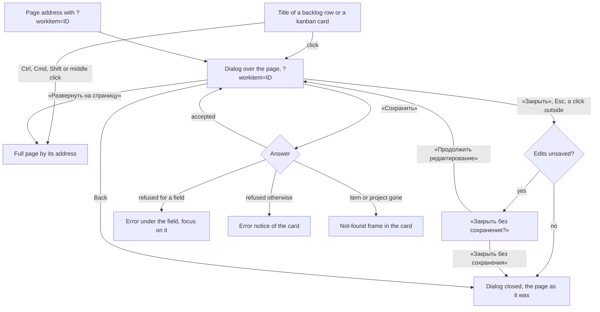

# Spec: The work item card laid out as the reference (feat-029)

## Context and goal

The human wants the work item's card to look and work like the reference
tracker's form in their screenshots of 2026-10-11 (`status.md` D-1): a header
with the type's colour bar, a grey band of state and area with the tabs, three
columns, fields without frames — shown as a dialog over the backlog and the
kanban, and as the full page. Today the card is mod-003's form re-laid by
feat-022: a page only (a white band, a strip of three outlined pickers, an 8/4
grid of outlined fields), so every title in the list, the backlog and the
kanban leaves the screen the user was working on. This task rebuilds the card
from tech-015's kit (D-2) in both shapes. It runs the short route: this spec
and `design.md` are one pass (D-2), and the one acceptance test of the look is
a side-by-side with the reference, as feat-027's was. New rules are BR-C-n;
rules restated keep their ids (BR-M3-n mod-003 and feat-022, BR-H-n feat-001,
BR-T-n feat-027).

## Roles and access

Until mod-016, mod-003 BR-M3-27 holds unchanged: any signed-in user opens,
edits and saves a work item of every active organization and project, in the
dialog and on the page; an anonymous caller gets mod-015's auth card and 401.
The card has a read-only mode (BR-C-19) that nothing triggers today.

## Scope

**In:** the card in two shapes — the dialog and the page (BR-C-1..-6); its
header, band, tab and three columns (BR-C-7..-14); borderless fields and a
draft of touched fields only (BR-C-15, -16); the actions Save, refresh,
undo-all and «⋮» (BR-C-8..-11); every state (design § 6).

**Out — the places kept (D-1).** The layout keeps a named place for each; none
is drawn, no disabled control, no «скоро» (BR-C-18). Where it stands is
`design.md` § 4.8.

| Place of the reference | Owner |
|---|---|
| Tags and «+» | feat-016-work-item-tags |
| Comments count; «Обсуждение» | feat-002-work-item-comments |
| «История» tab; «Обновил <имя>» | feat-015-work-item-history (D-4: `updatedBy` is its slot) |
| «Вложения» tab | mod-004-work-item-attachments |
| «Итерация» | mod-007-iterations |
| «Причина» (state reason) | none queued: release 3 (doc-002 § Out of scope; feat-022's `feat-NNN-process-reason-transitions`, not queued) — D-4 |
| «Следить» (follow) | none queued: release 2, owner settled by doc-011 — D-4 |
| «Разработка», «Развёртывание» | none: not in the product plan (feat-022 D-2) — D-4 |
| The reference's Related Work block: the add-link menu («Изменить родителя…», «Добавить дочерний элемент…») and the groups «Родитель» and «Дочерние элементы (n)» over link rows | feat-030-work-item-related-work (D-3): not drawn and no place kept — the card keeps feat-001's «Родитель» picker until feat-030 rebuilds the section |
| «Связи» tab (count) | not kept: «Связанная работа» of «Детали» holds the parent and the children; other link types are release 2 (doc-002 § Out of scope) |

Also out: the list page «Рабочие элементы» (its titles still open the full page,
D-1 names the backlog and the kanban); «Удалить» (mod-005); rich text (feat-018);
the concurrency token (feat-021); a leave guard for browser Back and navigation
(mod-015 § 9.7; the dialog's own ways to close are guarded, BR-C-4); any backend
change (the one the reference's «Updated by» would need — a stored «changed by» —
is feat-015's, D-4).

## Stories

| id | Title | depends-on | File |
|----|-------|------------|------|
| US-1 | A user opens a work item from the backlog or the kanban in a dialog | - | `stories/US-1-open-in-dialog.md` |
| US-2 | A user reads the card's header, band and tab as the reference's | US-1 | `stories/US-2-header-band-tabs.md` |
| US-3 | A user reads the body in three columns, by type, in fields without frames | US-2 | `stories/US-3-three-columns-borderless-fields.md` |
| US-4 | A user edits fields in place and saves only what they touched | US-3 | `stories/US-4-edit-and-save-touched.md` |
| US-5 | A user refreshes the card, undoes all edits and copies its link | US-4 | `stories/US-5-refresh-undo-copy-link.md` |
| US-6 | A user closes or expands the card without losing edits by accident | US-4 | `stories/US-6-close-and-expand-with-edits.md` |
| US-7 | A user works on the same card as a full page, at any width | US-3 | `stories/US-7-full-page-and-widths.md` |

All seven are `shippable: no`: each needs the card of US-2/US-3, and the card
without its dialog (US-1) replaces nothing the user reaches from a board.

## Business process

## Business rules

| # | Rule | Source |
|---|------|--------|
| BR-C-1 | A work item's title in a backlog row and on a kanban card is a link whose address is the full page. A plain click opens the card as a dialog over the same page, which stays as it was. A click with Ctrl, Cmd, Shift or Alt, or the middle button, follows the address (a new tab or the full page). Opening adds one history entry. | D-1 |
| BR-C-2 | The dialog's state is in the address: the page's own address with `?workitem=<identifier>`. A page opened with it opens the dialog; Back closes it; leaving the page's address (another team, another level) drops it. The value is read as received; an identifier that resolves to nothing is the not-found frame in the dialog (mod-003 § Not-found answers). | D-1 |
| BR-C-3 | «Развернуть на страницу» in the dialog opens the full page of the item. The edits not yet saved go with it and stand on the page as they stood. The page has no such control. | D-1; this task's call |
| BR-C-4 | «Закрыть», Esc and a click outside close the dialog; with edits unsaved each first asks «Закрыть без сохранения?» (US-6; D-4). Browser Back and every other navigation close it with no question, as mod-015 § 9.7 has it for every page. While a save runs the dialog is not dismissible. Closing returns focus to the title that opened it. | mod-015 § 9.1, § 9.7; D-4 |
| BR-C-5 | Inside the dialog, the link to a parent or a child in «Связанная работа» opens that item in the same dialog (a new history entry); unsaved edits ask first, «Перейти без сохранения?» (D-4). On the page the same link goes to the other item's page. | feat-001 BR-H-6; this task's call |
| BR-C-6 | The full page (`…/workitems/:identifier`, mod-003 D-5) renders the same card: the address, the trail, the tab title «<Тип> <ID> — Mustask» and the not-found frames are unchanged; the type line is the page's only `h1`. | mod-003 § Page; mod-015 BR-6 |
| BR-C-7 | The header is: the type's colour bar; the type line (icon, type name and identifier, small capitals); the title row (the identifier and the editable «Заголовок», one line); the action row (the assignee at the left, the Save group, «Обновить», «Отменить все изменения» and «⋮» at the right). Each part's content is a field or action the item already has. | D-1 |
| BR-C-8 | «Сохранить» is enabled while the draft differs from the stored item and sends only the touched fields (BR-C-16, BR-M3-25, BR-M3-38). Its arrow opens «Сохранить и закрыть»: the same save, then the dialog closes (the page goes back); a refused save closes nothing. | D-1; this task's call |
| BR-C-9 | «Обновить» reads the item again. A field the user did not touch takes the stored value; a touched field keeps the user's. It changes no draft and sends nothing. | BR-M3-25; feat-001 BR-H-4 |
| BR-C-10 | «Отменить все изменения» is enabled only with edits unsaved; after a confirmation it drops every edit and shows the stored values. | D-1 |
| BR-C-11 | «⋮» («Ещё действия») holds the actions the product has: «Копировать ссылку» (the full page's address). «Удалить» joins with mod-005; nothing else is drawn. | mod-015 § 10.3; D-1 |
| BR-C-12 | The grey band holds «Статус» (the category dot and the state's name) and «Область», each a field of the draft; and «Изменён: <дата>», the time of the latest accepted save (BR-M3-28). It does not say who changed it: the item stores no such user, and «Обновил <имя>» is the slot `updatedBy` for feat-015 (D-4). | mod-003 BR-M3-28; D-1; D-4 |
| BR-C-13 | The tab strip holds one tab, «Детали». The reference's other tabs are places kept. | D-1; feat-022 § Left out |
| BR-C-14 | The body is three columns: the texts (feat-022's `texts` of the type), the type's sections (its `sections`), «Связанная работа». Below a body width of 1 040 px the third column stands under the second; below 680 px all stand in one column. The width is the card's own, not the window's. | feat-022 § The form's sections; D-1 |
| BR-C-15 | A field shows its label above its value (in the band, at its left; a text has none of its own: its section's head names it), the value as text with no frame, and a frame on hover and on focus. A hint of the field shows on focus; an error shows as a frame and a line under the field. An empty optional text, number or date shows its placeholder only on hover or focus; an empty optional list shows «Не указан» as its value at rest (design § 2, KD-13). | D-1; tech-015 D-5 |
| BR-C-16 | The draft holds only the fields the user touched; every other field always shows the latest stored value. This is tech-010's m1 for the card. A value changed and changed back is no change. | BR-M3-25; tech-010 m1 |
| BR-C-17 | Everything the form validates and refuses is unchanged: BR-M3-3, -19, -21..-23 and the browser checks of feat-022; BR-M3-30..-38; feat-001 BR-H-2..-6 and its `parent_changed`. A refusal about a field is that field's error; any other is the card's `InlineNotice`; a not-found answer is the frame. | mod-003; feat-022; feat-001 |
| BR-C-18 | The places kept are named slots in the card: they render nothing until their task fills them, and nothing is reserved on screen for them but the band's height (design § 4.3). | D-1 |
| BR-C-19 | The card has a read-only mode: every field a value with no frame and no editing, no Save group, no undo, an `InlineNotice` naming the reason. Nothing sets it today (BR-M3-27); mod-016 sets it by the write code and mod-005 for a deleted item. | mod-003 BR-M3-27; mod-015 § 10.3 |
| BR-C-20 | A control the form already has keeps its accessible name and role (design § 8): «Заголовок», «Описание», «Статус», «Исполнитель», «Область», «Родитель», every feat-022 field, «Сохранить». | E2E 22, 24, 25 |
| BR-C-21 | After a save or a refresh in the dialog, the backlog or the kanban behind reads again, so its row or card shows the new title, state and values when the dialog closes. | this task's call |
| BR-C-22 | The look is accepted side by side with the reference at 1 536 × 790 CSS px, device pixel ratio 1.25 (the reference screenshot's own), the dialog open on a user story: the measures of `design.md` § 2 hold within 2 px **except the items of its list «Known differences from the reference» (KD-1…), which are the only exemptions** — each is a choice with its reason there, so a difference that is not on the list is a defect and one that is on it is not; and nothing the reference draws that D-1 keeps as a place is drawn. | D-1, D-2 |

## Operation completeness

| Entity | Create | Read | Update | Delete/deactivate | Cancel/reverse |
|--------|--------|------|--------|-------------------|----------------|
| The card (dialog, page) | no: mod-003's create dialog | any signed-in user (US-1, US-7) | any signed-in user, the touched fields (US-4) | no: mod-005 | close or undo-all drops unsaved edits (US-5, US-6); a saved change is reversed by another save |
| Unsaved edits (the draft) | by editing a field | in the card; carried to the page by «Развернуть» (US-6) | by editing again | undo-all, «Закрыть без сохранения», Back, any navigation | undo-all after a confirmation |
| A place kept (slot) | by its owner's task | — | — | — | — |

## Screens and copy

The design is `design.md`; the copy is final there, in § 9, and the stories
quote it. The reference's parts and where they stand here:

| Reference part | Here |
|---|---|
| the header: colour bar, type and number, number and title | § 4.2 (BR-C-7) |
| the assignee («No one selected»), Save with its arrow, refresh, undo, «⋮» | § 4.2; § 9 |
| comments count, tag chips and «+», «Follow» and its settings | places kept (§ 4.8) |
| the maximize and close icons | «Развернуть на страницу», «Закрыть» (§ 4.1) |
| the grey band: State with its dot, Area, «Updated by …: date» | § 4.3 (BR-C-12) |
| Reason, Iteration | places kept |
| the tabs Details, History, Links (count), Attachments (count) | one tab «Детали» (§ 4.4); the rest are places kept |
| Description, Acceptance Criteria; Planning, Classification | § 4.6 (feat-022's table, by type); a text's head names it, it draws no label of its own |
| Related Work: «Add link», Parent | «Связанная работа» (§ 4.6): «Родитель» as feat-001's picker with its state and «Открыть <ID>», then «Дочерние элементы (n)»; **«Add link» is not drawn and not kept** — the human's call, D-3 (KD-6): the reference's block is feat-030-work-item-related-work |
| Discussion; Deployment; Development | places kept |
| the resize grip at the dialog's bottom-right corner; the underlined access-key letters in «State», «Area», «Iteration» | not drawn: this task has no resizing and no access keys — KD-8 |
| the page behind the dialog | not dimmed: the card's backdrop is transparent and still takes the outside click (§ 4.1) |

## Non-functional requirements

- **Speed:** mod-003's: the item reads and saves within 1 s. The dialog's frame
  and its skeleton are on screen in the same frame as the click; the item
  fills in without moving what the skeleton drew.
- **Accessibility:** the dialog is modal with a focus trap and a name; every
  action has a keyboard path; the colour of a state or a type is never the only
  carrier; the new hover and focus frames and the tab line keep the 3:1 of
  mod-015 BR-5; at 200 % of 1 280 px (640 CSS px) nothing is cut and the page
  does not scroll sideways. Names and focus: `design.md` § 8.
- **Look (BR-C-22):** the window and the measures above; the visual
  comparison is a QA step, not a pixel diff.
- **Language:** copy Russian; the reference tracker is never named.

## E2E (E2E: yes)

New file `27-work-item-card.spec.ts` (D-4: 27 is the card's and 28 the kit
showcase's, tech-015 § 11; the kit merges first, so neither renumbers). Project
«Мастаск», team «Платформа»; items as `stories/US-1`'s data. One test per story:

| Test | Story | What |
|---|---|---|
| 27.1 | US-1 | a backlog title opens the dialog, the address gains `?workitem=`, the page stays; Esc closes; the address with the parameter reopens it; Back closes; a Ctrl-click link keeps the full page's `href`; a kanban card does the same |
| 27.2 | US-2 | at 1 536 × 790, ratio 1.25: the bar, the three header rows, the band, the one tab, the Save group are at the measures (§ 2, ± 2 px), among them «Область»'s label 303 from the dialog's left edge and the band values 88 from their labels, the refresh button's centre 110 and the ✕'s 21 from the right edge, the tab indicator 2 px thick with its foot 4 px above the band, «Описание»'s text box 20 below its section's rule and, for a text of up to two lines, the next section's head 102 below that rule (the cap tops 30 and 107, KD-12); **the card's backdrop has a transparent computed background** and the page behind is as bright as before it opened; no place kept is drawn; screenshots attached for the side-by-side |
| 27.3 | US-3 | the three columns of a story, a bug, a task and an epic by their positions; labels above values; the frame on hover and focus; the hint on focus; folding at 1 100, 800 and 640 px |
| 27.4 | US-4 | a changed title and priority are sent alone (the PATCH body), «Сохранить и закрыть» closes, an empty title is refused under the field with focus on it, a refused parent keeps the other edits |
| 27.5 | US-5 | «Обновить» after the item changed by API; «Отменить все изменения» with its confirmation; «Копировать ссылку» puts the full page's address on the clipboard |
| 27.6 | US-6 | Esc with an edit asks and stays; «Закрыть без сохранения» closes; «Развернуть на страницу» brings the edit to the page |
| 27.7 | US-7 | the page by address: the `h1`, the trail, three columns at 1 440, two at 1 000, one at 640; an item that is not there answers its frame |

Files that must be aligned (the others are re-run, none edited unless it fails):

- **22.2** — the form block reads «Заголовок», «Описание», «Статус», «Исполнитель»,
  «Область», «Сохранить» and the `h1` by role and name; the names hold
  (BR-C-20), so nothing is expected to change; the assignee's picker is now an
  icon and a name, its combobox still named «Исполнитель».
- **23.x** (the kanban card's link, step «Вход по паролю») — it now expects a
  `dialog` named «Пользовательская история <ключ>-US-1» and the address
  `?workitem=`, and reads «Статус» inside the dialog, not an `h1`.
- **24.1, 24.2** — the links «Открыть <ID>» stay links with an address; on the
  page they navigate as before. Re-run.
- **25** — `labelsOf` reads `.MuiInputLabel-root`, which the kit's label is not:
  it reads the section's `label` elements instead; 25.1's two-column and
  one-column assertions (1 440 and 1 279 px, the `Описание` and `Планирование`
  boxes) become three columns at 1 440 and the thresholds of BR-C-14; the
  accessible descriptions and `placeholder` attributes are unchanged.

## Decomposition for the backlog

| id | Task | size | deps |
|----|------|------|------|
| feat-029-work-item-card-reference (this task) | Frontend A: the card — header bar, band, tab, three columns, the kit's inline fields, the touched-only draft, every state — as the full page (US-2..US-5, US-7). Frontend B: the dialog and its hosting on the backlog and the kanban, the address, closing and expanding with edits, E2E 27 and the aligned files (US-1, US-6). Each pass ends green | M | tech-015, feat-022 |

Owed at gate-3, not new lines: tech-010's line loses m1 (BR-C-16); feat-016,
feat-002, feat-015, mod-004 and mod-007 each gain «fills the slot `design.md`
§ 4.8 names»; feat-015 also carries «Обновил <имя>» (D-4); feat-030 (queued,
deps feat-029) gains «rebuilds the card's Связанная работа as the reference's
block» (D-3); mod-005 adds «Удалить» to «⋮» and sets the read-only mode for a
deleted item; mod-016 sets it by `workitems.workitem.write`; feat-028 (teams
across projects) re-checks that the dialog reads the item in the page's project.
D-4 queues nothing for the state's reason, following, development and
deployment.

## Open questions

None. The three questions this spec raised were decided on 2026-10-12
(`status.md` D-4) and the decisions are applied above.

- [x] **Q-1. Closing a dialog with unsaved edits** — decided (a), D-4. mod-015
      § 9.7 (D-22) ruled every leave guard out of the MVP, for pages, and still
      does. The dialog's own ways to close — «Закрыть», Esc, a click outside —
      ask «Закрыть без сохранения?» when edits are unsaved, and a switch to a
      related item asks the same in its own words, «Перейти без сохранения?»
      (BR-C-4, BR-C-5; `design.md` § 6, § 9). Browser Back and navigation stay
      unguarded (the router has no blocker). Rejected: (b) no guard, which lets
      one stray Esc or click lose a long «Описание».
- [x] **Q-2. «Обновил <имя>: <дата>»** — decided (a), D-4. The item has the time
      of the latest save (`changedAt`) and its creator (`createdBy`, never shown),
      but not who saved last. The band says «Изменён: <дата>» (BR-C-12) and
      `updatedBy` stays a slot (`design.md` § 4.8) for feat-015, which records who
      and when for every save. Rejected: (b) a backend slice now — a stored
      «changed by» written by the save, the parent write and the child create,
      a migration and three write paths, size S to M.
- [x] **Q-3. Four places have no task** — decided (a), D-4: no queue line for the
      state's reason, following, development or deployment. Reason is release 3
      and follow release 2, both settled by analysis (doc-002 D-6, doc-011) that
      does not exist yet; development and deployment are not in the product plan
      (feat-022 D-2). Their slots are named in the card and cite their owner
      (`design.md` § 4.8). Rejected: (b) one line each in «Later».

One question was put and answered outside this list: the Related Work block
(`design.md` KD-6) — the human's call, D-3: the parent picker now, the
reference's block as feat-030-work-item-related-work.
