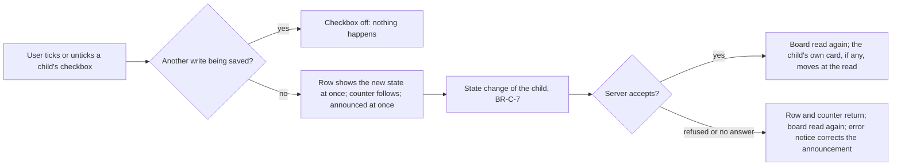

# Spec: Board card checklists (feat-032)

## Context and goal

The human's screenshot of the reference tracker's card (`research/reference-card.png`,
`status.md` D-1) shows what a card on «Канбан» lacks: the work under a story is
invisible until its form is opened. Here a card shows its tasks, bugs and test
cases as checklists — a row of counters, each a toggle that opens its own list;
a row's checkbox closes or reopens the child; «Добавить задачу» creates a task
beneath the card's item; the assignee is on the card and on every row. It builds
on mod-006 (the board and the card), feat-027 (create with a parent, BR-T-9,
BR-T-10) and mod-003 (the state change); test cases arrive with feat-031 (D-2).
New rules are BR-C-n; restated ones keep their ids. Decisions D-3, D-4 settle
the questions of review round 1 (§ Decided).

## Roles

| Who | What they may do |
|---|---|
| Any signed-in user | in every active organization and project: see the checklists of every card, expand and collapse them, close and reopen a child, add a task (mod-006 BR-M4-27, mod-002 D-a: until mod-016 nothing narrows it) |
| Anonymous caller | nothing: mod-015's auth card, 401 |

## Stories

| id | Title | depends-on | File |
|----|-------|------------|------|
| US-1 | A user sees a card's tasks, bugs and test cases as collapsible checklists, with who is assigned | - | `stories/US-1-card-checklists.md` |
| US-2 | A user closes or reopens a child from its checkbox | US-1 | `stories/US-2-close-reopen-child.md` |
| US-3 | A user adds a task to a card from its checklist | US-1 | `stories/US-3-add-task-from-card.md` |

US-1 is `shippable: yes` on its own (read-only, every part of it used);
US-2 and US-3 are `shippable: no`, they act on US-1's rows. The task is not
split: the route is one M task (D-2's confirmation), and all three stories
rewrite the same card component that feat-029 also rewrites, so one merge costs
one rebase, not three (§ Decomposition).

## Business process (BPMN)

The checkbox is the one branching flow (US-2); the add-task flow is feat-027's.

## Business rules

| # | Rule | Source |
|---|------|--------|
| BR-C-1 | The checklist of a card holds the **direct** children of the card's item that are live (not in the Removed category) and of one of three kinds, recognised by `type.appearance`, never by name: `task`, `bug`, `testcase` (D-3: this token is fixed here; feat-031 adopts the spelling). A child of another kind (a story under a feature, a feature under an epic) is not in it; grandchildren are not in it. Whatever the child's Область: **unlike the backlog's tree (feat-027 BR-T-4), which shows only children on the team's surfaces**, a child of another team is in its parent's checklist and counters — so a story can read three tasks on its card and show two beneath it on the backlog, by design (D-4, OQ-4 (a)). The board's cards and columns are unchanged: a bug that is a child of a story stays a card of its own on the «Истории» board too, and is also in that story's checklist. | D-1, D-2, D-3, D-4; mod-006 BR-M4-5, -14; feat-027 BR-T-4 |
| BR-C-2 | A card with at least one such child shows a **row of counters** under its assignee, one per kind present, in the order task, bug, test case: the kind's icon and «<done>/<total>» for tasks and bugs, «<total>» alone for test cases. A card whose type offers a task as a child (BR-C-9) shows the task counter always, «0/0» included (the only way to «Добавить задачу» on a story with no task). A card with no checklist shows no row. | D-1 (1) |
| BR-C-3 | A child is **done** when its state is in the Completed category («Закрыта» in the seeded process). A state in the Resolved category («Разрешена» of a bug) is not done. A removed child (BR-C-1) is in neither the numerator nor the denominator. | D-1; mod-001 state categories |
| BR-C-4 | Each counter is a toggle: it opens its own list under the row, a second press closes it; the lists are independent, several may be open. A chevron at the list's bottom closes it too. The first state is **collapsed**, only the counters show (D-3, OQ-1). What the user opened is kept per card for the visit to the page, across re-reads; a reload, another level or team starts collapsed again, and so does coming back from an item's form: that is a new visit, accepted as feat-027 BR-T-7 accepted it. Opening or closing changes nothing but what is shown and never moves the card. | D-1 (1, 2), D-3; feat-027 BR-T-7 |
| BR-C-5 | A list's rows, in order of the child's number (creation order, **for every kind — unlike feat-027 BR-T-6**, which orders a story's bug children by the bug level's backlog order; tasks have no order of their own before feat-023): a checkbox (checked when done), the type icon, the assignee's avatar, the title as a link that opens the item the way the card's own title does. A test case's row has **no checkbox** and its counter is a count only, because the reference shows a flask count only (D-1; D-4, OQ-2 (a)); every live test case counts whatever its state, «Закрыта» included. No row has «Ещё действия» (D-4, OQ-5 (a)). | D-1 (2); D-4 |
| BR-C-6 | The assignee is on the card as avatar and name (it already is, mod-006 BR-M4-14) and on every child row as the avatar alone, the name in its accessible name and tooltip. Nobody assigned reads «Не назначен» on the card and shows the neutral person avatar on a row; a name the directory does not know is mod-003's «Неизвестный пользователь». | D-1; mod-003's assignee display |
| BR-C-7 | A checkbox writes **one thing**: the child's Статус — ticking a task or bug sets the first state of the Completed category of its type in the process's order («Закрыта»); unticking sets its initial state, the first of the Proposed category («Новая»), so a «Разрешена» bug ticked and unticked ends in «Новая» (D-3, OQ-3). It is the same change as the form's and the card move's (mod-003 BR-M3-21, BR-M3-28): «Изменён» moves, nothing else changes. A child whose type has no Completed state has its checkbox disabled. Last write wins, no check (mod-006 BR-M4-3); a stale tick on a child removed since the read is mod-005's to refuse, this task adds no check. A write is `workitems.workitem.write` (mod-006 BR-M4-27); nothing checks it until mod-016. | D-1, D-3; mod-003 BR-M3-21; mod-006 BR-M4-3, -27 |
| BR-C-8 | One write at a time on the board: while a card move, a child's state change or a task creation is saved, every card menu, every checkbox, every «Добавить задачу», the Enter of an add field already open (it keeps its text) and card dragging are off; then the board is read again. A refused or unanswered write puts the row and the counter back and shows a notice (§ Screens and copy). | mod-006 BR-M4-28; feat-027 BR-T-15 |
| BR-C-9 | «Добавить задачу» stands at the top of the task list on every card whose type offers a task as a child — by feat-027 BR-T-9, a story; not an epic, a feature, a bug. Its text is D-1's wording and fixed, not the process's type name (feat-027's «Добавить: <тип>» is not used here). It opens feat-027's inline row (BR-T-10): a title field, Enter creates one task whose parent is the card's item — all or none, one `requestId`, the parent's Область as stored, the type's initial state, no assignee —, Escape or an empty title cancels with nothing sent; a refusal shows at the field, the title kept. The new task is the last row of the list and the counter's total grows by one. It declares `workitems.workitem.write` and `workitems.link.write` (feat-027 BR-T-17). | D-1; feat-027 BR-T-9, -10, -17; mod-003 BR-M3-26 |
| BR-C-10 | The board's read answers each card's children with it, in the same answer: no read per toggle, nothing fetched when a list opens; the checklist after a write is the next read's, as for every board write (mod-006 BR-M4-28). The change is additive: nothing the board answered before changes. | D-2; mod-006 BR-M4-28 |
| BR-C-11 | The `testcase` token and its flask icon are added by **this task** to the panel's appearance set and theme mark (mod-001's contract lists five tokens; ADR-0024 § 3 already lets the set grow "only by a change to `app/theme`", which this is, so the ADR is not edited). feat-031 adds the type and must use the same spelling: the human sent it to the feat-031 session on 2026-10-12 (status Log; D-3, R-22), and feat-031 owns adding `testcase` to mod-001's token set and the matching `WorkItemField` support (`WorkItemField.Of(Testcase)` throws today, `Mustask.Domain/WorkItems/WorkItemField.cs`; QA D-4, m-4). Until feat-031 is in `main` no process has a type of that appearance, no flask counter appears, and this task's tests use a fixture process that has one; nothing here waits for feat-031. | D-2, D-3 |
| BR-C-12 | A press or a drag started on a counter, a checkbox, a row, a link, «Добавить задачу» or the add field never starts a card drag; text in the add field can be selected with the pointer and typed; the card is dragged from the rest of its surface as before (mod-006 US-5). | D-1; mod-006 § Page «Доски», US-5 |

## Operation completeness

| Entity | Create | Read | Update | Delete/deactivate | Cancel/reverse |
|--------|--------|------|--------|-------------------|----------------|
| Card's checklist (derived from the children) | no: it is the children (below) | any signed-in user (US-1) | no: derived | no: derived | n/a |
| Child's state | n/a | any signed-in user (US-1) | any signed-in user: its checkbox (US-2); the form stays | no: mod-005 | untick; another write |
| Task created from a card | any signed-in user (US-3) | the list, the form | the form (mod-003) | no: mod-005 | Escape before Enter; after it no undo |
| Test case in a list | no: feat-031's form; not from the card (out of scope) | any signed-in user (US-1) | no: not from the card | no: mod-005 | n/a |
| Expanded lists (per visit) | system: collapsed at the start (BR-C-4) | as the board | a counter, the chevron (US-1) | system: reload, another level or team, an item's form | close again |

## Screens and copy

Built from mod-015's patterns in the card's existing manner; the card keeps its
stripe, type, ID, title, state and menu. Design (layout, sizes, the exact look)
is the design stage's; the copy is fixed here. The row of counters is the
reference's (1), the list the reference's (2). Every control carries the card's
ID in its name: a board holds hundreds of cards.

| Place | Copy |
|---|---|
| Counter's accessible name (starts with its visible text, D-5) | «<n>/<m> — <ID>, <тип>: выполнено <n> из <m>» (task, bug); «<m> — <ID>, <тип>: <m>» (test case, whose visible text is the count); `<тип>` is the process's own name of that type; `aria-expanded` on each |
| List's chevron | «Свернуть список: <тип> (<ID>)» |
| Checkbox | accessible name «<ID>: выполнено» (the child's ID); checked or not by state |
| Assignee avatar on a row | accessible name the person's name, «Не назначен», or «Неизвестный пользователь» |
| Add button / field | visible «Добавить задачу», accessible name «Добавить задачу (<ID>)» (the card's ID); field «Заголовок: Задача (<ID>)», placeholder «Введите заголовок» (feat-027) |
| Announcements (at once, with the tick; the process's state name) | «<ID>: статус «<состояние>».» — «MSK-TASK-4: статус «Закрыта».» |
| Notices (`Snackbar`, `Alert` error, 6 s, bottom left) | a refusal with a code: the server's `detail`; none or no code: «Не удалось сохранить статус. Попробуйте ещё раз.» (task creation: feat-027's) |
| Task created | «Рабочий элемент <ID> создан.» |

No new error codes: the state change and the create answer mod-003's and
feat-027's.

## Non-functional requirements

- **Volumes and speed:** the board of one team and level with 5 000 cards, each
  with five children, every list collapsed, is read within 2 s (mod-006's budget
  stands; the 2 s is the read); a checkbox or a task creation within 1 s. A
  single card with up to 200 children opens its list within 100 ms, with no
  request.
- **Accessibility:** counters, checkboxes, the add button and the chevron are in
  the Tab order and work by Enter and Space; state is never colour alone; every
  checkbox change is announced (mod-015 § 12).
- **Concurrency:** a checkbox is last write wins (BR-C-7); a task creation runs
  under feat-027's parent-write ordering.
- **Audit:** none here; feat-015 records changes.
- **Language:** copy Russian; the reference tracker is never named.

## Out of scope

- «Story Points» (the screenshot's grey line) and «Трудоёмкость» on the card:
  its own queue line, feat-034-board-card-effort (D-3).
- The row's «…» menu in the screenshot (actions on a child; D-4, OQ-5).
- Adding a bug or a test case from a card; only a task (D-1). Test cases come
  from feat-031's own form.
- Reassigning from the card or a row; editing a title in place; reordering or
  dragging children; dragging a child to another card.
- Checklists on epic and feature cards for their story or feature children
  (BR-C-1, D-4 OQ-6), and children of children.
- Counters on backlog rows (feat-027's table is unchanged); live push (mod-006
  BR-M4-28 stands).
- Test steps, plans, suites (the human, 2026-10-12, feat-031).

## Decomposition for the backlog

| id | Task | size | deps |
|----|------|------|------|
| feat-032-board-card-checklists (this task) | Backend: the board's answer gains each card's children (BR-C-1, -10), additively. Frontend A: counters, toggles, rows, assignee, the `testcase` token and flask icon (US-1). Frontend B: the checkbox, «Добавить задачу» (US-2, US-3). Each pass ends green. The card file is also feat-029's: whichever merges second rebases (D-2). feat-031 is not a dependency (BR-C-11) | M | mod-006, feat-027 |

No new queue lines from this spec (feat-034-board-card-effort is already
queued, D-3). Owed at gate-3: a superseded-in-part note in mod-006's
§ Page «Доски» card row and BR-M4-14 (the card gains the checklist), and in
mod-001, mod-003 and mod-015 where the five-token set stands (the sixth token,
`testcase`) — done at code review round 1 (api-contract § 7 lists the places).
The `testcase` spelling is with the feat-031 session (BR-C-11), not on a queue
line; feat-031 owns the token in mod-001's set and `WorkItemField` support.

## Decided

| OQ | Decision | Source |
|---|---|---|
| OQ-1 first state of the lists | collapsed, only the counters show (BR-C-4) | D-3 (human) |
| OQ-2 test cases | rows without a checkbox, a count in the counter, every live test case counted whatever its state (BR-C-5) | D-4 (a), reworded per R-5 |
| OQ-3 what a tick and an untick write | tick → first Completed state, untick → «Новая»; a «Разрешена» bug is not done (BR-C-3, -7) | D-3 (human) |
| OQ-4 other team's children, duplicate bug | every live child counts whatever its Область; a child bug is a card and a row; diverges from feat-027 BR-T-4 (BR-C-1) | D-4 (a), divergence per R-6 |
| OQ-5 the row's «…» menu | not in this cut (BR-C-5) | D-4 (a) |
| OQ-6 epic and feature cards | no checklist for story or feature children (BR-C-1) | D-4 (a) |
| R-20 «Трудоёмкость» on the card | not in this cut; feat-034-board-card-effort | D-3 (human) |
| R-1 test-case token | `testcase`; this task adds the flask icon (BR-C-11) | D-3 |

## Open questions

None.
