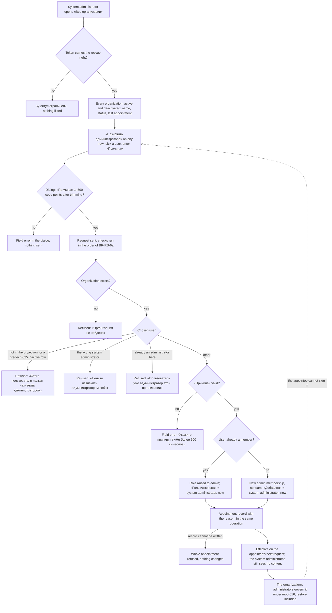

# Spec: A system administrator appoints an organization administrator (feat-033)

## Context and goal

An organization can be left with nobody able to administer it: its
administrators have left, their Keycloak accounts are disabled or deleted, or
the accounts are still enabled but nobody can use them (doc-006 § "Known MVP
limitation", H-1). Today there is no way back. MUSTASK cannot detect this
state: since tech-025 the user projection is filled from the sign-in only and
never learns that an account was disabled or deleted (ADR-0034, Consequences).
So this task gives the holder of the `system-admin` client role (ADR-0033) an
appointment on request: in any organization, active or deactivated, they add an
administrator or raise a member to administrator, with a required reason, on a
permanent record, and without gaining any access to the organization's content
(doc-006 BR-M1-8). This is wider than the queue line's "no active
administrator" by the human's decision (gate-1 answers in `status.md`, R-1 = A).

## Roles

| Who | Source of the right | What they may do here |
|---|---|---|
| System administrator | the `mustask-api` client role `system-admin`, in the token (ADR-0033); the rescue right is an instance right reached through `InstanceRoles` by `system-admin` only | read the instance organization list (BR-RS-2); appoint an administrator (BR-RS-4..-9); read any organization's appointment record from that list (BR-RS-10) |
| Organization administrator | their membership; the organization code `organizations.membership.write` (mod-016) | read their own organization's appointment record on «Участники» (BR-RS-10); otherwise unchanged |
| Organization member, reader | their membership | unchanged; they read the appointee's «Добавлен» / «Роль изменена» on «Участники» (doc-006 BR-M1-16) |
| `organization-creator`, `dictionaries-admin`, `user` | client roles (ADR-0033) | nothing here |
| Company realm administrator | the company Keycloak console | grants and revokes `system-admin`; nothing in this task writes to Keycloak |

The system administrator is not made a member of any organization by this
feature and reaches no organization content through it (BR-RS-3).

## Stories

| id | Title | depends-on | File |
|----|-------|------------|------|
| US-1 | A system administrator sees every organization of the instance | - | `stories/US-1-instance-organization-list.md` |
| US-2 | A system administrator appoints an administrator to an organization | US-1 | `stories/US-2-appoint-administrator.md` |
| US-3 | Every appointment is recorded and readable | US-2 | `stories/US-3-appointment-record.md` |

No story is spun out: the list without the appointment is a read with nothing
to act on, and the appointment without its record breaks "audited". All three
are `shippable: no`.

## Business process (BPMN)

## Business rules

| # | Rule | Source |
|---|------|--------|
| BR-RS-1 | The rescue right is an instance right, carried in the token and held through `InstanceRoles` by `system-admin` only — never by `organization-creator`, `dictionaries-admin` or `user`, and never by any organization role. It is not a membership and reaches no organization content. Granting or revoking it is assigning `system-admin` in the company realm; nothing in Keycloak is added or written by this task. A change reaches the user with the next token (ADR-0018, "Revocation is NOT instant"). Without the right, the page «Все организации» answers «Доступ ограничен», and an appointment or a record read attempted anyway is refused with 403 «Недостаточно прав», changing nothing. | ADR-0033 § 1–2; ADR-0029 § 9; doc-006 BR-M1-2 |
| BR-RS-2 | The instance organization list shows every organization of the instance, active and deactivated alike: its name; its status «Активна» / «Деактивирована»; the date of its last appointment, «—» when there was none. It is ordered by name (mod-014 BR-UP-15's collation), paged 25 rows a page with the total count shown, and filtered by name: the trimmed filter text matches any substring of the name, ignoring case, with `ё` = `е`; an empty filter (after trimming) shows all; the filter applies across all pages. It shows nothing about the organization's administrators: MUSTASK cannot tell whether an organization still has a usable one (ADR-0034, Consequences). | queue line; doc-006 BR-M1-1; human decision R-1 = A |
| BR-RS-3 | Non-disclosure. The system administrator learns through this feature exactly: (a) the name and the status of every organization; (b) through the appointee search, the name and e-mail of every user the projection knows — both accepted by the human (R-6); (c) the appointment record of BR-RS-10; (d) from the refusal of BR-RS-6, that the one user they chose is already an administrator of that organization (OQ-6). Nothing else: not the members or their number, not the administrators' names, not its projects, teams, areas, work items, process or settings. Opening the organization or anything under it still answers «Организация не найдена» unless they hold a membership of their own (ADR-0027 rule 4, ADR-0029 § 9). | doc-006 BR-M1-8; human decision R-6 |
| BR-RS-4 | An appointment is allowed in any organization, active or deactivated, whether or not it has administrators, on request. It only adds an `admin` membership or raises an existing member to `admin`; it never removes, downgrades or otherwise changes anyone else's membership. | human decision R-1 = A |
| BR-RS-5 | «Причина» is required: 1–500 characters (Unicode code points, as ADR-0034 counts) after trimming; the dialog and the server count the same way. It is kept in the appointment record (BR-RS-10) and nowhere else. | human decision R-1 = A |
| BR-RS-6 | The appointee is any user the projection knows, member of the organization or not; the search is the projection's (mod-014 BR-UP-14: at least 2 characters, at most 20 answers in BR-UP-15's order), finds by name or e-mail, and shows each candidate's name and e-mail only, saying nothing about membership. A user who has never signed in to MUSTASK is not in the projection, is not found, and is refused with «Этого пользователя нельзя назначить администратором» if named anyway (ADR-0034, Consequences: asking them to sign in once is the procedure). A row the pre-tech-025 push feed marked inactive (disabled, deleted or absent) is hidden from the search and refused with the same words if named directly, as mod-016's add-member refuses it; search and API agree. A user who is already an administrator of the organization is refused with «Пользователь уже администратор этой организации», changing nothing. MUSTASK cannot see whether the chosen person's Keycloak account is still enabled; the dialog says so (US-2). | OQ-1; ADR-0034; R-2; mod-016 |
| BR-RS-6a | Order of refusals when several apply to one request (ADR-0029 § 8, not-found first; the dialog's own field check runs before sending): 403 «Недостаточно прав» → «Организация не найдена» → «Этого пользователя нельзя назначить администратором» → «Нельзя назначить администратором себя» → «Пользователь уже администратор этой организации» → the «Причина» field errors. So a system administrator already administering the organization who names themselves gets the self refusal; an unknown user in a missing organization gets «Организация не найдена». | R-9; ADR-0029 § 8 |
| BR-RS-7 | A system administrator never appoints themselves; the refusal «Нельзя назначить администратором себя» changes nothing. Another system administrator may appoint them. | OQ-2 |
| BR-RS-8 | A member is appointed by raising their role to `admin`; their membership, team memberships and «Добавлен» are kept, and «Роль изменена» becomes the acting system administrator, now. A non-member is appointed by a new `admin` membership: «Добавлен» = the acting system administrator, now; «Роль изменена» «—»; they join no team. Exactly one user is appointed per appointment. | doc-006 BR-M1-5, -10, -16; OQ-1 |
| BR-RS-9 | The appointment takes effect on the appointee's next request with no re-login (doc-006 BR-M1-6). On a deactivated organization it does not restore it: the appointee restores it per mod-016 BR-M1-35. Afterwards the organization's administrators govern it under mod-016 alone; the appointment gives the system administrator nothing to undo. The rescue is repeatable: if the appointee turns out unable to sign in, the system administrator appoints someone else. | doc-006 BR-M1-6; mod-016 BR-M1-35; R-2 |
| BR-RS-10 | Every successful appointment writes, in the same all-or-nothing operation, an appointment record: the organization, the appointee, the acting system administrator, the moment, the reason. A refused appointment writes none. Records are never edited or deleted and outlive any later change of the membership. Readers: holders of the rescue right, for any organization, from «Все организации»; and the holders of `organizations.membership.write` in that organization (its administrators), for their own organization only, from «Участники». Both read the same rows, newest first. Users are named as on «Участники» (mod-016 § Screens); «неактивен» / «Неизвестный пользователь» can show only for rows the projection kept from before tech-025 (ADR-0034, Consequences). | queue line ("audited"); OQ-3 as changed by the human |
| BR-RS-11 | Of two concurrent appointments of the same user to one organization, exactly one succeeds and the other is refused with «Пользователь уже администратор этой организации». Two concurrent appointments of different users to one organization both succeed, each with its own record. An appointment and a concurrent mod-016 change by an organization administrator to the same membership are serialized: one commits first and the other is judged against the committed state. If the member was removed first, the appointment sees a non-member and creates a new admin membership (BR-RS-8); if the member was raised to `admin` first, it is refused with «Пользователь уже администратор этой организации»; if the appointment commits first, the later removal or role change applies to the now-admin membership under mod-016's own rules (BR-M1-4), and the record stays. | doc-006 NFR Concurrency; R-3 |
| BR-RS-12 | Dates are shown in the viewer's local time zone, as «Добавлен» on «Участники» (mod-016 design § 3.3): «Последнее назначение» as «ДД.ММ.ГГГГ», the record's moment as «ДД.ММ.ГГГГ ЧЧ:мм». | mod-016 design; R-7 |

## Operation completeness

| Entity | Create | Read | Update | Delete/deactivate | Cancel/reverse |
|--------|--------|------|--------|-------------------|----------------|
| Instance organization list (a view, BR-RS-2) | no: derived from the organizations | system administrator (US-1) | no: a view | no: a view | n/a |
| Organization (rename, deactivate, restore) | no: unchanged, `organization-creator` (mod-002) | system administrator: name and status only (BR-RS-2, -3) | no: its administrators, per mod-002 / mod-016 | no: its administrators; the appointment does not restore (BR-RS-9) | no: its administrators restore |
| Admin membership made by an appointment | system administrator, in any organization (US-2, BR-RS-4) | the organization's members, with who/when (doc-006 BR-M1-16) | no for the system administrator; the organization's administrators per mod-016 | no for the system administrator; the organization's administrators per mod-016 (BR-M1-4) | no: no undo by the system administrator; the organization's administrators change or remove it, or the appointee steps down per BR-M1-4 |
| Other memberships of the organization | no: the appointment creates only the appointee's (BR-RS-4) | unchanged (mod-016) | no: never changed by an appointment (BR-RS-4) | no: never removed by an appointment (BR-RS-4) | n/a |
| Appointment record | written by the appointment itself, never by hand (BR-RS-10) | system administrator, any organization; the organization's administrators, their own (US-3) | no: a record, never edited | no: never deleted | no: a record of what happened |
| Rescue right | company realm administrator, by assigning `system-admin` (BR-RS-1) | company Keycloak console | n/a — held or not | company realm administrator revokes; effective with the next token | n/a |

## Non-functional requirements

- **Volumes:** up to 1 000 organizations; a page of the list, filter included,
  within 2 s; the appointee search within 2 s at 10 000 projected users
  (mod-014 NFR); a record of up to 100 rows within 2 s.
- **Access:** no call to Keycloak, no write to Keycloak (ADR-0023, ADR-0033,
  ADR-0034); the access check does not read the projection (ADR-0027 rule 3).
- **Audit:** the appointment record is the only new record. The appointment
  and its record succeed or fail together.
- **Concurrency:** BR-RS-11.
- **Localization:** copy is Russian, quoted here and in the stories; the
  reference tracker is never named.

## Out of scope

- Detecting an organization without a usable administrator, by any means
  (Keycloak status, last sign-in) — MUSTASK cannot see it (ADR-0034); human
  decision R-1 = A.
- A general audit log of system-administrator actions, and the M1 audit log
  (doc-006 BR-M1-15) — release 2.
- Any role management in MUSTASK: granting `system-admin`, a screen for
  instance rights — the company realm owns roles (ADR-0033).
- Any write to Keycloak, including re-enabling a disabled administrator.
- Any other system-administrator power inside an organization: removing or
  downgrading members, renaming, deactivating or restoring, reading content.
- Notifications or e-mail to the appointee or the organization.
- Creating users or inviting people who are not in the projection.
- The appointment record for the organization's members who are not its
  administrators.
- The ADR itself — owed to the design/plan stage (below).

## Decomposition for the backlog

No new queue lines: the queue line is this task (size L, confirmed by the
human). Development passes inside it, each ≤ M. Re-estimated after R-1 = A:
the list no longer derives an administrator state over every membership, and
the record gains one more reader; both passes sit inside M.

| id | Task | size | deps |
|----|------|------|------|
| backend | the rescue instance right in the catalog and `InstanceRoles` (`system-admin` only); the paged, filtered instance organization list with status and last appointment; the appointee search; the appointment with BR-RS-4..-9 and -11; the record and its two reads (instance, and inside the organization under `organizations.membership.write`); the rescue routes registered as inventory exceptions with ADR-0029 § 9's reason (mod-016 BR-M1-33) | M | - |
| frontend | «Все организации» under «Настройки» for the right's holders only, with the filter and paging; the appointment dialog; «История назначений» from the list and from «Участники» for the organization's administrators; the panel's mirror of `InstanceRoles` (ADR-0033 Consequences) | M | backend |

## Open questions

- [x] **OQ-1 Whom can be appointed?** Closed by the human: as recommended —
  any user the projection knows; a member is raised, a non-member gets a new
  admin membership with no team (BR-RS-6, -8).
- [x] **OQ-2 May a system administrator appoint themselves?** Closed by the
  human: as recommended — no (BR-RS-7).
- [x] **OQ-3 Who reads the record?** Closed by the human, changed: a separate
  permanent record with the reason, read by system administrators and by the
  organization's administrators inside the organization, plus the membership's
  «Добавлен» / «Роль изменена» naming the system administrator (BR-RS-8, -10).
- [x] **OQ-4 Only with no active administrator, or always?** Closed by the
  human (R-1 = A): on request in any organization, adding or raising only,
  with a required reason (BR-RS-4, -5).
- [x] **OQ-5 The unknown administrator.** Closed: dropped with R-1 = A — the
  list states no administrator state, so nothing depends on whether the
  projection knows an organization's administrators (ADR-0034).
- [x] **OQ-6 The already-administrator refusal discloses one fact.** Closed by
  the human: accepted as recommended — the explicit refusal «Пользователь уже
  администратор этой организации» (BR-RS-3 (d)).

**ADR debt (owed to the design/plan stage, not written here).** ADR-0029 § 9
already sanctions the rescue as an instance operation that appoints an
organization admin, writes a membership, is audited, reads no content and
holds no scoped code, with its routes as inventory exceptions; this spec builds
on it and does not amend it. The owed ADR still decides: (1) the trigger —
on request in any organization, add or raise only, with a required reason,
and why no detection is attempted (ADR-0034); (2) the disclosures of BR-RS-3;
(3) the appointment record, its reason, and its second reader — the
organization's administrators under `organizations.membership.write`. It
amends the wording of ADR-0027 rule 4 and ADR-0033 § 1 ("later tasks use it for
cross-organization administration") to name this operation.
