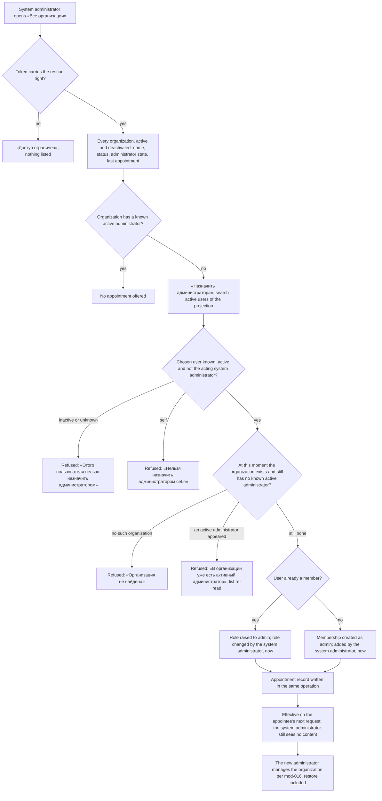

# Spec: Rescue of an organization with no active administrator (feat-033)

## Context and goal

An organization can be left with nobody able to administer it: every `admin`
membership belongs to an account that is disabled or deleted in Keycloak,
which MUSTASK never refuses (doc-006 BR-M1-4, BR-M1-17). Today there is no way
back — the members keep working, but nobody can change membership, rename,
deactivate or restore the organization, or manage its structure. doc-006
recorded this as an accepted risk (H-1, § "Known MVP limitation"). This task
closes it: the holder of the `system-admin` client role (ADR-0033) sees every
organization of the instance with whether it has an active administrator, and
appoints one where it has none — recorded, and without themselves gaining any
access to the organization's content (doc-006 BR-M1-8). Scope is the queue
line only, as the human decided (`status.md`, route confirmation): no general
audit log of system-admin actions, no role management in MUSTASK.

## Roles

| Who | Source of the right | What they may do here |
|---|---|---|
| System administrator | the `mustask-api` client role `system-admin`, in the token (ADR-0033); the new right is an instance right, reached through `InstanceRoles` by `system-admin` only | read the instance-wide organization list of BR-RS-2; appoint an administrator per BR-RS-4..-9; read the appointment record of BR-RS-10 |
| Organization administrator, member, reader | their organization membership (ADR-0027, ADR-0029) | unchanged; they read the appointed administrator's membership with its who/when (doc-006 BR-M1-16) |
| `organization-creator`, `dictionaries-admin`, `user` | client roles (ADR-0033) | nothing here |
| Company realm administrator | the company Keycloak console | grants and revokes `system-admin`; nothing in this task writes to Keycloak |

The system administrator is not made a member of any organization by this
feature and reaches no organization content through it (BR-RS-3).

## Stories

| id | Title | depends-on | File |
|----|-------|------------|------|
| US-1 | A system administrator sees every organization and which have no active administrator | - | `stories/US-1-instance-organization-list.md` |
| US-2 | A system administrator appoints an administrator to an organization that has none | US-1 | `stories/US-2-appoint-administrator.md` |
| US-3 | Every appointment is recorded and readable | US-2 | `stories/US-3-appointment-record.md` |

No story is spun out: the list without the appointment is a read with nothing
to act on, and the appointment without its record breaks "audited". All three
are `shippable: no`.

## Business process (BPMN)

## Business rules

| # | Rule | Source |
|---|------|--------|
| BR-RS-1 | The rescue right is an instance right, carried in the token and held through `InstanceRoles` by `system-admin` only — never by `organization-creator`, `dictionaries-admin` or `user`, and never by any organization role. It is not a membership and reaches no organization code. Granting or revoking it is assigning `system-admin` in the company realm; nothing in Keycloak is added or written by this task. A change reaches the user with the next token (ADR-0018, "Revocation is NOT instant"). | ADR-0033 § 1–2; doc-006 BR-M1-2; human scope decision |
| BR-RS-2 | The instance-wide organization list shows, for every organization of the instance, active and deactivated alike: its name; its status «Активна» / «Деактивирована»; its administrator state «Есть активный администратор» / «Нет активного администратора» (BR-RS-5); and the date of its last appointment, «—» when there was none. It is ordered by name (mod-014 BR-UP-15's collation) and filtered by name substring and by «Только без активного администратора». | queue line; doc-006 BR-M1-1 (names are public), H-2 |
| BR-RS-3 | Nothing else about an organization reaches the system administrator through this feature: not its members or their number, not the names of its administrators active or inactive, not its projects, teams, areas, work items, process or settings. Opening the organization or anything under it still answers «Организация не найдена» unless they hold a membership of their own (doc-006 BR-M1-8, ADR-0027 rule 4, ADR-0029 § 8). The administrator state is the one fact about an organization's membership this feature discloses, plus what the appointment record of BR-RS-10 says. | doc-006 BR-M1-8; queue line ("no access to the organization's content") |
| BR-RS-4 | An appointment is allowed only while the organization has no known active administrator at the moment of the appointment; otherwise it is refused and nothing changes. The rescue right never changes the membership of an organization that has an active administrator. | doc-006 H-1; this spec (OQ-4) |
| BR-RS-5 | "Known active administrator" means what it means for doc-006 BR-M1-4 and mod-016 BR-M1-32: an `admin` membership whose user the projection holds as active. A user the projection does not know yet (mod-014 BR-UP-17) does not count, so an organization whose only administrator is not yet projected shows «Нет активного администратора». | mod-016 BR-M1-32; mod-014 BR-UP-17 |
| BR-RS-6 | The appointee is any user the projection holds as active, member of the organization or not; an inactive or unknown user is refused and never offered by the search. The search is the projection's (mod-014 BR-UP-14: at least 2 characters, at most 20 answers in BR-UP-15's order) and says nothing about whether a candidate is a member of the organization. | doc-006 BR-M1-5, BR-M1-17; mod-016 BR-M1-32; OQ-1 |
| BR-RS-7 | A system administrator never appoints themselves; the refusal changes nothing. Another system administrator may appoint them. | OQ-2 |
| BR-RS-8 | A member is appointed by raising their role to `admin`; their membership, team memberships and «Добавлен» are kept, and «Роль изменена» becomes the acting system administrator, now (doc-006 BR-M1-16). A non-member is appointed by a new `admin` membership, «Добавлен» = the acting system administrator, now, «Роль изменена» empty; they join no team. Exactly one administrator is appointed per appointment. | doc-006 BR-M1-5, -10, -16; mod-016 § Screens |
| BR-RS-9 | The appointment takes effect on the appointee's next request with no re-login (doc-006 BR-M1-6). It works the same on a deactivated organization and does not restore it: the new administrator restores it per mod-016 BR-M1-35. After the appointment the organization's administrators govern it under mod-016 alone, BR-M1-4 included; the system administrator cannot act again while an active administrator exists (BR-RS-4). | doc-006 BR-M1-6; mod-016 BR-M1-35 |
| BR-RS-10 | Every successful appointment writes, in the same all-or-nothing operation, an appointment record: the organization, the appointed user, the acting system administrator, the moment. A refused appointment writes none. Records are never edited or deleted, outlive any later change of the membership, and are read only by holders of the rescue right, per organization, newest first. Users are named as on «Участники» (mod-016 § Screens: «неактивен», «Неизвестный пользователь»). | queue line ("audited"); human scope decision; OQ-3 |
| BR-RS-11 | Of two appointments to one organization that each pass BR-RS-4 alone, exactly one succeeds and the other is refused with «В организации уже есть активный администратор». An appointment that races a Keycloak re-enable of an administrator follows the projection as it reads at the moment of the appointment (doc-006 BR-M1-4: a Keycloak change is not a MUSTASK change). | doc-006 NFR Concurrency, doc-001 BR-11 |

## Operation completeness

| Entity | Create | Read | Update | Delete/deactivate | Cancel/reverse |
|--------|--------|------|--------|-------------------|----------------|
| Instance organization list (a view, BR-RS-2) | no: derived from the organizations | system administrator (US-1) | no: a view | no: a view | n/a |
| Organization (rename, deactivate, restore) | no: unchanged, `organization-creator` (mod-002) | system administrator: name, status, administrator state only (BR-RS-2, BR-RS-3) | no: the appointed administrator, per mod-002/mod-016 | no: the appointed administrator; the rescue does not restore (BR-RS-9) | no: the appointed administrator restores |
| Admin membership made by an appointment | system administrator, only with no known active administrator (US-2, BR-RS-4) | the organization's members, with who/when (doc-006 BR-M1-16) | no for the system administrator; the organization's administrators per mod-016 | no for the system administrator; the organization's administrators per mod-016, never the last known active one (BR-M1-4) | no: no undo by the system administrator; the appointee adds another administrator and steps down per BR-M1-4 |
| Appointment record | written by the appointment itself, never by hand (BR-RS-10) | system administrator, per organization (US-3) | no: a record, never edited | no: never deleted | no: a record of what happened |
| Rescue right | company realm administrator, by assigning `system-admin` (BR-RS-1) | company Keycloak console | n/a — held or not | company realm administrator revokes; effective with the next token | n/a |

## Non-functional requirements

- **Volumes:** up to 1 000 organizations of up to 500 memberships each; the
  list with its administrator state, filter included, renders within 2 s; the
  appointee search within 2 s at 10 000 projected users (mod-014 NFR).
- **Access:** no call to Keycloak, no write to Keycloak (ADR-0023, ADR-0033);
  the administrator state reads the projection, the access check does not
  (ADR-0027 rule 3).
- **Audit:** the appointment record of BR-RS-10 is the only new record. The
  appointment and its record succeed or fail together.
- **Concurrency:** BR-RS-11 under concurrent requests; one is refused.
- **Localization:** copy is Russian, quoted here and in the stories; the
  reference tracker is never named.

## Out of scope

- A general audit log of system-administrator actions, and the M1 audit log
  (doc-006 BR-M1-15) — release 2, human scope decision.
- Any role management in MUSTASK: granting `system-admin`, instance rights,
  a screen for them — the company realm owns roles (ADR-0033).
- Any write to Keycloak, including re-enabling a disabled administrator.
- Any other system-administrator power inside an organization: removing or
  downgrading members, appointing where an active administrator exists,
  renaming, deactivating or restoring, reading its content.
- Notifications or e-mail to the appointee or the organization.
- Creating users or inviting people who are not in the projection.
- The ADR itself — owed to the design/plan stage (§ Open questions, ADR debt).

## Decomposition for the backlog

No new queue lines: the queue line is this task (size L, confirmed by the
human). Development passes inside it, each ≤ M:

| id | Task | size | deps |
|----|------|------|------|
| backend | the rescue instance right in the catalog and `InstanceRoles` (`system-admin` only); the list with administrator state and last appointment; the appointee search; the appointment with BR-RS-4..-9 and -11; the record and its read (BR-RS-10); the ADR amending ADR-0027 / ADR-0029 § 8 / ADR-0033 | M | - |
| frontend | «Все организации» under «Настройки» for the right's holders only, the filter, the appointment dialog, the record dialog, the panel's mirror of `InstanceRoles` (ADR-0033 Consequences) | M | backend |

## Open questions

Each with the analyst's recommendation, which the stories already follow.

- [ ] **OQ-1 Whom can be appointed?** Recommended: any active projected user,
  member or not (BR-RS-6, BR-RS-8). Alternative: only an existing member —
  fails when every remaining member is a reader the organization does not
  want as administrator, or when nobody active remains.
- [ ] **OQ-2 May a system administrator appoint themselves?** Recommended:
  no (BR-RS-7) — the feature's promise is "no access to content", and self-
  appointment is exactly that access; a second system administrator can still
  do it, on the record.
- [ ] **OQ-3 What does "audited" mean and who reads it?** Recommended: both
  the membership's who/when (BR-M1-16, read by the organization's members) and
  a durable appointment record, read by system administrators only
  (BR-RS-10) — the who/when alone is overwritten by the next role change.
  Alternatives: who/when only (not durable); the record also readable by the
  organization's administrators (needs a new screen inside the organization).
- [ ] **OQ-4 Only with no active administrator, or always?** Recommended:
  only with none (BR-RS-4) — "always" makes `system-admin` a superuser over
  every membership.
- [ ] **OQ-5 The unknown administrator.** Recommended: an administrator the
  projection does not know yet does not count (BR-RS-5), consistent with
  BR-M1-4. Risk: a minutes-old organization whose creator is not projected yet
  shows «Нет активного администратора» and could be rescued; the record
  shows who did it. Dependency: if `tech-025` changes how the projection
  learns a disabled or deleted account, BR-RS-5's state follows it, and the
  design stage re-checks this rule against it.

**ADR debt (owed to the design/plan stage, not written here).** This is the
first rule under which an instance role acts inside an organization without a
membership. ADR-0027 rule 4 and ADR-0029 § 8 ("the instance administrator
still sees no content") and ADR-0033 § 1 ("later tasks use it for
cross-organization administration") need an ADR that amends them: the
rescue right, its single operation, BR-RS-3's disclosure boundary and the
appointment record.
