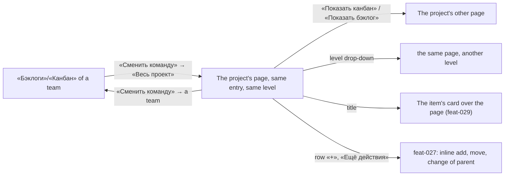

# Design: Project backlog and board (feat-039)

Stage 3 artifact. The rules (BR-PB-n) and the scenarios (US-1..US-3) are in
`spec.md` and `stories/`; this file is the layout, the MUI components, every
state and every Russian string of the new pages, and nowhere else. The pages
are the team pages (mod-006, feat-027, feat-029, feat-032) over a project, so
what they already draw is named and not redrawn.

- Base: [feat-027's design](../feat-027-backlog-tree-editing/design.md) (the
  head § 3, the table § 4, the keys § 4.11), mod-015's frame, states and
  notices, mod-016's state order (design § 2.1) and
  [ui-kit.md](../../conventions/ui-kit.md). Every part below exists in the
  panel; **no theme token, no kit component, no icon, no new copy but two
  strings** (§ 10).
- **No prototype:** every screen has a live analogue, the team's page of the
  same name.
- Examples use US-1's data: organization O, project «Альфа» (key ALP) with
  teams MARS and VENUS, level «Истории».

## 1. Screen map

| Screen | Address (below `/organizations/:o`) | Stories | Access |
|---|---|---|---|
| «Бэклоги» of a project | `/projects/:p/backlogs/:level` | US-1, US-2 | the read code `workitems.workitem.read`, all three roles; a non-member: «Организация не найдена» |
| «Канбан» of a project | `/projects/:p/boards/:level` | US-1 (head), US-3 | as above |
| The entry «Весь проект» in the head's team drop-down, on the **team** pages too | the team pages' addresses | US-1 | as the team pages |

`:level` is `epics`, `features` or `stories`; any other segment, and a missing
one, is «Страница не найдена» (BR-PB-1).



## 2. What differs from the team page

Everything not in this table is the team page's, unchanged (BR-PB-3, BR-PB-8).

| Part | Team page today | Project page |
|---|---|---|
| `h1` | the team's name | the project's name (§ 3.3) |
| Head's drop-down | the project's teams, the current one selected | the same teams, none selected, and «Весь проект» after a divider, selected (§ 3.4) |
| Primary command in the head | «Новый рабочий элемент» on «Бэклоги»; none on «Канбан» | none on either (BR-PB-6) |
| The first board column | the button «Новый элемент» | the column header and the list only |
| Empty backlog | «Бэклог пуст», a role-dependent hint, an action for a writer | «Бэклог пуст», one hint for every role, no action (§ 7) |
| What the list holds | the items whose area the team owns | every item of the project at the level, in the project's own order (BR-PB-2, BR-PB-4) |
| Frames of the address | organization, project, team | organization, project; no team frame can occur (§ 7) |
| Re-read after a write | the team's two views | the project's two views; a team's views are read when they open (BR-M4-28) |

Row actions (the row's «+», «Ещё действия», a drop onto a row), the card's
checklist and «Добавить задачу», the item's card over the page and every notice
are the team page's, with the same words and the same codes (BR-PB-3, BR-PB-5,
BR-PB-6; OQ-5 A). They name a parent or a state and need no team.

## 3. The head

### 3.1 Layout

The head is feat-027's team head (§ 3.1, § 3.2: spacing, the title group, the
tab row), without the primary command.

```
                                                          (28 px under the top bar)
[bars] Альфа ⌄                                       [(→) Показать канбан]    <- row 1, h1 = the project
                                                          (12 px)
Бэклог                                                                Истории ⌄ <- tab row
━━━━━━                                                                           (20 px)
+------------------------------------------------------------------------------+
|  the table card, or the board's columns                                      |
```

On «Канбан»: the tab «Канбан», the leading icon `ViewWeekOutlined`, the one
command «Показать бэклог» with `ArrowCircleLeftOutlined`.

### 3.2 Components

`PageHeader variant="team"`, as `TeamHead` uses it today; nothing is added to it.

| Block | Component | Notes |
|---|---|---|
| Leading icon | `BacklogIcon` on «Бэклоги»; `ViewWeekOutlined` on «Канбан» | as the team head |
| `h1` | `PageHeader`'s title | § 3.3 |
| Drop-down button | `IconButton` with the thin chevron, `aria-label` and tooltip «Сменить команду» | as the team head; the name does not change on a project page (US-1 asserts it) |
| Menu | `Menu variant="selectedMenu"`, `aria-label` «Команды проекта» | § 3.4 |
| Command to the other page | grey `contained` link button | «Показать канбан» / «Показать бэклог», to the **project's** other page at the same level |
| Tab | one `Tab` as a link to the page itself, label «Бэклог» / «Канбан», group «Вид страницы» | as the team head |
| Level drop-down | `LevelMenu` | its three links are the project's addresses at the other levels |
| Browser tab | `documentTitle` | «Бэклоги — Mustask» / «Канбан — Mustask» |

### 3.3 The `h1`

The project's name from the page's own read once it is there, else the name
the shell's list gives for the address's `projectId`, else the page's own name,
«Бэклоги» or «Канбан»: never empty, the team head's rule. The browser tab keeps
saying which page it is, the `h1` which project.

### 3.4 The team drop-down and «Весь проект» (BR-PB-7)

```
 Сменить команду ⌄  →   Команды проекта
                         ┌────────────────┐
                         │ MARS           │  the teams, in the shell list's order
                         │ VENUS          │  (selected only on a team page)
                         ├────────────────┤  Divider
                         │ Весь проект    │  selected, aria-current="page" on a project page
                         └────────────────┘
```

- **Place: last, after a `Divider`.** The teams keep their order, their
  positions (the first team is still the first item) and the selected team; the
  entry is not a team and is the broadest scope, so it closes the list.
  Existing tests that read the entries by position keep their indices and gain
  one item (BR-PB-8).
- **Items.** Teams: as today. The entry: `MenuItem component={RouterLink}` to the
  project page of the **same entry and level** (`…/projects/:p/backlogs/:level`
  from «Бэклоги», `…/boards/:level` from «Канбан»), with the same one-shot
  `TEAM_CHOSEN_STATE`. On a project page the entry is `selected` with
  `aria-current="page"` and no team is; choosing a team opens that team's page
  at the same level. Choosing the selected entry moves nothing and leaves focus
  on the button.
- **MUI detail.** `Divider` and the entry are direct children of the `Menu`
  beside the teams' array: a `Fragment` is not supported by `MenuList`'s focus
  handling. `Divider` has no `tabindex`, so the arrows skip it.
- **Keyboard** (mod-015 § 12.4, unchanged): Enter, Space or ArrowDown on the
  button opens the menu on the **selected** entry (a team on a team page,
  «Весь проект» on a project page); the arrows, Home and End move; Enter
  chooses; Escape closes and returns focus to the button. The teams' order and
  the arrows between them do not change; the only difference is the end of the
  list: ArrowDown on the last team reaches «Весь проект» (it wrapped to the first
  team), and End goes to «Весь проект».
- **Focus after a choice.** The page of the other scope is made anew, so its
  «Сменить команду» takes focus on arrival (feat-027 F-9), on the project pages
  as on the team pages.
- **Shown** when the shell has read the project's teams and the project has at
  least one, as the team head's `teams.length > 0` guard has it. While the list
  is loading or failed, or the project has no team (owed by
  `feat-028-org-level-teams`), there is no button; the page works.

### 3.5 States of the head

- **Loading:** complete at once (§ 3.3, the tab, the level button, the grey
  button); only the drop-down button waits for the shell's list.
- **Read error:** the head stays, `ErrorBanner` replaces the table or the board.
- **Not found** (organization, project, page): the shared `NotFound` replaces the
  whole page, the head with it (§ 7).
- **Permissions:** the head is the same for every role; it has no write control.

## 4. «Бэклоги» of a project

Layout: the head (§ 3), then the table card (feat-027 § 4), unchanged:

- columns, in order: the hierarchy column (header buttons «Развернуть на один
  уровень», «Свернуть на один уровень»), «Порядок», «Тип», «Заголовок»,
  «Статус», «Трудоёмкость», «Бизнес-ценность», «Вид ценности» (§ 4.3);
- the tree, the row's «+», «Ещё действия» with «Переместить» («В начало»,
  «Выше», «Ниже», «В конец») on a top-level row, «Изменить родителя…», «Убрать
  родителя»; the drag from any point of a top-level row, the drop onto a row as a
  parent write (§ 4.5–§ 4.9);
- the title opens the item's card over the page (`?workitem=`), a save there
  makes the page read again.

What the project's data changes on screen, and nothing else:

- «Порядок» numbers the project's top-level rows 1..n; children stand beneath
  their parent whatever their team (BR-PB-3). A row never appears twice.
- Unplaced rows follow the placed ones (BR-PB-4); a row added from a «+» stands
  last beneath its parent, takes the parent's team, and the notice reads
  «Рабочий элемент ALP-TASK-<n> создан.».
- **A reorder** (keyboard path first, BR-M4-8): the same entries and the same
  announcement, «ALP-US-3 перемещён: позиция 1 из 3.»; focus stays on the row's
  «Ещё действия: ALP-US-3». A drop onto another row is a parent write, not a place.
- No filter, search or sort control; no «Новый рабочий элемент» (BR-PB-6,
  out of scope).

## 5. «Канбан» of a project

Layout: the head (§ 3), then `BoardColumns` as the team board has them: a
`section` named «Канбан» that scrolls sideways inside itself, one `Paper` column
per column of the process at 280 px (`layout.boardColumnWidth`), a header
(category marker, `h2` with the column's name, the count), a list named «<колонка>,
рабочих элементов: <n>» and the cards in the project's order (BR-PB-4).

- The first column has **no «Новый элемент»** (BR-PB-6).
- A card is the team board's card: type, identifier, title, state, assignee,
  priority, the checklist counters and lists, «Ещё действия» with «Переместить в
  колонку». The card carries **no team or project mark** (owed by
  `mod-017-work-item-owning-team`).
- A move by drop or by menu, its announcement «ALP-US-1 перемещён в колонку
  «Активна».», focus on the card's «Ещё действия» in the new column, one write at
  a time, the card back with «Не удалось сохранить перемещение. Попробуйте ещё
  раз.» when the write gets no answer: as the team board.
- A column that maps no state of a card's type is no drop target and is not in
  that card's menu (BR-M4-18). Dragging inside a column reorders nothing.
- Checklists: counters, ticks and «Добавить задачу» as feat-032, with the team
  board's words; the new task takes the card's team.

## 6. The shell on a project page (BR-PB-9)

No drawing changes in the shell; this is what the user sees (all interim,
retired by `feat-043-area-project-team-navigation`).

| Where | On a project page |
|---|---|
| Main navigation | «Бэклоги» is current (`aria-current="page"`) at all three levels of the backlog; «Канбан» on the board; the other entry is not. They keep their landings: the switcher's team, «Истории» |
| Page trail | none |
| Top-bar switcher | names the organization, the project and the team last chosen in it, else the default; **never «Весь проект»** |
| A choice in the switcher | another project: the same page of that project at the same level; another organization: the same page of its first project at the same level, «Главная» when it has none; another team: the page stays, the switcher and the entries' landings take the team |
| No team at the switcher (loading, failed, none) | «Бэклоги» and «Канбан» are hidden, none is current, the page works |

The one thing a user can misread is the top bar saying «Команда: VENUS» over a
page that shows the whole project. The page says what it shows in two places:
the `h1` (the project, not a team) and the selected «Весь проект» in the head's
menu. No third marker is added (D-3, Q-1).

## 7. States, every screen

The order is mod-016's (design § 2.1) and then the page's:

| # | State | What the user sees |
|---|---|---|
| 1 | The organization's codes are being read | `OrganizationPage`'s static title «Бэклоги» / «Канбан» and the registry skeleton «Загрузка данных» |
| 2 | The codes failed to read | `ErrorBanner` «Не удалось загрузить права доступа», the server's text, «Повторить» |
| 3 | Not a member (an instance administrator with no membership included) | full-page `NotFound` «Организация не найдена», «Проверьте адрес или вернитесь на главную.», «На главную» |
| 4 | **403 as a page:** the read code is missing | full-page `AccessDenied` «Доступ ограничен» with the canon's hint. Not reachable today: all three roles hold the read code; it is the gate's row, kept for a later role |
| 5 | `:level` is not `epics`, `features` or `stories` (`tasks`, `sprints`, anything else) | full-page `NotFound` «Страница не найдена», checked before any read, so no request is made |
| 6 | The read is pending | the head complete (§ 3.5) and under it, on «Бэклоги», `RegistrySkeleton` with the eight headers of § 4 (first blank), on «Канбан» `BoardSkeleton` (four columns of three cards); both `role="status"` «Загрузка данных». Only a page never read is loading: a re-read keeps what is shown |
| 7 | The project is not found: deactivated, of another organization, or an id that names nothing | full-page `NotFound` «Проект не найден»; the project is told before the level. A team frame cannot occur |
| 8 | The read failed | the head and `ErrorBanner` with the server's text and «Повторить» in place of the table or the board. `boards.level.not_found` («Уровень бэклога не найден.») is this state: it means a level the process lacks, which the router has no way to know |
| 9 | A re-read failed while the table or the board is shown | it **stays** with its rows, what is expanded, the selection and the scroll; the `ErrorBanner` stands above it, and a retry that succeeds takes it away |
| 10 | The project has no item at the level | on «Бэклоги»: `StateFrame` `InboxOutlined`, «Бэклог пуст», «В проекте нет рабочих элементов этого уровня.», no action, the same for every role. On «Канбан»: `StateFrame` `ViewWeekOutlined`, «Канбан пуст», «Новые рабочие элементы этого уровня появятся в колонке «Новая».» (the first column's own header), no action. There is no empty-after-filter state: the line has no filter |
| 11 | A project of any size | the content, below |

**A write that is refused** (the notices are the team pages', the server's text
by `errorCode`): a reorder with `boards.backlog.reorder_stale` shows «Не удалось
переместить: бэклог изменился. Список обновлён — повторите перемещение.» after
the backlog is read again and the row is back where it was; no answer to a
reorder or a move shows «Не удалось сохранить перемещение. Попробуйте ещё раз.»;
a refused parent write, a tick and a creation show theirs. **403 on a write**
(`organizations.access.forbidden`, «Недостаточно прав») shows at once in the
error notice, bottom left, 6 s; the codes are read again and the controls of a
role that lost the code disappear (mod-016 design § 2.3); a role-change notice
replaces the refusal. A 404 «Организация не найдена» from any call turns the page
into state 3 (mod-016 § 2.2).

**What each role sees**

| Part | «Администратор», «Участник» | «Читатель» | Not a member |
|---|---|---|---|
| Head, rows, cards, columns, counters | all | the same | state 3 |
| Backlog row: grip, drag, «+», «Ещё действия» | all | none drawn; no row drags | — |
| Board card: «Ещё действия», drag | all | none | — |
| Checklist ticks, «Добавить задачу» | enabled | disabled | — |
| Reorder, move, tick, add (codes) | `boards.backlog.reorder`, `workitems.workitem.write`, `workitems.link.write` | refused with 403 if sent directly | — |

**Size.** Both reads are whole, with no paging (a reorder is made against the
whole level).

- *Backlog and the 2 000-row cap.* The first state is feat-027's BR-T-7: expanded
  level by level while the drawn rows stay within 2 000 (`DRAWN_ROWS_LIMIT`). A
  project's level can exceed that on its top-level rows alone (5 000 stories,
  each top-level): then every top-level row is drawn, none is expanded, and the
  header buttons are enabled by what that leaves. **No row is ever withheld, so
  there is no banner, no «Показать ещё» and no notice about the cap**; the status
  region says «Показано строк: <m>.» after either header button (D-4). The
  bound of 2 000 on large views is owed by
  `feat-040-team-surfaces-across-projects` (OQ-4).
- *Board.* Every card of the level is drawn, as on the team board; there is no
  per-column «show more» (OQ-4 A). The board of thousands of cards is slower than
  a team's; accepted until feat-040.

## 8. Narrow widths (down to 640 CSS px, ADR-0024)

- **≥ 1 024 px:** as § 3–§ 5. The table (1 060 px of columns) scrolls sideways
  inside its card at 1 280 px with the navigation expanded; the page never does.
- **640–1 023 px** (overlay navigation): the head's row 1 is the icon, the `h1`
  and the chevron button at the left, the grey command at the right. A long
  project name breaks anywhere (`overflowWrap`), as a team's does, and the
  command moves into «Ещё действия» when the row is full (mod-015 § 6.1); no
  page trail above the `h1`, the pages have none. The tab stays at the left and
  the level button at the right.
- **The table** keeps its minimum width and scrolls inside the card, the header
  stays on top while the rows scroll vertically. **The board** keeps the 280 px
  columns and scrolls sideways inside its `section`.
- **The menu «Команды проекта»** is anchored to the chevron, no wider than the
  window less its margins; its entries are short, and a long team name is cut by
  the menu as it is today.
- Below 640 px nothing is claimed (ADR-0024).

## 9. Accessible names

Only what is new or changes; the rest is feat-027 § 5, feat-032 and mod-006.

| Control | Role | Name |
|---|---|---|
| the page's heading | heading level 1 | the project's name («Альфа»); «Бэклоги» / «Канбан» while it is unknown |
| the drop-down button | button, `aria-haspopup="menu"` | «Сменить команду» (as on a team page) |
| its menu | menu | «Команды проекта» |
| its entries | menuitem | the team's name; **«Весь проект»**, `aria-current="page"` and `Mui-selected` on a project page |
| the divider before it | separator | none |
| the views | tablist / tab | «Вид страницы» / «Бэклог» (on «Канбан»: «Канбан») |
| the level drop-down | button / menu | «Уровень: Истории» / «Уровень: Истории» |
| to the other page | link | «Показать канбан» / «Показать бэклог» |
| the table / the board region | table / region | «Бэклог» / «Канбан» |
| a main navigation entry on a project page | link, `aria-current="page"` | «Бэклоги» / «Канбан» |
| status region | status | «Показано строк: <m>.»; «<ID> перемещён: позиция <n> из <m>.»; «<ID> перемещён в колонку «<колонка>».» |

## 10. Interface texts

All final. New are marked ◆; the rest is unchanged and listed so the developer
copies instead of inventing.

| Where | Text |
|---|---|
| ◆ drop-down entry | «Весь проект» |
| ◆ empty backlog, the hint | «В проекте нет рабочих элементов этого уровня.» |
| `h1` | the project's name; fallback «Бэклоги» / «Канбан» |
| tab, group | «Бэклог» / «Канбан»; «Вид страницы» |
| drop-down button, its menu | «Сменить команду»; «Команды проекта» |
| level button, menu | «Эпики» / «Фичи» / «Истории» (named «Уровень: …») |
| the other page | «Показать канбан», «Показать бэклог» |
| browser tab | «Бэклоги — Mustask», «Канбан — Mustask» |
| empty backlog, the heading | «Бэклог пуст» |
| empty board | «Канбан пуст», «Новые рабочие элементы этого уровня появятся в колонке «<первая колонка>».» |
| loading, retry | «Загрузка данных», «Повторить» |
| not found | «Страница не найдена», «Организация не найдена», «Проект не найден» (the frame's heading carries no full stop; «Проект не найден.» with the stop is the API's text) |
| denied, codes failed | «Доступ ограничен»; «Не удалось загрузить права доступа» |
| level not found (the read's error) | «Уровень бэклога не найден.» |
| refusals | «Недостаточно прав»; «Не удалось переместить: бэклог изменился. Список обновлён — повторите перемещение.»; «Некорректная позиция перемещения.»; «Не удалось сохранить перемещение. Попробуйте ещё раз.»; «Не удалось сохранить статус. Попробуйте ещё раз.»; «Не удалось сохранить родителя. Попробуйте ещё раз.» |
| notices | «Рабочий элемент <ID> создан.»; «У <ID> теперь родитель <ID родителя>.»; «У <ID> больше нет родителя.» |
| row, card actions | «Добавить: <Тип>», «Добавить дочерний элемент», «Ещё действия: <ID>», «Переместить», «В начало», «Выше», «Ниже», «В конец», «Изменить родителя…», «Убрать родителя», «Переместить в колонку», «Добавить задачу» |

## 11. For the developer and the tests

- **Reuse, do not copy.** Generalise the team pages into one body per page with
  a scope, team or project: `TeamHead` (the `h1`, the menu's entry, the three
  addresses), `BacklogPage`, `BoardPage`, the query keys, `useBacklog`, `useBoard`,
  `useReorderBacklog` and `useReadTeamAgain` (a project counterpart reads the
  project's two views). `BacklogTable` and `BoardColumns` take the scope instead
  of a `teamId`. Paths gain the project's `backlogPath` / `boardPath` and the two
  route patterns in `features/boards/paths.ts`; the pages are keyed by
  `organization/project` and wrapped as the team routes are
  (`OrganizationPage`, `boardsPermissions.workItemRead`, title «Бэклоги» /
  «Канбан», registry skeleton).
- **The project board needs no `newItem`:** `BoardColumns` draws the first
  column's «Новый элемент» from `newItem.canWrite`; a project board passes
  `canWrite` from `workitems.workitem.write` and a flag that draws no create
  button. `BacklogPage` passes no `primaryAction`.
- **Needs from the contract (backend stage):** each project view's answer carries
  the project's `id` and `name`, as the team views carry `team`, so the `h1` can
  read it (§ 3.3).
- **Kit guard.** No new violation: `TeamHead` and `LevelMenu` keep their
  allow-listed raw `Menu`/`MenuItem`, `Divider` is allowed without a rule, and
  the drop-down moves to `MenuButton` (its `'divider'` entry, `selection="page"`)
  with the rest of the backlog and board in tech-016. Do not add an entry to the
  allow-list.
- **Hooks for tests:** `data-identifier`, `data-tier`, `data-block`,
  `data-column`, `data-checklist` and the rest are unchanged. Tests find the
  entry by `getByRole('menuitem', { name: 'Весь проект' })`, a page's `h1` by
  `heading level 1`. A not-found frame is asserted by its heading without the
  full stop, as the team tests do.
- **Tests that change** (BR-PB-8): the lists of the drop-down's entries in
  `BacklogPage.head.test.tsx` gain «Весь проект» as the last item (and its
  `aria-current` null); the navigation tests gain the project-address cases.
- **No** theme change, kit component, icon, dependency, error code or
  permission code.

## 12. Decisions taken and questions for the human

All decided under the night delegation (the recommended option); they stand
for the human's morning look at gate-2.

- [ ] **D-1 Where the entry stands.** (A, recommended) Last, after a divider (§ 3.4):
  the teams keep their positions and the existing tests keep their indices; it
  reads from the narrow scope to the broad. (B) First, above the teams: the
  scope reads top-down, but every team moves one place and the first team is no
  longer the first item. decided: A (recommended) under the night delegation —
  for the human.
- [ ] **D-2 A project with no team.** (A, recommended) No button (the head's
  guard); the page works and is reached by address. (B) A menu holding «Весь
  проект» alone: a control that only returns to the page it is on.
  decided: A (recommended) under the night delegation — for the human.
- [ ] **D-3 / Q-1 Telling a project page from a team page.** A project's first
  team is named after the project (mod-002 BR-M1-9), so the `h1` of the project
  page and of that team's page can read the same, and the top bar still names a
  team (§ 6). (A, recommended) Nothing more is drawn: the head's selected
  «Весь проект», the address and the single-tab shape carry it, as the spec's
  OQ-1 and OQ-6 chose. (B) A quiet label «Весь проект» (`body2`, `text.secondary`)
  beside the chevron on project pages: clearer, but a fifth element in the head
  and a string every test must tell from the menu's entry. decided: A
  (recommended) under the night delegation — for the human; B is one
  `titleControl` away if the stand shows the confusion.
- [ ] **D-4 The 2 000 cap says nothing.** (A, recommended) No banner or notice,
  because no row is withheld (§ 7). (B) A line above the table «Показаны все
  строки верхнего уровня; вложенные свёрнуты» when the first state could not
  expand: it explains a collapsed tree, and is a new string and state this line
  has no spec for. decided: A (recommended) under the night delegation — for
  the human.
- [ ] **D-5 One empty hint for every role.** (A, recommended) There is no create
  command for anyone (BR-PB-6), so the team page's second, role-dependent hint
  («Рабочие элементы создают участники…») has nothing to say. (B) Keep it for the
  reader: it would promise a command the page does not offer.
  decided: A (recommended) under the night delegation — for the human.
- **Note for the story author and QA (not a question).** US-1 and US-3 quote the
  not-found frame as «Проект не найден.» with a full stop; the frame's heading,
  shared with every team page, has none. The stop belongs to the API's `detail`.
  The tests assert the heading as the team tests do (§ 10).

## 13. Stories to screens

| Story | Closed by |
|---|---|
| US-1 (the backlog, the entry, the shell, the missing address, the size) | § 2–§ 4, § 6, § 7, § 8 |
| US-2 (reorder, who may) | § 4, § 7 |
| US-3 (the board, a move, the checklist, the empty board, the size) | § 5, § 7 |
