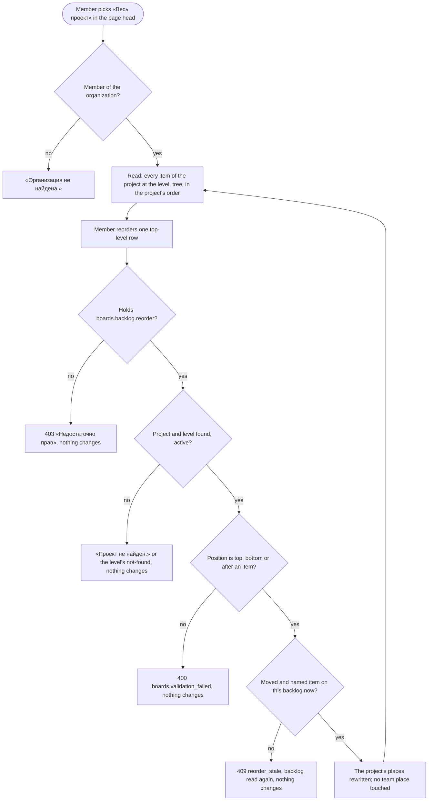

# Spec: Project backlog and board (feat-039)

## Context and goal

Today a backlog and a board exist only per team (mod-006): each holds the items whose area the team owns, so the work of one project is spread over its teams' pages and nobody sees it whole. doc-012 (`docs/features/doc-012-matrix-organization-model/`) starts its delivery with this line: a backlog and a board per level over every item of the project, whatever its owning team or none, in an order of the project's own (BR-MX-17, BR-MX-18; doc-012 US-7, project part). Confirmed in the tree: the boards slice has the team routes and pages only; no project view exists.
The line is additive. It adds the project's views, their order and an interim way in; it changes no team view, address, read, order or code. A clause that needs a later line (the owning team, «Без команды», scoped grants, visibility) is owed by that line (§ Owed by) and is re-run when it merges. Ids: BR-MX-n are doc-012's, BR-M4-n mod-006's, BR-T-n feat-027's, BR-PB-n new here.

## Roles

Access is derived from the organization membership (ADR-0027), as today (mod-016 api-contract § 0.2); this line registers no permission code and no error code (ADR-0029, delivery lines).

| Role | Reads the project's backlog and board | Reorders the project's backlog | Moves a card, ticks a checklist row | Adds a child, sets or clears a parent |
|---|---|---|---|---|
| «Администратор» | yes | yes (`boards.backlog.reorder`) | yes (`workitems.workitem.write`) | yes (a child: `workitems.workitem.write` and `workitems.link.write`; a parent: `workitems.link.write`) |
| «Участник» | yes | yes | yes | yes |
| «Читатель» | yes (`workitems.workitem.read`) | no: 403 | no: 403 | no: 403 |
| Not a member of the organization, an instance administrator included | no: «Организация не найдена.» | no | no | no |

The panel draws for each role what the team pages draw for it today (mod-016 design § 6.2): a reader's backlog rows have no «+», no «Ещё действия» and no grip and none drags; a reader's cards have no «Ещё действия» and none drags; a reader's checklist checkboxes and «Добавить задачу» are disabled.

Area, project and team grants and project visibility (BR-MX-21..-23) are owed by `mod-019-scoped-access` and `feat-041-project-visibility`; until they merge every project is visible to every member and the organization role alone decides. Belonging to a team grants nothing.

## Stories

| id | Title | depends-on | File |
|----|-------|------------|------|
| US-1 | A member reads a project's backlog, per level, over every item of the project | - | `stories/US-1-project-backlog.md` |
| US-2 | A member reorders the project's backlog | US-1 | `stories/US-2-reorder-project-backlog.md` |
| US-3 | A member reads a project's board, per level, and moves a card | US-1 | `stories/US-3-project-board.md` |

All three are `shippable: no`: the line is one MR (doc-012 § Decomposition), and splitting it would ship a page nobody can order or a board with no way in.

## Business process (BPMN)

The reorder is the one branching flow; the answer order is today's (mod-016 api-contract § 0.1), which `feat-041-project-visibility` changes (BR-MX-24).

## Business rules

New rules of this line:

| # | Rule | Source |
|---|------|--------|
| BR-PB-1 | **The views.** Every active project has, for each mod-006 level («Эпики», «Фичи», «Истории»), one backlog and one board of its own, at `/organizations/:o/projects/:p/backlogs/:level` and `/organizations/:o/projects/:p/boards/:level`, `:level` being `epics`, `features` or `stories`. Any other segment is «Страница не найдена»; a level the organization's process lacks answers `boards.level.not_found`. Nobody creates or removes them. The «Задачи» level has none (`feat-023-tasks-backlog`) | doc-012 § Decomposition; BR-MX-17; mod-006 BR-M4-1 |
| BR-PB-2 | **What a project view holds.** For project P and level L: the items of P whose type belongs to L (mod-001 BR-M2-4) and whose state is outside the Removed category — whatever team's backlog they stand on, and, once the owning team exists, whatever their owning team or none. No team, area or sprint narrows it. An item is on one project's views only. An item never changes project (BR-MX-9) or type, and so level (mod-003 BR-M3-1): it leaves its project's view of a level only by entering the Removed category | BR-MX-17; mod-006 BR-M4-23; mod-003 BR-M3-1 |
| BR-PB-3 | **The tree.** The backlog is feat-027's tree over every child in the project (OQ-5): an item whose live parent is of the same level stands beneath that parent only, every other item is a top-level row, «Порядок» numbers the top-level rows 1..n, and children stand by level, then in the project's order of that level; tasks, which have no order before `feat-023-tasks-backlog`, by number (BR-T-6). Columns, first expanded state, row actions (add child, drop onto a row, «Ещё действия») and the title that opens the item's card over the page (feat-029) are the team backlog's, unchanged | doc-012 fate table (BR-T-4, -5 "on project views, over every child"); feat-027 BR-T-1..-15; feat-029 US-1 |
| BR-PB-4 | **The project's order.** One order per project and level, kept apart from every team's: reordering one changes none of the other. Placed and unplaced items, where items land, what a reorder says, the stale refusal and arrival-order serialization are mod-006 BR-M4-24..-26 with the project's backlog in place of the team's, except that an item's project place is neither lost when it gets a team place nor touched when it changes team. Unplaced items follow the placed ones by creation time, then identifier number (one project, one key). The board's columns list cards in this order. Team views keep their number tie-break until `feat-040-team-surfaces-across-projects` | BR-MX-18; ADR-0028 rule 9 |
| BR-PB-5 | **Codes.** Reads declare `workitems.workitem.read`, a reorder `boards.backlog.reorder` — «Администратор» and «Участник» hold it, «Читатель» does not — a card move `workitems.workitem.write`, a child's creation and a parent write `workitems.link.write` as today. `mod-019-scoped-access` replaces the reorder's check with `boards.projectbacklog.reorder` | ADR-0029 (feat-039 registers no code); mod-006 BR-M4-27 |
| BR-PB-6 | **No create command.** Neither project view offers «Новый рабочий элемент» or the board's «Новый элемент»: a creation from a project view starts with the project default team (BR-MX-10, BR-MX-11), which `mod-017-work-item-owning-team` brings. A row's own add-child and a card's «Добавить задачу» (feat-032 BR-C-9) stay: each names its parent and takes the parent's team. A card's checklist — its counters, lists and ticks — is the team board's (feat-032 BR-C-1..-12) | BR-MX-10; OQ-2; feat-032 |
| BR-PB-7 | **The interim entry.** The page head's team drop-down on «Бэклоги» and «Канбан» gains the entry «Весь проект», which opens the project's backlog or board at the same level. On a project page the `h1` is the project's name, «Весь проект» is the selected entry (`aria-current="page"`), the other entries are the project's teams and each opens that team's page at the same level. Until the project's name is known the `h1` reads the page's name, as the team's does. The menu keeps its name «Команды проекта»; where in it the entry stands is the design's, but the teams' order, the selected team and the keyboard path among them do not change. The entry adds no nesting the project-scoped team menu does not already have; BR-MX-27's "no menu puts a team under a project" is met when `feat-040-team-surfaces-across-projects` and `feat-043-area-project-team-navigation` retire that menu. What the shell does on a project page is BR-PB-9 | doc-012 § Decomposition; OQ-1, OQ-3 |
| BR-PB-8 | **Additive.** The team backlogs and boards — reads, rules, addresses, orders, codes — and the shell's treatment of every team address (the current entry, the switcher, mod-006 US-1's switch rule) stay as mod-006, mod-015 and feat-027 leave them, with one exception: a team board whose re-read fails keeps its columns, their cards and open checklists, with the error above them, which is what feat-032's merged design asks of it (`feat-032-board-card-checklists/design.md` § 7.1) and the old code missed; the team's board and the project's share one body, so the project's board does the same. Tests that list the drop-down's entries gain the new one, and mod-016's route inventory (count and list) gains the three routes. The navigation tests gain cases for the project addresses (BR-PB-9): the entries' current-page marker, the switch target, the switcher's choice at each level. An existing case changes only if it expects a project view's address (`…/projects/:p/backlogs/:level`, `…/boards/:level`) to match no entry; none does today. No other existing test changes | doc-012 § Decomposition; feat-032 design § 7.1 |
| BR-PB-9 | **The shell on a project page.** A project page is a project-level page (mod-015 BR-18) and the page of the navigation entry it shares its name with. (a) **Current entry:** «Бэклоги» is current (`aria-current="page"`, no page trail) on the project's backlog at each of the three levels, «Канбан» on its board, and the other entry is not; an entry keeps its landing, so pressing it opens the switcher's team's «Истории» page, as on every page. (b) **The switcher's team level** is what it is on any project-level page: the team last chosen in this project (after «Весь проект» from MARS's page it still names MARS), else the switcher's default team for the project. It never names «Весь проект»: the `h1` and the head's selected entry say what the page shows. (c) **A choice in the switcher:** another project opens the same page — backlog or board — of that project at the same level; another organization opens it for its first project at the same level, «Главная» when it has none; another team moves nothing, as mod-015 BR-18 says of a level below the address's: the page stays and the switcher and both entries' landings take the team. The project and organization moves are an exception to BR-18's "landing page of the same entry", so that a switch does not leave the whole-project view; team pages keep BR-18 and mod-006 US-1 (the entry kept, the level back to «Истории»). While the project's teams are unread or failed to read, or (once `feat-028-org-level-teams` merges) it has none, the switcher holds no team: the team-scoped entries are hidden as on any page, none is current, and the page works. All of it is interim: `feat-040-team-surfaces-across-projects` and `feat-043-area-project-team-navigation` replace the switcher and its switch rule (doc-012 fate table, BR-MX-28) | mod-015 BR-13, BR-18; OQ-6 |

Rules relied on, restated:

| Rule | What it says here | Applies |
|---|---|---|
| BR-MX-1 | The project is read under the organization of the address; a project of another organization answers like one that names nothing | now |
| BR-MX-9 | A card move or a reorder changes neither the item's project nor its owning team | now (the team half has nothing to change before `mod-017-work-item-owning-team`) |
| BR-MX-16 | An item exists once; every view shows it at most once; a change of state shows in every view | now |
| BR-MX-17 | Views per level hold every state outside Removed; a project's views hold every item of the project whatever its team or none; every view then leaves out items the user may not see | now; «or none» owed by `mod-017-work-item-owning-team`; the rest by `feat-041-project-visibility` |
| BR-MX-18 | A project's order is its own; unplaced items sort by creation time, then project key and number; a card move writes only the item's state in its own project | now; the key tie-break across projects owed by `feat-040-team-surfaces-across-projects` |
| BR-MX-19 | The columns are those the organization's process gives the level; a move offers only the states of the card's own type; no status is rewritten | now (one process per organization, doc-012 OQ-2) |
| BR-MX-21, -22, -23 | A project the user may not see does not exist for them; scoped codes decide reorder and move | owed by `feat-041-project-visibility`, `mod-019-scoped-access` |
| BR-MX-24 | A project's not-found comes before the 403 | owed by `feat-041-project-visibility`; today 401, organization 404, 403, project and level 404, 400, 409 |
| BR-M4-2 (as bug-004 D-3 reads it), -3, -15, -18 | Columns derived from the process; a move writes only the state; a column lists cards in its view's order; no drop target for an unmapped type | now, on project views as on team views |
| BR-M4-6, -8, -24, -25, -26 | Unplaced items land last; reorder by pointer and by keyboard; places given by a reorder; arrival-order serialization; a stale reorder is refused | now, as BR-PB-4 reads them |
| BR-M4-28 | No live push: a page is read again when it opens, after each write of its user and when the tab regains focus | now |
| feat-027 BR-T-7, -13..-15 | First state expanded within 2 000 drawn rows; any point of a top-level row drags; one write at a time | now |
| feat-032 BR-C-1..-12 | A card's checklist holds its item's live task, bug and test-case children whatever their team; a tick writes only the child's state; «Добавить задачу» creates a task under the card's item; one write at a time on the board | now, on the project board as on the team board |
| feat-029 US-1, BR-C-21 | A row's or a card's title opens the item's card over the page (`?workitem=`); a save there makes the page read again | now |
| mod-015 BR-13, BR-18; mod-006 US-1 (switch rule) | The levels below what the address carries show the current selection and do not move the page; choosing at a carried level opens the landing of the same entry, else «Главная»; a team page keeps the entry, not the level | now, unchanged on team pages; on project pages as BR-PB-9 reads it |

## Operation completeness

| Entity | Create | Read | Update | Delete/deactivate | Cancel/reverse |
|--------|--------|------|--------|-------------------|----------------|
| Project backlog / board (project, level) | no: exists for every active project and level (BR-PB-1) | «Администратор», «Участник», «Читатель» (US-1, US-3) | no: board settings are doc-011's | no direct action: it answers «Проект не найден.» while the project is deactivated and is back on restore | restore the project (organization administrator, mod-002) |
| Board column | no: derived from the process (BR-MX-19) | as the board | no: doc-011 | no: doc-011 | n/a |
| Place in the project's order | system, by a reorder (BR-PB-4) | as the backlog | «Администратор», «Участник»: reorder (US-2); project «Изменение» once `mod-019-scoped-access` merges | system: dropped by a reorder after the item left the backlog; kept when the project is deactivated | another reorder; no undo |
| Work item: state by card move or checklist tick | no | — | «Администратор», «Участник» (US-3) | — | another move, tick or the form |
| Work item: creation from a project view | no: owed by `mod-017-work-item-owning-team` (BR-PB-6); a row's add-child is feat-027's and a card's «Добавить задачу» feat-032's | — | — | — | — |

## Non-functional requirements

- **Volumes and speed:** a project board of one level with up to 5 000 items is served within 2 s, as in mod-006 and doc-012's volumes; with up to 5 000 items on each of the project's four levels, every one linked under an item of the level above, the backlog read of «Эпики» and of «Истории», tree included, is served within 2 s (feat-027 NFR); a reorder or a card move within 1 s. The read is of the whole level, with no paging, because a reorder is made against the whole level. Above 5 000 items at a level the read stays whole and has no time budget, doc-012's accepted risk.
- **Client load:** one request returns the items of one view. The backlog draws as feat-027 BR-T-7 states; the board draws its cards as the team board does today. doc-012's bound of at most 2 000 rows or cards at a time for large views is owed by `feat-040-team-surfaces-across-projects` (US-7, large views); this line does not found it (OQ-4).
- **Query shape:** reading a project view takes a number of statements that does not grow with the items, parents, teams or tree depth; a statement-count test pins it for the backlog and for the board (brief §§ 14, 17).
- **Concurrency:** reorders of one project backlog and level apply one at a time in arrival order (BR-M4-25); a reorder of a team's backlog and one of the project's do not fail each other (ADR-0028 rule 9).
- **Tenant isolation:** each new route declares an organization code, so the inventory test of mod-016 passes, and an id of another organization answers like one that names nothing (BR-MX-1).
- **Accessibility:** every move has a keyboard path and is announced (BR-M4-8, feat-027 BR-T-13, -14); at 640 CSS px the table and the board scroll inside their containers.
- **Audit:** none; a reorder is never a history event (mod-006 NFR).
- **Regression:** `scripts/verify.sh` stays green; the team drop-down's entry lists in tests gain «Весь проект», and the navigation tests gain the project-address cases (BR-PB-8, BR-PB-9). E2E: the standing answer is NO (paused 2026-10-12); the E2E specs that open the drop-down (`26-backlog-tree-editing.spec.ts`) look up entries by name and are not affected.
- **Language:** all interface copy is Russian; the reference tracker is never named.

## Out of scope

- Creating an item from a project view, and its team choice (BR-PB-6): `mod-017-work-item-owning-team`.
- Filters, search and sorting of the views, the project and team filters among them: `feat-013-board-backlog-filter`, `mod-017-work-item-owning-team` (US-11).
- The «Задачи» level (`feat-023-tasks-backlog`); reordering inside a board column (`feat-024-board-in-column-reorder`); touch drag (`feat-025-boards-touch-drag`).
- The owning team on rows and cards, «Без команды», the default team: `mod-017-work-item-owning-team`. Team views across projects: `feat-040-team-surfaces-across-projects`. Area views: `feat-042-area-board-and-overview`.
- Sprints, their column and filter on the project board: `mod-007-iterations`.
- A navigation entry, a project page with sections, breadcrumbs and the switcher's project level: `feat-043-area-project-team-navigation`.
- Board settings, swimlanes, WIP limits, several boards per level (doc-011); per-project processes (doc-012 OQ-2); live push.
- Any change to a team view or a team's order, to the Keycloak realm, or to a permission or error code.

## Owed by

| Clause (doc-012 US-7 unless noted) | Owed by |
|---|---|
| An item with no owning team is on the project's views; «Проект» and «Команда» on rows and cards; the project views' team filter | `mod-017-work-item-owning-team` |
| A creation from a project view starts with the project default team | `mod-017-work-item-owning-team` |
| The independent-orders and change-of-team scenarios re-run with owned items | `mod-017-work-item-owning-team` |
| Unplaced items of several projects sort by project key and number; large views draw at most 2 000 rows or cards | `feat-040-team-surfaces-across-projects` |
| The entry on team pages leaves with the project-nested team addresses (OQ-3) | `feat-040-team-surfaces-across-projects` |
| A project the user may not see answers «Проект не найден.»; the answer order of BR-MX-24 | `feat-041-project-visibility` |
| `boards.projectbacklog.reorder`; project «Изменение» orders the backlog and moves cards; team «Планирование» does not | `mod-019-scoped-access` |
| Items in the Removed category leave the views | `mod-005-work-item-delete-restore` |
| Dragging a card inside a column reorders the project's backlog | `feat-024-board-in-column-reorder` |
| A way in from the navigation; the interim entry and BR-PB-9's shell clauses retire | `feat-043-area-project-team-navigation` |
| A project with no team at the switcher (BR-PB-9): every project keeps its first team before | `feat-028-org-level-teams` |

## Decomposition for the backlog

| id | Task | size | deps |
|----|------|------|------|
| `feat-039-project-board` (this task, queue line 1 of doc-012) | The project's backlog and board reads per level, the project's own order with its reorder, and the two pages with the head's entry and the shell's treatment of their addresses (US-1..US-3; BR-PB-9: a current-entry rule and one branch in the switch rule, no request). Backend, then frontend, one QA pass, one review round | M | mod-006 |

No new queue line: every owed clause has its line in doc-012 § Decomposition. `feat-023-tasks-backlog` and `feat-024-board-in-column-reorder` already carry `feat-039-project-board` in their deps (`docs/backlog.md`). For the orchestrator: the status log of `feat-040-team-surfaces-across-projects` should note OQ-3 (where the project views are reached from) and OQ-4 (the 2 000 bound now covers the project views too), and the logs of `feat-040-team-surfaces-across-projects` and `feat-043-area-project-team-navigation` should note OQ-6 (BR-PB-9 adds shell behaviour on the project addresses to the switcher and address model they replace).

## Open questions

All six are decided under the night delegation; they stay open for the human's morning look.

- [x] **OQ-1 The entry and the project page's head.** (A, recommended) The entry reads «Весь проект»; on the project's pages the `h1` is the project's name and the entry is selected. It is accurate when items have no team, and it keeps one tab and the team head's shape. (B) «Все команды проекта»: wrong for the items with no team, and it reads as a team. decided: A (recommended) under the night delegation; kept by the human on 2026-10-17.
- [x] **OQ-2 Creating from a project view.** (A, recommended) None in this line (BR-PB-6); the empty backlog reads «Бэклог пуст» with the hint «В проекте нет рабочих элементов этого уровня.» and no action, and the empty board keeps its hint without an action. (B) Offer «Новый рабочий элемент» now: with no team context it would give the item the project's root area and so the first team, which doc-012 retires (ADR-0028 rule 2), and `mod-017-work-item-owning-team` would have to undo it. decided: A (recommended) under the night delegation; kept by the human on 2026-10-17.
- [x] **OQ-3 Reaching the project views after `feat-040-team-surfaces-across-projects`.** That line moves team pages out of the project's address and the switcher holds a project or a team, never both (BR-MX-28), so the entry on team pages goes with it and, until `feat-043-area-project-team-navigation`, the project views are reached only from the project pages themselves and by address. (A, recommended) This line ships the entry as the task says; feat-040's analysis names where the project views are reached from until feat-043 (a link in the project's settings navigation is the candidate), and a note goes into feat-040's status.md. (B) This line also adds a second entry point now, outside the team drop-down, which the doc-012 line does not name. decided: A (recommended) under the night delegation; kept by the human on 2026-10-17.
- [x] **OQ-4 The 2 000 bound on a large board.** doc-012's NFR says views draw at most 2 000 rows or cards at a time but gives the board no way to reach the rest. (A, recommended) This line keeps today's drawing (the backlog's BR-T-7 first state; the board draws its cards as the team board) and leaves the bound to `feat-040-team-surfaces-across-projects`, where US-7's large-views scenario puts it. (B) Bound the project board's cards now, with a per-column "show more", a design this M has not got and one that would differ from the team board until feat-040. decided: A (recommended) under the night delegation; kept by the human on 2026-10-17.
- [x] **OQ-5 Row actions on the project backlog.** (A, recommended) The rows work as the team backlog's do (BR-PB-3): add a child from the row's «+», drop a row onto another, «Ещё действия». Their writes name a parent or a state and need no team context, and one page serves both views. (B) The project backlog is read and reorder only, with the tree read-only: the project views would then edit less than the team's, and the page would need switches that hide what it already has. decided: A (recommended) under the night delegation; kept by the human on 2026-10-17.
- [x] **OQ-6 The shell on a project page (BR-PB-9).** The project views are project-level pages of the existing «Бэклоги» and «Канбан» entries, and the switcher still holds an organization, a project and a team. (A, recommended) The entry is current; the switcher's team level is left as it is; another project or organization opens the same project view at the same level; another team moves nothing, as mod-015 BR-18 says of a level below the address's. It adds no navigation entry and leaves the whole-project view only when the user asks. (B) Choosing another team also opens that team's page at the same level, as the head's drop-down does: what review round 1 (R-1) recommended; it amends BR-18 for these two pages, and the switcher's team level then has two meanings (move on a project page, stay on every other project-level page). (C) BR-18 to the letter: a project or organization choice opens the new context's landing of the entry, the new project's default team's «Истории» page, so every switch leaves the whole-project view and loses the level, and it needs that team, which a project address does not carry. decided: A (recommended) under the night delegation; kept by the human on 2026-10-17.
