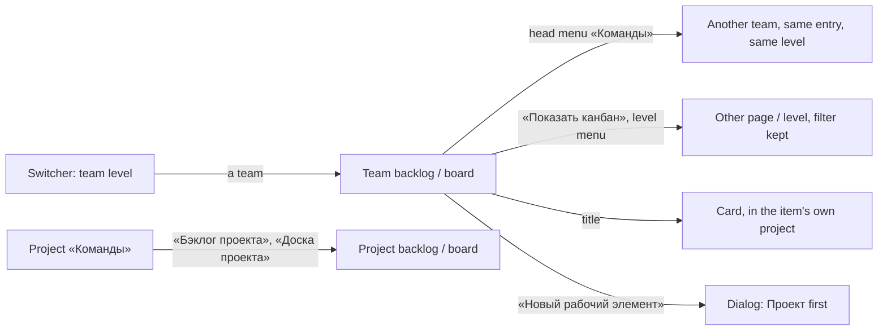

# Design: Team surfaces across projects (feat-040)

Stage 3 artifact. The rules (BR-TS-n) and the scenarios (US-1..US-7) are in `spec.md` and `stories/`; this file is the layout, the MUI components, every state and every Russian string of what changes, and nowhere else. The pages are feat-027's and feat-039's, so what they already draw is named, not redrawn. Every string in «» is final; ◆ marks a string the spec does not quote or a story only proposed.

- Base: [feat-039](../feat-039-project-board/design.md) (head § 3, states § 7), [mod-017](../mod-017-work-item-owning-team/design.md) (card band § 3, dialog § 4, filter row § 6.2-§ 6.3), [feat-027](../feat-027-backlog-tree-editing/design.md) (table § 4, drop § 4.9), mod-015's frame and notices, mod-016's state order (design § 2.1), [ui-kit.md](../../conventions/ui-kit.md), ADR-0024, ADR-0028 § 7.
- Prototype (an L): `prototype/index.html`: a team's backlog and board, the head's menu, the filter, the creation dialog, the card band, the switcher; the role and the team are switchable.
- Examples use the spec's cast: «Ромашка», projects Alpha (ALP), Beta (BET), Gamma (GAM), teams MARS, VENUS, JUPITER; level «Истории».
- **No new kit part, icon, colour, dependency, permission or error code; one table token** (`layout.backlogTable.projectColumn`, § 5.1). Every control below is a kit part that exists.

## 1. Screen map

| Surface | Address (below `/organizations/:o`) | Stories | Change |
|---|---|---|---|
| Team «Бэклоги» / «Канбан» | `/teams/:t/backlogs\|boards/:level` | US-1..US-5 | new address; head menu of the organization's teams; filter row «Проект»; «Проект» on rows and cards; create with a project (§ 3-§ 6) |
| Project «Бэклоги» / «Канбан» | `/projects/:p/backlogs\|boards/:level` | US-1, US-6 | head without a team menu; «Проект» on rows and cards (§ 3, § 5) |
| «Новый рабочий элемент», on a team view | over the page | US-5 | «Проект» first (§ 6) |
| The card, dialog or page | `?workitem=` over a view; `/projects/:p/workitems/:id` | US-1, US-4 | «Проект» in the band; read in its own project (§ 7) |
| The switcher | the top bar | US-6 | the team level lists the organization's teams (§ 8) |
| Project «Команды» | `/projects/:p/settings/teams` | US-6 | the two project-view links always (§ 9) |
| The retired team addresses | `/projects/:p/teams/:t/…` | US-1 | `NotFound` «Страница не найдена» (§ 10, state 5) |



## 2. What differs

Everything not here is the existing page's, unchanged (BR-TS-3, -5).

| Part | Team page before | Team page now | Project page |
|---|---|---|---|
| Address | under a project | `/teams/:t/…`, no project | unchanged |
| `h1` | the team | the team | the project; **no drop-down button** |
| Head drop-down | the project's teams + «Весь проект» | the organization's teams, T selected (§ 3) | none |
| Filter row | none | «Проект» (§ 4) | «Команда», as mod-017 (mod-020 moves it to the address) |
| Rows, cards | «Команда» | + «Проект» (§ 5) | + «Проект» |
| Create | the page's project | «Проект» first (§ 6) | as mod-017 |

## 3. The head

### 3.1 Layout and components

The head is `TeamHead`'s (`PageHeader variant="team"`), feat-039 § 3.1-§ 3.2 unchanged: leading icon, `h1`, the chevron button, the tab «Бэклог» / «Канбан», `LevelMenu`, the grey command to the other page, and on «Бэклоги» the primary «Новый рабочий элемент». Under it, on a team page, the filter row (§ 4).

```
[bars] MARS ⌄                         [+ Новый рабочий элемент]  [(→) Показать канбан]
Бэклог                                                                   Истории ⌄
━━━━━━
Проект [ Beta, Alpha ⌄ ]   ⊘ Очистить фильтры                    <- § 4, 20 px below the tab row
+--------------------------------------------------------------------------------+
```

### 3.2 The drop-down «Сменить команду» (BR-TS-11)

- The chevron button as today (`aria-label` and tooltip «Сменить команду»); its menu's `aria-label` is now **«Команды»**.
- **Entries:** the switcher's team level, in its order (§ 8: the user's own teams first, each group by name), no headings, no divider, **no «Весь проект»**. T is `selected`, `aria-current="page"`. Each entry is a `MenuItem` link to the **same entry and level** of that team, carrying nothing of the filter (`TEAM_CHOSEN_STATE` as today).
- **Keyboard** (mod-015 § 12.4, as today): Enter, Space or ArrowDown on the button opens the menu on T; arrows, Home, End move; typing a letter jumps to the next name; Enter chooses; Escape closes with focus back on the button. Choosing the selected team moves nothing. The target page's button takes focus on arrival (feat-027 F-9).
- **Size:** up to 200 teams; the menu scrolls inside its window height. No search (D-3).
- **Shown** when the organization's teams are read (T is among them). While they load or failed, no button; the page works.

### 3.3 Project page

`h1` is the project's name (feat-039 § 3.3); **no drop-down button**, so no menu puts a team under a project (BR-TS-11). The tab, `LevelMenu` and the grey command are the project's addresses, as today. D-7 is about telling the two apart.

### 3.4 States of the head

Complete at once but the drop-down button (waits for the teams) and the primary command (waits for the read). A read error keeps the head; a not-found frame replaces the page. Permissions: § 10.

## 4. The filter row on a team's views (BR-TS-8)

### 4.1 Layout and control

A `Stack role="group"` named «Фильтры» (mod-017 § 6.2's row, one component now taking the dimension): `ProjectFilter` and, while the address carries a value, `ActionButton tone="subtle"` «Очистить фильтры» (`FilterListOffIcon`).

- `ProjectFilter` is `InlineMultiSelectField<string>`, `frame="always"`, label «Проект» above its box, `spacing(30)` wide (`maxWidth: 100%`), `emptyText` «Все проекты». Options: **T's linked active projects by name**, from the page's read, no counts. Ticking keeps the list open; Escape closes it with focus back on the field; focus stays on the field after every choice. A choice sets the address at once (by replace, other parameters such as `?workitem=` kept).
- **The address** carries the chosen ids in the shared filter specification's form (OQ-2 A): a repeated `projectId`, as mod-020's repeated `teamId`; the contract and the plan fix the name. **Kept** by the level menu, the tab and «Показать канбан» / «Показать бэклог» (BR-TS-8). **Dropped** by the head menu, the switcher, and the main navigation's «Бэклоги» and «Канбан».

### 4.2 States

| State | The user sees |
|---|---|
| First read pending | the row at once: the field works, its list says «Загрузка…»; the skeleton below |
| First read failed | the row stays; its list says «Не удалось загрузить проекты. Попробуйте ещё раз.» ◆, opening it again reads the page again; `ErrorBanner` below |
| T linked to no active project, no value | no row (nothing to filter by); the empty state of § 10 |
| The address carries values | «Очистить фильтры» shown. Known ids: their names joined by «, ». **None known** (unknown, malformed, foreign, unlinked, deactivated): the field reads «Фильтр задан» ◆ in place of «Все проекты», naming no project and no reason, and the view is the filtered-empty frame. Known beside unknown: the known ones' items |
| T linked to no project, with a value | the row is drawn (the filter is on): «Фильтр задан», its list «Нет проектов» ◆, «Очистить фильтры»; the filtered-empty frame |
| A change being read | the previous rows stay, `aria-busy="true"`, no skeleton (mod-017 D-7) |
| That read failed | `ErrorBanner` «Повторить» replaces the rows, which no longer match |
| A chosen project deactivated or unlinked meanwhile | at the next read it is no option; its id stays in the address and selects nothing; restored, it selects again (US-2) |

### 4.3 What the filter does on a view

mod-017 § 6.3 holds: the tree is built over matching items, «Порядок» numbers the visible top-level rows, a reorder announces its position among the visible rows and is sent against the full list; board columns and their counters («Новая, рабочих элементов: 1») follow it; a card's checklist is not narrowed. **Filtered-empty:** `StateFrame` `FilterListOffIcon` (the board: `ViewWeekOutlinedIcon`), «Ничего не найдено», «Ни один рабочий элемент не подходит под заданные условия фильтра.», action «Сбросить фильтр» (it and «Очистить фильтры» do the same); the row stays above it.

## 5. Rows and cards

### 5.1 Backlog row

Column **«Проект» after «Команда»** (D-1): `BacklogCell` with the name in a clipped span and `title`; every item has a project, so there is no «без проекта» state. Width token `layout.backlogTable.projectColumn` = 120 px, pinned in `theme.test.tsx`; the table's least width grows from 1 180 to 1 300 px and scrolls in its card as before. Headers: «Иерархия», «Порядок», «Тип», «Заголовок», «Статус», «Команда», **«Проект»**, «Трудоёмкость», «Бизнес-ценность», «Вид ценности»; `backlogSkeletonColumns()` follows (ten, the first blank). Team **and** project views draw it (BR-TS-3).

### 5.2 Board card

The card's third row (assignee, priority) gains the project at its right end: `Typography variant="caption"`, `text.secondary`, `TruncatedText`, at most half the row, preceded by `VisuallyHidden` «Проект: »; the team stays at the right end of the state row above it, so the two stand one under the other. The card does not grow (D-1).

### 5.3 A row dropped onto a row of another project (BR-TS-5)

The existing drop states stand (feat-027 § 4.6): over a row of the same project the allowed frame; over a refused row the dashed `error.main` frame. A **third refusal reason, `project`**: the target's project is not the dragged row's. It is judged first, as the server cannot find another project's parent at all (`workitems.link.parent_not_found`, before the type check). Releasing sends nothing; the error notice (`useNotice`, bottom left, 6 s) reads «Родителем может быть только рабочий элемент того же проекта.» ◆, in the words of the type refusal. Keyboard: «Изменить родителя…» offers parents of the **row's own project** only (its `ParentPicker` takes that project, never the page's).

### 5.4 The row's «+» and the card's «Добавить задачу»

Unchanged and without a dialog: the child lands in the parent's project with its next number and the parent's team; notice «Рабочий элемент BET-TASK-12 создан.»

## 6. «Новый рабочий элемент» on a team view (BR-TS-9)

### 6.1 Offered

To the holder of `workitems.workitem.write` when T has a linked active project: the primary command on «Бэклоги» (the type picker first when the level has several types), «Новый элемент» in the board's first column. T with none, or «Читатель»: no command, in the head, the first column or the empty frame.

### 6.2 Layout

```
Новый рабочий элемент                                                  ✕
Рабочий элемент будет создан в статусе «Новая» в области «Beta». Остальные поля заполняются в его форме.
Проект *   [ Beta                         ⌄ ]      InlinePickerField, label above, frame always
Тип        [ 📘 Пользовательская история  ⌄ ]      unchanged
Команда    [ MARS                         ⌄ ]      TeamField over the chosen project's teams
Встанет в конец бэклога команды «MARS».            caption, aria-describedby
Заголовок *[                                 ]     unchanged
                                         Отмена  [Создать]
```

- `FormDialog` as in mod-017 § 4. «Проект» is **first**, a kit `InlinePickerField` (a search, like «Команда» beneath it), `required`, placeholder «Найти проект» ◆, options T's linked active projects by name, **read afresh at every opening** (feat-028 § 2.2). The area line follows the project: with none chosen it reads «Рабочий элемент будет создан в статусе «Новая». Остальные поля заполняются в его форме.» ◆; the chosen project's root area tree is read when it is chosen (today's skeleton line / `InlineNotice` «Повторить», neither blocks «Создать»).
- **«Проект» starts** chosen when the filter names exactly one valid project, else when T has exactly one, else none; decided once, when the read ends, and never re-set while open.
- **«Команда»** starts as T and offers «Без команды» and the chosen project's linked teams (read afresh when the project is chosen). **Until a project is chosen it is read-only and holds T** (D-4), and the caption reads «Встанет в конец бэклога команды «MARS». Другую команду можно выбрать после выбора проекта.» ◆. Choosing a project the shown team is not linked to **sets it back to T** (D-5): a polite announcement (`LiveRegion`) and, in place of the caption until the next pick, «Команда «VENUS» не участвует в проекте «Beta». Выбрана «MARS».» ◆. The caption otherwise follows the team (mod-017 § 4's two lines).
- **Focus** on opening: «Проект» when none is chosen, else «Заголовок». A refusal puts focus on the field named.

### 6.3 Fields and validation

| Field | Required | Check | Error |
|---|---|---|---|
| «Проект» | yes | one of the offered; on «Создать», nothing is sent | «Выберите проект» ◆ under it |
| «Команда» | a value («Без команды» is one) | none in the browser | the server's, below |
| «Заголовок» | yes | mod-003's `titleError` | today's |

Both «Проект» and «Заголовок» refused: both errors show and focus takes «Проект».

### 6.4 States

| State | The user sees |
|---|---|
| Projects being read | `FieldsSkeleton count={1}` in «Проект»' place, «Создать» unavailable; «Заголовок» takes typing |
| Projects failed | `InlineNotice` error with the server's text and «Повторить»; «Создать» unavailable |
| Chosen project's teams being read / failed | «Команда» is `busy` / its list says «Не удалось загрузить команды. Попробуйте ещё раз.» (mod-017) |
| Submitting | all fields disabled, «Создать» busy; one `requestId` per submission |
| 404 project | «Проект не найден.» under «Проект»; the value kept; the dialog open; the projects read again, so it is no longer offered |
| 409 not linked / 404 team | «Команда не участвует в проекте.» / «Команда не найдена.» under «Команда»; the dialog open; its options read again; the next pick clears it |
| Created | the dialog closes; the notice below; the view reads again; focus to where it was |
| 403 | the error notice «Недостаточно прав»; the codes are read again (mod-016 § 2.3) |

**After a creation** (extends mod-017 D-5): «Рабочий элемент BET-US-42 создан.»; when the item's team is not T (another team or none) it adds «Он не принадлежит этой команде.» ◆; else when the project filter hides it, «Он не подходит под текущий фильтр.»

## 7. The card (BR-TS-3, -4)

«Проект» joins the band (D-2): **block A, row 2, under «Статус»**, a read-only `InlineTextField` (`labelPlacement="start"`, label «Проект», the name as text; no picker: an item does not move between projects). The band keeps its 76 px, and the unqueued «Причина» place is the only thing this row takes. «Область» and «Команда» are the item's project's, as today. Below 720 px of card width the blocks stack: «Статус», «Проект», «Область», «Команда». For «Читатель» the same.

The dialog opens by `?workitem=<identifier>` over a team view **in the item's own project**: the row's, or, opened by address, the organization's active project whose key the identifier carries. An identifier that resolves to no readable item (unknown or malformed, a deactivated project's, another organization's key) shows feat-029's not-found frame («Рабочий элемент не найден», «Проверьте адрес или закройте окно.», «Закрыть»), naming nothing; «Закрыть» leaves the page with no `?workitem=`. Project views read in the page's project, as today.

## 8. The switcher's team level (BR-TS-10)

```
Ромашка ⌄ / Alpha ⌄ / VENUS ⌄        menu «Команды»:  ✓ VENUS      (Max's own, first)
                                                         JUPITER
                                                         MARS
```

The levels and the menu's `ListSubheader` «Команды» are today's; changed is what the team level holds: **the organization's active teams the user may see, the user's own first, each group by name, no group headings, no divider**, whatever project is chosen. 200 teams scroll inside the menu; arrows, Home, End and a typed letter reach them; no search.

| State | The switcher shows |
|---|---|
| Teams read | `Ромашка / Alpha / VENUS`; the team level is drawn **also when the organization has no project**: `Ромашка / Нет проектов / VENUS` |
| The organization has no team | the team level reads «Нет команд», whatever its projects; «Бэклоги» and «Канбан» are hidden |
| Teams being read | one skeleton in the team level's place; the team-scoped entries are hidden; the other levels work |
| Teams failed | «Не удалось загрузить команды» with «Повторить» (today's `FailedLevel`); the entries hidden |
| A gone team | today's notice «Ранее выбранный контекст недоступен. Выбрано: …» (mod-002 § 3.6), unchanged |

A project choice moves nothing on a team page; a team choice on a project page moves nothing (BR-TS-10). Not drawn: a mark for a fallback team.

## 9. The project's «Команды» (BR-TS-12)

`PageHeader` commands **«Бэклог проекта»** (`FormatListNumberedIcon`) and **«Доска проекта»** (`ViewWeekOutlinedIcon`) are drawn **always**, ahead of «Команда по умолчанию», for every role, from the first paint (they need no read), as links to the project's «Истории» backlog and board. They overflow into «Ещё действия» on a narrow bar. A `NotFound` frame takes the whole page, them with it. The rest of the page is feat-028 § 7's.

## 10. States, every team page

The order is mod-016's and feat-039 § 7's:

| # | State | The user sees |
|---|---|---|
| 1-2 | The organization's codes are read / failed | `OrganizationPage`'s title and `RegistrySkeleton` «Загрузка данных» / `ErrorBanner` «Не удалось загрузить права доступа», «Повторить» |
| 3 | Not a member (an instance administrator with no membership included) | full-page `NotFound` «Организация не найдена» |
| 4 | The read code is missing | `AccessDenied` «Доступ ограничен» (not reachable today) |
| 5 | `:level` is not `epics`, `features`, `stories`; **any project-nested team address**, whether or not it exists | full-page `NotFound level="page"` «Страница не найдена», checked before any read, naming nothing of the team or the project; no redirect |
| 6 | The first read is pending | the head, the filter row and `RegistrySkeleton` (ten headers) / `BoardSkeleton`, `role="status"` «Загрузка данных» |
| 7 | The team is deleted, unknown, malformed or another organization's | full-page `NotFound` «Команда не найдена», the four alike. There is no project frame on a team address |
| 8 | The read failed | the head and `ErrorBanner` with «Повторить» in place of the rows; `boards.level.not_found` («Уровень бэклога не найден.») is this state |
| 9 | A re-read failed with the table or board shown | it **stays** (rows, expansion, selection, scroll) with the `ErrorBanner` above |
| 10 | Nothing to show | below |
| 11 | The content | §§ 5, 6; no row is withheld and no banner speaks of size (feat-039 § 7; the 2 000 bound is OQ-3 A's own line) |

**State 10, by cause** (`StateFrame`): **(a) T works on no project**, JUPITER or every project deactivated, **the same for every role, one frame, saying nothing of why:** `InboxOutlinedIcon`, «Бэклог пуст» / `ViewWeekOutlinedIcon`, «Канбан пуст», hint «Команда не участвует ни в одном проекте.» ◆, no action, no filter row, no create command. **(b) T owns nothing at the level:** today's frames, hint and «Новый рабочий элемент» for a writer. **(c) The filter matches nothing:** § 4.3.

**A refused write** shows the team pages' notices by `errorCode`, unchanged; **403** shows «Недостаточно прав» at once and the codes are read again.

| Part | «Администратор», «Участник» | «Читатель» | Not a member |
|---|---|---|---|
| Head, filter, rows, cards, «Проект» | all | the same | state 3 |
| Primary command, first-column «Новый элемент», dialog | when T has a project | none | - |
| Row grip, drag, «+», «Ещё действия»; card menu and drag; checklist ticks | all | none; ticks disabled | - |
| Direct write | allowed by code | 403 | - |

## 11. Narrow widths (down to 640 CSS px, ADR-0024)

- **Head:** as feat-039 § 8 (icon, `h1`, chevron at the left, the grey command at the right, moved into «Ещё действия» when the row is full); a long name breaks anywhere.
- **Filter row:** wraps; the field takes the full row below 640 px of content, «Очистить фильтры» under it. The menu «Команды» is no wider than the window.
- **Table:** 1 300 px, scrolls inside its card with the header sticky; the page never scrolls sideways. **Board:** 280 px columns scroll inside their `section`.
- **Dialog:** full width less margins; fields and captions wrap.

## 12. Accessible names

Only what is new or changed.

| Control | Role | Name |
|---|---|---|
| the head's menu | menu | «Команды» (was «Команды проекта») |
| its entries | menuitem | the team's name; T `aria-current="page"` |
| project filter | combobox, multiselectable listbox | «Проект»; options `option` with `aria-selected` |
| filter row | group | «Фильтры» |
| clear | button | «Очистить фильтры» |
| the row's project | cell | under the header «Проект» |
| the card's project | text | «Проект: Beta» (hidden prefix) |
| the dialog's field | combobox | «Проект», required; error by `aria-describedby` |
| the band's field | text | «Проект» |
| «Команда» reset | status | «Команда «VENUS» не участвует в проекте «Beta». Выбрана «MARS».» |
| project links | links | «Бэклог проекта», «Доска проекта» |

## 13. Interface texts

All final; ◆ new. The rest is existing and listed so the developer copies.

| Where | Text |
|---|---|
| head's menu | «Сменить команду» (button), «Команды» ◆ (menu) |
| filter | «Проект», «Все проекты» ◆, «Фильтр задан» ◆, «Нет проектов» ◆, «Загрузка…», «Не удалось загрузить проекты. Попробуйте ещё раз.» ◆, «Очистить фильтры», «Фильтры» |
| filtered-empty | «Ничего не найдено», «Ни один рабочий элемент не подходит под заданные условия фильтра.», «Сбросить фильтр» |
| works on no project | «Бэклог пуст» / «Канбан пуст», «Команда не участвует ни в одном проекте.» ◆ |
| row, card, band | «Проект» (header, band label), «Проект: » (hidden prefix) |
| refused drop | «Родителем может быть только рабочий элемент того же проекта.» ◆ |
| dialog | «Новый рабочий элемент», «Проект», «Найти проект» ◆, «Выберите проект» ◆, «Создать», «Отмена»; area line without a project ◆ (§ 6.2) |
| «Команда» in the dialog | «Встанет в конец бэклога команды «MARS». Другую команду можно выбрать после выбора проекта.» ◆; «Команда «VENUS» не участвует в проекте «Beta». Выбрана «MARS».» ◆ |
| server refusals | «Проект не найден.», «Команда не участвует в проекте.», «Команда не найдена.», «Недостаточно прав» |
| notices | «Рабочий элемент BET-US-42 создан.», «… Он не принадлежит этой команде.» ◆, «… Он не подходит под текущий фильтр.» |
| frames | «Страница не найдена», «Организация не найдена», «Команда не найдена» (heading, no stop), «Уровень бэклога не найден.», «Рабочий элемент не найден» |
| switcher | «Нет команд», «Нет проектов», «Не удалось загрузить команды» |

## 14. For the developer and the tests

- **Needs from the contract (backend stage).** Both team-view reads at `/organizations/:o/teams/:t/…` answer `team {id, name}`, `projects` (T's linked active projects `{id, name}` by name: the filter, the empty state (a) and the create command read it) and, on every row, child and card, `project {id, name}`. The filter is the repeated query parameter of § 4.1. The project views carry `project` on items too.
- **Keys.** The shell's projects carry no `key` (`WorkContextProject`); the plan names where `?workitem=BET-US-3` finds Beta (an unknown key shows the not-found frame without a request).
- **Reuse.** `ProjectFilterRow` becomes one `FilterRow` over a dimension; `TeamHead` loses `WHOLE_PROJECT_LABEL`, takes the organization's teams from `useWorkContext()` and draws no button on a project page; `ScopedBacklog` and `ScopedBoard` keep the filter in the address, not in `useState`; `createdNotice` gains the team reason; `dropVerdict` gains `project`. `CreateWorkItemDialog` takes an optional project list (a team view) in place of `projectId`; the plan decides whether a changed «Проект» keeps the submission's `requestId` (mod-003 BR-M3-26). `placeRefusal` maps a project answer to a field, not a frame, on a team view.
- **Kit guard.** No new site: `ProjectFilter` is `InlineMultiSelectField`, the dialog's field `InlinePickerField`, the band's `InlineTextField`. Do not add an allow-list entry. The head keeps its allow-listed raw `Menu`.
- **Hooks for tests.** `data-identifier`, `data-column` and the rest are unchanged. The filter is `getByRole('combobox', { name: 'Проект' })` and the dialog's field is the same role: scope by `within(dialog)`. A frame is asserted by its heading without the stop.

## 15. Decisions for the human (gate-2; none is taken)

Each goes into the package as one question; the design stands on A.

- [x] **D-1 Where «Проект» stands on a row and a card.** (A, recommended) A backlog column after «Команда» and the right end of the card's assignee row: the card does not grow (a board of thousands), team above project in both, no existing column moves. (B) A column before «Команда» (the spec names the project first) and a caption row of its own on the card: the card grows by a line, every board column with it. Answered A by the human at gate-2, 2026-10-18.
- [x] **D-2 «Проект» on the card.** (A, recommended) Block A row 2, read-only, under «Статус»: the band keeps 76 px and stays right when mod-018 retires «Область». (B) Block B row 1 above «Область»: next to its siblings, but the band grows to three rows. (C) In the header's identifier line: out of the band, but a part the kit's `CardHeaderBar` lacks. Answered A by the human at gate-2, 2026-10-18.
- [x] **D-3 Which long lists have a search** (up to 200). (A, recommended) The dialog's «Проект» searches (`InlinePickerField`, like «Команда»); the filter and the menus are lists reached by arrows, Home, End and a typed letter. (B) No search anywhere: one pattern, a long scroll in the dialog. (C) The filter searches too (`InlineMultiPickerField`): a tag box in a row of one-line fields. Answered A by the human at gate-2, 2026-10-18.
- [x] **D-4 «Команда» in the dialog before a project is chosen.** (A, recommended) Drawn, read-only, holding T, with the caption saying why: a stable layout. (B) Hidden until the project is chosen: a shorter dialog that jumps. (C) Enabled with T and «Без команды»: the user cannot see why VENUS is missing. Answered A by the human at gate-2, 2026-10-18.
- [x] **D-5 A team set back by a project change.** (A, recommended) A polite announcement and a visible line in the caption's place until the next pick. (B) Silent: the field just reads «MARS»; a sighted user may not see that «VENUS» was dropped. Answered A by the human at gate-2, 2026-10-18.
- [x] **D-6 A created item the view will not show.** (A, recommended) The notice names the reason (this team, or the filter) as in § 6.4. (B) Today's plain notice: the item seems to vanish. Answered A by the human at gate-2, 2026-10-18.
- [x] **D-7 Telling a project page from a team page.** The drop-down button is now the only difference in the head, and a name may be equal. (A, recommended) Nothing more: the rows and the address carry it, as feat-039 D-3 chose. (B) A quiet label «Проект» / «Команда» (`body2`, `text.secondary`) before the `h1`: clearer, a fifth head element every test must tell from the filter's label. Answered A by the human at gate-2, 2026-10-18.

**Note (not a question).** The spec keeps the filter across «Показать канбан» on a team's views (BR-TS-8), while mod-020 starts the project views unfiltered there. The difference is the spec's; this design draws what it fixes.

## 16. Stories to screens

US-1: §§ 2, 3, 5, 10. US-2: § 4. US-3: §§ 4.3, 10 (order and races are the backend's). US-4: §§ 5.3, 5.4, 7. US-5: § 6. US-6: §§ 3, 8, 9. US-7: § 10 (roles, frames); the rest is the backend's.
