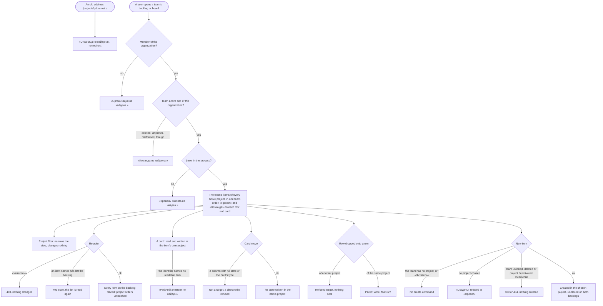

# Spec: Team backlogs and boards across projects (feat-040)

## Context and goal

Since feat-028 a team is the organization's and may work on several projects, but its backlog and board are still read at one project's address and hold only that project's items (feat-028 BR-OL-11), and the switcher's team level lists only the chosen project's teams. A team that plans across its projects cannot see its work in one place. doc-012 (`docs/features/doc-012-matrix-organization-model/`, gate-1 approved 2026-10-17) and ADR-0028 make a team view hold the items the team owns in every project, at an address that names the team alone (BR-MX-17, BR-MX-27; US-7).
This line, the fourth of doc-012's, moves the team views to `/organizations/:o/teams/:t/…`, puts «Проект» on every row and card, opens a card in its own project, adds a project filter, settles the order of items of several projects in one team order (BR-MX-18), lets a team view create an item in a project chosen first, and gives the switcher an interim team level over the organization's teams (doc-013 OQ-3 A). It is breaking (doc-012 § Decomposition, Breaks cell): the project-nested team addresses answer «Страница не найдена». It takes over tech-011 m2 and m3 and feat-028's card-dialog re-check. BR-MX-n, US-n without a prefix and P-n are doc-012's; BR-TS-n are this spec's.

## Roles

Access is derived from the organization membership (ADR-0027, ADR-0029): belonging to a team grants nothing on its views, and only orders the switcher (BR-TS-10). This line registers no permission code; until `mod-019-scoped-access` every code is checked against the organization role alone.

| Role | Reads team views, filters them, opens a card | Reorders a team's backlog | Moves a card, creates from a team view, adds a child, writes in the card |
|---|---|---|---|
| «Администратор» | yes (`workitems.workitem.read`) | yes (`boards.backlog.reorder`) | yes (`workitems.workitem.write`; `workitems.link.write` for a parent) |
| «Участник» | yes | yes | yes |
| «Читатель» | yes | no: 403 «Недостаточно прав», and the drag is not offered | no: 403, and the commands are not offered |
| Not a member of the organization (an instance administrator included) | «Организация не найдена.» | - | - |

Visibility is `feat-041-project-visibility`'s: until it merges every project is «Организация», so every member sees every team and every item of an active project.

## Stories

| id | Title | depends-on | File |
|----|-------|------------|------|
| US-1 | A team's views hold its items of every project, at the team's address | - | `stories/US-1-team-views-across-projects.md` |
| US-2 | A project filter on a team's views | US-1 | `stories/US-2-project-filter.md` |
| US-3 | One team order across projects | US-1 | `stories/US-3-one-team-order.md` |
| US-4 | An item on a team view is read and written in its own project | US-1 | `stories/US-4-item-in-its-own-project.md` |
| US-5 | Creating from a team view, the project chosen first | US-1, US-2 | `stories/US-5-create-from-team-view.md` |
| US-6 | The switcher's interim team level and the page heads | US-1 | `stories/US-6-switcher-and-heads.md` |
| US-7 | Tenant containment, access and volumes | US-1, US-3, US-4, US-5 | `stories/US-7-containment-access-volumes.md` |

Every story is `shippable: no`: the line is one L and one MR, and splitting a breaking change does not make it additive (doc-012 § Decomposition). Common cast: organization «Ромашка» with active projects Alpha (ALP), Beta (BET), Gamma (GAM) and Delta (DLT); teams MARS (linked to Alpha, Beta, Gamma), VENUS (Alpha only) and JUPITER (no project); Delta has no linked team, and no project names a default team; Ann «Администратор», member of no team; Max «Участник», member of VENUS; Vera «Читатель»; organization «Другая» with project Zeta (ZET) and team Orion. The level is «Истории» unless a scenario says otherwise. New interface copy is proposed in the stories and fixed by the design; the criteria hold whatever its wording.

## Business process (BPMN)

## Business rules

| # | Rule | Source |
|---|------|--------|
| BR-TS-1 | **Addresses.** A team's views are at `/organizations/:o/teams/:t/backlogs/:level` and `/organizations/:o/teams/:t/boards/:level`, `:level` being `epics`, `features` or `stories`; any other segment is «Страница не найдена»; a level the organization's process lacks answers `boards.level.not_found`. The address names the organization, the team and the level, and no project. The API addresses a team under the organization alone; its contract is the backend stage's. The panel's `…/projects/:p/teams/:t/backlogs/:level` and `…/boards/:level` answer «Страница не найдена», whether or not `:p` and `:t` exist, with no redirect; the API's project-nested team-view routes are not served and have no alias. | ADR-0028 § 7; BR-MX-27 |
| BR-TS-2 | **What a team view holds.** For team T and level L: the items T owns whose type belongs to L (mod-001 BR-M2-4) and whose state is outside the Removed category, in every active project of the organization; a team owns items only in its linked projects (feat-028 BR-OL-6, -8). No area, sprint or switcher project narrows it. Beneath a row stand only T's own children (mod-017 BR-OT-5). A deactivated project's items leave T's views and come back when it is restored, with their places (ADR-0028 rule 9). A team that owns nothing, JUPITER included, shows empty views; a deleted, unknown, malformed or other-organization team answers «Команда не найдена.», alike. Project views keep feat-039 BR-PB-2. | BR-MX-17; US-7 |
| BR-TS-3 | **«Проект» and «Команда» everywhere.** Every row of every team and project backlog and every card of every board shows «Проект», the item's project name, and «Команда» (mod-017 BR-OT-7): one row and card shape on both kinds of view, as US-7 reads. The card dialog shows «Проект» too. Where they stand is the design's. | US-7; mod-017 BR-OT-7, OQ-3 A |
| BR-TS-4 | **A card in its own project.** On a team view a card opens over the page by `?workitem=<identifier>` and is read and written in the item's own project: the row's, or, opened by address, the organization's project whose key the identifier carries (keys are unique in an organization, mod-002 BR-M1-1). An identifier that names no item the user may read (an unknown or malformed one, a deactivated project's, another organization's key) shows the dialog's not-found frame, alike. An item not on the view opens too. Project views keep reading in the page's project, which is every row's: that is feat-028's re-check, settled. | ADR-0028 § 7; feat-029 |
| BR-TS-5 | **Moves and row actions stay in the item's project.** A card move writes the item's state in its own project. The columns are the organization's process for the level, the read changes no state, and only a column that maps a state of the card's type is a target (BR-MX-19, ADR-0028 § 11, mod-006 BR-M4-18). The row's «+» and the card's «Добавить задачу» create in the parent's project, with its team (mod-017 BR-OT-3). Dropping a row onto a row of another project is a refused target (feat-027 BR-T-12): the hover marks it, the release sends nothing and the notice says why; a direct parent write naming another project's parent answers `workitems.link.parent_not_found`. «Изменить родителя…» offers parents of the item's own project. | BR-MX-9, -19; feat-027; feat-032 |
| BR-TS-6 | **One team order.** T has one order per level across its projects; every project order stays apart and is never touched by T's (BR-MX-18, feat-039 BR-PB-4). Placed items come first by position. Unplaced items, and placed items of equal position, sort by creation time, then project key by character code, then identifier number as a number. Equal positions come from feat-028's per-project reorders (its OQ-3 A) and from a deactivated project's kept places. A board's column lists its cards, and a row its children of one level (feat-027 BR-T-6), in this order. | BR-MX-18; feat-028 OQ-3 A |
| BR-TS-7 | **Reorder.** A reorder of T's backlog is mod-006's (BR-M4-24..-26) over the whole list across projects. It writes a place for every item on the backlog then, of every project, and leaves a deactivated project's items' places as they are. Naming an item not on the backlog (another team's, a deactivated project's, a Removed one, another organization's) answers `boards.backlog.reorder_stale`, changes nothing and discloses nothing. A filtered backlog reorders against the full list (BR-TS-8). The project orders are untouched. Races: mod-017 BR-OT-13 (3) holds across projects. A reorder against an unlink of one of T's projects (feat-028 BR-OL-8), against T's deletion or against a save that changes an item's team ends in one order, with no server error and no place left for a team that does not own its item. A read that meets T's deletion answers «Команда не найдена.» or the view before it, never a server error (tech-011 m2). | BR-MX-18; ADR-0028 rules 8, 9 |
| BR-TS-8 | **Project filter.** One «Проект» filter on T's backlog and board, the shared filter specification's second dimension, with mod-017 BR-OT-8's meaning. Any chosen value matches. The options are T's linked active projects by name, with no counts. A value that names no such project (unknown, malformed, another organization's, unlinked or deactivated) selects nothing, alike. It narrows the view and nothing else: the tree is built over matching items, a checklist is not narrowed, totals follow it, a reorder runs against the full list, and no item, team or place changes. It lives in the page's address (OQ-2 A), so a link and a reload carry it and a level change keeps it; another team's view starts without it. Project views get no project filter; feat-013 adds the other dimensions and the per-view memory. | BR-MX-16, -17; US-7; mod-017 BR-OT-8 |
| BR-TS-9 | **Creating from a team view.** «Новый рабочий элемент» (backlog) and «Новый элемент» (board) are offered to holders of `workitems.workitem.write` when T has a linked active project. The dialog gains «Проект», first, offering T's linked active projects by name. It is preselected when the filter names exactly one project or T has exactly one; otherwise none is chosen and «Создать» is refused at the field. «Команда» starts as T and offers the chosen project's linked teams and «Без команды»; choosing a project the shown team is not linked to sets it back to T. The item is created in the chosen project with its next number, owned by the team shown or none, and unplaced on both backlogs. At the save, a deactivated project answers «Проект не найден.», a shown team since unlinked «Команда не участвует в проекте.» and a deleted one «Команда не найдена.»; nothing is created, and the dialog keeps its values. | BR-MX-9, -10, -12; US-7; mod-017 BR-OT-3 |
| BR-TS-10 | **The switcher's interim team level.** Until `feat-043-area-project-team-navigation`, the switcher keeps its three levels. Its team level lists the organization's active teams the user may see, the user's own first, each group by name, with no headings, whatever project is chosen. A project change keeps the team. A team address sets the organization and the team; the project level shows its current selection, and choosing a project there moves nothing (ADR-0024 § 2). On a team page, another team opens the same entry's landing for it (mod-015 BR-18, mod-006 US-1) and another organization follows BR-18; on a project page feat-039 BR-PB-9 (c) holds. Remembering is mod-002 BR-M1-24's, with no per-kind memory and no vanish notice. With no team chosen, or a remembered one gone, the level's first entry stands, generalizing mod-016 BR-M1-27. Whichever of this line and `mod-020` merges second makes the fallback mod-020's on this level: the chosen project's default team (BR-MX-11), else the level's first entry. «Бэклоги» and «Канбан» need the organization and a team, and land on the team's «Истории» page. | doc-013 OQ-3 A, BR-NE-9; ADR-0028 § 7; BR-MX-28 |
| BR-TS-11 | **Page heads.** On T's pages the `h1` is T's name, and its drop-down lists the switcher's team level with T selected; each entry opens that team's page at the same level (feat-027 BR-T-16's behaviour). «Весь проект» retires (feat-039 BR-PB-7). A project page's head is the project's name with no team menu, so no menu puts a team under a project. | BR-MX-27, -28 |
| BR-TS-12 | **The way into project views (OQ-1 A).** The project's «Команды» (`…/projects/:p/settings/teams`) always offers «Бэклог проекта» and «Доска проекта», whatever teams are linked, extending feat-028 OQ-2 A; feat-043 retires it. The project pages keep their addresses and BR-PB-9's shell rules. | feat-039 OQ-3; feat-028 BR-OL-10 |
| BR-TS-13 | **Codes and answers.** No new permission code, error code or text. Reads declare `workitems.workitem.read`; a reorder `boards.backlog.reorder`; a card move and a creation `workitems.workitem.write`, plus `workitems.link.write` for a parent (feat-039 BR-PB-5). The answer order is mod-016 § 0.1's: 401; «Организация не найдена.» for a non-member; 403; «Команда не найдена.»; `boards.level.not_found`; 400; 409. On every team-view route a team, project or item id of another organization answers as an id that names nothing does (tech-011 m3). `feat-041-project-visibility` moves this to BR-MX-24, and `mod-019-scoped-access` rescopes the codes. | ADR-0027 rule 4; ADR-0029 |
| BR-TS-14 | **Data.** Nothing is dropped or remapped. The team places and orders feat-028 left (one order per team and level) are read as they are; equal positions sort by BR-TS-6 until a reorder rewrites them. An index, if needed, is the backend plan's (ADR-0028 rule 13). | doc-012 § Existing data |

## Existing rules: keep, replace or retire

Tests are retired by name, citing the rule (P-1); "rewritten" keeps the name and intent over the new model; the plans name the rest.

| Existing rule | Fate | Tests it takes with it |
|---|---|---|
| feat-028 BR-OL-11 (team views at a project's address, holding that project's items; a reorder writes only that view's places) | replaced → BR-TS-1, -2, -7 | Retired: `TeamAcrossProjectsEndpointTests.Reorder_InOneProject_LeavesTheOthersPlacesAndProjectOrdersAlone`. Rewritten at the team's address: `GetBacklogEndpointTests`, `GetBoardEndpointTests`, `ReorderBacklogEndpointTests` (their `…_ContextNotFound_AnswersItsLevelsCode` lose the project level, and the foreign-team case becomes a team of «Другая»); kept: `Reorder_TeamDeletedWhileWaiting_Returns404TeamNotFound` |
| mod-006 BR-M4-24's number tie-break, kept for team views by feat-039 BR-PB-4's last sentence; feat-027 BR-T-6 "unplaced by number" | replaced → BR-TS-6 | Rewritten: `GetBacklogEndpointTests.Get_NeverReordered_ListsByNumber` (creation time, key, number) |
| feat-027 BR-T-16 (the drop-down lists the project's teams); feat-039 BR-PB-7 («Весь проект») | replaced → BR-TS-11 | Retired: `ProjectBacklogPage.test.tsx` «on the project’s page the menu lists the teams…», «from a team’s page «Весь проект» closes…», «choosing the selected «Весь проект» moves nothing…», the two keyboard tests reaching «Весь проект» and «on «Канбан» «Весь проект» opens…»; `ProjectBoardPage.test.tsx` «lists the teams and «Весь проект», selected…»; `routes.projectBoards.test.tsx` «after «Весь проект» from «Платформа»’s page…». Rewritten: `BacklogPage.head.test.tsx` «the h1 reads «Мастаск»…» (the organization's teams, no «Весь проект»); kept at the team's address: «its team drop-down opens the same board of another team at the same level» |
| mod-016 BR-M1-27; mod-002 BR-M1-24 and the switcher's project-scoped team level; feat-039 BR-PB-9 (b), and (c) on team pages | replaced → BR-TS-10 | Rewritten: `useOrganizationsContextSource.teamLevel.test.tsx`, `.defaultTeam.test.tsx`, `resolveSelection.test.ts`, `ContextSwitcher.levels.test.tsx`, `switchTarget.test.ts` (the organization's teams; a project change keeps the team) |
| feat-028 BR-OL-10's way in (the views' links only while no team is linked) | extended → BR-TS-12 (OQ-1 A) | Rewritten: `TeamsPage.test.tsx` «shows neither view once a team is linked» (both views shown) |
| The project-nested panel routes and their navigation | retired → BR-TS-1 | Rewritten at the team's address: `routes.boards.test.tsx`, `ProjectViews.team.test.tsx`, `projectViews.test.ts`; added: the old address answers «Страница не найдена» |
| mod-017 BR-OT-7's "«Проект» waits"; feat-027 BR-T-1 (the column list); feat-032's card | extended → BR-TS-3 | Rewritten: the row, column and card shape tests gain «Проект» |
| mod-017 BR-OT-3 from a team view | extended → BR-TS-9 | Rewritten: the creation-dialog tests of the team pages («Проект» first) |
| mod-016 inventory rows 35-37 | replaced → BR-TS-1, -13 | Rewritten: the `OrganizationAddressedRoutes` rows (three out, three in, the count unchanged) |
| feat-039 BR-PB-1..-6, BR-PB-9 (a) and (c) on project pages; mod-017 BR-OT-5, -6, -8, -13; mod-006 BR-M4-18, -26; feat-028 BR-OL-1..-10, -12..-14 | kept | Project views, their team filter and their order are unchanged; BR-OT-13's races extend across projects (BR-TS-7) |

## Error codes

No new code or text (`docs/error-codes.md`). Used here: `organizations.organization.not_found`, `.project.not_found`, `.team.not_found` (404); `organizations.access.forbidden` (403); `organizations.team.not_in_project` (409); `boards.level.not_found` (404); `boards.backlog.reorder_stale` (409); `boards.backlog.position_invalid`, `boards.validation_failed` (400); `workitems.workitem.not_found`, `workitems.link.parent_not_found` (404); `workitems.workitem.state_not_allowed` (409).

## Operation completeness

| Entity | Create | Read | Update | Delete/deactivate | Cancel/reverse |
|--------|--------|------|--------|-------------------|----------------|
| A team's backlog and board | no: one per team and level, nobody creates them (as feat-039 BR-PB-1) | every member (US-1) | no: their contents change through items | no: they end with the team (feat-028 BR-OL-9); a deactivated project's items leave them (BR-TS-2) | no: nothing to reverse |
| The team's order across projects | the first reorder, «Администратор», «Участник» (US-3) | every member | reorder, the same roles; «Читатель» 403 | no: a place ends with the ownership (mod-017 BR-OT-6) or the team | reorder again; no undo (mod-006) |
| The project filter | every member, choosing values (US-2) | the page's address (OQ-2 A) | change the values | clear them | back in the browser's history |
| An item created from a team view | «Администратор», «Участник» (US-5) | every member | in its card, as today | as today (mod-003), unchanged here | «Отмена» sends nothing |
| An item's state by a card move | the same roles (US-4) | every member | move again | no: a state is changed, not removed | move back |
| The switcher's team selection | choosing a team, or a team address (US-6) | the switcher | choosing another | no: a gone team falls back (BR-TS-10) | choose again |

## Non-functional requirements

- **Speed and volumes:** a team's backlog or board of 5 000 items over 50 linked projects answers within 2 s, filtered or not; a reorder of it within mod-006's 1 s (doc-012 NFR; US-7 large views).
- **Query shape:** each team-view read takes a number of statements that does not grow with rows, projects, filter values or depth; a statement-count test pins each (doc-012 NFR Query shape).
- **Concurrency:** BR-TS-7's races and BR-TS-9's save races each end in one order, with no server error.
- **Tenant isolation:** BR-TS-13, with a test per route (tech-011 m3); the route inventory lists the three team-addressed routes and not the project-nested ones.
- **Existing data:** BR-TS-14; no data dropped, nothing named in the MR beyond the retired addresses.
- **Client load:** the 2 000-row drawing bound is OQ-3's; with A it is its own line.
- **Accessibility:** the filter, «Проект» in the dialog and the head's menu work by keyboard and down to 640 CSS px (ADR-0024).
- **Regression:** `scripts/verify.sh` stays green with the tests above retired or rewritten by name. E2E: the standing answer is NO (paused 2026-10-12); the MR names the specs this line breaks. Interface copy is Russian; the reference tracker is never named.

## Out of scope

- Projects the user may not see leaving team views, the filter and «Проект» (`feat-041-project-visibility`); per-object codes and grants (`mod-019-scoped-access`).
- The final switcher, grouped by kind with per-kind memory and a vanish notice; the top-level «Команды», a team's overview and the project views' way in from the project's own page (`feat-043-area-project-team-navigation`); the switcher's fallback team as mod-020 builds it (`mod-020`, BR-TS-10).
- Sprints on team views (`mod-007-iterations`); other filter dimensions and filter memory (`feat-013-board-backlog-filter`); area views (`feat-042-area-board-and-overview`); a «Задачи» level (`feat-023-tasks-backlog`); in-column card order (`feat-024-board-in-column-reorder`).
- A project filter on project views; per-process columns across projects (one process per organization, ADR-0028 § 11); moving an item to another project.
- The 2 000-row drawing bound, if OQ-3 A (`feat-NNN-large-view-drawing-bound`).

## Decomposition for the backlog

| id | Task | size | deps |
|----|------|------|------|
| `feat-040-team-surfaces-across-projects` (this task, doc-012 line 4) | US-1..US-7; backend, then frontend, on the light route (status.md § Plan); nothing dropped | L: breaking, per its Breaks cell | feat-028-org-level-teams |
| `feat-NNN-large-view-drawing-bound` (only with OQ-3 A) | Team and project backlogs and boards draw at most 2 000 rows or cards at a time, with a way to reach the rest by mouse and keyboard; the first expanded state of feat-027 BR-T-7 kept (doc-012 NFR client load; US-7 large views; feat-039 OQ-4) | M | feat-040-team-surfaces-across-projects |

The spun-out line is per-story delivery: it is verifiable alone and leaves nothing unused. **Breaks (P-10), a note in each owner's status.md:** mod-006 api-contract §§ 2-3 and 7 (the team routes); mod-016 inventory rows 35-37; feat-027 BR-T-1 and BR-T-16 and feat-032's card (the row and card shapes); feat-039 BR-PB-4 (last sentence), BR-PB-7, BR-PB-9 (b); feat-028 BR-OL-10 and BR-OL-11; mod-017 BR-OT-7; mod-016 BR-M1-27; the switcher's three-level context model of ADR-0024 § 2, interim by ADR-0028 § 7; the project-nested team addresses. For the orchestrator: `status.md` moves to `02-requirements-review`.

## Owed by

| Clause | Owed by |
|---|---|
| A project the user may not see leaves a team's views, the filter and «Проект»; the answer order of BR-MX-24 | `feat-041-project-visibility` |
| A team-scope reorder and a move only where the user may change the item | `mod-019-scoped-access` |
| The switcher grouped by kind, its memory and vanish notice; the project views from the project's page; the interim team level and fallback retired | `feat-043-area-project-team-navigation` |
| The project default team as the switcher's fallback (whichever merges second) | `mod-020` |
| Drawing at most 2 000 rows or cards (OQ-3 A) | `feat-NNN-large-view-drawing-bound` |
| A team's sprints on its views | `mod-007-iterations` |

## Open questions

- [ ] **OQ-1 Where the project views are reached from once «Весь проект» leaves the team menu.** Team pages move off the project's address, so the head's «Весь проект» goes, and until feat-043 the project views need another way in (feat-039 OQ-3). (A, recommended) The project's «Команды» always offers «Бэклог проекта» and «Доска проекта», as it already does while no team is linked (feat-028 OQ-2 A): no new page and nothing new to retire. (B) Two entries in the project's settings navigation: always visible, but a new menu item feat-043 must retire. (C) «Бэклоги» and «Канбан» open the project's views when no team is chosen: no new control, but an entry then means two things. The analysis goes on with A.
- [ ] **OQ-2 Where the project filter lives.** (A, recommended) In the page's address, so a link and a reload carry it, as the human chose for the team filter (mod-017 OQ-9 B, built by mod-020); until mod-020 merges the two dimensions differ in that. (B) For the visit only, as mod-017 BR-OT-8 reads today: one lifetime for both now, and mod-020's change would then miss this dimension. The analysis goes on with A.
- [ ] **OQ-3 The 2 000 rows-or-cards drawing bound.** doc-012 and feat-039 OQ-4 put it here. (A, recommended) Spin it out into `feat-NNN-large-view-drawing-bound` (M), per the per-story delivery rule: it is verifiable alone and needs a design of its own (how the rest is reached); this line keeps the 2 s read. (B) Keep it here: one line fewer, a larger L and a design that grows. The analysis goes on with A.
