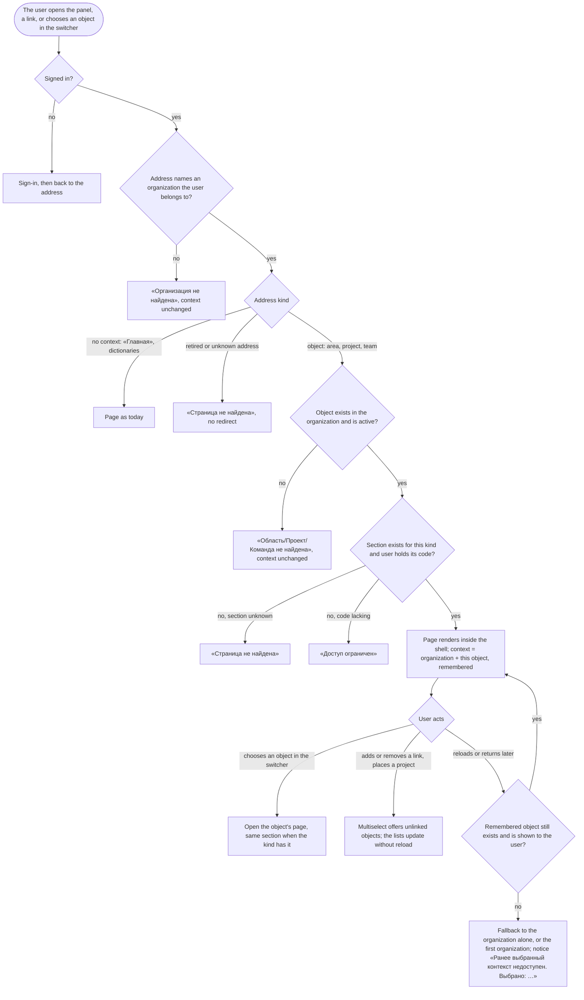

# Spec: Area, project and team navigation (feat-043)

## Context and goal

Today a user reaches a team, a project or an area through the organization's settings, the project's settings and a three-level switcher; the human called this «максимально неудобное» (doc-013, 2026-10-18). doc-012 (BR-MX-27, BR-MX-28, US-10) fixed the target: «Области», «Проекты» and «Команды» as top-level entries, each object on a page of its own with sections, breadcrumbs that invent no hierarchy, a switcher that opens objects, and a remembered context. doc-013 moved this line right after `mod-018-area-workspace` and folded feat-045 (the organization's home page) in; the lines after it (mod-019, feat-041, feat-042, mod-007) add their sections to these pages instead of interim entries.
This line also carries the amendment of `ADR-0031` (2026-10-28, typed single tree): an area page follows the tree «Департамент» → «Проект» (a project's place) → sub-areas, not doc-012's area–project links, which are not built (BR-AW-0, BR-AW-6). It is breaking for the panel (addresses retire, the context model changes) and additive for the API.
Rule ids: BR-MX-n are doc-012's, BR-NE-n doc-013's, BR-AW-n mod-018's, BR-OL-n feat-028's, BR-TS-n feat-040's, BR-WS-n feat-003's; BR-NV-n are this spec's. «The reference tracker» is never named.

## Roles

Unchanged from doc-012 § Roles: access is the organization role's bundle (ADR-0027) until `mod-019-scoped-access`; belonging to a team grants nothing. Sections and commands are shown by the codes served today (BR-NE-5), so until mod-019 only an organization «Администратор» sees «Настройки» of an object and the create, link and move commands; «Участник» and «Читатель» read. A page shows what the user may open (ADR-0024 § 1) and no more.

| Role | Opens every entry and object page | Creates, links, moves, deletes, deactivates | Sees «Настройки» of an object |
|---|---|---|---|
| «Администратор» | yes | yes (existing codes, none added) | yes |
| «Участник», «Читатель» | yes | no: the commands are absent | no: the section is absent |
| Not a member (an instance administrator included) | «Организация не найдена» | - | - |

## Stories

Every story is `shippable: no`: one L, one MR, and the address model is one breaking change (OQ-9 proposes a cut).

| id | Title | depends-on | File |
|----|-------|------------|------|
| US-1 | The main navigation and the address model | - | `stories/US-1-navigation-and-addresses.md` |
| US-2 | The organization's «Обзор» and the lists «Области», «Проекты», «Команды» | US-1 | `stories/US-2-overview-and-lists.md` |
| US-3 | An area's page: a department, a project's place, a sub-area | US-1, US-2 | `stories/US-3-area-page.md` |
| US-4 | A project's page and its settings | US-1, US-2 | `stories/US-4-project-page.md` |
| US-5 | A team's page | US-1, US-2 | `stories/US-5-team-page.md` |
| US-6 | Work items across projects, and in the project's section | US-1, US-4 | `stories/US-6-work-items-across-projects.md` |
| US-7 | Links and placements through a searchable multiselect | US-3, US-4, US-5 | `stories/US-7-links-by-multiselect.md` |
| US-8 | Breadcrumbs, the switcher and the remembered context | US-1..US-5 | `stories/US-8-trail-switcher-context.md` |
| US-9 | The interim pages retire; the taken-over debts close | US-1..US-8 | `stories/US-9-interim-retire-and-debts.md` |

## Business process (BPMN)

## Business rules

| # | Rule | Source |
|---|------|--------|
| BR-NV-1 | **Main navigation.** «Обзор», «Рабочие элементы», «Области», «Проекты», «Команды», «Участники», «Настройки», in this order, none waiting for an object chosen in the switcher. «Бэклоги» and «Канбан» are no longer entries: they are sections of an object's page. An entry the user may not open is absent, never disabled. | BR-MX-27; US-10; ADR-0024 § 1 |
| BR-NV-2 | **Addresses.** The organization's pages (including the lists `…/areas`, `…/projects`, `…/teams`) and one prefix per object kind: `/organizations/:o/areas/:areaId/…`, `…/projects/:projectId/…`, `…/teams/:teamId/…`, each with its sections. An address names the organization, one object and a section; no address nests a team under a project, a project under an area, or the other way round. A project's node is served by the area prefix (ADR-0031 rule 5); its page shows the project and links to it; there is no second address. | ADR-0028 rule 7; ADR-0031 rule 5; BR-MX-27 |
| BR-NV-3 | **Sections.** Each kind has an ordered list of sections; a section is added by the line that owns its content and is absent until then (not disabled, no placeholder). The sections this line builds and those it leaves are in the table below. A section is shown by the codes served today; a later line switches the source to per-object codes. | BR-NE-3, BR-NE-4; US-10 |
| BR-NV-4 | **The tree is real; nothing else nests.** The typed tree of ADR-0031 (a department at the top, a project's place below it or at the top, sub-areas below the project) is a hierarchy the model has, so «Области» and an area's trail show it. «Проекты» and «Команды» are flat lists by name; a project's trail is «Ромашка / Проекты / A» and shows no department; its placement is a path in its «Общие». A link (project–team, team–department) never appears in a trail or a menu as a parent. Outside the tree an area is named by its path from the top level (BR-AW-13). | BR-MX-27 as ADR-0031 amends it; OQ-1 |
| BR-NV-5 | **Organization settings hold what is the organization's.** The team and area pages of mod-018 and feat-028, the organization's project list and members page, and the project's settings pages of teams, areas and general move to «Области», «Проекты», «Команды», «Участники» and the objects' own pages; «Настройки» keeps the organization's own pages and the instance sections. | BR-MX-27; US-10 |
| BR-NV-6 | **Retired addresses.** Each address in the table "Retired addresses" below answers «Страница не найдена», whether or not the user may see the object, and redirects nowhere. A user who is not a member sees «Организация не найдена» first. | ADR-0024 § 4; ADR-0028 rule 7 |
| BR-NV-7 | **Not found by level.** The outermost missing level answers: «Организация не найдена», then «Область не найдена», «Проект не найден» or «Команда не найдена»; a deleted, deactivated or foreign object answers as one that does not exist, and the switcher's context does not change. A section the kind lacks answers «Страница не найдена»; a section whose code the user lacks, «Доступ ограничен». | BR-MX-24; ADR-0024 § 4 |
| BR-NV-8 | **Matching.** An address in another letter case, or with a percent-encoded character, is matched the way the router matches it, and shows the page with its navigation marker, settings menu and trail; ids in an address are compared the way the platform compares ids, not as raw strings. | bug-003; tech-009 F4 |
| BR-NV-9 | **Lists.** Every object appears once in its list whatever its links; rows by name; every row opens its object's page; at 1 000 areas, 200 projects and 200 teams each list is read within 2 s and the «Обзор» lists show only their first rows, as many as the design sets, with a link to the full list. | BR-MX-16, BR-MX-21 (volumes); doc-012 NFR |
| BR-NV-10 | **Context.** The switcher holds the organization and at most one area, project or team, lists objects as BR-MX-28 orders them, opens the chosen object's page, remembers the choice per user in the browser, and falls back with a notice when the remembered object is gone. The interim team level of feat-040 and mod-020's fallback team retire; BR-MX-11's "The default affects BR-MX-10 only" is restored. | BR-MX-28; BR-NE-9; ADR-0028 rule 7 |
| BR-NV-11 | **Links by multiselect.** A link or placement is added through a searchable multiselect that leaves out what is linked already; linked objects are rows that open their page; the unlink command is on the row for the user who may unlink. The lists on both ends update without a page reload. A project's place is its parent, so "add a project to a department" is a move of the project's node; there is no area–project link. | BR-MX-27; BR-AW-6; ADR-0031 rule 4 |
| BR-NV-12 | **Work items across projects.** The organization's «Рабочие элементы» is the project section's list over every project the user may see (now: every project, BR-NE-5), 50 to a page, each item once, with its project and owning team; the project section is the same list fixed to the project. Feat-003's filters (state with «Удалена», assignee with former members, keyword over «Заголовок» and the identifier) and mod-020's team filter in the address are on both; a deleted item is on neither unless «Удалена» is chosen. | BR-MX-9, -16, -21; BR-NE-8; BR-WS-1..-7; BR-DR-6 |
| BR-NV-13 | **A deactivated project** has no page (BR-NV-7); its node is shown in the tree marked «деактивирован» and opens nothing; an administrator restores it from «Проекты», «Деактивированные». | BR-AW-10; ADR-0026 |
| BR-NV-14 | **Commands move with their pages.** Creating a project (with its place), deactivating and restoring it, creating a team, creating a department, deleting a node or a team, setting the default team, and naming a project's description keep their rules, codes and confirmations and live on the page that owns the object. | BR-AW-9; BR-OL-*; mod-002 |
| BR-NV-15 | **No visibility yet.** Every project is visible to every member until `feat-041-project-visibility`; each read across projects takes the caller as a required argument so that feat-041 adds the set form inside it. | BR-NE-5; ADR-0029 §§ 7-8 |

**Sections.** Order is the order shown; *owed* sections are absent until the named line adds them.

| Page | Sections built here | Owed by a later line |
|---|---|---|
| Department | «Обзор», «Проекты», «Команды», «Настройки» (admin) | «Канбан», «Бэклог» (feat-042, before «Проекты»); «Участники» (mod-019); «Аналитика» (feat-044) |
| Project's node, sub-area | «Обзор», «Настройки» (admin) | «Канбан», «Бэклог» (feat-042) |
| Project | «Общие», «Рабочие элементы», «Канбан», «Бэклог», «Команды», «Настройки» (admin) | «Спринты» (mod-007); «Участники и доступ» (mod-019) |
| Team | «Обзор», «Канбан», «Бэклог», «Проекты», «Участники и доступ» (members only), «Настройки» (admin) | «Спринты» (mod-007); the grants in «Участники и доступ» (mod-019) |

**Retired addresses** (all answer «Страница не найдена»): `…/settings/teams[/:t]`, `…/settings/areas[/:a]`, `…/settings/projects[/deactivated]`, `…/settings/members`, `…/projects/:p/settings/general`, `…/projects/:p/settings/teams`, `…/projects/:p/settings/areas`, the entries «Бэклоги» and «Канбан» and their organization-level pages. (Project-nested team boards and backlogs are already retired by feat-040.)

## Operation completeness

| Entity | Create | Read | Update | Delete/deactivate | Cancel/reverse |
|--------|--------|------|--------|-------------------|----------------|
| Entry / section / page | no: code, not data | every member, by the codes (US-1) | no: a later line adds a section | no | no |
| Organization «Обзор» | no: derived | every member (US-2) | no: derived | no | no |
| Department | «Администратор», «Области» (US-2, BR-AW-3) | every member | «Администратор»: name, description, move (not: it stands at the top) (US-3) | «Администратор», with no child, confirmed (US-3, BR-AW-9) | no: hard delete, create again |
| Project's node, sub-area | project: with the project (US-4); sub-area: «Администратор» on the node's page (US-3) | every member | sub-area: rename, describe, move within the project; node: renamed with its project, described on its page | sub-area: only with no child and no item; node: only with its project (`root_is_fixed`) | no |
| Project's place | with the project's creation (US-4) | every member, as a path | «Администратор»: move from «Общие» or a department's «Проекты» (US-3, US-7) | moved to the top level | move back |
| Project | «Администратор», «Проекты» (BR-NV-14) | every member | «Администратор»: name, description, default team (US-4) | deactivate from «Проекты» | restore from «Деактивированные» |
| Project–team link | «Администратор», project's «Команды» or team's «Проекты» (US-7) | every member | no: nothing to edit | «Администратор», with the reassign choice (BR-MX-12) | link again |
| Team–department link | «Администратор», department's «Команды» or team's «Обзор» (US-7) | every member | no | «Администратор» | link again |
| Team | «Администратор», «Команды» | every member | «Администратор»: name, description | «Администратор», confirmed with counts (BR-MX-12) | no: no restore (feat-028) |
| Team membership | «Администратор», team's «Участники и доступ» | every member | no: remove and add again | «Администратор» | add again |
| Work item list | no: an item needs a project; created from the project's section or a team view | every member, by project (US-6) | no | no | filters cleared |
| Remembered context | the user's choice or an address | the user, in the browser | the next choice | cleared by the fallback | the fallback itself (US-8) |

## Non-functional requirements

- **Volumes:** 1 000 areas over 10 levels, 200 projects, 200 teams: each list and the switcher's offer within 2 s on the read behind it, typed text narrows the offer at those volumes; the cross-project «Рабочие элементы» page within 2 s at 5 000 items per project over 200 projects (doc-012 NFR). Statement counts do not grow with the number of objects; a statement-count test pins each new read.
- **No reload:** moving between sections and objects requests no new document; the top bar and the navigation stay in place; Back returns step by step (brief § 17).
- **Accessibility:** the navigation, switcher, multiselect and trail work by keyboard and down to 640 CSS px (ADR-0024 § 5).
- **Security:** every read stays inside the organization in the address (BR-MX-1); an id of another organization anywhere answers as one that names nothing.
- **Regression:** `scripts/verify.sh` green; E2E is paused (the standing NO), and the MR names the specs the address changes break.
- **Existing data:** none changes; this line stores nothing about objects, only the remembered context in the browser.

## Out of scope

- Grants, per-object codes, area «Участники», «Участники и доступ» grants (`mod-019-scoped-access`); project visibility and non-disclosure (`feat-041-project-visibility`); area boards, backlogs and overview figures (`feat-042-area-board-and-overview`); sprints (`mod-007-iterations`); analytics (`feat-044-area-analytics`); the filters of the board and backlog views and their memory (`feat-013`, US-11).
- A «Проект» filter on the cross-project list (OQ-4); creating a work item from the organization's list; releases, milestones, capacity (doc-012 § Out of scope).
- Any redirect from a retired address; a second address for a project node; an area–project link.
- Restyling the shell onto the UI kit (`tech-019-ui-kit-m4-shell`, OQ-5).

## Decomposition for the backlog

| id | Task | size | deps |
|----|------|------|------|
| `feat-NNN-area-project-team-navigation` | US-1..US-9 as one L, the task confirmed by the human (doc-013 OQ-6 A); additive API (the cross-project list, bounded reads), breaking panel addresses; takes over tech-009 F4, bug-003, mod-020 review CR-2/CR-3/CR-6; makes tech-011 m4 obsolete | L: breaking | feat-040, mod-018, mod-020 |

If the human prefers a cut (OQ-9): `feat-NNN-object-pages-and-lists` (US-2..US-5, US-7, additive: the new pages beside the old), `feat-NNN-work-items-across-projects` (US-6), `feat-NNN-navigation-shell-and-retire` (US-1, US-8, US-9: the flip). Order: pages first, flip last.
**Breaks (P-10), a note in each owner's status.md:** ADR-0024 § 2 (the three fixed prefixes and the three-level switcher); feat-040 BR-TS-10 and US-6 (the interim team level); mod-020 (the fallback team; BR-MX-11 restored); mod-015 BR-6, BR-11, BR-18; mod-018 BR-AW-12 (its interim pages); feat-028 BR-OL-10 (the project's «Бэклог проекта» and «Доска проекта» entries) and its interim team pages; feat-039's interim project views in the team drop-down; mod-002 BR-M1-23, -24. Queue lines the change touches: mod-019, feat-041, feat-042, mod-007 (their sections go on these pages: doc-013 already rewords them).

## Open questions

- [ ] **OQ-1 What «Области» lists, and what a project's row opens.** ADR-0031 makes the tree a real hierarchy, which doc-012 BR-MX-27 ("no list puts a project inside an area") predates.
  - (A, recommended) «Области» is the whole typed tree (departments, project nodes marked «Проект», sub-areas), as mod-018's interim page already is. A project's row opens the node's page on the area prefix (sub-areas, description, a link «Открыть проект»); the project's «Общие» shows the placement path and a link to the node's page. «Проекты» and «Команды» stay flat; a project's trail shows no department. BR-NV-4 as written.
  - (B) «Области» lists departments only, each page listing its project nodes; sub-areas are reached from the project's page, which gets a section «Области» (an extra section in US-10's list). Less nesting on one screen, but one more section and two routes to a sub-area.
  - (C) Keep BR-MX-27 to the letter: no list nests a project in a department, so project nodes and sub-areas are listed flat with their path. Matches the old text, loses the tree the human built.
- [ ] **OQ-2 Counts and lists on «Обзор».** The doc-012 text counts "areas".
  - (A, recommended) «Области» counts and lists departments only; project nodes are counted as projects and sub-areas stay in the tree.
  - (B) It counts every node except project nodes (departments and sub-areas).
- [ ] **OQ-3 A deactivated project's node in the tree (BR-NV-13).** (A, recommended) Marked «деактивирован», opens nothing. (B) Opens its node's page read-only, with the mark; every write answers «Проект не найден.» as BR-AW-10 says.
- [ ] **OQ-4 A «Проект» filter on the cross-project list.** (A, recommended) Not now: the list shows the project of each row and offers the team filter and feat-003's filters only (the queue line's scope). (B) Add it; one more filter in the address.
- [ ] **OQ-5 `tech-019-ui-kit-m4-shell`** (queued, S) puts the shell on the UI kit, which this line rebuilds. (A, recommended) tech-019 first; this line starts on the kit. (B) This line absorbs it and withdraws it (tech-020 then takes this line as a dep, doc-013 § Queue changes); the L grows by an S and its risk. The criteria here are look-neutral either way.
- [ ] **OQ-6 Where the section lives in the address** (a path segment `…/teams/:t/backlog` or a query). Not product: it is the new ADR's and the design's; listed so gate-1 knows it is open.
- [ ] **OQ-7 A new ADR.** (A, recommended) Yes, at the design: it replaces ADR-0024 § 2 whole and consolidates ADR-0028 rule 7 and ADR-0031 rule 5 into one text, deciding the four address prefixes with their sections, the per-kind section list as a contract four lines extend, the retirement list, and the remembered context's key and fallback. (B) Another amendment note on ADR-0028 rule 7: cheaper, but the address model is "locked in for the long term" (ADR-0024) and already amended twice.
- [ ] **OQ-8 The landing after sign-in and after onboarding.** feat-038's landing (doc-012 queue note, doc-013 OQ-5 A): whichever merges second points it at «Проекты». (A, recommended) Keep: «Проекты». (B) «Обзор», which for an empty organization shows empty lists and sends on to «Проекты».
- [ ] **OQ-9 Cutting the line.** (A, recommended) One L, as confirmed; the plan orders the work additive-first, retire-last (stage 5-6). (B) The cut in § Decomposition: three M tasks, a third gate cycle and an interim state where old and new pages coexist.
