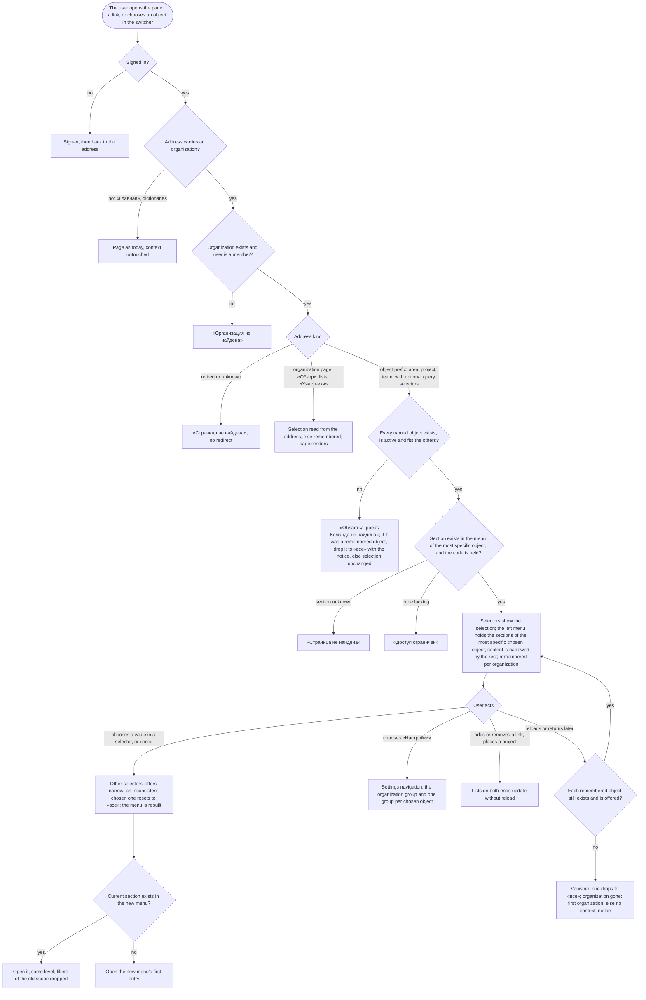

# Spec: Area, project and team navigation (feat-043)

## Context and goal

Today a user reaches a team, a project or an area through the organization's settings, the project's settings and a three-level switcher; the human called this «максимально неудобное» (doc-013, 2026-10-18). doc-012 (BR-MX-27, BR-MX-28, US-10) fixed the target: «Области», «Проекты» and «Команды» as top-level entries, each object on a page of its own with sections, breadcrumbs that invent no hierarchy, a switcher that opens objects, and a remembered context. **Gate-2 rejection (2026-10-30, status.md § Decisions) overrides the page-with-tabs model:** the header is a trail of four selectors (organization, department, team, project), each «все» or a chosen one; the left menu holds the sections of what is chosen and changes with the choice, so nobody drops into a list to pick a project before reaching «Общие», «Рабочие элементы», «Канбан», «Бэклог» or «Команды»; «Настройки» stay where they were, the derived entry of the shell (mod-015 BR-19). An object has no tab strip; its sections are left-menu entries. doc-013 moved this line right after `mod-018-area-workspace` and folded feat-045 (the organization's home page) in; the lines after it (mod-019, feat-041, feat-042, mod-007) add their sections to these pages instead of interim entries.
This line also carries `ADR-0031` (2026-10-28, typed single tree): an area page follows the tree «Департамент» → «Проект» (a project's place) → sub-areas, not doc-012's area–project links, which are not built (BR-AW-0, BR-AW-6). It is breaking for the panel (addresses retire, the context model changes) and additive for the API.
Rule ids: BR-MX-n are doc-012's, BR-NE-n doc-013's, BR-AW-n mod-018's, BR-OL-n feat-028's, BR-TS-n feat-040's, BR-WS-n feat-003's; BR-NV-n are this spec's. The text is written as if each recommendation of § Open questions holds, marked with its id; an answer flips only that text. «The reference tracker» is never named.

## Roles

Unchanged from doc-012 § Roles: access is the organization role's bundle (ADR-0027) until `mod-019-scoped-access`; belonging to a team grants nothing. Sections and commands are shown by the codes served today (BR-NE-5), so until mod-019 only an organization «Администратор» sees the object groups of «Настройки» and the create, link, place and delete commands; «Участник» and «Читатель» read.

| Role | Opens every menu entry and object | Creates, links, places, deletes, deactivates | Sees the object groups of «Настройки» |
|---|---|---|---|
| «Администратор» | yes | yes (existing codes, none added) | yes |
| «Участник», «Читатель» | yes | no: the commands are absent | no: the group is absent |
| Not a member (an instance administrator included) | «Организация не найдена» | - | - |

## Stories

Every story is `shippable: no`: one L, one MR, and the address model is one breaking change (OQ-9).

| id | Title | depends-on | File |
|----|-------|------------|------|
| US-1 | The left menu by scope, «Настройки», and the address model | - | `stories/US-1-navigation-and-addresses.md` |
| US-2 | The organization's «Обзор», the organizations list and the lists «Области», «Проекты», «Команды» | US-1 | `stories/US-2-overview-and-lists.md` |
| US-3 | A department chosen: its menu; a project's place and a sub-area | US-1, US-2 | `stories/US-3-area-page.md` |
| US-4 | A project chosen: its menu and settings | US-1, US-2 | `stories/US-4-project-page.md` |
| US-5 | A team chosen: its menu and settings | US-1, US-2 | `stories/US-5-team-page.md` |
| US-6 | Work items across projects, and in the project's section | US-1, US-4 | `stories/US-6-work-items-across-projects.md` |
| US-7 | Links and placements | US-3, US-4, US-5 | `stories/US-7-links-by-multiselect.md` |
| US-8 | The header selectors, the trail and the remembered context | US-1..US-5 | `stories/US-8-trail-switcher-context.md` |
| US-9 | The interim pages retire; the taken-over debts close | US-1..US-8 | `stories/US-9-interim-retire-and-debts.md` |

## Business process (BPMN)

## Business rules

| # | Rule | Source |
|---|------|--------|
| BR-NV-1 | **The left menu follows the selection (gate-2).** It holds the sections of the most specific chosen object (project, else team, else department, else the organization), per the table below, and is rebuilt when a selector changes; no entry waits for an object to be picked from a list. With nothing chosen: «Обзор», «Рабочие элементы», «Области», «Проекты», «Команды», «Участники», then the derived «Настройки» last, where mod-015 BR-19 puts it (it opens the settings navigation, with the main menu as a rail). «Бэклоги» and «Канбан» are menu entries only once a department, team or project is chosen. An entry the user may not open is absent, never disabled. | BR-MX-27; US-10; ADR-0024 § 1 |
| BR-NV-2 | **Addresses.** `/organizations/:o/…` for the organization's pages, including the lists `…/areas`, `…/projects`, `…/teams`, and one prefix per kind: `…/areas/:areaId/…`, `…/projects/:projectId/…`, `…/teams/:teamId/…`, each with its sections as path segments and its `…/settings` (the object's group in «Настройки»). **Forced by gate-2 (Q-1 A):** the prefix names the most specific chosen object (project, else team, else department); the other chosen selectors ride as the query `teamId` (the form mod-020 founded) and `departmentId`, e.g. `…/projects/:p/backlogs/stories?teamId=…`. Single-object addresses are exactly the approved ones. Existing addresses stand: team and project boards and backlogs keep `…/boards/:level` and `…/backlogs/:level`, a work item keeps `…/projects/:p/workitems/:identifier`; the lines after this one use `areas/:a/overview`, `areas/:a/backlogs/:level`, `areas/:a/boards/:level`, `teams/:t/sprints` and `projects/:p/sprints`. An address names the organization, its primary object, a section and optional selectors; no address nests one object under another. A project's node is served by the area prefix (ADR-0031 rule 5); there is no second address. | ADR-0028 rule 7; ADR-0031 rule 5; BR-MX-27 |
| BR-NV-3 | **Sections are menu entries.** Each kind has an ordered list of sections, shown in the left menu, not as tabs; a section is added by the line that owns its content and is absent until then (not disabled, no placeholder). Table below. A section is shown by the codes served today; mod-019 switches the source to per-object codes. | BR-NE-3, BR-NE-4; US-10 |
| BR-NV-4 | **The tree is real; nothing else nests (OQ-1 A).** The typed tree of ADR-0031 is a hierarchy the model has, so «Области» and an area's trail show it. «Проекты» and «Команды» are flat lists by name; a project's trail is «Ромашка / Проекты / A» and shows no department; its place is a path in its «Общие». A link never appears in a trail or a menu as a parent. Outside the tree an area is named by its path from the top level (BR-AW-13). A project has two pages, its own and its node's; the node's page marks «Области» in the menu while no department, team or project is chosen, shows the node's own description, and links to the project. | BR-MX-27 as ADR-0031 amends it |
| BR-NV-5 | **Organization settings hold what is the organization's.** The team and area pages of mod-018 and feat-028, the organization's project list and members page, and the project's settings pages of teams, areas and general move to «Области», «Проекты», «Команды», «Участники» and the objects' own pages; «Настройки» keeps the organization's own pages and the instance sections. | BR-MX-27; US-10 |
| BR-NV-6 | **Retired addresses.** Each address in the table below answers «Страница не найдена», whether or not the user may see the object, and redirects nowhere; a non-member sees «Организация не найдена» first. No link in the panel targets a retired address. | ADR-0024 § 4; ADR-0028 rule 7 |
| BR-NV-7 | **Not found by level.** The outermost missing level answers: «Организация не найдена», then «Область не найдена», «Проект не найден» or «Команда не найдена»; a deleted, deactivated or foreign object answers as one that does not exist. A work item's path address names its project first, so a foreign project answers «Проект не найден». A section the kind lacks answers «Страница не найдена»; a section whose code the user lacks, «Доступ ограничен». The context does not change, except that when the address names the remembered object, the page answers not found and the context falls back with the notice (BR-NV-10). | BR-MX-24; ADR-0024 § 4 |
| BR-NV-8 | **Matching.** An address in another letter case, or with a percent-encoded character, is matched the way the router matches it and shows the page with its navigation marker, settings menu and trail; ids in an address are compared the way the platform compares ids. | bug-003; tech-009 F4 |
| BR-NV-9 | **Lists.** Every object appears once in its list whatever its links; rows by name; every row opens its object's page. «Области» (the tree), «Проекты» and «Команды» each narrow by typed text at 1 000 areas, 200 projects and 200 teams; narrowing the tree keeps the ancestors of a match. Each list is read within 2 s, and the «Обзор» lists show only their first rows, as many as the design sets, with a link to the full list. | BR-MX-16, BR-MX-21; doc-012 NFR |
| BR-NV-10 | **Context = the four selectors (gate-2; Q-1..Q-4 A).** The header trail holds four selectors in this order: organization, department, team, project. Each shows «все» or its chosen object, and each is choosable. The selection is the organization plus at most one department, one team and one project. It drives the left menu (BR-NV-1) and narrows the content (BR-NV-17). It is remembered per user and per organization in the browser; an address sets it in its own tab (the address wins; the last write wins for a reload). Opening an address of another organization changes the selection without a notice; a notice appears only when a remembered object is gone, and that one drops to «все». A department's, team's or project's page sets its own selector; a project's node or a sub-area sets the project selector (and the department selector to the project's place); project nodes and sub-areas are not offered in any selector. Choosing a value keeps the section and level when the new menu has it, with the filters of the old scope dropped; otherwise it opens the new menu's first entry. Choosing another organization opens its «Обзор» with «все» in the other three. The interim team level of feat-040 and mod-020's fallback team retire; BR-MX-11's "The default affects BR-MX-10 only" is restored. | BR-MX-28; BR-NE-9; ADR-0028 rule 7 |
| BR-NV-11 | **Links and placements.** A link is added through a searchable multiselect that leaves out what is linked already; linked objects are rows that open their page; the unlink command is on the row for the user who may unlink; both ends update without a reload. A project's place is its parent, so placing is a move of the project's node, **one project at a time** through a searchable single-select (H-3 A); there is no area–project link and no batch move. A move that would take a sibling's name or pass the depth limit is refused with the catalogue's message and nothing changes. | BR-MX-27; BR-AW-3, BR-AW-6; ADR-0031 rule 4 |
| BR-NV-12 | **Work items across projects.** The organization's «Рабочие элементы» is the project section's list over every active project (BR-NE-5), 50 to a page, each item once, with its project and owning team; the project's section is the same list fixed to the project. Order, total on both: change time descending, then number descending, then project key (BR-WS-12 kept). Feat-003's filters and mod-020's team filter are on both. The keyword on the organization's list: (a) the title as in BR-WS-9; (b) a whole identifier matches its one item; (c) a number matches the item with that number in every listed project, each once; BR-WS-15's "never finds another project's item" reads "another organization's" there. A deleted item is on neither list unless «Удалена» is chosen. No create command on the organization's list. | BR-MX-9, -16; BR-NE-8; BR-WS-1..-15 |
| BR-NV-13 | **A deactivated project (E)** has no page. Table below. | BR-AW-10; ADR-0026; OQ-3, H-2 |
| BR-NV-14 | **Commands move with their pages.** Creating a project (with its place), deactivating and restoring it, creating a team, a department, deleting a node or a team, setting the default team and the description keep their rules, codes and confirmations and live on the page that owns the object. | BR-AW-9; BR-OL-*; mod-002 |
| BR-NV-15 | **No visibility yet.** Every project is visible to every member until `feat-041-project-visibility`; each read across projects takes the caller as a required argument, so that feat-041 adds the set form inside it (checked by a signature test, US-6). | BR-NE-5; ADR-0029 §§ 7-8 |
| BR-NV-17 | **Selectors narrow each other and the content (Q-2, Q-3 A).** What a selector offers once others are chosen: *project* — the projects placed in the chosen department and linked to the chosen team; *team* — the teams linked to the chosen project and to the chosen department; *department* — the departments holding the chosen project and linked to the chosen team. A chosen value that the others no longer fit resets to «все» (a notice «Выбор сброшен: …» names it). «все» means no narrowing on that dimension. Content: with a project chosen, the project's «Рабочие элементы», «Канбан» and «Бэклог» show its items, and a chosen team narrows them to the items the team owns (the `teamId` filter of mod-020, one state); with a team and no project, the team's views span its projects; the department narrows the offers and the lists «Проекты» and «Команды» only, and narrows work items in no view before `feat-042` (which owns area views). The menu of the most specific object is kept when several are chosen. | gate-2; BR-MX-17, -28 |
| BR-NV-18 | **«Настройки» stay where they were.** The derived last entry of the shell opens the settings navigation (mod-015 BR-19; main menu as a rail). Its groups: «Организация» (the organization's own pages: «Общие», «Процесс») and, for a holder of the write code, one group per chosen kind — «Департамент», «Команда», «Проект» — each with the entry «Параметры» (name, description, delete or deactivate; for a project also its default team). The lists «Проекты», «Команды», «Области» and «Участники» are left-menu entries, not settings. No object has a «Настройки» tab. | mod-015 BR-19; gate-2 |
| BR-NV-16 | **Where an organization opens.** A row of the organizations list and the switcher open the organization's «Обзор»; the create flow opens the new organization's «Проекты», where the first project is created. feat-038 is not merged and is no dependency; when it merges it changes the landing of an empty first organization only, and whichever merges second aligns (OQ-8 A). | doc-013 OQ-5 |

**The left menu by scope.** Order is the order shown, «Настройки» always last (BR-NV-18); *owed* entries are absent until the named line adds them.

| Most specific chosen | Menu built here | Owed by a later line |
|---|---|---|
| Nothing (organization) | «Обзор», «Рабочие элементы», «Области», «Проекты», «Команды», «Участники» | - |
| Department | «Обзор», «Проекты», «Команды» | «Канбан», «Бэклог» (feat-042, before «Проекты»); «Участники» (mod-019); «Аналитика» (feat-044) |
| Team (with or without a department) | «Обзор», «Канбан», «Бэклог», «Проекты», «Участники и доступ» (members only) | «Спринты» (mod-007); the grants (mod-019) |
| Project (with or without team and department) | «Общие», «Структура» (the node's page: sub-areas, node description), «Рабочие элементы», «Канбан», «Бэклог», «Команды» | «Спринты» (mod-007); «Участники и доступ» (mod-019) |
| A project's node or a sub-area opened from «Области» | the project's menu, «Структура» marked | «Канбан», «Бэклог» (feat-042) |

**A deactivated project E** (H-2 A, OQ-3 A): not listed in «Проекты» (only in «Деактивированные», for the administrator, with «Восстановить»), not offered in the switcher, the placement picker or a team's link picker; not in a team's «Проекты» or its counts; its items are in no row, count or option of the organization's list. In «Области» its node is shown marked «деактивирован» with its sub-areas beneath, marked, none a link. A department's «Проекты» lists it marked, not a link, and counts it apart («1 деактивирован»), so a refused deletion is explained. The addresses of its node, its sub-areas and its items answer «Проект не найден». Its name stays taken among its siblings (BR-AW-10), and its links return on restore.

**Retired addresses** (each opens a page today, answers «Страница не найдена»): `…/settings/teams[/:t]`, `…/settings/areas[/:a]`, `…/settings/projects[/deactivated]`, `…/settings/members`, `…/projects/:p/settings/general`, `…/projects/:p/settings/teams`, `…/projects/:p/settings/areas`. The project-nested team boards and backlogs are already retired by feat-040.

## Operation completeness

| Entity | Create | Read | Update | Delete/deactivate | Cancel/reverse |
|--------|--------|------|--------|-------------------|----------------|
| Entry / section / page | no: code, not data | every member, by the codes (US-1) | no: a later line adds a section | no | no |
| Organization «Обзор», organizations list | no: derived; a new organization from the list (US-2) | every member | no | no | no |
| Department | «Администратор», «Области» (US-2) | every member | «Администратор»: name, description (it stands at the top: no move) (US-3) | «Администратор», with no child, confirmed (US-3) | no: hard delete, create again |
| Project's node, sub-area | node: with the project; sub-area: «Администратор» on the node's page (US-3) | every member | sub-area: rename, describe, move within its project; node: described, renamed with its project | sub-area: with no child and no item; node: only with its project | no |
| Project's place | with the project (US-4) | every member, as a path | «Администратор»: move from «Общие» or a department's «Проекты» (US-7) | moved to the top level | move back |
| Project | «Администратор», «Проекты» | every member | «Администратор»: name, description, default team (US-4) | deactivate from «Проекты» | restore from «Деактивированные» |
| Project–team link | «Администратор», project's «Команды» or team's «Проекты» (US-7) | every member | no: nothing to edit | «Администратор», with the reassign choice (BR-MX-12) | link again |
| Team–department link | «Администратор», department's «Команды» or team's «Обзор» (US-7) | every member | no | «Администратор» | link again |
| Team | «Администратор», «Команды» | every member | «Администратор»: name, description | «Администратор», confirmed with counts | no: no restore |
| Team membership | «Администратор», team's «Участники и доступ» | every member | no: remove and add again | «Администратор» | add again |
| Work item list | no: an item needs a project | every member, active projects (US-6) | no | no | filters cleared |
| Remembered context | the user's choice or an address | the user, in the browser | the next choice | cleared by the fallback | the fallback itself (US-8) |

## Non-functional requirements

- **Volumes:** 1 000 areas over 10 levels, 200 projects, 200 teams: each list, the switcher's offer and a placement picker within 2 s; statement counts do not grow with the number of objects (a test pins each new read).
- **Organization-wide list (H-4 A):** at 200 projects with 5 000 items each, a page within 2 s unfiltered and with a team, an assignee or a state filter, with the pager's count; the «Исполнитель» options within 2 s; a keyword that matches an identifier or a number within 2 s; a keyword that contains-matches titles within 5 s (a weaker budget, recorded). Narrowing by keyword is the only way to cut this list by project (OQ-4 A).
- **No reload:** moving between sections and objects requests no new document; the top bar and navigation stay; Back returns step by step (brief § 17).
- **Accessibility:** navigation, switcher, pickers and trail work by keyboard and down to 640 CSS px (ADR-0024 § 5).
- **Security:** every read stays inside the organization in the address (BR-MX-1); a foreign id answers as one that names nothing.
- **Regression:** `scripts/verify.sh` green; E2E is paused (standing NO); the MR names the specs the address changes break. This line stores nothing about objects, only the remembered context in the browser.

## Out of scope

- Grants, per-object codes, area «Участники» (mod-019); project visibility (feat-041); area boards, backlogs, figures (feat-042); sprints (mod-007); analytics (feat-044); the views' filters and memory (feat-013, US-11).
- A «Проект» filter on the cross-project list (OQ-4); creating a work item from it; releases, milestones, capacity (doc-012 § Out of scope); a batch move of projects.
- Any redirect from a retired address; a second address for a project node; an area–project link.

## Decomposition for the backlog

| id | Task | size | deps |
|----|------|------|------|
| `feat-043-area-project-team-navigation` | US-1..US-9 as one L, confirmed by the human (doc-013 OQ-6 A); additive API (the cross-project list; bounded reads; no batch move), breaking panel addresses; absorbs `tech-019-ui-kit-m4-shell` (OQ-5 A); takes over tech-009 F4, bug-003, mod-020 review CR-2/CR-3/CR-6; tech-011 m4 obsolete | L: breaking | feat-040, mod-018, mod-020 |

`tech-020-ui-kit-m5-legacy-out` then takes this line in place of tech-019 (doc-013 § Queue changes), an orchestrator edit after gate-1.
**Breaks (P-10), a note in each owner's status.md:** ADR-0024 § 1 ("the context it needs is real"), § 2 (the fixed prefixes, the three-level switcher) and § 4 (an area level of not found); doc-012 BR-MX-27 and BR-MX-28 (areas offered), the US-10 clauses that hold area–project links, doc-013 BR-NE-6 (BR-MX-1..-28 stand), doc-012's fate-table lines that name a board as an entry; feat-040 BR-TS-10 and US-6; mod-020 (fallback, BR-MX-11 restored); feat-003 BR-WS-9 (c) and BR-WS-15 (read for the organization's list); mod-015 BR-6 (the trail becomes four selectors), BR-11, BR-18 (the switcher), BR-19 kept; mod-018 BR-AW-12; feat-028 BR-OL-10 and its interim team pages; feat-039's interim project views in the team drop-down; mod-002 BR-M1-23, -24. Queue lines touched: mod-019, feat-041, feat-042, mod-007, tech-019 (withdrawn), tech-020.

## Open questions

Each states the requirement under the recommended answer; the text above is written for it.

- [ ] **OQ-1 What «Области» lists, and what a project's row opens.** ADR-0031 makes the tree a real hierarchy, which BR-MX-27 ("no list nests a project in an area") predates.
  - (A, recommended) The whole typed tree (departments, project nodes marked «Проект», sub-areas). A project row opens the node's page on the area prefix, which links to the project; «Проекты» and «Команды» stay flat; the switcher offers departments, projects and teams, not nodes or sub-areas. An organization with no node at all reads «В организации пока нет областей»; with projects and no department the tree shows the top-level project nodes and the administrator is offered «Создать департамент».
  - (B) «Области» lists departments only; sub-areas are reached from a project section «Области» (an extra section). Less nesting, one more section.
  - (C) Keep BR-MX-27 to the letter: nodes listed flat with paths. Loses the tree.
- [ ] **OQ-2 Counts and lists on «Обзор».** (A, recommended) «Области» counts and lists departments only (0 and empty when there is none); project nodes count as projects. (B) It counts every node except project nodes (departments and sub-areas).
- [ ] **OQ-3 A deactivated project's node and sub-areas in the tree.** (A, recommended) Marked «деактивирован», none a link, their addresses «Проект не найден». (B) The node opens read-only with the mark; writes answer «Проект не найден.» as BR-AW-10 says.
- [ ] **OQ-4 A «Проект» filter on the cross-project list.** (A, recommended) Not now: queue-line scope; the row shows its project, the keyword narrows. (B) Add it to the address.
- [ ] **OQ-5 `tech-019-ui-kit-m4-shell`.** doc-013's rule: if it has not started when this line starts, this line absorbs it. It has not. (A, recommended) Absorb: the shell (top bar, navigation, page header) is built on the UI kit here, US-1 gains the kit scenario, tech-020 takes this line as a dep. (B) Depart from the rule: tech-019 first as an S, which pauses this started L after gate-1.
- [ ] **OQ-7 A new ADR.** (A, recommended) Yes, at the design: it replaces ADR-0024 § 2 and consolidates ADR-0028 rule 7 and ADR-0031 rule 5, deciding the per-kind section list as a contract four lines extend, the retirement list, the context's key (per user and organization) and its fallback. Addresses themselves stand (BR-NV-2). (B) A further amendment note on ADR-0028 rule 7.
- [ ] **OQ-8 Where a chosen or new organization opens.** feat-038 is unmerged (its branch is at stage 1, gate-1 pending). (A, recommended) A row and the switcher open «Обзор»; the create flow opens «Проекты» (BR-NV-16). (B) Both open «Обзор».
- [ ] **OQ-9 Cutting the line.** (A, recommended) One L as confirmed; the plan orders additive-first, retire-last. (B) Three M tasks: `feat-NNN-object-pages-and-lists` (US-2..5, 7), `feat-NNN-work-items-across-projects` (US-6), `feat-NNN-navigation-shell-and-retire` (US-1, 8, 9); a third gate cycle and old and new pages coexisting. New since doc-013: nine stories and the typed tree.
- [ ] **H-1 The selected entry «Рабочие элементы» and the team filter.** (A, recommended) A link without `teamId`, the selected entry included, opens the list unfiltered (feat-003 BR-WS-11 stands; CR-2 closes by the written rule in mod-017 BR-OT-8). (B) The selected entry keeps the filter; BR-WS-11 is amended and listed in Breaks.
- [ ] **H-2 A deactivated project's items, nodes and department row.** (A, recommended) As the table: hidden from lists, counts and options; shown marked in the tree and the department's «Проекты». (B) Its items and node stay readable everywhere until restored. (C) Hidden everywhere, the department row included.
- [ ] **H-3 Placing projects.** (A, recommended) One project at a time (BR-NV-11); no new API. (B) A batch, all or none, a new additive route and its failure rows.
- [ ] **Q-1 The address when several selectors are chosen (forced by gate-2).** An address names one object (ADR-0032 § 1), a selection may name three. (A, recommended) The prefix is the most specific chosen object (project, else team, else department); the others ride as `teamId` and `departmentId` in the query; every single-object address stands as approved. (B) All selectors only in the query on organization-level addresses; the approved object prefixes are dropped, which breaks them. (C) One selector at a time, narrowing done by in-page filters: contradicts the gate-2 requirement.
- [ ] **Q-2 What a selector offers once another is chosen.** (A, recommended) The selectors narrow each other (BR-NV-17): a project is offered only in the chosen department and linked to the chosen team, and so for the others; a value the rest no longer fit resets to «все» with a notice. (B) Independent: any combination is allowed and may be empty. (C) Only downward: the department narrows team and project, nothing narrows the department.
- [ ] **Q-3 What the content shows at «все».** (A, recommended) «все» is no narrowing on that dimension: team «все» with a project shows all the project's items; project «все» with a team shows the team's views across its projects; department «все» is no placement narrowing; nothing chosen shows the organization's lists. A department narrows no work-item view until `feat-042`. (B) The department also narrows work-item views here (items of the projects placed in it), which pre-empts feat-042.
- [ ] **Q-4 The left menu when several are chosen.** (A, recommended) The sections of the most specific object (project, else team, else department, else organization); the others narrow its content. (B) The union of the chosen objects' menus, grouped by object: longer, with the same names twice. (C) The menu of the selector the user touched last.
- [ ] **Q-5 The organization selector's «все».** (A, recommended) It is «Все организации», the organizations list (the organization part of the switcher before); choosing it clears the other three. (B) The selector has no «все»: an organization is always chosen.
- [ ] **H-4 The keyword's budget at a million rows.** (A, recommended) Title contains-match within 5 s, everything else 2 s (NFR). (B) Everything within 2 s; the design may need a text index.
