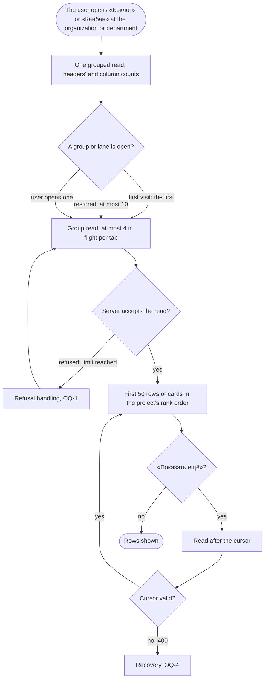

# Spec: Aggregate level views (feat-048)

## Context and goal

This line is «the second line» of `feat-043-area-project-team-navigation` (its OQ-9 split, human, 2026-10-30). It adds, after «Обзор», «Рабочие элементы», «Канбан» and «Бэклог» at the organization and department level and «Рабочие элементы» at the team level: the organization-wide work-item list with feat-003's filters and keyword rules, and the aggregate backlogs and boards of every active project (department: the projects placed in it) as one collapsible group (swimlane on the board) per project in the project's own rank order, with a move inside a group, rows loaded per project as a group opens and the reads capped, paged by a cursor. The requirements are **reused, not restated**: they were approved at feat-043's gate-1 and gate-2 and live in that folder; this index points at them and adds only the Delta below. Nothing in the approved text is reworded or reopened here.

Folder `F43` = `docs/features/feat-043-area-project-team-navigation/`. «The reference tracker» is never named.

## Roles

Unchanged from F43 `spec.md` § Roles: access is the organization role's bundle (ADR-0027) until `mod-019`; «Администратор» and «Участник» move a group's rows and a lane's cards where the project's own board or backlog allows it, «Читатель» reads; a non-member sees «Организация не найдена».

## Stories

Both stories are written and approved in F43; this line has no story file of its own (a delta scenario, if the human wants one, becomes `stories/US-11-<slug>.md`, see § Delta). Each is `shippable: no` on its own; they ship together.

| id | Title | depends-on | File |
|----|-------|------------|------|
| US-6 | «Рабочие элементы» at every level: organization, department, team, project | US-1, US-4 (merged) | [`F43/stories/US-6-work-items-across-projects.md`](../feat-043-area-project-team-navigation/stories/US-6-work-items-across-projects.md) |
| US-10 | «Канбан» and «Бэклог» at the organization and the department; one group per project | US-1 (merged), US-6 | [`F43/stories/US-10-aggregated-board-and-backlog.md`](../feat-043-area-project-team-navigation/stories/US-10-aggregated-board-and-backlog.md) |

## Rules carried

The rule text is in F43 `spec.md` § Business rules and § Non-functional requirements; ids only here.

| Rule | What it fixes | Where |
|------|---------------|-------|
| BR-NV-12 | The cross-project work-item list, its order and total, the keyword rules, the team as the selector's state, the entry clearing filters never selectors | F43 spec, BR-NV-12; US-6 |
| BR-NV-20 | Aggregate «Бэклог» and «Канбан»: one group or swimlane per project, open-state memory, cursor paging (Q-13 A), the move inside a group (Q-10 A), the card move inside a lane (Q-12 A), the grouped count read and the per-group read, the cap of 4 in flight per tab (Q-11) | F43 spec, BR-NV-20; US-10 |
| BR-NV-1, BR-NV-2, BR-NV-3 | Which menu entries and addresses this line adds (department `areas/:a/…`, team `teams/:t/workitems`, organization `…/workitems|boards|backlogs`) | F43 spec, the menu table |
| BR-NV-15 | Every read across projects takes the caller as a required argument (signature test over the item and view reads) | F43 spec; US-6, US-10 |
| BR-NV-17, BR-NV-13 | Narrowing by the selectors and the Q-9 no-reorder hint; a deactivated project leaves every view | F43 spec |
| Budgets | NFR "Organization-wide list" and "Aggregate views" (H-4 A, Q-11) | F43 spec § NFR |
| Resolved | Q-7 B, Q-8 A, Q-9 A, Q-10, Q-11, Q-12 A, Q-13 A (F43 `status.md` § Decisions) | F43 spec § Open questions |

Design input already set: F43 `design.md` § 12 (layout, accordions, drag and drop through `BacklogRow` and `BoardColumns`, keyboard path).

## Business process (BPMN)

The group read, with the two failures the approved text leaves open (the refusal and the cursor failure, § Delta).

## Business rules

None added here. The rules are those carried above; the Delta below is the only new material and becomes rules once the human answers it.

## Operation completeness

As F43 `spec.md` § Operation completeness, rows "Work item list" and "Board and backlog views, aggregate": no create command on the aggregate views; a move inside a group and a card move inside a lane by the item's project's code; no delete or cancel.

## Non-functional requirements

As F43 `spec.md` § Non-functional requirements: "Organization-wide list" and "Aggregate views" budgets, statement counts constant, read concurrency capped at 4 per tab. Added by the Delta only: the server-side limit (OQ-1..OQ-3) must not make a single user with two tabs see refusals in ordinary use.

## Out of scope

- The views' filters and their memory (feat-013); the project set and visibility (feat-041); per-object codes (mod-019); the overview's figures and the switch «Включая дочерние области» (feat-042); sprints (mod-007).
- Everything F43 already excludes: a «Проект» filter on the cross-project list, creating an item from it, a batch move, views of a sub-area or a project's node.
- Rewording any approved rule or story of F43.

## Dependencies

feat-043 (the shell, selectors, menu table, addresses; merged, #49), feat-003 (work-item list and filters), mod-006 (levels «Эпики», «Фичи», «Истории»), mod-017 (backlog and team views), mod-020 (`teamId`), feat-040 (team boards and backlogs). feat-043 is verified merged in the recent history (commit `9391d048`, #49); the other five are named by feat-043's own dependencies as merged and were not re-verified by `git log` in this session.

## Decomposition for the backlog

| id | Task | size | deps |
|----|------|------|------|
| `feat-NNN-aggregate-level-views` | US-6 and US-10 as one task: the read side (grouped count read, group and cell reads, cross-project list), the limiter, the cursor, and the panel entries and views | L (route confirmed by the human: an ADR is owed for the cursor and for the limiter) | feat-043 |

No further tasks: the queue line already exists as `feat-048-aggregate-level-views`.

## Delta

What F43's approved text leaves open and this line must settle. Checked and dropped as already settled: the concurrency cap's role and the pool argument (BR-NV-20 states them); the cursor's ordering and its stale-row behaviour (BR-NV-20, US-10); the menu table and addresses (the shipped `MENU_TABLE` and the owed rows match F43's table, no contradiction); the deviation from ADR-0014 as a decision (the ADR is the design's, owed per route).

- **OQ-1 What the user sees when the server refuses a group read (design § 12 owes a limiter: per user 4 to 6, global about 40, 429 when full).** The approved text fixes the numbers' direction, not the behaviour.
  - (A, recommended) The panel retries on its own, waiting the time the refusal names (else 1 s, doubling, at most 3 tries), the group showing its loading state; after the last try the group shows inline «Не удалось загрузить проекты группы. Сервис занят, попробуйте ещё раз.» with the button «Повторить», and the other groups are unaffected. Why: a refusal is expected under shared load and passes in seconds; a silent retry hides it, a bounded one never loops, and the manual button is the exit.
  - (B) No automatic retry: the group shows the same message and «Повторить» at once. Simpler, but a restored set of 10 groups on a busy moment needs many clicks.
  - (C) Treat as an ordinary error with the generic message. Loses the cause; the user cannot tell busy from broken.
- **OQ-2 What the limiter covers.**
  - (A, recommended) Only the reads that open a group or a board cell and their «Показать ещё» (the fan-out), per user and globally. The grouped count read is one per page open and the lists are single reads; limiting them would refuse the page's first screen for no gain.
  - (B) Every read of this line, the grouped count and the cross-project list included. Protects the pool most; a refused count read leaves the headers empty and the page unusable.
- **OQ-3 The "4 in flight per tab" value, and the per-user server limit against it (the spec: "the analyst's, to confirm at the design").**
  - (A, recommended) 4 per tab stays; the per-user server limit is set so that two tabs (8 reads) are not refused in ordinary use, and a refusal then means an abnormal load or a script. The requirement is the behaviour (two tabs, no refusal); the number is the design's. Why: a tab count is not controllable, and a limiter that refuses a normal two-tab user would turn OQ-1 into the common path.
  - (B) 4 per tab and a per-user limit of 6, as design § 12 has it: a second tab opening 10 restored groups meets refusals, handled by OQ-1.
  - (C) 3 per tab: fits 6 for two tabs, slower first screen against the 4 s budget (US-10 budget scenario).
- **OQ-4 What the panel does when a page read after a cursor fails (the 400 for a malformed or foreign cursor, or a refusal after the last try).** US-10 says the 400 is the existing validation error; it does not say what the user sees.
  - (A, recommended) A 400 from a cursor reloads the group from the first page and drops the rows held, without a message (the cursor was ours, so a 400 means a stale session); the header counts are re-read with it. A refusal keeps the rows held and shows «Показать ещё» again with the OQ-1 message under the group.
  - (B) Show «Не удалось загрузить» with «Повторить» for both cases, and keep the rows; the user chooses. A stale cursor then fails again on the retry.
- **OQ-5 The project list's «Команда» control against the approved rule.** BR-NV-12 and US-6 say the filter bar has no «Команда» and «Без команды» stays a filter-bar option on the project's list only; the shipped `TeamFilter` on the project's list is still the multi-select labelled «Команда» (teams of the project, then «Без команды»). The text does not say what replaces it.
  - (A, recommended) The project's filter bar keeps one control, «Без команды», a toggle exclusive with a team chosen in the team selector; the multi-select over teams goes (the selector is the only team narrowing, Q-6 A). One state, as the approved rule says.
  - (B) Keep the shipped control and make it read the selector's state too. Two controls for one thing, which Q-6 B rejected.

No new story is needed: OQ-1 and OQ-4 become scenarios in the existing US-10 text only if the human wants them as acceptance criteria; if so they go into `stories/US-11-group-read-failures.md` in the shortened M form, at gate-1.
