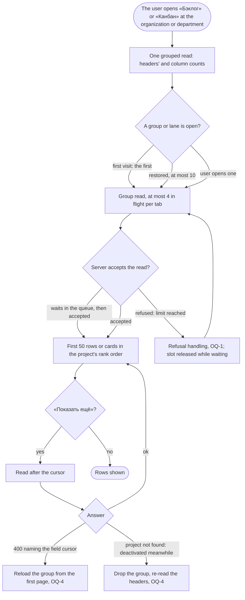

# Spec: Aggregate level views (feat-048)

## Context and goal

This line is «the second line» of `feat-043-area-project-team-navigation` (its OQ-9 split, human, 2026-10-30). It adds, after «Обзор», «Рабочие элементы», «Канбан» and «Бэклог» at the organization and department level and «Рабочие элементы» at the team level: the organization-wide work-item list, and the aggregate backlogs and boards of every active project (department: the projects placed in it) as one collapsible group (swimlane on the board) per project in the project's own rank order, with a move inside a group, rows loaded per project as a group opens, the reads capped and paged by a cursor. The requirements are **reused, not restated**: they were approved at feat-043's gate-1 and gate-2 and live in that folder; this index points at them and adds only the Delta below. Nothing in the approved text is reworded or reopened here.

Folder `F43` = `docs/features/feat-043-area-project-team-navigation/`. «The reference tracker» is never named.

## Roles

Unchanged from F43 `spec.md` § Roles: access is the organization role's bundle (ADR-0027) until `mod-019`; «Администратор» and «Участник» move a group's rows and a lane's cards where the project's own board or backlog allows it, «Читатель» reads; a non-member sees «Организация не найдена».

## Stories

Both stories are written and approved in F43; this line has no story file of its own (a delta scenario, if the human wants one, becomes `stories/US-11-<slug>.md`, see § Delta). Each is `shippable: no` on its own; they ship together.

| id | Title | depends-on | File |
|----|-------|------------|------|
| US-6 | «Рабочие элементы» at every level: organization, department, team, project | US-1, US-4 (merged) | [`F43/stories/US-6-work-items-across-projects.md`](../feat-043-area-project-team-navigation/stories/US-6-work-items-across-projects.md) |
| US-10 | «Канбан» and «Бэклог» at the organization and the department; one group per project | US-1 (merged), US-6 | [`F43/stories/US-10-aggregated-board-and-backlog.md`](../feat-043-area-project-team-navigation/stories/US-10-aggregated-board-and-backlog.md) |

## Rules carried

The rule text is in F43 `spec.md` § Business rules and § Non-functional requirements; ids only here.

| Rule | What it fixes | Where |
|------|---------------|-------|
| BR-NV-12 | The cross-project work-item list, its order and total, the keyword rules, the team as the selector's state, the entry clearing filters never selectors | F43 spec, BR-NV-12; US-6 |
| BR-NV-20 | Aggregate «Бэклог» and «Канбан»: one group or swimlane per project, open-state memory, cursor paging (Q-13 A), the move inside a group (Q-10 A), the card move inside a lane (Q-12 A), the grouped count read and the per-group read, the cap of 4 in flight per tab (Q-11) | F43 spec, BR-NV-20; US-10 |
| BR-NV-1, BR-NV-2, BR-NV-3 | Which menu entries and addresses this line adds (department `areas/:a/…`, team `teams/:t/workitems`, organization `…/workitems|boards|backlogs`) | F43 spec, the menu table |
| BR-NV-17, the clauses marked "from the second line" | This line owns exactly these: (1) the content of «Рабочие элементы», «Канбан» and «Бэклог» at the department (the projects placed in it) and at the organization (every active project); (2) a team chosen **together with a department** narrows the team's own feat-040 «Бэклог» and «Канбан» (and its «Рабочие элементы») to the projects placed in that department, shown as one group or swimlane per project, each in its project's rank order, with **no reorder while narrowed** (the Q-9 A hint) and the line «сужено: команда …, департамент …»; this changes an existing view, not only the new ones; (3) the team-level «Рабочие элементы» across the team's projects. A team with no department keeps feat-040's views as today | F43 spec, BR-NV-17; US-6, US-10 scenarios "A chosen team narrows" |
| BR-NV-13, BR-NV-15 | A deactivated project leaves every view; every read across projects takes the caller (signature test) | F43 spec |
| Budgets | NFR "Organization-wide list" and "Aggregate views" (H-4 A, Q-11) | F43 spec § NFR |
| Resolved | Q-6 A (the selector is the only team narrowing), Q-7 B, Q-8 A, Q-9 A, Q-10, Q-11, H-1 A (the entry clears filters, never selectors), H-4 A; Q-12 A and Q-13 A are taken from F43 `status.md` § Decisions (their boxes in F43 `spec.md` are still unticked) | F43 spec § Open questions, F43 status.md |

Design input already set (F43 `design.md` § 12): the layout, the accordions, drag and drop through `BacklogRow` and `BoardColumns`, the keyboard path. **Owed to this line's design by § 12:** the server-side concurrency limiter on the group and cell reads (per user 4 to 6, global about 40, 429 when full; the numbers are this line's), and the short ADR or amendment note for the cursor (opaque `nextCursor`, forward only), which deviates from ADR-0014.

### The team filter of the project's list, a stated requirement

Not a question: BR-NV-12, Q-6 A and US-6 decide it. The shipped `TeamFilter` («Команда», a multi-select over the project's teams, then «Без команды») on the project's «Рабочие элементы» is replaced, in this line, by one control, «Без команды». **Exclusive** means: choosing «Без команды» while a team is chosen in the team selector resets the team selector to «все» with the notice «Выбор сброшен: …» (the F43 reset notice); choosing a team while «Без команды» is on clears «Без команды». The project's **backlog and board** (`ViewFilterRow`) keep the shipped «Команда» control until feat-013, and for those two views the rule of BR-NV-17 (the selector and the control are one state, mod-020) is as today; a project's list and its backlog therefore differ in this one control until feat-013, recorded here.

## Business process (BPMN)

The group read, with the failures the approved text leaves open (§ Delta).

## Business rules

None added here beyond the stated requirement above; the Delta is the only new material and becomes rules once the human answers it.

## Operation completeness

As F43 `spec.md` § Operation completeness, rows "Work item list" and "Board and backlog views, aggregate": no create command on the aggregate views; a move inside a group and a card move inside a lane by the item's project's code; no delete or cancel. The behaviour of a move in a part-loaded group is OQ-6.

## Non-functional requirements

As F43 `spec.md` § Non-functional requirements: the "Organization-wide list" and "Aggregate views" budgets, statement counts constant, read concurrency capped at 4 per tab. Added by the Delta:

- **The limiter, testable:** one user with two tabs, each restoring 10 groups (so 8 group reads in flight at once), receives no 429; a ninth concurrent read from the same user may be waited on or refused (OQ-3). A test with a fake clock asserts both sides.
- **The limiter's key and scope (behaviour fixed, numbers the design's):** the key is the signed-in user (the Keycloak subject), the same across organizations, tabs and devices; the scope is **per API process**, since the pool it protects is per process (a replica adds its own pool and its own limiter). The global limit is likewise per process.
- **The refusal's contract:** a new catalogue entry for the refusal (status 429, Russian and Kazakh text) is owed to `docs/error-codes.md` and `contracts/errors/*.json`, with the wait it asks for in the standard `Retry-After` header.

## Out of scope

- The views' filter bar and its memory (feat-013) beyond OQ-5; the project set and visibility (feat-041); per-object codes (mod-019); the overview's figures and the switch «Включая дочерние области» (feat-042); sprints (mod-007).
- Everything F43 already excludes: a «Проект» filter on the cross-project list, creating an item from it, a batch move, views of a sub-area or a project's node.
- Rewording any approved rule or story of F43.

## Dependencies

feat-043 (the shell, selectors, menu table, addresses; merged, #49, `9391d048`), feat-003 (work-item list and filters), mod-006 (levels «Эпики», «Фичи», «Истории»), mod-017 (backlog and team views), mod-020 (`teamId`), feat-040 (team boards and backlogs). All six are merged on origin/main, as the orchestrator's check recorded in this task's `status.md` Log.

## Decomposition for the backlog

| id | Task | size | deps |
|----|------|------|------|
| `feat-NNN-aggregate-level-views` | US-6 and US-10 as one task: the read side (grouped count read, group and cell reads, cross-project list), the limiter, the cursor, and the panel entries and views | L (route confirmed by the human: an ADR is owed for the cursor and for the limiter) | feat-043 |

No further tasks: the queue line already exists as `feat-048-aggregate-level-views`.

## Delta

What F43's approved text leaves open and this line must settle. Checked and dropped as already settled: the concurrency cap's role and the pool argument (BR-NV-20); the cursor's ordering and stale-row behaviour (BR-NV-20, US-10); the menu table and addresses (the shipped `MENU_TABLE` matches F43's table); the ADR-0014 deviation as a decision (the design's); the project list's team control (a stated requirement above).

- **OQ-1 (resolved A, the human, gate-1 2026-11-03) What the user sees when the server refuses a group read (429).**
  - (A, recommended) The panel retries by itself, waiting the time `Retry-After` names (else 1 s, doubling, at most 3 tries), the group showing its loading state; **a group waiting to retry releases its slot of the tab's 4**, so others are not blocked behind its backoff. After the last try the group shows inline «Не удалось загрузить элементы проекта. Сервис занят, попробуйте ещё раз.» with «Повторить»; other groups are unaffected. Why: a refusal passes in seconds, a bounded retry never loops, and the button is the exit.
  - (B) No automatic retry: the message and «Повторить» at once. Simpler; a restored set of 10 groups on a busy moment needs many clicks.
  - (C) The generic error message. Loses the cause.
- **OQ-2 (resolved A, the human, gate-1 2026-11-03) What the limiter covers.**
  - (A, recommended) The group and cell reads and their «Показать ещё» (the fan-out), per user and globally. The grouped count read and the lists are single reads. **Recorded accepted risk:** the cross-project list's title keyword read (budget up to 5 s) is the longest-held connection of this line and stays outside the limiter.
  - (B) As A, and the cross-project list's keyword read falls under the **global** limit only (not the per-user one), so the longest read is counted against the pool.
  - (C) Every read of this line, the grouped count included; a refused count read leaves the headers empty and the page unusable.
- **OQ-3 (resolved A, the human, gate-1 2026-11-03) The per-tab value of 4 and the server's behaviour at the per-user limit.**
  - (A, recommended) 4 per tab stays. The per-user limit is 6 with a **short bounded wait queue** (a read waits up to a few seconds for a free place before it is refused), so two tabs (8 reads) wait briefly instead of being refused, and a 429 stays abnormal. The queue length and wait are the design's; the behaviour is the NFR above.
  - (B) No queue; the per-user limit is raised to at least 8 so two tabs never meet it. Simple; a third tab or a script meets refusals at once, and the pool's share per user grows.
  - (C) No queue and per-user 6, as design § 12 has it: a second tab restoring 10 groups meets refusals, handled by OQ-1. Fails the NFR above.
- **OQ-4 (resolved A, the human, gate-1 2026-11-03) Recovery when a read after the first page fails.**
  - (A, recommended) (1) A 400 whose validation error names the field `cursor` reloads the group from the first page, dropping the rows held, and re-reads the header counts, without a message; a 400 naming any other field (a level, a filter) is shown as an error and does not reload. (2) A refusal keeps the rows held, shows «Показать ещё» again and the OQ-1 message under the group. (3) «Проект не найден» on «Показать ещё», a row move or a card move (the project was deactivated while its group was open) removes the group or lane and re-reads the headers, with the notice «Проект больше недоступен: группа скрыта.»
  - (B) The same inline message and «Повторить» for all three cases, rows kept. The user chooses; a stale cursor fails again, and a deactivated project's group stays visible.
- **OQ-5 (resolved A, the human, gate-1 2026-11-03) Which filters the aggregate views and the cross-project list have in this line (feat-013 is unmerged).** Feat-003's filter bar is on the work-item list; the board and backlog filter bar is feat-013's. The approved text still speaks of filters ("«3 из 40»", the keyword scenario, "with a team, assignee or state filter" in the budget).
  - (A, recommended) «Рабочие элементы» (organization, department, team) has feat-003's filters, as US-6 says. The grouped, group and cell reads of «Бэклог» and «Канбан» **accept feat-003's filter parameters now** (so the budgets with a team, assignee or state filter are measured on the reads), but the aggregate views have **no filter bar until feat-013**: only the selectors narrow them, the headers read «3 из 40» when a selector narrows, and the filter clauses of US-10 ("Filters change the counts…", the keyword) are tested at the read level in this line and in the panel when feat-013 lands. The budget "with a team, assignee or state filter" is read as the read with those parameters. The project's backlog and board keep the shipped `ViewFilterRow`.
  - (B) No filter parameters on the aggregate reads and no filter bar: only the selectors narrow; the filtered budgets and US-10's filter scenarios wait for feat-013. Smaller, but feat-013 then changes the reads' contract.
  - (C) Build the aggregate views' filter bar here. Scope growth, against the human's answer for this line (the queue line only).
- **OQ-6 (resolved A, the human, gate-1 2026-11-03) A move in a part-loaded group.** A group holds only the pages loaded so far; the shipped move menu («В начало», «Выше», «Ниже», «В конец») and the drag target were written for a whole backlog.
  - (A, recommended) «В конец» means the end of the project's backlog: the row leaves the loaded set and appears once, at the end, when the pages reach it. «Ниже» on the last loaded row is disabled until «Показать ещё» loads more; a drop lands only between loaded rows (the end of the loaded rows is not a drop target while more rows exist). The user's own move across the cursor never shows the row twice (the panel drops a held row by id) and never loses it. Scenarios: «В конец» in a 120-row group with 50 loaded; «Ниже» on row 50; a drop below row 50.
  - (B) Moves are limited to the loaded rows: «В конец» and a drop at the end are absent while more rows exist. Simpler to test; the user must load every page to move a row to the end.

No new story is needed: OQ-1, OQ-4 and OQ-6 become scenarios in `stories/US-11-group-read-failures-and-moves.md` (shortened M form) at gate-1 if the human wants them as acceptance criteria.
