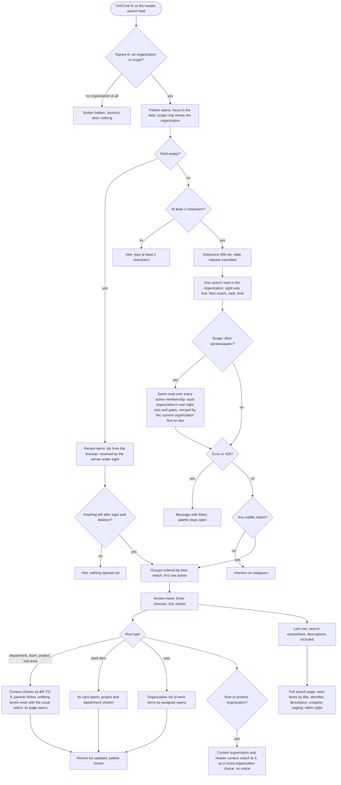

# Spec: Global search palette (feat-065)

## Context and goal

At doc-016 gate-2 (2026-11-12) the human asked for one place to jump to anything by typing: a palette opened with Ctrl+K (Cmd+K on macOS) or a search field in the middle of the header (a magnifier button on narrow screens), which finds departments, teams, projects, sub-areas, users and work items, shows the user's recent items when the field is empty, and is fully usable by keyboard. Everything it finds is inside the user's sight (doc-016 BR-TD-12..-17, delivered by feat-041; ADR-0040): a hidden object is not found, not counted, not hinted at. Today the panel can only filter one project's list by keyword (feat-003) and, after doc-016, jump between departments, teams and projects from the context panel (BR-TD-21); nothing finds a work item or a person from anywhere. This analysis decides what is searched and how it is ranked, how sight is enforced without disclosure, what "recent" means and where it lives, what choosing a row does, and the delivery lines. At gate-1 (2026-11-13) the human added a second mode: the palette is the quick search (identifiers, titles, names; typo-tolerant), and a full search page, reached from the palette's last row, also searches work items' descriptions with stemming and shows snippets. Implementation waits for feat-041; the design stage follows this one. Rule ids: BR-GS-n are this spec's; BR-TD-n are doc-016's; BR-WS-n are feat-003's.

## Roles

Organization roles «Администратор», «Участник», «Читатель» (ADR-0027) and the scoped grants (ADR-0038). The palette adds no permission code: each group is read under the gate its object already has, and sight (BR-TD-12..-15) comes first.

| Role | Finds |
|---|---|
| Any active member | the departments, teams, projects and sub-areas they see (BR-TD-12..-15); the work items of the projects they see, under `workitems.workitem.read`; the organization's members, under `organizations.membership.read` (today all three role bundles hold it, so every member gets the group; the gate is kept and tested at the handler with a caller lacking the code) |
| Organization «Администратор» | everything of the organization (BR-TD-12), deleted and deactivated objects excepted |
| Not a member (an instance administrator included) | nothing: «Организация не найдена.» for the palette's organization (BR-GS-4); in «Все организации» an organization without the user's active membership is simply absent (BR-GS-19) |

Common cast of every story: organization «Ромашка» (Ann «Администратор»; Max, Olga «Участник»; Vera «Читатель»); departments «Логистика» and «Финансы»; teams MARS and VENUS in «Логистика», JUPITER in «Финансы»; projects «Альфа» (key ALP) and «Браво» (BRV) in «Логистика», «Чарли» (CHR) and «Дельта» (DLT) in «Финансы»; links MARS–ALP, MARS–BRV, VENUS–ALP, JUPITER–CHR, JUPITER–DLT; every project's «Видим всей организации» is off; Olga is a member of VENUS and holds no grant, so she sees ALP, VENUS, MARS (linked to ALP) and «Логистика»; Max holds a department grant on «Логистика» and on «Финансы», so he sees every department, team and project (BR-TD-12 (a), BR-TD-13). Items: ALP-US-7 «Оплата картой», BRV-BUG-3 «Оплата картой», CHR-TASK-5 «Оплата счёта». Organization «Другая» (Olga «Участник»): department «Склад», team ORION, project «Зет» (ZED), item ZED-US-1 «Оплата картой».

## Stories

| id | Title | depends-on | File |
|----|-------|------------|------|
| US-1 | The palette opens from Ctrl+K or the header button and works by keyboard | - | `stories/US-1-open-palette-keyboard.md` |
| US-2 | Typing finds departments, teams, projects, sub-areas and users, grouped and ranked | US-1 | `stories/US-2-find-structure-and-users.md` |
| US-3 | Typing finds work items by identifier or title | US-1 | `stories/US-3-find-work-items.md` |
| US-4 | Only what the user sees is found, and nothing reveals what is hidden | US-2, US-3 | `stories/US-4-sight-no-disclosure.md` |
| US-5 | Choosing a result opens it and sets the work context | US-2, US-3 | `stories/US-5-choose-result.md` |
| US-6 | An empty field shows the user's recent items | US-5 | `stories/US-6-recent-items.md` |
| US-7 | A full search page finds work items by their description too, with snippets | US-3 | `stories/US-7-full-search-page.md` |
| US-8 | The user can search all their organizations at once | US-2, US-3, US-4, US-5, US-7 | `stories/US-8-search-all-organizations.md` |

No story is `shippable` alone: the palette is one capability delivered by the lines in § Decomposition. A docs/design cut: no story is delivered by this task.

## Business process (BPMN)

## Business rules

| # | Rule | Source |
|---|------|--------|
| BR-GS-1 | **Opening.** Ctrl+K (Cmd+K on macOS) anywhere in the signed-in shell, and a click or focus on the search field in the middle of the header (between the context path and the user menu; on a narrow screen the magnifier button that replaces it) open the search panel: the field is the combobox, labelled «Поиск», and a dropdown panel opens under it as the context panel does (no modal, no dimmed page); the shortcut toggles it and cancels the browser's own binding. The field shows the hint «Ctrl K» («⌘K» on macOS); the magnifier's tooltip and `aria-label` read «Поиск (Ctrl+K)», «Поиск (⌘K)» on macOS. Focus lands in the field; on close it returns to the element that had it before. A user with no organization has neither the field, the button nor the shortcut. Two exceptions to "anywhere": inside the rich-text editor (ADR-0039) Ctrl/Cmd+K stays the editor's own link command and the palette does not open there (the field and the magnifier still open it); while another modal dialog is open the shortcut does nothing. | the human, doc-016 gate-2; ADR-0039 (the editor's existing Ctrl/Cmd+K) |
| BR-GS-2 | **Scope: the current organization.** The palette searches one organization: the one the address carries; with none in the address (Главная, «Все организации»), the remembered one (ADR-0032 § 6), else the user's first by name. A chip in the palette names it and lets the user pick another of their organizations for the palette only; that changes no header selector and lasts until the palette closes (every opening starts from the default above). The chip's menu also offers «Все организации» to a user who is an active member of two or more organizations (BR-GS-19); the default stays the one organization above. In one-organization mode a result never mixes organizations. | the human, 2026-11-13 (current organization; gate-2: «Все организации»); ADR-0032 §§ 5-6 |
| BR-GS-3 | **What is searched, and in which fields.** Work items: the identifier and the title (BR-GS-7). Projects: name and key. Departments, teams, sub-areas: name. Users: display name and email, among the organization's current members only (a former member is not found; a member whose account is disabled is found and reads «(неактивен)», feat-003 BR-WS-7). The palette does not search a work item's «Описание» (that is the full search page, BR-GS-18), comments or any other field. Matching ignores letter case and treats «ё» as «е» (feat-003 BR-WS-9); every character is literal («%», «_», «\» find only themselves); in the palette words are not reduced to stems (stemming belongs to the full search page) and a wrong keyboard layout is not corrected; near-misses are BR-GS-17. | the human, gate-1 2026-11-13 (OQ-1 two modes, OQ-3 A); feat-003 BR-WS-9 |
| BR-GS-4 | **Sight first (BR-TD-17).** The palette is a surface of BR-TD-17: every read joins the visible departments, teams, projects and sub-areas (BR-TD-12..-15) and, for work items, the visible projects under `workitems.workitem.read`, before matching, ranking and limiting. A non-member of the palette's organization gets «Организация не найдена.»; a project, team or department the user does not see is found nowhere, in any group, on any query. | doc-016 BR-TD-12..-17; ADR-0040 § 4 |
| BR-GS-5 | **No disclosure of existence or counts.** No group shows a total; there is no «N скрытых», no empty group heading for a hidden match, and a result list never differs in length or order because of a hidden row. "More" (BR-GS-9) is known only from the visible rows (the read asks for one row past the limit after sight is applied). Response time must not reveal hidden matches beyond the noise of the visible work (not tested to the microsecond; no early exit on a hidden hit). | BR-TD-17; doc-012 BR-MX-21 |
| BR-GS-6 | **Not found: deleted and inactive.** A work item in the Removed state (ADR-0030), an item of a deactivated project, a deactivated or deleted project, team or department (ADR-0026), and the sub-areas of a deactivated project are not found. The palette is a new named entry point of the recycle bin's hiding (ADR-0030 B2): the entry-point test lists it. | ADR-0030; ADR-0026 |
| BR-GS-7 | **Work item matching.** An item matches when (a) the query is its full identifier (`MSK-BUG-42`) or the project key and the number (`MSK-42`; the number is unique in the project across types, so this names one item); (b) the query is a prefix of its full identifier from its first character (`MSK-BUG-4`, `msk-bug-4`; the key-and-number form of (a) has no prefix match: `MSK-4` names item 4 only); (c) its title contains the query as one piece of text. (a) in either form is BR-GS-8's tier 1, (b) tier 2. A bare number does not match by number (needs the key); it matches titles. Several words are one piece of text, not an AND of words. | analysis default; feat-003 BR-WS-9 widened for type-ahead |
| BR-GS-8 | **Ranking.** Within a group, rows are ordered by match tier, then a tie-break: (1) exact identifier or exact name or key; (2) identifier, name or key starting with the query; (3) a word of the name or title starting with the query; (4) contains; (5) similar (BR-GS-17), always below tiers 1-4 and ordered by similarity, highest first. Tie-break: work items by latest change, then identifier (project key, then number descending); projects, teams, departments, sub-areas and users by name (the Russian collation of the lists), then id. Groups appear in the order of their best row's tier, equal tiers in the fixed order «Рабочие элементы», «Проекты», «Команды», «Департаменты», «Области», «Пользователи»; the first row of the first group is active. | analysis default |
| BR-GS-9 | **Limits and "more".** At most 5 rows a group on the first read. A group with more visible matches ends with the row «Показать ещё», which expands that group in place to at most 20 rows (one more read, the same query); there is no further paging. Below every group, whenever the query is valid, the palette's last row is «Искать везде, включая описания» (BR-GS-18); it is there even when nothing matched. Besides it the panel carries a permanent button «Полный поиск» in every state, the empty field included, opening the same page with the current text (or none) and the current scope. The palette no longer links to the organization's «Рабочие элементы» list with a keyword, so the palette and its destination share the identifier grammar (BR-GS-7) and no list-keyword divergence exists. | the human, gate-1 2026-11-13 (R-5) |
| BR-GS-10 | **Query rules.** Trimmed; at least 2 characters (shorter: «Введите не менее 2 символов»); at most 100 (the field stops there); 200 ms debounce after the last keystroke; a read still in flight when the text changes is cancelled and its answer is ignored; no read runs while an IME composition is open. The query text is never written to the application's logs, traces or any record (only its length and the timing); the design chooses a transport that keeps it out of the request line the API logs (no query-string parameter, or one redacted), and the edge proxy's access log is outside this rule. Contrast: the context panel's own field searches from the first character (BR-TD-21). | analysis default |
| BR-GS-11 | **Rows.** A row shows its type icon (the tree's, ADR-0024 tokens), the primary text with the matched part emphasised, and a grey secondary line: work item — the primary text is the identifier and the title, the secondary line the state and the project name; project — key, department; team — department; department — nothing; sub-area — project, department; user — email. A department, team and project row show the object's colour (BR-TD-20) as the context panel does. | doc-016 BR-TD-20, -21 |
| BR-GS-12 | **Choosing (see US-5).** A department, team, project or sub-area is chosen in the context as BR-TD-9 says (organization and department follow; a chosen value the choice leaves unfitting resets to «все» with «Выбор сброшен: …»; one that still fits stays and nothing is announced; doc-016 design § 3.3) and its own page opens (the bare object address, ADR-0032 § 1); a sub-area chooses its project and the project's department (ADR-0032 § 5). A work item opens its card under its project, the project and its department being chosen as for a project: the team stays when it still fits, else resets with the notice. A user opens the organization's «Рабочие элементы» filtered by that person as «Исполнитель» (feat-003); there is no user page. A person assigned no visible live item gets the list's own answer to a value that selects nothing (feat-003 BR-WS-10: an empty list, the band showing a filter is on, «Очистить фильтры»); the human accepted this outcome (R-10). Every row is a real link: a middle click or Ctrl/Cmd+Enter opens it in a new tab, which sets the context from its address. | the human, gate-1 2026-11-13 (OQ-6 A, R-10); ADR-0032 §§ 1, 5; BR-TD-9 |
| BR-GS-13 | **Recent items (see US-6).** "Recent" is what the user opened — an object's own page or a work item's card, from the palette or by any other route — not what they typed. An object's own page is any page whose address prefix names it as the primary object (ADR-0032 § 1: any menu entry of a department, team or project; a sub-area's node page); a project's «Структура» node page records the project; a card records the work item only; the query's `teamId`/`departmentId` record nothing. At most 10, newest first, one entry per object, per user and per organization, kept in the browser's `localStorage` as type, id and organization only, no names (`mustask.recent.v1..<organizationId>`, like ADR-0032 § 6's key). The empty field sends the ids to one read that returns only the objects the user still sees today, with their current names; an object that is gone, deleted, deactivated or no longer visible is omitted without a reason and its id is dropped from storage on the next write, judged only by a resolution that succeeded (a failed resolution drops nothing and shows BR-GS-15's message). | analysis default (OQ-4, OQ-5); ADR-0032 § 6; ADR-0030 |
| BR-GS-14 | **Differences from the neighbours; no duplication.** The context panel's field (BR-TD-21) selects a department, team or project inside the selectors and stays; the «Структура» filter (BR-TD-21, feat-061) hides rows on a page and never navigates; feat-003's keyword filters one project's list. The palette finds across types and navigates. It shares their sight sets (BR-TD-12..-15) and the fields they match for structure objects (name, a project's key); its own match rules (BR-GS-3: two characters at least, «ё» as «е», literal characters) are the palette's and change neither of them; it does not replace any of them. feat-062 owns sight on the multi-project views' keyword filters and counts; the palette needs none of that line. | doc-016 BR-TD-21, -22; feat-061; feat-062 |
| BR-GS-15 | **Failure.** An error or a 429 (`http.too_many_requests`, ADR-0036's limiter wording) shows «Не удалось выполнить поиск. Попробуйте ещё раз.» with «Повторить» (a 429 is retried by `Retry-After`, up to 3 tries); the field keeps its text and the palette stays open. Offline is the same message, and so is a failed resolution of recent items (BR-GS-13). A 404 «Организация не найдена.» (the user stopped being a member of the palette's organization while it was open) shows that text without «Повторить». | ADR-0036; ADR-0007 |
| BR-GS-16 | **Accessibility.** The field is a combobox over a listbox with `aria-activedescendant`; groups are labelled; a polite live region says the number of rows shown («Найдено: 7») or the empty text, never a hidden total; focus stays in the field and the panel and leaving them closes the panel; Esc closes at any time; it works from 640 CSS px (below the design's breakpoint the field collapses to the magnifier and the panel takes the full width) and the active row is visible without a mouse. | ADR-0024; doc-016 § 9 |
| BR-GS-17 | **Typo tolerance, the last tier.** When a group's exact, prefix, word-prefix and contains tiers (1-4) return fewer rows than the group's limit (5 on the first read, 20 on an expansion) and the query is at least 4 characters, the group is filled up with trigram-similar rows (tier 5), after all tier 1-4 rows, never displacing one; it applies to titles, names, project keys and users' names and emails, not to identifiers (a mistyped identifier finds nothing). The measure is `word_similarity` over the folded text (case, «ё»→«е»); the threshold is the design's, fixed in the ADR and pinned by a test table of near-misses and non-matches; a similar row carries no emphasis. The tier works inside sight like every tier (BR-GS-4): similarity is computed over the visible set only. | the human, gate-1 2026-11-13 (OQ-2 A with typo tolerance) |
| BR-GS-18 | **Two modes; the full search page.** The quick search is the palette. The full search is a page in the organization, reached only from the palette's last row «Искать везде, включая описания» or its permanent «Полный поиск» button (it carries the query; the page has its own field and the address carries the text and the page number). It lists work items only (structure objects and people have no description; the palette already finds them by every field, so the page repeats none of them). A match is: BR-GS-7's identifier forms, or the query's words found in the title or in the description, by stemmed Russian and English word forms (Postgres full-text, both configurations, a word matching in either), all words required. Ranking: identifier hits first, then title matches, then description-only matches, each by relevance, then latest change, project key, number descending. Each row shows the palette's row (BR-GS-11) plus, for a description match, a plain-text snippet of the description with the matching words highlighted, rendered as text (never as markup). The description searched is plain text derived from the sanitized HTML (ADR-0039: tags dropped, entities decoded, block boundaries as spaces, link text kept and link addresses not), kept up to date by the description's own write, so a saved edit is searchable on the next request. Sight (BR-GS-4), hiding (BR-GS-6), query limits (BR-GS-10, 2..100 characters) and failures (BR-GS-15) are the palette's. 20 rows a page (ADR-0015 envelope, page ceiling 100 as its rule); the page shows the count of visible matches and no more (BR-GS-5 forbids counting hidden ones, not visible ones). | the human, gate-1 2026-11-13 (OQ-1); ADR-0039; ADR-0015 |
| BR-GS-19 | **Scope «Все организации» (US-8).** A third kind of choice in the scope chip, offered only to a user with two or more active memberships; it lasts until the palette closes and the default is unchanged (BR-GS-2). **Sight, per organization:** the user's active memberships are read on the server, never named by the client; each organization is searched under its own sight sets (BR-TD-12..-17) and gates (`workitems.workitem.read`, `organizations.membership.read`), and nothing crosses organizations: a grant, a team or a sight in one gives nothing in another. A deactivated or ended membership contributes nothing and leaves no trace; an organization the user is not a member of is never mentioned, in no row, heading, count or error (BR-GS-5 extends: no total, no per-organization count, no list of organizations that matched). **Display:** groups stay by type; every row's secondary line ends with its organization's name (all rows, the current organization's too, so the mode reads the same everywhere); two organizations' same key or same identifier (`ALP-US-7` in both) are two rows told apart by that name; the same person in two organizations is two rows. **Ranking:** one list per group, by BR-GS-8's tiers; ties by the current organization first, then the other organizations by name, then BR-GS-8's own tie-break. **Limits unchanged and shared:** 5 rows a group in total (not per organization), «Показать ещё» up to 20 in total; one organization with many matches may fill a group. **Choosing:** a row of another organization opens that object's address; the current organization and the header context become that organization's, as any cross-organization choice does (ADR-0032 § 5; doc-016 design § 3.3: the lower selectors follow BR-TD-9 within the new organization, no «Выбор сброшен» for values of the old one); a user row opens that organization's «Рабочие элементы» by assignee. The scope returns to the default at the next opening. **Recent items:** the empty field in this mode shows the current organization's recent items, exactly as in one-organization mode (BR-GS-13 stands: per organization, no timestamps across keys); the other organizations' recent items are reached by choosing that organization in the chip. **Full search page:** the row «Искать везде, включая описания» carries the scope as a page parameter; the page applies the same rules (per-organization sight, organization name on each row, ties by current organization first; paging over the merged order) and lets the user change the scope there too. **One request:** the mode is one read however many organizations the user has; the limiter counts one slot (BR-GS-15 unchanged). | the human, gate-2 2026-11-13; BR-TD-17; ADR-0032 § 5; ADR-0040 § 4 |

## Operation completeness

| Entity | Create | Read | Update | Delete/deactivate | Cancel/reverse |
|--------|--------|------|--------|-------------------|----------------|
| Search query (typed text) | the user, in the field (US-2, US-3) | the user, as results; never stored (BR-GS-10) | retype | clear the field (shows recent) | Esc closes, text discarded |
| Result row (department, team, project, sub-area, user, work item) | no: derived from objects | any member, within sight (US-4) | no | no: leaves the results when the object leaves sight, is deleted or deactivated (BR-GS-6) | no |
| Recent entry | by opening an object (US-6) | its user, only while the object is still visible | no: reorders on re-open | no: aged out beyond 10; dropped when unresolved; «Очистить недавние» clears the list (US-6) | no |
| Description's plain-text copy | derived on every description write and, once, for existing items (backfill) | no row reads it but the full search; no one sees the copy itself | follows the description | goes with the item (purge, ADR-0030 C3) | no |
| Palette scope (organization chip) | no: defaults per BR-GS-2 | the user | the user picks another of their organizations, or «Все организации» when they have two or more (BR-GS-19) | no | pick again |

## Non-functional requirements

- **Volumes.** One organization at doc-012's volumes: 100 000 work items, 1 000 areas, 200 projects, 200 teams, 2 000 members; a user seeing everything or a tenth of it. The server read has p95 ≤ 300 ms and p99 ≤ 800 ms at these volumes with the sight sets applied, and the result is on screen within 600 ms of the last keystroke at p95 (debounce included), measured by a volume test. A non-indexable pattern (a 2-character query) stays within the same targets.
- **Full search page.** Same volumes, descriptions averaging 1 500 characters: p95 ≤ 1 s for a 2-word query with snippets, p99 ≤ 2 s; the extra storage of the plain-text copy and its index is stated in the ADR; the backfill of existing items completes without blocking writes. Snippets are built only for the 20 rows of the page.
- **Query shape.** A fixed number of statements per read, independent of rows, groups and the sight sets' sizes (sight sets read once, then at most one statement per group); a statement-count test pins it. Recent resolution is one statement per type, at most one request for ten ids.
- **Load.** A search is a hot, frequent read: it has its own per-user concurrency limit and a per-process one, refused with 429 and `Retry-After` as ADR-0036 does for group reads; the numbers are the design's. The debounce and the cancel of stale requests are required, since they are what keeps the load near one read per pause.
- **Non-disclosure.** BR-GS-4/-5: a test per object kind holds a hidden object out of the results, the "more" row, the live region and the recent list; the response bodies for a hidden object and for a name that exists nowhere are identical.
- **Privacy.** The query text is not in the application's logs or traces (BR-GS-10). Email is matched and shown only for a holder of `organizations.membership.read`, the same people the «Участники» page already shows it to.
- **All organizations (BR-GS-19).** One request however many organizations; the statement count is fixed and does not grow with organizations (the memberships, sight sets and one statement per group are set-based over all of them); a statement-count test with 1, 3 and 5 organizations pins it. Each organization at the volumes above, a user in N ≤ 5: p95 ≤ 500 ms and p99 ≤ 1.2 s for the read, on screen within 800 ms of the last keystroke at p95; for doc-016's 10 organizations the read still finishes within 1 s at p95. The full search page in this mode: p95 ≤ 1.5 s for N ≤ 5. The per-user limiter admits it as one read.
- **Tenant.** In one-organization mode every read is scoped to the organization of the route and an id of another organization in the recent list resolves to nothing. In «Все организации» a row never carries data of an organization the user has no active membership in, and no object of one organization is ever read under another's sight sets; a test with a user who left an organization, and one with different roles in two, holds this.
- **Localization.** Interface copy is Russian, quoted in this spec and the stories; new error text (if any) goes to the catalogue at the backend stage.

## Out of scope

- Merged recent items across organizations; a per-organization quota or fairness in the shared group limit of «Все организации» (BR-GS-19); searching an organization where the user has no active membership, an instance administrator's rescue access included.
- Searching comments, tags, attachments, custom fields; wrong-keyboard-layout correction; synonyms; typo tolerance on identifiers and on the full search page (it stems, it does not fuzz).
- Structure objects and people on the full search page (the palette finds them by all their fields).
- Commands in the palette («Создать…», «Перейти в настройки»), saved searches, filters inside the palette, search history of typed queries.
- Searching deleted items, the recycle bin, deactivated objects (BR-GS-6).
- A user profile page (none exists); the organization's «Участники» page gains nothing.
- Sight on the multi-project views, counts and the keyword filter on lists (feat-061, feat-062); the palette does not change them.
- Server-side recent items and recent items across devices (OQ-4).
- Full-text ranking beyond Postgres `ts_rank`; a separate search engine (OpenSearch, etc.).

## Decomposition for the backlog

Proposals for the human; the orchestrator queues them with numbers after approval. Priority in the order given. The queue line `feat-065-global-search` (size:M, one line) is replaced by these eight; one ADR (trigram for the quick search with typo tolerance, full-text for the full search, the limiter) is owed with the first.

| id | Task | size | deps |
|----|------|------|------|
| `feat-NNN-search-structure-users-read` | US-2 and US-4's read side for departments, teams, projects, sub-areas and users: the one search read in an organization (sight sets joined first, groups, ranking, limit+1 "more", expansion of one group), the trigram indexes on names and keys, the per-user and per-process limiter, the ADR for the match technique and the limiter accepted at its gate, error catalogue entries, hidden-object tests per kind, statement-count and volume tests | M | feat-041-project-visibility |
| `feat-NNN-search-work-items-read` | US-3 and US-4's read side for work items: identifier grammar (BR-GS-7), the title index, joining visible projects and the read gate, the Removed/deactivated hiding and its entry-point test entry, the group in the same read and its expansion, volume test at 100 000 items | M | `feat-NNN-search-structure-users-read` |
| `feat-NNN-search-dialog-kit` | The UI kit parts the palette and the page are built from, split out at gate-2 (design D-8, review R-23): `SearchField`, `SearchPanel`, `SearchOption`, `HighlightedText`, `ThinSearchIcon` and the theme tokens of design § 1, with their kit tests; no feature uses them yet, so it ships ahead of feat-041 | S | - |
| `feat-NNN-search-palette` | US-1, US-2, US-3, US-5 in the panel, on the kit parts of `feat-NNN-search-dialog-kit`: Ctrl/Cmd+K and the header search field (the magnifier on narrow screens), the panel under it with the combobox, debounce and cancel, groups and rows, keyboard, scope chip, choosing (context per BR-TD-9, -10, card, the assignee-filtered list), states and failures | M | `feat-NNN-search-work-items-read`, `feat-NNN-search-dialog-kit`, `feat-063-cascading-context-selectors`, `feat-062-sight-in-work-views` |
| `feat-NNN-search-all-organizations` | US-8 (BR-GS-19): the read over every active membership in one request (each organization's own sight sets and gates, merged ranking with current-organization ties, shared limits, organization name on rows), the same for the full search read and page parameter, the third chip option in the palette and the page, the choice that switches the organization and context, tests of sight per organization, left organizations, identifier collisions, statement count over 1, 3, 5 organizations and the volume targets; no new index | M | `feat-NNN-search-full-page`, `feat-064-cross-organization-selectors` |
| `feat-NNN-search-recent` | US-6: the recent list (route-level recording of opened objects, the browser key), the resolving read under sight, the empty state, «Очистить недавние» | S | `feat-NNN-search-palette` |
| `feat-NNN-search-description-index` | The backend base of US-7: the description's plain-text copy derived in the description's write (sanitized HTML to text, ADR-0039), the backfill of existing items, the full-text index (Russian and English configurations), the entry in the ADR accepted by line 1; tests of the derivation (tags, entities, links, lists, tables, empty), of freshness on edit and of purge | M | `feat-NNN-search-structure-users-read` |
| `feat-NNN-search-full-page` | US-7: the full search read (identifier forms, words by stem in either configuration, title above description ranking, snippets, ADR-0015 paging, sight and hiding, limiter, statement count, volume test) and the page «Поиск» (field, results with highlighted snippets, pager, states) with the palette's last row «Искать везде, включая описания» | M | `feat-NNN-search-description-index`, `feat-NNN-search-work-items-read`, `feat-NNN-search-palette` |

`feat-063-cascading-context-selectors` (doc-016) is the line whose choice rules (BR-TD-9, -10, -18) the palette reuses; it is required because choosing must not re-implement them. `feat-062-sight-in-work-views` is required because the user rows open the organization's «Рабочие элементы» list, whose sight is that line's (the full search page reads under its own sight and needs none of it): before it the palette would be a new road onto a list that does not yet hold BR-TD-17. If the human prefers an earlier first release, `feat-NNN-search-palette` can ship with structure and users only (dropping the dependency on the work items read) and the work items group follows.

## Open questions

All decided by the human at gate-1, 2026-11-13; the options stay as the record of what was weighed.

- [x] **OQ-1 Is a work item's «Описание» searched?** Decided 2026-11-13: **two modes**. The palette stays A (identifier and title); a full search page, reached from the palette's last row, also searches descriptions (B, as a second mode, with Postgres full-text and snippets): BR-GS-18, US-7. (A, recommended) No: title and identifier only (BR-GS-3). The description is sanitized HTML (ADR-0039), so searching it needs a stored plain-text copy, a second index and a rule for reindexing on edit; titles and identifiers cover "find that item". Downside: an item known only by a phrase in its description is not found; the project list's keyword has the same limit (feat-003). (B) Yes, through a derived plain-text column with its own trigram or full-text index: finds more, at the cost of a new column, an update path in every description write, and a larger index on the table that grows fastest. (C) Later: ship A now and queue B as its own line once usage shows the need.
- [x] **OQ-2 The match technique: which database features.** Decided 2026-11-13: **A** for the palette, plus typo tolerance as a last tier (BR-GS-17); the full search page uses full-text (B's technique, for the page only); one ADR covers both. (A, recommended) `pg_trgm` GIN indexes on the folded (lower, «ё»→«е») title, names, keys and display names, with a substring match: fits type-ahead on partial words and identifiers, mixes Russian and English without a language configuration, matches feat-003's no-stemming semantics. Needs `CREATE EXTENSION pg_trgm` in every database (a one-line additive migration; the company-wide Keycloak realm is not involved, but the DB host must allow it). (B) `tsvector` with Russian and English configurations: ranks by word and handles word forms, but breaks on partial words typed so far, on identifiers (`MSK-BUG-42`) and on mixed text, and needs a language column per item. (C) A plain scan with `LIKE` and no extension: nothing to install, acceptable for names (a few thousand rows), but 100 000 titles per organization scan on every keystroke and break the p95 target as organizations grow. Both A and B depart from ADR-0015's "full-text search … a new ADR" note; the ADR is owed by the first line (not drafted here, the number is issued when a line takes it; an accepted ADR needs the human's `accepted`).
- [x] **OQ-3 Are users found by email as well as by name?** Decided 2026-11-13: **A**. (A, recommended) Name and email: people type either, and the «Участники» page already shows the email to the same readers. (B) Name only: nothing about email is added to a surface; a user known by email is not found.
- [x] **OQ-4 Where recent items live.** Decided 2026-11-13: **A**, `localStorage`, ids only. (A, recommended) The browser's `localStorage`, ids only, per user and organization (BR-GS-13): no table, no migration, the server stays authoritative for names and sight; recents do not follow the user to another browser. (B) On the server, per user and organization: follows the user across devices, at the cost of a table, a write on every opening (a write on a read path) and a retention rule. ADR-0032 § 6 took the same trade for the remembered selection.
- [x] **OQ-5 What counts as "opened".** Decided 2026-11-13: **A**, any opening of an object's page or card. (A, recommended) Any display of an object's own page or a work item's card, whether reached from the palette or by a board, link or address (BR-GS-13), recorded by one route-level hook. (B) Only what was chosen in the palette: far simpler, but the empty field is mostly empty for a user who works from boards. 
- [x] **OQ-6 What choosing a user does.** Decided 2026-11-13: **A**, the list filtered by «Исполнитель»; a person assigned nothing opens an empty list (review R-10 accepted). (A, recommended) Opens the organization's «Рабочие элементы» filtered by that person as «Исполнитель» (BR-GS-12): it needs no new page and answers the usual "what is X working on". (B) Opens «Участники» scrolled to the person: needs the members page to take a person in its address and highlight a row, a change to another line's page. (C) No users group in this cut: removes the question, loses "find a colleague".
- [x] **Review R-1** Decided 2026-11-13: inside the description editor Ctrl/Cmd+K stays the editor's link command (BR-GS-1).
- [x] **Review R-4** Decided 2026-11-13: the palette line waits for feat-062 (user rows open that list).
- [x] **Review R-5** Decided 2026-11-13: «Все рабочие элементы по запросу» is replaced by the full-search row; the divergence text is gone (BR-GS-9).
- [x] **Review R-10** Decided 2026-11-13: a person assigned nothing opens an empty list (BR-GS-12).
- [x] **OQ-7 (decided at gate-1, 2026-11-13: work items only, as the default)** The full search page lists work items only, not structure objects or people: they have no description to search and the palette finds them by all their fields. If the human wants one page listing every type, US-7 grows into a second grouped read and the line is no longer M.
- [x] **OQ-8 Search across all of the user's organizations.** Decided by the human at gate-2, 2026-11-13: the scope chip gets «Все организации» beside the organizations (BR-GS-19, US-8); the current organization stays the default and the choice lasts until the palette closes. Analyst's choices inside it, for the human to confirm: (1) the empty field shows the current organization's recent items, not a merge (merging needs a timestamp per entry across storage keys); (2) the full search page carries the scope, with the same rules; (3) the 5-row group limit is shared by all organizations, not per organization; (4) the option is absent for a user with one organization; (5) every row carries its organization's name in this mode, the current organization's too.
- Left to the design and the ADR, not to the human: the `word_similarity` threshold (BR-GS-17), the plain-text derivation details, snippet length, the transport of the query text that keeps it out of the API's request log (BR-GS-10), the limiter numbers.
