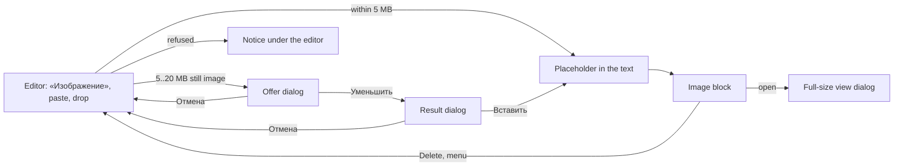

# Design: images in Описание (feat-018 task B)

Stories: US-1 (insert, notices, host seam), US-4 (display, full size, read-only),
US-6 (the over-5-MB reduction). US-2, US-3 and US-5 are server-only and have no
screen (their client half is the refusals of US-1 and the stored form). The
editor is the feat-018 `RichTextEditor` (TipTap, ADR-0039): this design adds one
node (an image block), one toolbar control and three dialogs, and names no
library API. Interface copy is final Russian: the stories' copy tables are used
verbatim, § Interface texts lists what this design adds. Prototype:
[`prototype/index.html`](prototype/index.html), clickable, opens from `file://`
(plain script, no build, no network).

## Screen map

No new route. The work item form's section «Описание» (feat-018) gains the
image control; four surfaces open from the editor, none is a route. The same
editor sits in feat-059's send and edit dialogs (§ Host seam).

| Surface | Stories | Who sees it |
|---|---|---|
| Editor with the image control, placeholder, image block, notices | US-1, US-4 | the item's editors; readers get the image block only |
| Offer / reducing / result / cannot-reduce / failure dialog (one `Dialog`, five bodies) | US-6 | editors |
| Full-size view (`Dialog`) | US-4 | everyone who may read the item, read-only roles included |
| Image menu (`Menu`, keyboard path) | US-1, US-4 | editors (readers get no menu: «Открыть» is Enter) |

Permissions: no new one. No right to edit, or «Удалена»: no «Изображение»
button, paste and drop insert nothing, no delete control (§ Read-only).

## Toolbar control «Изображение»

Takes feat-018's reserved slot: the **last control of group 5**, after
«Эмодзи». `IconButton size="small"` with `Image` (`@mui/icons-material`,
ADR-0019), `aria-label` «Изображение», `Tooltip` «Вставить изображение» (no
shortcut). It opens the browser's file chooser (a hidden `<input type="file"
multiple accept="image/png,image/jpeg,image/gif,image/webp">`; the real check
is by content, BR-IM-2). It joins the toolbar's roving tabindex and is data in
feat-018's control array, so tasks C and the host see no layout change.

- **Never context-disabled**: in a heading, table cell or code block the insert
  lands after the block (BR-IM-13). It is disabled while the card saves, and
  **absent** (not disabled) without the right to edit.
- The toolbar now has 27 controls. The developer checks at 640 px that it still
  fits two rows; if not, feat-018's overflow rule applies (group 5 moves into the
  «Ещё» `Menu`), and «Изображение» stays reachable there with the same name.
- After a chosen file the focus returns to the body at the caret; a cancelled
  chooser leaves it on the button.

## Placeholder, image block, states

**Placeholder** (an uploading image). A block of its own at the insert place:
`Box` with a dashed `inputBorder`, min height 96 px, the text «Загрузка
изображения…» and an indeterminate `LinearProgress` (the browser's `fetch` gives
no byte progress, so none is promised). `aria-busy="true"`, `aria-label` = the
text. It is selectable and removable like an image: Delete removes it and
cancels the upload (the result is ignored; the server's sweep removes a stored
upload). Editing goes on around it (BR-IM-14).

**Image block** (stored or uploaded). An `img` as a block between paragraphs;
**natural size, scaled down proportionally to the editor's width, never up**
(`max-width: 100%; height: auto`), a 1 px `divider` border and the shape's
radius so a white screenshot has an edge on both themes. Alternative text =
the stored text alternative (file name without extension, «Изображение» for a
clipboard image). The address comes from the host (§ Host seam), never typed by
the editor.

| State | What shows |
|---|---|
| Loading (read pending) | `Skeleton variant="rounded"` 240 × 120 px at the image's place; the text around is already shown (BR-IM-12) |
| Shown | the image; nothing else |
| Cannot be shown (removed, read failed) | `Box` with a dashed border, `BrokenImage` icon and «Изображение недоступно»; `role="img"`, the same name; the rest of the text stays; no retry button (a reopened card reads again) |
| Selected (editors) | 2 px accent outline with 2 px offset (a shape, not only a colour) and, top right, two pointer buttons: «Открыть в полном размере» (`OpenInFull`) and «Удалить изображение» (`DeleteOutline`), `IconButton size="small"` on `paper`; both are out of the tab order (as feat-018's table handles); the keyboard path is below |
| Uploading | the placeholder above |
| Saving | images stay shown and openable; delete and the «Изображение» control are off (the editor is disabled as feat-018 says) |

A transparent image sits on the editor's `paper`, no checkerboard.

## Paste, drop and the file chooser

| Input | Behaviour |
|---|---|
| File chooser, several files | one placeholder per file, in the chosen order, all at the caret; uploads run in parallel, the order of the blocks is the chosen order, not the finishing order |
| Paste of an image or an image file | at the caret; text alternative: the file's name without the extension, «Изображение» when there is no name |
| Paste of rich content | as BR-IM-13: the text as feat-018; own-store, data-address and foreign images by its rules and the US-1 notices |
| Drop of files | inserted at the **drop position** (a drop cursor line shows it); while files are dragged over the card its border turns dashed accent with a `sel` tint; the browser never navigates to the file; dragging text or links shows nothing new |
| Several files, some refused | the valid ones go in; each refusal text is announced **once** per action, one line per kind, up to the kinds there are (never more than four lines) |

Insert place (BR-IM-13), made visible: a caret in a paragraph splits it (an
empty half is not kept); in a heading, a table cell or a code block the image
goes right after the block; in a list item it is a block of its own in that
item.

**Notices.** feat-018's polite live region under the card (always in the DOM,
cleared on the next edit or blur, a second action re-announces; `ⓘ` icon, the
helper's caption size). Refusals use the story copy; added lines are in
§ Interface texts. A server refusal announces the server's reason (the text of
its error code, `docs/error-codes.md`); a network failure or a server error
announces «Не удалось загрузить изображение. Попробуйте ещё раз.» and removes
the placeholder; the rest of the description is unchanged.

**Count.** The 50-image check counts images, placeholders and the offers waiting
in the queue, at the moment of the insert; over it: «В описании может быть не
больше 50 изображений.», no placeholder, no offer (US-6).

**Save with an upload running** (BR-IM-14). «Сохранить» (and the item form's
other save paths) is accepted; the form shows its usual saving state and the
editor's helper slot reads «Дожидаемся загрузки изображений…» (polite) until
the uploads end; then the description is sent with the images that succeeded and
no trace of a failed one (its notice is announced). The helper returns to «До
100 000 символов» afterwards.

## Dialog «Изображение больше 5 МБ» (US-6)

One MUI `Dialog` (`maxWidth="sm" fullWidth`; below 600 px `fullScreen`) with
`DialogTitle`, `DialogContent`, `DialogActions`, `aria-labelledby` the title.
It changes body in place (no new dialog per step), so focus never leaves it. It
is opened over the editor, and over feat-059's `FormDialog` too (a nested modal:
Esc and a click on the scrim close only this one).

Under the title, a caption (`Typography variant="caption"`, `text.secondary`)
holds the file name, and «Файл {n} из {N} · » before it when the insert has
more than one file over 5 MB (queue).

| Step | Content | Buttons (default is filled; initial focus) |
|---|---|---|
| Offer | title «Изображение больше 5 МБ»; text «Размер файла — {размер}, а в описание можно вставить изображение не больше 5 МБ. Система может уменьшить его: файл станет легче, изображение может стать немного менее чётким.» | «Отмена», **«Уменьшить»** (focus) |
| Reducing | «Уменьшаем изображение…» (`role="status"`) and an indeterminate `LinearProgress`; the NFR is 15 s, no timeout of its own is drawn | «Отмена» only (focus): it aborts the request and ignores a late answer |
| Result | two lines in one `Typography` block, `fontWeight 600`: «Было: {размер}, {ш} × {в}» and «Стало: {размер}, {ш} × {в}», then the preview (`img`, max width of the content, max height 40 vh, `object-fit: contain`, alternative text «Уменьшенное изображение», loaded through the host's address rule); the lines are the first thing a screen reader reads with the dialog (`aria-describedby` on both lines) | «Отмена», **«Вставить»** (focus) |
| Cannot reduce | `Alert severity="warning"`: «Не удалось уменьшить изображение до 5 МБ без сильной потери качества. Уменьшите его в другой программе и вставьте снова.» | **«Закрыть»** |
| Failed (network, server) | `Alert severity="error"` `role="alert"`: «Не удалось уменьшить изображение. Попробуйте ещё раз.» | «Отмена», **«Повторить»** (sends the file again; goes to Reducing) |

Preview states: while it loads a `Skeleton` at 4:3; if the preview cannot be
read, «Изображение недоступно» replaces it, the numbers stay, and «Вставить»
becomes `aria-disabled` (the member cannot judge what is inserted).

**Closing.** «Отмена», Esc and a click on the scrim are the same cancel at every
step: nothing is inserted; at Result the reduced upload is left to the sweep. The
dialog never asks «Вы уверены?». Focus returns to the editor at the caret where
it was, **or** goes straight to the next offer of the queue.

**Queue** (BR-IM-20 (7)). Files within 5 MB of the same insert upload at once and
show their placeholders; the offers open one after another, never two at once;
the next opens as the previous is closed. A confirmed image takes **its own place
in the chosen order** among its batch (the editor holds that place as an invisible
position, not a node, mapped through edits), and a cancelled one leaves no gap.
The editor is not editable while a dialog is open, so nothing moves under it.

## Full-size view

MUI `Dialog` (`maxWidth="lg" fullWidth`; `fullScreen` below 600 px) through the
kit's `DialogTitleBar`: title «Просмотр изображения», its text alternative as a
caption under it, `DialogContent` with `overflow: auto` holding the image at its
**natural size** (larger than the window: scrolls both ways; the scroll area is
focusable, `tabIndex=0`, so a keyboard user can scroll it), `DialogActions` with
**«Закрыть»**. «Закрыть», Esc, the title bar's ✕ and the scrim close it; **focus
returns to the image** it was opened from, selected. Loading: `Skeleton`;
failure: «Изображение недоступно» inside the dialog. It is opened by the pointer
(double click, the selected image's «Открыть в полном размере», or a click in a
read-only view) and by the keyboard (Enter or Space on the selected image, the
image menu).

## Keyboard and screen reader

An image block is a single node: the caret cannot enter it, it is **selected**.

| Keys | Behaviour |
|---|---|
| Arrow keys at a paragraph's edge (← at its start, → at its end, ↑ on its first line, ↓ on its last) | select the neighbouring image; from a selected image ↑/← and ↓/→ go to the neighbour (the text's start or end, or the next image); the gap cursor of feat-018 applies at the document's ends |
| Enter, Space (image selected) | «Просмотр изображения» |
| Delete, Backspace (selected) | removes it; the caret goes to the neighbouring paragraph; undo restores it (Ctrl/Cmd+Z, the toolbar's «Отменить») |
| Shift+F10, ContextMenu key | the **image menu**: `Menu` «Меню изображения» with «Открыть в полном размере», «Удалить изображение»; arrows move, Enter picks, Esc closes and returns to the image |
| Printable keys (selected) | ignored: typing never replaces a selected image (an accidental overwrite would also drop it from the text) |
| Tab, Shift+Tab | leave the editor, as feat-018: an image is not a tab stop in the editing state |
| Cut, paste | moves it; copy puts the image with its reference on the clipboard (the paste rules are BR-IM-13) |

**Announcements.** An image is read as an image with its text alternative
(`img alt`; the selection wrapper has `role="img"` and the same `aria-label`).
When an image becomes selected **by the keyboard** the notice region says «Enter
— открыть в полном размере, Delete — удалить, Shift+F10 — меню.» (the pattern
of feat-018's Tab hint: on the transition, not per move); a pointer selection
says nothing. After an insert «Изображение вставлено.», after a removal
«Изображение удалено.» (both polite). Every control above has a name, the two
pointer buttons included (`aria-label`s), though they are out of the tab order.
Screen-reader and real-clipboard checks are manual QA (US-1, US-4).

## Read-only view

Applies to a read-only role and an item in «Удалена». Images show as in the
editing state but without the selection outline, the pointer buttons, the menu,
the «Изображение» control and any removal. Each image block is a `ButtonBase`
with `role="button"`, `aria-label` «Открыть в полном размере: {text
alternative}», **a tab stop**, opened by a click, Enter or Space: this is the
one place where feat-018's greyed `editable:false` body (known gap QA FD-1) is
refined, because US-4 asks that the full-size view work by keyboard alone for
readers too. Paste and drop do nothing, and a dropped file does not navigate the
browser. The rest of the editor in that state is feat-018's and not designed
here.

## Host seam (BR-IM-19)

The editor names no route. A host form passes it a prop group, an optional
object `images` with three members: the **upload operation** (a file in, the
opaque reference, the text alternative and the stored size back, abortable), the
**reduction operation** (the same shape, for the US-6 request), and the
**address rule** (a stored reference in, the string an `img` loads from out; it
serves the editor, the preview of a reduction and the full-size view). Without
`images` the editor shows no «Изображение» control, no insert on paste or drop,
and a dropped image file is ignored without navigation: it is the state of every
other host until it adopts images. The item form passes the item's upload and
read; feat-059's two dialogs pass the feedback operation and its read, so the
same stored markup displays on both surfaces. The 50, 5 MB, 20 MB limits are
props with those defaults.

Inside feat-059's `FormDialog` nothing else changes: its disclosure, validation
(«Введите описание.» accepts an image alone), close question and busy state are
feat-059's. «Отправить» waits for running uploads as «Сохранить» does, with the
same helper line; Esc, «Отмена» and the scrim are ignored while it sends (feat-059's rule); our
dialogs open only from an editable editor, so none is open then.

## Narrow screens

- Below 600 px the offer/result and the full-size dialogs are `fullScreen`; the
  result's preview fills the width, the buttons stay on one line.
- The image control keeps its place in group 5; images scale to the card's
  width, so a 3 000 px screenshot shows at about 330 px, and opens full size to
  scroll.
- The pointer buttons on a selected image are 28 px circles with a 36 px hit
  area (touch); there is no hover state, so selection is a tap.
- Drag and drop is a desktop path; on a touch screen the chooser and paste work.

## Theme

Colours come from the theme object; no literal outside `app/theme`. New
values need no token table: outlines `primary.main`, dashed borders
`shell.inputBorder`, the skeleton the theme's, the drop tint `action.selected`.
Images are shown as they are in the dark theme (no inversion, no dimming).

## Forms and validation

No new field. The editor's existing limits stand. The image checks and their
copy are below (client side, before any upload; the server repeats them):

| Check | Where | Text |
|---|---|---|
| Format (PNG, JPEG, GIF, WebP) | client by the declared type, server by content | «Можно вставить только изображения PNG, JPEG, GIF или WebP.» |
| Over 20 MB | client | «Файл больше 20 МБ. Уменьшите изображение в другой программе и вставьте снова.» |
| Animation over 5 MB | client | «Анимация больше 5 МБ. Уменьшите её в другой программе и вставьте снова.» |
| 5..20 MB still image | no text: the offer | § Dialog |
| Over 50 images | client | «В описании может быть не больше 50 изображений.» |
| Pixels, frames | server's reason, announced | «Изображение слишком большое: не больше 60 мегапикселей и 20 000 пикселей по стороне.»; «Анимация слишком большая: не больше 1 000 кадров.» |
| Network, server error | client | «Не удалось загрузить изображение. Попробуйте ещё раз.» |
| Image from another site | client, on paste | «Изображение с другого сайта не вставлено. Сохраните его как файл и вставьте снова.» |

## Interface texts

All strings of the US-1, US-4 and US-6 copy tables are used verbatim. Additions,
final wording:

| Where | Text |
|---|---|
| Selection by the keyboard, notice | «Enter — открыть в полном размере, Delete — удалить, Shift+F10 — меню.» |
| After an insert / a removal, notice | «Изображение вставлено.» / «Изображение удалено.» |
| Save waits for uploads, helper slot | «Дожидаемся загрузки изображений…» |
| Image menu, accessible name | «Меню изображения» |
| Read-only image, accessible name | «Открыть в полном размере: {text alternative}» |
| Queue caption in the offer dialog | «Файл {n} из {N} · {имя файла}» (a single file: the name alone) |
| Full-size view, scroll area name | «Изображение, полный размер» |
| Preview that cannot be read | «Изображение недоступно» (as US-4) |

## Decisions in this design (for gate-2)

| # | Decision | Why / cost |
|---|---|---|
| D-1 | **Text alternative editing is not designed.** The spec's out-of-scope table excludes it; the alternative is the file name (or «Изображение») and the image menu has two items | a screenshot from the clipboard is announced just «Изображение»: a known accessibility gap, closed by a later small line; the menu has room for a third item |
| D-2 | One dialog changes its body through the steps of the reduction instead of one dialog per step | focus and the Esc rule stay in one place; the cost is a body that changes under a screen reader, so the result lines are `aria-describedby` |
| D-3 | Typing over a selected image is ignored | an accidental overwrite would silently delete it; Delete stays the way |
| D-4 | The pointer buttons on a selected image plus a keyboard menu instead of a toolbar that changes with the selection | the toolbar keeps its fixed controls and its roving tabindex; the pattern is feat-018's table handles |
| D-5 | A removal of a placeholder cancels its upload | the spec leaves the user no other way out of a slow upload; costs nothing on the server (the sweep) |
| D-6 | Read-only readers get a tab stop on each image | US-4's keyboard requirement; the rest of the greyed read-only body stays as feat-018 left it (FD-1) |
| D-7 | No byte progress, only an indeterminate bar; no timeout drawn on the reduction | `fetch` gives no upload progress; the 15 s NFR is a server figure |
| D-8 | The editor without an `images` host has no image control and ignores image paste and drop silently (no notice) | every host but the item form and feat-059 until it adopts images; a notice there would name a format rule the host does not have |
| D-9 | A confirmed image of a queue takes its own place in the chosen batch order | the member sees the order they chose |
| D-10 | Extra polite lines «Изображение вставлено.» and «Изображение удалено.» | placeholder to image, and a removal, are otherwise silent for a screen reader |
| D-11 | The «Изображение» control is hidden, not disabled, without the right to edit | US-1: no button; same as feat-018's switched-off controls |

## Prototype and verification

`prototype/index.html`: self-contained, no network, plain script (no build).
It has the toolbar with the roving tabindex and the «Изображение» control (a
real file chooser), real paste (Ctrl+V of an image) and real drop of image files,
simulated upload and reduction, a placeholder, the image block with the 600 px
and 3 000 px cases, the unavailable image, selection by click and by arrows,
Delete and undo, the image menu (Shift+F10), the full-size view, the offer,
reducing, result, cannot-reduce, failure and retry, the queue of three files, all
refusal notices, the 50-image case, the save that waits, the read-only and saving
modes, the feedback-dialog host frame, a dark theme switch and a 360 px switch.
It is a sketch of behaviour: its document model is simplified DOM code, not the
editor's, and its stored value is not the server's canonical form. Click it
through in a browser before the gate; jsdom checks the behaviour at build time
(US-1, US-4, US-6 verification), the real clipboard, drop and rendering are
manual QA.
